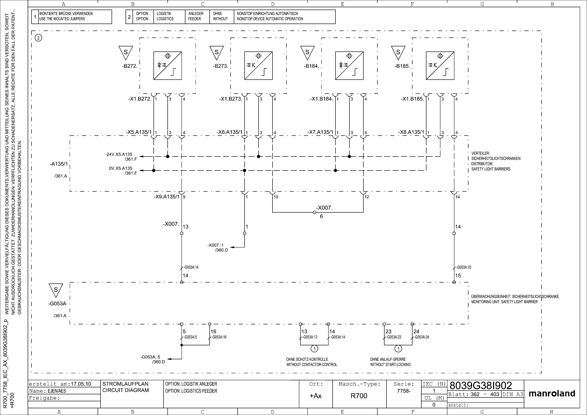

# +Ax — Sheet 362 of 403 — OPTION: LOGISTIK ANLEGER

**OPTION: LOGISTICS FEEDER**

> Part of the manroland **R700** printing press IEC/UL circuit diagrams.
> Drawing class: **Stromlaufplan / Circuit diagram** (DIN A3).
> Document `+Ax` covers the **Central control console** machine section.

## At a glance

| Field | Value |
|---|---|
| Document | `+Ax`  (8039G38I902) |
| Sheet | **362** of 403 |
| Section (DE) | OPTION: LOGISTIK ANLEGER |
| Section (EN) | OPTION: LOGISTICS FEEDER |
| Section type | CIRCUIT — Circuit diagram |
| Machine type | `R700` |
| Series | `7758` |
| Created | 17.05.10 |
| Replaces | — |
| Columns used | A, B, C, D, E, F, G |
| Path numbers | — |
| Labels on sheet | 108 |
| Cross-refs out | 6 |
| Cross-refs in | 35 |

**Previous:** [+Ax sheet 361](SHEET_0361.md) · **Next:** [+Ax sheet 363](SHEET_0363.md) · **Document TOC:** [_TOC.md](_TOC.md)  (+Ax) · **Master TOC:** [all sheets](../_MASTER_TOC.md)

## Sheet image (300 DPI, exact vector render)



_Rendered directly from the PDF vector layer at 300 DPI (1-bit), no OCR and no resampling. Use it to confirm anything ambiguous in the text below._

## Cross-references on this sheet

Each entry is a wire leaving this sheet. The printed token is `/sheet.column`; the link resolves to that sheet inside the same document.

| Ref | Target sheet | Col | Path | Destination on target | Target section | From col |
|---|---|---|---|---|---|---|
| `/361.F` | [+Ax sheet 361](SHEET_0361.md) | F | — | 24V.X5.A135 | OPTION: LOGISTIK ANLEGER | B |
| `/361.F` | [+Ax sheet 361](SHEET_0361.md) | F | — | 0V.X5.A135 | OPTION: LOGISTIK ANLEGER | B |
| `/361.A` | [+Ax sheet 361](SHEET_0361.md) | A | — | — | OPTION: LOGISTIK ANLEGER | A |
| `/360.D` | [+Ax sheet 360](SHEET_0360.md) | D | — | X007.:1 | OPTION: LOGISTIK ANLEGER | C |
| `/361.A` | [+Ax sheet 361](SHEET_0361.md) | A | — | — | OPTION: LOGISTIK ANLEGER | A |
| `/360.D` | [+Ax sheet 360](SHEET_0360.md) | D | — | G053A.:5 | OPTION: LOGISTIK ANLEGER | B |

### Incoming references (sheets that point here)

Every other sheet that sends a wire to this one. `Back-ref` is the token printed on *that* sheet; `Path` is its line number.

| From sheet | Cols | Back-ref | Path | Refs | What continues there |
|---|---|---|---|---|---|
| [+Ax#212](SHEET_0212.md) | G, H | `/212.G`, `/212.H` | — | 6 | — |
| [+Ax#213](SHEET_0213.md) | B, C | `/213.B`, `/213.C` | — | 6 | — |
| [+Ax#230](SHEET_0230.md) | B | `/230.B` | — | 3 | — |
| [+Ax#233](SHEET_0233.md) | B | `/233.B` | — | 3 | — |
| [+Ax#235](SHEET_0235.md) | B | `/235.B` | — | 3 | — |
| [+Ax#237](SHEET_0237.md) | C | `/237.C` | — | 3 | — |
| [+Ax#240](SHEET_0240.md) | C | `/240.C` | — | 5 | — |
| [+Ax#360](SHEET_0360.md) | D | `/360.D` | — | 2 | — |
| [+Ax#361](SHEET_0361.md) | A, F | `/361.A`, `/361.F` | — | 4 | — |


## Devices on this sheet

| Tag | Class | Class meaning (IEC) | Col | Sub | Terminal | Sign |
|---|---|---|---|---|---|---|
| `A135/1` | A | Baugruppe / assembly, module, PC board | A | 1 | — | — |
| `B272.` | — | cross-device reference | B | — | — | — |
| `X1.B272.` | — | cross-device reference | B | — | — | — |
| `B273.` | — | cross-device reference | C | — | — | — |
| `X1.B273.` | — | cross-device reference | C | — | — | — |
| `B184.` | — | cross-device reference | E | — | — | — |
| `X1.B184.` | — | cross-device reference | E | — | — | — |
| `B185.` | — | cross-device reference | F | — | — | — |
| `X1.B185.` | — | cross-device reference | F | — | — | — |
| `X007.` | — | cross-device reference | C | — | — | — |
| `X007.` | — | cross-device reference | E | — | — | — |

## Potentials / nets

| Potential | Count | Columns | Attached devices | Terminals |
|---|---|---|---|---|
| `0V` | 1 | B | `A135`, `X5` | — |
| `24V` | 1 | B | `A135`, `X5` | — |


A potential such as `L24+/4` or `M24+` is a named supply/return rail; every place it appears on this sheet is electrically common.

## Wire-end annotations (grouped as printed)

A wire that continues elsewhere is annotated with a small cluster: the destination description, the path/line number `#NN`, and the `/sheet.column` cross reference. Each row below is one such cluster exactly as it is grouped on the drawing.

| Col | Y | Path | Cross-ref | Text on the wire |
|---|---|---|---|---|
| A | 24.7 | — | — | `1 USE THE MOUNTED JUMPERS MONTIERTE BRÜCKE VERWENDEN` |
| C | 24.7 | — | — | `2 NONSTOP EINRICHTUNG AUTOMATISCH NONSTOP DEVICE AUTOMATIC OPERATION` |
| B | 24.7 | — | — | `OPTION OPTION` |
| B | 24.7 | — | — | `LOGISTIK LOGISTICS` |
| C | 24.7 | — | — | `FEEDER ANLEGER` |
| C | 24.7 | — | — | `OHNE WITHOUT` |
| A | 74.0 | — | — | `2` |
| D | 100.3 | — | — | `S S S S` |
| B | 129.3 | — | — | `B272.` |
| C | 129.3 | — | — | `B273.` |
| E | 129.3 | — | — | `B184.` |
| F | 129.3 | — | — | `B185.` |
| B | 195.9 | — | — | `X1.B272. 1 3 4` |
| D | 195.9 | — | — | `X1.B273. 1 3 4` |
| E | 195.9 | — | — | `X1.B184. 1 3 4` |
| F | 195.9 | — | — | `X1.B185. 1 3 4` |
| B | 263.2 | — | — | `X5.A135/1 1 3 4` |
| D | 263.2 | — | — | `X6.A135/1 1 3 4` |
| E | 263.2 | — | — | `X7.A135/1 1 3 4` |
| F | 263.2 | — | — | `X8.A135/1 1 3 4` |
| G | 308.2 | — | — | `DISTRIBUTOR: SICHERHEITSLICHTSCHRANKEN VERTEILER:` |
| B | 309.2 | — | `/361.F` | `24V.X5.A135` |
| A | 327.7 | — | — | `A135/1` |
| B | 337.6 | — | `/361.F` | `0V.X5.A135` |
| G | 340.1 | — | — | `SAFETY LIGHT BARRIERS` |
| A | 353.2 | — | `/361.A` | — |
| C | 394.3 | — | — | `X9.A135/1 9` |
| D | 395.8 | — | — | `1` |
| D | 395.8 | — | — | `10` |
| E | 395.8 | — | — | `12` |
| G | 395.8 | — | — | `14` |
| E | 416.5 | — | — | `X007.` |
| E | 434.0 | — | — | `6` |
| E | 449.4 | — | — | `X007. 13 14` |
| D | 455.2 | — | — | `1` |
| C | 493.5 | — | `/360.D` | `X007.:1` |
| E | 539.2 | — | — | `G053A:14 G053A:15` |
| E | 554.4 | — | — | `14 15` |
| A | 582.2 | — | — | `S` |
| G | 598.7 | — | — | `ÜBERWACHUNGSEINHEIT: SICHERHEITSLICHTSCHRANKE MONITORING UNIT: SAFETY LIGHT BARRIER` |
| A | 611.2 | — | — | `G053A` |
| A | 636.6 | — | `/361.A` | — |
| D | 667.8 | — | — | `5 16 13 14 23 24` |
| D | 681.0 | — | — | `G053A:5 G053A:16 G053A:13 G053A:14 G053A:23 G053A:24` |
| E | 704.2 | — | — | `1 1` |
| B | 720.3 | — | `/360.D` | `G053A.:5` |
| E | 726.3 | — | — | `OHNE SCHÜTZ KONTROLLE WITHOUT CONTACTOR CONTROL` |
| F | 726.3 | — | — | `OHNE ANLAUF SPERRE WITHOUT START LOCKING` |


## Reconstructed tables

This sheet carries tabular content (pin map / terminal assignment / index). The grid below was rebuilt from the drawing's own rule lines, so each row is exactly one physical row of the table.

### Table 1 — 3 data rows × 16 columns (at x=311.8, y=104.9)

|  |  |  | S B273. |  |  |  | S B184. |  |  |  |  | S B185. |  |  |  |
|---|---|---|---|---|---|---|---|---|---|---|---|---|---|---|---|
| `1 1` | `3 3` | `4 4` | `X1.B273. X6.A135/1` | `1 1` | `3 3` | `4 4` | `X1.B184. X7.A135/1` |  | `1 1` | `3 3` | `4 4` | `X8.A135/1` | `X1.B185.` | `1 1` | `3 3` |
| `X9.A135/1` |  | `9` |  | `1` |  | `10` | `X007.` |  |  |  | `12` |  |  |  |  |
|  | `X007.` | `13 G053A:14 14 5 G053A:5` | `X007.:1 /360.D 16 G053A:16` | `1` |  |  | `6 13 G053A:13` | `14` | `G053A:14` |  |  | `23 G053A:23` | `24 G053A:24` |  |  |


## Notes and free text on this sheet

| Text | Col | Y (pt) |
|---|---|---|
| `VERTEILER:` | G | 308.16 |
| `SICHERHEITSLICHTSCHRANKEN` | G | 318.83 |
| `DISTRIBUTOR:` | G | 329.43 |
| `SAFETY LIGHT BARRIERS` | G | 340.07 |
| `X5.A135/1` | B | 263.23 |
| `X9.A135/1` | B | 394.33 |
| `X6.A135/1` | C | 263.23 |
| `X7.A135/1` | E | 263.23 |
| `X8.A135/1` | F | 263.23 |
| `G053A` | A | 611.17 |
| `ÜBERWACHUNGSEINHEIT: SICHERHEITSLICHTSCHRANKE` | G | 598.73 |
| `MONITORING UNIT: SAFETY LIGHT BARRIER` | G | 609.37 |
| `G053A.:5` | B | 720.28 |
| `X007.:1` | C | 493.51 |
| `S` | B | 100.3 |
| `S` | C | 100.3 |
| `S` | D | 100.3 |
| `S` | F | 100.3 |
| `S` | A | 582.19 |
| `G053A:14` | C | 539.23 |
| `G053A:15` | G | 539.23 |
| `OHNE ANLAUF SPERRE` | F | 726.3 |
| `WITHOUT START LOCKING` | F | 736.92 |
| `OHNE SCHÜTZ KONTROLLE` | D | 726.31 |
| `WITHOUT CONTACTOR CONTROL` | E | 736.94 |
| `G053A:5` | C | 680.95 |
| `G053A:16` | C | 680.96 |
| `G053A:13` | E | 680.96 |
| `G053A:14` | E | 680.96 |
| `G053A:23` | F | 680.96 |
| `G053A:24` | F | 680.96 |
| `MONTIERTE BRÜCKE VERWENDEN` | A | 24.71 |
| `USE THE MOUNTED JUMPERS` | A | 35.36 |
| `OPTION` | B | 24.69 |
| `LOGISTIK` | B | 24.69 |
| `LOGISTICS` | B | 35.32 |
| `ANLEGER` | C | 24.73 |
| `FEEDER` | C | 35.32 |
| `OHNE` | C | 24.71 |
| `WITHOUT` | C | 35.31 |
| `NONSTOP EINRICHTUNG AUTOMATISCH` | D | 24.73 |
| `NONSTOP DEVICE AUTOMATIC OPERATION` | D | 35.35 |

## Complete label inventory (exact text from the drawing)

Every text object inside the drawing area of this sheet, in DIN reading order (column A→H, then top→bottom). This is the authoritative list: if a string is not here it is not printed on this sheet.

| Col | Y | X | Dir | Type | Text |
|---|---|---|---|---|---|
| A | 24.7 | 80.2 | → | text | `MONTIERTE BRÜCKE VERWENDEN` |
| A | 30.0 | 68.3 | → | number | `1` |
| A | 35.4 | 79.9 | → | text | `USE THE MOUNTED JUMPERS` |
| A | 74.0 | 76.0 | → | number | `2` |
| A | 327.7 | 100.9 | → | device tag | `A135/1` |
| A | 353.2 | 110.6 | → | cross-reference | `/361.A` |
| A | 582.2 | 109.3 | → | text | `S` |
| A | 611.2 | 97.8 | → | text | `G053A` |
| A | 636.6 | 109.1 | → | cross-reference | `/361.A` |
| B | 24.7 | 276.1 | → | text | `OPTION` |
| B | 24.7 | 318.0 | → | text | `LOGISTIK` |
| B | 30.0 | 259.4 | → | number | `2` |
| B | 35.3 | 276.1 | → | text | `OPTION` |
| B | 35.3 | 318.0 | → | text | `LOGISTICS` |
| B | 100.3 | 251.0 | → | text | `S` |
| B | 129.3 | 247.7 | → | device ref | `B272.` |
| B | 195.9 | 260.2 | → | device ref | `X1.B272.` |
| B | 197.3 | 313.8 | → | number | `1` |
| B | 263.2 | 255.1 | → | text | `X5.A135/1` |
| B | 265.4 | 313.8 | → | number | `1` |
| B | 309.3 | 213.4 | → | potential | `24V.X5.A135` |
| B | 319.2 | 253.1 | → | cross-reference | `/361.F` |
| B | 337.6 | 221.1 | → | potential | `0V.X5.A135` |
| B | 347.5 | 253.1 | → | cross-reference | `/361.F` |
| B | 394.3 | 311.8 | → | text | `X9.A135/1` |
| B | 720.3 | 284.9 | → | text | `G053A.:5` |
| B | 730.2 | 309.0 | → | cross-reference | `/360.D` |
| C | 24.7 | 382.7 | → | text | `ANLEGER` |
| C | 24.7 | 432.0 | → | text | `OHNE` |
| C | 35.3 | 381.8 | → | text | `FEEDER` |
| C | 35.3 | 432.3 | → | text | `WITHOUT` |
| C | 100.3 | 435.3 | → | text | `S` |
| C | 129.3 | 432.0 | → | device ref | `B273.` |
| C | 195.9 | 444.5 | → | device ref | `X1.B273.` |
| C | 197.3 | 342.7 | → | number | `3` |
| C | 197.3 | 371.1 | → | number | `4` |
| C | 263.2 | 439.4 | → | text | `X6.A135/1` |
| C | 265.4 | 342.7 | → | number | `3` |
| C | 265.4 | 371.1 | → | number | `4` |
| C | 395.8 | 371.1 | → | number | `9` |
| C | 449.4 | 330.5 | → | device ref | `X007.` |
| C | 455.2 | 370.2 | → | number | `13` |
| C | 493.5 | 420.7 | → | text | `X007.:1` |
| C | 503.4 | 436.5 | → | cross-reference | `/360.D` |
| C | 539.2 | 372.5 | → | text | `G053A:14` |
| C | 554.4 | 370.2 | → | number | `14` |
| C | 667.8 | 370.8 | → | number | `5` |
| C | 667.8 | 426.9 | → | number | `16` |
| C | 681.0 | 372.5 | → | text | `G053A:5` |
| C | 681.0 | 429.2 | → | text | `G053A:16` |
| D | 24.7 | 481.0 | → | text | `NONSTOP EINRICHTUNG AUTOMATISCH` |
| D | 35.4 | 481.0 | → | text | `NONSTOP DEVICE AUTOMATIC OPERATION` |
| D | 100.3 | 619.5 | → | text | `S` |
| D | 197.3 | 498.0 | → | number | `1` |
| D | 197.3 | 527.0 | → | number | `3` |
| D | 197.3 | 555.3 | → | number | `4` |
| D | 265.4 | 498.0 | → | number | `1` |
| D | 265.4 | 527.0 | → | number | `3` |
| D | 265.4 | 555.3 | → | number | `4` |
| D | 395.8 | 498.0 | → | number | `1` |
| D | 395.8 | 554.7 | → | number | `10` |
| D | 455.2 | 497.8 | → | number | `1` |
| D | 667.8 | 611.1 | → | number | `13` |
| D | 726.3 | 580.8 | → | text | `OHNE SCHÜTZ KONTROLLE` |
| E | 129.3 | 616.3 | → | device ref | `B184.` |
| E | 195.9 | 628.7 | → | device ref | `X1.B184.` |
| E | 197.3 | 682.3 | → | number | `1` |
| E | 197.3 | 711.2 | → | number | `3` |
| E | 197.3 | 739.6 | → | number | `4` |
| E | 263.2 | 623.6 | → | text | `X7.A135/1` |
| E | 265.4 | 682.3 | → | number | `1` |
| E | 265.4 | 711.2 | → | number | `3` |
| E | 265.4 | 739.6 | → | number | `4` |
| E | 395.8 | 739.0 | → | number | `12` |
| E | 416.5 | 641.3 | → | device ref | `X007.` |
| E | 434.0 | 649.1 | → | number | `6` |
| E | 667.8 | 667.8 | → | number | `14` |
| E | 681.0 | 613.4 | → | text | `G053A:13` |
| E | 681.0 | 670.1 | → | text | `G053A:14` |
| E | 704.2 | 636.0 | → | number | `1` |
| E | 736.9 | 581.1 | → | text | `WITHOUT CONTACTOR CONTROL` |
| F | 100.3 | 803.8 | → | text | `S` |
| F | 129.3 | 800.5 | → | device ref | `B185.` |
| F | 195.9 | 813.0 | → | device ref | `X1.B185.` |
| F | 197.3 | 866.6 | → | number | `1` |
| F | 197.3 | 895.5 | → | number | `3` |
| F | 263.2 | 807.9 | → | text | `X8.A135/1` |
| F | 265.4 | 866.6 | → | number | `1` |
| F | 265.4 | 895.5 | → | number | `3` |
| F | 667.8 | 782.1 | → | number | `23` |
| F | 667.8 | 838.8 | → | number | `24` |
| F | 681.0 | 783.5 | → | text | `G053A:23` |
| F | 681.0 | 840.2 | → | text | `G053A:24` |
| F | 704.2 | 806.1 | → | number | `1` |
| F | 726.3 | 750.9 | → | text | `OHNE ANLAUF SPERRE` |
| F | 736.9 | 751.2 | → | text | `WITHOUT START LOCKING` |
| G | 197.3 | 923.8 | → | number | `4` |
| G | 265.4 | 923.8 | → | number | `4` |
| G | 308.2 | 956.7 | → | text | `VERTEILER:` |
| G | 318.8 | 956.4 | → | text | `SICHERHEITSLICHTSCHRANKEN` |
| G | 329.4 | 955.8 | → | text | `DISTRIBUTOR:` |
| G | 340.1 | 956.4 | → | text | `SAFETY LIGHT BARRIERS` |
| G | 395.8 | 923.2 | → | number | `14` |
| G | 455.2 | 923.0 | → | number | `14` |
| G | 539.2 | 925.2 | → | text | `G053A:15` |
| G | 554.4 | 923.0 | → | number | `15` |
| G | 598.7 | 955.8 | → | text | `ÜBERWACHUNGSEINHEIT: SICHERHEITSLICHTSCHRANKE` |
| G | 609.4 | 956.1 | → | text | `MONITORING UNIT: SAFETY LIGHT BARRIER` |

## Reading-order text block

The same content as a plain block, grouped by DIN column — convenient to paste or to match against a visual description.

```text
=== Column A ===
  24.7   80.2  text         MONTIERTE BRÜCKE VERWENDEN
  30.0   68.3  numeric      1
  35.4   79.9  text         USE THE MOUNTED JUMPERS
  74.0   76.0  numeric      2
 327.7  100.9  devtag       A135/1
 353.2  110.6  xref         /361.A
 582.2  109.3  text         S
 611.2   97.8  text         G053A
 636.6  109.1  xref         /361.A
=== Column B ===
  24.7  276.1  text         OPTION
  24.7  318.0  text         LOGISTIK
  30.0  259.4  numeric      2
  35.3  276.1  text         OPTION
  35.3  318.0  text         LOGISTICS
 100.3  251.0  text         S
 129.3  247.7  devref       B272.
 195.9  260.2  devref       X1.B272.
 197.3  313.8  numeric      1
 263.2  255.1  text         X5.A135/1
 265.4  313.8  numeric      1
 309.3  213.4  net          24V.X5.A135
 319.2  253.1  xref         /361.F
 337.6  221.1  net          0V.X5.A135
 347.5  253.1  xref         /361.F
 394.3  311.8  text         X9.A135/1
 720.3  284.9  text         G053A.:5
 730.2  309.0  xref         /360.D
=== Column C ===
  24.7  382.7  text         ANLEGER
  24.7  432.0  text         OHNE
  35.3  381.8  text         FEEDER
  35.3  432.3  text         WITHOUT
 100.3  435.3  text         S
 129.3  432.0  devref       B273.
 195.9  444.5  devref       X1.B273.
 197.3  342.7  numeric      3
 197.3  371.1  numeric      4
 263.2  439.4  text         X6.A135/1
 265.4  342.7  numeric      3
 265.4  371.1  numeric      4
 395.8  371.1  numeric      9
 449.4  330.5  devref       X007.
 455.2  370.2  numeric      13
 493.5  420.7  text         X007.:1
 503.4  436.5  xref         /360.D
 539.2  372.5  text         G053A:14
 554.4  370.2  numeric      14
 667.8  370.8  numeric      5
 667.8  426.9  numeric      16
 681.0  372.5  text         G053A:5
 681.0  429.2  text         G053A:16
=== Column D ===
  24.7  481.0  text         NONSTOP EINRICHTUNG AUTOMATISCH
  35.4  481.0  text         NONSTOP DEVICE AUTOMATIC OPERATION
 100.3  619.5  text         S
 197.3  498.0  numeric      1
 197.3  527.0  numeric      3
 197.3  555.3  numeric      4
 265.4  498.0  numeric      1
 265.4  527.0  numeric      3
 265.4  555.3  numeric      4
 395.8  498.0  numeric      1
 395.8  554.7  numeric      10
 455.2  497.8  numeric      1
 667.8  611.1  numeric      13
 726.3  580.8  text         OHNE SCHÜTZ KONTROLLE
=== Column E ===
 129.3  616.3  devref       B184.
 195.9  628.7  devref       X1.B184.
 197.3  682.3  numeric      1
 197.3  711.2  numeric      3
 197.3  739.6  numeric      4
 263.2  623.6  text         X7.A135/1
 265.4  682.3  numeric      1
 265.4  711.2  numeric      3
 265.4  739.6  numeric      4
 395.8  739.0  numeric      12
 416.5  641.3  devref       X007.
 434.0  649.1  numeric      6
 667.8  667.8  numeric      14
 681.0  613.4  text         G053A:13
 681.0  670.1  text         G053A:14
 704.2  636.0  numeric      1
 736.9  581.1  text         WITHOUT CONTACTOR CONTROL
=== Column F ===
 100.3  803.8  text         S
 129.3  800.5  devref       B185.
 195.9  813.0  devref       X1.B185.
 197.3  866.6  numeric      1
 197.3  895.5  numeric      3
 263.2  807.9  text         X8.A135/1
 265.4  866.6  numeric      1
 265.4  895.5  numeric      3
 667.8  782.1  numeric      23
 667.8  838.8  numeric      24
 681.0  783.5  text         G053A:23
 681.0  840.2  text         G053A:24
 704.2  806.1  numeric      1
 726.3  750.9  text         OHNE ANLAUF SPERRE
 736.9  751.2  text         WITHOUT START LOCKING
=== Column G ===
 197.3  923.8  numeric      4
 265.4  923.8  numeric      4
 308.2  956.7  text         VERTEILER:
 318.8  956.4  text         SICHERHEITSLICHTSCHRANKEN
 329.4  955.8  text         DISTRIBUTOR:
 340.1  956.4  text         SAFETY LIGHT BARRIERS
 395.8  923.2  numeric      14
 455.2  923.0  numeric      14
 539.2  925.2  text         G053A:15
 554.4  923.0  numeric      15
 598.7  955.8  text         ÜBERWACHUNGSEINHEIT: SICHERHEITSLICHTSCHRANKE
 609.4  956.1  text         MONITORING UNIT: SAFETY LIGHT BARRIER
```

---
_Generated from the PDF vector text layer; no OCR. Source: `R700_7758_IEC_AX_8039G38I902_p`, sheet 362._
