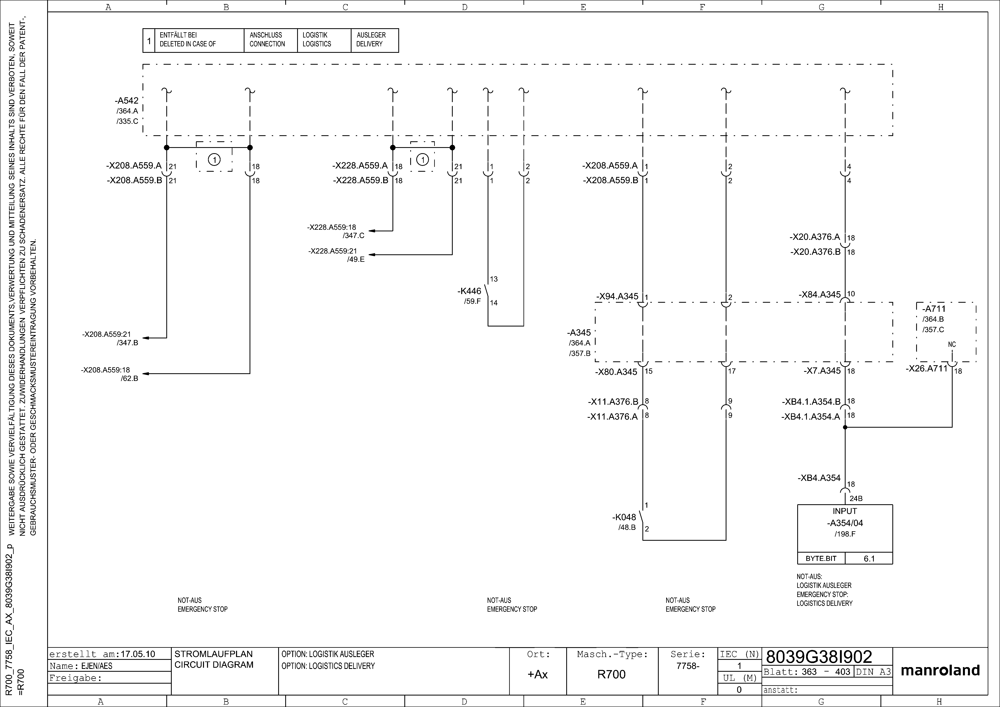

# +Ax — Sheet 363 of 403 — OPTION: LOGISTIK AUSLEGER

**OPTION: LOGISTICS DELIVERY**

> Part of the manroland **R700** printing press IEC/UL circuit diagrams.
> Drawing class: **Stromlaufplan / Circuit diagram** (DIN A3).
> Document `+Ax` covers the **Central control console** machine section.

## At a glance

| Field | Value |
|---|---|
| Document | `+Ax`  (8039G38I902) |
| Sheet | **363** of 403 |
| Section (DE) | OPTION: LOGISTIK AUSLEGER |
| Section (EN) | OPTION: LOGISTICS DELIVERY |
| Section type | CIRCUIT — Circuit diagram |
| Machine type | `R700` |
| Series | `7758` |
| Created | 17.05.10 |
| Replaces | — |
| Columns used | A, B, C, D, E, F, G, H |
| Path numbers | — |
| Labels on sheet | 105 |
| Cross-refs out | 13 |
| Cross-refs in | 47 |

**Previous:** [+Ax sheet 362](SHEET_0362.md) · **Next:** [+Ax sheet 364](SHEET_0364.md) · **Document TOC:** [_TOC.md](_TOC.md)  (+Ax) · **Master TOC:** [all sheets](../_MASTER_TOC.md)

## Sheet image (300 DPI, exact vector render)



_Rendered directly from the PDF vector layer at 300 DPI (1-bit), no OCR and no resampling. Use it to confirm anything ambiguous in the text below._

## Cross-references on this sheet

Each entry is a wire leaving this sheet. The printed token is `/sheet.column`; the link resolves to that sheet inside the same document.

| Ref | Target sheet | Col | Path | Destination on target | Target section | From col |
|---|---|---|---|---|---|---|
| `/364.A` | [+Ax sheet 364](SHEET_0364.md) | A | — | — | OPTION: LOGISTIK AUSLEGER | A |
| `/335.C` | [+Ax sheet 335](SHEET_0335.md) | C | — | — | 1 OPTION: LOGISTIK (ANLEGER AUSLEGER) | A |
| `/347.C` | [+Ax sheet 347](SHEET_0347.md) | C | — | X228.A559:18 | OPTION: LOGISTIK ANLEGER | C |
| `/49.E` | [+Ax sheet 49](SHEET_0049.md) | E | — | X228.A559:21 | NOT AUS | C |
| `/59.F` | [+Ax sheet 59](SHEET_0059.md) | F | — | — | DRUCKLUFTANLAGE | D |
| `/364.B` | [+Ax sheet 364](SHEET_0364.md) | B | — | A711 | OPTION: LOGISTIK AUSLEGER | H |
| `/357.C` | [+Ax sheet 357](SHEET_0357.md) | C | — | A711 | OPTION: LOGISTIK ANLEGER | H |
| `/347.B` | [+Ax sheet 347](SHEET_0347.md) | B | — | X208.A559:21 | OPTION: LOGISTIK ANLEGER | A |
| `/364.A` | [+Ax sheet 364](SHEET_0364.md) | A | — | — | OPTION: LOGISTIK AUSLEGER | E |
| `/357.B` | [+Ax sheet 357](SHEET_0357.md) | B | — | — | OPTION: LOGISTIK ANLEGER | E |
| `/62.B` | [+Ax sheet 62](SHEET_0062.md) | B | — | X208.A559:18 | DRUCKLUFTANLAGE | A |
| `/48.B` | [+Ax sheet 48](SHEET_0048.md) | B | — | — | NOT AUS | E |
| `/198.F` | [+Ax sheet 198](SHEET_0198.md) | F | — | — | REFERENZMODUL | G |

### Incoming references (sheets that point here)

Every other sheet that sends a wire to this one. `Back-ref` is the token printed on *that* sheet; `Path` is its line number.

| From sheet | Cols | Back-ref | Path | Refs | What continues there |
|---|---|---|---|---|---|
| [+Ax#48](SHEET_0048.md) | B | `/48.B` | — | 1 | — |
| [+Ax#49](SHEET_0049.md) | E | `/49.E` | — | 1 | X228.A559:21 |
| [+Ax#59](SHEET_0059.md) | F | `/59.F` | — | 1 | — |
| [+Ax#62](SHEET_0062.md) | B | `/62.B` | — | 1 | — |
| [+Ax#198](SHEET_0198.md) | F | `/198.F` | — | 1 | — |
| [+Ax#228](SHEET_0228.md) | A, B, C | `/228.A`, `/228.B`, `/228.C` | — | 3 | — |
| [+Ax#235](SHEET_0235.md) | H | `/235.H` | — | 1 | — |
| [+Ax#247](SHEET_0247.md) | C, E | `/247.C`, `/247.E` | — | 4 | — |
| [+Ax#260](SHEET_0260.md) | E, F | `/260.E`, `/260.F` | — | 2 | — |
| [+Ax#269](SHEET_0269.md) | H | `/269.H` | — | 1 | — |
| [+Ax#286](SHEET_0286.md) | C | `/286.C` | — | 2 | — |
| [+Ax#287](SHEET_0287.md) | B | `/287.B` | — | 1 | — |
| [+Ax#289](SHEET_0289.md) | H | `/289.H` | — | 2 | — |
| [+Ax#292](SHEET_0292.md) | G, H | `/292.G`, `/292.H` | — | 10 | — |
| [+Ax#294](SHEET_0294.md) | E, F | `/294.E`, `/294.F` | — | 8 | — |
| [+Ax#335](SHEET_0335.md) | C | `/335.C` | — | 1 | — |
| [+Ax#347](SHEET_0347.md) | B, C | `/347.B`, `/347.C` | — | 2 | — |
| [+Ax#357](SHEET_0357.md) | B, C | `/357.B`, `/357.C` | — | 2 | — |
| [+Ax#364](SHEET_0364.md) | A, B | `/364.A`, `/364.B` | — | 3 | — |


## Devices on this sheet

| Tag | Class | Class meaning (IEC) | Col | Sub | Terminal | Sign |
|---|---|---|---|---|---|---|
| `A542` | A | Baugruppe / assembly, module, PC board | A | — | — | — |
| `K446` | K | Relais / relay, contactor | D | — | — | — |
| `K048` | K | Relais / relay, contactor | E | — | — | — |
| `A354/04` | A | Baugruppe / assembly, module, PC board | G | 04 | — | — |
| `A711` | A | Baugruppe / assembly, module, PC board | H | — | — | — |
| `A345` | A | Baugruppe / assembly, module, PC board | E | — | — | — |
| `X208.A559.A` | — | cross-device reference | A | — | — | — |
| `X208.A559.B` | — | cross-device reference | A | — | — | — |
| `X228.A559.A` | — | cross-device reference | C | — | — | — |
| `X228.A559.B` | — | cross-device reference | C | — | — | — |
| `X80.A345` | — | cross-device reference | E | — | — | — |
| `X11.A376.B` | — | cross-device reference | E | — | — | — |
| `X11.A376.A` | — | cross-device reference | E | — | — | — |
| `X7.A345` | — | cross-device reference | G | — | — | — |
| `6.1` | — | cross-device reference | G | — | — | — |
| `XB4.A354` | — | cross-device reference | G | — | — | — |
| `X20.A376.B` | — | cross-device reference | G | — | — | — |
| `X20.A376.A` | — | cross-device reference | G | — | — | — |
| `X26.A711` | — | cross-device reference | H | — | — | — |
| `XB4.1.A354.B` | — | cross-device reference | G | — | — | — |
| `XB4.1.A354.A` | — | cross-device reference | G | — | — | — |
| `X94.A345` | — | cross-device reference | E | — | — | — |
| `X84.A345` | — | cross-device reference | G | — | — | — |
| `X208.A559.A` | — | cross-device reference | E | — | — | — |
| `X208.A559.B` | — | cross-device reference | E | — | — | — |
| `X208.A559:21` | — | cross-device reference | A | — | 21 | — |
| `X208.A559:18` | — | cross-device reference | A | — | 18 | — |
| `X228.A559:21` | — | cross-device reference | C | — | 21 | — |
| `X228.A559:18` | — | cross-device reference | C | — | 18 | — |

## Potentials / nets

_No named potentials on this sheet._

## Wire-end annotations (grouped as printed)

A wire that continues elsewhere is annotated with a small cluster: the destination description, the path/line number `#NN`, and the `/sheet.column` cross reference. Each row below is one such cluster exactly as it is grouped on the drawing.

| Col | Y | Path | Cross-ref | Text on the wire |
|---|---|---|---|---|
| B | 38.9 | — | — | `1 ENTFÄLLT BEI DELETED IN CASE OF` |
| B | 38.9 | — | — | `CONNECTION ANSCHLUSS` |
| C | 38.9 | — | — | `LOGISTIK LOGISTICS` |
| C | 38.9 | — | — | `DELIVERY AUSLEGER` |
| A | 115.1 | — | — | `A542` |
| A | 128.2 | — | `/364.A`, `/335.C` | — |
| C | 186.9 | — | — | `1 1` |
| A | 192.4 | — | — | `X208.A559.A 21` |
| C | 192.4 | — | — | `X228.A559.A 18` |
| E | 192.4 | — | — | `X208.A559.A 1` |
| B | 194.5 | — | — | `18` |
| D | 194.5 | — | — | `21` |
| D | 194.5 | — | — | `1` |
| E | 194.5 | — | — | `2` |
| F | 194.5 | — | — | `2` |
| G | 194.5 | — | — | `4` |
| A | 210.1 | — | — | `X208.A559.B 21` |
| C | 210.1 | — | — | `X228.A559.B 18` |
| E | 210.1 | — | — | `X208.A559.B 1` |
| B | 211.5 | — | — | `18` |
| D | 211.5 | — | — | `21` |
| D | 211.5 | — | — | `1` |
| E | 211.5 | — | — | `2` |
| F | 211.5 | — | — | `2` |
| G | 211.5 | — | — | `4` |
| C | 266.8 | — | `/347.C` | `X228.A559:18` |
| G | 277.4 | — | — | `X20.A376.A 18` |
| C | 295.1 | — | `/49.E` | `X228.A559:21` |
| G | 295.1 | — | — | `X20.A376.B 18` |
| D | 328.4 | — | — | `13` |
| D | 341.9 | — | — | `K446 14` |
| G | 346.1 | — | — | `2 X84.A345 10` |
| E | 348.3 | — | — | `X94.A345 1` |
| D | 354.9 | — | `/59.F` | — |
| H | 363.1 | — | `/364.B`, `/357.C` | `A711` |
| E | 391.5 | — | — | `A345` |
| A | 394.3 | — | `/347.B` | `X208.A559:21` |
| E | 404.6 | — | `/364.A`, `/357.B` | — |
| H | 407.4 | — | — | `NC` |
| H | 434.0 | — | — | `X26.A711 18` |
| A | 436.8 | — | `/62.B` | `X208.A559:18` |
| G | 436.8 | — | — | `X7.A345 18` |
| F | 438.3 | — | — | `X80.A345 15 17` |
| E | 473.7 | — | — | `X11.A376.B 8` |
| F | 473.7 | — | — | `9` |
| G | 473.7 | — | — | `XB4.1.A354.B 18` |
| E | 490.7 | — | — | `X11.A376.A 8` |
| F | 490.7 | — | — | `9` |
| G | 490.7 | — | — | `XB4.1.A354.A 18` |
| G | 564.4 | — | — | `XB4.A354 18` |
| G | 589.9 | — | — | `24B` |
| F | 597.7 | — | — | `1` |
| G | 604.4 | — | — | `INPUT` |
| E | 611.2 | — | — | `K048 2` |
| G | 618.3 | — | — | `A354/04` |
| E | 624.2 | — | `/48.B` | — |
| G | 632.0 | — | `/198.F` | — |
| G | 661.1 | — | — | `BYTE.BIT 6.1` |
| G | 683.8 | — | — | `NOT AUS: LOGISTIK AUSLEGER EMERGENCY STOP: LOGISTICS DELIVERY` |
| B | 712.1 | — | — | `NOT AUS EMERGENCY STOP` |
| D | 712.1 | — | — | `NOT AUS EMERGENCY STOP` |
| F | 712.1 | — | — | `NOT AUS EMERGENCY STOP` |


## Reconstructed tables

This sheet carries tabular content (pin map / terminal assignment / index). The grid below was rebuilt from the drawing's own rule lines, so each row is exactly one physical row of the table.

### Table 1 — 1 data rows × 3 columns (at x=467.7, y=175.7)

| 1 18 18 | 21 21 | 1 1 |
|---|---|---|
|  | `K446 /59.F` | `13 14` |


### Table 2 — 2 data rows × 2 columns (at x=949.6, y=508.8)

| XB4.A354 | 18 24B |
|---|---|
| `INPUT` | `A354/04 /198.F` |
| `BYTE.BIT` | `6.1` |


## Notes and free text on this sheet

| Text | Col | Y (pt) |
|---|---|---|
| `24B` | G | 589.89 |
| `INPUT` | G | 604.42 |
| `BYTE.BIT` | G | 661.67 |
| `NOT AUS:` | G | 683.75 |
| `LOGISTIK AUSLEGER` | G | 694.39 |
| `EMERGENCY STOP:` | G | 705.03 |
| `LOGISTICS DELIVERY` | G | 715.66 |
| `ENTFÄLLT BEI` | B | 38.86 |
| `DELETED IN CASE OF` | B | 49.51 |
| `ANSCHLUSS` | B | 38.9 |
| `CONNECTION` | B | 49.54 |
| `LOGISTIK` | C | 38.86 |
| `LOGISTICS` | C | 49.5 |
| `AUSLEGER` | C | 38.9 |
| `DELIVERY` | C | 49.51 |
| `NOT AUS` | B | 712.11 |
| `EMERGENCY STOP` | B | 722.75 |
| `NOT AUS` | F | 712.11 |
| `EMERGENCY STOP` | F | 722.75 |
| `NC` | H | 407.36 |
| `NOT AUS` | D | 712.11 |
| `EMERGENCY STOP` | D | 722.75 |

## Complete label inventory (exact text from the drawing)

Every text object inside the drawing area of this sheet, in DIN reading order (column A→H, then top→bottom). This is the authoritative list: if a string is not here it is not printed on this sheet.

| Col | Y | X | Dir | Type | Text |
|---|---|---|---|---|---|
| A | 44.2 | 174.6 | → | number | `1` |
| A | 115.1 | 136.6 | → | device tag | `A542` |
| A | 128.2 | 138.9 | → | cross-reference | `/364.A` |
| A | 140.6 | 138.9 | → | cross-reference | `/335.C` |
| A | 192.4 | 126.4 | → | device ref | `X208.A559.A` |
| A | 210.1 | 127.3 | → | device ref | `X208.A559.B` |
| A | 394.3 | 97.8 | → | device ref | `X208.A559:21` |
| A | 404.2 | 139.2 | → | cross-reference | `/347.B` |
| A | 436.8 | 96.4 | → | device ref | `X208.A559:18` |
| A | 446.7 | 144.0 | → | cross-reference | `/62.B` |
| B | 38.9 | 190.5 | → | text | `ENTFÄLLT BEI` |
| B | 38.9 | 297.6 | → | text | `ANSCHLUSS` |
| B | 49.5 | 190.5 | → | text | `DELETED IN CASE OF` |
| B | 49.5 | 297.4 | → | text | `CONNECTION` |
| B | 186.9 | 253.4 | → | number | `1` |
| B | 194.5 | 201.0 | → | number | `21` |
| B | 194.5 | 299.6 | → | number | `18` |
| B | 211.5 | 201.0 | → | number | `21` |
| B | 211.5 | 299.6 | → | number | `18` |
| B | 712.1 | 211.7 | → | text | `NOT AUS` |
| B | 722.8 | 211.7 | → | text | `EMERGENCY STOP` |
| C | 38.9 | 360.6 | → | text | `LOGISTIK` |
| C | 38.9 | 425.2 | → | text | `AUSLEGER` |
| C | 49.5 | 360.6 | → | text | `LOGISTICS` |
| C | 49.5 | 424.3 | → | text | `DELIVERY` |
| C | 192.4 | 395.7 | → | device ref | `X228.A559.A` |
| C | 194.5 | 469.7 | → | number | `18` |
| C | 210.1 | 396.6 | → | device ref | `X228.A559.B` |
| C | 211.5 | 469.7 | → | number | `18` |
| C | 266.7 | 365.7 | → | device ref | `X228.A559:18` |
| C | 276.7 | 408.2 | → | cross-reference | `/347.C` |
| C | 295.1 | 367.1 | → | device ref | `X228.A559:21` |
| C | 305.0 | 413.6 | → | cross-reference | `/49.E` |
| D | 186.9 | 501.4 | → | number | `1` |
| D | 194.5 | 541.1 | → | number | `21` |
| D | 194.5 | 583.1 | → | number | `1` |
| D | 211.5 | 541.1 | → | number | `21` |
| D | 211.5 | 583.1 | → | number | `1` |
| D | 328.4 | 583.1 | → | number | `13` |
| D | 341.9 | 544.8 | → | device tag | `K446` |
| D | 354.9 | 552.8 | → | cross-reference | `/59.F` |
| D | 356.8 | 583.1 | → | number | `14` |
| D | 712.1 | 580.3 | → | text | `NOT AUS` |
| D | 722.8 | 580.3 | → | text | `EMERGENCY STOP` |
| E | 192.4 | 693.4 | → | device ref | `X208.A559.A` |
| E | 194.5 | 626.2 | → | number | `2` |
| E | 210.1 | 694.2 | → | device ref | `X208.A559.B` |
| E | 211.5 | 626.2 | → | number | `2` |
| E | 348.3 | 710.1 | → | device ref | `X94.A345` |
| E | 391.5 | 675.2 | → | device tag | `A345` |
| E | 404.6 | 677.5 | → | cross-reference | `/364.A` |
| E | 417.0 | 677.8 | → | cross-reference | `/357.B` |
| E | 438.3 | 708.7 | → | device ref | `X80.A345` |
| E | 473.7 | 700.2 | → | device ref | `X11.A376.B` |
| E | 491.4 | 699.3 | → | device ref | `X11.A376.A` |
| E | 611.2 | 729.1 | → | device tag | `K048` |
| E | 624.2 | 736.4 | → | cross-reference | `/48.B` |
| F | 194.5 | 767.3 | → | number | `1` |
| F | 194.5 | 867.1 | → | number | `2` |
| F | 211.5 | 767.3 | → | number | `1` |
| F | 211.5 | 867.1 | → | number | `2` |
| F | 350.4 | 767.3 | → | number | `1` |
| F | 350.4 | 867.1 | → | number | `2` |
| F | 438.3 | 767.3 | → | number | `15` |
| F | 438.3 | 866.6 | → | number | `17` |
| F | 473.7 | 767.9 | → | number | `8` |
| F | 473.7 | 867.1 | → | number | `9` |
| F | 490.7 | 767.9 | → | number | `8` |
| F | 490.7 | 867.1 | → | number | `9` |
| F | 597.7 | 767.3 | → | number | `1` |
| F | 626.1 | 767.9 | → | number | `2` |
| F | 712.1 | 792.9 | → | text | `NOT AUS` |
| F | 722.8 | 792.9 | → | text | `EMERGENCY STOP` |
| G | 194.5 | 1008.9 | → | number | `4` |
| G | 211.5 | 1008.9 | → | number | `4` |
| G | 277.4 | 940.3 | → | device ref | `X20.A376.A` |
| G | 279.5 | 1008.3 | → | number | `18` |
| G | 295.1 | 941.1 | → | device ref | `X20.A376.B` |
| G | 296.5 | 1008.3 | → | number | `18` |
| G | 346.1 | 951.0 | → | device ref | `X84.A345` |
| G | 346.2 | 1008.3 | → | number | `10` |
| G | 436.8 | 957.0 | → | device ref | `X7.A345` |
| G | 438.3 | 1008.3 | → | number | `18` |
| G | 473.7 | 931.2 | → | device ref | `XB4.1.A354.B` |
| G | 473.7 | 1008.3 | → | number | `18` |
| G | 490.7 | 1008.3 | → | number | `18` |
| G | 491.4 | 930.3 | → | device ref | `XB4.1.A354.A` |
| G | 564.4 | 949.9 | → | device ref | `XB4.A354` |
| G | 572.9 | 1008.3 | → | number | `18` |
| G | 589.9 | 1011.7 | → | text | `24B` |
| G | 604.4 | 991.4 | → | text | `INPUT` |
| G | 618.3 | 984.9 | → | device tag | `A354/04` |
| G | 632.0 | 994.0 | → | cross-reference | `/198.F` |
| G | 661.1 | 1028.7 | → | device ref | `6.1` |
| G | 661.7 | 959.5 | → | text | `BYTE.BIT` |
| G | 683.7 | 948.8 | → | text | `NOT AUS:` |
| G | 694.4 | 948.8 | → | text | `LOGISTIK AUSLEGER` |
| G | 705.0 | 948.8 | → | text | `EMERGENCY STOP:` |
| G | 715.7 | 948.8 | → | text | `LOGISTICS DELIVERY` |
| H | 363.1 | 1098.1 | → | device tag | `A711` |
| H | 376.2 | 1098.4 | → | cross-reference | `/364.B` |
| H | 388.6 | 1098.4 | → | cross-reference | `/357.C` |
| H | 407.4 | 1129.0 | → | text | `NC` |
| H | 434.0 | 1078.6 | → | device ref | `X26.A711` |
| H | 438.3 | 1135.8 | → | number | `18` |

## Reading-order text block

The same content as a plain block, grouped by DIN column — convenient to paste or to match against a visual description.

```text
=== Column A ===
  44.2  174.6  numeric      1
 115.1  136.6  devtag       A542
 128.2  138.9  xref         /364.A
 140.6  138.9  xref         /335.C
 192.4  126.4  devref       X208.A559.A
 210.1  127.3  devref       X208.A559.B
 394.3   97.8  devref       X208.A559:21
 404.2  139.2  xref         /347.B
 436.8   96.4  devref       X208.A559:18
 446.7  144.0  xref         /62.B
=== Column B ===
  38.9  190.5  text         ENTFÄLLT BEI
  38.9  297.6  text         ANSCHLUSS
  49.5  190.5  text         DELETED IN CASE OF
  49.5  297.4  text         CONNECTION
 186.9  253.4  numeric      1
 194.5  201.0  numeric      21
 194.5  299.6  numeric      18
 211.5  201.0  numeric      21
 211.5  299.6  numeric      18
 712.1  211.7  text         NOT AUS
 722.8  211.7  text         EMERGENCY STOP
=== Column C ===
  38.9  360.6  text         LOGISTIK
  38.9  425.2  text         AUSLEGER
  49.5  360.6  text         LOGISTICS
  49.5  424.3  text         DELIVERY
 192.4  395.7  devref       X228.A559.A
 194.5  469.7  numeric      18
 210.1  396.6  devref       X228.A559.B
 211.5  469.7  numeric      18
 266.7  365.7  devref       X228.A559:18
 276.7  408.2  xref         /347.C
 295.1  367.1  devref       X228.A559:21
 305.0  413.6  xref         /49.E
=== Column D ===
 186.9  501.4  numeric      1
 194.5  541.1  numeric      21
 194.5  583.1  numeric      1
 211.5  541.1  numeric      21
 211.5  583.1  numeric      1
 328.4  583.1  numeric      13
 341.9  544.8  devtag       K446
 354.9  552.8  xref         /59.F
 356.8  583.1  numeric      14
 712.1  580.3  text         NOT AUS
 722.8  580.3  text         EMERGENCY STOP
=== Column E ===
 192.4  693.4  devref       X208.A559.A
 194.5  626.2  numeric      2
 210.1  694.2  devref       X208.A559.B
 211.5  626.2  numeric      2
 348.3  710.1  devref       X94.A345
 391.5  675.2  devtag       A345
 404.6  677.5  xref         /364.A
 417.0  677.8  xref         /357.B
 438.3  708.7  devref       X80.A345
 473.7  700.2  devref       X11.A376.B
 491.4  699.3  devref       X11.A376.A
 611.2  729.1  devtag       K048
 624.2  736.4  xref         /48.B
=== Column F ===
 194.5  767.3  numeric      1
 194.5  867.1  numeric      2
 211.5  767.3  numeric      1
 211.5  867.1  numeric      2
 350.4  767.3  numeric      1
 350.4  867.1  numeric      2
 438.3  767.3  numeric      15
 438.3  866.6  numeric      17
 473.7  767.9  numeric      8
 473.7  867.1  numeric      9
 490.7  767.9  numeric      8
 490.7  867.1  numeric      9
 597.7  767.3  numeric      1
 626.1  767.9  numeric      2
 712.1  792.9  text         NOT AUS
 722.8  792.9  text         EMERGENCY STOP
=== Column G ===
 194.5 1008.9  numeric      4
 211.5 1008.9  numeric      4
 277.4  940.3  devref       X20.A376.A
 279.5 1008.3  numeric      18
 295.1  941.1  devref       X20.A376.B
 296.5 1008.3  numeric      18
 346.1  951.0  devref       X84.A345
 346.2 1008.3  numeric      10
 436.8  957.0  devref       X7.A345
 438.3 1008.3  numeric      18
 473.7  931.2  devref       XB4.1.A354.B
 473.7 1008.3  numeric      18
 490.7 1008.3  numeric      18
 491.4  930.3  devref       XB4.1.A354.A
 564.4  949.9  devref       XB4.A354
 572.9 1008.3  numeric      18
 589.9 1011.7  text         24B
 604.4  991.4  text         INPUT
 618.3  984.9  devtag       A354/04
 632.0  994.0  xref         /198.F
 661.1 1028.7  devref       6.1
 661.7  959.5  text         BYTE.BIT
 683.7  948.8  text         NOT AUS:
 694.4  948.8  text         LOGISTIK AUSLEGER
 705.0  948.8  text         EMERGENCY STOP:
 715.7  948.8  text         LOGISTICS DELIVERY
=== Column H ===
 363.1 1098.1  devtag       A711
 376.2 1098.4  xref         /364.B
 388.6 1098.4  xref         /357.C
 407.4 1129.0  text         NC
 434.0 1078.6  devref       X26.A711
 438.3 1135.8  numeric      18
```

---
_Generated from the PDF vector text layer; no OCR. Source: `R700_7758_IEC_AX_8039G38I902_p`, sheet 363._
