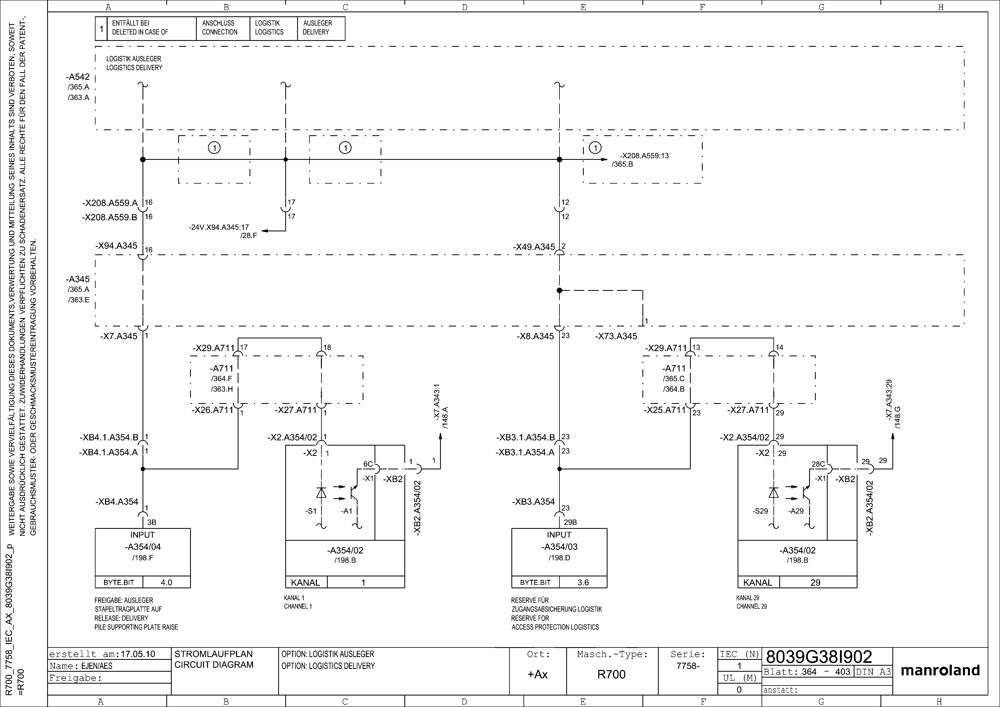

# +Ax — Sheet 364 of 403 — OPTION: LOGISTIK AUSLEGER

**OPTION: LOGISTICS DELIVERY**

> Part of the manroland **R700** printing press IEC/UL circuit diagrams.
> Drawing class: **Stromlaufplan / Circuit diagram** (DIN A3).
> Document `+Ax` covers the **Central control console** machine section.

## At a glance

| Field | Value |
|---|---|
| Document | `+Ax`  (8039G38I902) |
| Sheet | **364** of 403 |
| Section (DE) | OPTION: LOGISTIK AUSLEGER |
| Section (EN) | OPTION: LOGISTICS DELIVERY |
| Section type | CIRCUIT — Circuit diagram |
| Machine type | `R700` |
| Series | `7758` |
| Created | 17.05.10 |
| Replaces | — |
| Columns used | A, B, C, D, E, F, G, H |
| Path numbers | — |
| Labels on sheet | 134 |
| Cross-refs out | 16 |
| Cross-refs in | 45 |

**Previous:** [+Ax sheet 363](SHEET_0363.md) · **Next:** [+Ax sheet 365](SHEET_0365.md) · **Document TOC:** [_TOC.md](_TOC.md)  (+Ax) · **Master TOC:** [all sheets](../_MASTER_TOC.md)

## Sheet image (300 DPI, exact vector render)



_Rendered directly from the PDF vector layer at 300 DPI (1-bit), no OCR and no resampling. Use it to confirm anything ambiguous in the text below._

## Cross-references on this sheet

Each entry is a wire leaving this sheet. The printed token is `/sheet.column`; the link resolves to that sheet inside the same document.

| Ref | Target sheet | Col | Path | Destination on target | Target section | From col |
|---|---|---|---|---|---|---|
| `/365.A` | [+Ax sheet 365](SHEET_0365.md) | A | — | — | OPTION: LOGISTIK AUSLEGER | A |
| `/363.A` | [+Ax sheet 363](SHEET_0363.md) | A | — | — | OPTION: LOGISTIK AUSLEGER | A |
| `/365.B` | [+Ax sheet 365](SHEET_0365.md) | B | — | — | OPTION: LOGISTIK AUSLEGER | E |
| `/28.F` | [+Ax sheet 28](SHEET_0028.md) | F | — | 24V.X94.A345:17 | SPANNUNGSVERSORGUNG, SCHALTSCHRANKBELÜFTUNG | B |
| `/365.A` | [+Ax sheet 365](SHEET_0365.md) | A | — | — | OPTION: LOGISTIK AUSLEGER | A |
| `/363.E` | [+Ax sheet 363](SHEET_0363.md) | E | — | — | OPTION: LOGISTIK AUSLEGER | A |
| `/364.F` | [+Ax sheet 364](SHEET_0364.md) | F | — | — | OPTION: LOGISTIK AUSLEGER | B |
| `/363.H` | [+Ax sheet 363](SHEET_0363.md) | H | — | — | OPTION: LOGISTIK AUSLEGER | B |
| `/365.C` | [+Ax sheet 365](SHEET_0365.md) | C | — | — | OPTION: LOGISTIK AUSLEGER | F |
| `/364.B` | [+Ax sheet 364](SHEET_0364.md) | B | — | — | OPTION: LOGISTIK AUSLEGER | F |
| `/148.G` | [+Ax sheet 148](SHEET_0148.md) | G | — | X7.A343:29 | ÜBERWACHUNGSRECHNER SICHERHEITSBUS | H |
| `/148.A` | [+Ax sheet 148](SHEET_0148.md) | A | — | X7.A343:1 | ÜBERWACHUNGSRECHNER SICHERHEITSBUS | D |
| `/198.F` | [+Ax sheet 198](SHEET_0198.md) | F | — | — | REFERENZMODUL | A |
| `/198.D` | [+Ax sheet 198](SHEET_0198.md) | D | — | — | REFERENZMODUL | E |
| `/198.B` | [+Ax sheet 198](SHEET_0198.md) | B | — | — | REFERENZMODUL | C |
| `/198.B` | [+Ax sheet 198](SHEET_0198.md) | B | — | — | REFERENZMODUL | G |

### Incoming references (sheets that point here)

Every other sheet that sends a wire to this one. `Back-ref` is the token printed on *that* sheet; `Path` is its line number.

| From sheet | Cols | Back-ref | Path | Refs | What continues there |
|---|---|---|---|---|---|
| [+Ax#28](SHEET_0028.md) | F | `/28.F` | — | 1 | — |
| [+Ax#148](SHEET_0148.md) | A, G | `/148.A`, `/148.G` | — | 2 | X7.A343:1; X7.A343:29 |
| [+Ax#198](SHEET_0198.md) | B, D, F | `/198.B`, `/198.D`, `/198.F` | — | 4 | — |
| [+Ax#219](SHEET_0219.md) | C, D, E, F | `/219.C`, `/219.D`, `/219.E`, `/219.F` | — | 4 | — |
| [+Ax#224](SHEET_0224.md) | A, B, C | `/224.A`, `/224.B`, `/224.C` | — | 3 | — |
| [+Ax#228](SHEET_0228.md) | A, B, C | `/228.A`, `/228.B`, `/228.C` | — | 3 | — |
| [+Ax#235](SHEET_0235.md) | H | `/235.H` | — | 1 | — |
| [+Ax#238](SHEET_0238.md) | A | `/238.A` | — | 1 | — |
| [+Ax#268](SHEET_0268.md) | C | `/268.C` | — | 1 | — |
| [+Ax#269](SHEET_0269.md) | H | `/269.H` | — | 1 | — |
| [+Ax#271](SHEET_0271.md) | A, B | `/271.A`, `/271.B` | — | 2 | — |
| [+Ax#274](SHEET_0274.md) | A | `/274.A` | — | 4 | — |
| [+Ax#283](SHEET_0283.md) | E | `/283.E` | — | 1 | — |
| [+Ax#285](SHEET_0285.md) | C | `/285.C` | — | 1 | — |
| [+Ax#289](SHEET_0289.md) | H | `/289.H` | — | 1 | — |
| [+Ax#292](SHEET_0292.md) | G, H | `/292.G`, `/292.H` | — | 6 | — |
| [+Ax#363](SHEET_0363.md) | A, E, H | `/363.A`, `/363.E`, `/363.H` | — | 3 | A711 |
| [+Ax#364](SHEET_0364.md) | B, F | `/364.B`, `/364.F` | — | 2 | — |
| [+Ax#365](SHEET_0365.md) | A, B, C | `/365.A`, `/365.B`, `/365.C` | — | 4 | X208.A559:13 |


## Devices on this sheet

| Tag | Class | Class meaning (IEC) | Col | Sub | Terminal | Sign |
|---|---|---|---|---|---|---|
| `A354/04` | A | Baugruppe / assembly, module, PC board | A | 04 | — | — |
| `A542` | A | Baugruppe / assembly, module, PC board | A | — | — | — |
| `A345` | A | Baugruppe / assembly, module, PC board | A | — | — | — |
| `S1` | S | Schalter / switch | C | — | — | — |
| `A1` | A | Baugruppe / assembly, module, PC board | C | — | — | — |
| `X1` | X | Klemme / terminal, plug connector | C | — | — | — |
| `X2` | X | Klemme / terminal, plug connector | C | — | — | — |
| `XB2` | XB |  | C | — | — | — |
| `A354/02` | A | Baugruppe / assembly, module, PC board | C | 02 | — | — |
| `A711` | A | Baugruppe / assembly, module, PC board | B | — | — | — |
| `A354/03` | A | Baugruppe / assembly, module, PC board | E | 03 | — | — |
| `S29` | S | Schalter / switch | F | — | — | — |
| `A29` | A | Baugruppe / assembly, module, PC board | G | — | — | — |
| `X1` | X | Klemme / terminal, plug connector | G | — | — | — |
| `X2` | X | Klemme / terminal, plug connector | G | — | — | — |
| `XB2` | XB |  | G | — | — | — |
| `A354/02` | A | Baugruppe / assembly, module, PC board | G | 02 | — | — |
| `A711` | A | Baugruppe / assembly, module, PC board | F | — | — | — |
| `4.0` | — | cross-device reference | A | — | — | — |
| `XB4.A354` | — | cross-device reference | A | — | — | — |
| `X7.A345` | — | cross-device reference | A | — | — | — |
| `X94.A345` | — | cross-device reference | A | — | — | — |
| `X208.A559.B` | — | cross-device reference | A | — | — | — |
| `X208.A559.A` | — | cross-device reference | A | — | — | — |
| `X29.A711` | — | cross-device reference | B | — | — | — |
| `X27.A711` | — | cross-device reference | C | — | — | — |
| `X26.A711` | — | cross-device reference | B | — | — | — |
| `XB4.1.A354.B` | — | cross-device reference | A | — | — | — |
| `XB4.1.A354.A` | — | cross-device reference | A | — | — | — |
| `3.6` | — | cross-device reference | E | — | — | — |
| `XB3.A354` | — | cross-device reference | E | — | — | — |
| `X8.A345` | — | cross-device reference | E | — | — | — |
| `X49.A345` | — | cross-device reference | E | — | — | — |
| `XB3.1.A354.B` | — | cross-device reference | E | — | — | — |
| `XB3.1.A354.A` | — | cross-device reference | E | — | — | — |
| `X29.A711` | — | cross-device reference | F | — | — | — |
| `X27.A711` | — | cross-device reference | F | — | — | — |
| `X25.A711` | — | cross-device reference | F | — | — | — |
| `X7.A343:1` | — | cross-device reference | D | — | 1 | — |
| `X7.A343:29` | — | cross-device reference | H | — | 29 | — |
| `X208.A559:13` | — | cross-device reference | F | — | 13 | — |
| `X73.A345` | — | cross-device reference | E | — | — | — |

## Potentials / nets

| Potential | Count | Columns | Attached devices | Terminals |
|---|---|---|---|---|
| `24V` | 1 | B | `A345`, `X94` | `17` |


A potential such as `L24+/4` or `M24+` is a named supply/return rail; every place it appears on this sheet is electrically common.

## Wire-end annotations (grouped as printed)

A wire that continues elsewhere is annotated with a small cluster: the destination description, the path/line number `#NN`, and the `/sheet.column` cross reference. Each row below is one such cluster exactly as it is grouped on the drawing.

| Col | Y | Path | Cross-ref | Text on the wire |
|---|---|---|---|---|
| A | 24.7 | — | — | `1 ENTFÄLLT BEI DELETED IN CASE OF` |
| B | 24.7 | — | — | `CONNECTION ANSCHLUSS` |
| B | 24.7 | — | — | `LOGISTIK LOGISTICS` |
| C | 24.7 | — | — | `DELIVERY AUSLEGER` |
| A | 67.2 | — | — | `LOGISTIK AUSLEGER LOGISTICS DELIVERY` |
| A | 86.8 | — | — | `A542` |
| A | 99.8 | — | `/365.A`, `/363.A` | — |
| B | 172.7 | — | — | `1 1` |
| E | 172.7 | — | — | `1` |
| F | 181.7 | — | — | `X208.A559:13` |
| E | 191.6 | — | `/365.B` | — |
| A | 237.0 | — | — | `X208.A559.A 16` |
| C | 237.0 | — | — | `17` |
| E | 237.0 | — | — | `12` |
| A | 254.0 | — | — | `X208.A559.B 16` |
| C | 254.0 | — | — | `17` |
| E | 254.0 | — | — | `12` |
| B | 266.7 | — | `/28.F` | `24V.X94.A345:17` |
| A | 288.0 | — | — | `X94.A345 16` |
| E | 289.4 | — | — | `X49.A345 2` |
| A | 327.7 | — | — | `A345` |
| A | 340.8 | — | `/365.A` | — |
| A | 353.2 | — | `/363.E` | — |
| F | 378.8 | — | — | `1` |
| A | 395.7 | — | — | `X7.A345 1` |
| E | 395.7 | — | — | `X8.A345 23` |
| E | 395.7 | — | — | `X73.A345` |
| B | 409.9 | — | — | `X29.A711 17 18` |
| F | 409.9 | — | — | `X29.A711 13 14` |
| B | 434.0 | — | — | `A711` |
| F | 434.0 | — | — | `A711` |
| B | 447.1 | — | `/364.F`, `/363.H` | — |
| F | 447.1 | — | `/365.C`, `/364.B` | — |
| H | 451.8 | — | `/148.G` | `X7.A343:29` |
| D | 456.7 | — | `/148.A` | `X7.A343:1` |
| B | 483.6 | — | — | `X26.A711 1 X27.A711 1` |
| F | 483.6 | — | — | `X25.A711 23 X27.A711 29` |
| A | 516.2 | — | — | `XB4.1.A354.B 1` |
| C | 516.2 | — | — | `X2.A354/02 1` |
| E | 516.2 | — | — | `XB3.1.A354.B 23` |
| F | 516.2 | — | — | `X2.A354/02 29` |
| A | 533.2 | — | — | `XB4.1.A354.A 1` |
| F | 533.2 | — | — | `XB3.1.A354.A 23 29 29` |
| C | 534.7 | — | — | `X2` |
| G | 534.7 | — | — | `X2` |
| C | 536.1 | — | — | `1 1` |
| D | 544.6 | — | — | `1` |
| H | 544.6 | — | — | `29` |
| C | 548.8 | — | — | `6C` |
| G | 548.8 | — | — | `28C` |
| C | 565.8 | — | — | `X1` |
| C | 565.8 | — | — | `XB2` |
| G | 565.8 | — | — | `X1` |
| G | 565.8 | — | — | `XB2` |
| D | 572.0 | — | — | `XB2.A354/02` |
| G | 572.0 | — | — | `XB2.A354/02` |
| A | 592.8 | — | — | `XB4.A354 1` |
| E | 592.8 | — | — | `XB3.A354 23` |
| C | 604.8 | — | — | `S1 A1` |
| G | 604.8 | — | — | `S29 A29` |
| A | 618.2 | — | — | `3B` |
| E | 618.2 | — | — | `29B` |
| A | 632.8 | — | — | `INPUT` |
| E | 632.8 | — | — | `INPUT` |
| A | 646.6 | — | — | `A354/04` |
| E | 646.6 | — | — | `A354/03` |
| C | 650.9 | — | — | `A354/02` |
| G | 650.9 | — | — | `A354/02` |
| A | 660.4 | — | `/198.F` | — |
| E | 660.4 | — | `/198.D` | — |
| C | 663.2 | — | `/198.B` | — |
| G | 663.2 | — | `/198.B` | — |
| C | 689.1 | — | — | `KANAL 1` |
| G | 689.1 | — | — | `KANAL 29` |
| A | 689.4 | — | — | `BYTE.BIT 4.0` |
| E | 689.4 | — | — | `BYTE.BIT 3.6` |
| C | 709.4 | — | — | `KANAL 1 CHANNEL 1` |
| F | 709.5 | — | — | `KANAL 29 CHANNEL 29` |
| A | 712.1 | — | — | `FREIGABE: AUSLEGER` |
| E | 712.1 | — | — | `RESERVE FÜR` |
| A | 722.8 | — | — | `RELEASE: DELIVERY PILE SUPPORTING PLATE RAISE STAPELTRAGPLATTE AUF` |
| E | 722.8 | — | — | `RESERVE FOR ZUGANGSABSICHERUNG LOGISTIK` |
| E | 744.0 | — | — | `ACCESS PROTECTION LOGISTICS` |


## Reconstructed tables

This sheet carries tabular content (pin map / terminal assignment / index). The grid below was rebuilt from the drawing's own rule lines, so each row is exactly one physical row of the table.

### Table 1 — 7 data rows × 20 columns (at x=113.4, y=189.9)

| X208.A559.A X208.A559.B X94.A345 | 16 16 16 | 24V.X94.A345:17 | /28.F | 17 17 |  |  |  |  |  | X49.A345 | 12 12 2 | /365.B |  |  |  |  |  |  |  |
|---|---|---|---|---|---|---|---|---|---|---|---|---|---|---|---|---|---|---|---|
| `X7.A345` | `1` |  |  |  |  |  |  |  |  | `X8.A345` | `23` | `X73.A345` | `1` |  |  |  |  |  |  |
| `XB4.1.A354.B` | `1` | `X29.A711 A711 /364.F /363.H X26.A711` | `17 1` | `X27.A711 X2.A354/02` | `18 1 1` |  |  | `X7.A343:1` | `/148.A` | `XB3.1.A354.B` | `23` |  | `X29.A711 A711 /365.C /364.B X25.A711` | `13 23` | `X27.A711 X2.A354/02` | `14 29 29` |  |  | `X7.A343:29` |
| `XB4.1.A354.A` | `1` |  |  | `X2` | `1` | `6C` |  | `1 1` |  | `XB3.1.A354.A` | `23` |  |  |  | `X2` | `29` | `28C` |  | `29 29` |
| `XB4.A354` | `1 3B` |  |  | `S1` | `A1` | `X1` | `XB2` | `XB2.A354/02` |  | `XB3.A354` | `23 29B` |  |  |  | `S29` | `A29` | `X1` | `XB2` | `XB2.A354/02` |
| `INPUT` |  |  |  |  |  |  |  |  |  | `INPUT` |  |  |  |  |  |  |  |  |  |
|  | `A354/04 /198.F` |  |  |  | `A354/02 /198.B` |  |  |  |  |  | `A354/03 /198.D` |  |  |  |  | `A354/02 /198.B` |  |  |  |
| `BYTE.BIT` | `4.0` |  |  | `KANAL` |  | `1` |  |  |  | `BYTE.BIT` | `3.6` |  |  |  | `KANAL` |  | `29` |  |  |


## Notes and free text on this sheet

| Text | Col | Y (pt) |
|---|---|---|
| `3B` | A | 618.22 |
| `INPUT` | A | 632.76 |
| `BYTE.BIT` | A | 690.01 |
| `FREIGABE: AUSLEGER` | A | 712.1 |
| `STAPELTRAGPLATTE AUF` | A | 722.75 |
| `RELEASE: DELIVERY` | A | 733.37 |
| `PILE SUPPORTING PLATE RAISE` | A | 744 |
| `LOGISTIK AUSLEGER` | A | 67.23 |
| `LOGISTICS DELIVERY` | A | 77.86 |
| `KANAL 1` | C | 709.41 |
| `CHANNEL 1` | C | 719.36 |
| `6C` | C | 548.83 |
| `KANAL` | C | 689.12 |
| `X2.A354/02` | C | 516.21 |
| `XB2.A354/02` | D | 572.03 |
| `29B` | E | 618.24 |
| `INPUT` | E | 632.76 |
| `BYTE.BIT` | E | 690.01 |
| `RESERVE FÜR` | E | 712.11 |
| `ZUGANGSABSICHERUNG LOGISTIK` | E | 722.77 |
| `RESERVE FOR` | E | 733.37 |
| `ACCESS PROTECTION LOGISTICS` | E | 744.02 |
| `KANAL 29` | F | 709.45 |
| `CHANNEL 29` | F | 719.39 |
| `28C` | G | 548.83 |
| `KANAL` | F | 689.12 |
| `X2.A354/02` | F | 516.21 |
| `XB2.A354/02` | G | 572.03 |
| `ENTFÄLLT BEI` | A | 24.68 |
| `DELETED IN CASE OF` | A | 35.34 |
| `ANSCHLUSS` | B | 24.73 |
| `CONNECTION` | B | 35.36 |
| `LOGISTIK` | B | 24.69 |
| `LOGISTICS` | B | 35.32 |
| `AUSLEGER` | C | 24.73 |
| `DELIVERY` | C | 35.33 |

## Complete label inventory (exact text from the drawing)

Every text object inside the drawing area of this sheet, in DIN reading order (column A→H, then top→bottom). This is the authoritative list: if a string is not here it is not printed on this sheet.

| Col | Y | X | Dir | Type | Text |
|---|---|---|---|---|---|
| A | 24.7 | 133.8 | → | text | `ENTFÄLLT BEI` |
| A | 30.0 | 117.9 | → | number | `1` |
| A | 35.3 | 133.8 | → | text | `DELETED IN CASE OF` |
| A | 67.2 | 126.7 | → | text | `LOGISTIK AUSLEGER` |
| A | 77.9 | 126.7 | → | text | `LOGISTICS DELIVERY` |
| A | 86.8 | 78.5 | → | device tag | `A542` |
| A | 99.8 | 80.8 | → | cross-reference | `/365.A` |
| A | 112.2 | 80.8 | → | cross-reference | `/363.A` |
| A | 237.0 | 98.1 | → | device ref | `X208.A559.A` |
| A | 237.0 | 172.1 | → | number | `16` |
| A | 254.0 | 97.5 | → | device ref | `X208.A559.B` |
| A | 254.0 | 172.1 | → | number | `16` |
| A | 288.0 | 113.4 | → | device ref | `X94.A345` |
| A | 293.7 | 172.1 | → | number | `16` |
| A | 327.7 | 78.5 | → | device tag | `A345` |
| A | 340.8 | 80.8 | → | cross-reference | `/365.A` |
| A | 353.2 | 81.4 | → | cross-reference | `/363.E` |
| A | 395.7 | 119.3 | → | device ref | `X7.A345` |
| A | 395.8 | 172.1 | → | number | `1` |
| A | 516.2 | 95.0 | → | device ref | `XB4.1.A354.B` |
| A | 516.2 | 172.1 | → | number | `1` |
| A | 533.2 | 172.1 | → | number | `1` |
| A | 533.9 | 94.1 | → | device ref | `XB4.1.A354.A` |
| A | 592.7 | 113.7 | → | device ref | `XB4.A354` |
| A | 601.3 | 172.1 | → | number | `1` |
| A | 618.2 | 175.5 | → | text | `3B` |
| A | 632.8 | 155.2 | → | text | `INPUT` |
| A | 646.6 | 148.7 | → | device tag | `A354/04` |
| A | 660.4 | 157.7 | → | cross-reference | `/198.F` |
| A | 689.4 | 191.6 | → | device ref | `4.0` |
| A | 690.0 | 123.3 | → | text | `BYTE.BIT` |
| A | 712.1 | 112.5 | → | text | `FREIGABE: AUSLEGER` |
| A | 722.7 | 113.1 | → | text | `STAPELTRAGPLATTE AUF` |
| A | 733.4 | 112.5 | → | text | `RELEASE: DELIVERY` |
| A | 744.0 | 112.5 | → | text | `PILE SUPPORTING PLATE RAISE` |
| B | 24.7 | 240.9 | → | text | `ANSCHLUSS` |
| B | 24.7 | 303.9 | → | text | `LOGISTIK` |
| B | 35.3 | 303.9 | → | text | `LOGISTICS` |
| B | 35.4 | 240.7 | → | text | `CONNECTION` |
| B | 172.7 | 253.4 | → | number | `1` |
| B | 266.7 | 224.8 | → | potential | `24V.X94.A345:17` |
| B | 276.6 | 286.3 | → | cross-reference | `/28.F` |
| B | 409.9 | 229.6 | → | device ref | `X29.A711` |
| B | 409.9 | 285.4 | → | number | `17` |
| B | 434.0 | 250.0 | → | device tag | `A711` |
| B | 447.1 | 251.7 | → | cross-reference | `/364.F` |
| B | 459.5 | 251.4 | → | cross-reference | `/363.H` |
| B | 483.6 | 228.2 | → | device ref | `X26.A711` |
| B | 487.9 | 285.4 | → | number | `1` |
| C | 24.7 | 361.4 | → | text | `AUSLEGER` |
| C | 35.3 | 360.6 | → | text | `DELIVERY` |
| C | 172.7 | 409.3 | → | number | `1` |
| C | 237.0 | 342.1 | → | number | `17` |
| C | 254.0 | 342.1 | → | number | `17` |
| C | 409.9 | 384.7 | → | number | `18` |
| C | 483.6 | 327.4 | → | device ref | `X27.A711` |
| C | 487.9 | 384.7 | → | number | `1` |
| C | 516.2 | 318.6 | → | text | `X2.A354/02` |
| C | 516.2 | 384.7 | → | number | `1` |
| C | 534.7 | 361.1 | → | device tag | `X2` |
| C | 536.1 | 387.5 | → | number | `1` |
| C | 548.8 | 432.9 | → | text | `6C` |
| C | 565.8 | 431.7 | → | device tag | `X1` |
| C | 565.8 | 456.1 | → | device tag | `XB2` |
| C | 604.8 | 363.7 | → | device tag | `S1` |
| C | 604.8 | 406.2 | → | device tag | `A1` |
| C | 650.9 | 389.6 | → | device tag | `A354/02` |
| C | 663.2 | 398.4 | → | cross-reference | `/198.B` |
| C | 689.1 | 346.4 | → | text | `KANAL` |
| C | 689.1 | 429.7 | → | number | `1` |
| C | 709.4 | 338.2 | → | text | `KANAL 1` |
| C | 719.4 | 338.5 | → | text | `CHANNEL 1` |
| D | 456.7 | 516.2 | ↕ | device ref | `X7.A343:1` |
| D | 484.7 | 526.1 | ↕ | cross-reference | `/148.A` |
| D | 544.6 | 514.2 | → | number | `1` |
| D | 546.0 | 486.7 | → | number | `1` |
| D | 572.0 | 492.1 | ↕ | text | `XB2.A354/02` |
| E | 172.7 | 706.9 | → | number | `1` |
| E | 191.6 | 728.5 | → | cross-reference | `/365.B` |
| E | 237.0 | 668.1 | → | number | `12` |
| E | 254.0 | 668.1 | → | number | `12` |
| E | 289.4 | 610.9 | → | device ref | `X49.A345` |
| E | 289.5 | 668.7 | → | number | `2` |
| E | 395.7 | 615.4 | → | device ref | `X8.A345` |
| E | 395.7 | 708.7 | → | device ref | `X73.A345` |
| E | 395.8 | 668.7 | → | number | `23` |
| E | 516.2 | 591.0 | → | device ref | `XB3.1.A354.B` |
| E | 516.2 | 668.7 | → | number | `23` |
| E | 533.2 | 668.7 | → | number | `23` |
| E | 533.9 | 590.2 | → | device ref | `XB3.1.A354.A` |
| E | 592.7 | 609.7 | → | device ref | `XB3.A354` |
| E | 601.3 | 668.7 | → | number | `23` |
| E | 618.2 | 671.5 | → | text | `29B` |
| E | 632.8 | 651.3 | → | text | `INPUT` |
| E | 646.6 | 644.7 | → | device tag | `A354/03` |
| E | 660.4 | 653.4 | → | cross-reference | `/198.D` |
| E | 689.4 | 687.7 | → | device ref | `3.6` |
| E | 690.0 | 619.4 | → | text | `BYTE.BIT` |
| E | 712.1 | 608.6 | → | text | `RESERVE FÜR` |
| E | 722.8 | 609.4 | → | text | `ZUGANGSABSICHERUNG LOGISTIK` |
| E | 733.4 | 608.6 | → | text | `RESERVE FOR` |
| E | 744.0 | 609.4 | → | text | `ACCESS PROTECTION LOGISTICS` |
| F | 181.7 | 738.1 | → | device ref | `X208.A559:13` |
| F | 378.7 | 767.3 | → | number | `1` |
| F | 409.9 | 768.2 | → | device ref | `X29.A711` |
| F | 409.9 | 824.0 | → | number | `13` |
| F | 434.0 | 788.6 | → | device tag | `A711` |
| F | 447.1 | 789.4 | → | cross-reference | `/365.C` |
| F | 459.5 | 789.7 | → | cross-reference | `/364.B` |
| F | 483.6 | 766.8 | → | device ref | `X25.A711` |
| F | 483.6 | 866.0 | → | device ref | `X27.A711` |
| F | 487.9 | 824.6 | → | number | `23` |
| F | 516.2 | 857.2 | → | text | `X2.A354/02` |
| F | 604.8 | 896.0 | → | device tag | `S29` |
| F | 689.1 | 885.0 | → | text | `KANAL` |
| F | 709.4 | 876.8 | → | text | `KANAL 29` |
| F | 719.4 | 877.0 | → | text | `CHANNEL 29` |
| G | 409.9 | 923.2 | → | number | `14` |
| G | 487.9 | 923.8 | → | number | `29` |
| G | 516.2 | 923.8 | → | number | `29` |
| G | 534.7 | 899.7 | → | device tag | `X2` |
| G | 536.1 | 926.6 | → | number | `29` |
| G | 546.0 | 1025.9 | → | number | `29` |
| G | 548.8 | 966.6 | → | text | `28C` |
| G | 565.8 | 970.3 | → | device tag | `X1` |
| G | 565.8 | 994.7 | → | device tag | `XB2` |
| G | 572.0 | 1030.7 | ↕ | text | `XB2.A354/02` |
| G | 604.8 | 938.6 | → | device tag | `A29` |
| G | 650.9 | 928.2 | → | device tag | `A354/02` |
| G | 663.2 | 937.0 | → | cross-reference | `/198.B` |
| G | 689.1 | 965.1 | → | number | `29` |
| H | 451.8 | 1054.8 | ↕ | device ref | `X7.A343:29` |
| H | 483.9 | 1064.7 | ↕ | cross-reference | `/148.G` |
| H | 544.6 | 1046.6 | → | number | `29` |

## Reading-order text block

The same content as a plain block, grouped by DIN column — convenient to paste or to match against a visual description.

```text
=== Column A ===
  24.7  133.8  text         ENTFÄLLT BEI
  30.0  117.9  numeric      1
  35.3  133.8  text         DELETED IN CASE OF
  67.2  126.7  text         LOGISTIK AUSLEGER
  77.9  126.7  text         LOGISTICS DELIVERY
  86.8   78.5  devtag       A542
  99.8   80.8  xref         /365.A
 112.2   80.8  xref         /363.A
 237.0   98.1  devref       X208.A559.A
 237.0  172.1  numeric      16
 254.0   97.5  devref       X208.A559.B
 254.0  172.1  numeric      16
 288.0  113.4  devref       X94.A345
 293.7  172.1  numeric      16
 327.7   78.5  devtag       A345
 340.8   80.8  xref         /365.A
 353.2   81.4  xref         /363.E
 395.7  119.3  devref       X7.A345
 395.8  172.1  numeric      1
 516.2   95.0  devref       XB4.1.A354.B
 516.2  172.1  numeric      1
 533.2  172.1  numeric      1
 533.9   94.1  devref       XB4.1.A354.A
 592.7  113.7  devref       XB4.A354
 601.3  172.1  numeric      1
 618.2  175.5  text         3B
 632.8  155.2  text         INPUT
 646.6  148.7  devtag       A354/04
 660.4  157.7  xref         /198.F
 689.4  191.6  devref       4.0
 690.0  123.3  text         BYTE.BIT
 712.1  112.5  text         FREIGABE: AUSLEGER
 722.7  113.1  text         STAPELTRAGPLATTE AUF
 733.4  112.5  text         RELEASE: DELIVERY
 744.0  112.5  text         PILE SUPPORTING PLATE RAISE
=== Column B ===
  24.7  240.9  text         ANSCHLUSS
  24.7  303.9  text         LOGISTIK
  35.3  303.9  text         LOGISTICS
  35.4  240.7  text         CONNECTION
 172.7  253.4  numeric      1
 266.7  224.8  net          24V.X94.A345:17
 276.6  286.3  xref         /28.F
 409.9  229.6  devref       X29.A711
 409.9  285.4  numeric      17
 434.0  250.0  devtag       A711
 447.1  251.7  xref         /364.F
 459.5  251.4  xref         /363.H
 483.6  228.2  devref       X26.A711
 487.9  285.4  numeric      1
=== Column C ===
  24.7  361.4  text         AUSLEGER
  35.3  360.6  text         DELIVERY
 172.7  409.3  numeric      1
 237.0  342.1  numeric      17
 254.0  342.1  numeric      17
 409.9  384.7  numeric      18
 483.6  327.4  devref       X27.A711
 487.9  384.7  numeric      1
 516.2  318.6  text         X2.A354/02
 516.2  384.7  numeric      1
 534.7  361.1  devtag       X2
 536.1  387.5  numeric      1
 548.8  432.9  text         6C
 565.8  431.7  devtag       X1
 565.8  456.1  devtag       XB2
 604.8  363.7  devtag       S1
 604.8  406.2  devtag       A1
 650.9  389.6  devtag       A354/02
 663.2  398.4  xref         /198.B
 689.1  346.4  text         KANAL
 689.1  429.7  numeric      1
 709.4  338.2  text         KANAL 1
 719.4  338.5  text         CHANNEL 1
=== Column D ===
 456.7  516.2  devref       X7.A343:1
 484.7  526.1  xref         /148.A
 544.6  514.2  numeric      1
 546.0  486.7  numeric      1
 572.0  492.1  text         XB2.A354/02
=== Column E ===
 172.7  706.9  numeric      1
 191.6  728.5  xref         /365.B
 237.0  668.1  numeric      12
 254.0  668.1  numeric      12
 289.4  610.9  devref       X49.A345
 289.5  668.7  numeric      2
 395.7  615.4  devref       X8.A345
 395.7  708.7  devref       X73.A345
 395.8  668.7  numeric      23
 516.2  591.0  devref       XB3.1.A354.B
 516.2  668.7  numeric      23
 533.2  668.7  numeric      23
 533.9  590.2  devref       XB3.1.A354.A
 592.7  609.7  devref       XB3.A354
 601.3  668.7  numeric      23
 618.2  671.5  text         29B
 632.8  651.3  text         INPUT
 646.6  644.7  devtag       A354/03
 660.4  653.4  xref         /198.D
 689.4  687.7  devref       3.6
 690.0  619.4  text         BYTE.BIT
 712.1  608.6  text         RESERVE FÜR
 722.8  609.4  text         ZUGANGSABSICHERUNG LOGISTIK
 733.4  608.6  text         RESERVE FOR
 744.0  609.4  text         ACCESS PROTECTION LOGISTICS
=== Column F ===
 181.7  738.1  devref       X208.A559:13
 378.7  767.3  numeric      1
 409.9  768.2  devref       X29.A711
 409.9  824.0  numeric      13
 434.0  788.6  devtag       A711
 447.1  789.4  xref         /365.C
 459.5  789.7  xref         /364.B
 483.6  766.8  devref       X25.A711
 483.6  866.0  devref       X27.A711
 487.9  824.6  numeric      23
 516.2  857.2  text         X2.A354/02
 604.8  896.0  devtag       S29
 689.1  885.0  text         KANAL
 709.4  876.8  text         KANAL 29
 719.4  877.0  text         CHANNEL 29
=== Column G ===
 409.9  923.2  numeric      14
 487.9  923.8  numeric      29
 516.2  923.8  numeric      29
 534.7  899.7  devtag       X2
 536.1  926.6  numeric      29
 546.0 1025.9  numeric      29
 548.8  966.6  text         28C
 565.8  970.3  devtag       X1
 565.8  994.7  devtag       XB2
 572.0 1030.7  text         XB2.A354/02
 604.8  938.6  devtag       A29
 650.9  928.2  devtag       A354/02
 663.2  937.0  xref         /198.B
 689.1  965.1  numeric      29
=== Column H ===
 451.8 1054.8  devref       X7.A343:29
 483.9 1064.7  xref         /148.G
 544.6 1046.6  numeric      29
```

---
_Generated from the PDF vector text layer; no OCR. Source: `R700_7758_IEC_AX_8039G38I902_p`, sheet 364._
