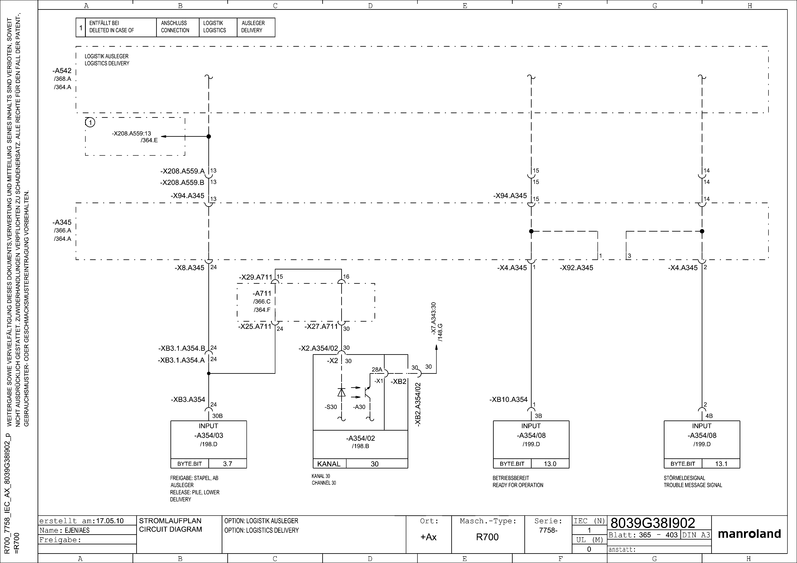

# +Ax — Sheet 365 of 403 — OPTION: LOGISTIK AUSLEGER

**OPTION: LOGISTICS DELIVERY**

> Part of the manroland **R700** printing press IEC/UL circuit diagrams.
> Drawing class: **Stromlaufplan / Circuit diagram** (DIN A3).
> Document `+Ax` covers the **Central control console** machine section.

## At a glance

| Field | Value |
|---|---|
| Document | `+Ax`  (8039G38I902) |
| Sheet | **365** of 403 |
| Section (DE) | OPTION: LOGISTIK AUSLEGER |
| Section (EN) | OPTION: LOGISTICS DELIVERY |
| Section type | CIRCUIT — Circuit diagram |
| Machine type | `R700` |
| Series | `7758` |
| Created | 17.05.10 |
| Replaces | — |
| Columns used | A, B, C, D, E, F, G, H |
| Path numbers | — |
| Labels on sheet | 107 |
| Cross-refs out | 12 |
| Cross-refs in | 37 |

**Previous:** [+Ax sheet 364](SHEET_0364.md) · **Next:** [+Ax sheet 366](SHEET_0366.md) · **Document TOC:** [_TOC.md](_TOC.md)  (+Ax) · **Master TOC:** [all sheets](../_MASTER_TOC.md)

## Sheet image (300 DPI, exact vector render)



_Rendered directly from the PDF vector layer at 300 DPI (1-bit), no OCR and no resampling. Use it to confirm anything ambiguous in the text below._

## Cross-references on this sheet

Each entry is a wire leaving this sheet. The printed token is `/sheet.column`; the link resolves to that sheet inside the same document.

| Ref | Target sheet | Col | Path | Destination on target | Target section | From col |
|---|---|---|---|---|---|---|
| `/368.A` | [+Ax sheet 368](SHEET_0368.md) | A | — | — | OPTION: LOGISTIK AUSLEGER | A |
| `/364.A` | [+Ax sheet 364](SHEET_0364.md) | A | — | — | OPTION: LOGISTIK AUSLEGER | A |
| `/364.E` | [+Ax sheet 364](SHEET_0364.md) | E | — | X208.A559:13 | OPTION: LOGISTIK AUSLEGER | B |
| `/366.A` | [+Ax sheet 366](SHEET_0366.md) | A | — | — | OPTION: LOGISTIK AUSLEGER | A |
| `/364.A` | [+Ax sheet 364](SHEET_0364.md) | A | — | — | OPTION: LOGISTIK AUSLEGER | A |
| `/366.C` | [+Ax sheet 366](SHEET_0366.md) | C | — | — | OPTION: LOGISTIK AUSLEGER | C |
| `/148.G` | [+Ax sheet 148](SHEET_0148.md) | G | — | X7.A343:30 | ÜBERWACHUNGSRECHNER SICHERHEITSBUS | E |
| `/364.F` | [+Ax sheet 364](SHEET_0364.md) | F | — | — | OPTION: LOGISTIK AUSLEGER | C |
| `/198.D` | [+Ax sheet 198](SHEET_0198.md) | D | — | — | REFERENZMODUL | B |
| `/199.D` | [+Ax sheet 199](SHEET_0199.md) | D | — | — | REFERENZMODUL | F |
| `/199.D` | [+Ax sheet 199](SHEET_0199.md) | D | — | — | REFERENZMODUL | G |
| `/198.B` | [+Ax sheet 198](SHEET_0198.md) | B | — | — | REFERENZMODUL | D |

### Incoming references (sheets that point here)

Every other sheet that sends a wire to this one. `Back-ref` is the token printed on *that* sheet; `Path` is its line number.

| From sheet | Cols | Back-ref | Path | Refs | What continues there |
|---|---|---|---|---|---|
| [+Ax#148](SHEET_0148.md) | G | `/148.G` | — | 1 | X7.A343:30 |
| [+Ax#198](SHEET_0198.md) | B, D | `/198.B`, `/198.D` | — | 2 | — |
| [+Ax#199](SHEET_0199.md) | D | `/199.D` | — | 2 | — |
| [+Ax#219](SHEET_0219.md) | D, F | `/219.D`, `/219.F` | — | 2 | — |
| [+Ax#224](SHEET_0224.md) | A, B, C | `/224.A`, `/224.B`, `/224.C` | — | 3 | — |
| [+Ax#227](SHEET_0227.md) | A | `/227.A` | — | 2 | — |
| [+Ax#238](SHEET_0238.md) | A | `/238.A` | — | 1 | — |
| [+Ax#245](SHEET_0245.md) | B | `/245.B` | — | 2 | — |
| [+Ax#268](SHEET_0268.md) | C | `/268.C` | — | 1 | — |
| [+Ax#271](SHEET_0271.md) | B | `/271.B` | — | 1 | — |
| [+Ax#274](SHEET_0274.md) | A | `/274.A` | — | 2 | — |
| [+Ax#289](SHEET_0289.md) | F, H | `/289.F`, `/289.H` | — | 5 | — |
| [+Ax#292](SHEET_0292.md) | G, H | `/292.G`, `/292.H` | — | 6 | — |
| [+Ax#364](SHEET_0364.md) | A, E, F | `/364.A`, `/364.E`, `/364.F` | — | 4 | — |
| [+Ax#366](SHEET_0366.md) | A, B | `/366.A`, `/366.B` | — | 2 | — |
| [+Ax#368](SHEET_0368.md) | A | `/368.A` | — | 1 | — |


## Devices on this sheet

| Tag | Class | Class meaning (IEC) | Col | Sub | Terminal | Sign |
|---|---|---|---|---|---|---|
| `A542` | A | Baugruppe / assembly, module, PC board | A | — | — | — |
| `A345` | A | Baugruppe / assembly, module, PC board | A | — | — | — |
| `S30` | S | Schalter / switch | D | — | — | — |
| `A30` | A | Baugruppe / assembly, module, PC board | D | — | — | — |
| `X1` | X | Klemme / terminal, plug connector | D | — | — | — |
| `X2` | X | Klemme / terminal, plug connector | D | — | — | — |
| `XB2` | XB |  | D | — | — | — |
| `A354/02` | A | Baugruppe / assembly, module, PC board | D | 02 | — | — |
| `A711` | A | Baugruppe / assembly, module, PC board | C | — | — | — |
| `A354/03` | A | Baugruppe / assembly, module, PC board | B | 03 | — | — |
| `A354/08` | A | Baugruppe / assembly, module, PC board | F | 08 | — | — |
| `A354/08` | A | Baugruppe / assembly, module, PC board | G | 08 | — | — |
| `X208.A559.B` | — | cross-device reference | B | — | — | — |
| `X208.A559.A` | — | cross-device reference | B | — | — | — |
| `X4.A345` | — | cross-device reference | E | — | — | — |
| `X94.A345` | — | cross-device reference | E | — | — | — |
| `X4.A345` | — | cross-device reference | G | — | — | — |
| `X8.A345` | — | cross-device reference | B | — | — | — |
| `X94.A345` | — | cross-device reference | B | — | — | — |
| `X29.A711` | — | cross-device reference | C | — | — | — |
| `X27.A711` | — | cross-device reference | C | — | — | — |
| `X25.A711` | — | cross-device reference | C | — | — | — |
| `XB3.1.A354.B` | — | cross-device reference | B | — | — | — |
| `XB3.1.A354.A` | — | cross-device reference | B | — | — | — |
| `3.7` | — | cross-device reference | B | — | — | — |
| `XB3.A354` | — | cross-device reference | B | — | — | — |
| `13.0` | — | cross-device reference | F | — | — | — |
| `XB10.A354` | — | cross-device reference | E | — | — | — |
| `13.1` | — | cross-device reference | H | — | — | — |
| `X7.A343:30` | — | cross-device reference | E | — | 30 | — |
| `X208.A559:13` | — | cross-device reference | A | — | 13 | — |
| `X92.A345` | — | cross-device reference | F | — | — | — |

## Potentials / nets

_No named potentials on this sheet._

## Wire-end annotations (grouped as printed)

A wire that continues elsewhere is annotated with a small cluster: the destination description, the path/line number `#NN`, and the `/sheet.column` cross reference. Each row below is one such cluster exactly as it is grouped on the drawing.

| Col | Y | Path | Cross-ref | Text on the wire |
|---|---|---|---|---|
| A | 31.8 | — | — | `1 ENTFÄLLT BEI DELETED IN CASE OF` |
| B | 31.8 | — | — | `CONNECTION ANSCHLUSS` |
| B | 31.8 | — | — | `LOGISTIK LOGISTICS` |
| C | 31.8 | — | — | `DELIVERY AUSLEGER` |
| A | 81.4 | — | — | `LOGISTIK AUSLEGER LOGISTICS DELIVERY` |
| A | 100.9 | — | — | `A542` |
| A | 114.0 | — | `/368.A`, `/364.A` | — |
| A | 179.8 | — | — | `1` |
| B | 195.9 | — | `/364.E` | `X208.A559:13` |
| B | 251.2 | — | — | `X208.A559.A 13` |
| F | 251.2 | — | — | `15` |
| H | 251.2 | — | — | `14` |
| B | 268.2 | — | — | `X208.A559.B 13` |
| F | 268.2 | — | — | `15` |
| H | 268.2 | — | — | `14` |
| B | 288.0 | — | — | `X94.A345 13` |
| F | 288.0 | — | — | `X94.A345 15` |
| H | 293.7 | — | — | `14` |
| A | 327.7 | — | — | `A345` |
| A | 340.8 | — | `/366.A`, `/364.A` | — |
| G | 378.8 | — | — | `1 3` |
| B | 395.7 | — | — | `X8.A345 24` |
| F | 395.7 | — | — | `X4.A345 1` |
| F | 395.7 | — | — | `X92.A345` |
| G | 395.7 | — | — | `X4.A345 2` |
| C | 409.9 | — | — | `X29.A711 15 16` |
| C | 434.0 | — | — | `A711` |
| C | 447.1 | — | `/366.C` | — |
| E | 451.8 | — | `/148.G` | `X7.A343:30` |
| C | 459.5 | — | `/364.F` | — |
| C | 483.6 | — | — | `X25.A711 24 X27.A711 30` |
| B | 516.2 | — | — | `XB3.1.A354.B 24` |
| D | 516.2 | — | — | `X2.A354/02 30` |
| B | 533.2 | — | — | `XB3.1.A354.A 24` |
| D | 534.7 | — | — | `X2` |
| D | 536.1 | — | — | `30 30` |
| E | 544.6 | — | — | `30` |
| D | 548.8 | — | — | `28A` |
| D | 565.8 | — | — | `X1` |
| D | 565.8 | — | — | `XB2` |
| E | 572.0 | — | — | `XB2.A354/02` |
| B | 592.8 | — | — | `XB3.A354 24` |
| F | 592.8 | — | — | `XB10.A354 1` |
| H | 601.3 | — | — | `2` |
| D | 604.8 | — | — | `S30 A30` |
| B | 618.2 | — | — | `30B` |
| F | 618.2 | — | — | `3B` |
| H | 618.2 | — | — | `4B` |
| B | 632.8 | — | — | `INPUT` |
| F | 632.8 | — | — | `INPUT` |
| G | 632.8 | — | — | `INPUT` |
| B | 646.6 | — | — | `A354/03` |
| F | 646.6 | — | — | `A354/08` |
| G | 646.6 | — | — | `A354/08` |
| D | 650.9 | — | — | `A354/02` |
| B | 660.4 | — | `/198.D` | — |
| F | 660.4 | — | `/199.D` | — |
| G | 660.4 | — | `/199.D` | — |
| D | 663.2 | — | `/198.B` | — |
| D | 689.1 | — | — | `KANAL 30` |
| B | 689.4 | — | — | `BYTE.BIT 3.7` |
| F | 689.5 | — | — | `BYTE.BIT 13.0` |
| G | 689.5 | — | — | `BYTE.BIT 13.1` |
| D | 709.5 | — | — | `KANAL 30 CHANNEL 30` |
| B | 712.1 | — | — | `FREIGABE: STAPEL, AB` |
| F | 712.1 | — | — | `BETRIEBSBEREIT READY FOR OPERATION` |
| G | 712.1 | — | — | `STÖRMELDESIGNAL TROUBLE MESSAGE SIGNAL` |
| B | 722.8 | — | — | `RELEASE: PILE, LOWER DELIVERY AUSLEGER` |


## Reconstructed tables

This sheet carries tabular content (pin map / terminal assignment / index). The grid below was rebuilt from the drawing's own rule lines, so each row is exactly one physical row of the table.

### Table 1 — 7 data rows × 17 columns (at x=255.1, y=204.1)

| X208.A559.A X208.A559.B X94.A345 | 13 13 13 |  |  |  |  |  |  |  |  | X94.A345 | 15 15 15 |  |  |  |  | 14 14 14 |
|---|---|---|---|---|---|---|---|---|---|---|---|---|---|---|---|---|
| `X8.A345` | `24` |  |  |  |  |  |  |  |  | `X4.A345` | `1` | `X92.A345` | `1` | `3` | `X4.A345` | `2` |
| `XB3.1.A354.B` | `24` | `X29.A711 A711 /366.C /364.F X25.A711` | `15 24` | `X27.A711 X2.A354/02` | `16 30 30` |  |  | `X7.A343:30` | `/148.G` |  |  |  |  |  |  |  |
| `XB3.1.A354.A` | `24` |  |  | `X2` | `30` | `28A` |  | `30 30` |  |  |  |  |  |  |  |  |
| `XB3.A354` | `24 30B` |  |  | `S30` | `A30` | `X1` | `XB2` | `XB2.A354/02` |  | `XB10.A354` | `1 3B` |  |  |  |  | `2 4B` |
| `INPUT` |  |  |  |  |  |  |  |  |  | `INPUT` |  |  |  |  | `INPUT` |  |
|  | `A354/03 /198.D` |  |  |  | `A354/02 /198.B` |  |  |  |  |  | `A354/08 /199.D` |  |  |  |  | `A354/08 /199.D` |
| `BYTE.BIT` | `3.7` |  |  | `KANAL` |  | `30` |  |  |  | `BYTE.BIT` | `13.0` |  |  |  | `BYTE.BIT` | `13.1` |


## Notes and free text on this sheet

| Text | Col | Y (pt) |
|---|---|---|
| `LOGISTIK AUSLEGER` | A | 81.4 |
| `LOGISTICS DELIVERY` | A | 92.04 |
| `KANAL 30` | C | 709.45 |
| `CHANNEL 30` | D | 719.39 |
| `28A` | D | 548.79 |
| `KANAL` | D | 689.12 |
| `X2.A354/02` | C | 516.21 |
| `XB2.A354/02` | E | 572.03 |
| `30B` | B | 618.24 |
| `INPUT` | B | 632.76 |
| `BYTE.BIT` | B | 690.01 |
| `FREIGABE: STAPEL, AB` | B | 712.09 |
| `AUSLEGER` | B | 722.76 |
| `RELEASE: PILE, LOWER` | B | 733.34 |
| `DELIVERY` | B | 744 |
| `3B` | F | 618.22 |
| `INPUT` | F | 632.76 |
| `BYTE.BIT` | E | 690.01 |
| `BETRIEBSBEREIT` | E | 712.09 |
| `READY FOR OPERATION` | F | 722.74 |
| `4B` | H | 618.22 |
| `INPUT` | G | 632.76 |
| `BYTE.BIT` | G | 690.01 |
| `STÖRMELDESIGNAL` | G | 712.13 |
| `TROUBLE MESSAGE SIGNAL` | G | 722.76 |
| `ENTFÄLLT BEI` | A | 31.77 |
| `DELETED IN CASE OF` | A | 42.43 |
| `ANSCHLUSS` | B | 31.82 |
| `CONNECTION` | B | 42.45 |
| `LOGISTIK` | B | 31.78 |
| `LOGISTICS` | B | 42.41 |
| `AUSLEGER` | C | 31.81 |
| `DELIVERY` | C | 42.42 |

## Complete label inventory (exact text from the drawing)

Every text object inside the drawing area of this sheet, in DIN reading order (column A→H, then top→bottom). This is the authoritative list: if a string is not here it is not printed on this sheet.

| Col | Y | X | Dir | Type | Text |
|---|---|---|---|---|---|
| A | 31.8 | 133.8 | → | text | `ENTFÄLLT BEI` |
| A | 37.1 | 117.9 | → | number | `1` |
| A | 42.4 | 133.8 | → | text | `DELETED IN CASE OF` |
| A | 81.4 | 126.7 | → | text | `LOGISTIK AUSLEGER` |
| A | 92.0 | 126.7 | → | text | `LOGISTICS DELIVERY` |
| A | 100.9 | 78.5 | → | device tag | `A542` |
| A | 114.0 | 80.8 | → | cross-reference | `/368.A` |
| A | 126.4 | 80.8 | → | cross-reference | `/364.A` |
| A | 179.8 | 132.9 | → | number | `1` |
| A | 195.9 | 167.2 | → | device ref | `X208.A559:13` |
| A | 327.7 | 78.5 | → | device tag | `A345` |
| A | 340.8 | 80.8 | → | cross-reference | `/366.A` |
| A | 353.2 | 80.8 | → | cross-reference | `/364.A` |
| B | 31.8 | 240.9 | → | text | `ANSCHLUSS` |
| B | 31.8 | 303.9 | → | text | `LOGISTIK` |
| B | 42.4 | 303.9 | → | text | `LOGISTICS` |
| B | 42.5 | 240.7 | → | text | `CONNECTION` |
| B | 205.8 | 210.3 | → | cross-reference | `/364.E` |
| B | 251.2 | 239.8 | → | device ref | `X208.A559.A` |
| B | 251.2 | 313.8 | → | number | `13` |
| B | 268.2 | 239.2 | → | device ref | `X208.A559.B` |
| B | 268.2 | 313.8 | → | number | `13` |
| B | 288.0 | 255.1 | → | device ref | `X94.A345` |
| B | 293.7 | 313.8 | → | number | `13` |
| B | 395.7 | 261.1 | → | device ref | `X8.A345` |
| B | 395.8 | 314.4 | → | number | `24` |
| B | 516.2 | 236.7 | → | device ref | `XB3.1.A354.B` |
| B | 516.2 | 314.4 | → | number | `24` |
| B | 533.2 | 314.4 | → | number | `24` |
| B | 533.9 | 235.8 | → | device ref | `XB3.1.A354.A` |
| B | 592.7 | 255.4 | → | device ref | `XB3.A354` |
| B | 601.3 | 314.4 | → | number | `24` |
| B | 618.2 | 317.2 | → | text | `30B` |
| B | 632.8 | 296.9 | → | text | `INPUT` |
| B | 646.6 | 290.4 | → | device tag | `A354/03` |
| B | 660.4 | 299.1 | → | cross-reference | `/198.D` |
| B | 689.4 | 333.4 | → | device ref | `3.7` |
| B | 690.0 | 265.0 | → | text | `BYTE.BIT` |
| B | 712.1 | 254.3 | → | text | `FREIGABE: STAPEL, AB` |
| B | 722.8 | 255.1 | → | text | `AUSLEGER` |
| B | 733.3 | 254.3 | → | text | `RELEASE: PILE, LOWER` |
| B | 744.0 | 254.3 | → | text | `DELIVERY` |
| C | 31.8 | 361.4 | → | text | `AUSLEGER` |
| C | 42.4 | 360.6 | → | text | `DELIVERY` |
| C | 409.9 | 357.2 | → | device ref | `X29.A711` |
| C | 409.9 | 413.0 | → | number | `15` |
| C | 434.0 | 377.6 | → | device tag | `A711` |
| C | 447.1 | 378.4 | → | cross-reference | `/366.C` |
| C | 459.5 | 379.3 | → | cross-reference | `/364.F` |
| C | 483.6 | 355.7 | → | device ref | `X25.A711` |
| C | 483.6 | 455.0 | → | device ref | `X27.A711` |
| C | 487.9 | 413.6 | → | number | `24` |
| C | 516.2 | 446.2 | → | text | `X2.A354/02` |
| C | 709.4 | 465.7 | → | text | `KANAL 30` |
| D | 409.9 | 512.2 | → | number | `16` |
| D | 487.9 | 512.8 | → | number | `30` |
| D | 516.2 | 512.8 | → | number | `30` |
| D | 534.7 | 488.7 | → | device tag | `X2` |
| D | 536.1 | 515.6 | → | number | `30` |
| D | 546.0 | 614.8 | → | number | `30` |
| D | 548.8 | 555.6 | → | text | `28A` |
| D | 565.8 | 559.3 | → | device tag | `X1` |
| D | 565.8 | 583.7 | → | device tag | `XB2` |
| D | 604.8 | 485.0 | → | device tag | `S30` |
| D | 604.8 | 527.5 | → | device tag | `A30` |
| D | 650.9 | 517.2 | → | device tag | `A354/02` |
| D | 663.2 | 526.0 | → | cross-reference | `/198.B` |
| D | 689.1 | 474.0 | → | text | `KANAL` |
| D | 689.1 | 553.9 | → | number | `30` |
| D | 719.4 | 466.0 | → | text | `CHANNEL 30` |
| E | 288.0 | 737.0 | → | device ref | `X94.A345` |
| E | 395.7 | 743.0 | → | device ref | `X4.A345` |
| E | 451.8 | 643.7 | ↕ | device ref | `X7.A343:30` |
| E | 483.9 | 653.7 | ↕ | cross-reference | `/148.G` |
| E | 544.6 | 635.5 | → | number | `30` |
| E | 572.0 | 619.7 | ↕ | text | `XB2.A354/02` |
| E | 592.7 | 731.3 | → | device ref | `XB10.A354` |
| E | 690.0 | 746.9 | → | text | `BYTE.BIT` |
| E | 712.1 | 736.2 | → | text | `BETRIEBSBEREIT` |
| F | 251.2 | 795.7 | → | number | `15` |
| F | 268.2 | 795.7 | → | number | `15` |
| F | 293.7 | 795.7 | → | number | `15` |
| F | 378.7 | 894.9 | → | number | `1` |
| F | 395.7 | 836.2 | → | device ref | `X92.A345` |
| F | 395.8 | 795.7 | → | number | `1` |
| F | 601.3 | 795.7 | → | number | `1` |
| F | 618.2 | 799.1 | → | text | `3B` |
| F | 632.8 | 778.8 | → | text | `INPUT` |
| F | 646.6 | 772.3 | → | device tag | `A354/08` |
| F | 660.4 | 780.9 | → | cross-reference | `/199.D` |
| F | 689.4 | 812.3 | → | device ref | `13.0` |
| F | 722.7 | 736.2 | → | text | `READY FOR OPERATION` |
| G | 378.7 | 938.0 | → | number | `3` |
| G | 395.7 | 998.1 | → | device ref | `X4.A345` |
| G | 632.8 | 1033.9 | → | text | `INPUT` |
| G | 646.6 | 1027.4 | → | device tag | `A354/08` |
| G | 660.4 | 1036.1 | → | cross-reference | `/199.D` |
| G | 690.0 | 1002.0 | → | text | `BYTE.BIT` |
| G | 712.1 | 991.8 | → | text | `STÖRMELDESIGNAL` |
| G | 722.8 | 991.8 | → | text | `TROUBLE MESSAGE SIGNAL` |
| H | 251.2 | 1050.8 | → | number | `14` |
| H | 268.2 | 1050.8 | → | number | `14` |
| H | 293.7 | 1050.8 | → | number | `14` |
| H | 395.8 | 1051.4 | → | number | `2` |
| H | 601.3 | 1051.4 | → | number | `2` |
| H | 618.2 | 1054.2 | → | text | `4B` |
| H | 689.4 | 1068.2 | → | device ref | `13.1` |

## Reading-order text block

The same content as a plain block, grouped by DIN column — convenient to paste or to match against a visual description.

```text
=== Column A ===
  31.8  133.8  text         ENTFÄLLT BEI
  37.1  117.9  numeric      1
  42.4  133.8  text         DELETED IN CASE OF
  81.4  126.7  text         LOGISTIK AUSLEGER
  92.0  126.7  text         LOGISTICS DELIVERY
 100.9   78.5  devtag       A542
 114.0   80.8  xref         /368.A
 126.4   80.8  xref         /364.A
 179.8  132.9  numeric      1
 195.9  167.2  devref       X208.A559:13
 327.7   78.5  devtag       A345
 340.8   80.8  xref         /366.A
 353.2   80.8  xref         /364.A
=== Column B ===
  31.8  240.9  text         ANSCHLUSS
  31.8  303.9  text         LOGISTIK
  42.4  303.9  text         LOGISTICS
  42.5  240.7  text         CONNECTION
 205.8  210.3  xref         /364.E
 251.2  239.8  devref       X208.A559.A
 251.2  313.8  numeric      13
 268.2  239.2  devref       X208.A559.B
 268.2  313.8  numeric      13
 288.0  255.1  devref       X94.A345
 293.7  313.8  numeric      13
 395.7  261.1  devref       X8.A345
 395.8  314.4  numeric      24
 516.2  236.7  devref       XB3.1.A354.B
 516.2  314.4  numeric      24
 533.2  314.4  numeric      24
 533.9  235.8  devref       XB3.1.A354.A
 592.7  255.4  devref       XB3.A354
 601.3  314.4  numeric      24
 618.2  317.2  text         30B
 632.8  296.9  text         INPUT
 646.6  290.4  devtag       A354/03
 660.4  299.1  xref         /198.D
 689.4  333.4  devref       3.7
 690.0  265.0  text         BYTE.BIT
 712.1  254.3  text         FREIGABE: STAPEL, AB
 722.8  255.1  text         AUSLEGER
 733.3  254.3  text         RELEASE: PILE, LOWER
 744.0  254.3  text         DELIVERY
=== Column C ===
  31.8  361.4  text         AUSLEGER
  42.4  360.6  text         DELIVERY
 409.9  357.2  devref       X29.A711
 409.9  413.0  numeric      15
 434.0  377.6  devtag       A711
 447.1  378.4  xref         /366.C
 459.5  379.3  xref         /364.F
 483.6  355.7  devref       X25.A711
 483.6  455.0  devref       X27.A711
 487.9  413.6  numeric      24
 516.2  446.2  text         X2.A354/02
 709.4  465.7  text         KANAL 30
=== Column D ===
 409.9  512.2  numeric      16
 487.9  512.8  numeric      30
 516.2  512.8  numeric      30
 534.7  488.7  devtag       X2
 536.1  515.6  numeric      30
 546.0  614.8  numeric      30
 548.8  555.6  text         28A
 565.8  559.3  devtag       X1
 565.8  583.7  devtag       XB2
 604.8  485.0  devtag       S30
 604.8  527.5  devtag       A30
 650.9  517.2  devtag       A354/02
 663.2  526.0  xref         /198.B
 689.1  474.0  text         KANAL
 689.1  553.9  numeric      30
 719.4  466.0  text         CHANNEL 30
=== Column E ===
 288.0  737.0  devref       X94.A345
 395.7  743.0  devref       X4.A345
 451.8  643.7  devref       X7.A343:30
 483.9  653.7  xref         /148.G
 544.6  635.5  numeric      30
 572.0  619.7  text         XB2.A354/02
 592.7  731.3  devref       XB10.A354
 690.0  746.9  text         BYTE.BIT
 712.1  736.2  text         BETRIEBSBEREIT
=== Column F ===
 251.2  795.7  numeric      15
 268.2  795.7  numeric      15
 293.7  795.7  numeric      15
 378.7  894.9  numeric      1
 395.7  836.2  devref       X92.A345
 395.8  795.7  numeric      1
 601.3  795.7  numeric      1
 618.2  799.1  text         3B
 632.8  778.8  text         INPUT
 646.6  772.3  devtag       A354/08
 660.4  780.9  xref         /199.D
 689.4  812.3  devref       13.0
 722.7  736.2  text         READY FOR OPERATION
=== Column G ===
 378.7  938.0  numeric      3
 395.7  998.1  devref       X4.A345
 632.8 1033.9  text         INPUT
 646.6 1027.4  devtag       A354/08
 660.4 1036.1  xref         /199.D
 690.0 1002.0  text         BYTE.BIT
 712.1  991.8  text         STÖRMELDESIGNAL
 722.8  991.8  text         TROUBLE MESSAGE SIGNAL
=== Column H ===
 251.2 1050.8  numeric      14
 268.2 1050.8  numeric      14
 293.7 1050.8  numeric      14
 395.8 1051.4  numeric      2
 601.3 1051.4  numeric      2
 618.2 1054.2  text         4B
 689.4 1068.2  devref       13.1
```

---
_Generated from the PDF vector text layer; no OCR. Source: `R700_7758_IEC_AX_8039G38I902_p`, sheet 365._
