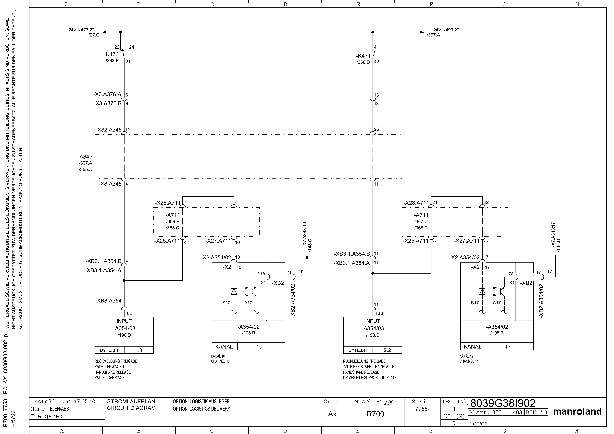

# +Ax — Sheet 366 of 403 — OPTION: LOGISTIK AUSLEGER

**OPTION: LOGISTICS DELIVERY**

> Part of the manroland **R700** printing press IEC/UL circuit diagrams.
> Drawing class: **Stromlaufplan / Circuit diagram** (DIN A3).
> Document `+Ax` covers the **Central control console** machine section.

## At a glance

| Field | Value |
|---|---|
| Document | `+Ax`  (8039G38I902) |
| Sheet | **366** of 403 |
| Section (DE) | OPTION: LOGISTIK AUSLEGER |
| Section (EN) | OPTION: LOGISTICS DELIVERY |
| Section type | CIRCUIT — Circuit diagram |
| Machine type | `R700` |
| Series | `7758` |
| Created | 17.05.10 |
| Replaces | — |
| Columns used | A, B, C, D, E, F, G, H |
| Path numbers | — |
| Labels on sheet | 119 |
| Cross-refs out | 16 |
| Cross-refs in | 42 |

**Previous:** [+Ax sheet 365](SHEET_0365.md) · **Next:** [+Ax sheet 367](SHEET_0367.md) · **Document TOC:** [_TOC.md](_TOC.md)  (+Ax) · **Master TOC:** [all sheets](../_MASTER_TOC.md)

## Sheet image (300 DPI, exact vector render)



_Rendered directly from the PDF vector layer at 300 DPI (1-bit), no OCR and no resampling. Use it to confirm anything ambiguous in the text below._

## Cross-references on this sheet

Each entry is a wire leaving this sheet. The printed token is `/sheet.column`; the link resolves to that sheet inside the same document.

| Ref | Target sheet | Col | Path | Destination on target | Target section | From col |
|---|---|---|---|---|---|---|
| `/27.G` | [+Ax sheet 27](SHEET_0027.md) | G | — | 24V.K473:22 | SPANNUNGSVERSORGUNG, SCHALTSCHRANKBELÜFTUNG | A |
| `/367.A` | [+Ax sheet 367](SHEET_0367.md) | A | — | — | OPTION: LOGISTIK AUSLEGER | F |
| `/368.F` | [+Ax sheet 368](SHEET_0368.md) | F | — | — | OPTION: LOGISTIK AUSLEGER | B |
| `/368.D` | [+Ax sheet 368](SHEET_0368.md) | D | — | — | OPTION: LOGISTIK AUSLEGER | E |
| `/367.A` | [+Ax sheet 367](SHEET_0367.md) | A | — | — | OPTION: LOGISTIK AUSLEGER | A |
| `/365.A` | [+Ax sheet 365](SHEET_0365.md) | A | — | — | OPTION: LOGISTIK AUSLEGER | A |
| `/366.F` | [+Ax sheet 366](SHEET_0366.md) | F | — | — | OPTION: LOGISTIK AUSLEGER | B |
| `/365.C` | [+Ax sheet 365](SHEET_0365.md) | C | — | — | OPTION: LOGISTIK AUSLEGER | B |
| `/367.C` | [+Ax sheet 367](SHEET_0367.md) | C | — | — | OPTION: LOGISTIK AUSLEGER | F |
| `/366.C` | [+Ax sheet 366](SHEET_0366.md) | C | — | — | OPTION: LOGISTIK AUSLEGER | F |
| `/148.C` | [+Ax sheet 148](SHEET_0148.md) | C | — | X7.A343:10 | ÜBERWACHUNGSRECHNER SICHERHEITSBUS | D |
| `/148.D` | [+Ax sheet 148](SHEET_0148.md) | D | — | X7.A343:17 | ÜBERWACHUNGSRECHNER SICHERHEITSBUS | H |
| `/198.B` | [+Ax sheet 198](SHEET_0198.md) | B | — | — | REFERENZMODUL | C |
| `/198.B` | [+Ax sheet 198](SHEET_0198.md) | B | — | — | REFERENZMODUL | G |
| `/198.D` | [+Ax sheet 198](SHEET_0198.md) | D | — | — | REFERENZMODUL | B |
| `/198.D` | [+Ax sheet 198](SHEET_0198.md) | D | — | — | REFERENZMODUL | E |

### Incoming references (sheets that point here)

Every other sheet that sends a wire to this one. `Back-ref` is the token printed on *that* sheet; `Path` is its line number.

| From sheet | Cols | Back-ref | Path | Refs | What continues there |
|---|---|---|---|---|---|
| [+Ax#27](SHEET_0027.md) | G | `/27.G` | — | 1 | — |
| [+Ax#148](SHEET_0148.md) | C, D | `/148.C`, `/148.D` | — | 2 | X7.A343:10; X7.A343:17 |
| [+Ax#198](SHEET_0198.md) | B, D | `/198.B`, `/198.D` | — | 4 | — |
| [+Ax#219](SHEET_0219.md) | C, E | `/219.C`, `/219.E` | — | 4 | — |
| [+Ax#224](SHEET_0224.md) | A, B, C, E, F | `/224.A`, `/224.B`, `/224.C`, `/224.E`, `/224.F` | — | 10 | — |
| [+Ax#238](SHEET_0238.md) | A | `/238.A` | — | 2 | — |
| [+Ax#268](SHEET_0268.md) | C | `/268.C` | — | 2 | — |
| [+Ax#271](SHEET_0271.md) | A | `/271.A` | — | 2 | — |
| [+Ax#272](SHEET_0272.md) | G | `/272.G` | — | 4 | — |
| [+Ax#286](SHEET_0286.md) | F | `/286.F` | — | 2 | — |
| [+Ax#365](SHEET_0365.md) | A, C | `/365.A`, `/365.C` | — | 2 | — |
| [+Ax#366](SHEET_0366.md) | B, F | `/366.B`, `/366.F` | — | 2 | — |
| [+Ax#367](SHEET_0367.md) | A, C | `/367.A`, `/367.C` | — | 3 | 24V.K499:22 |
| [+Ax#368](SHEET_0368.md) | D, F | `/368.D`, `/368.F` | — | 2 | — |


## Devices on this sheet

| Tag | Class | Class meaning (IEC) | Col | Sub | Terminal | Sign |
|---|---|---|---|---|---|---|
| `K473` | K | Relais / relay, contactor | B | — | — | — |
| `A345` | A | Baugruppe / assembly, module, PC board | A | — | — | — |
| `A354/03` | A | Baugruppe / assembly, module, PC board | B | 03 | — | — |
| `S10` | S | Schalter / switch | C | — | — | — |
| `A10` | A | Baugruppe / assembly, module, PC board | C | — | — | — |
| `X1` | X | Klemme / terminal, plug connector | D | — | — | — |
| `X2` | X | Klemme / terminal, plug connector | C | — | — | — |
| `XB2` | XB |  | D | — | — | — |
| `A354/02` | A | Baugruppe / assembly, module, PC board | C | 02 | — | — |
| `A711` | A | Baugruppe / assembly, module, PC board | B | — | — | — |
| `K471` | K | Relais / relay, contactor | E | — | — | — |
| `A354/03` | A | Baugruppe / assembly, module, PC board | E | 03 | — | — |
| `S17` | S | Schalter / switch | G | — | — | — |
| `A17` | A | Baugruppe / assembly, module, PC board | G | — | — | — |
| `X1` | X | Klemme / terminal, plug connector | G | — | — | — |
| `X2` | X | Klemme / terminal, plug connector | G | — | — | — |
| `XB2` | XB |  | G | — | — | — |
| `A354/02` | A | Baugruppe / assembly, module, PC board | G | 02 | — | — |
| `A711` | A | Baugruppe / assembly, module, PC board | F | — | — | — |
| `X8.A345` | — | cross-device reference | B | — | — | — |
| `X3.A376.B` | — | cross-device reference | B | — | — | — |
| `X3.A376.A` | — | cross-device reference | B | — | — | — |
| `X82.A345` | — | cross-device reference | B | — | — | — |
| `1.3` | — | cross-device reference | B | — | — | — |
| `XB3.A354` | — | cross-device reference | B | — | — | — |
| `XB3.1.A354.B` | — | cross-device reference | B | — | — | — |
| `XB3.1.A354.A` | — | cross-device reference | B | — | — | — |
| `X28.A711` | — | cross-device reference | B | — | — | — |
| `X27.A711` | — | cross-device reference | C | — | — | — |
| `X25.A711` | — | cross-device reference | B | — | — | — |
| `2.2` | — | cross-device reference | E | — | — | — |
| `X28.A711` | — | cross-device reference | F | — | — | — |
| `X27.A711` | — | cross-device reference | F | — | — | — |
| `X25.A711` | — | cross-device reference | F | — | — | — |
| `XB3.1.A354.B` | — | cross-device reference | E | — | — | — |
| `XB3.1.A354.A` | — | cross-device reference | E | — | — | — |
| `X7.A343:17` | — | cross-device reference | H | — | 17 | — |
| `X7.A343:10` | — | cross-device reference | D | — | 10 | — |

## Potentials / nets

| Potential | Count | Columns | Attached devices | Terminals |
|---|---|---|---|---|
| `24V` | 2 | A, F | `K473`, `K499` | `22` |


A potential such as `L24+/4` or `M24+` is a named supply/return rail; every place it appears on this sheet is electrically common.

## Wire-end annotations (grouped as printed)

A wire that continues elsewhere is annotated with a small cluster: the destination description, the path/line number `#NN`, and the `/sheet.column` cross reference. Each row below is one such cluster exactly as it is grouped on the drawing.

| Col | Y | Path | Cross-ref | Text on the wire |
|---|---|---|---|---|
| A | 54.1 | — | `/27.G` | `24V.K473:22` |
| F | 54.1 | — | — | `24V.K499:22` |
| F | 64.0 | — | `/367.A` | — |
| B | 87.5 | — | — | `K473 24` |
| B | 87.5 | — | — | `22` |
| E | 87.5 | — | — | `41` |
| E | 103.8 | — | — | `K471 42` |
| B | 114.0 | — | `/368.F` | — |
| B | 115.8 | — | — | `21` |
| E | 116.9 | — | `/368.D` | — |
| B | 178.2 | — | — | `X3.A376.A 6` |
| E | 180.3 | — | — | `13` |
| B | 195.9 | — | — | `X3.A376.B 6` |
| E | 197.3 | — | — | `13` |
| B | 246.9 | — | — | `X82.A345 11` |
| E | 246.9 | — | — | `25` |
| A | 299.4 | — | — | `A345` |
| A | 312.4 | — | `/367.A`, `/365.A` | — |
| B | 351.8 | — | — | `X8.A345 4` |
| E | 353.2 | — | — | `11` |
| C | 388.6 | — | — | `X28.A711 7 8` |
| F | 388.6 | — | — | `X28.A711 21 22` |
| B | 412.7 | — | — | `A711` |
| F | 412.7 | — | — | `A711` |
| B | 425.8 | — | `/366.F`, `/365.C` | — |
| F | 425.8 | — | `/367.C`, `/366.C` | — |
| D | 430.6 | — | `/148.C` | `X7.A343:10` |
| H | 430.6 | — | `/148.D` | `X7.A343:17` |
| C | 462.4 | — | — | `X25.A711 4 X27.A711 10` |
| F | 462.4 | — | — | `X25.A711 11 X27.A711 17` |
| E | 487.9 | — | — | `XB3.1.A354.B 11` |
| C | 494.9 | — | — | `X2.A354/02 10` |
| G | 494.9 | — | — | `X2.A354/02 17` |
| B | 502.1 | — | — | `XB3.1.A354.B 4` |
| E | 504.9 | — | — | `XB3.1.A354.A 11` |
| C | 513.4 | — | — | `X2` |
| G | 513.4 | — | — | `X2` |
| C | 514.8 | — | — | `XB3.1.A354.A 4 10 10` |
| G | 514.8 | — | — | `17 17` |
| D | 523.3 | — | — | `10` |
| H | 523.3 | — | — | `17` |
| D | 527.5 | — | — | `11A` |
| G | 527.5 | — | — | `17A` |
| D | 544.5 | — | — | `X1` |
| G | 544.5 | — | — | `X1` |
| D | 544.6 | — | — | `XB2` |
| G | 544.6 | — | — | `XB2` |
| D | 550.8 | — | — | `XB2.A354/02` |
| H | 550.8 | — | — | `XB2.A354/02` |
| B | 578.6 | — | — | `XB3.A354 4` |
| C | 583.5 | — | — | `S10 A10` |
| G | 583.5 | — | — | `S17 A17` |
| E | 587.1 | — | — | `11` |
| B | 604.0 | — | — | `6B` |
| E | 604.1 | — | — | `13B` |
| B | 618.6 | — | — | `INPUT` |
| E | 618.6 | — | — | `INPUT` |
| C | 629.6 | — | — | `A354/02` |
| G | 629.6 | — | — | `A354/02` |
| B | 632.4 | — | — | `A354/03` |
| E | 632.4 | — | — | `A354/03` |
| C | 642.0 | — | `/198.B` | — |
| G | 642.0 | — | `/198.B` | — |
| B | 646.2 | — | `/198.D` | — |
| E | 646.2 | — | `/198.D` | — |
| C | 667.8 | — | — | `KANAL 10` |
| G | 667.8 | — | — | `KANAL 17` |
| B | 675.3 | — | — | `BYTE.BIT 1.3` |
| E | 675.3 | — | — | `BYTE.BIT 2.2` |
| C | 688.2 | — | — | `KANAL 10 CHANNEL 10` |
| G | 688.2 | — | — | `KANAL 17 CHANNEL 17` |
| B | 698.0 | — | — | `RÜCKMELDUNG FREIGABE PALETTENWAGEN HANDSHAKE RELEASE PALLET CARRIAGE` |
| E | 698.0 | — | — | `RÜCKMELDUNG FREIGABE` |
| E | 708.6 | — | — | `HANDSHAKE RELEASE DRIVES PILE SUPPORTING PLATE ANTRIEBE STAPELTRAGPLATTE` |


## Reconstructed tables

This sheet carries tabular content (pin map / terminal assignment / index). The grid below was rebuilt from the drawing's own rule lines, so each row is exactly one physical row of the table.

### Table 1 — 7 data rows × 20 columns (at x=184.3, y=62.4)

| 22 K473 /368.F X3.A376.A X3.A376.B X82.A345 X8.A345 |  | 24 21 6 6 11 4 |  |  |  |  |  |  |  |  | K471 /368.D | 41 42 13 13 25 11 |  | /367.A |  |  |  |  |  |
|---|---|---|---|---|---|---|---|---|---|---|---|---|---|---|---|---|---|---|---|
| `XB3.1.A354.B` |  | `4` | `X28.A711 A711 /366.F /365.C X25.A711` | `7 4` | `X27.A711 X2.A354/02` | `8 10 10` |  |  | `X7.A343:10` | `/148.C` | `XB3.1.A354.B` | `11` | `X28.A711 A711 /367.C /366.C X25.A711` | `21 11` | `X27.A711 X2.A354/02` | `22 17 17` |  |  | `X7.A343:17` |
| `XB3.1.A354.A` |  | `4` |  |  | `X2` | `10` |  |  | `10 10` |  | `XB3.1.A354.A` | `11` |  |  | `X2` | `17` |  |  | `17 17` |
|  |  |  |  |  |  |  | `11A` |  |  |  |  |  |  |  |  |  | `17A` |  |  |
| `XB3.A354` |  | `4 6B` |  |  | `S10` | `A10` | `X1` | `XB2` | `XB2.A354/02` |  |  | `11 13B` |  |  | `S17` | `A17` | `X1` | `XB2` | `XB2.A354/02` |
|  | `INPUT` | `A354/03 /198.D` |  |  |  | `A354/02 /198.B` |  |  |  |  | `INPUT` | `A354/03 /198.D` |  |  |  | `A354/02 /198.B` |  |  |  |
|  |  |  |  |  | `KANAL` |  | `10` |  |  |  |  |  |  |  | `KANAL` |  | `17` |  |  |
| `BYTE.BIT` |  | `1.3` |  |  |  |  |  |  |  |  | `BYTE.BIT` | `2.2` |  |  |  |  |  |  |  |


## Notes and free text on this sheet

| Text | Col | Y (pt) |
|---|---|---|
| `6B` | B | 604.05 |
| `INPUT` | B | 618.59 |
| `BYTE.BIT` | B | 675.84 |
| `RÜCKMELDUNG FREIGABE` | B | 697.96 |
| `PALETTENWAGEN` | B | 708.53 |
| `HANDSHAKE RELEASE` | B | 719.2 |
| `PALLET CARRIAGE` | B | 729.83 |
| `KANAL 10` | C | 688.19 |
| `CHANNEL 10` | C | 698.13 |
| `11A` | D | 527.53 |
| `KANAL` | C | 667.86 |
| `X2.A354/02` | C | 494.95 |
| `XB2.A354/02` | D | 550.77 |
| `13B` | E | 604.07 |
| `INPUT` | E | 618.59 |
| `BYTE.BIT` | E | 675.84 |
| `RÜCKMELDUNG FREIGABE` | E | 697.96 |
| `ANTRIEBE STAPELTRAGPLATTE` | E | 708.57 |
| `HANDSHAKE RELEASE` | E | 719.2 |
| `DRIVES PILE SUPPORTING PLATE` | E | 729.83 |
| `KANAL 17` | F | 688.19 |
| `CHANNEL 17` | G | 698.13 |
| `17A` | G | 527.53 |
| `KANAL` | G | 667.86 |
| `X2.A354/02` | F | 494.95 |
| `XB2.A354/02` | H | 550.77 |

## Complete label inventory (exact text from the drawing)

Every text object inside the drawing area of this sheet, in DIN reading order (column A→H, then top→bottom). This is the authoritative list: if a string is not here it is not printed on this sheet.

| Col | Y | X | Dir | Type | Text |
|---|---|---|---|---|---|
| A | 54.1 | 129.8 | → | potential | `24V.K473:22` |
| A | 64.0 | 171.8 | → | cross-reference | `/27.G` |
| A | 299.4 | 150.8 | → | device tag | `A345` |
| A | 312.4 | 153.1 | → | cross-reference | `/367.A` |
| A | 324.8 | 153.1 | → | cross-reference | `/365.A` |
| B | 87.5 | 222.0 | → | number | `22` |
| B | 87.5 | 250.6 | → | number | `24` |
| B | 100.9 | 201.8 | → | device tag | `K473` |
| B | 114.0 | 204.9 | → | cross-reference | `/368.F` |
| B | 115.8 | 243.5 | → | number | `21` |
| B | 178.2 | 180.9 | → | device ref | `X3.A376.A` |
| B | 180.3 | 243.5 | → | number | `6` |
| B | 195.9 | 181.7 | → | device ref | `X3.A376.B` |
| B | 197.3 | 243.5 | → | number | `6` |
| B | 246.9 | 185.7 | → | device ref | `X82.A345` |
| B | 246.9 | 242.9 | → | number | `11` |
| B | 351.8 | 191.6 | → | device ref | `X8.A345` |
| B | 353.2 | 243.5 | → | number | `4` |
| B | 388.7 | 300.5 | → | device ref | `X28.A711` |
| B | 412.7 | 320.9 | → | device tag | `A711` |
| B | 425.8 | 322.6 | → | cross-reference | `/366.F` |
| B | 438.2 | 321.7 | → | cross-reference | `/365.C` |
| B | 462.4 | 299.1 | → | device ref | `X25.A711` |
| B | 502.1 | 165.8 | → | device ref | `XB3.1.A354.B` |
| B | 502.1 | 243.5 | → | number | `4` |
| B | 519.1 | 243.5 | → | number | `4` |
| B | 519.8 | 165.0 | → | device ref | `XB3.1.A354.A` |
| B | 578.6 | 184.5 | → | device ref | `XB3.A354` |
| B | 587.1 | 243.5 | → | number | `4` |
| B | 604.0 | 246.3 | → | text | `6B` |
| B | 618.6 | 226.1 | → | text | `INPUT` |
| B | 632.4 | 219.5 | → | device tag | `A354/03` |
| B | 646.2 | 228.2 | → | cross-reference | `/198.D` |
| B | 675.3 | 262.2 | → | device ref | `1.3` |
| B | 675.8 | 194.2 | → | text | `BYTE.BIT` |
| B | 698.0 | 183.4 | → | text | `RÜCKMELDUNG FREIGABE` |
| B | 708.5 | 183.4 | → | text | `PALETTENWAGEN` |
| B | 719.2 | 183.4 | → | text | `HANDSHAKE RELEASE` |
| B | 729.8 | 183.4 | → | text | `PALLET CARRIAGE` |
| C | 388.7 | 356.9 | → | number | `7` |
| C | 388.7 | 456.1 | → | number | `8` |
| C | 462.4 | 398.3 | → | device ref | `X27.A711` |
| C | 466.6 | 356.9 | → | number | `4` |
| C | 466.6 | 455.5 | → | number | `10` |
| C | 495.0 | 389.5 | → | text | `X2.A354/02` |
| C | 495.0 | 455.5 | → | number | `10` |
| C | 513.4 | 432.0 | → | device tag | `X2` |
| C | 514.8 | 458.4 | → | number | `10` |
| C | 583.5 | 428.3 | → | device tag | `S10` |
| C | 583.5 | 470.8 | → | device tag | `A10` |
| C | 629.6 | 460.5 | → | device tag | `A354/02` |
| C | 642.0 | 469.3 | → | cross-reference | `/198.B` |
| C | 667.9 | 417.3 | → | text | `KANAL` |
| C | 688.2 | 409.0 | → | text | `KANAL 10` |
| C | 698.1 | 409.3 | → | text | `CHANNEL 10` |
| D | 430.6 | 587.1 | ↕ | device ref | `X7.A343:10` |
| D | 463.2 | 597.0 | ↕ | cross-reference | `/148.C` |
| D | 523.3 | 578.8 | → | number | `10` |
| D | 524.7 | 557.6 | → | number | `10` |
| D | 527.5 | 498.9 | → | text | `11A` |
| D | 544.5 | 502.6 | → | device tag | `X1` |
| D | 544.6 | 527.0 | → | device tag | `XB2` |
| D | 550.8 | 563.0 | ↕ | text | `XB2.A354/02` |
| D | 667.8 | 496.9 | → | number | `10` |
| E | 87.5 | 725.4 | → | number | `41` |
| E | 103.8 | 690.8 | → | device tag | `K471` |
| E | 115.8 | 725.4 | → | number | `42` |
| E | 116.9 | 691.7 | → | cross-reference | `/368.D` |
| E | 180.3 | 724.8 | → | number | `13` |
| E | 197.3 | 724.8 | → | number | `13` |
| E | 246.9 | 725.4 | → | number | `25` |
| E | 353.2 | 724.8 | → | number | `11` |
| E | 487.9 | 647.7 | → | device ref | `XB3.1.A354.B` |
| E | 487.9 | 724.8 | → | number | `11` |
| E | 504.9 | 724.8 | → | number | `11` |
| E | 505.6 | 646.9 | → | device ref | `XB3.1.A354.A` |
| E | 587.1 | 724.8 | → | number | `11` |
| E | 604.1 | 727.7 | → | text | `13B` |
| E | 618.6 | 708.0 | → | text | `INPUT` |
| E | 632.4 | 701.4 | → | device tag | `A354/03` |
| E | 646.2 | 710.1 | → | cross-reference | `/198.D` |
| E | 675.3 | 744.4 | → | device ref | `2.2` |
| E | 675.8 | 676.1 | → | text | `BYTE.BIT` |
| E | 698.0 | 665.3 | → | text | `RÜCKMELDUNG FREIGABE` |
| E | 708.6 | 666.1 | → | text | `ANTRIEBE STAPELTRAGPLATTE` |
| E | 719.2 | 665.3 | → | text | `HANDSHAKE RELEASE` |
| E | 729.8 | 665.3 | → | text | `DRIVES PILE SUPPORTING PLATE` |
| F | 54.1 | 837.4 | → | potential | `24V.K499:22` |
| F | 64.0 | 827.7 | → | cross-reference | `/367.A` |
| F | 388.7 | 782.4 | → | device ref | `X28.A711` |
| F | 388.7 | 838.8 | → | number | `21` |
| F | 412.7 | 802.8 | → | device tag | `A711` |
| F | 425.8 | 803.6 | → | cross-reference | `/367.C` |
| F | 438.2 | 803.6 | → | cross-reference | `/366.C` |
| F | 462.4 | 780.9 | → | device ref | `X25.A711` |
| F | 462.4 | 880.2 | → | device ref | `X27.A711` |
| F | 466.6 | 838.2 | → | number | `11` |
| F | 495.0 | 871.4 | → | text | `X2.A354/02` |
| F | 688.2 | 890.9 | → | text | `KANAL 17` |
| G | 388.7 | 938.0 | → | number | `22` |
| G | 466.6 | 937.4 | → | number | `17` |
| G | 495.0 | 937.4 | → | number | `17` |
| G | 513.4 | 913.9 | → | device tag | `X2` |
| G | 514.8 | 940.3 | → | number | `17` |
| G | 524.7 | 1039.5 | → | number | `17` |
| G | 527.5 | 980.8 | → | text | `17A` |
| G | 544.5 | 984.5 | → | device tag | `X1` |
| G | 544.6 | 1008.9 | → | device tag | `XB2` |
| G | 583.5 | 910.2 | → | device tag | `S17` |
| G | 583.5 | 952.7 | → | device tag | `A17` |
| G | 629.6 | 942.4 | → | device tag | `A354/02` |
| G | 642.0 | 951.2 | → | cross-reference | `/198.B` |
| G | 667.8 | 978.8 | → | number | `17` |
| G | 667.9 | 899.1 | → | text | `KANAL` |
| G | 698.1 | 891.2 | → | text | `CHANNEL 17` |
| H | 430.6 | 1068.9 | ↕ | device ref | `X7.A343:17` |
| H | 463.2 | 1078.9 | ↕ | cross-reference | `/148.D` |
| H | 523.3 | 1060.7 | → | number | `17` |
| H | 550.8 | 1044.9 | ↕ | text | `XB2.A354/02` |

## Reading-order text block

The same content as a plain block, grouped by DIN column — convenient to paste or to match against a visual description.

```text
=== Column A ===
  54.1  129.8  net          24V.K473:22
  64.0  171.8  xref         /27.G
 299.4  150.8  devtag       A345
 312.4  153.1  xref         /367.A
 324.8  153.1  xref         /365.A
=== Column B ===
  87.5  222.0  numeric      22
  87.5  250.6  numeric      24
 100.9  201.8  devtag       K473
 114.0  204.9  xref         /368.F
 115.8  243.5  numeric      21
 178.2  180.9  devref       X3.A376.A
 180.3  243.5  numeric      6
 195.9  181.7  devref       X3.A376.B
 197.3  243.5  numeric      6
 246.9  185.7  devref       X82.A345
 246.9  242.9  numeric      11
 351.8  191.6  devref       X8.A345
 353.2  243.5  numeric      4
 388.7  300.5  devref       X28.A711
 412.7  320.9  devtag       A711
 425.8  322.6  xref         /366.F
 438.2  321.7  xref         /365.C
 462.4  299.1  devref       X25.A711
 502.1  165.8  devref       XB3.1.A354.B
 502.1  243.5  numeric      4
 519.1  243.5  numeric      4
 519.8  165.0  devref       XB3.1.A354.A
 578.6  184.5  devref       XB3.A354
 587.1  243.5  numeric      4
 604.0  246.3  text         6B
 618.6  226.1  text         INPUT
 632.4  219.5  devtag       A354/03
 646.2  228.2  xref         /198.D
 675.3  262.2  devref       1.3
 675.8  194.2  text         BYTE.BIT
 698.0  183.4  text         RÜCKMELDUNG FREIGABE
 708.5  183.4  text         PALETTENWAGEN
 719.2  183.4  text         HANDSHAKE RELEASE
 729.8  183.4  text         PALLET CARRIAGE
=== Column C ===
 388.7  356.9  numeric      7
 388.7  456.1  numeric      8
 462.4  398.3  devref       X27.A711
 466.6  356.9  numeric      4
 466.6  455.5  numeric      10
 495.0  389.5  text         X2.A354/02
 495.0  455.5  numeric      10
 513.4  432.0  devtag       X2
 514.8  458.4  numeric      10
 583.5  428.3  devtag       S10
 583.5  470.8  devtag       A10
 629.6  460.5  devtag       A354/02
 642.0  469.3  xref         /198.B
 667.9  417.3  text         KANAL
 688.2  409.0  text         KANAL 10
 698.1  409.3  text         CHANNEL 10
=== Column D ===
 430.6  587.1  devref       X7.A343:10
 463.2  597.0  xref         /148.C
 523.3  578.8  numeric      10
 524.7  557.6  numeric      10
 527.5  498.9  text         11A
 544.5  502.6  devtag       X1
 544.6  527.0  devtag       XB2
 550.8  563.0  text         XB2.A354/02
 667.8  496.9  numeric      10
=== Column E ===
  87.5  725.4  numeric      41
 103.8  690.8  devtag       K471
 115.8  725.4  numeric      42
 116.9  691.7  xref         /368.D
 180.3  724.8  numeric      13
 197.3  724.8  numeric      13
 246.9  725.4  numeric      25
 353.2  724.8  numeric      11
 487.9  647.7  devref       XB3.1.A354.B
 487.9  724.8  numeric      11
 504.9  724.8  numeric      11
 505.6  646.9  devref       XB3.1.A354.A
 587.1  724.8  numeric      11
 604.1  727.7  text         13B
 618.6  708.0  text         INPUT
 632.4  701.4  devtag       A354/03
 646.2  710.1  xref         /198.D
 675.3  744.4  devref       2.2
 675.8  676.1  text         BYTE.BIT
 698.0  665.3  text         RÜCKMELDUNG FREIGABE
 708.6  666.1  text         ANTRIEBE STAPELTRAGPLATTE
 719.2  665.3  text         HANDSHAKE RELEASE
 729.8  665.3  text         DRIVES PILE SUPPORTING PLATE
=== Column F ===
  54.1  837.4  net          24V.K499:22
  64.0  827.7  xref         /367.A
 388.7  782.4  devref       X28.A711
 388.7  838.8  numeric      21
 412.7  802.8  devtag       A711
 425.8  803.6  xref         /367.C
 438.2  803.6  xref         /366.C
 462.4  780.9  devref       X25.A711
 462.4  880.2  devref       X27.A711
 466.6  838.2  numeric      11
 495.0  871.4  text         X2.A354/02
 688.2  890.9  text         KANAL 17
=== Column G ===
 388.7  938.0  numeric      22
 466.6  937.4  numeric      17
 495.0  937.4  numeric      17
 513.4  913.9  devtag       X2
 514.8  940.3  numeric      17
 524.7 1039.5  numeric      17
 527.5  980.8  text         17A
 544.5  984.5  devtag       X1
 544.6 1008.9  devtag       XB2
 583.5  910.2  devtag       S17
 583.5  952.7  devtag       A17
 629.6  942.4  devtag       A354/02
 642.0  951.2  xref         /198.B
 667.8  978.8  numeric      17
 667.9  899.1  text         KANAL
 698.1  891.2  text         CHANNEL 17
=== Column H ===
 430.6 1068.9  devref       X7.A343:17
 463.2 1078.9  xref         /148.D
 523.3 1060.7  numeric      17
 550.8 1044.9  text         XB2.A354/02
```

---
_Generated from the PDF vector text layer; no OCR. Source: `R700_7758_IEC_AX_8039G38I902_p`, sheet 366._
