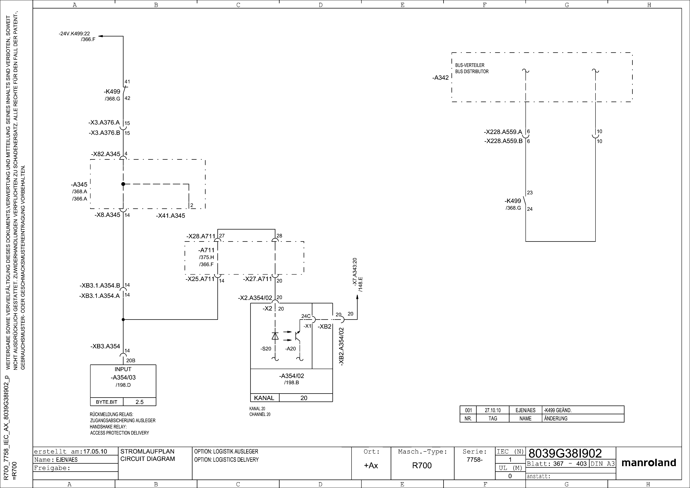

# +Ax — Sheet 367 of 403 — OPTION: LOGISTIK AUSLEGER

**OPTION: LOGISTICS DELIVERY**

> Part of the manroland **R700** printing press IEC/UL circuit diagrams.
> Drawing class: **Stromlaufplan / Circuit diagram** (DIN A3).
> Document `+Ax` covers the **Central control console** machine section.

## At a glance

| Field | Value |
|---|---|
| Document | `+Ax`  (8039G38I902) |
| Sheet | **367** of 403 |
| Section (DE) | OPTION: LOGISTIK AUSLEGER |
| Section (EN) | OPTION: LOGISTICS DELIVERY |
| Section type | CIRCUIT — Circuit diagram |
| Machine type | `R700` |
| Series | `7758` |
| Created | 17.05.10 |
| Replaces | — |
| Columns used | A, B, C, D, E, F, G |
| Path numbers | — |
| Labels on sheet | 86 |
| Cross-refs out | 10 |
| Cross-refs in | 28 |

**Previous:** [+Ax sheet 366](SHEET_0366.md) · **Next:** [+Ax sheet 368](SHEET_0368.md) · **Document TOC:** [_TOC.md](_TOC.md)  (+Ax) · **Master TOC:** [all sheets](../_MASTER_TOC.md)

## Sheet image (300 DPI, exact vector render)



_Rendered directly from the PDF vector layer at 300 DPI (1-bit), no OCR and no resampling. Use it to confirm anything ambiguous in the text below._

## Cross-references on this sheet

Each entry is a wire leaving this sheet. The printed token is `/sheet.column`; the link resolves to that sheet inside the same document.

| Ref | Target sheet | Col | Path | Destination on target | Target section | From col |
|---|---|---|---|---|---|---|
| `/366.F` | [+Ax sheet 366](SHEET_0366.md) | F | — | 24V.K499:22 | OPTION: LOGISTIK AUSLEGER | A |
| `/368.G` | [+Ax sheet 368](SHEET_0368.md) | G | — | — | OPTION: LOGISTIK AUSLEGER | A |
| `/368.A` | [+Ax sheet 368](SHEET_0368.md) | A | — | — | OPTION: LOGISTIK AUSLEGER | A |
| `/366.A` | [+Ax sheet 366](SHEET_0366.md) | A | — | — | OPTION: LOGISTIK AUSLEGER | A |
| `/368.G` | [+Ax sheet 368](SHEET_0368.md) | G | — | — | OPTION: LOGISTIK AUSLEGER | F |
| `/375.H` | [+Ax sheet 375](SHEET_0375.md) | H | — | — | OPTION: VORDERMARKENEINSTELLUNG | C |
| `/366.F` | [+Ax sheet 366](SHEET_0366.md) | F | — | — | OPTION: LOGISTIK AUSLEGER | C |
| `/148.E` | [+Ax sheet 148](SHEET_0148.md) | E | — | X7.A343:20 | ÜBERWACHUNGSRECHNER SICHERHEITSBUS | D |
| `/198.B` | [+Ax sheet 198](SHEET_0198.md) | B | — | — | REFERENZMODUL | D |
| `/198.D` | [+Ax sheet 198](SHEET_0198.md) | D | — | — | REFERENZMODUL | B |

### Incoming references (sheets that point here)

Every other sheet that sends a wire to this one. `Back-ref` is the token printed on *that* sheet; `Path` is its line number.

| From sheet | Cols | Back-ref | Path | Refs | What continues there |
|---|---|---|---|---|---|
| [+Ax#148](SHEET_0148.md) | E | `/148.E` | — | 1 | X7.A343:20 |
| [+Ax#198](SHEET_0198.md) | B, D | `/198.B`, `/198.D` | — | 2 | — |
| [+Ax#219](SHEET_0219.md) | D, F | `/219.D`, `/219.F` | — | 2 | — |
| [+Ax#224](SHEET_0224.md) | A, B, C, E, F | `/224.A`, `/224.B`, `/224.C`, `/224.E`, `/224.F` | — | 5 | — |
| [+Ax#238](SHEET_0238.md) | A | `/238.A` | — | 1 | — |
| [+Ax#268](SHEET_0268.md) | C | `/268.C` | — | 1 | — |
| [+Ax#271](SHEET_0271.md) | B | `/271.B` | — | 1 | — |
| [+Ax#272](SHEET_0272.md) | H | `/272.H` | — | 2 | — |
| [+Ax#280](SHEET_0280.md) | E | `/280.E` | — | 1 | — |
| [+Ax#286](SHEET_0286.md) | F | `/286.F` | — | 1 | — |
| [+Ax#294](SHEET_0294.md) | E, F | `/294.E`, `/294.F` | — | 4 | — |
| [+Ax#366](SHEET_0366.md) | A, F | `/366.A`, `/366.F` | — | 3 | — |
| [+Ax#368](SHEET_0368.md) | A, G | `/368.A`, `/368.G` | — | 3 | — |
| [+Ax#375](SHEET_0375.md) | H | `/375.H` | — | 1 | A711 |


## Devices on this sheet

| Tag | Class | Class meaning (IEC) | Col | Sub | Terminal | Sign |
|---|---|---|---|---|---|---|
| `A354/03` | A | Baugruppe / assembly, module, PC board | B | 03 | — | — |
| `A345` | A | Baugruppe / assembly, module, PC board | A | — | — | — |
| `S20` | S | Schalter / switch | C | — | — | — |
| `A20` | A | Baugruppe / assembly, module, PC board | D | — | — | — |
| `X1` | X | Klemme / terminal, plug connector | D | — | — | — |
| `X2` | X | Klemme / terminal, plug connector | C | — | — | — |
| `XB2` | XB |  | D | — | — | — |
| `A354/02` | A | Baugruppe / assembly, module, PC board | D | 02 | — | — |
| `A711` | A | Baugruppe / assembly, module, PC board | C | — | — | — |
| `K499` | K | Relais / relay, contactor | A | — | — | — |
| `K499` | K | Relais / relay, contactor | F | — | — | — |
| `A342` | A | Baugruppe / assembly, module, PC board | E | — | — | — |
| `2.5` | — | cross-device reference | B | — | — | — |
| `XB3.A354` | — | cross-device reference | A | — | — | — |
| `X3.A376.B` | — | cross-device reference | A | — | — | — |
| `X3.A376.A` | — | cross-device reference | A | — | — | — |
| `X8.A345` | — | cross-device reference | A | — | — | — |
| `X82.A345` | — | cross-device reference | A | — | — | — |
| `X28.A711` | — | cross-device reference | C | — | — | — |
| `X27.A711` | — | cross-device reference | C | — | — | — |
| `X25.A711` | — | cross-device reference | C | — | — | — |
| `XB3.1.A354.B` | — | cross-device reference | A | — | — | — |
| `XB3.1.A354.A` | — | cross-device reference | A | — | — | — |
| `NR.` | — | cross-device reference | F | — | — | — |
| `27.10.10` | — | cross-device reference | F | — | — | — |
| `X228.A559.B` | — | cross-device reference | F | — | — | — |
| `X228.A559.A` | — | cross-device reference | F | — | — | — |
| `X7.A343:20` | — | cross-device reference | D | — | 20 | — |
| `X41.A345` | — | cross-device reference | B | — | — | — |

## Potentials / nets

| Potential | Count | Columns | Attached devices | Terminals |
|---|---|---|---|---|
| `24V` | 1 | A | `K499` | `22` |


A potential such as `L24+/4` or `M24+` is a named supply/return rail; every place it appears on this sheet is electrically common.

## Wire-end annotations (grouped as printed)

A wire that continues elsewhere is annotated with a small cluster: the destination description, the path/line number `#NN`, and the `/sheet.column` cross reference. Each row below is one such cluster exactly as it is grouped on the drawing.

| Col | Y | Path | Cross-ref | Text on the wire |
|---|---|---|---|---|
| A | 54.1 | — | `/366.F` | `24V.K499:22` |
| F | 109.8 | — | — | `BUS VERTEILER BUS DISTRIBUTOR` |
| E | 129.3 | — | — | `A342` |
| B | 137.1 | — | — | `41` |
| B | 153.4 | — | — | `K499 42` |
| A | 166.5 | — | `/368.G` | — |
| A | 206.5 | — | — | `X3.A376.A 15` |
| F | 222.8 | — | — | `X228.A559.A 6` |
| G | 222.8 | — | — | `10` |
| A | 224.2 | — | — | `X3.A376.B 15` |
| F | 238.4 | — | — | `X228.A559.B 6` |
| G | 239.8 | — | — | `10` |
| A | 261.1 | — | — | `X82.A345 4` |
| A | 313.5 | — | — | `A345` |
| A | 326.6 | — | `/368.A`, `/366.A` | — |
| G | 328.4 | — | — | `23` |
| F | 341.9 | — | — | `K499 24` |
| B | 350.4 | — | — | `2` |
| F | 355.0 | — | `/368.G` | — |
| A | 366.0 | — | — | `X8.A345 14` |
| B | 367.4 | — | — | `X41.A345` |
| C | 402.8 | — | — | `X28.A711 27 28` |
| C | 426.9 | — | — | `A711` |
| C | 440.0 | — | `/375.H`, `/366.F` | — |
| D | 444.8 | — | `/148.E` | `X7.A343:20` |
| C | 476.5 | — | — | `X25.A711 14 X27.A711 20` |
| A | 487.9 | — | — | `XB3.1.A354.B 14` |
| A | 504.9 | — | — | `XB3.1.A354.A 14` |
| C | 509.1 | — | — | `X2.A354/02 20` |
| C | 527.6 | — | — | `X2` |
| D | 529.0 | — | — | `20 20` |
| D | 537.5 | — | — | `20` |
| D | 541.8 | — | — | `24C` |
| D | 558.7 | — | — | `X1` |
| D | 558.7 | — | — | `XB2` |
| D | 565.0 | — | — | `XB2.A354/02` |
| A | 592.8 | — | — | `XB3.A354 14` |
| C | 597.7 | — | — | `S20 A20` |
| B | 618.2 | — | — | `20B` |
| B | 632.8 | — | — | `INPUT` |
| D | 643.8 | — | — | `A354/02` |
| B | 646.6 | — | — | `A354/03` |
| D | 656.1 | — | `/198.B` | — |
| B | 660.4 | — | `/198.D` | — |
| D | 682.0 | — | — | `KANAL 20` |
| B | 689.4 | — | — | `BYTE.BIT 2.5` |
| C | 702.4 | — | — | `KANAL 20 CHANNEL 20` |
| F | 704.7 | — | — | `001 27.10.10 EJEN/AES K499 GEÄND.` |
| A | 712.1 | — | — | `RÜCKMELDUNG RELAIS:` |
| F | 718.8 | — | — | `NR. TAG NAME ÄNDERUNG` |
| B | 722.8 | — | — | `HANDSHAKE RELAY: ZUGANGSABSICHERUNG AUSLEGER` |
| B | 744.0 | — | — | `ACCESS PROTECTION DELIVERY` |


## Reconstructed tables

This sheet carries tabular content (pin map / terminal assignment / index). The grid below was rebuilt from the drawing's own rule lines, so each row is exactly one physical row of the table.

### Table 1 — 6 data rows × 10 columns (at x=155.9, y=317.5)

| X8.A345 | 14 | X41.A345 | 2 |  |  |  |  |  |  |
|---|---|---|---|---|---|---|---|---|---|
| `XB3.1.A354.B XB3.1.A354.A` | `14 14` |  | `X28.A711 A711 /375.H /366.F X25.A711` | `27 14` | `X27.A711 X2.A354/02` | `28 20 20` |  |  | `X7.A343:20` |
|  |  |  |  |  | `X2` | `20` | `24C` |  | `20 20` |
| `XB3.A354` | `14 20B` |  |  |  | `S20` | `A20` | `X1` | `XB2` | `XB2.A354/02` |
| `INPUT` | `A354/03 /198.D` |  |  |  |  | `A354/02 /198.B` |  |  |  |
|  |  |  |  |  | `KANAL` |  | `20` |  |  |
| `BYTE.BIT` | `2.5` |  |  |  |  |  |  |  |  |


## Notes and free text on this sheet

| Text | Col | Y (pt) |
|---|---|---|
| `20B` | B | 618.24 |
| `INPUT` | B | 632.76 |
| `BYTE.BIT` | A | 690.01 |
| `RÜCKMELDUNG RELAIS:` | A | 712.13 |
| `ZUGANGSABSICHERUNG AUSLEGER` | B | 722.77 |
| `HANDSHAKE RELAY:` | A | 733.37 |
| `ACCESS PROTECTION DELIVERY` | B | 744.02 |
| `KANAL 20` | C | 702.36 |
| `CHANNEL 20` | C | 712.3 |
| `24C` | D | 541.75 |
| `KANAL` | C | 682.03 |
| `X2.A354/02` | C | 509.13 |
| `XB2.A354/02` | D | 564.95 |
| `TAG` | F | 718.92 |
| `NAME` | F | 718.9 |
| `ÄNDERUNG` | G | 718.96 |
| `EJEN/AES` | F | 704.75 |
| `K499 GEÄND.` | G | 704.76 |
| `BUS VERTEILER` | F | 109.75 |
| `BUS DISTRIBUTOR` | F | 120.39 |

## Complete label inventory (exact text from the drawing)

Every text object inside the drawing area of this sheet, in DIN reading order (column A→H, then top→bottom). This is the authoritative list: if a string is not here it is not printed on this sheet.

| Col | Y | X | Dir | Type | Text |
|---|---|---|---|---|---|
| A | 54.1 | 101.5 | → | potential | `24V.K499:22` |
| A | 64.1 | 139.7 | → | cross-reference | `/366.F` |
| A | 153.4 | 179.1 | → | device tag | `K499` |
| A | 166.5 | 181.1 | → | cross-reference | `/368.G` |
| A | 206.5 | 152.5 | → | device ref | `X3.A376.A` |
| A | 224.3 | 153.4 | → | device ref | `X3.A376.B` |
| A | 261.1 | 157.3 | → | device ref | `X82.A345` |
| A | 313.5 | 122.5 | → | device tag | `A345` |
| A | 326.6 | 124.7 | → | cross-reference | `/368.A` |
| A | 339.0 | 124.7 | → | cross-reference | `/366.A` |
| A | 366.0 | 163.3 | → | device ref | `X8.A345` |
| A | 487.9 | 137.5 | → | device ref | `XB3.1.A354.B` |
| A | 505.6 | 136.6 | → | device ref | `XB3.1.A354.A` |
| A | 592.7 | 156.2 | → | device ref | `XB3.A354` |
| A | 690.0 | 165.8 | → | text | `BYTE.BIT` |
| A | 712.1 | 155.1 | → | text | `RÜCKMELDUNG RELAIS:` |
| A | 733.4 | 155.1 | → | text | `HANDSHAKE RELAY:` |
| B | 137.1 | 215.1 | → | number | `41` |
| B | 165.4 | 215.1 | → | number | `42` |
| B | 208.7 | 214.6 | → | number | `15` |
| B | 225.7 | 214.6 | → | number | `15` |
| B | 261.1 | 215.1 | → | number | `4` |
| B | 350.4 | 328.5 | → | number | `2` |
| B | 367.4 | 214.6 | → | number | `14` |
| B | 367.4 | 269.3 | → | device ref | `X41.A345` |
| B | 487.9 | 214.6 | → | number | `14` |
| B | 504.9 | 214.6 | → | number | `14` |
| B | 601.3 | 214.6 | → | number | `14` |
| B | 618.2 | 218.0 | → | text | `20B` |
| B | 632.8 | 197.7 | → | text | `INPUT` |
| B | 646.6 | 191.2 | → | device tag | `A354/03` |
| B | 660.4 | 199.8 | → | cross-reference | `/198.D` |
| B | 689.4 | 234.1 | → | device ref | `2.5` |
| B | 722.8 | 155.9 | → | text | `ZUGANGSABSICHERUNG AUSLEGER` |
| B | 744.0 | 155.9 | → | text | `ACCESS PROTECTION DELIVERY` |
| C | 402.8 | 321.7 | → | device ref | `X28.A711` |
| C | 402.8 | 378.1 | → | number | `27` |
| C | 426.9 | 342.1 | → | device tag | `A711` |
| C | 440.0 | 343.6 | → | cross-reference | `/375.H` |
| C | 452.4 | 343.8 | → | cross-reference | `/366.F` |
| C | 476.5 | 320.3 | → | device ref | `X25.A711` |
| C | 476.5 | 419.5 | → | device ref | `X27.A711` |
| C | 480.8 | 377.6 | → | number | `14` |
| C | 509.1 | 410.7 | → | text | `X2.A354/02` |
| C | 527.6 | 453.3 | → | device tag | `X2` |
| C | 597.7 | 449.6 | → | device tag | `S20` |
| C | 682.0 | 438.5 | → | text | `KANAL` |
| C | 702.4 | 430.3 | → | text | `KANAL 20` |
| C | 712.3 | 430.6 | → | text | `CHANNEL 20` |
| D | 402.8 | 477.4 | → | number | `28` |
| D | 444.8 | 608.3 | ↕ | device ref | `X7.A343:20` |
| D | 477.6 | 618.2 | ↕ | cross-reference | `/148.E` |
| D | 480.8 | 477.4 | → | number | `20` |
| D | 509.1 | 477.4 | → | number | `20` |
| D | 529.0 | 480.2 | → | number | `20` |
| D | 537.5 | 600.1 | → | number | `20` |
| D | 538.9 | 579.4 | → | number | `20` |
| D | 541.7 | 520.2 | → | text | `24C` |
| D | 558.7 | 523.8 | → | device tag | `X1` |
| D | 558.7 | 548.2 | → | device tag | `XB2` |
| D | 564.9 | 584.2 | ↕ | text | `XB2.A354/02` |
| D | 597.7 | 492.1 | → | device tag | `A20` |
| D | 643.8 | 481.7 | → | device tag | `A354/02` |
| D | 656.1 | 490.5 | → | cross-reference | `/198.B` |
| D | 682.0 | 518.6 | → | number | `20` |
| E | 129.3 | 746.1 | → | device tag | `A342` |
| F | 109.7 | 785.8 | → | text | `BUS VERTEILER` |
| F | 120.4 | 785.8 | → | text | `BUS DISTRIBUTOR` |
| F | 222.8 | 835.1 | → | device ref | `X228.A559.A` |
| F | 238.4 | 835.9 | → | device ref | `X228.A559.B` |
| F | 341.9 | 870.8 | → | device tag | `K499` |
| F | 355.0 | 872.8 | → | cross-reference | `/368.G` |
| F | 704.7 | 802.7 | → | number | `001` |
| F | 704.7 | 889.8 | → | text | `EJEN/AES` |
| F | 704.8 | 836.8 | → | device ref | `27.10.10` |
| F | 718.8 | 801.7 | → | device ref | `NR.` |
| F | 718.9 | 843.3 | → | text | `TAG` |
| F | 718.9 | 896.7 | → | text | `NAME` |
| G | 222.8 | 909.6 | → | number | `6` |
| G | 222.8 | 1029.5 | → | number | `10` |
| G | 239.9 | 909.6 | → | number | `6` |
| G | 239.9 | 1029.5 | → | number | `10` |
| G | 328.4 | 909.6 | → | number | `23` |
| G | 356.8 | 909.6 | → | number | `24` |
| G | 704.8 | 938.7 | → | text | `K499 GEÄND.` |
| G | 719.0 | 939.3 | → | text | `ÄNDERUNG` |

## Reading-order text block

The same content as a plain block, grouped by DIN column — convenient to paste or to match against a visual description.

```text
=== Column A ===
  54.1  101.5  net          24V.K499:22
  64.1  139.7  xref         /366.F
 153.4  179.1  devtag       K499
 166.5  181.1  xref         /368.G
 206.5  152.5  devref       X3.A376.A
 224.3  153.4  devref       X3.A376.B
 261.1  157.3  devref       X82.A345
 313.5  122.5  devtag       A345
 326.6  124.7  xref         /368.A
 339.0  124.7  xref         /366.A
 366.0  163.3  devref       X8.A345
 487.9  137.5  devref       XB3.1.A354.B
 505.6  136.6  devref       XB3.1.A354.A
 592.7  156.2  devref       XB3.A354
 690.0  165.8  text         BYTE.BIT
 712.1  155.1  text         RÜCKMELDUNG RELAIS:
 733.4  155.1  text         HANDSHAKE RELAY:
=== Column B ===
 137.1  215.1  numeric      41
 165.4  215.1  numeric      42
 208.7  214.6  numeric      15
 225.7  214.6  numeric      15
 261.1  215.1  numeric      4
 350.4  328.5  numeric      2
 367.4  214.6  numeric      14
 367.4  269.3  devref       X41.A345
 487.9  214.6  numeric      14
 504.9  214.6  numeric      14
 601.3  214.6  numeric      14
 618.2  218.0  text         20B
 632.8  197.7  text         INPUT
 646.6  191.2  devtag       A354/03
 660.4  199.8  xref         /198.D
 689.4  234.1  devref       2.5
 722.8  155.9  text         ZUGANGSABSICHERUNG AUSLEGER
 744.0  155.9  text         ACCESS PROTECTION DELIVERY
=== Column C ===
 402.8  321.7  devref       X28.A711
 402.8  378.1  numeric      27
 426.9  342.1  devtag       A711
 440.0  343.6  xref         /375.H
 452.4  343.8  xref         /366.F
 476.5  320.3  devref       X25.A711
 476.5  419.5  devref       X27.A711
 480.8  377.6  numeric      14
 509.1  410.7  text         X2.A354/02
 527.6  453.3  devtag       X2
 597.7  449.6  devtag       S20
 682.0  438.5  text         KANAL
 702.4  430.3  text         KANAL 20
 712.3  430.6  text         CHANNEL 20
=== Column D ===
 402.8  477.4  numeric      28
 444.8  608.3  devref       X7.A343:20
 477.6  618.2  xref         /148.E
 480.8  477.4  numeric      20
 509.1  477.4  numeric      20
 529.0  480.2  numeric      20
 537.5  600.1  numeric      20
 538.9  579.4  numeric      20
 541.7  520.2  text         24C
 558.7  523.8  devtag       X1
 558.7  548.2  devtag       XB2
 564.9  584.2  text         XB2.A354/02
 597.7  492.1  devtag       A20
 643.8  481.7  devtag       A354/02
 656.1  490.5  xref         /198.B
 682.0  518.6  numeric      20
=== Column E ===
 129.3  746.1  devtag       A342
=== Column F ===
 109.7  785.8  text         BUS VERTEILER
 120.4  785.8  text         BUS DISTRIBUTOR
 222.8  835.1  devref       X228.A559.A
 238.4  835.9  devref       X228.A559.B
 341.9  870.8  devtag       K499
 355.0  872.8  xref         /368.G
 704.7  802.7  numeric      001
 704.7  889.8  text         EJEN/AES
 704.8  836.8  devref       27.10.10
 718.8  801.7  devref       NR.
 718.9  843.3  text         TAG
 718.9  896.7  text         NAME
=== Column G ===
 222.8  909.6  numeric      6
 222.8 1029.5  numeric      10
 239.9  909.6  numeric      6
 239.9 1029.5  numeric      10
 328.4  909.6  numeric      23
 356.8  909.6  numeric      24
 704.8  938.7  text         K499 GEÄND.
 719.0  939.3  text         ÄNDERUNG
```

---
_Generated from the PDF vector text layer; no OCR. Source: `R700_7758_IEC_AX_8039G38I902_p`, sheet 367._
