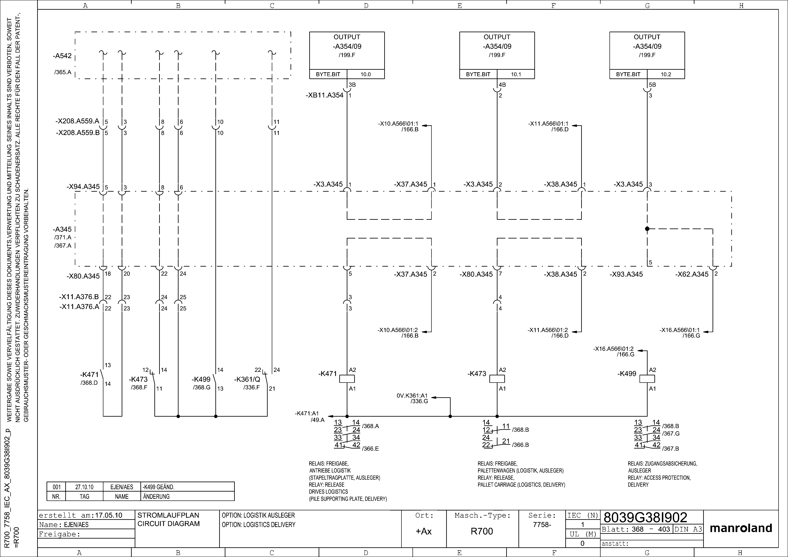

# +Ax — Sheet 368 of 403 — OPTION: LOGISTIK AUSLEGER

**OPTION: LOGISTICS DELIVERY**

> Part of the manroland **R700** printing press IEC/UL circuit diagrams.
> Drawing class: **Stromlaufplan / Circuit diagram** (DIN A3).
> Document `+Ax` covers the **Central control console** machine section.

## At a glance

| Field | Value |
|---|---|
| Document | `+Ax`  (8039G38I902) |
| Sheet | **368** of 403 |
| Section (DE) | OPTION: LOGISTIK AUSLEGER |
| Section (EN) | OPTION: LOGISTICS DELIVERY |
| Section type | CIRCUIT — Circuit diagram |
| Machine type | `R700` |
| Series | `7758` |
| Created | 17.05.10 |
| Replaces | — |
| Columns used | A, B, C, D, E, F, G, H |
| Path numbers | — |
| Labels on sheet | 179 |
| Cross-refs out | 24 |
| Cross-refs in | 70 |

**Previous:** [+Ax sheet 367](SHEET_0367.md) · **Next:** [+Ax sheet 369](SHEET_0369.md) · **Document TOC:** [_TOC.md](_TOC.md)  (+Ax) · **Master TOC:** [all sheets](../_MASTER_TOC.md)

## Sheet image (300 DPI, exact vector render)



_Rendered directly from the PDF vector layer at 300 DPI (1-bit), no OCR and no resampling. Use it to confirm anything ambiguous in the text below._

## Cross-references on this sheet

Each entry is a wire leaving this sheet. The printed token is `/sheet.column`; the link resolves to that sheet inside the same document.

| Ref | Target sheet | Col | Path | Destination on target | Target section | From col |
|---|---|---|---|---|---|---|
| `/199.F` | [+Ax sheet 199](SHEET_0199.md) | F | — | — | REFERENZMODUL | D |
| `/199.F` | [+Ax sheet 199](SHEET_0199.md) | F | — | — | REFERENZMODUL | E |
| `/199.F` | [+Ax sheet 199](SHEET_0199.md) | F | — | — | REFERENZMODUL | G |
| `/365.A` | [+Ax sheet 365](SHEET_0365.md) | A | — | — | OPTION: LOGISTIK AUSLEGER | A |
| `/166.B` | [+Ax sheet 166](SHEET_0166.md) | B | — | X10.A566\01:1 | ÜBERWACHUNGSRECHNER/ANSTEUERUNG NOT AUS | D |
| `/166.D` | [+Ax sheet 166](SHEET_0166.md) | D | — | X11.A566\01:1 | ÜBERWACHUNGSRECHNER/ANSTEUERUNG NOT AUS | F |
| `/371.A` | [+Ax sheet 371](SHEET_0371.md) | A | — | — | OPTION: VORDERMARKENEINSTELLUNG | A |
| `/367.A` | [+Ax sheet 367](SHEET_0367.md) | A | — | — | OPTION: LOGISTIK AUSLEGER | A |
| `/166.B` | [+Ax sheet 166](SHEET_0166.md) | B | — | X10.A566\01:2 | ÜBERWACHUNGSRECHNER/ANSTEUERUNG NOT AUS | D |
| `/166.D` | [+Ax sheet 166](SHEET_0166.md) | D | — | X11.A566\01:2 | ÜBERWACHUNGSRECHNER/ANSTEUERUNG NOT AUS | F |
| `/166.G` | [+Ax sheet 166](SHEET_0166.md) | G | — | X16.A566\01:1 | ÜBERWACHUNGSRECHNER/ANSTEUERUNG NOT AUS | G |
| `/166.G` | [+Ax sheet 166](SHEET_0166.md) | G | — | X16.A566\01:2 | ÜBERWACHUNGSRECHNER/ANSTEUERUNG NOT AUS | G |
| `/368.D` | [+Ax sheet 368](SHEET_0368.md) | D | — | — | OPTION: LOGISTIK AUSLEGER | A |
| `/368.F` | [+Ax sheet 368](SHEET_0368.md) | F | — | — | OPTION: LOGISTIK AUSLEGER | B |
| `/336.F` | [+Ax sheet 336](SHEET_0336.md) | F | — | — | OPTION: LOGISTIK ANLEGER / | C |
| `/368.G` | [+Ax sheet 368](SHEET_0368.md) | G | — | — | OPTION: LOGISTIK AUSLEGER | B |
| `/336.G` | [+Ax sheet 336](SHEET_0336.md) | G | — | 0V.K361:A1 | OPTION: LOGISTIK ANLEGER / | D |
| `/49.A` | [+Ax sheet 49](SHEET_0049.md) | A | — | K471:A1 | NOT AUS | C |
| `/368.A` | [+Ax sheet 368](SHEET_0368.md) | A | — | — | OPTION: LOGISTIK AUSLEGER | D |
| `/368.B` | [+Ax sheet 368](SHEET_0368.md) | B | — | — | OPTION: LOGISTIK AUSLEGER | G |
| `/367.G` | [+Ax sheet 367](SHEET_0367.md) | G | — | — | OPTION: LOGISTIK AUSLEGER | G |
| `/366.B` | [+Ax sheet 366](SHEET_0366.md) | B | — | — | OPTION: LOGISTIK AUSLEGER | F |
| `/366.E` | [+Ax sheet 366](SHEET_0366.md) | E | — | — | OPTION: LOGISTIK AUSLEGER | D |
| `/367.B` | [+Ax sheet 367](SHEET_0367.md) | B | — | — | OPTION: LOGISTIK AUSLEGER | G |

### Incoming references (sheets that point here)

Every other sheet that sends a wire to this one. `Back-ref` is the token printed on *that* sheet; `Path` is its line number.

| From sheet | Cols | Back-ref | Path | Refs | What continues there |
|---|---|---|---|---|---|
| [+Ax#49](SHEET_0049.md) | B | `/49.B` | — | 1 | — |
| [+Ax#166](SHEET_0166.md) | B, C, D, G | `/166.B`, `/166.C`, `/166.D`, `/166.G` | — | 6 | — |
| [+Ax#199](SHEET_0199.md) | F | `/199.F` | — | 3 | — |
| [+Ax#223](SHEET_0223.md) | B | `/223.B` | — | 3 | — |
| [+Ax#247](SHEET_0247.md) | A, C, E | `/247.A`, `/247.C`, `/247.E` | — | 15 | — |
| [+Ax#279](SHEET_0279.md) | F | `/279.F` | — | 2 | — |
| [+Ax#280](SHEET_0280.md) | A | `/280.A` | — | 2 | — |
| [+Ax#284](SHEET_0284.md) | G | `/284.G` | — | 1 | — |
| [+Ax#286](SHEET_0286.md) | C | `/286.C` | — | 6 | — |
| [+Ax#289](SHEET_0289.md) | G, H | `/289.G`, `/289.H` | — | 5 | — |
| [+Ax#292](SHEET_0292.md) | G, H | `/292.G`, `/292.H` | — | 12 | — |
| [+Ax#336](SHEET_0336.md) | F, G | `/336.F`, `/336.G` | — | 2 | — |
| [+Ax#365](SHEET_0365.md) | A | `/365.A` | — | 1 | — |
| [+Ax#366](SHEET_0366.md) | B, E | `/366.B`, `/366.E` | — | 2 | — |
| [+Ax#367](SHEET_0367.md) | A, F | `/367.A`, `/367.F` | — | 3 | — |
| [+Ax#368](SHEET_0368.md) | A, B, D, G | `/368.A`, `/368.B`, `/368.D`, `/368.G` | — | 5 | — |
| [+Ax#371](SHEET_0371.md) | A | `/371.A` | — | 1 | — |


## Devices on this sheet

| Tag | Class | Class meaning (IEC) | Col | Sub | Terminal | Sign |
|---|---|---|---|---|---|---|
| `A345` | A | Baugruppe / assembly, module, PC board | A | — | — | — |
| `A542` | A | Baugruppe / assembly, module, PC board | A | — | — | — |
| `A354/09` | A | Baugruppe / assembly, module, PC board | E | 09 | — | — |
| `A2` | A | Baugruppe / assembly, module, PC board | E | — | — | — |
| `A1` | A | Baugruppe / assembly, module, PC board | E | — | — | — |
| `K473` | K | Relais / relay, contactor | E | — | — | — |
| `A354/09` | A | Baugruppe / assembly, module, PC board | D | 09 | — | — |
| `A2` | A | Baugruppe / assembly, module, PC board | D | — | — | — |
| `A1` | A | Baugruppe / assembly, module, PC board | D | — | — | — |
| `K471` | K | Relais / relay, contactor | D | — | — | — |
| `K473` | K | Relais / relay, contactor | B | — | — | — |
| `A2` | A | Baugruppe / assembly, module, PC board | G | — | — | — |
| `A1` | A | Baugruppe / assembly, module, PC board | G | — | — | — |
| `K499` | K | Relais / relay, contactor | G | — | — | — |
| `A354/09` | A | Baugruppe / assembly, module, PC board | G | 09 | — | — |
| `K471` | K | Relais / relay, contactor | A | — | — | — |
| `K499` | K | Relais / relay, contactor | B | — | — | — |
| `K471:A1` | K | Relais / relay, contactor | C | — | A1 | — |
| `X94.A345` | — | cross-device reference | A | — | — | — |
| `X80.A345` | — | cross-device reference | A | — | — | — |
| `10.1` | — | cross-device reference | F | — | — | — |
| `X3.A345` | — | cross-device reference | E | — | — | — |
| `X80.A345` | — | cross-device reference | E | — | — | — |
| `X208.A559.B` | — | cross-device reference | A | — | — | — |
| `X208.A559.A` | — | cross-device reference | A | — | — | — |
| `10.0` | — | cross-device reference | D | — | — | — |
| `XB11.A354` | — | cross-device reference | D | — | — | — |
| `X3.A345` | — | cross-device reference | D | — | — | — |
| `X11.A376.B` | — | cross-device reference | A | — | — | — |
| `X11.A376.A` | — | cross-device reference | A | — | — | — |
| `X37.A345` | — | cross-device reference | D | — | — | — |
| `X37.A345` | — | cross-device reference | D | — | — | — |
| `10.2` | — | cross-device reference | G | — | — | — |
| `X3.A345` | — | cross-device reference | G | — | — | — |
| `X62.A345` | — | cross-device reference | G | — | — | — |
| `X38.A345` | — | cross-device reference | F | — | — | — |
| `X38.A345` | — | cross-device reference | F | — | — | — |
| `NR.` | — | cross-device reference | A | — | — | — |
| `27.10.10` | — | cross-device reference | A | — | — | — |
| `X10.A566\01:1` | — | cross-device reference | D | — | 1 | — |
| `X10.A566\01:2` | — | cross-device reference | D | — | 2 | — |
| `X11.A566\01:2` | — | cross-device reference | F | — | 2 | — |
| `X11.A566\01:1` | — | cross-device reference | F | — | 1 | — |
| `X16.A566\01:1` | — | cross-device reference | G | — | 1 | — |
| `X16.A566\01:2` | — | cross-device reference | G | — | 2 | — |
| `X93.A345` | — | cross-device reference | G | — | — | — |

## Potentials / nets

| Potential | Count | Columns | Attached devices | Terminals |
|---|---|---|---|---|
| `0V` | 1 | D | `K361` | `A1` |


A potential such as `L24+/4` or `M24+` is a named supply/return rail; every place it appears on this sheet is electrically common.

## Wire-end annotations (grouped as printed)

A wire that continues elsewhere is annotated with a small cluster: the destination description, the path/line number `#NN`, and the `/sheet.column` cross reference. Each row below is one such cluster exactly as it is grouped on the drawing.

| Col | Y | Path | Cross-ref | Text on the wire |
|---|---|---|---|---|
| D | 51.6 | — | — | `OUTPUT` |
| E | 51.6 | — | — | `OUTPUT` |
| G | 51.6 | — | — | `OUTPUT` |
| D | 65.5 | — | — | `A354/09` |
| E | 65.5 | — | — | `A354/09` |
| G | 65.5 | — | — | `A354/09` |
| D | 79.3 | — | `/199.F` | — |
| E | 79.3 | — | `/199.F` | — |
| G | 79.3 | — | `/199.F` | — |
| A | 79.7 | — | — | `A542` |
| A | 105.2 | — | `/365.A` | — |
| D | 108.9 | — | — | `BYTE.BIT 10.0` |
| E | 108.9 | — | — | `BYTE.BIT 10.1` |
| G | 108.9 | — | — | `BYTE.BIT 10.2` |
| D | 124.3 | — | — | `3B` |
| E | 124.3 | — | — | `4B` |
| G | 124.3 | — | — | `5B` |
| D | 139.2 | — | — | `XB11.A354 1` |
| E | 140.6 | — | — | `2` |
| G | 140.6 | — | — | `3` |
| A | 178.2 | — | — | `X208.A559.A 5` |
| A | 180.3 | — | — | `3` |
| B | 180.3 | — | — | `8` |
| B | 180.3 | — | — | `6` |
| B | 180.3 | — | — | `10` |
| C | 180.3 | — | — | `11` |
| D | 183.1 | — | `/166.B` | `X10.A566\01:1` |
| F | 183.1 | — | `/166.D` | `X11.A566\01:1` |
| A | 195.9 | — | — | `X208.A559.B 5` |
| A | 197.3 | — | — | `3` |
| B | 197.3 | — | — | `8` |
| B | 197.3 | — | — | `6` |
| B | 197.3 | — | — | `10` |
| C | 197.3 | — | — | `11` |
| D | 273.9 | — | — | `X3.A345 1` |
| E | 273.9 | — | — | `X37.A345 1` |
| E | 273.9 | — | — | `X3.A345 2` |
| F | 273.9 | — | — | `X38.A345 1` |
| G | 273.9 | — | — | `X3.A345 3` |
| A | 277.4 | — | — | `X94.A345 5` |
| A | 279.5 | — | — | `3` |
| B | 279.5 | — | — | `8` |
| B | 279.5 | — | — | `6` |
| A | 341.9 | — | — | `A345` |
| A | 354.9 | — | `/371.A`, `/367.A` | — |
| G | 392.9 | — | — | `5` |
| A | 409.9 | — | — | `X80.A345 18` |
| A | 409.9 | — | — | `20` |
| B | 409.9 | — | — | `22` |
| B | 409.9 | — | — | `24` |
| D | 409.9 | — | — | `5` |
| E | 409.9 | — | — | `X37.A345 2` |
| E | 409.9 | — | — | `X80.A345 7` |
| G | 409.9 | — | — | `X38.A345 2 X62.A345 2` |
| G | 409.9 | — | — | `X93.A345` |
| A | 443.9 | — | — | `X11.A376.B 22` |
| A | 445.4 | — | — | `23` |
| B | 445.4 | — | — | `24` |
| B | 445.4 | — | — | `25` |
| D | 445.4 | — | — | `3` |
| E | 445.4 | — | — | `4` |
| A | 458.8 | — | — | `X11.A376.A 22` |
| A | 462.4 | — | — | `23` |
| B | 462.4 | — | — | `24` |
| B | 462.4 | — | — | `25` |
| D | 462.4 | — | — | `3` |
| E | 462.4 | — | — | `4` |
| D | 494.9 | — | `/166.B` | `X10.A566\01:2` |
| F | 494.9 | — | `/166.D` | `X11.A566\01:2` |
| G | 494.9 | — | `/166.G` | `X16.A566\01:1` |
| G | 523.3 | — | `/166.G` | `X16.A566\01:2` |
| A | 548.1 | — | — | `13` |
| D | 555.1 | — | — | `A2` |
| E | 555.1 | — | — | `A2` |
| G | 555.1 | — | — | `A2` |
| B | 555.2 | — | — | `K473 14` |
| B | 555.2 | — | — | `12` |
| B | 555.2 | — | — | `14` |
| C | 555.2 | — | — | `K361/Q 24` |
| C | 555.2 | — | — | `22` |
| D | 560.1 | — | — | `K471` |
| E | 560.1 | — | — | `K473` |
| G | 560.1 | — | — | `K499` |
| A | 561.6 | — | — | `K471 14` |
| B | 568.6 | — | — | `K499 13` |
| A | 574.7 | — | `/368.D` | — |
| B | 581.7 | — | `/368.F` | — |
| B | 581.7 | — | `/368.G` | — |
| C | 581.7 | — | `/336.F` | — |
| B | 583.5 | — | — | `11` |
| C | 583.5 | — | — | `21` |
| D | 583.5 | — | — | `A1` |
| E | 583.5 | — | — | `A1` |
| G | 583.5 | — | — | `A1` |
| D | 594.1 | — | `/336.G` | `0V.K361:A1` |
| C | 621.1 | — | `/49.A` | `K471:A1` |
| D | 633.8 | — | — | `13 14` |
| E | 633.8 | — | — | `14 12 24 22 21` |
| G | 633.8 | — | — | `13 14` |
| F | 639.5 | — | — | `11 /368.B` |
| D | 640.2 | — | `/368.A` | — |
| G | 640.2 | — | `/368.B`, `/367.G` | — |
| D | 645.1 | — | — | `23 33 34 24` |
| G | 645.1 | — | — | `23 33 34 24` |
| D | 667.8 | — | — | `41 42` |
| G | 667.8 | — | — | `41 42` |
| F | 668.5 | — | `/366.B` | — |
| D | 674.2 | — | `/366.E` | — |
| G | 674.2 | — | `/367.B` | — |
| D | 697.9 | — | — | `RELAIS: FREIGABE,` |
| F | 697.9 | — | — | `RELAIS: FREIGABE, PALETTENWAGEN (LOGISTIK, AUSLEGER) RELAY: RELEASE, PALLET CARRIAGE (LOGISTICS, DELIVERY)` |
| G | 697.9 | — | — | `RELAIS: ZUGANGSABSICHERUNG,` |
| D | 708.6 | — | — | `RELAY: RELEASE DRIVES LOGISTICS (STAPELTRAGPLATTE, AUSLEGER) (PILE SUPPORTING PLATE, DELIVERY) ANTRIEBE LOGISTIK` |
| G | 708.6 | — | — | `RELAY: ACCESS PROTECTION, DELIVERY AUSLEGER` |
| A | 733.0 | — | — | `001 27.10.10 EJEN/AES K499 GEÄND.` |
| A | 747.1 | — | — | `NR. TAG NAME ÄNDERUNG` |


## Reconstructed tables

This sheet carries tabular content (pin map / terminal assignment / index). The grid below was rebuilt from the drawing's own rule lines, so each row is exactly one physical row of the table.

### Table 1 — 1 data rows × 6 columns (at x=155.9, y=48.2)

| 5 5 5 | 3 3 3 |  | 8 8 8 | 6 6 6 | 10 10 |
|---|---|---|---|---|---|
| `18 22 22 13 14` | `20 23 23 12 K473 /368.F` | `11` | `22 24 24 14` | `24 25 25 K499 /368.G` | `14 22 K361/Q /336.F 13` |


### Table 2 — 3 data rows × 5 columns (at x=411.0, y=48.2)

|  | OUTPUT | A354/09 /199.F |  |  |
|---|---|---|---|---|
|  | `BYTE.BIT` | `10.0` |  |  |
| `11 11` | `XB11.A354 X3.A345` | `3B 1 1` | `X10.A566\01:1 /166.B X37.A345` | `1` |
| `24 21 K471:A1` | `K471` | `5 3 3 A2 A1` | `X37.A345 X10.A566\01:2 /166.B 0V.K361:A1 /336.G` | `2` |


### Table 3 — 3 data rows × 7 columns (at x=694.5, y=48.2)

| OUTPUT | A354/09 /199.F |  |  | OUTPUT | A354/09 /199.F |  |
|---|---|---|---|---|---|---|
| `BYTE.BIT` | `10.1` |  |  | `BYTE.BIT` | `10.2` |  |
| `X3.A345` | `4B 2 2` | `X11.A566\01:1 /166.D X38.A345` | `1` | `X3.A345` | `5B 3 3` |  |
| `X80.A345 K473` | `7 4 4 A2 A1` | `X38.A345 X11.A566\01:2 /166.D` | `2` | `X93.A345 X16.A566\01:2 /166.G K499` | `5 X16.A566\01:1 A2 A1` | `X62.A345 /166.G` |


## Notes and free text on this sheet

| Text | Col | Y (pt) |
|---|---|---|
| `4B` | E | 124.29 |
| `OUTPUT` | E | 51.64 |
| `BYTE.BIT` | E | 108.91 |
| `11 /368.B` | F | 639.48 |
| `RELAIS: FREIGABE,` | E | 697.91 |
| `PALETTENWAGEN (LOGISTIK, AUSLEGER)` | F | 708.56 |
| `RELAY: RELEASE,` | E | 719.18 |
| `PALLET CARRIAGE (LOGISTICS, DELIVERY)` | F | 729.84 |
| `3B` | D | 124.29 |
| `OUTPUT` | D | 51.64 |
| `BYTE.BIT` | D | 108.91 |
| `RELAIS: FREIGABE,` | D | 697.91 |
| `ANTRIEBE LOGISTIK` | D | 708.57 |
| `(STAPELTRAGPLATTE, AUSLEGER)` | D | 719.21 |
| `RELAY: RELEASE` | D | 729.82 |
| `DRIVES LOGISTICS` | D | 740.46 |
| `(PILE SUPPORTING PLATE, DELIVERY)` | D | 751.1 |
| `K361/Q` | C | 568.67 |
| `RELAIS: ZUGANGSABSICHERUNG,` | G | 697.94 |
| `AUSLEGER` | G | 708.59 |
| `RELAY: ACCESS PROTECTION,` | G | 719.2 |
| `DELIVERY` | G | 729.83 |
| `5B` | G | 124.29 |
| `OUTPUT` | G | 51.64 |
| `BYTE.BIT` | G | 108.91 |
| `TAG` | A | 747.27 |
| `NAME` | A | 747.25 |
| `ÄNDERUNG` | B | 747.31 |
| `EJEN/AES` | A | 733.09 |
| `K499 GEÄND.` | B | 733.11 |

## Complete label inventory (exact text from the drawing)

Every text object inside the drawing area of this sheet, in DIN reading order (column A→H, then top→bottom). This is the authoritative list: if a string is not here it is not printed on this sheet.

| Col | Y | X | Dir | Type | Text |
|---|---|---|---|---|---|
| A | 79.7 | 79.9 | → | device tag | `A542` |
| A | 105.1 | 82.2 | → | cross-reference | `/365.A` |
| A | 178.2 | 83.9 | → | device ref | `X208.A559.A` |
| A | 180.3 | 158.5 | → | number | `5` |
| A | 180.3 | 186.8 | → | number | `3` |
| A | 195.9 | 84.8 | → | device ref | `X208.A559.B` |
| A | 197.3 | 158.5 | → | number | `5` |
| A | 197.3 | 186.8 | → | number | `3` |
| A | 277.4 | 100.6 | → | device ref | `X94.A345` |
| A | 279.5 | 158.5 | → | number | `5` |
| A | 279.5 | 186.8 | → | number | `3` |
| A | 341.9 | 79.9 | → | device tag | `A345` |
| A | 354.9 | 82.2 | → | cross-reference | `/371.A` |
| A | 367.4 | 82.2 | → | cross-reference | `/367.A` |
| A | 409.9 | 157.9 | → | number | `18` |
| A | 409.9 | 186.8 | → | number | `20` |
| A | 412.7 | 100.6 | → | device ref | `X80.A345` |
| A | 443.9 | 89.3 | → | device ref | `X11.A376.B` |
| A | 445.4 | 158.5 | → | number | `22` |
| A | 445.4 | 186.8 | → | number | `23` |
| A | 458.8 | 89.9 | → | device ref | `X11.A376.A` |
| A | 462.4 | 158.5 | → | number | `22` |
| A | 462.4 | 186.8 | → | number | `23` |
| A | 548.1 | 157.9 | → | number | `13` |
| A | 561.6 | 121.0 | → | device tag | `K471` |
| A | 574.7 | 121.9 | → | cross-reference | `/368.D` |
| A | 576.5 | 157.9 | → | number | `14` |
| A | 733.0 | 79.8 | → | number | `001` |
| A | 733.1 | 114.0 | → | device ref | `27.10.10` |
| A | 733.1 | 167.0 | → | text | `EJEN/AES` |
| A | 747.1 | 78.9 | → | device ref | `NR.` |
| A | 747.3 | 120.4 | → | text | `TAG` |
| A | 747.3 | 173.8 | → | text | `NAME` |
| B | 180.3 | 243.5 | → | number | `8` |
| B | 180.3 | 271.8 | → | number | `6` |
| B | 180.3 | 328.0 | → | number | `10` |
| B | 197.3 | 243.5 | → | number | `8` |
| B | 197.3 | 271.8 | → | number | `6` |
| B | 197.3 | 328.0 | → | number | `10` |
| B | 279.5 | 243.5 | → | number | `8` |
| B | 279.5 | 271.8 | → | number | `6` |
| B | 409.9 | 243.5 | → | number | `22` |
| B | 409.9 | 271.8 | → | number | `24` |
| B | 445.4 | 243.5 | → | number | `24` |
| B | 445.4 | 271.8 | → | number | `25` |
| B | 462.4 | 243.5 | → | number | `24` |
| B | 462.4 | 271.8 | → | number | `25` |
| B | 555.2 | 214.9 | → | number | `12` |
| B | 555.2 | 242.9 | → | number | `14` |
| B | 555.2 | 328.0 | → | number | `14` |
| B | 568.6 | 194.7 | → | device tag | `K473` |
| B | 568.6 | 289.7 | → | device tag | `K499` |
| B | 581.7 | 197.9 | → | cross-reference | `/368.F` |
| B | 581.7 | 291.7 | → | cross-reference | `/368.G` |
| B | 583.6 | 235.8 | → | number | `11` |
| B | 583.6 | 328.0 | → | number | `13` |
| B | 733.1 | 215.9 | → | text | `K499 GEÄND.` |
| B | 747.3 | 216.4 | → | text | `ÄNDERUNG` |
| C | 180.3 | 413.0 | → | number | `11` |
| C | 197.3 | 413.0 | → | number | `11` |
| C | 555.2 | 384.9 | → | number | `22` |
| C | 555.2 | 413.6 | → | number | `24` |
| C | 568.7 | 353.8 | → | text | `K361/Q` |
| C | 581.7 | 367.9 | → | cross-reference | `/336.F` |
| C | 583.6 | 406.5 | → | number | `21` |
| C | 621.1 | 445.6 | → | device tag | `K471:A1` |
| C | 631.0 | 469.7 | → | cross-reference | `/49.A` |
| D | 51.6 | 504.1 | → | text | `OUTPUT` |
| D | 65.5 | 503.0 | → | device tag | `A354/09` |
| D | 79.3 | 512.1 | → | cross-reference | `/199.F` |
| D | 108.9 | 477.6 | → | text | `BYTE.BIT` |
| D | 108.9 | 544.5 | → | device ref | `10.0` |
| D | 124.3 | 527.0 | → | text | `3B` |
| D | 139.2 | 462.0 | → | device ref | `XB11.A354` |
| D | 140.6 | 526.4 | → | number | `1` |
| D | 183.1 | 571.5 | → | device ref | `X10.A566\01:1` |
| D | 191.6 | 606.9 | → | cross-reference | `/166.B` |
| D | 273.8 | 595.3 | → | device ref | `X37.A345` |
| D | 273.9 | 473.7 | → | device ref | `X3.A345` |
| D | 275.3 | 526.4 | → | number | `1` |
| D | 409.9 | 527.0 | → | number | `5` |
| D | 409.9 | 595.3 | → | device ref | `X37.A345` |
| D | 445.4 | 527.0 | → | number | `3` |
| D | 462.4 | 527.0 | → | number | `3` |
| D | 494.9 | 570.3 | → | device ref | `X10.A566\01:2` |
| D | 503.4 | 606.9 | → | cross-reference | `/166.B` |
| D | 555.2 | 527.2 | → | device tag | `A2` |
| D | 560.1 | 481.0 | → | device tag | `K471` |
| D | 583.5 | 527.2 | → | device tag | `A1` |
| D | 594.1 | 599.5 | → | potential | `0V.K361:A1` |
| D | 633.8 | 504.6 | → | number | `13` |
| D | 633.8 | 531.8 | → | number | `14` |
| D | 640.2 | 547.1 | → | cross-reference | `/368.A` |
| D | 645.2 | 504.6 | → | number | `23` |
| D | 645.2 | 532.6 | → | number | `24` |
| D | 656.5 | 504.6 | → | number | `33` |
| D | 656.5 | 532.3 | → | number | `34` |
| D | 667.8 | 506.0 | → | number | `41` |
| D | 667.8 | 532.6 | → | number | `42` |
| D | 674.2 | 547.1 | → | cross-reference | `/366.E` |
| D | 697.9 | 466.9 | → | text | `RELAIS: FREIGABE,` |
| D | 708.6 | 467.7 | → | text | `ANTRIEBE LOGISTIK` |
| D | 719.2 | 467.1 | → | text | `(STAPELTRAGPLATTE, AUSLEGER)` |
| D | 729.8 | 466.9 | → | text | `RELAY: RELEASE` |
| D | 740.5 | 466.9 | → | text | `DRIVES LOGISTICS` |
| D | 751.1 | 467.1 | → | text | `(PILE SUPPORTING PLATE, DELIVERY)` |
| E | 51.6 | 730.9 | → | text | `OUTPUT` |
| E | 65.5 | 729.8 | → | device tag | `A354/09` |
| E | 79.3 | 738.9 | → | cross-reference | `/199.F` |
| E | 108.9 | 704.4 | → | text | `BYTE.BIT` |
| E | 124.3 | 753.7 | → | text | `4B` |
| E | 140.6 | 753.7 | → | number | `2` |
| E | 273.9 | 700.4 | → | device ref | `X3.A345` |
| E | 275.3 | 654.0 | → | number | `1` |
| E | 275.3 | 753.7 | → | number | `2` |
| E | 409.9 | 654.5 | → | number | `2` |
| E | 409.9 | 694.5 | → | device ref | `X80.A345` |
| E | 409.9 | 753.7 | → | number | `7` |
| E | 445.4 | 753.7 | → | number | `4` |
| E | 462.4 | 753.7 | → | number | `4` |
| E | 555.2 | 754.0 | → | device tag | `A2` |
| E | 560.1 | 706.4 | → | device tag | `K473` |
| E | 583.5 | 754.0 | → | device tag | `A1` |
| E | 602.6 | 620.5 | → | cross-reference | `/336.G` |
| E | 633.8 | 728.5 | → | number | `14` |
| E | 645.2 | 728.5 | → | number | `12` |
| E | 656.5 | 728.5 | → | number | `24` |
| E | 662.2 | 758.8 | → | number | `21` |
| E | 667.8 | 728.5 | → | number | `22` |
| E | 697.9 | 722.0 | → | text | `RELAIS: FREIGABE,` |
| E | 719.2 | 722.0 | → | text | `RELAY: RELEASE,` |
| F | 108.9 | 771.9 | → | device ref | `10.1` |
| F | 183.1 | 798.2 | → | device ref | `X11.A566\01:1` |
| F | 191.6 | 833.4 | → | cross-reference | `/166.D` |
| F | 273.8 | 822.0 | → | device ref | `X38.A345` |
| F | 275.3 | 880.7 | → | number | `1` |
| F | 409.9 | 822.0 | → | device ref | `X38.A345` |
| F | 409.9 | 881.3 | → | number | `2` |
| F | 494.9 | 797.1 | → | device ref | `X11.A566\01:2` |
| F | 503.4 | 833.4 | → | cross-reference | `/166.D` |
| F | 639.5 | 758.6 | → | text | `11 /368.B` |
| F | 668.5 | 773.9 | → | cross-reference | `/366.B` |
| F | 708.6 | 722.0 | → | text | `PALETTENWAGEN (LOGISTIK, AUSLEGER)` |
| F | 729.8 | 722.0 | → | text | `PALLET CARRIAGE (LOGISTICS, DELIVERY)` |
| G | 51.6 | 957.7 | → | text | `OUTPUT` |
| G | 65.5 | 956.6 | → | device tag | `A354/09` |
| G | 79.3 | 965.6 | → | cross-reference | `/199.F` |
| G | 108.9 | 931.2 | → | text | `BYTE.BIT` |
| G | 108.9 | 998.2 | → | device ref | `10.2` |
| G | 124.3 | 980.5 | → | text | `5B` |
| G | 140.6 | 980.5 | → | number | `3` |
| G | 273.9 | 927.2 | → | device ref | `X3.A345` |
| G | 275.3 | 980.5 | → | number | `3` |
| G | 392.9 | 980.5 | → | number | `5` |
| G | 409.9 | 921.3 | → | device ref | `X93.A345` |
| G | 409.9 | 1020.5 | → | device ref | `X62.A345` |
| G | 494.9 | 996.7 | → | device ref | `X16.A566\01:1` |
| G | 503.4 | 1031.5 | → | cross-reference | `/166.G` |
| G | 523.3 | 896.3 | → | device ref | `X16.A566\01:2` |
| G | 531.8 | 932.3 | → | cross-reference | `/166.G` |
| G | 555.2 | 980.8 | → | device tag | `A2` |
| G | 560.1 | 933.2 | → | device tag | `K499` |
| G | 583.5 | 980.8 | → | device tag | `A1` |
| G | 633.8 | 958.1 | → | number | `13` |
| G | 633.8 | 985.3 | → | number | `14` |
| G | 640.2 | 1000.6 | → | cross-reference | `/368.B` |
| G | 645.2 | 958.1 | → | number | `23` |
| G | 645.2 | 986.2 | → | number | `24` |
| G | 651.5 | 1000.6 | → | cross-reference | `/367.G` |
| G | 656.5 | 958.1 | → | number | `33` |
| G | 656.5 | 985.9 | → | number | `34` |
| G | 667.8 | 959.5 | → | number | `41` |
| G | 667.8 | 986.2 | → | number | `42` |
| G | 674.2 | 1000.6 | → | cross-reference | `/367.B` |
| G | 697.9 | 948.8 | → | text | `RELAIS: ZUGANGSABSICHERUNG,` |
| G | 708.6 | 949.6 | → | text | `AUSLEGER` |
| G | 719.2 | 948.8 | → | text | `RELAY: ACCESS PROTECTION,` |
| G | 729.8 | 948.8 | → | text | `DELIVERY` |
| H | 409.9 | 1079.7 | → | number | `2` |

## Reading-order text block

The same content as a plain block, grouped by DIN column — convenient to paste or to match against a visual description.

```text
=== Column A ===
  79.7   79.9  devtag       A542
 105.1   82.2  xref         /365.A
 178.2   83.9  devref       X208.A559.A
 180.3  158.5  numeric      5
 180.3  186.8  numeric      3
 195.9   84.8  devref       X208.A559.B
 197.3  158.5  numeric      5
 197.3  186.8  numeric      3
 277.4  100.6  devref       X94.A345
 279.5  158.5  numeric      5
 279.5  186.8  numeric      3
 341.9   79.9  devtag       A345
 354.9   82.2  xref         /371.A
 367.4   82.2  xref         /367.A
 409.9  157.9  numeric      18
 409.9  186.8  numeric      20
 412.7  100.6  devref       X80.A345
 443.9   89.3  devref       X11.A376.B
 445.4  158.5  numeric      22
 445.4  186.8  numeric      23
 458.8   89.9  devref       X11.A376.A
 462.4  158.5  numeric      22
 462.4  186.8  numeric      23
 548.1  157.9  numeric      13
 561.6  121.0  devtag       K471
 574.7  121.9  xref         /368.D
 576.5  157.9  numeric      14
 733.0   79.8  numeric      001
 733.1  114.0  devref       27.10.10
 733.1  167.0  text         EJEN/AES
 747.1   78.9  devref       NR.
 747.3  120.4  text         TAG
 747.3  173.8  text         NAME
=== Column B ===
 180.3  243.5  numeric      8
 180.3  271.8  numeric      6
 180.3  328.0  numeric      10
 197.3  243.5  numeric      8
 197.3  271.8  numeric      6
 197.3  328.0  numeric      10
 279.5  243.5  numeric      8
 279.5  271.8  numeric      6
 409.9  243.5  numeric      22
 409.9  271.8  numeric      24
 445.4  243.5  numeric      24
 445.4  271.8  numeric      25
 462.4  243.5  numeric      24
 462.4  271.8  numeric      25
 555.2  214.9  numeric      12
 555.2  242.9  numeric      14
 555.2  328.0  numeric      14
 568.6  194.7  devtag       K473
 568.6  289.7  devtag       K499
 581.7  197.9  xref         /368.F
 581.7  291.7  xref         /368.G
 583.6  235.8  numeric      11
 583.6  328.0  numeric      13
 733.1  215.9  text         K499 GEÄND.
 747.3  216.4  text         ÄNDERUNG
=== Column C ===
 180.3  413.0  numeric      11
 197.3  413.0  numeric      11
 555.2  384.9  numeric      22
 555.2  413.6  numeric      24
 568.7  353.8  text         K361/Q
 581.7  367.9  xref         /336.F
 583.6  406.5  numeric      21
 621.1  445.6  devtag       K471:A1
 631.0  469.7  xref         /49.A
=== Column D ===
  51.6  504.1  text         OUTPUT
  65.5  503.0  devtag       A354/09
  79.3  512.1  xref         /199.F
 108.9  477.6  text         BYTE.BIT
 108.9  544.5  devref       10.0
 124.3  527.0  text         3B
 139.2  462.0  devref       XB11.A354
 140.6  526.4  numeric      1
 183.1  571.5  devref       X10.A566\01:1
 191.6  606.9  xref         /166.B
 273.8  595.3  devref       X37.A345
 273.9  473.7  devref       X3.A345
 275.3  526.4  numeric      1
 409.9  527.0  numeric      5
 409.9  595.3  devref       X37.A345
 445.4  527.0  numeric      3
 462.4  527.0  numeric      3
 494.9  570.3  devref       X10.A566\01:2
 503.4  606.9  xref         /166.B
 555.2  527.2  devtag       A2
 560.1  481.0  devtag       K471
 583.5  527.2  devtag       A1
 594.1  599.5  net          0V.K361:A1
 633.8  504.6  numeric      13
 633.8  531.8  numeric      14
 640.2  547.1  xref         /368.A
 645.2  504.6  numeric      23
 645.2  532.6  numeric      24
 656.5  504.6  numeric      33
 656.5  532.3  numeric      34
 667.8  506.0  numeric      41
 667.8  532.6  numeric      42
 674.2  547.1  xref         /366.E
 697.9  466.9  text         RELAIS: FREIGABE,
 708.6  467.7  text         ANTRIEBE LOGISTIK
 719.2  467.1  text         (STAPELTRAGPLATTE, AUSLEGER)
 729.8  466.9  text         RELAY: RELEASE
 740.5  466.9  text         DRIVES LOGISTICS
 751.1  467.1  text         (PILE SUPPORTING PLATE, DELIVERY)
=== Column E ===
  51.6  730.9  text         OUTPUT
  65.5  729.8  devtag       A354/09
  79.3  738.9  xref         /199.F
 108.9  704.4  text         BYTE.BIT
 124.3  753.7  text         4B
 140.6  753.7  numeric      2
 273.9  700.4  devref       X3.A345
 275.3  654.0  numeric      1
 275.3  753.7  numeric      2
 409.9  654.5  numeric      2
 409.9  694.5  devref       X80.A345
 409.9  753.7  numeric      7
 445.4  753.7  numeric      4
 462.4  753.7  numeric      4
 555.2  754.0  devtag       A2
 560.1  706.4  devtag       K473
 583.5  754.0  devtag       A1
 602.6  620.5  xref         /336.G
 633.8  728.5  numeric      14
 645.2  728.5  numeric      12
 656.5  728.5  numeric      24
 662.2  758.8  numeric      21
 667.8  728.5  numeric      22
 697.9  722.0  text         RELAIS: FREIGABE,
 719.2  722.0  text         RELAY: RELEASE,
=== Column F ===
 108.9  771.9  devref       10.1
 183.1  798.2  devref       X11.A566\01:1
 191.6  833.4  xref         /166.D
 273.8  822.0  devref       X38.A345
 275.3  880.7  numeric      1
 409.9  822.0  devref       X38.A345
 409.9  881.3  numeric      2
 494.9  797.1  devref       X11.A566\01:2
 503.4  833.4  xref         /166.D
 639.5  758.6  text         11 /368.B
 668.5  773.9  xref         /366.B
 708.6  722.0  text         PALETTENWAGEN (LOGISTIK, AUSLEGER)
 729.8  722.0  text         PALLET CARRIAGE (LOGISTICS, DELIVERY)
=== Column G ===
  51.6  957.7  text         OUTPUT
  65.5  956.6  devtag       A354/09
  79.3  965.6  xref         /199.F
 108.9  931.2  text         BYTE.BIT
 108.9  998.2  devref       10.2
 124.3  980.5  text         5B
 140.6  980.5  numeric      3
 273.9  927.2  devref       X3.A345
 275.3  980.5  numeric      3
 392.9  980.5  numeric      5
 409.9  921.3  devref       X93.A345
 409.9 1020.5  devref       X62.A345
 494.9  996.7  devref       X16.A566\01:1
 503.4 1031.5  xref         /166.G
 523.3  896.3  devref       X16.A566\01:2
 531.8  932.3  xref         /166.G
 555.2  980.8  devtag       A2
 560.1  933.2  devtag       K499
 583.5  980.8  devtag       A1
 633.8  958.1  numeric      13
 633.8  985.3  numeric      14
 640.2 1000.6  xref         /368.B
 645.2  958.1  numeric      23
 645.2  986.2  numeric      24
 651.5 1000.6  xref         /367.G
 656.5  958.1  numeric      33
 656.5  985.9  numeric      34
 667.8  959.5  numeric      41
 667.8  986.2  numeric      42
 674.2 1000.6  xref         /367.B
 697.9  948.8  text         RELAIS: ZUGANGSABSICHERUNG,
 708.6  949.6  text         AUSLEGER
 719.2  948.8  text         RELAY: ACCESS PROTECTION,
 729.8  948.8  text         DELIVERY
=== Column H ===
 409.9 1079.7  numeric      2
```

---
_Generated from the PDF vector text layer; no OCR. Source: `R700_7758_IEC_AX_8039G38I902_p`, sheet 368._
