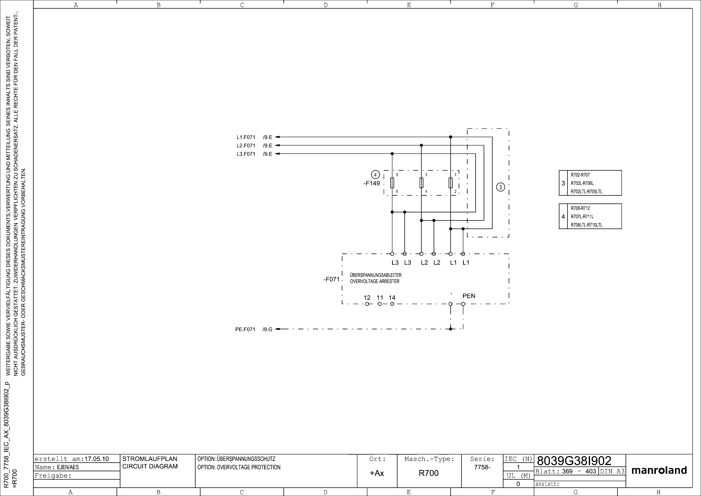

# +Ax — Sheet 369 of 403 — OPTION: ÜBERSPANNUNGSSCHUTZ

**OPTION: OVERVOLTAGE PROTECTION**

> Part of the manroland **R700** printing press IEC/UL circuit diagrams.
> Drawing class: **Stromlaufplan / Circuit diagram** (DIN A3).
> Document `+Ax` covers the **Central control console** machine section.

## At a glance

| Field | Value |
|---|---|
| Document | `+Ax`  (8039G38I902) |
| Sheet | **369** of 403 |
| Section (DE) | OPTION: ÜBERSPANNUNGSSCHUTZ |
| Section (EN) | OPTION: OVERVOLTAGE PROTECTION |
| Section type | CIRCUIT — Circuit diagram |
| Machine type | `R700` |
| Series | `7758` |
| Created | 17.05.10 |
| Replaces | — |
| Columns used | C, D, E, F, G |
| Path numbers | — |
| Labels on sheet | 39 |
| Cross-refs out | 4 |
| Cross-refs in | 4 |

**Previous:** [+Ax sheet 368](SHEET_0368.md) · **Next:** [+Ax sheet 370](SHEET_0370.md) · **Document TOC:** [_TOC.md](_TOC.md)  (+Ax) · **Master TOC:** [all sheets](../_MASTER_TOC.md)

## Sheet image (300 DPI, exact vector render)



_Rendered directly from the PDF vector layer at 300 DPI (1-bit), no OCR and no resampling. Use it to confirm anything ambiguous in the text below._

## Cross-references on this sheet

Each entry is a wire leaving this sheet. The printed token is `/sheet.column`; the link resolves to that sheet inside the same document.

| Ref | Target sheet | Col | Path | Destination on target | Target section | From col |
|---|---|---|---|---|---|---|
| `/9.E` | [+Ax sheet 9](SHEET_0009.md) | E | — | L1.F071 | SPANNUNGSVERSORGUNG, SCHALTSCHRANKBELÜFTUNG | C |
| `/9.E` | [+Ax sheet 9](SHEET_0009.md) | E | — | L2.F071 | SPANNUNGSVERSORGUNG, SCHALTSCHRANKBELÜFTUNG | C |
| `/9.E` | [+Ax sheet 9](SHEET_0009.md) | E | — | L3.F071 | SPANNUNGSVERSORGUNG, SCHALTSCHRANKBELÜFTUNG | C |
| `/9.G` | [+Ax sheet 9](SHEET_0009.md) | G | — | PE.F071 | SPANNUNGSVERSORGUNG, SCHALTSCHRANKBELÜFTUNG | C |

### Incoming references (sheets that point here)

Every other sheet that sends a wire to this one. `Back-ref` is the token printed on *that* sheet; `Path` is its line number.

| From sheet | Cols | Back-ref | Path | Refs | What continues there |
|---|---|---|---|---|---|
| [+Ax#9](SHEET_0009.md) | E, G | `/9.E`, `/9.G` | — | 4 | L1.F071; L2.F071; L3.F071; PE.F071 |


## Devices on this sheet

| Tag | Class | Class meaning (IEC) | Col | Sub | Terminal | Sign |
|---|---|---|---|---|---|---|
| `F149` | F | Schutz / protection device (fuse, circuit breaker) | E | — | — | — |
| `F071` | F | Schutz / protection device (fuse, circuit breaker) | D | — | — | — |

## Potentials / nets

| Potential | Count | Columns | Attached devices | Terminals |
|---|---|---|---|---|
| `L1` | 3 | C, F | `F071` | — |
| `L2` | 3 | C, E | `F071` | — |
| `L3` | 3 | C, E | `F071` | — |
| `PE` | 1 | C | `F071` | — |


A potential such as `L24+/4` or `M24+` is a named supply/return rail; every place it appears on this sheet is electrically common.

## Wire-end annotations (grouped as printed)

A wire that continues elsewhere is annotated with a small cluster: the destination description, the path/line number `#NN`, and the `/sheet.column` cross reference. Each row below is one such cluster exactly as it is grouped on the drawing.

| Col | Y | Path | Cross-ref | Text on the wire |
|---|---|---|---|---|
| C | 229.1 | — | `/9.E` | `L1.F071` |
| C | 243.3 | — | `/9.E` | `L2.F071` |
| C | 257.5 | — | `/9.E` | `L3.F071` |
| E | 293.7 | — | — | `4` |
| F | 294.0 | — | — | `1` |
| G | 294.0 | — | — | `R702 R707` |
| E | 294.3 | — | — | `5` |
| E | 294.3 | — | — | `3` |
| E | 306.4 | — | — | `F149` |
| G | 306.4 | — | — | `3` |
| G | 308.2 | — | — | `R702L R706L` |
| F | 314.9 | — | — | `3` |
| G | 322.4 | — | — | `R702LTL R705LTL` |
| E | 322.6 | — | — | `6` |
| E | 322.6 | — | — | `4` |
| F | 322.6 | — | — | `2` |
| G | 350.7 | — | — | `R708 R712` |
| G | 363.1 | — | — | `4 R706LTL R710LTL` |
| G | 364.9 | — | — | `R707L R711L` |
| E | 441.1 | — | — | `L3 L2 L1` |
| E | 441.1 | — | — | `L3 L2 L1` |
| E | 464.1 | — | — | `ÜBERSPANNUNGSABLEITER` |
| D | 469.4 | — | — | `F071` |
| E | 474.7 | — | — | `OVERVOLTAGE ARRESTER` |
| F | 497.3 | — | — | `'` |
| F | 497.8 | — | — | `PEN` |
| E | 500.6 | — | — | `12 11 14` |
| C | 555.1 | — | `/9.G` | `PE.F071` |


## Reconstructed tables

This sheet carries tabular content (pin map / terminal assignment / index). The grid below was rebuilt from the drawing's own rule lines, so each row is exactly one physical row of the table.

### Table 1 — 1 data rows × 6 columns (at x=669.0, y=232.4)

| 5 6 |  | 3 4 |  | 1 2 |  |
|---|---|---|---|---|---|
| `L3` | `L3` | `L2` | `L2` | `L1` | `L1 PEN` |


## Notes and free text on this sheet

| Text | Col | Y (pt) |
|---|---|---|
| `PEN` | F | 497.79 |
| `ÜBERSPANNUNGSABLEITER` | E | 464.09 |
| `OVERVOLTAGE ARRESTER` | E | 474.72 |
| `R702 R707` | G | 294.04 |
| `R702L R706L` | G | 308.22 |
| `R702LTL R705LTL` | G | 322.39 |
| `R708 R712` | G | 350.73 |
| `R707L R711L` | G | 364.91 |
| `R706LTL R710LTL` | G | 379.08 |

## Complete label inventory (exact text from the drawing)

Every text object inside the drawing area of this sheet, in DIN reading order (column A→H, then top→bottom). This is the authoritative list: if a string is not here it is not printed on this sheet.

| Col | Y | X | Dir | Type | Text |
|---|---|---|---|---|---|
| C | 229.1 | 446.7 | → | cross-reference | `/9.E` |
| C | 229.2 | 402.0 | → | potential | `L1.F071` |
| C | 243.3 | 446.7 | → | cross-reference | `/9.E` |
| C | 243.4 | 402.0 | → | potential | `L2.F071` |
| C | 257.5 | 402.0 | → | potential | `L3.F071` |
| C | 257.5 | 446.7 | → | cross-reference | `/9.E` |
| C | 555.1 | 399.7 | → | potential | `PE.F071` |
| C | 555.1 | 445.9 | → | cross-reference | `/9.G` |
| D | 469.4 | 549.6 | → | device tag | `F071` |
| D | 500.6 | 617.4 | → | number | `12` |
| E | 293.7 | 635.8 | → | number | `4` |
| E | 294.3 | 672.9 | → | number | `5` |
| E | 294.3 | 722.6 | → | number | `3` |
| E | 306.4 | 617.7 | → | device tag | `F149` |
| E | 322.6 | 672.9 | → | number | `6` |
| E | 322.6 | 722.6 | → | number | `4` |
| E | 441.1 | 665.3 | → | potential | `L3` |
| E | 441.1 | 686.6 | → | potential | `L3` |
| E | 441.1 | 714.9 | → | potential | `L2` |
| E | 441.1 | 736.2 | → | potential | `L2` |
| E | 464.1 | 594.4 | → | text | `ÜBERSPANNUNGSABLEITER` |
| E | 474.7 | 595.0 | → | text | `OVERVOLTAGE ARRESTER` |
| E | 500.6 | 639.4 | → | number | `11` |
| E | 500.6 | 659.9 | → | number | `14` |
| F | 294.0 | 771.9 | → | number | `1` |
| F | 314.9 | 848.4 | → | number | `3` |
| F | 322.6 | 772.2 | → | number | `2` |
| F | 441.1 | 764.5 | → | potential | `L1` |
| F | 441.1 | 785.8 | → | potential | `L1` |
| F | 497.3 | 764.8 | → | other | `'` |
| F | 497.8 | 785.8 | → | text | `PEN` |
| G | 294.0 | 970.0 | → | text | `R702 R707` |
| G | 306.4 | 953.7 | → | number | `3` |
| G | 308.2 | 970.0 | → | text | `R702L R706L` |
| G | 322.4 | 970.0 | → | text | `R702LTL R705LTL` |
| G | 350.7 | 970.0 | → | text | `R708 R712` |
| G | 363.1 | 953.9 | → | number | `4` |
| G | 364.9 | 970.0 | → | text | `R707L R711L` |
| G | 379.1 | 970.0 | → | text | `R706LTL R710LTL` |

## Reading-order text block

The same content as a plain block, grouped by DIN column — convenient to paste or to match against a visual description.

```text
=== Column C ===
 229.1  446.7  xref         /9.E
 229.2  402.0  net          L1.F071
 243.3  446.7  xref         /9.E
 243.4  402.0  net          L2.F071
 257.5  402.0  net          L3.F071
 257.5  446.7  xref         /9.E
 555.1  399.7  net          PE.F071
 555.1  445.9  xref         /9.G
=== Column D ===
 469.4  549.6  devtag       F071
 500.6  617.4  numeric      12
=== Column E ===
 293.7  635.8  numeric      4
 294.3  672.9  numeric      5
 294.3  722.6  numeric      3
 306.4  617.7  devtag       F149
 322.6  672.9  numeric      6
 322.6  722.6  numeric      4
 441.1  665.3  net          L3
 441.1  686.6  net          L3
 441.1  714.9  net          L2
 441.1  736.2  net          L2
 464.1  594.4  text         ÜBERSPANNUNGSABLEITER
 474.7  595.0  text         OVERVOLTAGE ARRESTER
 500.6  639.4  numeric      11
 500.6  659.9  numeric      14
=== Column F ===
 294.0  771.9  numeric      1
 314.9  848.4  numeric      3
 322.6  772.2  numeric      2
 441.1  764.5  net          L1
 441.1  785.8  net          L1
 497.3  764.8  other        `
 497.8  785.8  text         PEN
=== Column G ===
 294.0  970.0  text         R702 R707
 306.4  953.7  numeric      3
 308.2  970.0  text         R702L R706L
 322.4  970.0  text         R702LTL R705LTL
 350.7  970.0  text         R708 R712
 363.1  953.9  numeric      4
 364.9  970.0  text         R707L R711L
 379.1  970.0  text         R706LTL R710LTL
```

---
_Generated from the PDF vector text layer; no OCR. Source: `R700_7758_IEC_AX_8039G38I902_p`, sheet 369._
