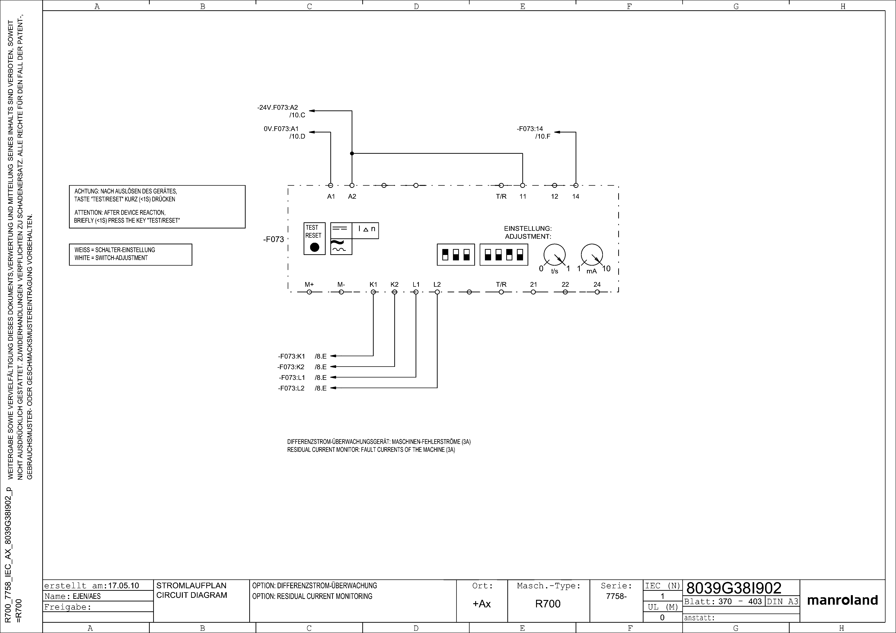

# +Ax — Sheet 370 of 403 — OPTION: DIFFERENZSTROM ÜBERWACHUNG

**OPTION: RESIDUAL CURRENT MONITORING**

> Part of the manroland **R700** printing press IEC/UL circuit diagrams.
> Drawing class: **Stromlaufplan / Circuit diagram** (DIN A3).
> Document `+Ax` covers the **Central control console** machine section.

## At a glance

| Field | Value |
|---|---|
| Document | `+Ax`  (8039G38I902) |
| Sheet | **370** of 403 |
| Section (DE) | OPTION: DIFFERENZSTROM ÜBERWACHUNG |
| Section (EN) | OPTION: RESIDUAL CURRENT MONITORING |
| Section type | CIRCUIT — Circuit diagram |
| Machine type | `R700` |
| Series | `7758` |
| Created | 17.05.10 |
| Replaces | — |
| Columns used | A, C, D, E, F |
| Path numbers | — |
| Labels on sheet | 52 |
| Cross-refs out | 7 |
| Cross-refs in | 7 |

**Previous:** [+Ax sheet 369](SHEET_0369.md) · **Next:** [+Ax sheet 371](SHEET_0371.md) · **Document TOC:** [_TOC.md](_TOC.md)  (+Ax) · **Master TOC:** [all sheets](../_MASTER_TOC.md)

## Sheet image (300 DPI, exact vector render)



_Rendered directly from the PDF vector layer at 300 DPI (1-bit), no OCR and no resampling. Use it to confirm anything ambiguous in the text below._

## Cross-references on this sheet

Each entry is a wire leaving this sheet. The printed token is `/sheet.column`; the link resolves to that sheet inside the same document.

| Ref | Target sheet | Col | Path | Destination on target | Target section | From col |
|---|---|---|---|---|---|---|
| `/10.C` | [+Ax sheet 10](SHEET_0010.md) | C | — | 24V.F073:A2 | SPANNUNGSVERSORGUNG, SCHALTSCHRANKBELÜFTUNG | C |
| `/10.D` | [+Ax sheet 10](SHEET_0010.md) | D | — | 0V.F073:A1 | SPANNUNGSVERSORGUNG, SCHALTSCHRANKBELÜFTUNG | C |
| `/10.F` | [+Ax sheet 10](SHEET_0010.md) | F | — | F073:14 | SPANNUNGSVERSORGUNG, SCHALTSCHRANKBELÜFTUNG | E |
| `/8.E` | [+Ax sheet 8](SHEET_0008.md) | E | — | F073:K1 | SPANNUNGSVERSORGUNG, SCHALTSCHRANKBELÜFTUNG | C |
| `/8.E` | [+Ax sheet 8](SHEET_0008.md) | E | — | F073:K2 | SPANNUNGSVERSORGUNG, SCHALTSCHRANKBELÜFTUNG | C |
| `/8.E` | [+Ax sheet 8](SHEET_0008.md) | E | — | F073:L1 | SPANNUNGSVERSORGUNG, SCHALTSCHRANKBELÜFTUNG | C |
| `/8.E` | [+Ax sheet 8](SHEET_0008.md) | E | — | F073:L2 | SPANNUNGSVERSORGUNG, SCHALTSCHRANKBELÜFTUNG | C |

### Incoming references (sheets that point here)

Every other sheet that sends a wire to this one. `Back-ref` is the token printed on *that* sheet; `Path` is its line number.

| From sheet | Cols | Back-ref | Path | Refs | What continues there |
|---|---|---|---|---|---|
| [+Ax#8](SHEET_0008.md) | E | `/8.E` | — | 4 | F073:K1; F073:K2; F073:L1; F073:L2 |
| [+Ax#10](SHEET_0010.md) | C, D, G | `/10.C`, `/10.D`, `/10.G` | — | 3 | — |


## Devices on this sheet

| Tag | Class | Class meaning (IEC) | Col | Sub | Terminal | Sign |
|---|---|---|---|---|---|---|
| `K1` | K | Relais / relay, contactor | D | — | — | — |
| `K2` | K | Relais / relay, contactor | D | — | — | — |
| `A1` | A | Baugruppe / assembly, module, PC board | C | — | — | — |
| `A2` | A | Baugruppe / assembly, module, PC board | C | — | — | — |
| `F073` | F | Schutz / protection device (fuse, circuit breaker) | C | — | — | — |
| `F073:K2` | F | Schutz / protection device (fuse, circuit breaker) | C | — | K2 | — |
| `F073:L1` | F | Schutz / protection device (fuse, circuit breaker) | C | — | L1 | — |
| `F073:14` | F | Schutz / protection device (fuse, circuit breaker) | E | — | 14 | — |
| `F073:K1` | F | Schutz / protection device (fuse, circuit breaker) | C | — | K1 | — |
| `F073:L2` | F | Schutz / protection device (fuse, circuit breaker) | C | — | L2 | — |

## Potentials / nets

| Potential | Count | Columns | Attached devices | Terminals |
|---|---|---|---|---|
| `0V` | 1 | C | `F073` | `A1` |
| `24V` | 1 | C | `F073` | `A2` |
| `L1` | 1 | D | — | — |
| `L2` | 1 | D | — | — |


A potential such as `L24+/4` or `M24+` is a named supply/return rail; every place it appears on this sheet is electrically common.

## Wire-end annotations (grouped as printed)

A wire that continues elsewhere is annotated with a small cluster: the destination description, the path/line number `#NN`, and the `/sheet.column` cross reference. Each row below is one such cluster exactly as it is grouped on the drawing.

| Col | Y | Path | Cross-ref | Text on the wire |
|---|---|---|---|---|
| C | 139.2 | — | `/10.C` | `24V.F073:A2` |
| C | 167.5 | — | `/10.D` | `0V.F073:A1` |
| E | 167.6 | — | `/10.F` | `F073:14` |
| A | 251.5 | — | — | `TASTE "TEST/RESET" KURZ (<1S) DRÜCKEN ACHTUNG: NACH AUSLÖSEN DES GERÄTES,` |
| D | 257.5 | — | — | `A1 A2 T/R 11 14` |
| E | 257.6 | — | — | `12` |
| A | 279.8 | — | — | `BRIEFLY (<1S) PRESS THE KEY "TEST/RESET" ATTENTION: AFTER DEVICE REACTION,` |
| C | 299.3 | — | — | `RESET TEST I n` |
| E | 300.0 | — | — | `EINSTELLUNG:` |
| C | 307.3 | — | — | `~` |
| E | 310.7 | — | — | `ADJUSTMENT:` |
| C | 313.5 | — | — | `F073` |
| A | 329.4 | — | — | `WEISS = SCHALTER EINSTELLUNG WHITE = SWITCH ADJUSTMENT` |
| E | 352.5 | — | — | `0 t/s 1 1 mA 10` |
| D | 374.4 | — | — | `M+ M K1 K2 L1 L2 T/R 21 22 24` |
| C | 470.1 | — | `/8.E` | `F073:K1` |
| C | 484.2 | — | `/8.E` | `F073:K2` |
| C | 498.4 | — | `/8.E` | `F073:L1` |
| C | 512.6 | — | `/8.E` | `F073:L2` |
| D | 584.6 | — | — | `DIFFERENZSTROM ÜBERWACHUNGSGERÄT: MASCHINEN FEHLERSTRÖME (3A) RESIDUAL CURRENT MONITOR: FAULT CURRENTS OF THE MACHINE (3A)` |


## Reconstructed tables

This sheet carries tabular content (pin map / terminal assignment / index). The grid below was rebuilt from the drawing's own rule lines, so each row is exactly one physical row of the table.

### Table 1 — 5 data rows × 1 columns (at x=403.9, y=147.4)

| C1 |
|---|
| `TEST RESET` |
| `M+` |
| `/8.E` |
| `/8.E` |
| `/8.E` |


### Table 2 — 2 data rows × 4 columns (at x=439.4, y=147.4)

| A1 | A2 |  |  |
|---|---|---|---|
|  | `n I` |  |  |
| `~ M` |  | `K1` | `K2` |


## Notes and free text on this sheet

| Text | Col | Y (pt) |
|---|---|---|
| `M` | C | 374.56 |
| `M+` | C | 374.52 |
| `T/R` | E | 374.45 |
| `DIFFERENZSTROM ÜBERWACHUNGSGERÄT: MASCHINEN FEHLERSTRÖME (3A)` | D | 584.58 |
| `RESIDUAL CURRENT MONITOR: FAULT CURRENTS OF THE MACHINE (3A)` | D | 595.21 |
| `I` | C | 299.94 |
| `n` | D | 299.33 |
| `TEST` | C | 299.64 |
| `RESET` | C | 310.27 |
| `ACHTUNG: NACH AUSLÖSEN DES GERÄTES,` | A | 251.5 |
| `TASTE "TEST/RESET" KURZ (<1S) DRÜCKEN` | A | 262.12 |
| `ATTENTION: AFTER DEVICE REACTION,` | A | 279.83 |
| `BRIEFLY (<1S) PRESS THE KEY "TEST/RESET"` | A | 290.45 |
| `t/s` | E | 356.71 |
| `mA` | F | 356.63 |
| `EINSTELLUNG:` | E | 300.04 |
| `ADJUSTMENT:` | E | 310.67 |
| `WEISS = SCHALTER EINSTELLUNG` | A | 329.43 |
| `WHITE = SWITCH ADJUSTMENT` | A | 340.05 |

## Complete label inventory (exact text from the drawing)

Every text object inside the drawing area of this sheet, in DIN reading order (column A→H, then top→bottom). This is the authoritative list: if a string is not here it is not printed on this sheet.

| Col | Y | X | Dir | Type | Text |
|---|---|---|---|---|---|
| A | 251.5 | 99.2 | → | text | `ACHTUNG: NACH AUSLÖSEN DES GERÄTES,` |
| A | 262.1 | 98.9 | → | text | `TASTE "TEST/RESET" KURZ (<1S) DRÜCKEN` |
| A | 279.8 | 99.2 | → | text | `ATTENTION: AFTER DEVICE REACTION,` |
| A | 290.5 | 98.4 | → | text | `BRIEFLY (<1S) PRESS THE KEY "TEST/RESET"` |
| A | 329.4 | 99.2 | → | text | `WEISS = SCHALTER EINSTELLUNG` |
| A | 340.1 | 99.2 | → | text | `WHITE = SWITCH ADJUSTMENT` |
| C | 139.2 | 341.9 | → | potential | `24V.F073:A2` |
| C | 149.1 | 384.7 | → | cross-reference | `/10.C` |
| C | 167.5 | 350.6 | → | potential | `0V.F073:A1` |
| C | 177.4 | 384.7 | → | cross-reference | `/10.D` |
| C | 257.5 | 434.8 | → | device tag | `A1` |
| C | 257.5 | 462.6 | → | device tag | `A2` |
| C | 299.6 | 406.5 | → | text | `TEST` |
| C | 299.9 | 476.4 | → | text | `I` |
| C | 307.3 | 437.7 | → | other | `~` |
| C | 310.3 | 405.9 | → | text | `RESET` |
| C | 313.5 | 349.8 | → | device tag | `F073` |
| C | 374.5 | 404.9 | → | text | `M+` |
| C | 374.6 | 448.4 | → | text | `M` |
| C | 470.1 | 369.6 | → | device tag | `F073:K1` |
| C | 470.1 | 418.4 | → | cross-reference | `/8.E` |
| C | 484.2 | 418.4 | → | cross-reference | `/8.E` |
| C | 484.3 | 368.5 | → | device tag | `F073:K2` |
| C | 498.4 | 418.4 | → | cross-reference | `/8.E` |
| C | 498.5 | 370.8 | → | device tag | `F073:L1` |
| C | 512.6 | 418.4 | → | cross-reference | `/8.E` |
| C | 512.7 | 369.6 | → | device tag | `F073:L2` |
| D | 299.3 | 493.1 | → | text | `n` |
| D | 374.4 | 491.1 | → | device tag | `K1` |
| D | 374.4 | 518.9 | → | device tag | `K2` |
| D | 374.5 | 548.4 | → | potential | `L1` |
| D | 374.5 | 576.1 | → | potential | `L2` |
| D | 584.6 | 381.8 | → | text | `DIFFERENZSTROM ÜBERWACHUNGSGERÄT: MASCHINEN FEHLERSTRÖME (3A)` |
| D | 595.2 | 381.8 | → | text | `RESIDUAL CURRENT MONITOR: FAULT CURRENTS OF THE MACHINE (3A)` |
| E | 167.6 | 686.8 | → | device tag | `F073:14` |
| E | 177.4 | 711.5 | → | cross-reference | `/10.F` |
| E | 257.5 | 659.1 | → | text | `T/R` |
| E | 257.6 | 690.1 | → | number | `11` |
| E | 257.6 | 732.0 | → | number | `12` |
| E | 257.6 | 760.3 | → | number | `14` |
| E | 300.0 | 669.8 | → | text | `EINSTELLUNG:` |
| E | 310.7 | 671.2 | → | text | `ADJUSTMENT:` |
| E | 352.5 | 716.3 | → | number | `0` |
| E | 352.5 | 752.2 | → | number | `1` |
| E | 356.7 | 732.5 | → | text | `t/s` |
| E | 374.4 | 659.1 | → | text | `T/R` |
| E | 374.5 | 704.6 | → | number | `21` |
| E | 374.5 | 746.5 | → | number | `22` |
| F | 352.5 | 766.3 | → | number | `1` |
| F | 352.5 | 799.7 | → | number | `10` |
| F | 356.6 | 779.5 | → | text | `mA` |
| F | 374.5 | 788.9 | → | number | `24` |

## Reading-order text block

The same content as a plain block, grouped by DIN column — convenient to paste or to match against a visual description.

```text
=== Column A ===
 251.5   99.2  text         ACHTUNG: NACH AUSLÖSEN DES GERÄTES,
 262.1   98.9  text         TASTE "TEST/RESET" KURZ (<1S) DRÜCKEN
 279.8   99.2  text         ATTENTION: AFTER DEVICE REACTION,
 290.5   98.4  text         BRIEFLY (<1S) PRESS THE KEY "TEST/RESET"
 329.4   99.2  text         WEISS = SCHALTER EINSTELLUNG
 340.1   99.2  text         WHITE = SWITCH ADJUSTMENT
=== Column C ===
 139.2  341.9  net          24V.F073:A2
 149.1  384.7  xref         /10.C
 167.5  350.6  net          0V.F073:A1
 177.4  384.7  xref         /10.D
 257.5  434.8  devtag       A1
 257.5  462.6  devtag       A2
 299.6  406.5  text         TEST
 299.9  476.4  text         I
 307.3  437.7  other        ~
 310.3  405.9  text         RESET
 313.5  349.8  devtag       F073
 374.5  404.9  text         M+
 374.6  448.4  text         M
 470.1  369.6  devtag       F073:K1
 470.1  418.4  xref         /8.E
 484.2  418.4  xref         /8.E
 484.3  368.5  devtag       F073:K2
 498.4  418.4  xref         /8.E
 498.5  370.8  devtag       F073:L1
 512.6  418.4  xref         /8.E
 512.7  369.6  devtag       F073:L2
=== Column D ===
 299.3  493.1  text         n
 374.4  491.1  devtag       K1
 374.4  518.9  devtag       K2
 374.5  548.4  net          L1
 374.5  576.1  net          L2
 584.6  381.8  text         DIFFERENZSTROM ÜBERWACHUNGSGERÄT: MASCHINEN FEHLERSTRÖME (3A)
 595.2  381.8  text         RESIDUAL CURRENT MONITOR: FAULT CURRENTS OF THE MACHINE (3A)
=== Column E ===
 167.6  686.8  devtag       F073:14
 177.4  711.5  xref         /10.F
 257.5  659.1  text         T/R
 257.6  690.1  numeric      11
 257.6  732.0  numeric      12
 257.6  760.3  numeric      14
 300.0  669.8  text         EINSTELLUNG:
 310.7  671.2  text         ADJUSTMENT:
 352.5  716.3  numeric      0
 352.5  752.2  numeric      1
 356.7  732.5  text         t/s
 374.4  659.1  text         T/R
 374.5  704.6  numeric      21
 374.5  746.5  numeric      22
=== Column F ===
 352.5  766.3  numeric      1
 352.5  799.7  numeric      10
 356.6  779.5  text         mA
 374.5  788.9  numeric      24
```

---
_Generated from the PDF vector text layer; no OCR. Source: `R700_7758_IEC_AX_8039G38I902_p`, sheet 370._
