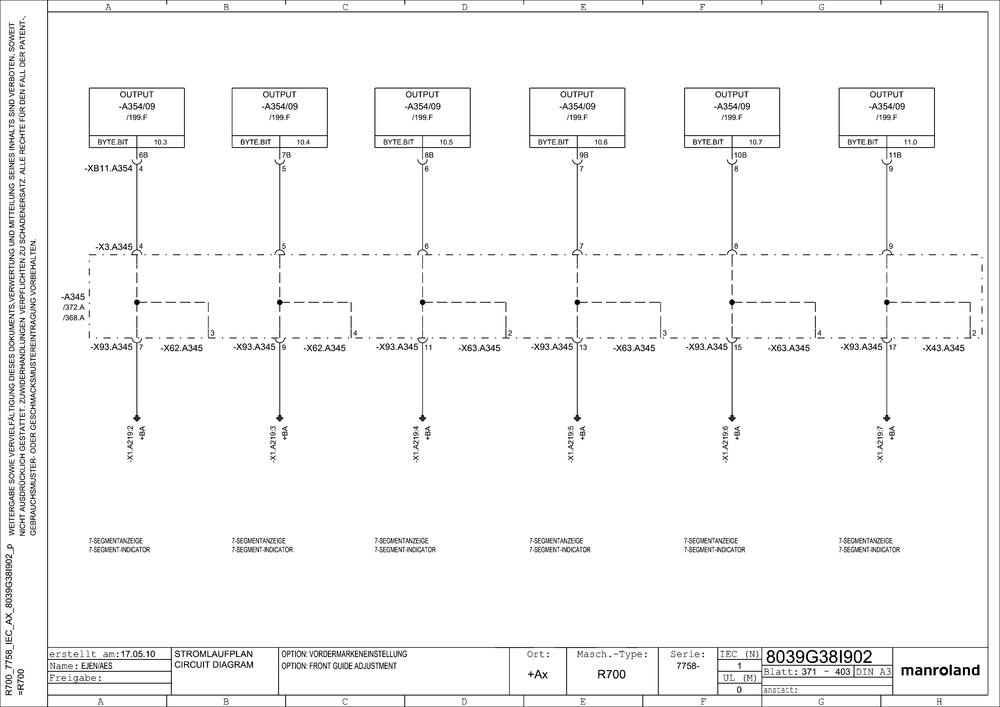

# +Ax — Sheet 371 of 403 — OPTION: VORDERMARKENEINSTELLUNG

**OPTION: FRONT GUIDE ADJUSTMENT**

> Part of the manroland **R700** printing press IEC/UL circuit diagrams.
> Drawing class: **Stromlaufplan / Circuit diagram** (DIN A3).
> Document `+Ax` covers the **Central control console** machine section.

## At a glance

| Field | Value |
|---|---|
| Document | `+Ax`  (8039G38I902) |
| Sheet | **371** of 403 |
| Section (DE) | OPTION: VORDERMARKENEINSTELLUNG |
| Section (EN) | OPTION: FRONT GUIDE ADJUSTMENT |
| Section type | CIRCUIT — Circuit diagram |
| Machine type | `R700` |
| Series | `7758` |
| Created | 17.05.10 |
| Replaces | — |
| Columns used | A, B, C, D, E, F, G, H |
| Path numbers | — |
| Labels on sheet | 101 |
| Cross-refs out | 8 |
| Cross-refs in | 32 |

**Previous:** [+Ax sheet 370](SHEET_0370.md) · **Next:** [+Ax sheet 372](SHEET_0372.md) · **Document TOC:** [_TOC.md](_TOC.md)  (+Ax) · **Master TOC:** [all sheets](../_MASTER_TOC.md)

## Sheet image (300 DPI, exact vector render)



_Rendered directly from the PDF vector layer at 300 DPI (1-bit), no OCR and no resampling. Use it to confirm anything ambiguous in the text below._

## Cross-references on this sheet

Each entry is a wire leaving this sheet. The printed token is `/sheet.column`; the link resolves to that sheet inside the same document.

| Ref | Target sheet | Col | Path | Destination on target | Target section | From col |
|---|---|---|---|---|---|---|
| `/199.F` | [+Ax sheet 199](SHEET_0199.md) | F | — | — | REFERENZMODUL | A |
| `/199.F` | [+Ax sheet 199](SHEET_0199.md) | F | — | — | REFERENZMODUL | B |
| `/199.F` | [+Ax sheet 199](SHEET_0199.md) | F | — | — | REFERENZMODUL | D |
| `/199.F` | [+Ax sheet 199](SHEET_0199.md) | F | — | — | REFERENZMODUL | E |
| `/199.F` | [+Ax sheet 199](SHEET_0199.md) | F | — | — | REFERENZMODUL | F |
| `/199.F` | [+Ax sheet 199](SHEET_0199.md) | F | — | — | REFERENZMODUL | H |
| `/372.A` | [+Ax sheet 372](SHEET_0372.md) | A | — | — | OPTION: VORDERMARKENEINSTELLUNG | A |
| `/368.A` | [+Ax sheet 368](SHEET_0368.md) | A | — | — | OPTION: LOGISTIK AUSLEGER | A |

### Incoming references (sheets that point here)

Every other sheet that sends a wire to this one. `Back-ref` is the token printed on *that* sheet; `Path` is its line number.

| From sheet | Cols | Back-ref | Path | Refs | What continues there |
|---|---|---|---|---|---|
| [+Ax#199](SHEET_0199.md) | F | `/199.F` | — | 6 | — |
| [+Ax#223](SHEET_0223.md) | B | `/223.B` | — | 6 | — |
| [+Ax#247](SHEET_0247.md) | A | `/247.A` | — | 6 | — |
| [+Ax#281](SHEET_0281.md) | E | `/281.E` | — | 1 | — |
| [+Ax#284](SHEET_0284.md) | G | `/284.G` | — | 5 | — |
| [+Ax#289](SHEET_0289.md) | G | `/289.G` | — | 6 | — |
| [+Ax#368](SHEET_0368.md) | A | `/368.A` | — | 1 | — |
| [+Ax#372](SHEET_0372.md) | A | `/372.A` | — | 1 | — |


## Devices on this sheet

| Tag | Class | Class meaning (IEC) | Col | Sub | Terminal | Sign |
|---|---|---|---|---|---|---|
| `A354/09` | A | Baugruppe / assembly, module, PC board | A | 09 | — | — |
| `A345` | A | Baugruppe / assembly, module, PC board | A | — | — | — |
| `A354/09` | A | Baugruppe / assembly, module, PC board | B | 09 | — | — |
| `A354/09` | A | Baugruppe / assembly, module, PC board | D | 09 | — | — |
| `A354/09` | A | Baugruppe / assembly, module, PC board | E | 09 | — | — |
| `A354/09` | A | Baugruppe / assembly, module, PC board | F | 09 | — | — |
| `A354/09` | A | Baugruppe / assembly, module, PC board | H | 09 | — | — |
| `10.3` | — | cross-device reference | A | — | — | — |
| `XB11.A354` | — | cross-device reference | A | — | — | — |
| `X3.A345` | — | cross-device reference | A | — | — | — |
| `X93.A345` | — | cross-device reference | A | — | — | — |
| `X1.A219:2` | — | cross-device reference | A | — | 2 | — |
| `10.4` | — | cross-device reference | C | — | — | — |
| `X93.A345` | — | cross-device reference | B | — | — | — |
| `X1.A219:3` | — | cross-device reference | B | — | 3 | — |
| `10.5` | — | cross-device reference | D | — | — | — |
| `X93.A345` | — | cross-device reference | C | — | — | — |
| `X1.A219:4` | — | cross-device reference | D | — | 4 | — |
| `10.6` | — | cross-device reference | E | — | — | — |
| `X93.A345` | — | cross-device reference | E | — | — | — |
| `X1.A219:5` | — | cross-device reference | E | — | 5 | — |
| `10.7` | — | cross-device reference | F | — | — | — |
| `X93.A345` | — | cross-device reference | F | — | — | — |
| `X1.A219:6` | — | cross-device reference | F | — | 6 | — |
| `X93.A345` | — | cross-device reference | G | — | — | — |
| `11.0` | — | cross-device reference | H | — | — | — |
| `X1.A219:7` | — | cross-device reference | G | — | 7 | — |
| `X62.A345` | — | cross-device reference | B | — | — | — |
| `X43.A345` | — | cross-device reference | H | — | — | — |
| `X62.A345` | — | cross-device reference | C | — | — | — |
| `X63.A345` | — | cross-device reference | D | — | — | — |
| `X63.A345` | — | cross-device reference | E | — | — | — |
| `X63.A345` | — | cross-device reference | G | — | — | — |

## Potentials / nets

_No named potentials on this sheet._

## Wire-end annotations (grouped as printed)

A wire that continues elsewhere is annotated with a small cluster: the destination description, the path/line number `#NN`, and the `/sheet.column` cross reference. Each row below is one such cluster exactly as it is grouped on the drawing.

| Col | Y | Path | Cross-ref | Text on the wire |
|---|---|---|---|---|
| A | 108.3 | — | — | `OUTPUT` |
| B | 108.3 | — | — | `OUTPUT` |
| D | 108.3 | — | — | `OUTPUT` |
| E | 108.3 | — | — | `OUTPUT` |
| F | 108.3 | — | — | `OUTPUT` |
| H | 108.3 | — | — | `OUTPUT` |
| A | 122.2 | — | — | `A354/09` |
| B | 122.2 | — | — | `A354/09` |
| D | 122.2 | — | — | `A354/09` |
| E | 122.2 | — | — | `A354/09` |
| F | 122.2 | — | — | `A354/09` |
| H | 122.2 | — | — | `A354/09` |
| A | 136.0 | — | `/199.F` | — |
| B | 136.0 | — | `/199.F` | — |
| D | 136.0 | — | `/199.F` | — |
| E | 136.0 | — | `/199.F` | — |
| F | 136.0 | — | `/199.F` | — |
| H | 136.0 | — | `/199.F` | — |
| A | 165.6 | — | — | `BYTE.BIT 10.3` |
| B | 165.6 | — | — | `BYTE.BIT 10.4` |
| D | 165.6 | — | — | `BYTE.BIT 10.5` |
| E | 165.6 | — | — | `BYTE.BIT 10.6` |
| F | 165.6 | — | — | `BYTE.BIT 10.7` |
| H | 165.6 | — | — | `BYTE.BIT 11.0` |
| A | 181.0 | — | — | `6B` |
| C | 181.0 | — | — | `7B` |
| D | 181.0 | — | — | `8B` |
| E | 181.0 | — | — | `9B` |
| F | 181.0 | — | — | `10B` |
| H | 181.0 | — | — | `11B` |
| A | 195.9 | — | — | `XB11.A354 4` |
| B | 197.3 | — | — | `5` |
| D | 197.3 | — | — | `6` |
| E | 197.3 | — | — | `7` |
| F | 197.3 | — | — | `8` |
| H | 197.3 | — | — | `9` |
| A | 289.4 | — | — | `X3.A345 4` |
| B | 289.5 | — | — | `5` |
| D | 289.5 | — | — | `6` |
| E | 289.5 | — | — | `7` |
| F | 289.5 | — | — | `8` |
| H | 289.5 | — | — | `9` |
| A | 349.0 | — | — | `A345` |
| A | 362.0 | — | `/372.A`, `/368.A` | — |
| B | 392.9 | — | — | `3` |
| E | 392.9 | — | — | `4 2 3 4` |
| H | 392.9 | — | — | `2` |
| A | 408.5 | — | — | `X93.A345 7` |
| B | 408.5 | — | — | `X93.A345 9` |
| C | 408.5 | — | — | `X93.A345 11` |
| E | 408.5 | — | — | `X93.A345 13` |
| F | 408.5 | — | — | `X93.A345 15` |
| G | 408.5 | — | — | `X93.A345 17` |
| E | 409.9 | — | — | `X62.A345 X62.A345 X63.A345 X63.A345 X63.A345 X43.A345` |
| A | 506.8 | — | — | `X1.A219:2` |
| B | 507.1 | — | — | `X1.A219:3` |
| D | 507.1 | — | — | `X1.A219:4` |
| E | 507.1 | — | — | `X1.A219:5` |
| F | 507.1 | — | — | `X1.A219:6` |
| G | 507.1 | — | — | `X1.A219:7` |
| A | 507.4 | — | — | `+BA` |
| B | 507.4 | — | — | `+BA` |
| D | 507.4 | — | — | `+BA` |
| E | 507.4 | — | — | `+BA` |
| F | 507.4 | — | — | `+BA` |
| H | 507.4 | — | — | `+BA` |
| A | 641.3 | — | — | `7 SEGMENTANZEIGE 7 SEGMENT INDICATOR` |
| B | 641.3 | — | — | `7 SEGMENTANZEIGE 7 SEGMENT INDICATOR` |
| D | 641.3 | — | — | `7 SEGMENTANZEIGE 7 SEGMENT INDICATOR` |
| E | 641.3 | — | — | `7 SEGMENTANZEIGE 7 SEGMENT INDICATOR` |
| F | 641.3 | — | — | `7 SEGMENTANZEIGE 7 SEGMENT INDICATOR` |
| G | 641.3 | — | — | `7 SEGMENTANZEIGE 7 SEGMENT INDICATOR` |


## Reconstructed tables

This sheet carries tabular content (pin map / terminal assignment / index). The grid below was rebuilt from the drawing's own rule lines, so each row is exactly one physical row of the table.

### Table 1 — 2 data rows × 2 columns (at x=106.3, y=104.9)

| OUTPUT | A354/09 /199.F |
|---|---|
| `BYTE.BIT` | `10.3` |
| `XB11.A354 X3.A345` | `6B 4 4` |


### Table 2 — 2 data rows × 2 columns (at x=276.4, y=104.9)

| OUTPUT | A354/09 /199.F |
|---|---|
| `BYTE.BIT` | `10.4` |
|  | `7B 5 5` |


### Table 3 — 2 data rows × 2 columns (at x=446.5, y=104.9)

| OUTPUT | A354/09 /199.F |
|---|---|
| `BYTE.BIT` | `10.5` |
|  | `8B 6 6` |


### Table 4 — 2 data rows × 2 columns (at x=630.7, y=104.9)

| OUTPUT | A354/09 /199.F |
|---|---|
| `BYTE.BIT` | `10.6` |
|  | `9B 7 7` |


### Table 5 — 2 data rows × 2 columns (at x=815.0, y=104.9)

| OUTPUT | A354/09 /199.F |
|---|---|
| `BYTE.BIT` | `10.7` |
|  | `10B 8 8` |


### Table 6 — 2 data rows × 2 columns (at x=999.2, y=104.9)

| OUTPUT | A354/09 /199.F |
|---|---|
| `BYTE.BIT` | `11.0` |
|  | `11B 9 9` |


## Notes and free text on this sheet

| Text | Col | Y (pt) |
|---|---|---|
| `6B` | A | 180.98 |
| `OUTPUT` | A | 108.33 |
| `BYTE.BIT` | A | 165.6 |
| `7 SEGMENTANZEIGE` | A | 641.26 |
| `7 SEGMENT INDICATOR` | A | 651.91 |
| `+BA` | A | 507.4 |
| `7B` | C | 180.98 |
| `OUTPUT` | B | 108.33 |
| `BYTE.BIT` | B | 165.6 |
| `7 SEGMENTANZEIGE` | B | 641.26 |
| `7 SEGMENT INDICATOR` | B | 651.91 |
| `+BA` | B | 507.4 |
| `8B` | D | 180.98 |
| `OUTPUT` | D | 108.33 |
| `BYTE.BIT` | C | 165.6 |
| `7 SEGMENTANZEIGE` | C | 641.26 |
| `7 SEGMENT INDICATOR` | D | 651.91 |
| `+BA` | D | 507.4 |
| `9B` | E | 180.98 |
| `OUTPUT` | E | 108.33 |
| `BYTE.BIT` | E | 165.6 |
| `7 SEGMENTANZEIGE` | E | 641.26 |
| `7 SEGMENT INDICATOR` | E | 651.91 |
| `+BA` | E | 507.4 |
| `10B` | F | 181 |
| `OUTPUT` | F | 108.33 |
| `BYTE.BIT` | F | 165.6 |
| `7 SEGMENTANZEIGE` | F | 641.26 |
| `7 SEGMENT INDICATOR` | F | 651.91 |
| `+BA` | F | 507.4 |
| `11B` | H | 181 |
| `OUTPUT` | H | 108.33 |
| `BYTE.BIT` | G | 165.6 |
| `7 SEGMENTANZEIGE` | G | 641.26 |
| `7 SEGMENT INDICATOR` | G | 651.91 |
| `+BA` | H | 507.4 |

## Complete label inventory (exact text from the drawing)

Every text object inside the drawing area of this sheet, in DIN reading order (column A→H, then top→bottom). This is the authoritative list: if a string is not here it is not printed on this sheet.

| Col | Y | X | Dir | Type | Text |
|---|---|---|---|---|---|
| A | 108.3 | 142.7 | → | text | `OUTPUT` |
| A | 122.2 | 141.6 | → | device tag | `A354/09` |
| A | 136.0 | 150.7 | → | cross-reference | `/199.F` |
| A | 165.6 | 116.2 | → | text | `BYTE.BIT` |
| A | 165.6 | 183.1 | → | device ref | `10.3` |
| A | 181.0 | 165.5 | → | text | `6B` |
| A | 195.9 | 100.6 | → | device ref | `XB11.A354` |
| A | 197.3 | 165.5 | → | number | `4` |
| A | 289.4 | 113.7 | → | device ref | `X3.A345` |
| A | 289.5 | 165.5 | → | number | `4` |
| A | 349.0 | 72.9 | → | device tag | `A345` |
| A | 362.0 | 75.1 | → | cross-reference | `/372.A` |
| A | 374.4 | 75.1 | → | cross-reference | `/368.A` |
| A | 408.5 | 107.7 | → | device ref | `X93.A345` |
| A | 409.9 | 165.5 | → | number | `7` |
| A | 506.8 | 151.2 | ↕ | device ref | `X1.A219:2` |
| A | 507.4 | 165.4 | ↕ | text | `+BA` |
| A | 641.3 | 106.0 | → | text | `7 SEGMENTANZEIGE` |
| A | 651.9 | 106.0 | → | text | `7 SEGMENT INDICATOR` |
| B | 108.3 | 312.8 | → | text | `OUTPUT` |
| B | 122.2 | 311.7 | → | device tag | `A354/09` |
| B | 136.0 | 320.7 | → | cross-reference | `/199.F` |
| B | 165.6 | 286.3 | → | text | `BYTE.BIT` |
| B | 197.3 | 335.6 | → | number | `5` |
| B | 289.5 | 335.6 | → | number | `5` |
| B | 392.9 | 250.6 | → | number | `3` |
| B | 408.5 | 277.8 | → | device ref | `X93.A345` |
| B | 409.9 | 191.3 | → | device ref | `X62.A345` |
| B | 409.9 | 335.6 | → | number | `9` |
| B | 507.1 | 321.3 | ↕ | device ref | `X1.A219:3` |
| B | 507.4 | 335.4 | ↕ | text | `+BA` |
| B | 641.3 | 276.1 | → | text | `7 SEGMENTANZEIGE` |
| B | 651.9 | 276.1 | → | text | `7 SEGMENT INDICATOR` |
| C | 165.6 | 353.2 | → | device ref | `10.4` |
| C | 165.6 | 456.4 | → | text | `BYTE.BIT` |
| C | 181.0 | 335.6 | → | text | `7B` |
| C | 392.9 | 420.7 | → | number | `4` |
| C | 408.5 | 447.9 | → | device ref | `X93.A345` |
| C | 409.9 | 361.4 | → | device ref | `X62.A345` |
| C | 641.3 | 446.2 | → | text | `7 SEGMENTANZEIGE` |
| D | 108.3 | 482.9 | → | text | `OUTPUT` |
| D | 122.2 | 481.7 | → | device tag | `A354/09` |
| D | 136.0 | 490.8 | → | cross-reference | `/199.F` |
| D | 165.6 | 523.3 | → | device ref | `10.5` |
| D | 181.0 | 505.7 | → | text | `8B` |
| D | 197.3 | 505.7 | → | number | `6` |
| D | 289.5 | 505.7 | → | number | `6` |
| D | 392.9 | 604.9 | → | number | `2` |
| D | 409.9 | 505.1 | → | number | `11` |
| D | 409.9 | 545.7 | → | device ref | `X63.A345` |
| D | 507.1 | 491.4 | ↕ | device ref | `X1.A219:4` |
| D | 507.4 | 505.5 | ↕ | text | `+BA` |
| D | 651.9 | 446.2 | → | text | `7 SEGMENT INDICATOR` |
| E | 108.3 | 667.1 | → | text | `OUTPUT` |
| E | 122.2 | 666.0 | → | device tag | `A354/09` |
| E | 136.0 | 675.1 | → | cross-reference | `/199.F` |
| E | 165.6 | 640.6 | → | text | `BYTE.BIT` |
| E | 165.6 | 707.5 | → | device ref | `10.6` |
| E | 181.0 | 690.0 | → | text | `9B` |
| E | 197.3 | 690.0 | → | number | `7` |
| E | 289.5 | 690.0 | → | number | `7` |
| E | 408.5 | 632.1 | → | device ref | `X93.A345` |
| E | 409.9 | 689.4 | → | number | `13` |
| E | 409.9 | 729.9 | → | device ref | `X63.A345` |
| E | 507.1 | 675.6 | ↕ | device ref | `X1.A219:5` |
| E | 507.4 | 689.8 | ↕ | text | `+BA` |
| E | 641.3 | 630.4 | → | text | `7 SEGMENTANZEIGE` |
| E | 651.9 | 630.4 | → | text | `7 SEGMENT INDICATOR` |
| F | 108.3 | 851.4 | → | text | `OUTPUT` |
| F | 122.2 | 850.3 | → | device tag | `A354/09` |
| F | 136.0 | 859.3 | → | cross-reference | `/199.F` |
| F | 165.6 | 824.9 | → | text | `BYTE.BIT` |
| F | 165.6 | 891.8 | → | device ref | `10.7` |
| F | 181.0 | 873.6 | → | text | `10B` |
| F | 197.3 | 874.2 | → | number | `8` |
| F | 289.5 | 874.2 | → | number | `8` |
| F | 392.9 | 789.2 | → | number | `3` |
| F | 408.5 | 816.4 | → | device ref | `X93.A345` |
| F | 409.9 | 873.6 | → | number | `15` |
| F | 507.1 | 859.9 | ↕ | device ref | `X1.A219:6` |
| F | 507.4 | 874.0 | ↕ | text | `+BA` |
| F | 641.3 | 814.7 | → | text | `7 SEGMENTANZEIGE` |
| F | 651.9 | 814.7 | → | text | `7 SEGMENT INDICATOR` |
| G | 165.6 | 1009.1 | → | text | `BYTE.BIT` |
| G | 392.9 | 973.4 | → | number | `4` |
| G | 408.5 | 1000.6 | → | device ref | `X93.A345` |
| G | 409.9 | 914.2 | → | device ref | `X63.A345` |
| G | 507.1 | 1044.1 | ↕ | device ref | `X1.A219:7` |
| G | 641.3 | 998.9 | → | text | `7 SEGMENTANZEIGE` |
| G | 651.9 | 998.9 | → | text | `7 SEGMENT INDICATOR` |
| H | 108.3 | 1035.6 | → | text | `OUTPUT` |
| H | 122.2 | 1034.5 | → | device tag | `A354/09` |
| H | 136.0 | 1043.6 | → | cross-reference | `/199.F` |
| H | 165.6 | 1076.0 | → | device ref | `11.0` |
| H | 181.0 | 1057.9 | → | text | `11B` |
| H | 197.3 | 1058.5 | → | number | `9` |
| H | 289.5 | 1058.5 | → | number | `9` |
| H | 392.9 | 1157.7 | → | number | `2` |
| H | 409.9 | 1057.9 | → | number | `17` |
| H | 409.9 | 1098.4 | → | device ref | `X43.A345` |
| H | 507.4 | 1058.3 | ↕ | text | `+BA` |

## Reading-order text block

The same content as a plain block, grouped by DIN column — convenient to paste or to match against a visual description.

```text
=== Column A ===
 108.3  142.7  text         OUTPUT
 122.2  141.6  devtag       A354/09
 136.0  150.7  xref         /199.F
 165.6  116.2  text         BYTE.BIT
 165.6  183.1  devref       10.3
 181.0  165.5  text         6B
 195.9  100.6  devref       XB11.A354
 197.3  165.5  numeric      4
 289.4  113.7  devref       X3.A345
 289.5  165.5  numeric      4
 349.0   72.9  devtag       A345
 362.0   75.1  xref         /372.A
 374.4   75.1  xref         /368.A
 408.5  107.7  devref       X93.A345
 409.9  165.5  numeric      7
 506.8  151.2  devref       X1.A219:2
 507.4  165.4  text         +BA
 641.3  106.0  text         7 SEGMENTANZEIGE
 651.9  106.0  text         7 SEGMENT INDICATOR
=== Column B ===
 108.3  312.8  text         OUTPUT
 122.2  311.7  devtag       A354/09
 136.0  320.7  xref         /199.F
 165.6  286.3  text         BYTE.BIT
 197.3  335.6  numeric      5
 289.5  335.6  numeric      5
 392.9  250.6  numeric      3
 408.5  277.8  devref       X93.A345
 409.9  191.3  devref       X62.A345
 409.9  335.6  numeric      9
 507.1  321.3  devref       X1.A219:3
 507.4  335.4  text         +BA
 641.3  276.1  text         7 SEGMENTANZEIGE
 651.9  276.1  text         7 SEGMENT INDICATOR
=== Column C ===
 165.6  353.2  devref       10.4
 165.6  456.4  text         BYTE.BIT
 181.0  335.6  text         7B
 392.9  420.7  numeric      4
 408.5  447.9  devref       X93.A345
 409.9  361.4  devref       X62.A345
 641.3  446.2  text         7 SEGMENTANZEIGE
=== Column D ===
 108.3  482.9  text         OUTPUT
 122.2  481.7  devtag       A354/09
 136.0  490.8  xref         /199.F
 165.6  523.3  devref       10.5
 181.0  505.7  text         8B
 197.3  505.7  numeric      6
 289.5  505.7  numeric      6
 392.9  604.9  numeric      2
 409.9  505.1  numeric      11
 409.9  545.7  devref       X63.A345
 507.1  491.4  devref       X1.A219:4
 507.4  505.5  text         +BA
 651.9  446.2  text         7 SEGMENT INDICATOR
=== Column E ===
 108.3  667.1  text         OUTPUT
 122.2  666.0  devtag       A354/09
 136.0  675.1  xref         /199.F
 165.6  640.6  text         BYTE.BIT
 165.6  707.5  devref       10.6
 181.0  690.0  text         9B
 197.3  690.0  numeric      7
 289.5  690.0  numeric      7
 408.5  632.1  devref       X93.A345
 409.9  689.4  numeric      13
 409.9  729.9  devref       X63.A345
 507.1  675.6  devref       X1.A219:5
 507.4  689.8  text         +BA
 641.3  630.4  text         7 SEGMENTANZEIGE
 651.9  630.4  text         7 SEGMENT INDICATOR
=== Column F ===
 108.3  851.4  text         OUTPUT
 122.2  850.3  devtag       A354/09
 136.0  859.3  xref         /199.F
 165.6  824.9  text         BYTE.BIT
 165.6  891.8  devref       10.7
 181.0  873.6  text         10B
 197.3  874.2  numeric      8
 289.5  874.2  numeric      8
 392.9  789.2  numeric      3
 408.5  816.4  devref       X93.A345
 409.9  873.6  numeric      15
 507.1  859.9  devref       X1.A219:6
 507.4  874.0  text         +BA
 641.3  814.7  text         7 SEGMENTANZEIGE
 651.9  814.7  text         7 SEGMENT INDICATOR
=== Column G ===
 165.6 1009.1  text         BYTE.BIT
 392.9  973.4  numeric      4
 408.5 1000.6  devref       X93.A345
 409.9  914.2  devref       X63.A345
 507.1 1044.1  devref       X1.A219:7
 641.3  998.9  text         7 SEGMENTANZEIGE
 651.9  998.9  text         7 SEGMENT INDICATOR
=== Column H ===
 108.3 1035.6  text         OUTPUT
 122.2 1034.5  devtag       A354/09
 136.0 1043.6  xref         /199.F
 165.6 1076.0  devref       11.0
 181.0 1057.9  text         11B
 197.3 1058.5  numeric      9
 289.5 1058.5  numeric      9
 392.9 1157.7  numeric      2
 409.9 1057.9  numeric      17
 409.9 1098.4  devref       X43.A345
 507.4 1058.3  text         +BA
```

---
_Generated from the PDF vector text layer; no OCR. Source: `R700_7758_IEC_AX_8039G38I902_p`, sheet 371._
