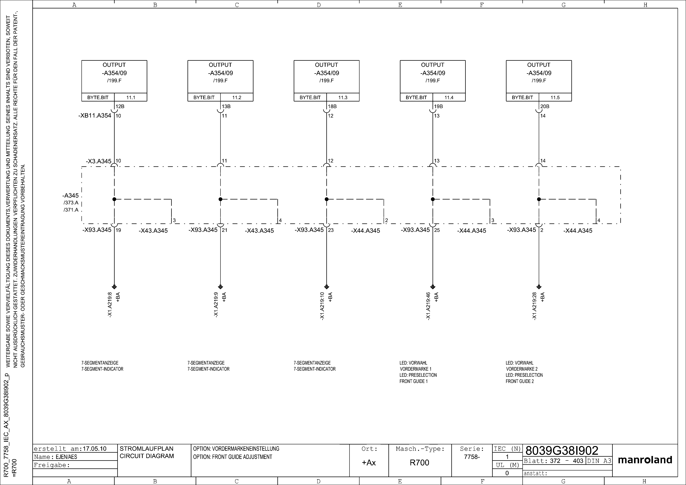

# +Ax — Sheet 372 of 403 — OPTION: VORDERMARKENEINSTELLUNG

**OPTION: FRONT GUIDE ADJUSTMENT**

> Part of the manroland **R700** printing press IEC/UL circuit diagrams.
> Drawing class: **Stromlaufplan / Circuit diagram** (DIN A3).
> Document `+Ax` covers the **Central control console** machine section.

## At a glance

| Field | Value |
|---|---|
| Document | `+Ax`  (8039G38I902) |
| Sheet | **372** of 403 |
| Section (DE) | OPTION: VORDERMARKENEINSTELLUNG |
| Section (EN) | OPTION: FRONT GUIDE ADJUSTMENT |
| Section type | CIRCUIT — Circuit diagram |
| Machine type | `R700` |
| Series | `7758` |
| Created | 17.05.10 |
| Replaces | — |
| Columns used | A, B, C, D, E, F, G |
| Path numbers | — |
| Labels on sheet | 89 |
| Cross-refs out | 7 |
| Cross-refs in | 27 |

**Previous:** [+Ax sheet 371](SHEET_0371.md) · **Next:** [+Ax sheet 373](SHEET_0373.md) · **Document TOC:** [_TOC.md](_TOC.md)  (+Ax) · **Master TOC:** [all sheets](../_MASTER_TOC.md)

## Sheet image (300 DPI, exact vector render)



_Rendered directly from the PDF vector layer at 300 DPI (1-bit), no OCR and no resampling. Use it to confirm anything ambiguous in the text below._

## Cross-references on this sheet

Each entry is a wire leaving this sheet. The printed token is `/sheet.column`; the link resolves to that sheet inside the same document.

| Ref | Target sheet | Col | Path | Destination on target | Target section | From col |
|---|---|---|---|---|---|---|
| `/199.F` | [+Ax sheet 199](SHEET_0199.md) | F | — | — | REFERENZMODUL | A |
| `/199.F` | [+Ax sheet 199](SHEET_0199.md) | F | — | — | REFERENZMODUL | C |
| `/199.F` | [+Ax sheet 199](SHEET_0199.md) | F | — | — | REFERENZMODUL | D |
| `/199.F` | [+Ax sheet 199](SHEET_0199.md) | F | — | — | REFERENZMODUL | E |
| `/199.F` | [+Ax sheet 199](SHEET_0199.md) | F | — | — | REFERENZMODUL | G |
| `/373.A` | [+Ax sheet 373](SHEET_0373.md) | A | — | — | OPTION: VORDERMARKENEINSTELLUNG | A |
| `/371.A` | [+Ax sheet 371](SHEET_0371.md) | A | — | — | OPTION: VORDERMARKENEINSTELLUNG | A |

### Incoming references (sheets that point here)

Every other sheet that sends a wire to this one. `Back-ref` is the token printed on *that* sheet; `Path` is its line number.

| From sheet | Cols | Back-ref | Path | Refs | What continues there |
|---|---|---|---|---|---|
| [+Ax#199](SHEET_0199.md) | F | `/199.F` | — | 5 | — |
| [+Ax#223](SHEET_0223.md) | B | `/223.B` | — | 5 | — |
| [+Ax#247](SHEET_0247.md) | A | `/247.A` | — | 5 | — |
| [+Ax#281](SHEET_0281.md) | E, H | `/281.E`, `/281.H` | — | 5 | — |
| [+Ax#289](SHEET_0289.md) | G | `/289.G` | — | 5 | — |
| [+Ax#371](SHEET_0371.md) | A | `/371.A` | — | 1 | — |
| [+Ax#373](SHEET_0373.md) | A | `/373.A` | — | 1 | — |


## Devices on this sheet

| Tag | Class | Class meaning (IEC) | Col | Sub | Terminal | Sign |
|---|---|---|---|---|---|---|
| `A354/09` | A | Baugruppe / assembly, module, PC board | A | 09 | — | — |
| `A345` | A | Baugruppe / assembly, module, PC board | A | — | — | — |
| `A354/09` | A | Baugruppe / assembly, module, PC board | C | 09 | — | — |
| `A354/09` | A | Baugruppe / assembly, module, PC board | D | 09 | — | — |
| `A354/09` | A | Baugruppe / assembly, module, PC board | E | 09 | — | — |
| `A354/09` | A | Baugruppe / assembly, module, PC board | G | 09 | — | — |
| `11.1` | — | cross-device reference | B | — | — | — |
| `XB11.A354` | — | cross-device reference | A | — | — | — |
| `X3.A345` | — | cross-device reference | A | — | — | — |
| `X93.A345` | — | cross-device reference | A | — | — | — |
| `X1.A219:8` | — | cross-device reference | A | — | 8 | — |
| `11.2` | — | cross-device reference | C | — | — | — |
| `X93.A345` | — | cross-device reference | C | — | — | — |
| `X1.A219:9` | — | cross-device reference | C | — | 9 | — |
| `11.3` | — | cross-device reference | D | — | — | — |
| `X93.A345` | — | cross-device reference | D | — | — | — |
| `X1.A219:10` | — | cross-device reference | D | — | 10 | — |
| `11.4` | — | cross-device reference | F | — | — | — |
| `X93.A345` | — | cross-device reference | E | — | — | — |
| `X1.A219:46` | — | cross-device reference | E | — | 46 | — |
| `11.5` | — | cross-device reference | G | — | — | — |
| `X93.A345` | — | cross-device reference | F | — | — | — |
| `X1.A219:28` | — | cross-device reference | G | — | 28 | — |
| `X43.A345` | — | cross-device reference | B | — | — | — |
| `X43.A345` | — | cross-device reference | C | — | — | — |
| `X44.A345` | — | cross-device reference | E | — | — | — |
| `X44.A345` | — | cross-device reference | F | — | — | — |
| `X44.A345` | — | cross-device reference | G | — | — | — |

## Potentials / nets

_No named potentials on this sheet._

## Wire-end annotations (grouped as printed)

A wire that continues elsewhere is annotated with a small cluster: the destination description, the path/line number `#NN`, and the `/sheet.column` cross reference. Each row below is one such cluster exactly as it is grouped on the drawing.

| Col | Y | Path | Cross-ref | Text on the wire |
|---|---|---|---|---|
| A | 108.3 | — | — | `OUTPUT` |
| C | 108.3 | — | — | `OUTPUT` |
| D | 108.3 | — | — | `OUTPUT` |
| E | 108.3 | — | — | `OUTPUT` |
| G | 108.3 | — | — | `OUTPUT` |
| A | 122.2 | — | — | `A354/09` |
| C | 122.2 | — | — | `A354/09` |
| D | 122.2 | — | — | `A354/09` |
| E | 122.2 | — | — | `A354/09` |
| G | 122.2 | — | — | `A354/09` |
| A | 136.0 | — | `/199.F` | — |
| C | 136.0 | — | `/199.F` | — |
| D | 136.0 | — | `/199.F` | — |
| E | 136.0 | — | `/199.F` | — |
| G | 136.0 | — | `/199.F` | — |
| A | 165.6 | — | — | `BYTE.BIT 11.1` |
| C | 165.6 | — | — | `BYTE.BIT 11.2` |
| D | 165.6 | — | — | `BYTE.BIT 11.3` |
| E | 165.6 | — | — | `BYTE.BIT 11.4` |
| G | 165.6 | — | — | `BYTE.BIT 11.5` |
| B | 181.0 | — | — | `12B` |
| C | 181.0 | — | — | `13B` |
| D | 181.0 | — | — | `18B` |
| E | 181.0 | — | — | `19B` |
| G | 181.0 | — | — | `20B` |
| A | 195.9 | — | — | `XB11.A354 10` |
| C | 197.3 | — | — | `11` |
| D | 197.3 | — | — | `12` |
| E | 197.3 | — | — | `13` |
| G | 197.3 | — | — | `14` |
| A | 275.3 | — | — | `X3.A345 10` |
| C | 275.3 | — | — | `11` |
| D | 275.3 | — | — | `12` |
| E | 275.3 | — | — | `13` |
| G | 275.3 | — | — | `14` |
| A | 334.8 | — | — | `A345` |
| A | 347.9 | — | `/373.A`, `/371.A` | — |
| B | 378.8 | — | — | `3` |
| D | 378.8 | — | — | `4` |
| E | 378.8 | — | — | `2` |
| F | 378.8 | — | — | `3` |
| G | 378.8 | — | — | `4` |
| A | 394.3 | — | — | `X93.A345 19` |
| C | 394.3 | — | — | `X93.A345 21` |
| D | 394.3 | — | — | `X93.A345 23` |
| E | 394.3 | — | — | `X93.A345 25` |
| G | 394.3 | — | — | `X93.A345 2` |
| E | 395.7 | — | — | `X43.A345 X43.A345 X44.A345 X44.A345 X44.A345` |
| A | 507.1 | — | — | `X1.A219:8` |
| C | 507.1 | — | — | `X1.A219:9` |
| D | 507.1 | — | — | `X1.A219:10` |
| E | 507.1 | — | — | `X1.A219:46` |
| G | 507.1 | — | — | `X1.A219:28` |
| B | 507.4 | — | — | `+BA` |
| C | 507.4 | — | — | `+BA` |
| D | 507.4 | — | — | `+BA` |
| E | 507.4 | — | — | `+BA` |
| G | 507.4 | — | — | `+BA` |
| E | 627.0 | — | — | `LED: VORWAHL` |
| F | 627.0 | — | — | `LED: VORWAHL` |
| A | 627.1 | — | — | `7 SEGMENTANZEIGE 7 SEGMENT INDICATOR` |
| C | 627.1 | — | — | `7 SEGMENTANZEIGE 7 SEGMENT INDICATOR` |
| D | 627.1 | — | — | `7 SEGMENTANZEIGE 7 SEGMENT INDICATOR` |
| E | 637.7 | — | — | `LED: PRESELECTION FRONT GUIDE 1 VORDERMARKE 1` |
| G | 637.7 | — | — | `LED: PRESELECTION FRONT GUIDE 2 VORDERMARKE 2` |


## Reconstructed tables

This sheet carries tabular content (pin map / terminal assignment / index). The grid below was rebuilt from the drawing's own rule lines, so each row is exactly one physical row of the table.

### Table 1 — 2 data rows × 2 columns (at x=141.7, y=104.9)

| OUTPUT | A354/09 /199.F |
|---|---|
| `BYTE.BIT` | `11.1` |
| `XB11.A354 X3.A345` | `12B 10 10` |


### Table 2 — 2 data rows × 2 columns (at x=326.0, y=104.9)

| OUTPUT | A354/09 /199.F |
|---|---|
| `BYTE.BIT` | `11.2` |
|  | `13B 11 11` |


### Table 3 — 2 data rows × 2 columns (at x=510.2, y=104.9)

| OUTPUT | A354/09 /199.F |
|---|---|
| `BYTE.BIT` | `11.3` |
|  | `18B 12 12` |


### Table 4 — 2 data rows × 2 columns (at x=694.5, y=104.9)

| OUTPUT | A354/09 /199.F |
|---|---|
| `BYTE.BIT` | `11.4` |
|  | `19B 13 13` |


### Table 5 — 2 data rows × 2 columns (at x=878.7, y=104.9)

| OUTPUT | A354/09 /199.F |
|---|---|
| `BYTE.BIT` | `11.5` |
|  | `20B 14 14` |


## Notes and free text on this sheet

| Text | Col | Y (pt) |
|---|---|---|
| `12B` | B | 181 |
| `OUTPUT` | A | 108.33 |
| `BYTE.BIT` | A | 165.6 |
| `7 SEGMENTANZEIGE` | A | 627.09 |
| `7 SEGMENT INDICATOR` | A | 637.74 |
| `+BA` | B | 507.4 |
| `13B` | C | 181 |
| `OUTPUT` | C | 108.33 |
| `BYTE.BIT` | C | 165.6 |
| `7 SEGMENTANZEIGE` | C | 627.09 |
| `7 SEGMENT INDICATOR` | C | 637.74 |
| `+BA` | C | 507.4 |
| `18B` | D | 181 |
| `OUTPUT` | D | 108.33 |
| `BYTE.BIT` | D | 165.6 |
| `7 SEGMENTANZEIGE` | D | 627.09 |
| `7 SEGMENT INDICATOR` | D | 637.74 |
| `+BA` | D | 507.4 |
| `19B` | E | 181 |
| `OUTPUT` | E | 108.33 |
| `BYTE.BIT` | E | 165.6 |
| `LED: VORWAHL` | E | 627.04 |
| `VORDERMARKE 1` | E | 637.71 |
| `LED: PRESELECTION` | E | 648.33 |
| `FRONT GUIDE 1` | E | 658.96 |
| `+BA` | E | 507.4 |
| `20B` | G | 181 |
| `OUTPUT` | G | 108.33 |
| `BYTE.BIT` | F | 165.6 |
| `LED: VORWAHL` | F | 627.04 |
| `VORDERMARKE 2` | F | 637.73 |
| `LED: PRESELECTION` | G | 648.33 |
| `FRONT GUIDE 2` | F | 658.98 |
| `+BA` | G | 507.4 |

## Complete label inventory (exact text from the drawing)

Every text object inside the drawing area of this sheet, in DIN reading order (column A→H, then top→bottom). This is the authoritative list: if a string is not here it is not printed on this sheet.

| Col | Y | X | Dir | Type | Text |
|---|---|---|---|---|---|
| A | 108.3 | 178.2 | → | text | `OUTPUT` |
| A | 122.2 | 177.0 | → | device tag | `A354/09` |
| A | 136.0 | 186.1 | → | cross-reference | `/199.F` |
| A | 165.6 | 151.7 | → | text | `BYTE.BIT` |
| A | 195.9 | 136.1 | → | device ref | `XB11.A354` |
| A | 275.3 | 149.1 | → | device ref | `X3.A345` |
| A | 334.8 | 108.3 | → | device tag | `A345` |
| A | 347.9 | 110.6 | → | cross-reference | `/373.A` |
| A | 360.3 | 110.6 | → | cross-reference | `/371.A` |
| A | 394.3 | 143.1 | → | device ref | `X93.A345` |
| A | 507.1 | 186.7 | ↕ | device ref | `X1.A219:8` |
| A | 627.1 | 141.4 | → | text | `7 SEGMENTANZEIGE` |
| A | 637.7 | 141.4 | → | text | `7 SEGMENT INDICATOR` |
| B | 165.6 | 219.1 | → | device ref | `11.1` |
| B | 181.0 | 200.4 | → | text | `12B` |
| B | 197.3 | 200.4 | → | number | `10` |
| B | 275.3 | 200.4 | → | number | `10` |
| B | 378.7 | 300.2 | → | number | `3` |
| B | 395.7 | 240.9 | → | device ref | `X43.A345` |
| B | 395.8 | 200.4 | → | number | `19` |
| B | 507.4 | 200.8 | ↕ | text | `+BA` |
| C | 108.3 | 362.4 | → | text | `OUTPUT` |
| C | 122.2 | 361.3 | → | device tag | `A354/09` |
| C | 136.0 | 370.3 | → | cross-reference | `/199.F` |
| C | 165.6 | 335.9 | → | text | `BYTE.BIT` |
| C | 165.6 | 402.9 | → | device ref | `11.2` |
| C | 181.0 | 384.7 | → | text | `13B` |
| C | 197.3 | 384.7 | → | number | `11` |
| C | 275.3 | 384.7 | → | number | `11` |
| C | 394.3 | 327.4 | → | device ref | `X93.A345` |
| C | 395.7 | 425.2 | → | device ref | `X43.A345` |
| C | 395.8 | 385.2 | → | number | `21` |
| C | 507.1 | 370.9 | ↕ | device ref | `X1.A219:9` |
| C | 507.4 | 385.0 | ↕ | text | `+BA` |
| C | 627.1 | 325.7 | → | text | `7 SEGMENTANZEIGE` |
| C | 637.7 | 325.7 | → | text | `7 SEGMENT INDICATOR` |
| D | 108.3 | 546.7 | → | text | `OUTPUT` |
| D | 122.2 | 545.5 | → | device tag | `A354/09` |
| D | 136.0 | 554.6 | → | cross-reference | `/199.F` |
| D | 165.6 | 520.2 | → | text | `BYTE.BIT` |
| D | 165.6 | 587.1 | → | device ref | `11.3` |
| D | 181.0 | 568.9 | → | text | `18B` |
| D | 197.3 | 568.9 | → | number | `12` |
| D | 275.3 | 568.9 | → | number | `12` |
| D | 378.7 | 484.4 | → | number | `4` |
| D | 394.3 | 511.7 | → | device ref | `X93.A345` |
| D | 395.8 | 569.5 | → | number | `23` |
| D | 507.1 | 555.2 | ↕ | device ref | `X1.A219:10` |
| D | 507.4 | 569.3 | ↕ | text | `+BA` |
| D | 627.1 | 510.0 | → | text | `7 SEGMENTANZEIGE` |
| D | 637.7 | 510.0 | → | text | `7 SEGMENT INDICATOR` |
| E | 108.3 | 730.9 | → | text | `OUTPUT` |
| E | 122.2 | 729.8 | → | device tag | `A354/09` |
| E | 136.0 | 738.9 | → | cross-reference | `/199.F` |
| E | 165.6 | 704.4 | → | text | `BYTE.BIT` |
| E | 181.0 | 753.2 | → | text | `19B` |
| E | 197.3 | 753.2 | → | number | `13` |
| E | 275.3 | 753.2 | → | number | `13` |
| E | 378.7 | 668.7 | → | number | `2` |
| E | 394.3 | 695.9 | → | device ref | `X93.A345` |
| E | 395.7 | 609.4 | → | device ref | `X44.A345` |
| E | 395.8 | 753.7 | → | number | `25` |
| E | 507.1 | 739.4 | ↕ | device ref | `X1.A219:46` |
| E | 507.4 | 753.6 | ↕ | text | `+BA` |
| E | 627.0 | 693.6 | → | text | `LED: VORWAHL` |
| E | 637.7 | 694.5 | → | text | `VORDERMARKE 1` |
| E | 648.3 | 693.6 | → | text | `LED: PRESELECTION` |
| E | 659.0 | 693.6 | → | text | `FRONT GUIDE 1` |
| F | 165.6 | 771.3 | → | device ref | `11.4` |
| F | 165.6 | 888.7 | → | text | `BYTE.BIT` |
| F | 378.7 | 852.9 | → | number | `3` |
| F | 394.3 | 880.2 | → | device ref | `X93.A345` |
| F | 395.7 | 793.7 | → | device ref | `X44.A345` |
| F | 627.0 | 877.9 | → | text | `LED: VORWAHL` |
| F | 637.7 | 878.7 | → | text | `VORDERMARKE 2` |
| F | 659.0 | 877.9 | → | text | `FRONT GUIDE 2` |
| G | 108.3 | 915.2 | → | text | `OUTPUT` |
| G | 122.2 | 914.0 | → | device tag | `A354/09` |
| G | 136.0 | 923.1 | → | cross-reference | `/199.F` |
| G | 165.6 | 955.6 | → | device ref | `11.5` |
| G | 181.0 | 938.0 | → | text | `20B` |
| G | 197.3 | 937.4 | → | number | `14` |
| G | 275.3 | 937.4 | → | number | `14` |
| G | 378.7 | 1037.2 | → | number | `4` |
| G | 395.7 | 978.0 | → | device ref | `X44.A345` |
| G | 395.8 | 938.0 | → | number | `2` |
| G | 507.1 | 923.7 | ↕ | device ref | `X1.A219:28` |
| G | 507.4 | 937.8 | ↕ | text | `+BA` |
| G | 648.3 | 877.9 | → | text | `LED: PRESELECTION` |

## Reading-order text block

The same content as a plain block, grouped by DIN column — convenient to paste or to match against a visual description.

```text
=== Column A ===
 108.3  178.2  text         OUTPUT
 122.2  177.0  devtag       A354/09
 136.0  186.1  xref         /199.F
 165.6  151.7  text         BYTE.BIT
 195.9  136.1  devref       XB11.A354
 275.3  149.1  devref       X3.A345
 334.8  108.3  devtag       A345
 347.9  110.6  xref         /373.A
 360.3  110.6  xref         /371.A
 394.3  143.1  devref       X93.A345
 507.1  186.7  devref       X1.A219:8
 627.1  141.4  text         7 SEGMENTANZEIGE
 637.7  141.4  text         7 SEGMENT INDICATOR
=== Column B ===
 165.6  219.1  devref       11.1
 181.0  200.4  text         12B
 197.3  200.4  numeric      10
 275.3  200.4  numeric      10
 378.7  300.2  numeric      3
 395.7  240.9  devref       X43.A345
 395.8  200.4  numeric      19
 507.4  200.8  text         +BA
=== Column C ===
 108.3  362.4  text         OUTPUT
 122.2  361.3  devtag       A354/09
 136.0  370.3  xref         /199.F
 165.6  335.9  text         BYTE.BIT
 165.6  402.9  devref       11.2
 181.0  384.7  text         13B
 197.3  384.7  numeric      11
 275.3  384.7  numeric      11
 394.3  327.4  devref       X93.A345
 395.7  425.2  devref       X43.A345
 395.8  385.2  numeric      21
 507.1  370.9  devref       X1.A219:9
 507.4  385.0  text         +BA
 627.1  325.7  text         7 SEGMENTANZEIGE
 637.7  325.7  text         7 SEGMENT INDICATOR
=== Column D ===
 108.3  546.7  text         OUTPUT
 122.2  545.5  devtag       A354/09
 136.0  554.6  xref         /199.F
 165.6  520.2  text         BYTE.BIT
 165.6  587.1  devref       11.3
 181.0  568.9  text         18B
 197.3  568.9  numeric      12
 275.3  568.9  numeric      12
 378.7  484.4  numeric      4
 394.3  511.7  devref       X93.A345
 395.8  569.5  numeric      23
 507.1  555.2  devref       X1.A219:10
 507.4  569.3  text         +BA
 627.1  510.0  text         7 SEGMENTANZEIGE
 637.7  510.0  text         7 SEGMENT INDICATOR
=== Column E ===
 108.3  730.9  text         OUTPUT
 122.2  729.8  devtag       A354/09
 136.0  738.9  xref         /199.F
 165.6  704.4  text         BYTE.BIT
 181.0  753.2  text         19B
 197.3  753.2  numeric      13
 275.3  753.2  numeric      13
 378.7  668.7  numeric      2
 394.3  695.9  devref       X93.A345
 395.7  609.4  devref       X44.A345
 395.8  753.7  numeric      25
 507.1  739.4  devref       X1.A219:46
 507.4  753.6  text         +BA
 627.0  693.6  text         LED: VORWAHL
 637.7  694.5  text         VORDERMARKE 1
 648.3  693.6  text         LED: PRESELECTION
 659.0  693.6  text         FRONT GUIDE 1
=== Column F ===
 165.6  771.3  devref       11.4
 165.6  888.7  text         BYTE.BIT
 378.7  852.9  numeric      3
 394.3  880.2  devref       X93.A345
 395.7  793.7  devref       X44.A345
 627.0  877.9  text         LED: VORWAHL
 637.7  878.7  text         VORDERMARKE 2
 659.0  877.9  text         FRONT GUIDE 2
=== Column G ===
 108.3  915.2  text         OUTPUT
 122.2  914.0  devtag       A354/09
 136.0  923.1  xref         /199.F
 165.6  955.6  devref       11.5
 181.0  938.0  text         20B
 197.3  937.4  numeric      14
 275.3  937.4  numeric      14
 378.7 1037.2  numeric      4
 395.7  978.0  devref       X44.A345
 395.8  938.0  numeric      2
 507.1  923.7  devref       X1.A219:28
 507.4  937.8  text         +BA
 648.3  877.9  text         LED: PRESELECTION
```

---
_Generated from the PDF vector text layer; no OCR. Source: `R700_7758_IEC_AX_8039G38I902_p`, sheet 372._
