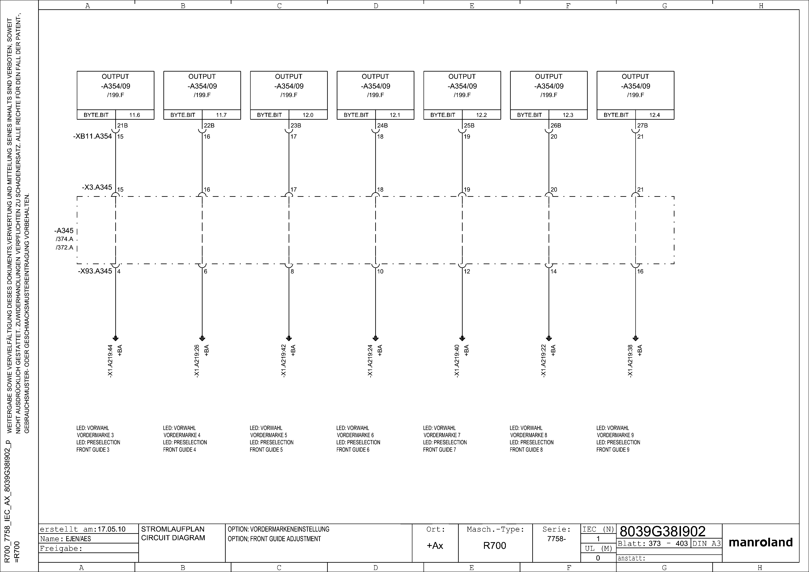

# +Ax — Sheet 373 of 403 — OPTION: VORDERMARKENEINSTELLUNG

**OPTION; FRONT GUIDE ADJUSTMENT**

> Part of the manroland **R700** printing press IEC/UL circuit diagrams.
> Drawing class: **Stromlaufplan / Circuit diagram** (DIN A3).
> Document `+Ax` covers the **Central control console** machine section.

## At a glance

| Field | Value |
|---|---|
| Document | `+Ax`  (8039G38I902) |
| Sheet | **373** of 403 |
| Section (DE) | OPTION: VORDERMARKENEINSTELLUNG |
| Section (EN) | OPTION; FRONT GUIDE ADJUSTMENT |
| Section type | CIRCUIT — Circuit diagram |
| Machine type | `R700` |
| Series | `7758` |
| Created | 17.05.10 |
| Replaces | — |
| Columns used | A, B, C, D, E, F, G |
| Path numbers | — |
| Labels on sheet | 111 |
| Cross-refs out | 9 |
| Cross-refs in | 30 |

**Previous:** [+Ax sheet 372](SHEET_0372.md) · **Next:** [+Ax sheet 374](SHEET_0374.md) · **Document TOC:** [_TOC.md](_TOC.md)  (+Ax) · **Master TOC:** [all sheets](../_MASTER_TOC.md)

## Sheet image (300 DPI, exact vector render)



_Rendered directly from the PDF vector layer at 300 DPI (1-bit), no OCR and no resampling. Use it to confirm anything ambiguous in the text below._

## Cross-references on this sheet

Each entry is a wire leaving this sheet. The printed token is `/sheet.column`; the link resolves to that sheet inside the same document.

| Ref | Target sheet | Col | Path | Destination on target | Target section | From col |
|---|---|---|---|---|---|---|
| `/199.F` | [+Ax sheet 199](SHEET_0199.md) | F | — | — | REFERENZMODUL | A |
| `/199.F` | [+Ax sheet 199](SHEET_0199.md) | F | — | — | REFERENZMODUL | B |
| `/199.F` | [+Ax sheet 199](SHEET_0199.md) | F | — | — | REFERENZMODUL | C |
| `/199.F` | [+Ax sheet 199](SHEET_0199.md) | F | — | — | REFERENZMODUL | D |
| `/199.F` | [+Ax sheet 199](SHEET_0199.md) | F | — | — | REFERENZMODUL | E |
| `/199.F` | [+Ax sheet 199](SHEET_0199.md) | F | — | — | REFERENZMODUL | F |
| `/199.F` | [+Ax sheet 199](SHEET_0199.md) | F | — | — | REFERENZMODUL | G |
| `/374.A` | [+Ax sheet 374](SHEET_0374.md) | A | — | — | OPTION: VORDERMARKENEINSTELLUNG | A |
| `/372.A` | [+Ax sheet 372](SHEET_0372.md) | A | — | — | OPTION: VORDERMARKENEINSTELLUNG | A |

### Incoming references (sheets that point here)

Every other sheet that sends a wire to this one. `Back-ref` is the token printed on *that* sheet; `Path` is its line number.

| From sheet | Cols | Back-ref | Path | Refs | What continues there |
|---|---|---|---|---|---|
| [+Ax#199](SHEET_0199.md) | F | `/199.F` | — | 7 | — |
| [+Ax#223](SHEET_0223.md) | B | `/223.B` | — | 7 | — |
| [+Ax#247](SHEET_0247.md) | A | `/247.A` | — | 7 | — |
| [+Ax#289](SHEET_0289.md) | G | `/289.G` | — | 7 | — |
| [+Ax#372](SHEET_0372.md) | A | `/372.A` | — | 1 | — |
| [+Ax#374](SHEET_0374.md) | A | `/374.A` | — | 1 | — |


## Devices on this sheet

| Tag | Class | Class meaning (IEC) | Col | Sub | Terminal | Sign |
|---|---|---|---|---|---|---|
| `A345` | A | Baugruppe / assembly, module, PC board | A | — | — | — |
| `A354/09` | A | Baugruppe / assembly, module, PC board | A | 09 | — | — |
| `A354/09` | A | Baugruppe / assembly, module, PC board | B | 09 | — | — |
| `A354/09` | A | Baugruppe / assembly, module, PC board | C | 09 | — | — |
| `A354/09` | A | Baugruppe / assembly, module, PC board | D | 09 | — | — |
| `A354/09` | A | Baugruppe / assembly, module, PC board | E | 09 | — | — |
| `A354/09` | A | Baugruppe / assembly, module, PC board | F | 09 | — | — |
| `A354/09` | A | Baugruppe / assembly, module, PC board | G | 09 | — | — |
| `XB11.A354` | — | cross-device reference | A | — | — | — |
| `11.6` | — | cross-device reference | A | — | — | — |
| `X3.A345` | — | cross-device reference | A | — | — | — |
| `X93.A345` | — | cross-device reference | A | — | — | — |
| `11.7` | — | cross-device reference | B | — | — | — |
| `12.0` | — | cross-device reference | C | — | — | — |
| `12.1` | — | cross-device reference | D | — | — | — |
| `12.2` | — | cross-device reference | E | — | — | — |
| `12.3` | — | cross-device reference | F | — | — | — |
| `12.4` | — | cross-device reference | G | — | — | — |
| `X1.A219:44` | — | cross-device reference | A | — | 44 | — |
| `X1.A219:26` | — | cross-device reference | B | — | 26 | — |
| `X1.A219:42` | — | cross-device reference | C | — | 42 | — |
| `X1.A219:24` | — | cross-device reference | D | — | 24 | — |
| `X1.A219:40` | — | cross-device reference | E | — | 40 | — |
| `X1.A219:22` | — | cross-device reference | F | — | 22 | — |
| `X1.A219:38` | — | cross-device reference | G | — | 38 | — |

## Potentials / nets

_No named potentials on this sheet._

## Wire-end annotations (grouped as printed)

A wire that continues elsewhere is annotated with a small cluster: the destination description, the path/line number `#NN`, and the `/sheet.column` cross reference. Each row below is one such cluster exactly as it is grouped on the drawing.

| Col | Y | Path | Cross-ref | Text on the wire |
|---|---|---|---|---|
| A | 108.3 | — | — | `OUTPUT` |
| B | 108.3 | — | — | `OUTPUT` |
| C | 108.3 | — | — | `OUTPUT` |
| D | 108.3 | — | — | `OUTPUT` |
| E | 108.3 | — | — | `OUTPUT` |
| F | 108.3 | — | — | `OUTPUT` |
| G | 108.3 | — | — | `OUTPUT` |
| A | 122.2 | — | — | `A354/09` |
| B | 122.2 | — | — | `A354/09` |
| C | 122.2 | — | — | `A354/09` |
| D | 122.2 | — | — | `A354/09` |
| E | 122.2 | — | — | `A354/09` |
| F | 122.2 | — | — | `A354/09` |
| G | 122.2 | — | — | `A354/09` |
| A | 136.0 | — | `/199.F` | — |
| B | 136.0 | — | `/199.F` | — |
| C | 136.0 | — | `/199.F` | — |
| D | 136.0 | — | `/199.F` | — |
| E | 136.0 | — | `/199.F` | — |
| F | 136.0 | — | `/199.F` | — |
| G | 136.0 | — | `/199.F` | — |
| A | 165.6 | — | — | `BYTE.BIT 11.6` |
| B | 165.6 | — | — | `BYTE.BIT 11.7` |
| C | 165.6 | — | — | `BYTE.BIT 12.0` |
| D | 165.6 | — | — | `BYTE.BIT 12.1` |
| E | 165.6 | — | — | `BYTE.BIT 12.2` |
| F | 165.6 | — | — | `BYTE.BIT 12.3` |
| G | 165.6 | — | — | `BYTE.BIT 12.4` |
| A | 181.0 | — | — | `21B` |
| B | 181.0 | — | — | `22B` |
| C | 181.0 | — | — | `23B` |
| D | 181.0 | — | — | `24B` |
| E | 181.0 | — | — | `25B` |
| F | 181.0 | — | — | `26B` |
| G | 181.0 | — | — | `27B` |
| A | 195.9 | — | — | `XB11.A354 15` |
| C | 197.3 | — | — | `16 17` |
| D | 197.3 | — | — | `18` |
| E | 197.3 | — | — | `19 20` |
| G | 197.3 | — | — | `21` |
| A | 271.0 | — | — | `X3.A345 15` |
| D | 275.3 | — | — | `16 17 18 19 20 21` |
| A | 334.8 | — | — | `A345` |
| A | 347.9 | — | `/374.A`, `/372.A` | — |
| A | 394.3 | — | — | `X93.A345 4` |
| D | 395.8 | — | — | `6 8 10 12 14 16` |
| C | 506.8 | — | — | `X1.A219:42` |
| F | 506.8 | — | — | `X1.A219:22` |
| A | 507.1 | — | — | `X1.A219:44` |
| B | 507.1 | — | — | `X1.A219:26` |
| D | 507.1 | — | — | `X1.A219:24` |
| E | 507.1 | — | — | `X1.A219:40` |
| G | 507.1 | — | — | `X1.A219:38` |
| A | 507.4 | — | — | `+BA` |
| B | 507.4 | — | — | `+BA` |
| C | 507.4 | — | — | `+BA` |
| D | 507.4 | — | — | `+BA` |
| E | 507.4 | — | — | `+BA` |
| F | 507.4 | — | — | `+BA` |
| G | 507.4 | — | — | `+BA` |
| A | 627.0 | — | — | `LED: VORWAHL` |
| B | 627.0 | — | — | `LED: VORWAHL` |
| C | 627.0 | — | — | `LED: VORWAHL` |
| D | 627.0 | — | — | `LED: VORWAHL` |
| E | 627.0 | — | — | `LED: VORWAHL` |
| F | 627.0 | — | — | `LED: VORWAHL` |
| F | 627.0 | — | — | `LED: VORWAHL` |
| A | 637.7 | — | — | `LED: PRESELECTION FRONT GUIDE 3 VORDERMARKE 3` |
| B | 637.7 | — | — | `LED: PRESELECTION FRONT GUIDE 4 VORDERMARKE 4` |
| C | 637.7 | — | — | `LED: PRESELECTION FRONT GUIDE 5 VORDERMARKE 5` |
| D | 637.7 | — | — | `LED: PRESELECTION FRONT GUIDE 6 VORDERMARKE 6` |
| E | 637.7 | — | — | `LED: PRESELECTION FRONT GUIDE 7 VORDERMARKE 7` |
| F | 637.7 | — | — | `LED: PRESELECTION FRONT GUIDE 8 VORDERMARKE 8` |
| G | 637.7 | — | — | `LED: PRESELECTION FRONT GUIDE 9 VORDERMARKE 9` |


## Reconstructed tables

This sheet carries tabular content (pin map / terminal assignment / index). The grid below was rebuilt from the drawing's own rule lines, so each row is exactly one physical row of the table.

### Table 1 — 1 data rows × 2 columns (at x=113.4, y=104.9)

| OUTPUT | A354/09 /199.F |
|---|---|
| `BYTE.BIT` | `11.6` |


### Table 2 — 1 data rows × 2 columns (at x=240.9, y=104.9)

| OUTPUT | A354/09 /199.F |
|---|---|
| `BYTE.BIT` | `11.7` |


### Table 3 — 1 data rows × 2 columns (at x=368.5, y=104.9)

| OUTPUT | A354/09 /199.F |
|---|---|
| `BYTE.BIT` | `12.0` |


### Table 4 — 1 data rows × 2 columns (at x=496.1, y=104.9)

| OUTPUT | A354/09 /199.F |
|---|---|
| `BYTE.BIT` | `12.1` |


### Table 5 — 1 data rows × 2 columns (at x=623.6, y=104.9)

| OUTPUT | A354/09 /199.F |
|---|---|
| `BYTE.BIT` | `12.2` |


### Table 6 — 1 data rows × 2 columns (at x=751.2, y=104.9)

| OUTPUT | A354/09 /199.F |
|---|---|
| `BYTE.BIT` | `12.3` |


### Table 7 — 1 data rows × 2 columns (at x=878.7, y=104.9)

| OUTPUT | A354/09 /199.F |
|---|---|
| `BYTE.BIT` | `12.4` |


## Notes and free text on this sheet

| Text | Col | Y (pt) |
|---|---|---|
| `21B` | A | 181 |
| `OUTPUT` | A | 108.33 |
| `BYTE.BIT` | A | 165.6 |
| `LED: VORWAHL` | A | 627.04 |
| `VORDERMARKE 3` | A | 637.73 |
| `LED: PRESELECTION` | A | 648.33 |
| `FRONT GUIDE 3` | A | 658.98 |
| `22B` | B | 181 |
| `OUTPUT` | B | 108.33 |
| `BYTE.BIT` | B | 165.6 |
| `LED: VORWAHL` | B | 627.04 |
| `VORDERMARKE 4` | B | 637.73 |
| `LED: PRESELECTION` | B | 648.33 |
| `FRONT GUIDE 4` | B | 658.98 |
| `23B` | C | 181 |
| `OUTPUT` | C | 108.33 |
| `BYTE.BIT` | C | 165.6 |
| `LED: VORWAHL` | C | 627.04 |
| `VORDERMARKE 5` | C | 637.73 |
| `LED: PRESELECTION` | C | 648.33 |
| `FRONT GUIDE 5` | C | 658.98 |
| `24B` | D | 181 |
| `OUTPUT` | D | 108.33 |
| `BYTE.BIT` | D | 165.6 |
| `LED: VORWAHL` | D | 627.04 |
| `VORDERMARKE 6` | D | 637.73 |
| `LED: PRESELECTION` | D | 648.33 |
| `FRONT GUIDE 6` | D | 658.98 |
| `25B` | E | 181 |
| `OUTPUT` | E | 108.33 |
| `BYTE.BIT` | E | 165.6 |
| `LED: VORWAHL` | E | 627.04 |
| `VORDERMARKE 7` | E | 637.73 |
| `LED: PRESELECTION` | E | 648.33 |
| `FRONT GUIDE 7` | E | 658.98 |
| `26B` | F | 181 |
| `OUTPUT` | F | 108.33 |
| `BYTE.BIT` | F | 165.6 |
| `LED: VORWAHL` | F | 627.04 |
| `VORDERMARKE 8` | F | 637.73 |
| `LED: PRESELECTION` | F | 648.33 |
| `FRONT GUIDE 8` | F | 658.98 |
| `27B` | G | 181 |
| `OUTPUT` | G | 108.33 |
| `VORDERMARKE 9` | F | 637.73 |
| `LED: PRESELECTION` | G | 648.33 |
| `FRONT GUIDE 9` | F | 658.98 |
| `+BA` | A | 507.4 |
| `+BA` | B | 507.4 |
| `+BA` | C | 507.4 |
| `+BA` | D | 507.4 |
| `+BA` | E | 507.4 |
| `+BA` | F | 507.4 |
| `+BA` | G | 507.4 |

## Complete label inventory (exact text from the drawing)

Every text object inside the drawing area of this sheet, in DIN reading order (column A→H, then top→bottom). This is the authoritative list: if a string is not here it is not printed on this sheet.

| Col | Y | X | Dir | Type | Text |
|---|---|---|---|---|---|
| A | 108.3 | 149.8 | → | text | `OUTPUT` |
| A | 122.2 | 148.7 | → | device tag | `A354/09` |
| A | 136.0 | 157.7 | → | cross-reference | `/199.F` |
| A | 165.6 | 123.3 | → | text | `BYTE.BIT` |
| A | 165.6 | 190.2 | → | device ref | `11.6` |
| A | 181.0 | 172.6 | → | text | `21B` |
| A | 195.9 | 107.7 | → | device ref | `XB11.A354` |
| A | 197.3 | 172.1 | → | number | `15` |
| A | 271.0 | 120.8 | → | device ref | `X3.A345` |
| A | 275.3 | 172.1 | → | number | `15` |
| A | 334.8 | 79.9 | → | device tag | `A345` |
| A | 347.9 | 82.2 | → | cross-reference | `/374.A` |
| A | 360.3 | 82.2 | → | cross-reference | `/372.A` |
| A | 394.3 | 114.8 | → | device ref | `X93.A345` |
| A | 395.8 | 172.6 | → | number | `4` |
| A | 507.1 | 158.3 | ↕ | device ref | `X1.A219:44` |
| A | 507.4 | 172.5 | ↕ | text | `+BA` |
| A | 627.0 | 112.5 | → | text | `LED: VORWAHL` |
| A | 637.7 | 113.4 | → | text | `VORDERMARKE 3` |
| A | 648.3 | 112.5 | → | text | `LED: PRESELECTION` |
| A | 659.0 | 112.5 | → | text | `FRONT GUIDE 3` |
| B | 108.3 | 277.4 | → | text | `OUTPUT` |
| B | 122.2 | 276.2 | → | device tag | `A354/09` |
| B | 136.0 | 285.3 | → | cross-reference | `/199.F` |
| B | 165.6 | 250.9 | → | text | `BYTE.BIT` |
| B | 165.6 | 317.8 | → | device ref | `11.7` |
| B | 181.0 | 300.2 | → | text | `22B` |
| B | 197.3 | 299.6 | → | number | `16` |
| B | 275.3 | 299.6 | → | number | `16` |
| B | 395.8 | 300.2 | → | number | `6` |
| B | 507.1 | 285.9 | ↕ | device ref | `X1.A219:26` |
| B | 507.4 | 300.0 | ↕ | text | `+BA` |
| B | 627.0 | 240.1 | → | text | `LED: VORWAHL` |
| B | 637.7 | 240.9 | → | text | `VORDERMARKE 4` |
| B | 648.3 | 240.1 | → | text | `LED: PRESELECTION` |
| B | 659.0 | 240.1 | → | text | `FRONT GUIDE 4` |
| C | 108.3 | 404.9 | → | text | `OUTPUT` |
| C | 122.2 | 403.8 | → | device tag | `A354/09` |
| C | 136.0 | 412.9 | → | cross-reference | `/199.F` |
| C | 165.6 | 378.4 | → | text | `BYTE.BIT` |
| C | 165.6 | 445.3 | → | device ref | `12.0` |
| C | 181.0 | 427.7 | → | text | `23B` |
| C | 197.3 | 427.2 | → | number | `17` |
| C | 275.3 | 427.2 | → | number | `17` |
| C | 395.8 | 427.7 | → | number | `8` |
| C | 506.8 | 413.4 | ↕ | device ref | `X1.A219:42` |
| C | 507.4 | 427.6 | ↕ | text | `+BA` |
| C | 627.0 | 367.7 | → | text | `LED: VORWAHL` |
| C | 637.7 | 368.5 | → | text | `VORDERMARKE 5` |
| C | 648.3 | 367.7 | → | text | `LED: PRESELECTION` |
| C | 659.0 | 367.7 | → | text | `FRONT GUIDE 5` |
| D | 108.3 | 532.5 | → | text | `OUTPUT` |
| D | 122.2 | 531.4 | → | device tag | `A354/09` |
| D | 136.0 | 540.4 | → | cross-reference | `/199.F` |
| D | 165.6 | 506.0 | → | text | `BYTE.BIT` |
| D | 165.6 | 573.4 | → | device ref | `12.1` |
| D | 181.0 | 555.3 | → | text | `24B` |
| D | 197.3 | 554.7 | → | number | `18` |
| D | 275.3 | 554.7 | → | number | `18` |
| D | 395.8 | 554.7 | → | number | `10` |
| D | 507.1 | 541.0 | ↕ | device ref | `X1.A219:24` |
| D | 507.4 | 555.1 | ↕ | text | `+BA` |
| D | 627.0 | 495.2 | → | text | `LED: VORWAHL` |
| D | 637.7 | 496.1 | → | text | `VORDERMARKE 6` |
| D | 648.3 | 495.2 | → | text | `LED: PRESELECTION` |
| D | 659.0 | 495.2 | → | text | `FRONT GUIDE 6` |
| E | 108.3 | 660.0 | → | text | `OUTPUT` |
| E | 122.2 | 658.9 | → | device tag | `A354/09` |
| E | 136.0 | 668.0 | → | cross-reference | `/199.F` |
| E | 165.6 | 633.5 | → | text | `BYTE.BIT` |
| E | 165.6 | 700.6 | → | device ref | `12.2` |
| E | 181.0 | 682.9 | → | text | `25B` |
| E | 197.3 | 682.3 | → | number | `19` |
| E | 275.3 | 682.3 | → | number | `19` |
| E | 395.8 | 682.3 | → | number | `12` |
| E | 507.1 | 668.6 | ↕ | device ref | `X1.A219:40` |
| E | 507.4 | 682.7 | ↕ | text | `+BA` |
| E | 627.0 | 622.8 | → | text | `LED: VORWAHL` |
| E | 637.7 | 623.6 | → | text | `VORDERMARKE 7` |
| E | 648.3 | 622.8 | → | text | `LED: PRESELECTION` |
| E | 659.0 | 622.8 | → | text | `FRONT GUIDE 7` |
| F | 108.3 | 787.6 | → | text | `OUTPUT` |
| F | 122.2 | 786.5 | → | device tag | `A354/09` |
| F | 136.0 | 795.5 | → | cross-reference | `/199.F` |
| F | 165.6 | 761.1 | → | text | `BYTE.BIT` |
| F | 165.6 | 828.0 | → | device ref | `12.3` |
| F | 165.6 | 888.7 | → | text | `BYTE.BIT` |
| F | 181.0 | 810.4 | → | text | `26B` |
| F | 197.3 | 810.4 | → | number | `20` |
| F | 275.3 | 810.4 | → | number | `20` |
| F | 395.8 | 809.9 | → | number | `14` |
| F | 506.8 | 796.1 | ↕ | device ref | `X1.A219:22` |
| F | 507.4 | 810.2 | ↕ | text | `+BA` |
| F | 627.0 | 750.3 | → | text | `LED: VORWAHL` |
| F | 627.0 | 877.9 | → | text | `LED: VORWAHL` |
| F | 637.7 | 751.2 | → | text | `VORDERMARKE 8` |
| F | 637.7 | 878.7 | → | text | `VORDERMARKE 9` |
| F | 648.3 | 750.3 | → | text | `LED: PRESELECTION` |
| F | 659.0 | 750.3 | → | text | `FRONT GUIDE 8` |
| F | 659.0 | 877.9 | → | text | `FRONT GUIDE 9` |
| G | 108.3 | 915.2 | → | text | `OUTPUT` |
| G | 122.2 | 914.0 | → | device tag | `A354/09` |
| G | 136.0 | 923.1 | → | cross-reference | `/199.F` |
| G | 165.6 | 955.6 | → | device ref | `12.4` |
| G | 181.0 | 938.0 | → | text | `27B` |
| G | 197.3 | 938.0 | → | number | `21` |
| G | 275.3 | 938.0 | → | number | `21` |
| G | 395.8 | 937.4 | → | number | `16` |
| G | 507.1 | 923.7 | ↕ | device ref | `X1.A219:38` |
| G | 507.4 | 937.8 | ↕ | text | `+BA` |
| G | 648.3 | 877.9 | → | text | `LED: PRESELECTION` |

## Reading-order text block

The same content as a plain block, grouped by DIN column — convenient to paste or to match against a visual description.

```text
=== Column A ===
 108.3  149.8  text         OUTPUT
 122.2  148.7  devtag       A354/09
 136.0  157.7  xref         /199.F
 165.6  123.3  text         BYTE.BIT
 165.6  190.2  devref       11.6
 181.0  172.6  text         21B
 195.9  107.7  devref       XB11.A354
 197.3  172.1  numeric      15
 271.0  120.8  devref       X3.A345
 275.3  172.1  numeric      15
 334.8   79.9  devtag       A345
 347.9   82.2  xref         /374.A
 360.3   82.2  xref         /372.A
 394.3  114.8  devref       X93.A345
 395.8  172.6  numeric      4
 507.1  158.3  devref       X1.A219:44
 507.4  172.5  text         +BA
 627.0  112.5  text         LED: VORWAHL
 637.7  113.4  text         VORDERMARKE 3
 648.3  112.5  text         LED: PRESELECTION
 659.0  112.5  text         FRONT GUIDE 3
=== Column B ===
 108.3  277.4  text         OUTPUT
 122.2  276.2  devtag       A354/09
 136.0  285.3  xref         /199.F
 165.6  250.9  text         BYTE.BIT
 165.6  317.8  devref       11.7
 181.0  300.2  text         22B
 197.3  299.6  numeric      16
 275.3  299.6  numeric      16
 395.8  300.2  numeric      6
 507.1  285.9  devref       X1.A219:26
 507.4  300.0  text         +BA
 627.0  240.1  text         LED: VORWAHL
 637.7  240.9  text         VORDERMARKE 4
 648.3  240.1  text         LED: PRESELECTION
 659.0  240.1  text         FRONT GUIDE 4
=== Column C ===
 108.3  404.9  text         OUTPUT
 122.2  403.8  devtag       A354/09
 136.0  412.9  xref         /199.F
 165.6  378.4  text         BYTE.BIT
 165.6  445.3  devref       12.0
 181.0  427.7  text         23B
 197.3  427.2  numeric      17
 275.3  427.2  numeric      17
 395.8  427.7  numeric      8
 506.8  413.4  devref       X1.A219:42
 507.4  427.6  text         +BA
 627.0  367.7  text         LED: VORWAHL
 637.7  368.5  text         VORDERMARKE 5
 648.3  367.7  text         LED: PRESELECTION
 659.0  367.7  text         FRONT GUIDE 5
=== Column D ===
 108.3  532.5  text         OUTPUT
 122.2  531.4  devtag       A354/09
 136.0  540.4  xref         /199.F
 165.6  506.0  text         BYTE.BIT
 165.6  573.4  devref       12.1
 181.0  555.3  text         24B
 197.3  554.7  numeric      18
 275.3  554.7  numeric      18
 395.8  554.7  numeric      10
 507.1  541.0  devref       X1.A219:24
 507.4  555.1  text         +BA
 627.0  495.2  text         LED: VORWAHL
 637.7  496.1  text         VORDERMARKE 6
 648.3  495.2  text         LED: PRESELECTION
 659.0  495.2  text         FRONT GUIDE 6
=== Column E ===
 108.3  660.0  text         OUTPUT
 122.2  658.9  devtag       A354/09
 136.0  668.0  xref         /199.F
 165.6  633.5  text         BYTE.BIT
 165.6  700.6  devref       12.2
 181.0  682.9  text         25B
 197.3  682.3  numeric      19
 275.3  682.3  numeric      19
 395.8  682.3  numeric      12
 507.1  668.6  devref       X1.A219:40
 507.4  682.7  text         +BA
 627.0  622.8  text         LED: VORWAHL
 637.7  623.6  text         VORDERMARKE 7
 648.3  622.8  text         LED: PRESELECTION
 659.0  622.8  text         FRONT GUIDE 7
=== Column F ===
 108.3  787.6  text         OUTPUT
 122.2  786.5  devtag       A354/09
 136.0  795.5  xref         /199.F
 165.6  761.1  text         BYTE.BIT
 165.6  828.0  devref       12.3
 165.6  888.7  text         BYTE.BIT
 181.0  810.4  text         26B
 197.3  810.4  numeric      20
 275.3  810.4  numeric      20
 395.8  809.9  numeric      14
 506.8  796.1  devref       X1.A219:22
 507.4  810.2  text         +BA
 627.0  750.3  text         LED: VORWAHL
 627.0  877.9  text         LED: VORWAHL
 637.7  751.2  text         VORDERMARKE 8
 637.7  878.7  text         VORDERMARKE 9
 648.3  750.3  text         LED: PRESELECTION
 659.0  750.3  text         FRONT GUIDE 8
 659.0  877.9  text         FRONT GUIDE 9
=== Column G ===
 108.3  915.2  text         OUTPUT
 122.2  914.0  devtag       A354/09
 136.0  923.1  xref         /199.F
 165.6  955.6  devref       12.4
 181.0  938.0  text         27B
 197.3  938.0  numeric      21
 275.3  938.0  numeric      21
 395.8  937.4  numeric      16
 507.1  923.7  devref       X1.A219:38
 507.4  937.8  text         +BA
 648.3  877.9  text         LED: PRESELECTION
```

---
_Generated from the PDF vector text layer; no OCR. Source: `R700_7758_IEC_AX_8039G38I902_p`, sheet 373._
