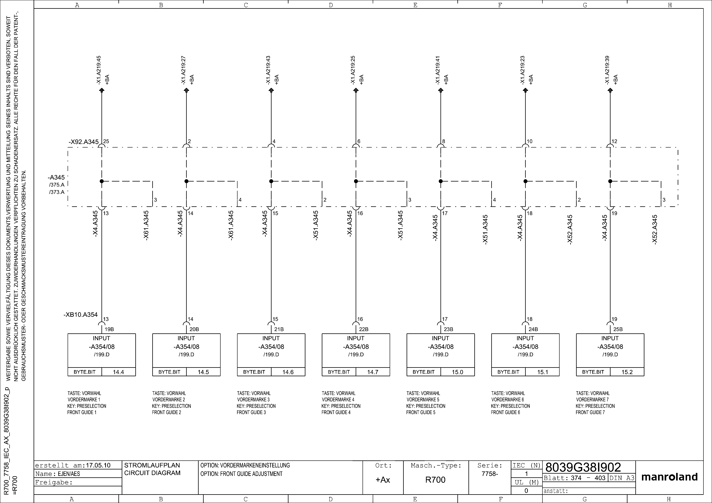

# +Ax — Sheet 374 of 403 — OPTION: VORDERMARKENEINSTELLUNG

**OPTION: FRONT GUIDE ADJUSTMENT**

> Part of the manroland **R700** printing press IEC/UL circuit diagrams.
> Drawing class: **Stromlaufplan / Circuit diagram** (DIN A3).
> Document `+Ax` covers the **Central control console** machine section.

## At a glance

| Field | Value |
|---|---|
| Document | `+Ax`  (8039G38I902) |
| Sheet | **374** of 403 |
| Section (DE) | OPTION: VORDERMARKENEINSTELLUNG |
| Section (EN) | OPTION: FRONT GUIDE ADJUSTMENT |
| Section type | CIRCUIT — Circuit diagram |
| Machine type | `R700` |
| Series | `7758` |
| Created | 17.05.10 |
| Replaces | — |
| Columns used | A, B, C, D, E, F, G, H |
| Path numbers | — |
| Labels on sheet | 131 |
| Cross-refs out | 9 |
| Cross-refs in | 37 |

**Previous:** [+Ax sheet 373](SHEET_0373.md) · **Next:** [+Ax sheet 375](SHEET_0375.md) · **Document TOC:** [_TOC.md](_TOC.md)  (+Ax) · **Master TOC:** [all sheets](../_MASTER_TOC.md)

## Sheet image (300 DPI, exact vector render)



_Rendered directly from the PDF vector layer at 300 DPI (1-bit), no OCR and no resampling. Use it to confirm anything ambiguous in the text below._

## Cross-references on this sheet

Each entry is a wire leaving this sheet. The printed token is `/sheet.column`; the link resolves to that sheet inside the same document.

| Ref | Target sheet | Col | Path | Destination on target | Target section | From col |
|---|---|---|---|---|---|---|
| `/375.A` | [+Ax sheet 375](SHEET_0375.md) | A | — | — | OPTION: VORDERMARKENEINSTELLUNG | A |
| `/373.A` | [+Ax sheet 373](SHEET_0373.md) | A | — | — | OPTION: VORDERMARKENEINSTELLUNG | A |
| `/199.D` | [+Ax sheet 199](SHEET_0199.md) | D | — | — | REFERENZMODUL | A |
| `/199.D` | [+Ax sheet 199](SHEET_0199.md) | D | — | — | REFERENZMODUL | B |
| `/199.D` | [+Ax sheet 199](SHEET_0199.md) | D | — | — | REFERENZMODUL | C |
| `/199.D` | [+Ax sheet 199](SHEET_0199.md) | D | — | — | REFERENZMODUL | D |
| `/199.D` | [+Ax sheet 199](SHEET_0199.md) | D | — | — | REFERENZMODUL | E |
| `/199.D` | [+Ax sheet 199](SHEET_0199.md) | D | — | — | REFERENZMODUL | F |
| `/199.D` | [+Ax sheet 199](SHEET_0199.md) | D | — | — | REFERENZMODUL | G |

### Incoming references (sheets that point here)

Every other sheet that sends a wire to this one. `Back-ref` is the token printed on *that* sheet; `Path` is its line number.

| From sheet | Cols | Back-ref | Path | Refs | What continues there |
|---|---|---|---|---|---|
| [+Ax#199](SHEET_0199.md) | D | `/199.D` | — | 7 | — |
| [+Ax#227](SHEET_0227.md) | A | `/227.A` | — | 7 | — |
| [+Ax#245](SHEET_0245.md) | B | `/245.B` | — | 7 | — |
| [+Ax#283](SHEET_0283.md) | F, G | `/283.F`, `/283.G` | — | 5 | — |
| [+Ax#284](SHEET_0284.md) | C | `/284.C` | — | 2 | — |
| [+Ax#289](SHEET_0289.md) | F | `/289.F` | — | 7 | — |
| [+Ax#373](SHEET_0373.md) | A | `/373.A` | — | 1 | — |
| [+Ax#375](SHEET_0375.md) | A | `/375.A` | — | 1 | — |


## Devices on this sheet

| Tag | Class | Class meaning (IEC) | Col | Sub | Terminal | Sign |
|---|---|---|---|---|---|---|
| `A354/08` | A | Baugruppe / assembly, module, PC board | A | 08 | — | — |
| `A354/08` | A | Baugruppe / assembly, module, PC board | B | 08 | — | — |
| `A354/08` | A | Baugruppe / assembly, module, PC board | C | 08 | — | — |
| `A354/08` | A | Baugruppe / assembly, module, PC board | D | 08 | — | — |
| `A345` | A | Baugruppe / assembly, module, PC board | A | — | — | — |
| `A354/08` | A | Baugruppe / assembly, module, PC board | E | 08 | — | — |
| `A354/08` | A | Baugruppe / assembly, module, PC board | F | 08 | — | — |
| `A354/08` | A | Baugruppe / assembly, module, PC board | G | 08 | — | — |
| `X4.A345` | — | cross-device reference | A | — | — | — |
| `X92.A345` | — | cross-device reference | A | — | — | — |
| `X4.A345` | — | cross-device reference | B | — | — | — |
| `X4.A345` | — | cross-device reference | C | — | — | — |
| `X4.A345` | — | cross-device reference | D | — | — | — |
| `14.4` | — | cross-device reference | A | — | — | — |
| `XB10.A354` | — | cross-device reference | A | — | — | — |
| `14.5` | — | cross-device reference | B | — | — | — |
| `14.6` | — | cross-device reference | C | — | — | — |
| `14.7` | — | cross-device reference | D | — | — | — |
| `X4.A345` | — | cross-device reference | E | — | — | — |
| `X4.A345` | — | cross-device reference | F | — | — | — |
| `X4.A345` | — | cross-device reference | G | — | — | — |
| `15.0` | — | cross-device reference | E | — | — | — |
| `15.1` | — | cross-device reference | G | — | — | — |
| `15.2` | — | cross-device reference | G | — | — | — |
| `X1.A219:45` | — | cross-device reference | A | — | 45 | — |
| `X1.A219:27` | — | cross-device reference | B | — | 27 | — |
| `X1.A219:43` | — | cross-device reference | C | — | 43 | — |
| `X1.A219:25` | — | cross-device reference | D | — | 25 | — |
| `X1.A219:41` | — | cross-device reference | E | — | 41 | — |
| `X1.A219:23` | — | cross-device reference | F | — | 23 | — |
| `X1.A219:39` | — | cross-device reference | G | — | 39 | — |
| `X61.A345` | — | cross-device reference | B | — | — | — |
| `X61.A345` | — | cross-device reference | C | — | — | — |
| `X51.A345` | — | cross-device reference | D | — | — | — |
| `X51.A345` | — | cross-device reference | E | — | — | — |
| `X51.A345` | — | cross-device reference | F | — | — | — |
| `X52.A345` | — | cross-device reference | G | — | — | — |
| `X52.A345` | — | cross-device reference | H | — | — | — |

## Potentials / nets

_No named potentials on this sheet._

## Wire-end annotations (grouped as printed)

A wire that continues elsewhere is annotated with a small cluster: the destination description, the path/line number `#NN`, and the `/sheet.column` cross reference. Each row below is one such cluster exactly as it is grouped on the drawing.

| Col | Y | Path | Cross-ref | Text on the wire |
|---|---|---|---|---|
| A | 93.3 | — | — | `X1.A219:45` |
| B | 93.3 | — | — | `X1.A219:27` |
| C | 93.3 | — | — | `X1.A219:43` |
| D | 93.3 | — | — | `X1.A219:25` |
| E | 93.3 | — | — | `X1.A219:41` |
| F | 93.3 | — | — | `X1.A219:23` |
| G | 93.3 | — | — | `X1.A219:39` |
| A | 125.0 | — | — | `+BA` |
| B | 125.0 | — | — | `+BA` |
| C | 125.0 | — | — | `+BA` |
| D | 125.0 | — | — | `+BA` |
| E | 125.0 | — | — | `+BA` |
| F | 125.0 | — | — | `+BA` |
| G | 125.0 | — | — | `+BA` |
| A | 232.8 | — | — | `X92.A345 25` |
| B | 232.8 | — | — | `2` |
| C | 232.8 | — | — | `4` |
| D | 232.8 | — | — | `6` |
| E | 232.8 | — | — | `8` |
| F | 232.8 | — | — | `10` |
| G | 232.8 | — | — | `12` |
| A | 292.3 | — | — | `A345` |
| A | 305.3 | — | `/375.A`, `/373.A` | — |
| B | 330.6 | — | — | `3` |
| C | 330.6 | — | — | `4` |
| D | 330.6 | — | — | `2 3` |
| F | 330.6 | — | — | `4` |
| G | 330.6 | — | — | `2` |
| H | 330.6 | — | — | `3` |
| A | 352.4 | — | — | `X4.A345` |
| B | 352.4 | — | — | `X61.A345` |
| B | 352.4 | — | — | `X4.A345` |
| C | 352.4 | — | — | `X61.A345` |
| C | 352.4 | — | — | `X4.A345` |
| D | 352.4 | — | — | `X51.A345` |
| D | 352.4 | — | — | `X4.A345` |
| E | 352.4 | — | — | `X51.A345` |
| A | 353.2 | — | — | `13` |
| B | 353.2 | — | — | `14` |
| C | 353.2 | — | — | `15` |
| D | 353.2 | — | — | `16` |
| E | 353.2 | — | — | `17` |
| F | 353.2 | — | — | `18` |
| G | 353.2 | — | — | `19` |
| E | 359.4 | — | — | `X4.A345` |
| F | 359.4 | — | — | `X51.A345` |
| F | 359.4 | — | — | `X4.A345` |
| G | 359.4 | — | — | `X52.A345` |
| G | 359.4 | — | — | `X4.A345` |
| H | 359.4 | — | — | `X52.A345` |
| A | 521.9 | — | — | `XB10.A354 13` |
| B | 530.4 | — | — | `14` |
| C | 530.4 | — | — | `15` |
| D | 530.4 | — | — | `16` |
| E | 530.4 | — | — | `17` |
| F | 530.4 | — | — | `18` |
| G | 530.4 | — | — | `19` |
| A | 547.4 | — | — | `19B` |
| B | 547.4 | — | — | `20B` |
| C | 547.4 | — | — | `21B` |
| D | 547.4 | — | — | `22B` |
| E | 547.4 | — | — | `23B` |
| F | 547.4 | — | — | `24B` |
| G | 547.4 | — | — | `25B` |
| A | 561.9 | — | — | `INPUT` |
| B | 561.9 | — | — | `INPUT` |
| C | 561.9 | — | — | `INPUT` |
| D | 561.9 | — | — | `INPUT` |
| E | 561.9 | — | — | `INPUT` |
| F | 561.9 | — | — | `INPUT` |
| G | 561.9 | — | — | `INPUT` |
| A | 575.7 | — | — | `A354/08` |
| B | 575.7 | — | — | `A354/08` |
| C | 575.7 | — | — | `A354/08` |
| D | 575.7 | — | — | `A354/08` |
| E | 575.7 | — | — | `A354/08` |
| F | 575.7 | — | — | `A354/08` |
| G | 575.7 | — | — | `A354/08` |
| A | 589.5 | — | `/199.D` | — |
| B | 589.5 | — | `/199.D` | — |
| C | 589.5 | — | `/199.D` | — |
| D | 589.5 | — | `/199.D` | — |
| E | 589.5 | — | `/199.D` | — |
| F | 589.5 | — | `/199.D` | — |
| G | 589.5 | — | `/199.D` | — |
| A | 618.6 | — | — | `BYTE.BIT 14.4` |
| B | 618.6 | — | — | `BYTE.BIT 14.5` |
| C | 618.6 | — | — | `BYTE.BIT 14.6` |
| D | 618.6 | — | — | `BYTE.BIT 14.7` |
| E | 618.6 | — | — | `BYTE.BIT 15.0` |
| F | 618.6 | — | — | `BYTE.BIT 15.1` |
| G | 618.6 | — | — | `BYTE.BIT 15.2` |
| A | 655.4 | — | — | `KEY: PRESELECTION FRONT GUIDE 1 TASTE: VORWAHL VORDERMARKE 1` |
| B | 655.4 | — | — | `KEY: PRESELECTION FRONT GUIDE 2 TASTE: VORWAHL VORDERMARKE 2` |
| C | 655.4 | — | — | `KEY: PRESELECTION FRONT GUIDE 3 TASTE: VORWAHL VORDERMARKE 3` |
| D | 655.4 | — | — | `KEY: PRESELECTION FRONT GUIDE 4 TASTE: VORWAHL VORDERMARKE 4` |
| E | 655.4 | — | — | `KEY: PRESELECTION FRONT GUIDE 5 TASTE: VORWAHL VORDERMARKE 5` |
| F | 655.4 | — | — | `KEY: PRESELECTION FRONT GUIDE 6 TASTE: VORWAHL VORDERMARKE 6` |
| G | 655.4 | — | — | `KEY: PRESELECTION FRONT GUIDE 7 TASTE: VORWAHL VORDERMARKE 7` |


## Reconstructed tables

This sheet carries tabular content (pin map / terminal assignment / index). The grid below was rebuilt from the drawing's own rule lines, so each row is exactly one physical row of the table.

### Table 1 — 2 data rows × 21 columns (at x=113.4, y=303.3)

| X4.A345 XB10.A354 | 13 13 19B | X61.A345 | 3 X4.A345 | 14 14 20B | X61.A345 | 4 X4.A345 | 15 15 21B | X51.A345 | 2 X4.A345 | 16 16 22B | X51.A345 | 3 X4.A345 | 17 17 23B | X51.A345 | 4 X4.A345 | 18 18 24B | X52.A345 | 2 X4.A345 | 19 19 25B | X52.A345 |
|---|---|---|---|---|---|---|---|---|---|---|---|---|---|---|---|---|---|---|---|---|
| `INPUT` | `A354/08 /199.D` |  | `INPUT` | `A354/08 /199.D` |  | `INPUT` | `A354/08 /199.D` |  | `INPUT` | `A354/08 /199.D` |  | `INPUT` | `A354/08 /199.D` |  | `INPUT` | `A354/08 /199.D` |  | `INPUT` | `A354/08 /199.D` |  |
| `BYTE.BIT` | `14.4` |  | `BYTE.BIT` | `14.5` |  | `BYTE.BIT` | `14.6` |  | `BYTE.BIT` | `14.7` |  | `BYTE.BIT` | `15.0` |  | `BYTE.BIT` | `15.1` |  | `BYTE.BIT` | `15.2` |  |


## Notes and free text on this sheet

| Text | Col | Y (pt) |
|---|---|---|
| `19B` | A | 547.37 |
| `INPUT` | A | 561.9 |
| `BYTE.BIT` | A | 619.15 |
| `TASTE: VORWAHL` | A | 655.39 |
| `VORDERMARKE 1` | A | 666.06 |
| `KEY: PRESELECTION` | A | 676.67 |
| `FRONT GUIDE 1` | A | 687.3 |
| `20B` | B | 547.37 |
| `INPUT` | B | 561.9 |
| `BYTE.BIT` | B | 619.15 |
| `TASTE: VORWAHL` | B | 655.39 |
| `VORDERMARKE 2` | B | 666.08 |
| `KEY: PRESELECTION` | B | 676.67 |
| `FRONT GUIDE 2` | B | 687.32 |
| `21B` | C | 547.37 |
| `INPUT` | C | 561.9 |
| `BYTE.BIT` | C | 619.15 |
| `TASTE: VORWAHL` | C | 655.39 |
| `VORDERMARKE 3` | C | 666.08 |
| `KEY: PRESELECTION` | C | 676.67 |
| `FRONT GUIDE 3` | C | 687.33 |
| `22B` | D | 547.37 |
| `INPUT` | D | 561.9 |
| `BYTE.BIT` | D | 619.15 |
| `TASTE: VORWAHL` | D | 655.39 |
| `VORDERMARKE 4` | D | 666.08 |
| `KEY: PRESELECTION` | D | 676.67 |
| `FRONT GUIDE 4` | D | 687.33 |
| `23B` | E | 547.37 |
| `INPUT` | E | 561.9 |
| `BYTE.BIT` | E | 619.15 |
| `TASTE: VORWAHL` | E | 655.39 |
| `VORDERMARKE 5` | E | 666.08 |
| `KEY: PRESELECTION` | E | 676.67 |
| `FRONT GUIDE 5` | E | 687.33 |
| `24B` | F | 547.37 |
| `INPUT` | F | 561.9 |
| `BYTE.BIT` | F | 619.15 |
| `TASTE: VORWAHL` | F | 655.39 |
| `VORDERMARKE 6` | F | 666.08 |
| `KEY: PRESELECTION` | F | 676.67 |
| `FRONT GUIDE 6` | F | 687.33 |
| `25B` | G | 547.37 |
| `INPUT` | G | 561.9 |
| `BYTE.BIT` | G | 619.15 |
| `TASTE: VORWAHL` | G | 655.39 |
| `VORDERMARKE 7` | G | 666.08 |
| `KEY: PRESELECTION` | G | 676.67 |
| `FRONT GUIDE 7` | G | 687.33 |
| `+BA` | A | 125.01 |
| `+BA` | B | 125.01 |
| `+BA` | C | 125.01 |
| `+BA` | D | 125.01 |
| `+BA` | E | 125.01 |
| `+BA` | F | 125.01 |
| `+BA` | G | 125.01 |

## Complete label inventory (exact text from the drawing)

Every text object inside the drawing area of this sheet, in DIN reading order (column A→H, then top→bottom). This is the authoritative list: if a string is not here it is not printed on this sheet.

| Col | Y | X | Dir | Type | Text |
|---|---|---|---|---|---|
| A | 93.3 | 161.2 | ↕ | device ref | `X1.A219:45` |
| A | 125.0 | 175.3 | ↕ | text | `+BA` |
| A | 232.7 | 114.8 | → | device ref | `X92.A345` |
| A | 232.8 | 172.6 | → | number | `25` |
| A | 292.3 | 79.9 | → | device tag | `A345` |
| A | 305.3 | 82.2 | → | cross-reference | `/375.A` |
| A | 317.7 | 82.2 | → | cross-reference | `/373.A` |
| A | 352.3 | 154.8 | ↕ | device ref | `X4.A345` |
| A | 353.2 | 172.1 | → | number | `13` |
| A | 521.9 | 106.3 | → | device ref | `XB10.A354` |
| A | 530.4 | 172.1 | → | number | `13` |
| A | 547.4 | 174.9 | → | text | `19B` |
| A | 561.9 | 155.2 | → | text | `INPUT` |
| A | 575.7 | 148.7 | → | device tag | `A354/08` |
| A | 589.5 | 157.3 | → | cross-reference | `/199.D` |
| A | 618.6 | 188.6 | → | device ref | `14.4` |
| A | 619.1 | 123.3 | → | text | `BYTE.BIT` |
| A | 655.4 | 113.1 | → | text | `TASTE: VORWAHL` |
| A | 666.1 | 113.4 | → | text | `VORDERMARKE 1` |
| A | 676.7 | 112.5 | → | text | `KEY: PRESELECTION` |
| A | 687.3 | 112.5 | → | text | `FRONT GUIDE 1` |
| B | 93.3 | 302.9 | ↕ | device ref | `X1.A219:27` |
| B | 125.0 | 317.0 | ↕ | text | `+BA` |
| B | 232.8 | 314.4 | → | number | `2` |
| B | 330.6 | 257.7 | → | number | `3` |
| B | 352.3 | 239.8 | ↕ | device ref | `X61.A345` |
| B | 352.3 | 296.5 | ↕ | device ref | `X4.A345` |
| B | 353.2 | 313.8 | → | number | `14` |
| B | 530.4 | 313.8 | → | number | `14` |
| B | 547.4 | 317.2 | → | text | `20B` |
| B | 561.9 | 296.9 | → | text | `INPUT` |
| B | 575.7 | 290.4 | → | device tag | `A354/08` |
| B | 589.5 | 299.1 | → | cross-reference | `/199.D` |
| B | 618.6 | 330.4 | → | device ref | `14.5` |
| B | 619.1 | 265.0 | → | text | `BYTE.BIT` |
| B | 655.4 | 254.8 | → | text | `TASTE: VORWAHL` |
| B | 666.1 | 255.1 | → | text | `VORDERMARKE 2` |
| B | 676.7 | 254.3 | → | text | `KEY: PRESELECTION` |
| B | 687.3 | 254.3 | → | text | `FRONT GUIDE 2` |
| C | 93.3 | 444.6 | ↕ | device ref | `X1.A219:43` |
| C | 125.0 | 458.8 | ↕ | text | `+BA` |
| C | 232.8 | 456.1 | → | number | `4` |
| C | 330.6 | 399.4 | → | number | `4` |
| C | 352.3 | 381.6 | ↕ | device ref | `X61.A345` |
| C | 352.3 | 438.3 | ↕ | device ref | `X4.A345` |
| C | 353.2 | 455.5 | → | number | `15` |
| C | 530.4 | 455.5 | → | number | `15` |
| C | 547.4 | 458.9 | → | text | `21B` |
| C | 561.9 | 438.7 | → | text | `INPUT` |
| C | 575.7 | 432.1 | → | device tag | `A354/08` |
| C | 589.5 | 440.8 | → | cross-reference | `/199.D` |
| C | 618.6 | 472.1 | → | device ref | `14.6` |
| C | 619.1 | 406.8 | → | text | `BYTE.BIT` |
| C | 655.4 | 396.6 | → | text | `TASTE: VORWAHL` |
| C | 666.1 | 396.9 | → | text | `VORDERMARKE 3` |
| C | 676.7 | 396.0 | → | text | `KEY: PRESELECTION` |
| C | 687.3 | 396.0 | → | text | `FRONT GUIDE 3` |
| D | 93.3 | 586.3 | ↕ | device ref | `X1.A219:25` |
| D | 125.0 | 600.5 | ↕ | text | `+BA` |
| D | 232.8 | 597.8 | → | number | `6` |
| D | 330.6 | 541.1 | → | number | `2` |
| D | 352.3 | 523.3 | ↕ | device ref | `X51.A345` |
| D | 352.3 | 580.0 | ↕ | device ref | `X4.A345` |
| D | 353.2 | 597.3 | → | number | `16` |
| D | 530.4 | 597.3 | → | number | `16` |
| D | 547.4 | 600.7 | → | text | `22B` |
| D | 561.9 | 580.4 | → | text | `INPUT` |
| D | 575.7 | 573.9 | → | device tag | `A354/08` |
| D | 589.5 | 582.5 | → | cross-reference | `/199.D` |
| D | 618.6 | 613.8 | → | device ref | `14.7` |
| D | 619.1 | 548.5 | → | text | `BYTE.BIT` |
| D | 655.4 | 538.3 | → | text | `TASTE: VORWAHL` |
| D | 666.1 | 538.6 | → | text | `VORDERMARKE 4` |
| D | 676.7 | 537.7 | → | text | `KEY: PRESELECTION` |
| D | 687.3 | 537.7 | → | text | `FRONT GUIDE 4` |
| E | 93.3 | 728.1 | ↕ | device ref | `X1.A219:41` |
| E | 125.0 | 742.2 | ↕ | text | `+BA` |
| E | 232.8 | 739.6 | → | number | `8` |
| E | 330.6 | 682.9 | → | number | `3` |
| E | 352.3 | 665.0 | ↕ | device ref | `X51.A345` |
| E | 353.2 | 739.0 | → | number | `17` |
| E | 359.4 | 723.1 | ↕ | device ref | `X4.A345` |
| E | 530.4 | 739.0 | → | number | `17` |
| E | 547.4 | 742.4 | → | text | `23B` |
| E | 561.9 | 722.1 | → | text | `INPUT` |
| E | 575.7 | 715.6 | → | device tag | `A354/08` |
| E | 589.5 | 724.3 | → | cross-reference | `/199.D` |
| E | 618.6 | 755.6 | → | device ref | `15.0` |
| E | 619.1 | 690.2 | → | text | `BYTE.BIT` |
| E | 655.4 | 680.0 | → | text | `TASTE: VORWAHL` |
| E | 666.1 | 680.3 | → | text | `VORDERMARKE 5` |
| E | 676.7 | 679.5 | → | text | `KEY: PRESELECTION` |
| E | 687.3 | 679.5 | → | text | `FRONT GUIDE 5` |
| F | 93.3 | 869.8 | ↕ | device ref | `X1.A219:23` |
| F | 125.0 | 883.9 | ↕ | text | `+BA` |
| F | 232.8 | 880.7 | → | number | `10` |
| F | 330.6 | 824.6 | → | number | `4` |
| F | 353.2 | 880.7 | → | number | `18` |
| F | 359.4 | 806.8 | ↕ | device ref | `X51.A345` |
| F | 359.4 | 864.9 | ↕ | device ref | `X4.A345` |
| F | 530.4 | 880.7 | → | number | `18` |
| F | 547.4 | 884.1 | → | text | `24B` |
| F | 561.9 | 863.9 | → | text | `INPUT` |
| F | 575.7 | 857.3 | → | device tag | `A354/08` |
| F | 589.5 | 866.0 | → | cross-reference | `/199.D` |
| F | 619.1 | 832.0 | → | text | `BYTE.BIT` |
| F | 655.4 | 821.8 | → | text | `TASTE: VORWAHL` |
| F | 666.1 | 822.0 | → | text | `VORDERMARKE 6` |
| F | 676.7 | 821.2 | → | text | `KEY: PRESELECTION` |
| F | 687.3 | 821.2 | → | text | `FRONT GUIDE 6` |
| G | 93.3 | 1011.5 | ↕ | device ref | `X1.A219:39` |
| G | 125.0 | 1025.7 | ↕ | text | `+BA` |
| G | 232.8 | 1022.5 | → | number | `12` |
| G | 330.6 | 966.3 | → | number | `2` |
| G | 353.2 | 1022.5 | → | number | `19` |
| G | 359.4 | 948.5 | ↕ | device ref | `X52.A345` |
| G | 359.4 | 1006.6 | ↕ | device ref | `X4.A345` |
| G | 530.4 | 1022.5 | → | number | `19` |
| G | 547.4 | 1025.9 | → | text | `25B` |
| G | 561.9 | 1005.6 | → | text | `INPUT` |
| G | 575.7 | 999.1 | → | device tag | `A354/08` |
| G | 589.5 | 1007.7 | → | cross-reference | `/199.D` |
| G | 618.6 | 898.2 | → | device ref | `15.1` |
| G | 618.6 | 1039.0 | → | device ref | `15.2` |
| G | 619.1 | 973.7 | → | text | `BYTE.BIT` |
| G | 655.4 | 963.5 | → | text | `TASTE: VORWAHL` |
| G | 666.1 | 963.8 | → | text | `VORDERMARKE 7` |
| G | 676.7 | 962.9 | → | text | `KEY: PRESELECTION` |
| G | 687.3 | 962.9 | → | text | `FRONT GUIDE 7` |
| H | 330.6 | 1108.1 | → | number | `3` |
| H | 359.4 | 1090.2 | ↕ | device ref | `X52.A345` |

## Reading-order text block

The same content as a plain block, grouped by DIN column — convenient to paste or to match against a visual description.

```text
=== Column A ===
  93.3  161.2  devref       X1.A219:45
 125.0  175.3  text         +BA
 232.7  114.8  devref       X92.A345
 232.8  172.6  numeric      25
 292.3   79.9  devtag       A345
 305.3   82.2  xref         /375.A
 317.7   82.2  xref         /373.A
 352.3  154.8  devref       X4.A345
 353.2  172.1  numeric      13
 521.9  106.3  devref       XB10.A354
 530.4  172.1  numeric      13
 547.4  174.9  text         19B
 561.9  155.2  text         INPUT
 575.7  148.7  devtag       A354/08
 589.5  157.3  xref         /199.D
 618.6  188.6  devref       14.4
 619.1  123.3  text         BYTE.BIT
 655.4  113.1  text         TASTE: VORWAHL
 666.1  113.4  text         VORDERMARKE 1
 676.7  112.5  text         KEY: PRESELECTION
 687.3  112.5  text         FRONT GUIDE 1
=== Column B ===
  93.3  302.9  devref       X1.A219:27
 125.0  317.0  text         +BA
 232.8  314.4  numeric      2
 330.6  257.7  numeric      3
 352.3  239.8  devref       X61.A345
 352.3  296.5  devref       X4.A345
 353.2  313.8  numeric      14
 530.4  313.8  numeric      14
 547.4  317.2  text         20B
 561.9  296.9  text         INPUT
 575.7  290.4  devtag       A354/08
 589.5  299.1  xref         /199.D
 618.6  330.4  devref       14.5
 619.1  265.0  text         BYTE.BIT
 655.4  254.8  text         TASTE: VORWAHL
 666.1  255.1  text         VORDERMARKE 2
 676.7  254.3  text         KEY: PRESELECTION
 687.3  254.3  text         FRONT GUIDE 2
=== Column C ===
  93.3  444.6  devref       X1.A219:43
 125.0  458.8  text         +BA
 232.8  456.1  numeric      4
 330.6  399.4  numeric      4
 352.3  381.6  devref       X61.A345
 352.3  438.3  devref       X4.A345
 353.2  455.5  numeric      15
 530.4  455.5  numeric      15
 547.4  458.9  text         21B
 561.9  438.7  text         INPUT
 575.7  432.1  devtag       A354/08
 589.5  440.8  xref         /199.D
 618.6  472.1  devref       14.6
 619.1  406.8  text         BYTE.BIT
 655.4  396.6  text         TASTE: VORWAHL
 666.1  396.9  text         VORDERMARKE 3
 676.7  396.0  text         KEY: PRESELECTION
 687.3  396.0  text         FRONT GUIDE 3
=== Column D ===
  93.3  586.3  devref       X1.A219:25
 125.0  600.5  text         +BA
 232.8  597.8  numeric      6
 330.6  541.1  numeric      2
 352.3  523.3  devref       X51.A345
 352.3  580.0  devref       X4.A345
 353.2  597.3  numeric      16
 530.4  597.3  numeric      16
 547.4  600.7  text         22B
 561.9  580.4  text         INPUT
 575.7  573.9  devtag       A354/08
 589.5  582.5  xref         /199.D
 618.6  613.8  devref       14.7
 619.1  548.5  text         BYTE.BIT
 655.4  538.3  text         TASTE: VORWAHL
 666.1  538.6  text         VORDERMARKE 4
 676.7  537.7  text         KEY: PRESELECTION
 687.3  537.7  text         FRONT GUIDE 4
=== Column E ===
  93.3  728.1  devref       X1.A219:41
 125.0  742.2  text         +BA
 232.8  739.6  numeric      8
 330.6  682.9  numeric      3
 352.3  665.0  devref       X51.A345
 353.2  739.0  numeric      17
 359.4  723.1  devref       X4.A345
 530.4  739.0  numeric      17
 547.4  742.4  text         23B
 561.9  722.1  text         INPUT
 575.7  715.6  devtag       A354/08
 589.5  724.3  xref         /199.D
 618.6  755.6  devref       15.0
 619.1  690.2  text         BYTE.BIT
 655.4  680.0  text         TASTE: VORWAHL
 666.1  680.3  text         VORDERMARKE 5
 676.7  679.5  text         KEY: PRESELECTION
 687.3  679.5  text         FRONT GUIDE 5
=== Column F ===
  93.3  869.8  devref       X1.A219:23
 125.0  883.9  text         +BA
 232.8  880.7  numeric      10
 330.6  824.6  numeric      4
 353.2  880.7  numeric      18
 359.4  806.8  devref       X51.A345
 359.4  864.9  devref       X4.A345
 530.4  880.7  numeric      18
 547.4  884.1  text         24B
 561.9  863.9  text         INPUT
 575.7  857.3  devtag       A354/08
 589.5  866.0  xref         /199.D
 619.1  832.0  text         BYTE.BIT
 655.4  821.8  text         TASTE: VORWAHL
 666.1  822.0  text         VORDERMARKE 6
 676.7  821.2  text         KEY: PRESELECTION
 687.3  821.2  text         FRONT GUIDE 6
=== Column G ===
  93.3 1011.5  devref       X1.A219:39
 125.0 1025.7  text         +BA
 232.8 1022.5  numeric      12
 330.6  966.3  numeric      2
 353.2 1022.5  numeric      19
 359.4  948.5  devref       X52.A345
 359.4 1006.6  devref       X4.A345
 530.4 1022.5  numeric      19
 547.4 1025.9  text         25B
 561.9 1005.6  text         INPUT
 575.7  999.1  devtag       A354/08
 589.5 1007.7  xref         /199.D
 618.6  898.2  devref       15.1
 618.6 1039.0  devref       15.2
 619.1  973.7  text         BYTE.BIT
 655.4  963.5  text         TASTE: VORWAHL
 666.1  963.8  text         VORDERMARKE 7
 676.7  962.9  text         KEY: PRESELECTION
 687.3  962.9  text         FRONT GUIDE 7
=== Column H ===
 330.6 1108.1  numeric      3
 359.4 1090.2  devref       X52.A345
```

---
_Generated from the PDF vector text layer; no OCR. Source: `R700_7758_IEC_AX_8039G38I902_p`, sheet 374._
