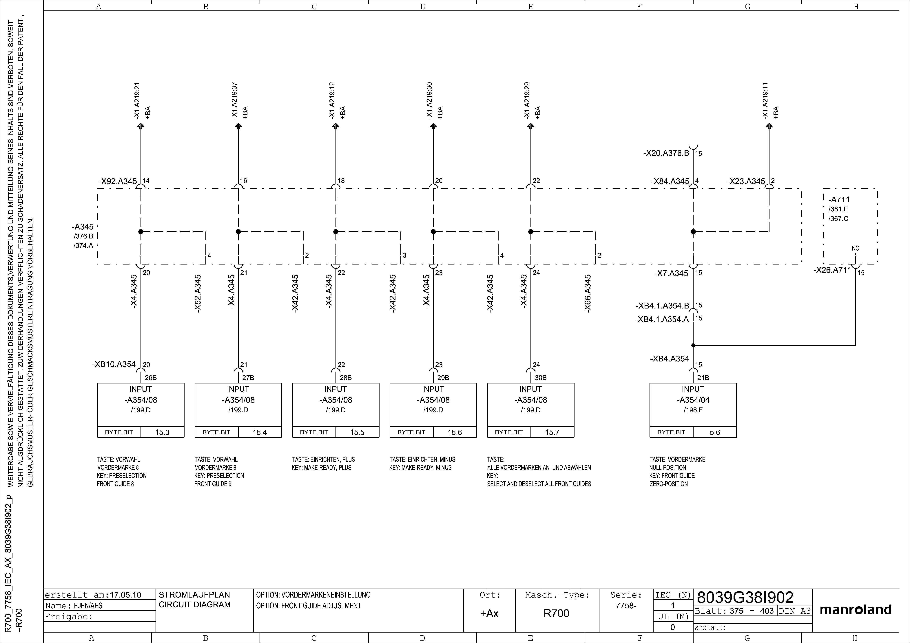

# +Ax — Sheet 375 of 403 — OPTION: VORDERMARKENEINSTELLUNG

**OPTION: FRONT GUIDE ADJUSTMENT**

> Part of the manroland **R700** printing press IEC/UL circuit diagrams.
> Drawing class: **Stromlaufplan / Circuit diagram** (DIN A3).
> Document `+Ax` covers the **Central control console** machine section.

## At a glance

| Field | Value |
|---|---|
| Document | `+Ax`  (8039G38I902) |
| Sheet | **375** of 403 |
| Section (DE) | OPTION: VORDERMARKENEINSTELLUNG |
| Section (EN) | OPTION: FRONT GUIDE ADJUSTMENT |
| Section type | CIRCUIT — Circuit diagram |
| Machine type | `R700` |
| Series | `7758` |
| Created | 17.05.10 |
| Replaces | — |
| Columns used | A, B, C, D, E, F, G, H |
| Path numbers | — |
| Labels on sheet | 123 |
| Cross-refs out | 10 |
| Cross-refs in | 38 |

**Previous:** [+Ax sheet 374](SHEET_0374.md) · **Next:** [+Ax sheet 376](SHEET_0376.md) · **Document TOC:** [_TOC.md](_TOC.md)  (+Ax) · **Master TOC:** [all sheets](../_MASTER_TOC.md)

## Sheet image (300 DPI, exact vector render)



_Rendered directly from the PDF vector layer at 300 DPI (1-bit), no OCR and no resampling. Use it to confirm anything ambiguous in the text below._

## Cross-references on this sheet

Each entry is a wire leaving this sheet. The printed token is `/sheet.column`; the link resolves to that sheet inside the same document.

| Ref | Target sheet | Col | Path | Destination on target | Target section | From col |
|---|---|---|---|---|---|---|
| `/381.E` | [+Ax sheet 381](SHEET_0381.md) | E | — | A711 | OPTION: INLINEFOILER PRINDOR | H |
| `/367.C` | [+Ax sheet 367](SHEET_0367.md) | C | — | A711 | OPTION: LOGISTIK AUSLEGER | H |
| `/376.B` | [+Ax sheet 376](SHEET_0376.md) | B | — | — | OPTION: FWW SPEZIALREINIGER | A |
| `/374.A` | [+Ax sheet 374](SHEET_0374.md) | A | — | — | OPTION: VORDERMARKENEINSTELLUNG | A |
| `/198.F` | [+Ax sheet 198](SHEET_0198.md) | F | — | — | REFERENZMODUL | G |
| `/199.D` | [+Ax sheet 199](SHEET_0199.md) | D | — | — | REFERENZMODUL | A |
| `/199.D` | [+Ax sheet 199](SHEET_0199.md) | D | — | — | REFERENZMODUL | B |
| `/199.D` | [+Ax sheet 199](SHEET_0199.md) | D | — | — | REFERENZMODUL | C |
| `/199.D` | [+Ax sheet 199](SHEET_0199.md) | D | — | — | REFERENZMODUL | D |
| `/199.D` | [+Ax sheet 199](SHEET_0199.md) | D | — | — | REFERENZMODUL | E |

### Incoming references (sheets that point here)

Every other sheet that sends a wire to this one. `Back-ref` is the token printed on *that* sheet; `Path` is its line number.

| From sheet | Cols | Back-ref | Path | Refs | What continues there |
|---|---|---|---|---|---|
| [+Ax#198](SHEET_0198.md) | F | `/198.F` | — | 1 | — |
| [+Ax#199](SHEET_0199.md) | D | `/199.D` | — | 5 | — |
| [+Ax#227](SHEET_0227.md) | A | `/227.A` | — | 5 | — |
| [+Ax#228](SHEET_0228.md) | A, B, C | `/228.A`, `/228.B`, `/228.C` | — | 3 | — |
| [+Ax#235](SHEET_0235.md) | H | `/235.H` | — | 1 | — |
| [+Ax#245](SHEET_0245.md) | B | `/245.B` | — | 5 | — |
| [+Ax#260](SHEET_0260.md) | F | `/260.F` | — | 1 | — |
| [+Ax#264](SHEET_0264.md) | F | `/264.F` | — | 1 | — |
| [+Ax#269](SHEET_0269.md) | H | `/269.H` | — | 1 | — |
| [+Ax#281](SHEET_0281.md) | A | `/281.A` | — | 3 | — |
| [+Ax#283](SHEET_0283.md) | G | `/283.G` | — | 1 | — |
| [+Ax#284](SHEET_0284.md) | H | `/284.H` | — | 1 | — |
| [+Ax#287](SHEET_0287.md) | B | `/287.B` | — | 1 | — |
| [+Ax#289](SHEET_0289.md) | F | `/289.F` | — | 5 | — |
| [+Ax#367](SHEET_0367.md) | C | `/367.C` | — | 1 | — |
| [+Ax#374](SHEET_0374.md) | A | `/374.A` | — | 1 | — |
| [+Ax#376](SHEET_0376.md) | B | `/376.B` | — | 1 | — |
| [+Ax#381](SHEET_0381.md) | E | `/381.E` | — | 1 | A711 |


## Devices on this sheet

| Tag | Class | Class meaning (IEC) | Col | Sub | Terminal | Sign |
|---|---|---|---|---|---|---|
| `A354/04` | A | Baugruppe / assembly, module, PC board | G | 04 | — | — |
| `A354/08` | A | Baugruppe / assembly, module, PC board | A | 08 | — | — |
| `A354/08` | A | Baugruppe / assembly, module, PC board | B | 08 | — | — |
| `A354/08` | A | Baugruppe / assembly, module, PC board | C | 08 | — | — |
| `A354/08` | A | Baugruppe / assembly, module, PC board | D | 08 | — | — |
| `A354/08` | A | Baugruppe / assembly, module, PC board | E | 08 | — | — |
| `A345` | A | Baugruppe / assembly, module, PC board | A | — | — | — |
| `A711` | A | Baugruppe / assembly, module, PC board | H | — | — | — |
| `XB4.A354` | — | cross-device reference | F | — | — | — |
| `5.6` | — | cross-device reference | G | — | — | — |
| `X7.A345` | — | cross-device reference | F | — | — | — |
| `X84.A345` | — | cross-device reference | F | — | — | — |
| `X20.A376.B` | — | cross-device reference | F | — | — | — |
| `X23.A345` | — | cross-device reference | G | — | — | — |
| `15.3` | — | cross-device reference | B | — | — | — |
| `XB10.A354` | — | cross-device reference | A | — | — | — |
| `15.4` | — | cross-device reference | B | — | — | — |
| `15.5` | — | cross-device reference | C | — | — | — |
| `15.6` | — | cross-device reference | D | — | — | — |
| `15.7` | — | cross-device reference | E | — | — | — |
| `X92.A345` | — | cross-device reference | A | — | — | — |
| `X4.A345` | — | cross-device reference | A | — | — | — |
| `X4.A345` | — | cross-device reference | B | — | — | — |
| `X4.A345` | — | cross-device reference | C | — | — | — |
| `X4.A345` | — | cross-device reference | D | — | — | — |
| `X4.A345` | — | cross-device reference | E | — | — | — |
| `X1.A219:21` | — | cross-device reference | A | — | 21 | — |
| `X1.A219:37` | — | cross-device reference | B | — | 37 | — |
| `X1.A219:12` | — | cross-device reference | C | — | 12 | — |
| `X1.A219:30` | — | cross-device reference | D | — | 30 | — |
| `X1.A219:29` | — | cross-device reference | E | — | 29 | — |
| `X1.A219:11` | — | cross-device reference | G | — | 11 | — |
| `X26.A711` | — | cross-device reference | H | — | — | — |
| `XB4.1.A354.B` | — | cross-device reference | F | — | — | — |
| `XB4.1.A354.A` | — | cross-device reference | F | — | — | — |
| `X52.A345` | — | cross-device reference | B | — | — | — |
| `X42.A345` | — | cross-device reference | C | — | — | — |
| `X42.A345` | — | cross-device reference | D | — | — | — |
| `X42.A345` | — | cross-device reference | E | — | — | — |
| `X66.A345` | — | cross-device reference | F | — | — | — |

## Potentials / nets

_No named potentials on this sheet._

## Wire-end annotations (grouped as printed)

A wire that continues elsewhere is annotated with a small cluster: the destination description, the path/line number `#NN`, and the `/sheet.column` cross reference. Each row below is one such cluster exactly as it is grouped on the drawing.

| Col | Y | Path | Cross-ref | Text on the wire |
|---|---|---|---|---|
| A | 107.4 | — | — | `X1.A219:21` |
| B | 107.4 | — | — | `X1.A219:37` |
| C | 107.4 | — | — | `X1.A219:12` |
| D | 107.4 | — | — | `X1.A219:30` |
| E | 107.4 | — | — | `X1.A219:29` |
| G | 107.4 | — | — | `X1.A219:11` |
| A | 139.2 | — | — | `+BA` |
| B | 139.2 | — | — | `+BA` |
| C | 139.2 | — | — | `+BA` |
| D | 139.2 | — | — | `+BA` |
| E | 139.2 | — | — | `+BA` |
| G | 139.2 | — | — | `+BA` |
| F | 195.9 | — | — | `X20.A376.B 15` |
| C | 232.8 | — | — | `X92.A345 14 16 18 20 22` |
| F | 232.8 | — | — | `X84.A345 4` |
| G | 232.8 | — | — | `X23.A345 2` |
| H | 256.8 | — | `/381.E`, `/367.C` | `A711` |
| A | 292.3 | — | — | `A345` |
| A | 305.3 | — | `/376.B`, `/374.A` | — |
| H | 322.3 | — | — | `NC` |
| B | 330.6 | — | — | `4` |
| D | 330.6 | — | — | `2 3 4 2` |
| H | 349.0 | — | — | `X26.A711 15` |
| A | 353.2 | — | — | `20` |
| B | 353.2 | — | — | `21` |
| C | 353.2 | — | — | `22` |
| D | 353.2 | — | — | `23` |
| E | 353.2 | — | — | `24` |
| F | 353.2 | — | — | `X7.A345 15` |
| A | 359.4 | — | — | `X4.A345` |
| B | 359.4 | — | — | `X52.A345` |
| B | 359.4 | — | — | `X4.A345` |
| C | 359.4 | — | — | `X42.A345` |
| C | 359.4 | — | — | `X4.A345` |
| D | 359.4 | — | — | `X42.A345` |
| D | 359.4 | — | — | `X4.A345` |
| E | 359.4 | — | — | `X42.A345` |
| E | 359.4 | — | — | `X4.A345` |
| F | 359.4 | — | — | `X66.A345` |
| F | 395.8 | — | — | `XB4.1.A354.B 15` |
| F | 412.8 | — | — | `XB4.1.A354.A 15` |
| F | 465.2 | — | — | `XB4.A354 15` |
| A | 472.3 | — | — | `XB10.A354 20` |
| B | 473.7 | — | — | `21` |
| C | 473.7 | — | — | `22` |
| D | 473.7 | — | — | `23` |
| E | 473.7 | — | — | `24` |
| A | 490.7 | — | — | `26B` |
| B | 490.7 | — | — | `27B` |
| C | 490.7 | — | — | `28B` |
| D | 490.7 | — | — | `29B` |
| E | 490.7 | — | — | `30B` |
| G | 490.7 | — | — | `21B` |
| A | 505.2 | — | — | `INPUT` |
| B | 505.2 | — | — | `INPUT` |
| C | 505.2 | — | — | `INPUT` |
| D | 505.2 | — | — | `INPUT` |
| E | 505.2 | — | — | `INPUT` |
| F | 505.2 | — | — | `INPUT` |
| A | 519.0 | — | — | `A354/08` |
| B | 519.0 | — | — | `A354/08` |
| C | 519.0 | — | — | `A354/08` |
| D | 519.0 | — | — | `A354/08` |
| E | 519.0 | — | — | `A354/08` |
| G | 519.0 | — | — | `A354/04` |
| G | 532.8 | — | `/198.F` | — |
| A | 532.9 | — | `/199.D` | — |
| B | 532.9 | — | `/199.D` | — |
| C | 532.9 | — | `/199.D` | — |
| D | 532.9 | — | `/199.D` | — |
| E | 532.9 | — | `/199.D` | — |
| A | 561.9 | — | — | `BYTE.BIT 15.3` |
| B | 561.9 | — | — | `BYTE.BIT 15.4` |
| C | 561.9 | — | — | `BYTE.BIT 15.5` |
| D | 561.9 | — | — | `BYTE.BIT 15.6` |
| E | 561.9 | — | — | `BYTE.BIT 15.7` |
| F | 561.9 | — | — | `BYTE.BIT 5.6` |
| A | 598.7 | — | — | `KEY: PRESELECTION FRONT GUIDE 8 TASTE: VORWAHL VORDERMARKE 8` |
| B | 598.7 | — | — | `KEY: PRESELECTION FRONT GUIDE 9 TASTE: VORWAHL VORDERMARKE 9` |
| C | 598.7 | — | — | `KEY: MAKE READY, PLUS TASTE: EINRICHTEN, PLUS` |
| D | 598.7 | — | — | `KEY: MAKE READY, MINUS TASTE: EINRICHTEN, MINUS` |
| E | 598.7 | — | — | `KEY: TASTE: ALLE VORDERMARKEN AN UND ABWÄHLEN` |
| F | 598.7 | — | — | `NULL POSITION KEY: FRONT GUIDE TASTE: VORDERMARKE` |
| E | 630.6 | — | — | `SELECT AND DESELECT ALL FRONT GUIDES` |
| F | 630.6 | — | — | `ZERO POSITION` |


## Reconstructed tables

This sheet carries tabular content (pin map / terminal assignment / index). The grid below was rebuilt from the drawing's own rule lines, so each row is exactly one physical row of the table.

### Table 1 — 3 data rows × 2 columns (at x=127.6, y=303.3)

| X4.A345 | 20 |
|---|---|
| `XB10.A354` | `20 26B` |
| `INPUT` | `A354/08 /199.D` |
| `BYTE.BIT` | `15.3` |


### Table 2 — 3 data rows × 3 columns (at x=255.1, y=303.3)

| X52.A345 | 4 X4.A345 | 21 |
|---|---|---|
|  |  | `21 27B` |
|  | `INPUT` | `A354/08 /199.D` |
|  | `BYTE.BIT` | `15.4` |


### Table 3 — 3 data rows × 3 columns (at x=382.7, y=303.3)

| X42.A345 | 2 X4.A345 | 22 |
|---|---|---|
|  |  | `22 28B` |
|  | `INPUT` | `A354/08 /199.D` |
|  | `BYTE.BIT` | `15.5` |


### Table 4 — 3 data rows × 3 columns (at x=510.2, y=303.3)

| X42.A345 | 3 X4.A345 | 23 |
|---|---|---|
|  |  | `23 29B` |
|  | `INPUT` | `A354/08 /199.D` |
|  | `BYTE.BIT` | `15.6` |


### Table 5 — 3 data rows × 7 columns (at x=637.8, y=303.3)

| X42.A345 | 4 X4.A345 | 24 | X66.A345 | 2 | X7.A345 XB4.1.A354.B XB4.1.A354.A | 15 15 15 |
|---|---|---|---|---|---|---|
|  |  | `24 30B` |  |  | `XB4.A354` | `15 21B` |
|  | `INPUT` | `A354/08 /199.D` |  |  | `INPUT` | `A354/04 /198.F` |
|  | `BYTE.BIT` | `15.7` |  |  | `BYTE.BIT` | `5.6` |


## Notes and free text on this sheet

| Text | Col | Y (pt) |
|---|---|---|
| `21B` | G | 490.68 |
| `INPUT` | F | 505.2 |
| `BYTE.BIT` | F | 562.45 |
| `TASTE: VORDERMARKE` | F | 598.73 |
| `NULL POSITION` | F | 609.36 |
| `KEY: FRONT GUIDE` | F | 619.98 |
| `ZERO POSITION` | F | 630.63 |
| `26B` | A | 490.68 |
| `INPUT` | A | 505.2 |
| `BYTE.BIT` | A | 562.45 |
| `TASTE: VORWAHL` | A | 598.7 |
| `VORDERMARKE 8` | A | 609.39 |
| `KEY: PRESELECTION` | A | 619.97 |
| `FRONT GUIDE 8` | A | 630.63 |
| `27B` | B | 490.68 |
| `INPUT` | B | 505.2 |
| `BYTE.BIT` | B | 562.45 |
| `TASTE: VORWAHL` | B | 598.7 |
| `VORDERMARKE 9` | B | 609.39 |
| `KEY: PRESELECTION` | B | 619.97 |
| `FRONT GUIDE 9` | B | 630.63 |
| `28B` | C | 490.68 |
| `INPUT` | C | 505.2 |
| `BYTE.BIT` | C | 562.45 |
| `TASTE: EINRICHTEN, PLUS` | C | 598.73 |
| `KEY: MAKE READY, PLUS` | C | 609.35 |
| `29B` | D | 490.68 |
| `INPUT` | D | 505.2 |
| `BYTE.BIT` | D | 562.45 |
| `TASTE: EINRICHTEN, MINUS` | D | 598.73 |
| `KEY: MAKE READY, MINUS` | D | 609.36 |
| `30B` | E | 490.68 |
| `INPUT` | E | 505.2 |
| `BYTE.BIT` | E | 562.45 |
| `TASTE:` | E | 598.67 |
| `ALLE VORDERMARKEN AN UND ABWÄHLEN` | E | 609.37 |
| `KEY:` | E | 619.86 |
| `SELECT AND DESELECT ALL FRONT GUIDES` | E | 630.64 |
| `+BA` | A | 139.18 |
| `+BA` | B | 139.18 |
| `+BA` | C | 139.18 |
| `+BA` | D | 139.18 |
| `+BA` | E | 139.18 |
| `+BA` | G | 139.18 |
| `NC` | H | 322.32 |

## Complete label inventory (exact text from the drawing)

Every text object inside the drawing area of this sheet, in DIN reading order (column A→H, then top→bottom). This is the authoritative list: if a string is not here it is not printed on this sheet.

| Col | Y | X | Dir | Type | Text |
|---|---|---|---|---|---|
| A | 107.4 | 175.3 | ↕ | device ref | `X1.A219:21` |
| A | 139.2 | 189.5 | ↕ | text | `+BA` |
| A | 232.7 | 129.0 | → | device ref | `X92.A345` |
| A | 232.8 | 186.2 | → | number | `14` |
| A | 292.3 | 94.1 | → | device tag | `A345` |
| A | 305.3 | 96.7 | → | cross-reference | `/376.B` |
| A | 317.7 | 96.4 | → | cross-reference | `/374.A` |
| A | 353.2 | 186.8 | → | number | `20` |
| A | 359.4 | 170.4 | ↕ | device ref | `X4.A345` |
| A | 472.3 | 120.5 | → | device ref | `XB10.A354` |
| A | 473.7 | 186.8 | → | number | `20` |
| A | 490.7 | 189.6 | → | text | `26B` |
| A | 505.2 | 169.4 | → | text | `INPUT` |
| A | 519.0 | 162.9 | → | device tag | `A354/08` |
| A | 532.8 | 171.5 | → | cross-reference | `/199.D` |
| A | 562.5 | 137.5 | → | text | `BYTE.BIT` |
| A | 598.7 | 127.3 | → | text | `TASTE: VORWAHL` |
| A | 609.4 | 127.6 | → | text | `VORDERMARKE 8` |
| A | 620.0 | 126.7 | → | text | `KEY: PRESELECTION` |
| A | 630.6 | 126.7 | → | text | `FRONT GUIDE 8` |
| B | 107.4 | 302.9 | ↕ | device ref | `X1.A219:37` |
| B | 139.2 | 317.0 | ↕ | text | `+BA` |
| B | 232.8 | 313.8 | → | number | `16` |
| B | 330.6 | 271.8 | → | number | `4` |
| B | 353.2 | 314.4 | → | number | `21` |
| B | 359.4 | 254.0 | ↕ | device ref | `X52.A345` |
| B | 359.4 | 297.9 | ↕ | device ref | `X4.A345` |
| B | 473.7 | 314.4 | → | number | `21` |
| B | 490.7 | 317.2 | → | text | `27B` |
| B | 505.2 | 296.9 | → | text | `INPUT` |
| B | 519.0 | 290.4 | → | device tag | `A354/08` |
| B | 532.8 | 299.1 | → | cross-reference | `/199.D` |
| B | 561.9 | 202.8 | → | device ref | `15.3` |
| B | 561.9 | 330.4 | → | device ref | `15.4` |
| B | 562.5 | 265.0 | → | text | `BYTE.BIT` |
| B | 598.7 | 254.8 | → | text | `TASTE: VORWAHL` |
| B | 609.4 | 255.1 | → | text | `VORDERMARKE 9` |
| B | 620.0 | 254.3 | → | text | `KEY: PRESELECTION` |
| B | 630.6 | 254.3 | → | text | `FRONT GUIDE 9` |
| C | 107.4 | 430.4 | ↕ | device ref | `X1.A219:12` |
| C | 139.2 | 444.6 | ↕ | text | `+BA` |
| C | 232.8 | 441.4 | → | number | `18` |
| C | 330.6 | 399.4 | → | number | `2` |
| C | 353.2 | 441.9 | → | number | `22` |
| C | 359.4 | 381.6 | ↕ | device ref | `X42.A345` |
| C | 359.4 | 425.5 | ↕ | device ref | `X4.A345` |
| C | 473.7 | 441.9 | → | number | `22` |
| C | 490.7 | 444.8 | → | text | `28B` |
| C | 505.2 | 424.5 | → | text | `INPUT` |
| C | 519.0 | 418.0 | → | device tag | `A354/08` |
| C | 532.8 | 426.6 | → | cross-reference | `/199.D` |
| C | 561.9 | 457.9 | → | device ref | `15.5` |
| C | 562.5 | 392.6 | → | text | `BYTE.BIT` |
| C | 598.7 | 382.4 | → | text | `TASTE: EINRICHTEN, PLUS` |
| C | 609.3 | 381.8 | → | text | `KEY: MAKE READY, PLUS` |
| D | 107.4 | 558.0 | ↕ | device ref | `X1.A219:30` |
| D | 139.2 | 572.1 | ↕ | text | `+BA` |
| D | 232.8 | 569.5 | → | number | `20` |
| D | 330.6 | 527.0 | → | number | `3` |
| D | 353.2 | 569.5 | → | number | `23` |
| D | 359.4 | 509.1 | ↕ | device ref | `X42.A345` |
| D | 359.4 | 553.1 | ↕ | device ref | `X4.A345` |
| D | 473.7 | 569.5 | → | number | `23` |
| D | 490.7 | 572.3 | → | text | `29B` |
| D | 505.2 | 552.0 | → | text | `INPUT` |
| D | 519.0 | 545.5 | → | device tag | `A354/08` |
| D | 532.8 | 554.2 | → | cross-reference | `/199.D` |
| D | 561.9 | 585.5 | → | device ref | `15.6` |
| D | 562.5 | 520.2 | → | text | `BYTE.BIT` |
| D | 598.7 | 510.0 | → | text | `TASTE: EINRICHTEN, MINUS` |
| D | 609.4 | 509.4 | → | text | `KEY: MAKE READY, MINUS` |
| E | 107.4 | 685.6 | ↕ | device ref | `X1.A219:29` |
| E | 139.2 | 699.7 | ↕ | text | `+BA` |
| E | 232.8 | 697.0 | → | number | `22` |
| E | 330.6 | 654.5 | → | number | `4` |
| E | 353.2 | 697.0 | → | number | `24` |
| E | 359.4 | 636.7 | ↕ | device ref | `X42.A345` |
| E | 359.4 | 680.6 | ↕ | device ref | `X4.A345` |
| E | 473.7 | 697.0 | → | number | `24` |
| E | 490.7 | 699.9 | → | text | `30B` |
| E | 505.2 | 679.6 | → | text | `INPUT` |
| E | 519.0 | 673.1 | → | device tag | `A354/08` |
| E | 532.8 | 681.7 | → | cross-reference | `/199.D` |
| E | 561.9 | 713.1 | → | device ref | `15.7` |
| E | 562.5 | 647.7 | → | text | `BYTE.BIT` |
| E | 598.7 | 637.5 | → | text | `TASTE:` |
| E | 609.4 | 637.8 | → | text | `ALLE VORDERMARKEN AN UND ABWÄHLEN` |
| E | 619.9 | 636.9 | → | text | `KEY:` |
| E | 630.6 | 637.5 | → | text | `SELECT AND DESELECT ALL FRONT GUIDES` |
| F | 195.9 | 841.9 | → | device ref | `X20.A376.B` |
| F | 232.7 | 851.8 | → | device ref | `X84.A345` |
| F | 330.6 | 782.1 | → | number | `2` |
| F | 353.2 | 856.3 | → | device ref | `X7.A345` |
| F | 359.4 | 764.2 | ↕ | device ref | `X66.A345` |
| F | 395.8 | 832.0 | → | device ref | `XB4.1.A354.B` |
| F | 413.5 | 831.1 | → | device ref | `XB4.1.A354.A` |
| F | 465.2 | 850.7 | → | device ref | `XB4.A354` |
| F | 505.2 | 892.2 | → | text | `INPUT` |
| F | 562.5 | 860.3 | → | text | `BYTE.BIT` |
| F | 598.7 | 850.1 | → | text | `TASTE: VORDERMARKE` |
| F | 609.4 | 849.5 | → | text | `NULL POSITION` |
| F | 620.0 | 849.5 | → | text | `KEY: FRONT GUIDE` |
| F | 630.6 | 850.4 | → | text | `ZERO POSITION` |
| G | 107.4 | 997.4 | ↕ | device ref | `X1.A219:11` |
| G | 139.2 | 1011.5 | ↕ | text | `+BA` |
| G | 197.3 | 909.1 | → | number | `15` |
| G | 232.7 | 951.0 | → | device ref | `X23.A345` |
| G | 232.8 | 909.6 | → | number | `4` |
| G | 232.8 | 1008.9 | → | number | `2` |
| G | 353.2 | 909.1 | → | number | `15` |
| G | 395.8 | 909.1 | → | number | `15` |
| G | 412.8 | 909.1 | → | number | `15` |
| G | 473.7 | 909.1 | → | number | `15` |
| G | 490.7 | 912.5 | → | text | `21B` |
| G | 519.0 | 885.7 | → | device tag | `A354/04` |
| G | 532.8 | 894.8 | → | cross-reference | `/198.F` |
| G | 561.9 | 928.6 | → | device ref | `5.6` |
| H | 256.8 | 1084.0 | → | device tag | `A711` |
| H | 269.9 | 1084.3 | → | cross-reference | `/381.E` |
| H | 282.3 | 1084.3 | → | cross-reference | `/367.C` |
| H | 322.3 | 1114.8 | → | text | `NC` |
| H | 349.0 | 1064.4 | → | device ref | `X26.A711` |
| H | 353.2 | 1121.7 | → | number | `15` |

## Reading-order text block

The same content as a plain block, grouped by DIN column — convenient to paste or to match against a visual description.

```text
=== Column A ===
 107.4  175.3  devref       X1.A219:21
 139.2  189.5  text         +BA
 232.7  129.0  devref       X92.A345
 232.8  186.2  numeric      14
 292.3   94.1  devtag       A345
 305.3   96.7  xref         /376.B
 317.7   96.4  xref         /374.A
 353.2  186.8  numeric      20
 359.4  170.4  devref       X4.A345
 472.3  120.5  devref       XB10.A354
 473.7  186.8  numeric      20
 490.7  189.6  text         26B
 505.2  169.4  text         INPUT
 519.0  162.9  devtag       A354/08
 532.8  171.5  xref         /199.D
 562.5  137.5  text         BYTE.BIT
 598.7  127.3  text         TASTE: VORWAHL
 609.4  127.6  text         VORDERMARKE 8
 620.0  126.7  text         KEY: PRESELECTION
 630.6  126.7  text         FRONT GUIDE 8
=== Column B ===
 107.4  302.9  devref       X1.A219:37
 139.2  317.0  text         +BA
 232.8  313.8  numeric      16
 330.6  271.8  numeric      4
 353.2  314.4  numeric      21
 359.4  254.0  devref       X52.A345
 359.4  297.9  devref       X4.A345
 473.7  314.4  numeric      21
 490.7  317.2  text         27B
 505.2  296.9  text         INPUT
 519.0  290.4  devtag       A354/08
 532.8  299.1  xref         /199.D
 561.9  202.8  devref       15.3
 561.9  330.4  devref       15.4
 562.5  265.0  text         BYTE.BIT
 598.7  254.8  text         TASTE: VORWAHL
 609.4  255.1  text         VORDERMARKE 9
 620.0  254.3  text         KEY: PRESELECTION
 630.6  254.3  text         FRONT GUIDE 9
=== Column C ===
 107.4  430.4  devref       X1.A219:12
 139.2  444.6  text         +BA
 232.8  441.4  numeric      18
 330.6  399.4  numeric      2
 353.2  441.9  numeric      22
 359.4  381.6  devref       X42.A345
 359.4  425.5  devref       X4.A345
 473.7  441.9  numeric      22
 490.7  444.8  text         28B
 505.2  424.5  text         INPUT
 519.0  418.0  devtag       A354/08
 532.8  426.6  xref         /199.D
 561.9  457.9  devref       15.5
 562.5  392.6  text         BYTE.BIT
 598.7  382.4  text         TASTE: EINRICHTEN, PLUS
 609.3  381.8  text         KEY: MAKE READY, PLUS
=== Column D ===
 107.4  558.0  devref       X1.A219:30
 139.2  572.1  text         +BA
 232.8  569.5  numeric      20
 330.6  527.0  numeric      3
 353.2  569.5  numeric      23
 359.4  509.1  devref       X42.A345
 359.4  553.1  devref       X4.A345
 473.7  569.5  numeric      23
 490.7  572.3  text         29B
 505.2  552.0  text         INPUT
 519.0  545.5  devtag       A354/08
 532.8  554.2  xref         /199.D
 561.9  585.5  devref       15.6
 562.5  520.2  text         BYTE.BIT
 598.7  510.0  text         TASTE: EINRICHTEN, MINUS
 609.4  509.4  text         KEY: MAKE READY, MINUS
=== Column E ===
 107.4  685.6  devref       X1.A219:29
 139.2  699.7  text         +BA
 232.8  697.0  numeric      22
 330.6  654.5  numeric      4
 353.2  697.0  numeric      24
 359.4  636.7  devref       X42.A345
 359.4  680.6  devref       X4.A345
 473.7  697.0  numeric      24
 490.7  699.9  text         30B
 505.2  679.6  text         INPUT
 519.0  673.1  devtag       A354/08
 532.8  681.7  xref         /199.D
 561.9  713.1  devref       15.7
 562.5  647.7  text         BYTE.BIT
 598.7  637.5  text         TASTE:
 609.4  637.8  text         ALLE VORDERMARKEN AN UND ABWÄHLEN
 619.9  636.9  text         KEY:
 630.6  637.5  text         SELECT AND DESELECT ALL FRONT GUIDES
=== Column F ===
 195.9  841.9  devref       X20.A376.B
 232.7  851.8  devref       X84.A345
 330.6  782.1  numeric      2
 353.2  856.3  devref       X7.A345
 359.4  764.2  devref       X66.A345
 395.8  832.0  devref       XB4.1.A354.B
 413.5  831.1  devref       XB4.1.A354.A
 465.2  850.7  devref       XB4.A354
 505.2  892.2  text         INPUT
 562.5  860.3  text         BYTE.BIT
 598.7  850.1  text         TASTE: VORDERMARKE
 609.4  849.5  text         NULL POSITION
 620.0  849.5  text         KEY: FRONT GUIDE
 630.6  850.4  text         ZERO POSITION
=== Column G ===
 107.4  997.4  devref       X1.A219:11
 139.2 1011.5  text         +BA
 197.3  909.1  numeric      15
 232.7  951.0  devref       X23.A345
 232.8  909.6  numeric      4
 232.8 1008.9  numeric      2
 353.2  909.1  numeric      15
 395.8  909.1  numeric      15
 412.8  909.1  numeric      15
 473.7  909.1  numeric      15
 490.7  912.5  text         21B
 519.0  885.7  devtag       A354/04
 532.8  894.8  xref         /198.F
 561.9  928.6  devref       5.6
=== Column H ===
 256.8 1084.0  devtag       A711
 269.9 1084.3  xref         /381.E
 282.3 1084.3  xref         /367.C
 322.3 1114.8  text         NC
 349.0 1064.4  devref       X26.A711
 353.2 1121.7  numeric      15
```

---
_Generated from the PDF vector text layer; no OCR. Source: `R700_7758_IEC_AX_8039G38I902_p`, sheet 375._
