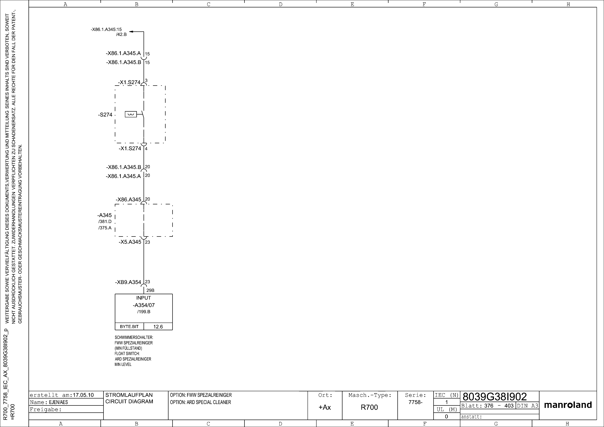

# +Ax — Sheet 376 of 403 — OPTION: FWW SPEZIALREINIGER

**OPTION: ARD SPECIAL CLEANER**

> Part of the manroland **R700** printing press IEC/UL circuit diagrams.
> Drawing class: **Stromlaufplan / Circuit diagram** (DIN A3).
> Document `+Ax` covers the **Central control console** machine section.

## At a glance

| Field | Value |
|---|---|
| Document | `+Ax`  (8039G38I902) |
| Sheet | **376** of 403 |
| Section (DE) | OPTION: FWW SPEZIALREINIGER |
| Section (EN) | OPTION: ARD SPECIAL CLEANER |
| Section type | CIRCUIT — Circuit diagram |
| Machine type | `R700` |
| Series | `7758` |
| Created | 17.05.10 |
| Replaces | — |
| Columns used | B |
| Path numbers | — |
| Labels on sheet | 36 |
| Cross-refs out | 4 |
| Cross-refs in | 13 |

**Previous:** [+Ax sheet 375](SHEET_0375.md) · **Next:** [+Ax sheet 377](SHEET_0377.md) · **Document TOC:** [_TOC.md](_TOC.md)  (+Ax) · **Master TOC:** [all sheets](../_MASTER_TOC.md)

## Sheet image (300 DPI, exact vector render)



_Rendered directly from the PDF vector layer at 300 DPI (1-bit), no OCR and no resampling. Use it to confirm anything ambiguous in the text below._

## Cross-references on this sheet

Each entry is a wire leaving this sheet. The printed token is `/sheet.column`; the link resolves to that sheet inside the same document.

| Ref | Target sheet | Col | Path | Destination on target | Target section | From col |
|---|---|---|---|---|---|---|
| `/42.B` | [+Ax sheet 42](SHEET_0042.md) | B | — | X86.1.A345:15 | HAUPTANTRIEB | B |
| `/381.D` | [+Ax sheet 381](SHEET_0381.md) | D | — | — | OPTION: INLINEFOILER PRINDOR | B |
| `/375.A` | [+Ax sheet 375](SHEET_0375.md) | A | — | — | OPTION: VORDERMARKENEINSTELLUNG | B |
| `/199.B` | [+Ax sheet 199](SHEET_0199.md) | B | — | — | REFERENZMODUL | B |

### Incoming references (sheets that point here)

Every other sheet that sends a wire to this one. `Back-ref` is the token printed on *that* sheet; `Path` is its line number.

| From sheet | Cols | Back-ref | Path | Refs | What continues there |
|---|---|---|---|---|---|
| [+Ax#42](SHEET_0042.md) | D | `/42.D` | — | 1 | 24V.X8.A375:14 |
| [+Ax#199](SHEET_0199.md) | B | `/199.B` | — | 1 | — |
| [+Ax#215](SHEET_0215.md) | C | `/215.C` | — | 2 | — |
| [+Ax#231](SHEET_0231.md) | A | `/231.A` | — | 1 | — |
| [+Ax#242](SHEET_0242.md) | A | `/242.A` | — | 1 | — |
| [+Ax#288](SHEET_0288.md) | A, B, C | `/288.A`, `/288.B`, `/288.C` | — | 5 | — |
| [+Ax#375](SHEET_0375.md) | A | `/375.A` | — | 1 | — |
| [+Ax#381](SHEET_0381.md) | D | `/381.D` | — | 1 | — |


## Devices on this sheet

| Tag | Class | Class meaning (IEC) | Col | Sub | Terminal | Sign |
|---|---|---|---|---|---|---|
| `A354/07` | A | Baugruppe / assembly, module, PC board | B | 07 | — | — |
| `S274` | S | Schalter / switch | B | — | — | — |
| `A345` | A | Baugruppe / assembly, module, PC board | B | — | — | — |
| `12.6` | — | cross-device reference | B | — | — | — |
| `XB9.A354` | — | cross-device reference | B | — | — | — |
| `X86.1.A345.B` | — | cross-device reference | B | — | — | — |
| `X86.1.A345.A` | — | cross-device reference | B | — | — | — |
| `X1.S274` | — | cross-device reference | B | — | — | — |
| `X1.S274` | — | cross-device reference | B | — | — | — |
| `X86.1.A345.B` | — | cross-device reference | B | — | — | — |
| `X86.1.A345.A` | — | cross-device reference | B | — | — | — |
| `X5.A345` | — | cross-device reference | B | — | — | — |
| `X86.A345` | — | cross-device reference | B | — | — | — |
| `X86.1.A345:15` | — | cross-device reference | B | — | 15 | — |

## Potentials / nets

_No named potentials on this sheet._

## Wire-end annotations (grouped as printed)

A wire that continues elsewhere is annotated with a small cluster: the destination description, the path/line number `#NN`, and the `/sheet.column` cross reference. Each row below is one such cluster exactly as it is grouped on the drawing.

| Col | Y | Path | Cross-ref | Text on the wire |
|---|---|---|---|---|
| B | 54.1 | — | `/42.B` | `X86.1.A345:15` |
| B | 100.2 | — | — | `X86.1.A345.A 15` |
| B | 118.0 | — | — | `X86.1.A345.B 15` |
| B | 154.8 | — | — | `X1.S274 3` |
| B | 221.4 | — | — | `S274` |
| B | 288.0 | — | — | `X1.S274 4` |
| B | 324.9 | — | — | `X86.1.A345.B 20` |
| B | 341.9 | — | — | `X86.1.A345.A 20` |
| B | 388.6 | — | — | `X86.A345 20` |
| B | 419.8 | — | — | `A345` |
| B | 432.9 | — | `/381.D`, `/375.A` | — |
| B | 472.3 | — | — | `X5.A345 23` |
| B | 551.6 | — | — | `XB9.A354 23` |
| B | 568.6 | — | — | `29B` |
| B | 583.2 | — | — | `INPUT` |
| B | 597.0 | — | — | `A354/07` |
| B | 610.8 | — | `/199.B` | — |
| B | 639.8 | — | — | `BYTE.BIT 12.6` |
| B | 662.5 | — | — | `FWW SPEZIALREINIGER FLOAT SWITCH: (MIN FÜLLSTAND) SCHWIMMERSCHALTER:` |
| B | 705.0 | — | — | `MIN LEVEL ARD SPEZIALREINIGER` |


## Reconstructed tables

This sheet carries tabular content (pin map / terminal assignment / index). The grid below was rebuilt from the drawing's own rule lines, so each row is exactly one physical row of the table.

### Table 1 — 1 data rows × 2 columns (at x=226.8, y=579.7)

| INPUT | A354/07 /199.B |
|---|---|
| `BYTE.BIT` | `12.6` |


## Notes and free text on this sheet

| Text | Col | Y (pt) |
|---|---|---|
| `29B` | B | 568.63 |
| `INPUT` | B | 583.16 |
| `BYTE.BIT` | B | 640.41 |
| `SCHWIMMERSCHALTER:` | B | 662.51 |
| `FWW SPEZIALREINIGER` | B | 673.09 |
| `(MIN FÜLLSTAND)` | B | 683.8 |
| `FLOAT SWITCH:` | B | 694.36 |
| `ARD SPEZIALREINIGER` | B | 705.05 |
| `MIN LEVEL` | B | 715.67 |

## Complete label inventory (exact text from the drawing)

Every text object inside the drawing area of this sheet, in DIN reading order (column A→H, then top→bottom). This is the authoritative list: if a string is not here it is not printed on this sheet.

| Col | Y | X | Dir | Type | Text |
|---|---|---|---|---|---|
| B | 54.1 | 178.9 | → | device ref | `X86.1.A345:15` |
| B | 64.0 | 229.0 | → | cross-reference | `/42.B` |
| B | 100.2 | 208.6 | → | device ref | `X86.1.A345.A` |
| B | 102.4 | 285.4 | → | number | `15` |
| B | 118.0 | 209.5 | → | device ref | `X86.1.A345.B` |
| B | 119.4 | 285.4 | → | number | `15` |
| B | 154.8 | 286.0 | → | number | `3` |
| B | 157.6 | 232.7 | → | device ref | `X1.S274` |
| B | 221.4 | 193.3 | → | device tag | `S274` |
| B | 288.0 | 234.1 | → | device ref | `X1.S274` |
| B | 289.5 | 286.0 | → | number | `4` |
| B | 324.9 | 209.5 | → | device ref | `X86.1.A345.B` |
| B | 324.9 | 286.0 | → | number | `20` |
| B | 341.9 | 286.0 | → | number | `20` |
| B | 342.6 | 208.6 | → | device ref | `X86.1.A345.A` |
| B | 388.7 | 228.2 | → | device ref | `X86.A345` |
| B | 388.7 | 286.0 | → | number | `20` |
| B | 419.8 | 191.9 | → | device tag | `A345` |
| B | 432.9 | 194.2 | → | cross-reference | `/381.D` |
| B | 445.3 | 194.2 | → | cross-reference | `/375.A` |
| B | 472.3 | 234.1 | → | device ref | `X5.A345` |
| B | 473.7 | 286.0 | → | number | `23` |
| B | 551.6 | 227.1 | → | device ref | `XB9.A354` |
| B | 551.7 | 286.0 | → | number | `23` |
| B | 568.6 | 288.9 | → | text | `29B` |
| B | 583.2 | 268.6 | → | text | `INPUT` |
| B | 597.0 | 262.1 | → | device tag | `A354/07` |
| B | 610.8 | 270.9 | → | cross-reference | `/199.B` |
| B | 639.8 | 302.0 | → | device ref | `12.6` |
| B | 640.4 | 236.7 | → | text | `BYTE.BIT` |
| B | 662.5 | 226.5 | → | text | `SCHWIMMERSCHALTER:` |
| B | 673.1 | 225.9 | → | text | `FWW SPEZIALREINIGER` |
| B | 683.8 | 226.2 | → | text | `(MIN FÜLLSTAND)` |
| B | 694.4 | 225.9 | → | text | `FLOAT SWITCH:` |
| B | 705.0 | 226.8 | → | text | `ARD SPEZIALREINIGER` |
| B | 715.7 | 226.2 | → | text | `MIN LEVEL` |

## Reading-order text block

The same content as a plain block, grouped by DIN column — convenient to paste or to match against a visual description.

```text
=== Column B ===
  54.1  178.9  devref       X86.1.A345:15
  64.0  229.0  xref         /42.B
 100.2  208.6  devref       X86.1.A345.A
 102.4  285.4  numeric      15
 118.0  209.5  devref       X86.1.A345.B
 119.4  285.4  numeric      15
 154.8  286.0  numeric      3
 157.6  232.7  devref       X1.S274
 221.4  193.3  devtag       S274
 288.0  234.1  devref       X1.S274
 289.5  286.0  numeric      4
 324.9  209.5  devref       X86.1.A345.B
 324.9  286.0  numeric      20
 341.9  286.0  numeric      20
 342.6  208.6  devref       X86.1.A345.A
 388.7  228.2  devref       X86.A345
 388.7  286.0  numeric      20
 419.8  191.9  devtag       A345
 432.9  194.2  xref         /381.D
 445.3  194.2  xref         /375.A
 472.3  234.1  devref       X5.A345
 473.7  286.0  numeric      23
 551.6  227.1  devref       XB9.A354
 551.7  286.0  numeric      23
 568.6  288.9  text         29B
 583.2  268.6  text         INPUT
 597.0  262.1  devtag       A354/07
 610.8  270.9  xref         /199.B
 639.8  302.0  devref       12.6
 640.4  236.7  text         BYTE.BIT
 662.5  226.5  text         SCHWIMMERSCHALTER:
 673.1  225.9  text         FWW SPEZIALREINIGER
 683.8  226.2  text         (MIN FÜLLSTAND)
 694.4  225.9  text         FLOAT SWITCH:
 705.0  226.8  text         ARD SPEZIALREINIGER
 715.7  226.2  text         MIN LEVEL
```

---
_Generated from the PDF vector text layer; no OCR. Source: `R700_7758_IEC_AX_8039G38I902_p`, sheet 376._
