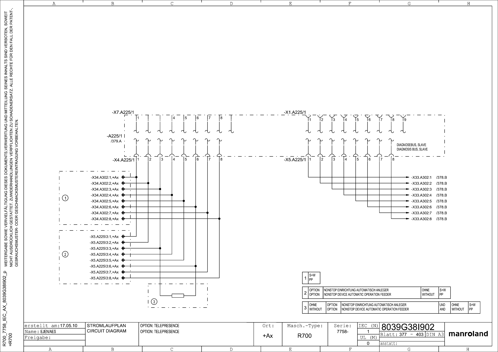

# +Ax — Sheet 377 of 403 — OPTION: TELEPRESENCE

**OPTION: TELEPRESENCE**

> Part of the manroland **R700** printing press IEC/UL circuit diagrams.
> Drawing class: **Stromlaufplan / Circuit diagram** (DIN A3).
> Document `+Ax` covers the **Central control console** machine section.

## At a glance

| Field | Value |
|---|---|
| Document | `+Ax`  (8039G38I902) |
| Sheet | **377** of 403 |
| Section (DE) | OPTION: TELEPRESENCE |
| Section (EN) | OPTION: TELEPRESENCE |
| Section type | CIRCUIT — Circuit diagram |
| Machine type | `R700` |
| Series | `7758` |
| Created | 17.05.10 |
| Replaces | — |
| Columns used | A, B, C, D, E, F, G, H |
| Path numbers | — |
| Labels on sheet | 99 |
| Cross-refs out | 9 |
| Cross-refs in | 43 |

**Previous:** [+Ax sheet 376](SHEET_0376.md) · **Next:** [+Ax sheet 378](SHEET_0378.md) · **Document TOC:** [_TOC.md](_TOC.md)  (+Ax) · **Master TOC:** [all sheets](../_MASTER_TOC.md)

## Sheet image (300 DPI, exact vector render)



_Rendered directly from the PDF vector layer at 300 DPI (1-bit), no OCR and no resampling. Use it to confirm anything ambiguous in the text below._

## Cross-references on this sheet

Each entry is a wire leaving this sheet. The printed token is `/sheet.column`; the link resolves to that sheet inside the same document.

| Ref | Target sheet | Col | Path | Destination on target | Target section | From col |
|---|---|---|---|---|---|---|
| `/379.A` | [+Ax sheet 379](SHEET_0379.md) | A | — | — | OPTION: TELEPRESENCE | B |
| `/378.B` | [+Ax sheet 378](SHEET_0378.md) | B | — | X33.A302:1 | OPTION: TELEPRESENCE | G |
| `/378.B` | [+Ax sheet 378](SHEET_0378.md) | B | — | X33.A302:2 | OPTION: TELEPRESENCE | G |
| `/378.B` | [+Ax sheet 378](SHEET_0378.md) | B | — | X33.A302:3 | OPTION: TELEPRESENCE | G |
| `/378.B` | [+Ax sheet 378](SHEET_0378.md) | B | — | X33.A302:4 | OPTION: TELEPRESENCE | G |
| `/378.B` | [+Ax sheet 378](SHEET_0378.md) | B | — | X33.A302:5 | OPTION: TELEPRESENCE | G |
| `/378.B` | [+Ax sheet 378](SHEET_0378.md) | B | — | X33.A302:6 | OPTION: TELEPRESENCE | G |
| `/378.B` | [+Ax sheet 378](SHEET_0378.md) | B | — | X33.A302:7 | OPTION: TELEPRESENCE | G |
| `/378.B` | [+Ax sheet 378](SHEET_0378.md) | B | — | X33.A302:8 | OPTION: TELEPRESENCE | G |

### Incoming references (sheets that point here)

Every other sheet that sends a wire to this one. `Back-ref` is the token printed on *that* sheet; `Path` is its line number.

| From sheet | Cols | Back-ref | Path | Refs | What continues there |
|---|---|---|---|---|---|
| [+Ax#206](SHEET_0206.md) | G | `/206.G` | — | 9 | — |
| [+Ax#226](SHEET_0226.md) | E | `/226.E` | — | 8 | — |
| [+Ax#230](SHEET_0230.md) | C | `/230.C` | — | 8 | — |
| [+Ax#235](SHEET_0235.md) | C | `/235.C` | — | 9 | — |
| [+Ax#378](SHEET_0378.md) | B, D | `/378.B`, `/378.D` | — | 8 | X33.A302:1,+BA X33.A302:1; X33.A302:2; X33.A302:3; X33.A302:4; X33.A302:5; X33.A302:6; X33.A302:7; X33.A302:8 |
| [+Ax#379](SHEET_0379.md) | A | `/379.A` | — | 1 | — |


## Devices on this sheet

| Tag | Class | Class meaning (IEC) | Col | Sub | Terminal | Sign |
|---|---|---|---|---|---|---|
| `A225/1` | A | Baugruppe / assembly, module, PC board | B | 1 | — | — |
| `X33.A302:7` | — | cross-device reference | G | — | 7 | — |
| `X33.A302:8` | — | cross-device reference | G | — | 8 | — |
| `X33.A302:6` | — | cross-device reference | G | — | 6 | — |
| `X33.A302:1` | — | cross-device reference | G | — | 1 | — |
| `X33.A302:2` | — | cross-device reference | G | — | 2 | — |
| `X33.A302:3` | — | cross-device reference | G | — | 3 | — |
| `X33.A302:4` | — | cross-device reference | G | — | 4 | — |
| `X33.A302:5` | — | cross-device reference | G | — | 5 | — |

## Potentials / nets

_No named potentials on this sheet._

## Wire-end annotations (grouped as printed)

A wire that continues elsewhere is annotated with a small cluster: the destination description, the path/line number `#NN`, and the `/sheet.column` cross reference. Each row below is one such cluster exactly as it is grouped on the drawing.

| Col | Y | Path | Cross-ref | Text on the wire |
|---|---|---|---|---|
| D | 263.9 | — | — | `X7.A225/1 X1.A225/1` |
| C | 278.1 | — | — | `1 4 5 6 7 8` |
| F | 282.4 | — | — | `1 2 3 4 5 6 7 8 9` |
| B | 320.6 | — | — | `A225/1` |
| B | 333.7 | — | `/379.A` | — |
| G | 343.6 | — | — | `DIAGNOSEBUS, SLAVE DIAGNOSIS BUS, SLAVE` |
| C | 377.3 | — | — | `X4.A225/1 1 2 3 4 5 6 7 8` |
| F | 377.3 | — | — | `X5.A225/1 1 2 3 4 5 6 7 8` |
| B | 420.5 | — | — | `X34.A302:1,+Ax` |
| G | 420.5 | — | `/378.B` | `X33.A302:1` |
| B | 434.7 | — | — | `X34.A302:2,+Ax` |
| G | 434.7 | — | `/378.B` | `X33.A302:2` |
| B | 448.9 | — | — | `X34.A302:3,+Ax` |
| G | 448.9 | — | `/378.B` | `X33.A302:3` |
| G | 463.0 | — | `/378.B` | `X33.A302:4` |
| B | 463.1 | — | — | `X34.A302:4,+Ax` |
| A | 470.3 | — | — | `1` |
| B | 477.2 | — | — | `X34.A302:5,+Ax` |
| G | 477.2 | — | `/378.B` | `X33.A302:5` |
| B | 491.4 | — | — | `X34.A302:6,+Ax` |
| G | 491.4 | — | `/378.B` | `X33.A302:6` |
| G | 505.5 | — | `/378.B` | `X33.A302:7` |
| B | 505.6 | — | — | `X34.A302:7,+Ax` |
| B | 519.7 | — | — | `X34.A302:8,+Ax` |
| G | 519.7 | — | `/378.B` | `X33.A302:8` |
| B | 562.3 | — | — | `X5.A225\3:1,+Ax` |
| B | 576.4 | — | — | `X5.A225\3:2,+Ax` |
| B | 590.6 | — | — | `X5.A225\3:3,+Ax` |
| B | 604.8 | — | — | `X5.A225\3:4,+Ax` |
| A | 605.5 | — | — | `2` |
| B | 619.0 | — | — | `X5.A225\3:5,+Ax` |
| B | 633.1 | — | — | `X5.A225\3:6,+Ax` |
| B | 647.3 | — | — | `X5.A225\3:7,+Ax` |
| E | 655.3 | — | — | `1 PP S+W` |
| B | 661.5 | — | — | `X5.A225\3:8,+Ax` |
| H | 690.7 | — | — | `PP S+W` |
| E | 690.8 | — | — | `OPTION OPTION` |
| F | 690.9 | — | — | `NONSTOP EINRICHTUNG AUTOMATISCH ANLEGER NONSTOP DEVICE AUTOMATIC OPERATION FEEDER` |
| G | 690.9 | — | — | `OHNE WITHOUT` |
| E | 696.2 | — | — | `2` |
| C | 718.9 | — | — | `3` |
| H | 726.1 | — | — | `PP S+W` |
| E | 726.3 | — | — | `3 OHNE WITHOUT` |
| F | 726.3 | — | — | `OPTION OPTION` |
| F | 726.3 | — | — | `NONSTOP EINRICHTUNG AUTOMATISCH ANLEGER NONSTOP DEVICE AUTOMATIC OPERATION FEEDER` |
| H | 726.3 | — | — | `UND` |
| H | 726.3 | — | — | `OHNE WITHOUT` |
| H | 736.9 | — | — | `AND` |


## Notes and free text on this sheet

| Text | Col | Y (pt) |
|---|---|---|
| `DIAGNOSEBUS, SLAVE` | G | 343.6 |
| `DIAGNOSIS BUS, SLAVE` | G | 354.22 |
| `X4.A225/1` | B | 378.03 |
| `X5.A225\3:1,+Ax` | B | 562.26 |
| `X5.A225\3:2,+Ax` | B | 576.43 |
| `X5.A225\3:3,+Ax` | B | 590.6 |
| `X5.A225\3:4,+Ax` | B | 604.78 |
| `X5.A225\3:5,+Ax` | B | 618.95 |
| `X5.A225\3:6,+Ax` | B | 633.12 |
| `X5.A225\3:7,+Ax` | B | 647.3 |
| `X5.A225\3:8,+Ax` | B | 661.47 |
| `X5.A225/1` | E | 377.32 |
| `X34.A302:1,+Ax` | B | 420.53 |
| `X34.A302:2,+Ax` | B | 434.7 |
| `X34.A302:3,+Ax` | B | 448.88 |
| `X34.A302:4,+Ax` | B | 463.05 |
| `X34.A302:5,+Ax` | B | 477.22 |
| `X34.A302:6,+Ax` | B | 491.4 |
| `X34.A302:7,+Ax` | B | 505.57 |
| `X34.A302:8,+Ax` | B | 519.74 |
| `X7.A225/1` | B | 263.94 |
| `X1.A225/1` | E | 263.94 |
| `OHNE` | E | 726.29 |
| `WITHOUT` | E | 736.89 |
| `OPTION` | F | 726.27 |
| `NONSTOP EINRICHTUNG AUTOMATISCH ANLEGER` | F | 726.31 |
| `NONSTOP DEVICE AUTOMATIC OPERATION FEEDER` | F | 736.93 |
| `S+W` | E | 655.29 |
| `PP` | E | 665.92 |
| `OPTION` | E | 690.83 |
| `OHNE` | G | 690.86 |
| `WITHOUT` | G | 701.46 |
| `S+W` | H | 690.72 |
| `PP` | H | 701.35 |
| `UND` | H | 726.29 |
| `AND` | H | 736.94 |
| `OHNE` | H | 726.29 |
| `WITHOUT` | H | 736.89 |

## Complete label inventory (exact text from the drawing)

Every text object inside the drawing area of this sheet, in DIN reading order (column A→H, then top→bottom). This is the authoritative list: if a string is not here it is not printed on this sheet.

| Col | Y | X | Dir | Type | Text |
|---|---|---|---|---|---|
| A | 470.3 | 154.1 | → | number | `1` |
| A | 605.5 | 153.9 | → | number | `2` |
| B | 263.9 | 267.9 | → | text | `X7.A225/1` |
| B | 278.1 | 328.0 | → | number | `1` |
| B | 320.6 | 255.4 | → | device tag | `A225/1` |
| B | 333.7 | 265.0 | → | cross-reference | `/379.A` |
| B | 377.3 | 328.0 | → | number | `1` |
| B | 378.0 | 269.3 | → | text | `X4.A225/1` |
| B | 420.5 | 217.1 | → | text | `X34.A302:1,+Ax` |
| B | 434.7 | 217.1 | → | text | `X34.A302:2,+Ax` |
| B | 448.9 | 217.1 | → | text | `X34.A302:3,+Ax` |
| B | 463.1 | 217.1 | → | text | `X34.A302:4,+Ax` |
| B | 477.2 | 217.1 | → | text | `X34.A302:5,+Ax` |
| B | 491.4 | 217.1 | → | text | `X34.A302:6,+Ax` |
| B | 505.6 | 217.1 | → | text | `X34.A302:7,+Ax` |
| B | 519.7 | 217.1 | → | text | `X34.A302:8,+Ax` |
| B | 562.3 | 214.6 | → | text | `X5.A225\3:1,+Ax` |
| B | 576.4 | 214.6 | → | text | `X5.A225\3:2,+Ax` |
| B | 590.6 | 214.6 | → | text | `X5.A225\3:3,+Ax` |
| B | 604.8 | 214.6 | → | text | `X5.A225\3:4,+Ax` |
| B | 619.0 | 214.6 | → | text | `X5.A225\3:5,+Ax` |
| B | 633.1 | 214.6 | → | text | `X5.A225\3:6,+Ax` |
| B | 647.3 | 214.6 | → | text | `X5.A225\3:7,+Ax` |
| B | 661.5 | 214.6 | → | text | `X5.A225\3:8,+Ax` |
| C | 278.1 | 413.6 | → | number | `4` |
| C | 278.1 | 441.9 | → | number | `5` |
| C | 278.1 | 470.3 | → | number | `6` |
| C | 377.3 | 356.9 | → | number | `2` |
| C | 377.3 | 385.2 | → | number | `3` |
| C | 377.3 | 413.6 | → | number | `4` |
| C | 377.3 | 441.9 | → | number | `5` |
| C | 377.3 | 470.3 | → | number | `6` |
| C | 718.9 | 366.5 | → | number | `3` |
| D | 278.1 | 498.6 | → | number | `7` |
| D | 278.1 | 527.0 | → | number | `8` |
| D | 377.3 | 498.6 | → | number | `7` |
| D | 377.3 | 527.0 | → | number | `8` |
| E | 263.9 | 678.9 | → | text | `X1.A225/1` |
| E | 282.4 | 739.0 | → | number | `1` |
| E | 377.3 | 678.9 | → | text | `X5.A225/1` |
| E | 377.3 | 739.0 | → | number | `1` |
| E | 655.3 | 739.6 | → | text | `S+W` |
| E | 660.7 | 727.4 | → | number | `1` |
| E | 665.9 | 739.0 | → | text | `PP` |
| E | 690.8 | 739.6 | → | text | `OPTION` |
| E | 696.2 | 727.1 | → | number | `2` |
| E | 701.5 | 739.6 | → | text | `OPTION` |
| E | 726.3 | 739.6 | → | text | `OHNE` |
| E | 731.6 | 726.9 | → | number | `3` |
| E | 736.9 | 739.8 | → | text | `WITHOUT` |
| F | 282.4 | 767.9 | → | number | `2` |
| F | 282.4 | 796.3 | → | number | `3` |
| F | 282.4 | 824.6 | → | number | `4` |
| F | 282.4 | 852.9 | → | number | `5` |
| F | 282.4 | 881.3 | → | number | `6` |
| F | 377.3 | 767.9 | → | number | `2` |
| F | 377.3 | 796.3 | → | number | `3` |
| F | 377.3 | 824.6 | → | number | `4` |
| F | 377.3 | 852.9 | → | number | `5` |
| F | 377.3 | 881.3 | → | number | `6` |
| F | 690.9 | 774.4 | → | text | `NONSTOP EINRICHTUNG AUTOMATISCH ANLEGER` |
| F | 701.5 | 774.4 | → | text | `NONSTOP DEVICE AUTOMATIC OPERATION FEEDER` |
| F | 726.3 | 782.1 | → | text | `OPTION` |
| F | 726.3 | 816.9 | → | text | `NONSTOP EINRICHTUNG AUTOMATISCH ANLEGER` |
| F | 736.9 | 782.1 | → | text | `OPTION` |
| F | 736.9 | 816.9 | → | text | `NONSTOP DEVICE AUTOMATIC OPERATION FEEDER` |
| G | 282.4 | 909.6 | → | number | `7` |
| G | 282.4 | 938.0 | → | number | `8` |
| G | 282.4 | 966.3 | → | number | `9` |
| G | 343.6 | 948.8 | → | text | `DIAGNOSEBUS, SLAVE` |
| G | 354.2 | 948.8 | → | text | `DIAGNOSIS BUS, SLAVE` |
| G | 377.3 | 909.6 | → | number | `7` |
| G | 377.3 | 938.0 | → | number | `8` |
| G | 420.5 | 983.3 | → | device ref | `X33.A302:1` |
| G | 434.7 | 983.3 | → | device ref | `X33.A302:2` |
| G | 448.9 | 983.3 | → | device ref | `X33.A302:3` |
| G | 463.0 | 983.3 | → | device ref | `X33.A302:4` |
| G | 477.2 | 983.3 | → | device ref | `X33.A302:5` |
| G | 491.4 | 983.3 | → | device ref | `X33.A302:6` |
| G | 505.6 | 983.3 | → | device ref | `X33.A302:7` |
| G | 519.7 | 983.3 | → | device ref | `X33.A302:8` |
| G | 690.9 | 1008.9 | → | text | `OHNE` |
| G | 701.5 | 1009.1 | → | text | `WITHOUT` |
| H | 420.5 | 1043.1 | → | cross-reference | `/378.B` |
| H | 434.7 | 1043.1 | → | cross-reference | `/378.B` |
| H | 448.8 | 1043.1 | → | cross-reference | `/378.B` |
| H | 463.0 | 1043.1 | → | cross-reference | `/378.B` |
| H | 477.2 | 1043.1 | → | cross-reference | `/378.B` |
| H | 491.4 | 1043.1 | → | cross-reference | `/378.B` |
| H | 505.5 | 1043.1 | → | cross-reference | `/378.B` |
| H | 519.7 | 1043.1 | → | cross-reference | `/378.B` |
| H | 690.7 | 1051.4 | → | text | `S+W` |
| H | 701.4 | 1050.8 | → | text | `PP` |
| H | 726.2 | 1122.2 | → | text | `S+W` |
| H | 726.3 | 1050.8 | → | text | `UND` |
| H | 726.3 | 1079.7 | → | text | `OHNE` |
| H | 736.8 | 1121.7 | → | text | `PP` |
| H | 736.9 | 1051.7 | → | text | `AND` |
| H | 736.9 | 1080.0 | → | text | `WITHOUT` |

## Reading-order text block

The same content as a plain block, grouped by DIN column — convenient to paste or to match against a visual description.

```text
=== Column A ===
 470.3  154.1  numeric      1
 605.5  153.9  numeric      2
=== Column B ===
 263.9  267.9  text         X7.A225/1
 278.1  328.0  numeric      1
 320.6  255.4  devtag       A225/1
 333.7  265.0  xref         /379.A
 377.3  328.0  numeric      1
 378.0  269.3  text         X4.A225/1
 420.5  217.1  text         X34.A302:1,+Ax
 434.7  217.1  text         X34.A302:2,+Ax
 448.9  217.1  text         X34.A302:3,+Ax
 463.1  217.1  text         X34.A302:4,+Ax
 477.2  217.1  text         X34.A302:5,+Ax
 491.4  217.1  text         X34.A302:6,+Ax
 505.6  217.1  text         X34.A302:7,+Ax
 519.7  217.1  text         X34.A302:8,+Ax
 562.3  214.6  text         X5.A225\3:1,+Ax
 576.4  214.6  text         X5.A225\3:2,+Ax
 590.6  214.6  text         X5.A225\3:3,+Ax
 604.8  214.6  text         X5.A225\3:4,+Ax
 619.0  214.6  text         X5.A225\3:5,+Ax
 633.1  214.6  text         X5.A225\3:6,+Ax
 647.3  214.6  text         X5.A225\3:7,+Ax
 661.5  214.6  text         X5.A225\3:8,+Ax
=== Column C ===
 278.1  413.6  numeric      4
 278.1  441.9  numeric      5
 278.1  470.3  numeric      6
 377.3  356.9  numeric      2
 377.3  385.2  numeric      3
 377.3  413.6  numeric      4
 377.3  441.9  numeric      5
 377.3  470.3  numeric      6
 718.9  366.5  numeric      3
=== Column D ===
 278.1  498.6  numeric      7
 278.1  527.0  numeric      8
 377.3  498.6  numeric      7
 377.3  527.0  numeric      8
=== Column E ===
 263.9  678.9  text         X1.A225/1
 282.4  739.0  numeric      1
 377.3  678.9  text         X5.A225/1
 377.3  739.0  numeric      1
 655.3  739.6  text         S+W
 660.7  727.4  numeric      1
 665.9  739.0  text         PP
 690.8  739.6  text         OPTION
 696.2  727.1  numeric      2
 701.5  739.6  text         OPTION
 726.3  739.6  text         OHNE
 731.6  726.9  numeric      3
 736.9  739.8  text         WITHOUT
=== Column F ===
 282.4  767.9  numeric      2
 282.4  796.3  numeric      3
 282.4  824.6  numeric      4
 282.4  852.9  numeric      5
 282.4  881.3  numeric      6
 377.3  767.9  numeric      2
 377.3  796.3  numeric      3
 377.3  824.6  numeric      4
 377.3  852.9  numeric      5
 377.3  881.3  numeric      6
 690.9  774.4  text         NONSTOP EINRICHTUNG AUTOMATISCH ANLEGER
 701.5  774.4  text         NONSTOP DEVICE AUTOMATIC OPERATION FEEDER
 726.3  782.1  text         OPTION
 726.3  816.9  text         NONSTOP EINRICHTUNG AUTOMATISCH ANLEGER
 736.9  782.1  text         OPTION
 736.9  816.9  text         NONSTOP DEVICE AUTOMATIC OPERATION FEEDER
=== Column G ===
 282.4  909.6  numeric      7
 282.4  938.0  numeric      8
 282.4  966.3  numeric      9
 343.6  948.8  text         DIAGNOSEBUS, SLAVE
 354.2  948.8  text         DIAGNOSIS BUS, SLAVE
 377.3  909.6  numeric      7
 377.3  938.0  numeric      8
 420.5  983.3  devref       X33.A302:1
 434.7  983.3  devref       X33.A302:2
 448.9  983.3  devref       X33.A302:3
 463.0  983.3  devref       X33.A302:4
 477.2  983.3  devref       X33.A302:5
 491.4  983.3  devref       X33.A302:6
 505.6  983.3  devref       X33.A302:7
 519.7  983.3  devref       X33.A302:8
 690.9 1008.9  text         OHNE
 701.5 1009.1  text         WITHOUT
=== Column H ===
 420.5 1043.1  xref         /378.B
 434.7 1043.1  xref         /378.B
 448.8 1043.1  xref         /378.B
 463.0 1043.1  xref         /378.B
 477.2 1043.1  xref         /378.B
 491.4 1043.1  xref         /378.B
 505.5 1043.1  xref         /378.B
 519.7 1043.1  xref         /378.B
 690.7 1051.4  text         S+W
 701.4 1050.8  text         PP
 726.2 1122.2  text         S+W
 726.3 1050.8  text         UND
 726.3 1079.7  text         OHNE
 736.8 1121.7  text         PP
 736.9 1051.7  text         AND
 736.9 1080.0  text         WITHOUT
```

---
_Generated from the PDF vector text layer; no OCR. Source: `R700_7758_IEC_AX_8039G38I902_p`, sheet 377._
