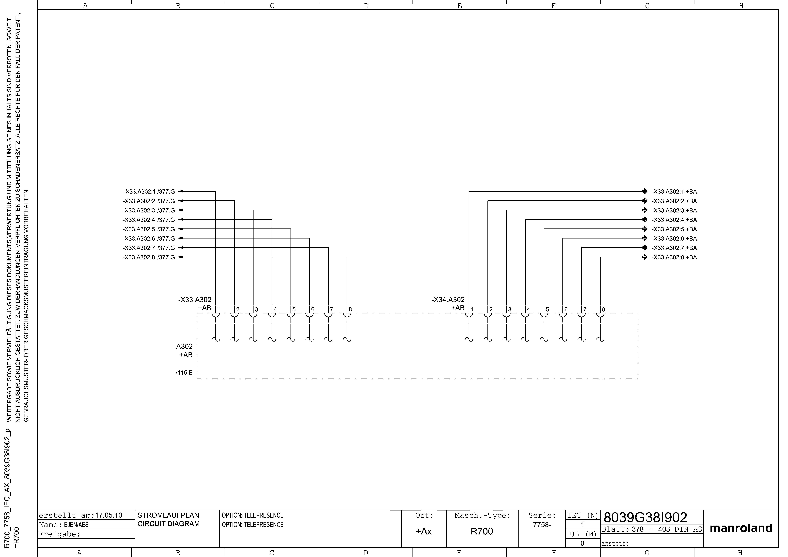

# +Ax — Sheet 378 of 403 — OPTION: TELEPRESENCE

**OPTION: TELEPRESENCE**

> Part of the manroland **R700** printing press IEC/UL circuit diagrams.
> Drawing class: **Stromlaufplan / Circuit diagram** (DIN A3).
> Document `+Ax` covers the **Central control console** machine section.

## At a glance

| Field | Value |
|---|---|
| Document | `+Ax`  (8039G38I902) |
| Sheet | **378** of 403 |
| Section (DE) | OPTION: TELEPRESENCE |
| Section (EN) | OPTION: TELEPRESENCE |
| Section type | CIRCUIT — Circuit diagram |
| Machine type | `R700` |
| Series | `7758` |
| Created | 17.05.10 |
| Replaces | — |
| Columns used | B, C, D, E, F, G |
| Path numbers | — |
| Labels on sheet | 47 |
| Cross-refs out | 9 |
| Cross-refs in | 25 |

**Previous:** [+Ax sheet 377](SHEET_0377.md) · **Next:** [+Ax sheet 379](SHEET_0379.md) · **Document TOC:** [_TOC.md](_TOC.md)  (+Ax) · **Master TOC:** [all sheets](../_MASTER_TOC.md)

## Sheet image (300 DPI, exact vector render)



_Rendered directly from the PDF vector layer at 300 DPI (1-bit), no OCR and no resampling. Use it to confirm anything ambiguous in the text below._

## Cross-references on this sheet

Each entry is a wire leaving this sheet. The printed token is `/sheet.column`; the link resolves to that sheet inside the same document.

| Ref | Target sheet | Col | Path | Destination on target | Target section | From col |
|---|---|---|---|---|---|---|
| `/377.G` | [+Ax sheet 377](SHEET_0377.md) | G | — | X33.A302:1,+BA X33.A302:1 | OPTION: TELEPRESENCE | D |
| `/377.G` | [+Ax sheet 377](SHEET_0377.md) | G | — | X33.A302:2 | OPTION: TELEPRESENCE | B |
| `/377.G` | [+Ax sheet 377](SHEET_0377.md) | G | — | X33.A302:3 | OPTION: TELEPRESENCE | B |
| `/377.G` | [+Ax sheet 377](SHEET_0377.md) | G | — | X33.A302:4 | OPTION: TELEPRESENCE | B |
| `/377.G` | [+Ax sheet 377](SHEET_0377.md) | G | — | X33.A302:5 | OPTION: TELEPRESENCE | B |
| `/377.G` | [+Ax sheet 377](SHEET_0377.md) | G | — | X33.A302:6 | OPTION: TELEPRESENCE | B |
| `/377.G` | [+Ax sheet 377](SHEET_0377.md) | G | — | X33.A302:7 | OPTION: TELEPRESENCE | B |
| `/377.G` | [+Ax sheet 377](SHEET_0377.md) | G | — | X33.A302:8 | OPTION: TELEPRESENCE | B |
| `/115.E` | [+Ax sheet 115](SHEET_0115.md) | E | — | — | HANDTERMINAL | B |

### Incoming references (sheets that point here)

Every other sheet that sends a wire to this one. `Back-ref` is the token printed on *that* sheet; `Path` is its line number.

| From sheet | Cols | Back-ref | Path | Refs | What continues there |
|---|---|---|---|---|---|
| [+Ax#115](SHEET_0115.md) | E | `/115.E` | — | 1 | — |
| [+Ax#276](SHEET_0276.md) | C | `/276.C` | — | 8 | — |
| [+Ax#277](SHEET_0277.md) | F | `/277.F` | — | 8 | — |
| [+Ax#377](SHEET_0377.md) | G | `/377.G` | — | 8 | X33.A302:1; X33.A302:2; X33.A302:3; X33.A302:4; X33.A302:5; X33.A302:6; X33.A302:7; X33.A302:8 |


## Devices on this sheet

| Tag | Class | Class meaning (IEC) | Col | Sub | Terminal | Sign |
|---|---|---|---|---|---|---|
| `A302` | A | Baugruppe / assembly, module, PC board | B | — | — | — |
| `X33.A302` | — | cross-device reference | B | — | — | — |
| `X34.A302` | — | cross-device reference | E | — | — | — |
| `X33.A302:1` | — | cross-device reference | B | — | 1 | — |
| `X33.A302:7` | — | cross-device reference | B | — | 7 | — |
| `X33.A302:8` | — | cross-device reference | B | — | 8 | — |
| `X33.A302:6` | — | cross-device reference | B | — | 6 | — |
| `X33.A302:2` | — | cross-device reference | B | — | 2 | — |
| `X33.A302:3` | — | cross-device reference | B | — | 3 | — |
| `X33.A302:4` | — | cross-device reference | B | — | 4 | — |
| `X33.A302:5` | — | cross-device reference | B | — | 5 | — |

## Potentials / nets

_No named potentials on this sheet._

## Wire-end annotations (grouped as printed)

A wire that continues elsewhere is annotated with a small cluster: the destination description, the path/line number `#NN`, and the `/sheet.column` cross reference. Each row below is one such cluster exactly as it is grouped on the drawing.

| Col | Y | Path | Cross-ref | Text on the wire |
|---|---|---|---|---|
| D | 285.9 | — | `/377.G` | `X33.A302:1 X33.A302:1,+BA` |
| B | 300.0 | — | `/377.G` | `X33.A302:2` |
| G | 300.0 | — | — | `X33.A302:2,+BA` |
| B | 314.2 | — | `/377.G` | `X33.A302:3` |
| G | 314.2 | — | — | `X33.A302:3,+BA` |
| B | 328.4 | — | `/377.G` | `X33.A302:4` |
| G | 328.4 | — | — | `X33.A302:4,+BA` |
| B | 342.6 | — | `/377.G` | `X33.A302:5` |
| G | 342.6 | — | — | `X33.A302:5,+BA` |
| B | 356.7 | — | `/377.G` | `X33.A302:6` |
| G | 356.7 | — | — | `X33.A302:6,+BA` |
| B | 370.9 | — | `/377.G` | `X33.A302:7` |
| G | 370.9 | — | — | `X33.A302:7,+BA` |
| B | 385.1 | — | `/377.G` | `X33.A302:8` |
| G | 385.1 | — | — | `X33.A302:8,+BA` |
| B | 448.2 | — | — | `X33.A302 1` |
| D | 448.2 | — | — | `+AB X34.A302 1` |
| F | 460.9 | — | — | `+AB 2 3 4 5 6 7 8` |
| C | 463.8 | — | — | `2 3 4 5 6 7 8` |
| B | 519.0 | — | — | `A302` |
| B | 531.7 | — | — | `+AB` |
| B | 559.4 | — | `/115.E` | — |


## Notes and free text on this sheet

| Text | Col | Y (pt) |
|---|---|---|
| `+AB` | B | 460.86 |
| `+AB` | E | 460.86 |
| `X33.A302:8,+BA` | G | 385.07 |
| `X33.A302:7,+BA` | G | 370.9 |
| `X33.A302:6,+BA` | G | 356.73 |
| `X33.A302:5,+BA` | G | 342.55 |
| `X33.A302:4,+BA` | G | 328.38 |
| `X33.A302:3,+BA` | G | 314.21 |
| `X33.A302:2,+BA` | G | 300.03 |
| `X33.A302:1,+BA` | G | 285.86 |

## Complete label inventory (exact text from the drawing)

Every text object inside the drawing area of this sheet, in DIN reading order (column A→H, then top→bottom). This is the authoritative list: if a string is not here it is not printed on this sheet.

| Col | Y | X | Dir | Type | Text |
|---|---|---|---|---|---|
| B | 285.9 | 186.8 | → | device ref | `X33.A302:1` |
| B | 285.9 | 237.8 | → | cross-reference | `/377.G` |
| B | 300.0 | 185.7 | → | device ref | `X33.A302:2` |
| B | 300.0 | 237.8 | → | cross-reference | `/377.G` |
| B | 314.2 | 185.4 | → | device ref | `X33.A302:3` |
| B | 314.2 | 237.8 | → | cross-reference | `/377.G` |
| B | 328.4 | 185.4 | → | device ref | `X33.A302:4` |
| B | 328.4 | 237.8 | → | cross-reference | `/377.G` |
| B | 342.6 | 185.4 | → | device ref | `X33.A302:5` |
| B | 342.6 | 237.8 | → | cross-reference | `/377.G` |
| B | 356.7 | 185.4 | → | device ref | `X33.A302:6` |
| B | 356.7 | 237.8 | → | cross-reference | `/377.G` |
| B | 370.9 | 185.4 | → | device ref | `X33.A302:7` |
| B | 370.9 | 237.8 | → | cross-reference | `/377.G` |
| B | 385.1 | 185.4 | → | device ref | `X33.A302:8` |
| B | 385.1 | 237.8 | → | cross-reference | `/377.G` |
| B | 448.2 | 269.3 | → | device ref | `X33.A302` |
| B | 460.9 | 299.1 | → | text | `+AB` |
| B | 463.8 | 328.0 | → | number | `1` |
| B | 519.0 | 262.8 | → | device tag | `A302` |
| B | 531.7 | 270.7 | → | text | `+AB` |
| B | 559.4 | 265.6 | → | cross-reference | `/115.E` |
| C | 463.8 | 356.9 | → | number | `2` |
| C | 463.8 | 385.2 | → | number | `3` |
| C | 463.8 | 413.6 | → | number | `4` |
| C | 463.8 | 441.9 | → | number | `5` |
| C | 463.8 | 470.3 | → | number | `6` |
| D | 463.8 | 498.6 | → | number | `7` |
| D | 463.8 | 527.0 | → | number | `8` |
| E | 448.2 | 652.0 | → | device ref | `X34.A302` |
| E | 460.9 | 681.7 | → | text | `+AB` |
| E | 463.8 | 710.6 | → | number | `1` |
| E | 463.8 | 739.6 | → | number | `2` |
| F | 463.8 | 767.9 | → | number | `3` |
| F | 463.8 | 796.3 | → | number | `4` |
| F | 463.8 | 824.6 | → | number | `5` |
| F | 463.8 | 852.9 | → | number | `6` |
| F | 463.8 | 881.3 | → | number | `7` |
| G | 285.9 | 984.8 | → | text | `X33.A302:1,+BA` |
| G | 300.0 | 984.8 | → | text | `X33.A302:2,+BA` |
| G | 314.2 | 984.8 | → | text | `X33.A302:3,+BA` |
| G | 328.4 | 984.8 | → | text | `X33.A302:4,+BA` |
| G | 342.6 | 984.8 | → | text | `X33.A302:5,+BA` |
| G | 356.7 | 984.8 | → | text | `X33.A302:6,+BA` |
| G | 370.9 | 984.8 | → | text | `X33.A302:7,+BA` |
| G | 385.1 | 984.8 | → | text | `X33.A302:8,+BA` |
| G | 463.8 | 909.6 | → | number | `8` |

## Reading-order text block

The same content as a plain block, grouped by DIN column — convenient to paste or to match against a visual description.

```text
=== Column B ===
 285.9  186.8  devref       X33.A302:1
 285.9  237.8  xref         /377.G
 300.0  185.7  devref       X33.A302:2
 300.0  237.8  xref         /377.G
 314.2  185.4  devref       X33.A302:3
 314.2  237.8  xref         /377.G
 328.4  185.4  devref       X33.A302:4
 328.4  237.8  xref         /377.G
 342.6  185.4  devref       X33.A302:5
 342.6  237.8  xref         /377.G
 356.7  185.4  devref       X33.A302:6
 356.7  237.8  xref         /377.G
 370.9  185.4  devref       X33.A302:7
 370.9  237.8  xref         /377.G
 385.1  185.4  devref       X33.A302:8
 385.1  237.8  xref         /377.G
 448.2  269.3  devref       X33.A302
 460.9  299.1  text         +AB
 463.8  328.0  numeric      1
 519.0  262.8  devtag       A302
 531.7  270.7  text         +AB
 559.4  265.6  xref         /115.E
=== Column C ===
 463.8  356.9  numeric      2
 463.8  385.2  numeric      3
 463.8  413.6  numeric      4
 463.8  441.9  numeric      5
 463.8  470.3  numeric      6
=== Column D ===
 463.8  498.6  numeric      7
 463.8  527.0  numeric      8
=== Column E ===
 448.2  652.0  devref       X34.A302
 460.9  681.7  text         +AB
 463.8  710.6  numeric      1
 463.8  739.6  numeric      2
=== Column F ===
 463.8  767.9  numeric      3
 463.8  796.3  numeric      4
 463.8  824.6  numeric      5
 463.8  852.9  numeric      6
 463.8  881.3  numeric      7
=== Column G ===
 285.9  984.8  text         X33.A302:1,+BA
 300.0  984.8  text         X33.A302:2,+BA
 314.2  984.8  text         X33.A302:3,+BA
 328.4  984.8  text         X33.A302:4,+BA
 342.6  984.8  text         X33.A302:5,+BA
 356.7  984.8  text         X33.A302:6,+BA
 370.9  984.8  text         X33.A302:7,+BA
 385.1  984.8  text         X33.A302:8,+BA
 463.8  909.6  numeric      8
```

---
_Generated from the PDF vector text layer; no OCR. Source: `R700_7758_IEC_AX_8039G38I902_p`, sheet 378._
