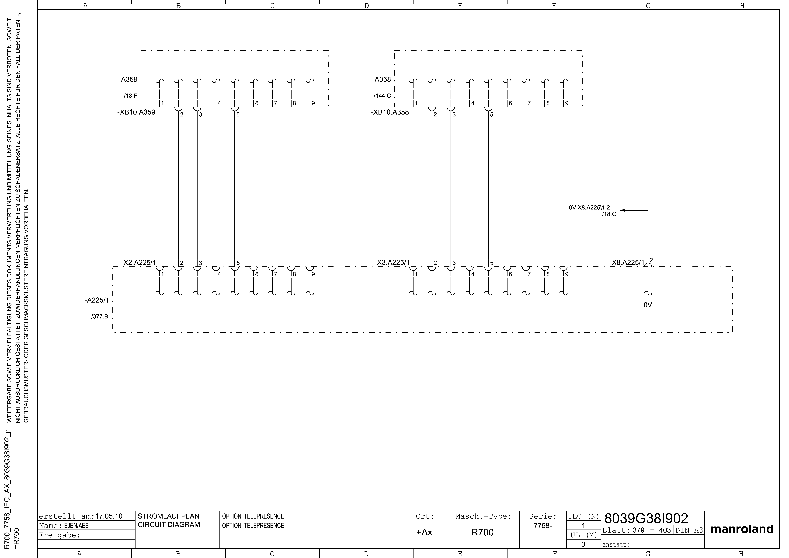

# +Ax — Sheet 379 of 403 — OPTION: TELEPRESENCE

**OPTION: TELEPRESENCE**

> Part of the manroland **R700** printing press IEC/UL circuit diagrams.
> Drawing class: **Stromlaufplan / Circuit diagram** (DIN A3).
> Document `+Ax` covers the **Central control console** machine section.

## At a glance

| Field | Value |
|---|---|
| Document | `+Ax`  (8039G38I902) |
| Sheet | **379** of 403 |
| Section (DE) | OPTION: TELEPRESENCE |
| Section (EN) | OPTION: TELEPRESENCE |
| Section type | CIRCUIT — Circuit diagram |
| Machine type | `R700` |
| Series | `7758` |
| Created | 17.05.10 |
| Replaces | — |
| Columns used | A, B, C, D, E, F, G |
| Path numbers | — |
| Labels on sheet | 51 |
| Cross-refs out | 4 |
| Cross-refs in | 41 |

**Previous:** [+Ax sheet 378](SHEET_0378.md) · **Next:** [+Ax sheet 380](SHEET_0380.md) · **Document TOC:** [_TOC.md](_TOC.md)  (+Ax) · **Master TOC:** [all sheets](../_MASTER_TOC.md)

## Sheet image (300 DPI, exact vector render)



_Rendered directly from the PDF vector layer at 300 DPI (1-bit), no OCR and no resampling. Use it to confirm anything ambiguous in the text below._

## Cross-references on this sheet

Each entry is a wire leaving this sheet. The printed token is `/sheet.column`; the link resolves to that sheet inside the same document.

| Ref | Target sheet | Col | Path | Destination on target | Target section | From col |
|---|---|---|---|---|---|---|
| `/18.F` | [+Ax sheet 18](SHEET_0018.md) | F | — | — | SPANNUNGSVERSORGUNG, SCHALTSCHRANKBELÜFTUNG | A |
| `/144.C` | [+Ax sheet 144](SHEET_0144.md) | C | — | — | ÜBERWACHUNGSRECHNER SICHERHEITSBUS | D |
| `/18.G` | [+Ax sheet 18](SHEET_0018.md) | G | — | 0V.X8.A225\1:2 | SPANNUNGSVERSORGUNG, SCHALTSCHRANKBELÜFTUNG | F |
| `/377.B` | [+Ax sheet 377](SHEET_0377.md) | B | — | — | OPTION: TELEPRESENCE | A |

### Incoming references (sheets that point here)

Every other sheet that sends a wire to this one. `Back-ref` is the token printed on *that* sheet; `Path` is its line number.

| From sheet | Cols | Back-ref | Path | Refs | What continues there |
|---|---|---|---|---|---|
| [+Ax#18](SHEET_0018.md) | F, G | `/18.F`, `/18.G` | — | 2 | 0V.X8.A225\1:2 |
| [+Ax#144](SHEET_0144.md) | C | `/144.C` | — | 1 | — |
| [+Ax#217](SHEET_0217.md) | E | `/217.E` | — | 9 | — |
| [+Ax#222](SHEET_0222.md) | E | `/222.E` | — | 9 | — |
| [+Ax#237](SHEET_0237.md) | E | `/237.E` | — | 1 | — |
| [+Ax#245](SHEET_0245.md) | C, E | `/245.C`, `/245.E` | — | 18 | — |
| [+Ax#377](SHEET_0377.md) | B | `/377.B` | — | 1 | — |


## Devices on this sheet

| Tag | Class | Class meaning (IEC) | Col | Sub | Terminal | Sign |
|---|---|---|---|---|---|---|
| `A225/1` | A | Baugruppe / assembly, module, PC board | A | 1 | — | — |
| `A359` | A | Baugruppe / assembly, module, PC board | A | — | — | — |
| `A358` | A | Baugruppe / assembly, module, PC board | D | — | — | — |
| `XB10.A359` | — | cross-device reference | B | — | — | — |
| `XB10.A358` | — | cross-device reference | D | — | — | — |

## Potentials / nets

| Potential | Count | Columns | Attached devices | Terminals |
|---|---|---|---|---|
| `0V` | 2 | F, G | `A225\1`, `X8` | `2` |


A potential such as `L24+/4` or `M24+` is a named supply/return rail; every place it appears on this sheet is electrically common.

## Wire-end annotations (grouped as printed)

A wire that continues elsewhere is annotated with a small cluster: the destination description, the path/line number `#NN`, and the `/sheet.column` cross reference. Each row below is one such cluster exactly as it is grouped on the drawing.

| Col | Y | Path | Cross-ref | Text on the wire |
|---|---|---|---|---|
| A | 115.1 | — | — | `A359` |
| D | 115.1 | — | — | `A358` |
| A | 140.6 | — | `/18.F` | — |
| D | 140.6 | — | `/144.C` | — |
| B | 152.0 | — | — | `1` |
| B | 152.0 | — | — | `4` |
| D | 152.0 | — | — | `6 7 8 9 1` |
| E | 152.0 | — | — | `4` |
| F | 152.0 | — | — | `6 7 8 9` |
| B | 164.7 | — | — | `XB10.A359 2 3` |
| E | 164.7 | — | — | `XB10.A358 2 3` |
| C | 169.0 | — | — | `5` |
| E | 169.0 | — | — | `5` |
| F | 309.2 | — | `/18.G` | `0V.X8.A225\1:2` |
| G | 388.7 | — | — | `X8.A225/1 2` |
| B | 391.5 | — | — | `X2.A225/1 2 3 5` |
| E | 391.5 | — | — | `X3.A225/1 2 3 5` |
| C | 409.9 | — | — | `1 4 6 7 8 9` |
| E | 409.9 | — | — | `1 4 6 7 8 9` |
| A | 448.2 | — | — | `A225/1` |
| G | 455.2 | — | — | `0V` |
| A | 473.6 | — | `/377.B` | — |


## Notes and free text on this sheet

| Text | Col | Y (pt) |
|---|---|---|
| `X2.A225/1` | B | 391.49 |
| `X3.A225/1` | D | 391.49 |
| `X8.A225/1` | G | 391.49 |

## Complete label inventory (exact text from the drawing)

Every text object inside the drawing area of this sheet, in DIN reading order (column A→H, then top→bottom). This is the authoritative list: if a string is not here it is not printed on this sheet.

| Col | Y | X | Dir | Type | Text |
|---|---|---|---|---|---|
| A | 115.1 | 179.1 | → | device tag | `A359` |
| A | 140.6 | 187.1 | → | cross-reference | `/18.F` |
| A | 448.2 | 127.8 | → | device tag | `A225/1` |
| A | 473.6 | 137.8 | → | cross-reference | `/377.B` |
| B | 152.0 | 242.9 | → | number | `1` |
| B | 152.0 | 328.5 | → | number | `4` |
| B | 164.7 | 177.2 | → | device ref | `XB10.A359` |
| B | 169.0 | 271.8 | → | number | `2` |
| B | 169.0 | 300.2 | → | number | `3` |
| B | 391.5 | 182.8 | → | text | `X2.A225/1` |
| B | 392.9 | 271.8 | → | number | `2` |
| B | 392.9 | 300.2 | → | number | `3` |
| B | 409.9 | 242.9 | → | number | `1` |
| B | 409.9 | 328.5 | → | number | `4` |
| C | 152.0 | 385.2 | → | number | `6` |
| C | 152.0 | 413.6 | → | number | `7` |
| C | 152.0 | 441.9 | → | number | `8` |
| C | 152.0 | 470.3 | → | number | `9` |
| C | 169.0 | 356.9 | → | number | `5` |
| C | 392.9 | 356.9 | → | number | `5` |
| C | 409.9 | 385.2 | → | number | `6` |
| C | 409.9 | 413.6 | → | number | `7` |
| C | 409.9 | 441.9 | → | number | `8` |
| C | 409.9 | 470.3 | → | number | `9` |
| D | 115.1 | 561.8 | → | device tag | `A358` |
| D | 140.6 | 564.1 | → | cross-reference | `/144.C` |
| D | 164.7 | 559.8 | → | device ref | `XB10.A358` |
| D | 391.5 | 565.5 | → | text | `X3.A225/1` |
| E | 152.0 | 625.6 | → | number | `1` |
| E | 152.0 | 711.2 | → | number | `4` |
| E | 169.0 | 654.5 | → | number | `2` |
| E | 169.0 | 682.9 | → | number | `3` |
| E | 169.0 | 739.6 | → | number | `5` |
| E | 392.9 | 654.5 | → | number | `2` |
| E | 392.9 | 682.9 | → | number | `3` |
| E | 392.9 | 739.6 | → | number | `5` |
| E | 409.9 | 625.6 | → | number | `1` |
| E | 409.9 | 711.2 | → | number | `4` |
| F | 152.0 | 767.9 | → | number | `6` |
| F | 152.0 | 796.3 | → | number | `7` |
| F | 152.0 | 824.6 | → | number | `8` |
| F | 152.0 | 852.9 | → | number | `9` |
| F | 309.2 | 858.6 | → | potential | `0V.X8.A225\1:2` |
| F | 409.9 | 767.9 | → | number | `6` |
| F | 409.9 | 796.3 | → | number | `7` |
| F | 409.9 | 824.6 | → | number | `8` |
| F | 409.9 | 852.9 | → | number | `9` |
| G | 319.2 | 908.8 | → | cross-reference | `/18.G` |
| G | 388.7 | 980.5 | → | number | `2` |
| G | 391.5 | 919.8 | → | text | `X8.A225/1` |
| G | 455.2 | 971.1 | → | potential | `0V` |

## Reading-order text block

The same content as a plain block, grouped by DIN column — convenient to paste or to match against a visual description.

```text
=== Column A ===
 115.1  179.1  devtag       A359
 140.6  187.1  xref         /18.F
 448.2  127.8  devtag       A225/1
 473.6  137.8  xref         /377.B
=== Column B ===
 152.0  242.9  numeric      1
 152.0  328.5  numeric      4
 164.7  177.2  devref       XB10.A359
 169.0  271.8  numeric      2
 169.0  300.2  numeric      3
 391.5  182.8  text         X2.A225/1
 392.9  271.8  numeric      2
 392.9  300.2  numeric      3
 409.9  242.9  numeric      1
 409.9  328.5  numeric      4
=== Column C ===
 152.0  385.2  numeric      6
 152.0  413.6  numeric      7
 152.0  441.9  numeric      8
 152.0  470.3  numeric      9
 169.0  356.9  numeric      5
 392.9  356.9  numeric      5
 409.9  385.2  numeric      6
 409.9  413.6  numeric      7
 409.9  441.9  numeric      8
 409.9  470.3  numeric      9
=== Column D ===
 115.1  561.8  devtag       A358
 140.6  564.1  xref         /144.C
 164.7  559.8  devref       XB10.A358
 391.5  565.5  text         X3.A225/1
=== Column E ===
 152.0  625.6  numeric      1
 152.0  711.2  numeric      4
 169.0  654.5  numeric      2
 169.0  682.9  numeric      3
 169.0  739.6  numeric      5
 392.9  654.5  numeric      2
 392.9  682.9  numeric      3
 392.9  739.6  numeric      5
 409.9  625.6  numeric      1
 409.9  711.2  numeric      4
=== Column F ===
 152.0  767.9  numeric      6
 152.0  796.3  numeric      7
 152.0  824.6  numeric      8
 152.0  852.9  numeric      9
 309.2  858.6  net          0V.X8.A225\1:2
 409.9  767.9  numeric      6
 409.9  796.3  numeric      7
 409.9  824.6  numeric      8
 409.9  852.9  numeric      9
=== Column G ===
 319.2  908.8  xref         /18.G
 388.7  980.5  numeric      2
 391.5  919.8  text         X8.A225/1
 455.2  971.1  net          0V
```

---
_Generated from the PDF vector text layer; no OCR. Source: `R700_7758_IEC_AX_8039G38I902_p`, sheet 379._
