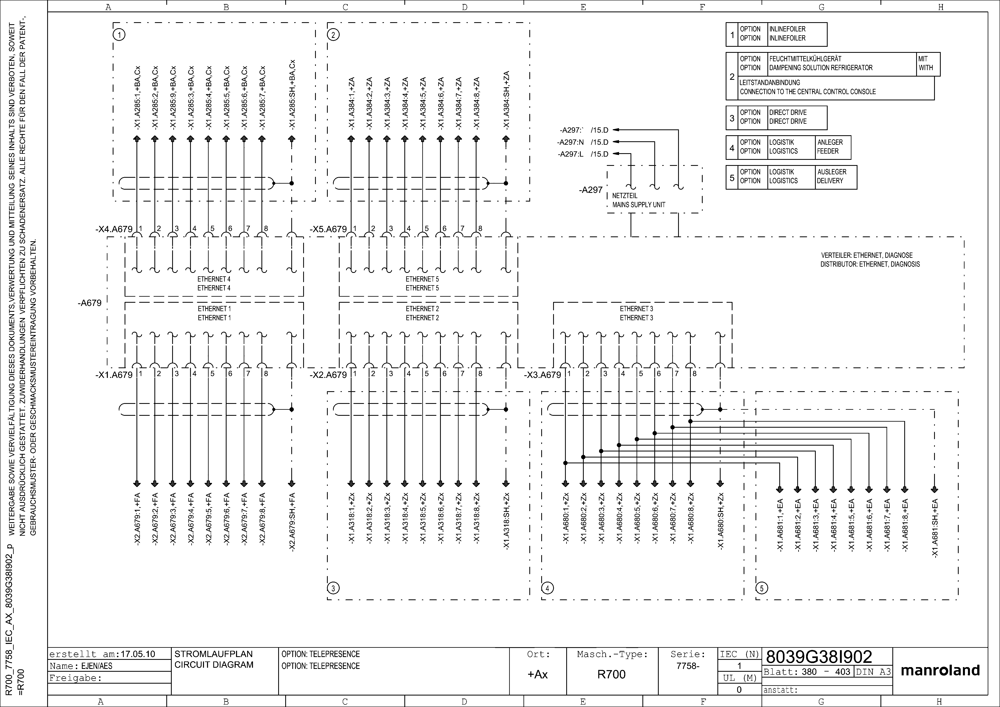

# +Ax — Sheet 380 of 403 — OPTION: TELEPRESENCE

**OPTION: TELEPRESENCE**

> Part of the manroland **R700** printing press IEC/UL circuit diagrams.
> Drawing class: **Stromlaufplan / Circuit diagram** (DIN A3).
> Document `+Ax` covers the **Central control console** machine section.

## At a glance

| Field | Value |
|---|---|
| Document | `+Ax`  (8039G38I902) |
| Sheet | **380** of 403 |
| Section (DE) | OPTION: TELEPRESENCE |
| Section (EN) | OPTION: TELEPRESENCE |
| Section type | CIRCUIT — Circuit diagram |
| Machine type | `R700` |
| Series | `7758` |
| Created | 17.05.10 |
| Replaces | — |
| Columns used | A, B, C, D, E, F, G, H |
| Path numbers | — |
| Labels on sheet | 159 |
| Cross-refs out | 3 |
| Cross-refs in | 43 |

**Previous:** [+Ax sheet 379](SHEET_0379.md) · **Next:** [+Ax sheet 381](SHEET_0381.md) · **Document TOC:** [_TOC.md](_TOC.md)  (+Ax) · **Master TOC:** [all sheets](../_MASTER_TOC.md)

## Sheet image (300 DPI, exact vector render)



_Rendered directly from the PDF vector layer at 300 DPI (1-bit), no OCR and no resampling. Use it to confirm anything ambiguous in the text below._

## Cross-references on this sheet

Each entry is a wire leaving this sheet. The printed token is `/sheet.column`; the link resolves to that sheet inside the same document.

| Ref | Target sheet | Col | Path | Destination on target | Target section | From col |
|---|---|---|---|---|---|---|
| `/15.D` | [+Ax sheet 15](SHEET_0015.md) | D | — | A297:` | SPANNUNGSVERSORGUNG, SCHALTSCHRANKBELÜFTUNG | E |
| `/15.D` | [+Ax sheet 15](SHEET_0015.md) | D | — | A297:N | SPANNUNGSVERSORGUNG, SCHALTSCHRANKBELÜFTUNG | E |
| `/15.D` | [+Ax sheet 15](SHEET_0015.md) | D | — | A297:L | SPANNUNGSVERSORGUNG, SCHALTSCHRANKBELÜFTUNG | E |

### Incoming references (sheets that point here)

Every other sheet that sends a wire to this one. `Back-ref` is the token printed on *that* sheet; `Path` is its line number.

| From sheet | Cols | Back-ref | Path | Refs | What continues there |
|---|---|---|---|---|---|
| [+Ax#15](SHEET_0015.md) | D | `/15.D` | — | 3 | A297:L; A297:N; A297:` |
| [+Ax#210](SHEET_0210.md) | F, G | `/210.F`, `/210.G` | — | 8 | — |
| [+Ax#221](SHEET_0221.md) | B | `/221.B` | — | 8 | — |
| [+Ax#225](SHEET_0225.md) | G | `/225.G` | — | 8 | — |
| [+Ax#229](SHEET_0229.md) | D | `/229.D` | — | 8 | — |
| [+Ax#232](SHEET_0232.md) | G | `/232.G` | — | 8 | — |


## Devices on this sheet

| Tag | Class | Class meaning (IEC) | Col | Sub | Terminal | Sign |
|---|---|---|---|---|---|---|
| `A679` | A | Baugruppe / assembly, module, PC board | A | — | — | — |
| `A297` | A | Baugruppe / assembly, module, PC board | E | — | — | — |
| `A297:L` | A | Baugruppe / assembly, module, PC board | E | — | L | — |
| `A297:N` | A | Baugruppe / assembly, module, PC board | E | — | N | — |
| `X1.A679` | — | cross-device reference | A | — | — | — |
| `X2.A679` | — | cross-device reference | C | — | — | — |
| `X3.A679` | — | cross-device reference | E | — | — | — |
| `X4.A679` | — | cross-device reference | A | — | — | — |
| `X5.A679` | — | cross-device reference | C | — | — | — |

## Potentials / nets

_No named potentials on this sheet._

## Wire-end annotations (grouped as printed)

A wire that continues elsewhere is annotated with a small cluster: the destination description, the path/line number `#NN`, and the `/sheet.column` cross reference. Each row below is one such cluster exactly as it is grouped on the drawing.

| Col | Y | Path | Cross-ref | Text on the wire |
|---|---|---|---|---|
| F | 31.8 | — | — | `1 OPTION OPTION` |
| G | 31.8 | — | — | `INLINEFOILER INLINEFOILER` |
| B | 38.0 | — | — | `1 2` |
| F | 67.2 | — | — | `OPTION OPTION` |
| G | 67.2 | — | — | `FEUCHTMITTELKÜHLGERÄT DAMPENING SOLUTION REFRIGERATOR` |
| H | 67.2 | — | — | `MIT` |
| C | 71.2 | — | — | `X1.A285:SH,+BA,Cx` |
| G | 77.7 | — | — | `2 WITH` |
| A | 78.5 | — | — | `X1.A285:1,+BA,Cx` |
| A | 78.5 | — | — | `X1.A285:2,+BA,Cx` |
| B | 78.5 | — | — | `X1.A285:9,+BA,Cx` |
| B | 78.5 | — | — | `X1.A285:3,+BA,Cx` |
| B | 78.5 | — | — | `X1.A285:4,+BA,Cx` |
| B | 78.5 | — | — | `X1.A285:5,+BA,Cx` |
| B | 78.5 | — | — | `X1.A285:6,+BA,Cx` |
| B | 78.5 | — | — | `X1.A285:7,+BA,Cx` |
| D | 84.5 | — | — | `X1.A384:SH,+ZA` |
| C | 91.8 | — | — | `X1.A384:1,+ZA` |
| C | 91.8 | — | — | `X1.A384:2,+ZA` |
| C | 91.8 | — | — | `X1.A384:3,+ZA` |
| D | 91.8 | — | — | `X1.A384:4,+ZA` |
| D | 91.8 | — | — | `X1.A384:5,+ZA` |
| D | 91.8 | — | — | `X1.A384:6,+ZA` |
| D | 91.8 | — | — | `X1.A384:7,+ZA` |
| D | 91.8 | — | — | `X1.A384:8,+ZA` |
| G | 95.6 | — | — | `LEITSTANDANBINDUNG` |
| G | 106.2 | — | — | `CONNECTION TO THE CENTRAL CONTROL CONSOLE` |
| F | 131.0 | — | — | `3 OPTION OPTION` |
| G | 131.0 | — | — | `DIRECT DRIVE DIRECT DRIVE` |
| E | 151.2 | — | `/15.D` | `A297:'` |
| E | 165.4 | — | `/15.D` | `A297:N` |
| F | 166.4 | — | — | `4 OPTION OPTION` |
| G | 166.4 | — | — | `LOGISTIK LOGISTICS` |
| G | 166.5 | — | — | `FEEDER ANLEGER` |
| E | 179.6 | — | `/15.D` | `A297:L` |
| F | 201.9 | — | — | `5 OPTION OPTION` |
| G | 201.9 | — | — | `LOGISTIK LOGISTICS` |
| G | 201.9 | — | — | `DELIVERY AUSLEGER` |
| E | 221.4 | — | — | `A297` |
| E | 230.2 | — | — | `NETZTEIL MAINS SUPPLY UNIT` |
| B | 268.2 | — | — | `X4.A679 1 2 3 4 5 6 7 8` |
| C | 268.2 | — | — | `X5.A679 1 2 3 4 5 6 7 8` |
| G | 301.1 | — | — | `DISTRIBUTOR: ETHERNET, DIAGNOSIS VERTEILER: ETHERNET, DIAGNOSE` |
| B | 329.4 | — | — | `ETHERNET 4 ETHERNET 4` |
| D | 329.4 | — | — | `ETHERNET 5 ETHERNET 5` |
| A | 356.1 | — | — | `A679` |
| B | 364.8 | — | — | `ETHERNET 1 ETHERNET 1` |
| D | 364.9 | — | — | `ETHERNET 2 ETHERNET 2` |
| E | 364.9 | — | — | `ETHERNET 3 ETHERNET 3` |
| C | 441.1 | — | — | `X1.A679 1 2 3 4 5 6 7 8 X2.A679 1 2 3 4 5 6 X3.A679 1 2 3 4 5 6 7 8` |
| D | 441.1 | — | — | `7 8` |
| A | 586.8 | — | — | `X2.A679:1,+FA` |
| A | 586.8 | — | — | `X2.A679:2,+FA` |
| B | 586.8 | — | — | `X2.A679:3,+FA` |
| B | 586.8 | — | — | `X2.A679:4,+FA` |
| B | 586.8 | — | — | `X2.A679:5,+FA` |
| B | 586.8 | — | — | `X2.A679:6,+FA` |
| B | 586.8 | — | — | `X2.A679:7,+FA` |
| B | 586.8 | — | — | `X2.A679:8,+FA` |
| C | 586.8 | — | — | `X2.A679:SH,+FA` |
| C | 586.8 | — | — | `X1.A318:1,+Zx` |
| C | 586.8 | — | — | `X1.A318:2,+Zx` |
| C | 586.8 | — | — | `X1.A318:3,+Zx` |
| D | 586.8 | — | — | `X1.A318:4,+Zx` |
| D | 586.8 | — | — | `X1.A318:5,+Zx` |
| D | 586.8 | — | — | `X1.A318:6,+Zx` |
| D | 586.8 | — | — | `X1.A318:7,+Zx` |
| D | 586.8 | — | — | `X1.A318:8,+Zx` |
| D | 586.8 | — | — | `X1.A318:SH,+Zx` |
| E | 586.8 | — | — | `X1.A680:1,+Zx` |
| E | 586.8 | — | — | `X1.A680:2,+Zx` |
| E | 586.8 | — | — | `X1.A680:3,+Zx` |
| E | 586.8 | — | — | `X1.A680:4,+Zx` |
| E | 586.8 | — | — | `X1.A680:5,+Zx` |
| F | 586.8 | — | — | `X1.A680:6,+Zx` |
| F | 586.8 | — | — | `X1.A680:7,+Zx` |
| F | 586.8 | — | — | `X1.A680:8,+Zx` |
| F | 586.8 | — | — | `X1.A680:SH,+Zx` |
| G | 593.9 | — | — | `X1.A681:1,+EA` |
| G | 593.9 | — | — | `X1.A681:2,+EA` |
| G | 593.9 | — | — | `X1.A681:3,+EA` |
| G | 593.9 | — | — | `X1.A681:4,+EA` |
| G | 593.9 | — | — | `X1.A681:5,+EA` |
| G | 593.9 | — | — | `X1.A681:6,+EA` |
| H | 593.9 | — | — | `X1.A681:7,+EA` |
| H | 593.9 | — | — | `X1.A681:8,+EA` |
| H | 593.9 | — | — | `X1.A681:SH,+EA` |
| C | 697.6 | — | — | `3` |
| F | 697.6 | — | — | `4 5` |


## Reconstructed tables

This sheet carries tabular content (pin map / terminal assignment / index). The grid below was rebuilt from the drawing's own rule lines, so each row is exactly one physical row of the table.

### Table 1 — 1 data rows × 8 columns (at x=163.0, y=154.5)

| 1 | 2 | 3 | 4 | 5 ETHERNET ETHERNET | 6 4 4 | 7 | 8 |
|---|---|---|---|---|---|---|---|
| `1` | `2` | `3` | `4` | `ETHERNET ETHERNET 5` | `1 1 6` | `7` | `8` |


### Table 2 — 2 data rows × 1 columns (at x=361.4, y=154.5)

| C1 |
|---|
| `X5.A679` |
| `X2.A679` |


### Table 3 — 1 data rows × 8 columns (at x=418.1, y=154.5)

| 1 | 2 | 3 | 4 ETHERNET ETHERNET | 5 5 5 | 6 | 7 | 8 |
|---|---|---|---|---|---|---|---|
| `1` | `2` | `3` | `ETHERNET ETHERNET 4` | `2 2 5` | `6` | `7` | `8` |


### Table 4 — 2 data rows × 8 columns (at x=673.2, y=154.5)

| A297:` A297:N A297:L | /15.D /15.D /15.D |  |  |  |  |  |  |
|---|---|---|---|---|---|---|---|
|  | `A297` |  | `NETZTEIL MAINS` |  | `SUPPLY` | `UNIT` |  |
| `1` | `2` | `3` | `4` | `ETHERNET ETHERNET` | `3 3 5` | `6` | `7` |


### Table 5 — 2 data rows × 4 columns (at x=822.0, y=154.5)

|  |  | OPTION 4 OPTION OPTION | LOGISTIK LOGISTICS LOGISTIK |
|---|---|---|---|
|  | `5` | `OPTION` | `LOGISTICS` |
| `8` |  |  |  |


### Table 6 — 0 data rows × 6 columns (at x=970.9, y=154.5) — **ANLEGER FEEDER AUSLEGER DELIVERY**

_none_


## Notes and free text on this sheet

| Text | Col | Y (pt) |
|---|---|---|
| `VERTEILER: ETHERNET, DIAGNOSE` | G | 301.1 |
| `DISTRIBUTOR: ETHERNET, DIAGNOSIS` | G | 311.73 |
| `X1.A285:1,+BA,Cx` | A | 78.52 |
| `X1.A285:2,+BA,Cx` | A | 78.52 |
| `X1.A285:3,+BA,Cx` | B | 78.52 |
| `X1.A285:4,+BA,Cx` | B | 78.52 |
| `X1.A285:5,+BA,Cx` | B | 78.52 |
| `X1.A285:6,+BA,Cx` | B | 78.52 |
| `X1.A285:7,+BA,Cx` | B | 78.52 |
| `X1.A285:SH,+BA,Cx` | C | 71.15 |
| `X1.A285:9,+BA,Cx` | B | 78.52 |
| `X1.A384:1,+ZA` | C | 91.84 |
| `X1.A384:2,+ZA` | C | 91.84 |
| `X1.A384:4,+ZA` | D | 91.84 |
| `X1.A384:5,+ZA` | D | 91.84 |
| `X1.A384:6,+ZA` | D | 91.84 |
| `X1.A384:7,+ZA` | D | 91.84 |
| `X1.A384:8,+ZA` | D | 91.84 |
| `X1.A384:SH,+ZA` | D | 84.47 |
| `X1.A384:3,+ZA` | C | 91.84 |
| `X2.A679:1,+FA` | A | 586.77 |
| `X2.A679:2,+FA` | A | 586.77 |
| `X2.A679:3,+FA` | B | 586.77 |
| `X2.A679:4,+FA` | B | 586.77 |
| `X2.A679:5,+FA` | B | 586.77 |
| `X2.A679:6,+FA` | B | 586.77 |
| `X2.A679:7,+FA` | B | 586.77 |
| `X2.A679:8,+FA` | B | 586.77 |
| `X2.A679:SH,+FA` | C | 586.77 |
| `X1.A318:1,+Zx` | C | 586.77 |
| `X1.A318:2,+Zx` | C | 586.77 |
| `X1.A318:3,+Zx` | C | 586.77 |
| `X1.A318:4,+Zx` | D | 586.77 |
| `X1.A318:5,+Zx` | D | 586.77 |
| `X1.A318:6,+Zx` | D | 586.77 |
| `X1.A318:7,+Zx` | D | 586.77 |
| `X1.A318:8,+Zx` | D | 586.77 |
| `X1.A318:SH,+Zx` | D | 586.77 |
| `X1.A680:1,+Zx` | E | 586.77 |
| `X1.A680:2,+Zx` | E | 586.77 |
| `X1.A680:3,+Zx` | E | 586.77 |
| `X1.A680:4,+Zx` | E | 586.77 |
| `X1.A680:5,+Zx` | E | 586.77 |
| `X1.A680:6,+Zx` | F | 586.77 |
| `X1.A680:7,+Zx` | F | 586.77 |
| `X1.A680:8,+Zx` | F | 586.77 |
| `X1.A680:SH,+Zx` | F | 586.77 |
| `X1.A681:1,+EA` | G | 593.86 |
| `X1.A681:2,+EA` | G | 593.86 |
| `X1.A681:3,+EA` | G | 593.86 |
| `X1.A681:4,+EA` | G | 593.86 |
| `X1.A681:5,+EA` | G | 593.86 |
| `X1.A681:6,+EA` | G | 593.86 |
| `X1.A681:7,+EA` | H | 593.86 |
| `X1.A681:8,+EA` | H | 593.86 |
| `X1.A681:SH,+EA` | H | 593.86 |
| `A297:'` | E | 151.24 |
| `ETHERNET 3` | E | 364.87 |
| `ETHERNET 5` | D | 329.43 |
| `ETHERNET 2` | D | 364.86 |
| `ETHERNET 4` | B | 329.43 |
| `ETHERNET 1` | B | 364.84 |
| `NETZTEIL` | E | 230.2 |
| `MAINS SUPPLY UNIT` | E | 240.86 |
| `OPTION` | F | 31.78 |
| `INLINEFOILER` | G | 31.8 |
| `FEUCHTMITTELKÜHLGERÄT` | G | 67.25 |
| `DAMPENING SOLUTION REFRIGERATOR` | G | 77.88 |
| `DIRECT DRIVE` | G | 131 |
| `LOGISTIK` | G | 166.42 |
| `LOGISTICS` | G | 177.05 |
| `ANLEGER` | G | 166.46 |
| `FEEDER` | G | 177.06 |
| `AUSLEGER` | G | 201.89 |
| `DELIVERY` | G | 212.5 |
| `LEITSTANDANBINDUNG` | G | 95.59 |
| `CONNECTION TO THE CENTRAL CONTROL CONSOLE` | G | 106.24 |
| `MIT` | H | 67.21 |
| `WITH` | H | 77.74 |

## Complete label inventory (exact text from the drawing)

Every text object inside the drawing area of this sheet, in DIN reading order (column A→H, then top→bottom). This is the authoritative list: if a string is not here it is not printed on this sheet.

| Col | Y | X | Dir | Type | Text |
|---|---|---|---|---|---|
| A | 38.0 | 140.0 | → | number | `1` |
| A | 78.5 | 159.7 | ↕ | text | `X1.A285:1,+BA,Cx` |
| A | 78.5 | 181.0 | ↕ | text | `X1.A285:2,+BA,Cx` |
| A | 268.2 | 113.7 | → | device ref | `X4.A679` |
| A | 268.2 | 165.0 | → | number | `1` |
| A | 268.2 | 186.8 | → | number | `2` |
| A | 356.1 | 92.7 | → | device tag | `A679` |
| A | 441.1 | 165.0 | → | number | `1` |
| A | 441.1 | 186.8 | → | number | `2` |
| A | 441.8 | 113.7 | → | device ref | `X1.A679` |
| A | 586.8 | 159.7 | ↕ | text | `X2.A679:1,+FA` |
| A | 586.8 | 181.0 | ↕ | text | `X2.A679:2,+FA` |
| B | 78.5 | 202.3 | ↕ | text | `X1.A285:9,+BA,Cx` |
| B | 78.5 | 223.5 | ↕ | text | `X1.A285:3,+BA,Cx` |
| B | 78.5 | 244.8 | ↕ | text | `X1.A285:4,+BA,Cx` |
| B | 78.5 | 266.0 | ↕ | text | `X1.A285:5,+BA,Cx` |
| B | 78.5 | 287.3 | ↕ | text | `X1.A285:6,+BA,Cx` |
| B | 78.5 | 308.6 | ↕ | text | `X1.A285:7,+BA,Cx` |
| B | 268.2 | 208.1 | → | number | `3` |
| B | 268.2 | 229.3 | → | number | `4` |
| B | 268.2 | 250.6 | → | number | `5` |
| B | 268.2 | 271.8 | → | number | `6` |
| B | 268.2 | 293.1 | → | number | `7` |
| B | 268.2 | 314.4 | → | number | `8` |
| B | 329.4 | 235.2 | → | text | `ETHERNET 4` |
| B | 340.1 | 235.2 | → | text | `ETHERNET 4` |
| B | 364.8 | 235.8 | → | text | `ETHERNET 1` |
| B | 375.5 | 235.8 | → | text | `ETHERNET 1` |
| B | 441.1 | 208.1 | → | number | `3` |
| B | 441.1 | 229.3 | → | number | `4` |
| B | 441.1 | 250.6 | → | number | `5` |
| B | 441.1 | 271.8 | → | number | `6` |
| B | 441.1 | 293.1 | → | number | `7` |
| B | 441.1 | 314.4 | → | number | `8` |
| B | 586.8 | 202.2 | ↕ | text | `X2.A679:3,+FA` |
| B | 586.8 | 223.5 | ↕ | text | `X2.A679:4,+FA` |
| B | 586.8 | 244.8 | ↕ | text | `X2.A679:5,+FA` |
| B | 586.8 | 266.0 | ↕ | text | `X2.A679:6,+FA` |
| B | 586.8 | 287.3 | ↕ | text | `X2.A679:7,+FA` |
| B | 586.8 | 308.5 | ↕ | text | `X2.A679:8,+FA` |
| C | 38.6 | 394.9 | → | number | `2` |
| C | 71.2 | 344.0 | ↕ | text | `X1.A285:SH,+BA,Cx` |
| C | 91.8 | 414.8 | ↕ | text | `X1.A384:1,+ZA` |
| C | 91.8 | 436.1 | ↕ | text | `X1.A384:2,+ZA` |
| C | 91.8 | 457.4 | ↕ | text | `X1.A384:3,+ZA` |
| C | 268.2 | 368.8 | → | device ref | `X5.A679` |
| C | 268.2 | 420.1 | → | number | `1` |
| C | 268.2 | 441.9 | → | number | `2` |
| C | 268.2 | 463.2 | → | number | `3` |
| C | 441.1 | 420.1 | → | number | `1` |
| C | 441.1 | 441.9 | → | number | `2` |
| C | 441.1 | 463.2 | → | number | `3` |
| C | 441.8 | 368.8 | → | device ref | `X2.A679` |
| C | 586.8 | 344.0 | ↕ | text | `X2.A679:SH,+FA` |
| C | 586.8 | 414.9 | ↕ | text | `X1.A318:1,+Zx` |
| C | 586.8 | 436.1 | ↕ | text | `X1.A318:2,+Zx` |
| C | 586.8 | 457.4 | ↕ | text | `X1.A318:3,+Zx` |
| C | 697.6 | 394.9 | → | number | `3` |
| D | 84.5 | 599.1 | ↕ | text | `X1.A384:SH,+ZA` |
| D | 91.8 | 478.6 | ↕ | text | `X1.A384:4,+ZA` |
| D | 91.8 | 499.9 | ↕ | text | `X1.A384:5,+ZA` |
| D | 91.8 | 521.1 | ↕ | text | `X1.A384:6,+ZA` |
| D | 91.8 | 542.4 | ↕ | text | `X1.A384:7,+ZA` |
| D | 91.8 | 563.7 | ↕ | text | `X1.A384:8,+ZA` |
| D | 268.2 | 484.4 | → | number | `4` |
| D | 268.2 | 505.7 | → | number | `5` |
| D | 268.2 | 527.0 | → | number | `6` |
| D | 268.2 | 548.2 | → | number | `7` |
| D | 268.2 | 569.5 | → | number | `8` |
| D | 329.4 | 483.3 | → | text | `ETHERNET 5` |
| D | 340.1 | 483.3 | → | text | `ETHERNET 5` |
| D | 364.9 | 483.4 | → | text | `ETHERNET 2` |
| D | 375.5 | 483.4 | → | text | `ETHERNET 2` |
| D | 441.1 | 484.4 | → | number | `4` |
| D | 441.1 | 505.7 | → | number | `5` |
| D | 441.1 | 527.0 | → | number | `6` |
| D | 441.1 | 548.2 | → | number | `7` |
| D | 441.1 | 569.5 | → | number | `8` |
| D | 586.8 | 478.6 | ↕ | text | `X1.A318:4,+Zx` |
| D | 586.8 | 499.9 | ↕ | text | `X1.A318:5,+Zx` |
| D | 586.8 | 521.2 | ↕ | text | `X1.A318:6,+Zx` |
| D | 586.8 | 542.4 | ↕ | text | `X1.A318:7,+Zx` |
| D | 586.8 | 563.7 | ↕ | text | `X1.A318:8,+Zx` |
| D | 586.8 | 599.1 | ↕ | text | `X1.A318:SH,+Zx` |
| E | 151.2 | 666.7 | → | text | `A297:'` |
| E | 151.2 | 703.6 | → | cross-reference | `/15.D` |
| E | 165.4 | 663.3 | → | device tag | `A297:N` |
| E | 165.4 | 703.6 | → | cross-reference | `/15.D` |
| E | 179.6 | 664.2 | → | device tag | `A297:L` |
| E | 179.6 | 703.6 | → | cross-reference | `/15.D` |
| E | 221.4 | 689.4 | → | device tag | `A297` |
| E | 230.2 | 729.1 | → | text | `NETZTEIL` |
| E | 240.9 | 729.4 | → | text | `MAINS SUPPLY UNIT` |
| E | 364.9 | 738.4 | → | text | `ETHERNET 3` |
| E | 375.5 | 738.4 | → | text | `ETHERNET 3` |
| E | 441.1 | 675.2 | → | number | `1` |
| E | 441.1 | 697.0 | → | number | `2` |
| E | 441.1 | 718.3 | → | number | `3` |
| E | 441.1 | 739.6 | → | number | `4` |
| E | 441.1 | 760.8 | → | number | `5` |
| E | 441.8 | 623.9 | → | device ref | `X3.A679` |
| E | 586.8 | 670.0 | ↕ | text | `X1.A680:1,+Zx` |
| E | 586.8 | 691.2 | ↕ | text | `X1.A680:2,+Zx` |
| E | 586.8 | 712.5 | ↕ | text | `X1.A680:3,+Zx` |
| E | 586.8 | 733.8 | ↕ | text | `X1.A680:4,+Zx` |
| E | 586.8 | 755.0 | ↕ | text | `X1.A680:5,+Zx` |
| E | 697.6 | 650.0 | → | number | `4` |
| F | 31.8 | 881.3 | → | text | `OPTION` |
| F | 37.1 | 869.1 | → | number | `1` |
| F | 42.4 | 881.3 | → | text | `OPTION` |
| F | 67.2 | 881.3 | → | text | `OPTION` |
| F | 77.8 | 881.3 | → | text | `OPTION` |
| F | 86.7 | 868.8 | → | number | `2` |
| F | 131.0 | 881.3 | → | text | `OPTION` |
| F | 136.3 | 868.7 | → | number | `3` |
| F | 141.6 | 881.3 | → | text | `OPTION` |
| F | 166.4 | 881.3 | → | text | `OPTION` |
| F | 171.8 | 868.8 | → | number | `4` |
| F | 177.1 | 881.3 | → | text | `OPTION` |
| F | 201.9 | 881.3 | → | text | `OPTION` |
| F | 207.2 | 868.7 | → | number | `5` |
| F | 212.5 | 881.3 | → | text | `OPTION` |
| F | 441.1 | 782.1 | → | number | `6` |
| F | 441.1 | 803.3 | → | number | `7` |
| F | 441.1 | 824.6 | → | number | `8` |
| F | 586.8 | 776.3 | ↕ | text | `X1.A680:6,+Zx` |
| F | 586.8 | 797.5 | ↕ | text | `X1.A680:7,+Zx` |
| F | 586.8 | 818.8 | ↕ | text | `X1.A680:8,+Zx` |
| F | 586.8 | 854.2 | ↕ | text | `X1.A680:SH,+Zx` |
| F | 697.6 | 905.1 | → | number | `5` |
| G | 31.8 | 916.2 | → | text | `INLINEFOILER` |
| G | 42.4 | 916.2 | → | text | `INLINEFOILER` |
| G | 67.3 | 916.2 | → | text | `FEUCHTMITTELKÜHLGERÄT` |
| G | 77.9 | 916.2 | → | text | `DAMPENING SOLUTION REFRIGERATOR` |
| G | 95.6 | 880.7 | → | text | `LEITSTANDANBINDUNG` |
| G | 106.2 | 881.3 | → | text | `CONNECTION TO THE CENTRAL CONTROL CONSOLE` |
| G | 131.0 | 916.2 | → | text | `DIRECT DRIVE` |
| G | 141.6 | 916.2 | → | text | `DIRECT DRIVE` |
| G | 166.4 | 916.2 | → | text | `LOGISTIK` |
| G | 166.5 | 973.7 | → | text | `ANLEGER` |
| G | 177.1 | 916.2 | → | text | `LOGISTICS` |
| G | 177.1 | 972.9 | → | text | `FEEDER` |
| G | 201.9 | 916.2 | → | text | `LOGISTIK` |
| G | 201.9 | 973.7 | → | text | `AUSLEGER` |
| G | 212.5 | 916.2 | → | text | `LOGISTICS` |
| G | 212.5 | 972.9 | → | text | `DELIVERY` |
| G | 301.1 | 978.0 | → | text | `VERTEILER: ETHERNET, DIAGNOSE` |
| G | 311.7 | 977.1 | → | text | `DISTRIBUTOR: ETHERNET, DIAGNOSIS` |
| G | 593.9 | 925.1 | ↕ | text | `X1.A681:1,+EA` |
| G | 593.9 | 946.3 | ↕ | text | `X1.A681:2,+EA` |
| G | 593.9 | 967.6 | ↕ | text | `X1.A681:3,+EA` |
| G | 593.9 | 988.8 | ↕ | text | `X1.A681:4,+EA` |
| G | 593.9 | 1010.1 | ↕ | text | `X1.A681:5,+EA` |
| G | 593.9 | 1031.4 | ↕ | text | `X1.A681:6,+EA` |
| H | 67.2 | 1093.6 | → | text | `MIT` |
| H | 77.7 | 1094.2 | → | text | `WITH` |
| H | 593.9 | 1052.6 | ↕ | text | `X1.A681:7,+EA` |
| H | 593.9 | 1073.9 | ↕ | text | `X1.A681:8,+EA` |
| H | 593.9 | 1109.3 | ↕ | text | `X1.A681:SH,+EA` |

## Reading-order text block

The same content as a plain block, grouped by DIN column — convenient to paste or to match against a visual description.

```text
=== Column A ===
  38.0  140.0  numeric      1
  78.5  159.7  text         X1.A285:1,+BA,Cx
  78.5  181.0  text         X1.A285:2,+BA,Cx
 268.2  113.7  devref       X4.A679
 268.2  165.0  numeric      1
 268.2  186.8  numeric      2
 356.1   92.7  devtag       A679
 441.1  165.0  numeric      1
 441.1  186.8  numeric      2
 441.8  113.7  devref       X1.A679
 586.8  159.7  text         X2.A679:1,+FA
 586.8  181.0  text         X2.A679:2,+FA
=== Column B ===
  78.5  202.3  text         X1.A285:9,+BA,Cx
  78.5  223.5  text         X1.A285:3,+BA,Cx
  78.5  244.8  text         X1.A285:4,+BA,Cx
  78.5  266.0  text         X1.A285:5,+BA,Cx
  78.5  287.3  text         X1.A285:6,+BA,Cx
  78.5  308.6  text         X1.A285:7,+BA,Cx
 268.2  208.1  numeric      3
 268.2  229.3  numeric      4
 268.2  250.6  numeric      5
 268.2  271.8  numeric      6
 268.2  293.1  numeric      7
 268.2  314.4  numeric      8
 329.4  235.2  text         ETHERNET 4
 340.1  235.2  text         ETHERNET 4
 364.8  235.8  text         ETHERNET 1
 375.5  235.8  text         ETHERNET 1
 441.1  208.1  numeric      3
 441.1  229.3  numeric      4
 441.1  250.6  numeric      5
 441.1  271.8  numeric      6
 441.1  293.1  numeric      7
 441.1  314.4  numeric      8
 586.8  202.2  text         X2.A679:3,+FA
 586.8  223.5  text         X2.A679:4,+FA
 586.8  244.8  text         X2.A679:5,+FA
 586.8  266.0  text         X2.A679:6,+FA
 586.8  287.3  text         X2.A679:7,+FA
 586.8  308.5  text         X2.A679:8,+FA
=== Column C ===
  38.6  394.9  numeric      2
  71.2  344.0  text         X1.A285:SH,+BA,Cx
  91.8  414.8  text         X1.A384:1,+ZA
  91.8  436.1  text         X1.A384:2,+ZA
  91.8  457.4  text         X1.A384:3,+ZA
 268.2  368.8  devref       X5.A679
 268.2  420.1  numeric      1
 268.2  441.9  numeric      2
 268.2  463.2  numeric      3
 441.1  420.1  numeric      1
 441.1  441.9  numeric      2
 441.1  463.2  numeric      3
 441.8  368.8  devref       X2.A679
 586.8  344.0  text         X2.A679:SH,+FA
 586.8  414.9  text         X1.A318:1,+Zx
 586.8  436.1  text         X1.A318:2,+Zx
 586.8  457.4  text         X1.A318:3,+Zx
 697.6  394.9  numeric      3
=== Column D ===
  84.5  599.1  text         X1.A384:SH,+ZA
  91.8  478.6  text         X1.A384:4,+ZA
  91.8  499.9  text         X1.A384:5,+ZA
  91.8  521.1  text         X1.A384:6,+ZA
  91.8  542.4  text         X1.A384:7,+ZA
  91.8  563.7  text         X1.A384:8,+ZA
 268.2  484.4  numeric      4
 268.2  505.7  numeric      5
 268.2  527.0  numeric      6
 268.2  548.2  numeric      7
 268.2  569.5  numeric      8
 329.4  483.3  text         ETHERNET 5
 340.1  483.3  text         ETHERNET 5
 364.9  483.4  text         ETHERNET 2
 375.5  483.4  text         ETHERNET 2
 441.1  484.4  numeric      4
 441.1  505.7  numeric      5
 441.1  527.0  numeric      6
 441.1  548.2  numeric      7
 441.1  569.5  numeric      8
 586.8  478.6  text         X1.A318:4,+Zx
 586.8  499.9  text         X1.A318:5,+Zx
 586.8  521.2  text         X1.A318:6,+Zx
 586.8  542.4  text         X1.A318:7,+Zx
 586.8  563.7  text         X1.A318:8,+Zx
 586.8  599.1  text         X1.A318:SH,+Zx
=== Column E ===
 151.2  666.7  text         A297:`
 151.2  703.6  xref         /15.D
 165.4  663.3  devtag       A297:N
 165.4  703.6  xref         /15.D
 179.6  664.2  devtag       A297:L
 179.6  703.6  xref         /15.D
 221.4  689.4  devtag       A297
 230.2  729.1  text         NETZTEIL
 240.9  729.4  text         MAINS SUPPLY UNIT
 364.9  738.4  text         ETHERNET 3
 375.5  738.4  text         ETHERNET 3
 441.1  675.2  numeric      1
 441.1  697.0  numeric      2
 441.1  718.3  numeric      3
 441.1  739.6  numeric      4
 441.1  760.8  numeric      5
 441.8  623.9  devref       X3.A679
 586.8  670.0  text         X1.A680:1,+Zx
 586.8  691.2  text         X1.A680:2,+Zx
 586.8  712.5  text         X1.A680:3,+Zx
 586.8  733.8  text         X1.A680:4,+Zx
 586.8  755.0  text         X1.A680:5,+Zx
 697.6  650.0  numeric      4
=== Column F ===
  31.8  881.3  text         OPTION
  37.1  869.1  numeric      1
  42.4  881.3  text         OPTION
  67.2  881.3  text         OPTION
  77.8  881.3  text         OPTION
  86.7  868.8  numeric      2
 131.0  881.3  text         OPTION
 136.3  868.7  numeric      3
 141.6  881.3  text         OPTION
 166.4  881.3  text         OPTION
 171.8  868.8  numeric      4
 177.1  881.3  text         OPTION
 201.9  881.3  text         OPTION
 207.2  868.7  numeric      5
 212.5  881.3  text         OPTION
 441.1  782.1  numeric      6
 441.1  803.3  numeric      7
 441.1  824.6  numeric      8
 586.8  776.3  text         X1.A680:6,+Zx
 586.8  797.5  text         X1.A680:7,+Zx
 586.8  818.8  text         X1.A680:8,+Zx
 586.8  854.2  text         X1.A680:SH,+Zx
 697.6  905.1  numeric      5
=== Column G ===
  31.8  916.2  text         INLINEFOILER
  42.4  916.2  text         INLINEFOILER
  67.3  916.2  text         FEUCHTMITTELKÜHLGERÄT
  77.9  916.2  text         DAMPENING SOLUTION REFRIGERATOR
  95.6  880.7  text         LEITSTANDANBINDUNG
 106.2  881.3  text         CONNECTION TO THE CENTRAL CONTROL CONSOLE
 131.0  916.2  text         DIRECT DRIVE
 141.6  916.2  text         DIRECT DRIVE
 166.4  916.2  text         LOGISTIK
 166.5  973.7  text         ANLEGER
 177.1  916.2  text         LOGISTICS
 177.1  972.9  text         FEEDER
 201.9  916.2  text         LOGISTIK
 201.9  973.7  text         AUSLEGER
 212.5  916.2  text         LOGISTICS
 212.5  972.9  text         DELIVERY
 301.1  978.0  text         VERTEILER: ETHERNET, DIAGNOSE
 311.7  977.1  text         DISTRIBUTOR: ETHERNET, DIAGNOSIS
 593.9  925.1  text         X1.A681:1,+EA
 593.9  946.3  text         X1.A681:2,+EA
 593.9  967.6  text         X1.A681:3,+EA
 593.9  988.8  text         X1.A681:4,+EA
 593.9 1010.1  text         X1.A681:5,+EA
 593.9 1031.4  text         X1.A681:6,+EA
=== Column H ===
  67.2 1093.6  text         MIT
  77.7 1094.2  text         WITH
 593.9 1052.6  text         X1.A681:7,+EA
 593.9 1073.9  text         X1.A681:8,+EA
 593.9 1109.3  text         X1.A681:SH,+EA
```

---
_Generated from the PDF vector text layer; no OCR. Source: `R700_7758_IEC_AX_8039G38I902_p`, sheet 380._
