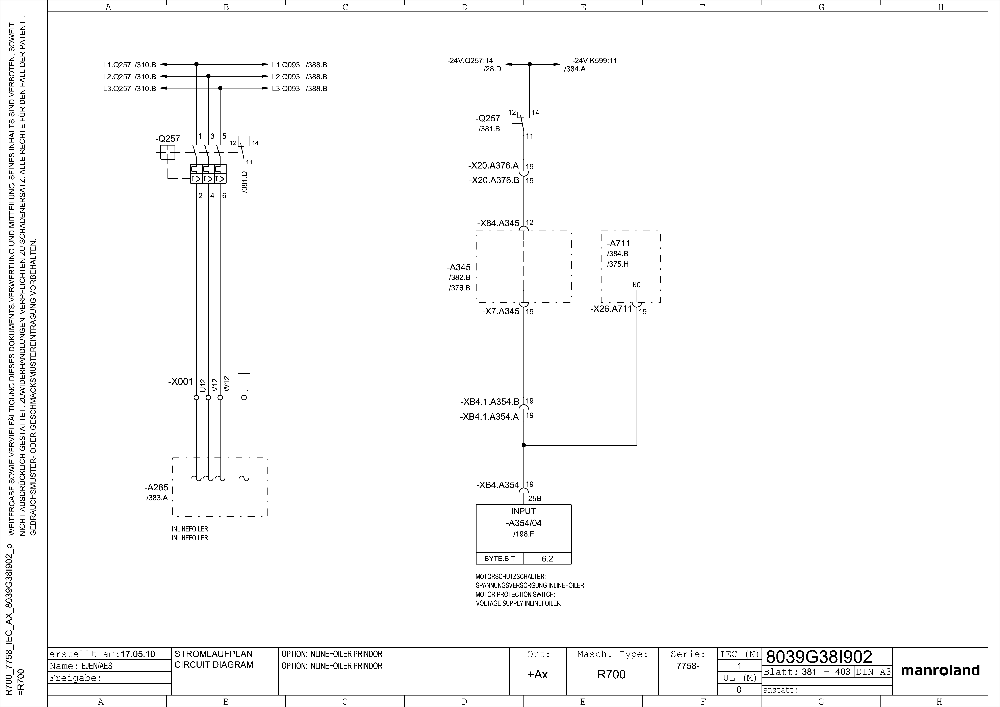

# +Ax — Sheet 381 of 403 — OPTION: INLINEFOILER PRINDOR

**OPTION: INLINEFOILER PRINDOR**

> Part of the manroland **R700** printing press IEC/UL circuit diagrams.
> Drawing class: **Stromlaufplan / Circuit diagram** (DIN A3).
> Document `+Ax` covers the **Central control console** machine section.

## At a glance

| Field | Value |
|---|---|
| Document | `+Ax`  (8039G38I902) |
| Sheet | **381** of 403 |
| Section (DE) | OPTION: INLINEFOILER PRINDOR |
| Section (EN) | OPTION: INLINEFOILER PRINDOR |
| Section type | CIRCUIT — Circuit diagram |
| Machine type | `R700` |
| Series | `7758` |
| Created | 17.05.10 |
| Replaces | — |
| Columns used | A, B, C, D, E |
| Path numbers | — |
| Labels on sheet | 74 |
| Cross-refs out | 16 |
| Cross-refs in | 24 |

**Previous:** [+Ax sheet 380](SHEET_0380.md) · **Next:** [+Ax sheet 382](SHEET_0382.md) · **Document TOC:** [_TOC.md](_TOC.md)  (+Ax) · **Master TOC:** [all sheets](../_MASTER_TOC.md)

## Sheet image (300 DPI, exact vector render)



_Rendered directly from the PDF vector layer at 300 DPI (1-bit), no OCR and no resampling. Use it to confirm anything ambiguous in the text below._

## Cross-references on this sheet

Each entry is a wire leaving this sheet. The printed token is `/sheet.column`; the link resolves to that sheet inside the same document.

| Ref | Target sheet | Col | Path | Destination on target | Target section | From col |
|---|---|---|---|---|---|---|
| `/28.D` | [+Ax sheet 28](SHEET_0028.md) | D | — | 24V.Q257:14 | SPANNUNGSVERSORGUNG, SCHALTSCHRANKBELÜFTUNG | D |
| `/310.B` | [+Ax sheet 310](SHEET_0310.md) | B | — | L1.Q257 | OPTION: IONISATIONSANLAGE ANLEGER | A |
| `/388.B` | [+Ax sheet 388](SHEET_0388.md) | B | — | L1.Q093 | OPTION: WASCHVORRICHTUNG MIT TUCH | C |
| `/384.A` | [+Ax sheet 384](SHEET_0384.md) | A | — | — | OPTION: INLINEFOILER PRINDOR | E |
| `/310.B` | [+Ax sheet 310](SHEET_0310.md) | B | — | L2.Q257 | OPTION: IONISATIONSANLAGE ANLEGER | A |
| `/388.B` | [+Ax sheet 388](SHEET_0388.md) | B | — | L2.Q093 | OPTION: WASCHVORRICHTUNG MIT TUCH | C |
| `/310.B` | [+Ax sheet 310](SHEET_0310.md) | B | — | L3.Q257 | OPTION: IONISATIONSANLAGE ANLEGER | A |
| `/388.B` | [+Ax sheet 388](SHEET_0388.md) | B | — | L3.Q093 | OPTION: WASCHVORRICHTUNG MIT TUCH | C |
| `/381.B` | [+Ax sheet 381](SHEET_0381.md) | B | — | — | OPTION: INLINEFOILER PRINDOR | D |
| `/381.D` | [+Ax sheet 381](SHEET_0381.md) | D | — | ` | OPTION: INLINEFOILER PRINDOR | B |
| `/384.B` | [+Ax sheet 384](SHEET_0384.md) | B | — | A711 | OPTION: INLINEFOILER PRINDOR | E |
| `/375.H` | [+Ax sheet 375](SHEET_0375.md) | H | — | A711 | OPTION: VORDERMARKENEINSTELLUNG | E |
| `/382.B` | [+Ax sheet 382](SHEET_0382.md) | B | — | — | OPTION: INLINEFOILER PRINDOR | D |
| `/376.B` | [+Ax sheet 376](SHEET_0376.md) | B | — | — | OPTION: FWW SPEZIALREINIGER | D |
| `/383.A` | [+Ax sheet 383](SHEET_0383.md) | A | — | — | OPTION: INLINEFOILER PRINDOR | A |
| `/198.F` | [+Ax sheet 198](SHEET_0198.md) | F | — | — | REFERENZMODUL | E |

### Incoming references (sheets that point here)

Every other sheet that sends a wire to this one. `Back-ref` is the token printed on *that* sheet; `Path` is its line number.

| From sheet | Cols | Back-ref | Path | Refs | What continues there |
|---|---|---|---|---|---|
| [+Ax#28](SHEET_0028.md) | D | `/28.D` | — | 1 | — |
| [+Ax#198](SHEET_0198.md) | F | `/198.F` | — | 1 | — |
| [+Ax#228](SHEET_0228.md) | A, B, C | `/228.A`, `/228.B`, `/228.C` | — | 3 | — |
| [+Ax#235](SHEET_0235.md) | H | `/235.H` | — | 1 | — |
| [+Ax#260](SHEET_0260.md) | E, F | `/260.E`, `/260.F` | — | 2 | — |
| [+Ax#269](SHEET_0269.md) | H | `/269.H` | — | 1 | — |
| [+Ax#287](SHEET_0287.md) | B | `/287.B` | — | 1 | — |
| [+Ax#310](SHEET_0310.md) | B | `/310.B` | — | 3 | — |
| [+Ax#375](SHEET_0375.md) | H | `/375.H` | — | 1 | A711 |
| [+Ax#376](SHEET_0376.md) | B | `/376.B` | — | 1 | — |
| [+Ax#381](SHEET_0381.md) | B, D | `/381.B`, `/381.D` | — | 2 | ` |
| [+Ax#382](SHEET_0382.md) | B | `/382.B` | — | 1 | — |
| [+Ax#383](SHEET_0383.md) | A | `/383.A` | — | 1 | — |
| [+Ax#384](SHEET_0384.md) | A, B | `/384.A`, `/384.B` | — | 2 | 24V.K599:11 |
| [+Ax#388](SHEET_0388.md) | A, C | `/388.A`, `/388.C` | — | 3 | L1.Q093 24V.Q093:14 L2.Q093; L3.Q093 |


## Devices on this sheet

| Tag | Class | Class meaning (IEC) | Col | Sub | Terminal | Sign |
|---|---|---|---|---|---|---|
| `A285` | A | Baugruppe / assembly, module, PC board | A | — | — | — |
| `U12` | U | Umrichter / frequency converter | B | — | — | — |
| `X001` | X | Klemme / terminal, plug connector | B | — | — | — |
| `V12` | V | Diode / semiconductor valve | B | — | — | — |
| `W12` | W | Kabel / cable, line, bus | B | — | — | — |
| `Q257` | Q | Leistungsschalter / power switching device | B | — | — | — |
| `Q257` | Q | Leistungsschalter / power switching device | D | — | — | — |
| `A345` | A | Baugruppe / assembly, module, PC board | D | — | — | — |
| `A354/04` | A | Baugruppe / assembly, module, PC board | E | 04 | — | — |
| `A711` | A | Baugruppe / assembly, module, PC board | E | — | — | — |
| `X20.A376.B` | — | cross-device reference | D | — | — | — |
| `X20.A376.A` | — | cross-device reference | D | — | — | — |
| `X84.A345` | — | cross-device reference | D | — | — | — |
| `X7.A345` | — | cross-device reference | D | — | — | — |
| `XB4.A354` | — | cross-device reference | D | — | — | — |
| `6.2` | — | cross-device reference | E | — | — | — |
| `XB4.1.A354.B` | — | cross-device reference | D | — | — | — |
| `XB4.1.A354.A` | — | cross-device reference | D | — | — | — |
| `X26.A711` | — | cross-device reference | E | — | — | — |

## Potentials / nets

| Potential | Count | Columns | Attached devices | Terminals |
|---|---|---|---|---|
| `24V` | 2 | D, E | `K599`, `Q257` | `11`, `14` |
| `L1` | 2 | A, C | `Q093`, `Q257` | — |
| `L2` | 2 | A, C | `Q093`, `Q257` | — |
| `L3` | 2 | A, C | `Q093`, `Q257` | — |


A potential such as `L24+/4` or `M24+` is a named supply/return rail; every place it appears on this sheet is electrically common.

## Wire-end annotations (grouped as printed)

A wire that continues elsewhere is annotated with a small cluster: the destination description, the path/line number `#NN`, and the `/sheet.column` cross reference. Each row below is one such cluster exactly as it is grouped on the drawing.

| Col | Y | Path | Cross-ref | Text on the wire |
|---|---|---|---|---|
| D | 68.3 | — | `/28.D` | `24V.Q257:14` |
| E | 68.3 | — | — | `24V.K599:11` |
| A | 73.3 | — | `/310.B` | `L1.Q257` |
| C | 73.3 | — | `/388.B` | `L1.Q093` |
| E | 78.2 | — | `/384.A` | — |
| A | 87.4 | — | `/310.B` | `L2.Q257` |
| C | 87.4 | — | `/388.B` | `L2.Q093` |
| A | 101.6 | — | `/310.B` | `L3.Q257` |
| C | 101.6 | — | `/388.B` | `L3.Q093` |
| D | 130.0 | — | — | `Q257 14` |
| D | 130.0 | — | — | `12` |
| D | 149.4 | — | `/381.B` | — |
| B | 158.4 | — | — | `1` |
| B | 158.4 | — | — | `3` |
| B | 158.4 | — | — | `5` |
| E | 158.4 | — | — | `11` |
| B | 160.5 | — | — | `Q257` |
| B | 167.4 | — | — | `12 14` |
| B | 190.1 | — | — | `11` |
| D | 192.4 | — | — | `X20.A376.A 19` |
| B | 203.8 | — | `/381.D` | `'` |
| D | 210.1 | — | — | `X20.A376.B 19` |
| B | 229.2 | — | — | `2` |
| B | 229.2 | — | — | `4` |
| B | 229.2 | — | — | `6` |
| D | 261.1 | — | — | `X84.A345 12` |
| E | 285.2 | — | `/384.B`, `/375.H` | `A711` |
| D | 313.5 | — | — | `A345` |
| D | 326.6 | — | `/382.B`, `/376.B` | — |
| E | 336.5 | — | — | `NC` |
| E | 363.1 | — | — | `X26.A711 19` |
| D | 366.0 | — | — | `X7.A345 19` |
| B | 447.6 | — | — | `W12` |
| B | 449.4 | — | — | `X001` |
| B | 450.7 | — | — | `V12` |
| B | 451.3 | — | — | `U12` |
| D | 473.7 | — | — | `XB4.1.A354.B 19` |
| D | 490.7 | — | — | `XB4.1.A354.A 19` |
| D | 572.9 | — | — | `XB4.A354 19` |
| A | 575.7 | — | — | `A285` |
| A | 588.8 | — | `/383.A` | — |
| E | 589.9 | — | — | `25B` |
| D | 604.4 | — | — | `INPUT` |
| E | 618.3 | — | — | `A354/04` |
| B | 627.1 | — | — | `INLINEFOILER INLINEFOILER` |
| E | 632.0 | — | `/198.F` | — |
| D | 661.1 | — | — | `BYTE.BIT 6.2` |
| E | 683.8 | — | — | `MOTORSCHUTZSCHALTER: MOTOR PROTECTION SWITCH: SPANNUNGSVERSORGUNG INLINEFOILER` |
| D | 715.7 | — | — | `VOLTAGE SUPPLY INLINEFOILER` |


## Reconstructed tables

This sheet carries tabular content (pin map / terminal assignment / index). The grid below was rebuilt from the drawing's own rule lines, so each row is exactly one physical row of the table.

### Table 1 — 2 data rows × 3 columns (at x=566.9, y=530.1)

| XB4.A354 | 19 | 25B |
|---|---|---|
| `INPUT` | `A354/04 /198.F` |  |
| `BYTE.BIT` |  | `6.2` |


## Notes and free text on this sheet

| Text | Col | Y (pt) |
|---|---|---|
| `INLINEFOILER` | B | 627.07 |
| `25B` | E | 589.89 |
| `INPUT` | D | 604.42 |
| `BYTE.BIT` | D | 661.67 |
| `MOTORSCHUTZSCHALTER:` | D | 683.79 |
| `SPANNUNGSVERSORGUNG INLINEFOILER` | E | 694.42 |
| `MOTOR PROTECTION SWITCH:` | D | 705.03 |
| `VOLTAGE SUPPLY INLINEFOILER` | D | 715.67 |
| `NC` | E | 336.49 |

## Complete label inventory (exact text from the drawing)

Every text object inside the drawing area of this sheet, in DIN reading order (column A→H, then top→bottom). This is the authoritative list: if a string is not here it is not printed on this sheet.

| Col | Y | X | Dir | Type | Text |
|---|---|---|---|---|---|
| A | 73.3 | 122.7 | → | potential | `L1.Q257` |
| A | 73.3 | 160.4 | → | cross-reference | `/310.B` |
| A | 87.4 | 160.4 | → | cross-reference | `/310.B` |
| A | 87.5 | 122.7 | → | potential | `L2.Q257` |
| A | 101.6 | 122.7 | → | potential | `L3.Q257` |
| A | 101.6 | 160.4 | → | cross-reference | `/310.B` |
| A | 575.7 | 172.1 | → | device tag | `A285` |
| A | 588.8 | 174.3 | → | cross-reference | `/383.A` |
| B | 158.4 | 235.8 | → | number | `1` |
| B | 158.4 | 250.6 | → | number | `3` |
| B | 158.4 | 264.8 | → | number | `5` |
| B | 160.5 | 185.1 | → | device tag | `Q257` |
| B | 167.4 | 273.0 | → | number | `12` |
| B | 167.4 | 299.9 | → | number | `14` |
| B | 190.1 | 292.8 | → | number | `11` |
| B | 203.8 | 287.3 | ↕ | cross-reference | `/381.D` |
| B | 229.2 | 236.4 | → | number | `2` |
| B | 229.2 | 250.6 | → | number | `4` |
| B | 229.2 | 264.8 | → | number | `6` |
| B | 447.6 | 265.9 | ↕ | device tag | `W12` |
| B | 449.4 | 200.4 | → | device tag | `X001` |
| B | 450.7 | 251.9 | ↕ | device tag | `V12` |
| B | 451.3 | 237.7 | ↕ | device tag | `U12` |
| B | 462.9 | 293.2 | ↕ | other | `'` |
| B | 627.1 | 204.7 | → | text | `INLINEFOILER` |
| B | 637.7 | 204.7 | → | text | `INLINEFOILER` |
| C | 73.3 | 323.7 | → | potential | `L1.Q093` |
| C | 73.3 | 364.3 | → | cross-reference | `/388.B` |
| C | 87.4 | 364.3 | → | cross-reference | `/388.B` |
| C | 87.5 | 323.7 | → | potential | `L2.Q093` |
| C | 101.6 | 323.7 | → | potential | `L3.Q093` |
| C | 101.6 | 364.3 | → | cross-reference | `/388.B` |
| D | 68.3 | 532.6 | → | potential | `24V.Q257:14` |
| D | 78.2 | 576.0 | → | cross-reference | `/28.D` |
| D | 130.0 | 604.6 | → | number | `12` |
| D | 136.4 | 566.4 | → | device tag | `Q257` |
| D | 149.4 | 570.0 | → | cross-reference | `/381.B` |
| D | 192.4 | 557.6 | → | device ref | `X20.A376.A` |
| D | 210.1 | 558.4 | → | device ref | `X20.A376.B` |
| D | 261.1 | 568.3 | → | device ref | `X84.A345` |
| D | 313.5 | 532.1 | → | device tag | `A345` |
| D | 326.6 | 534.6 | → | cross-reference | `/382.B` |
| D | 339.0 | 534.6 | → | cross-reference | `/376.B` |
| D | 366.0 | 574.3 | → | device ref | `X7.A345` |
| D | 473.7 | 548.5 | → | device ref | `XB4.1.A354.B` |
| D | 491.4 | 547.7 | → | device ref | `XB4.1.A354.A` |
| D | 572.9 | 567.2 | → | device ref | `XB4.A354` |
| D | 604.4 | 608.7 | → | text | `INPUT` |
| D | 661.7 | 576.9 | → | text | `BYTE.BIT` |
| D | 683.8 | 566.4 | → | text | `MOTORSCHUTZSCHALTER:` |
| D | 705.0 | 566.4 | → | text | `MOTOR PROTECTION SWITCH:` |
| D | 715.7 | 566.9 | → | text | `VOLTAGE SUPPLY INLINEFOILER` |
| E | 68.3 | 681.4 | → | potential | `24V.K599:11` |
| E | 78.2 | 671.8 | → | cross-reference | `/384.A` |
| E | 130.0 | 632.7 | → | number | `14` |
| E | 158.4 | 625.6 | → | number | `11` |
| E | 194.5 | 625.6 | → | number | `19` |
| E | 211.5 | 625.6 | → | number | `19` |
| E | 261.1 | 625.6 | → | number | `12` |
| E | 285.2 | 722.6 | → | device tag | `A711` |
| E | 298.3 | 722.8 | → | cross-reference | `/384.B` |
| E | 310.7 | 722.8 | → | cross-reference | `/375.H` |
| E | 336.5 | 753.4 | → | text | `NC` |
| E | 363.1 | 703.0 | → | device ref | `X26.A711` |
| E | 367.4 | 625.6 | → | number | `19` |
| E | 367.4 | 760.3 | → | number | `19` |
| E | 473.7 | 625.6 | → | number | `19` |
| E | 490.7 | 625.6 | → | number | `19` |
| E | 572.9 | 625.6 | → | number | `19` |
| E | 589.9 | 629.0 | → | text | `25B` |
| E | 618.3 | 602.2 | → | device tag | `A354/04` |
| E | 632.0 | 611.3 | → | cross-reference | `/198.F` |
| E | 661.1 | 645.2 | → | device ref | `6.2` |
| E | 694.4 | 566.6 | → | text | `SPANNUNGSVERSORGUNG INLINEFOILER` |

## Reading-order text block

The same content as a plain block, grouped by DIN column — convenient to paste or to match against a visual description.

```text
=== Column A ===
  73.3  122.7  net          L1.Q257
  73.3  160.4  xref         /310.B
  87.4  160.4  xref         /310.B
  87.5  122.7  net          L2.Q257
 101.6  122.7  net          L3.Q257
 101.6  160.4  xref         /310.B
 575.7  172.1  devtag       A285
 588.8  174.3  xref         /383.A
=== Column B ===
 158.4  235.8  numeric      1
 158.4  250.6  numeric      3
 158.4  264.8  numeric      5
 160.5  185.1  devtag       Q257
 167.4  273.0  numeric      12
 167.4  299.9  numeric      14
 190.1  292.8  numeric      11
 203.8  287.3  xref         /381.D
 229.2  236.4  numeric      2
 229.2  250.6  numeric      4
 229.2  264.8  numeric      6
 447.6  265.9  devtag       W12
 449.4  200.4  devtag       X001
 450.7  251.9  devtag       V12
 451.3  237.7  devtag       U12
 462.9  293.2  other        `
 627.1  204.7  text         INLINEFOILER
 637.7  204.7  text         INLINEFOILER
=== Column C ===
  73.3  323.7  net          L1.Q093
  73.3  364.3  xref         /388.B
  87.4  364.3  xref         /388.B
  87.5  323.7  net          L2.Q093
 101.6  323.7  net          L3.Q093
 101.6  364.3  xref         /388.B
=== Column D ===
  68.3  532.6  net          24V.Q257:14
  78.2  576.0  xref         /28.D
 130.0  604.6  numeric      12
 136.4  566.4  devtag       Q257
 149.4  570.0  xref         /381.B
 192.4  557.6  devref       X20.A376.A
 210.1  558.4  devref       X20.A376.B
 261.1  568.3  devref       X84.A345
 313.5  532.1  devtag       A345
 326.6  534.6  xref         /382.B
 339.0  534.6  xref         /376.B
 366.0  574.3  devref       X7.A345
 473.7  548.5  devref       XB4.1.A354.B
 491.4  547.7  devref       XB4.1.A354.A
 572.9  567.2  devref       XB4.A354
 604.4  608.7  text         INPUT
 661.7  576.9  text         BYTE.BIT
 683.8  566.4  text         MOTORSCHUTZSCHALTER:
 705.0  566.4  text         MOTOR PROTECTION SWITCH:
 715.7  566.9  text         VOLTAGE SUPPLY INLINEFOILER
=== Column E ===
  68.3  681.4  net          24V.K599:11
  78.2  671.8  xref         /384.A
 130.0  632.7  numeric      14
 158.4  625.6  numeric      11
 194.5  625.6  numeric      19
 211.5  625.6  numeric      19
 261.1  625.6  numeric      12
 285.2  722.6  devtag       A711
 298.3  722.8  xref         /384.B
 310.7  722.8  xref         /375.H
 336.5  753.4  text         NC
 363.1  703.0  devref       X26.A711
 367.4  625.6  numeric      19
 367.4  760.3  numeric      19
 473.7  625.6  numeric      19
 490.7  625.6  numeric      19
 572.9  625.6  numeric      19
 589.9  629.0  text         25B
 618.3  602.2  devtag       A354/04
 632.0  611.3  xref         /198.F
 661.1  645.2  devref       6.2
 694.4  566.6  text         SPANNUNGSVERSORGUNG INLINEFOILER
```

---
_Generated from the PDF vector text layer; no OCR. Source: `R700_7758_IEC_AX_8039G38I902_p`, sheet 381._
