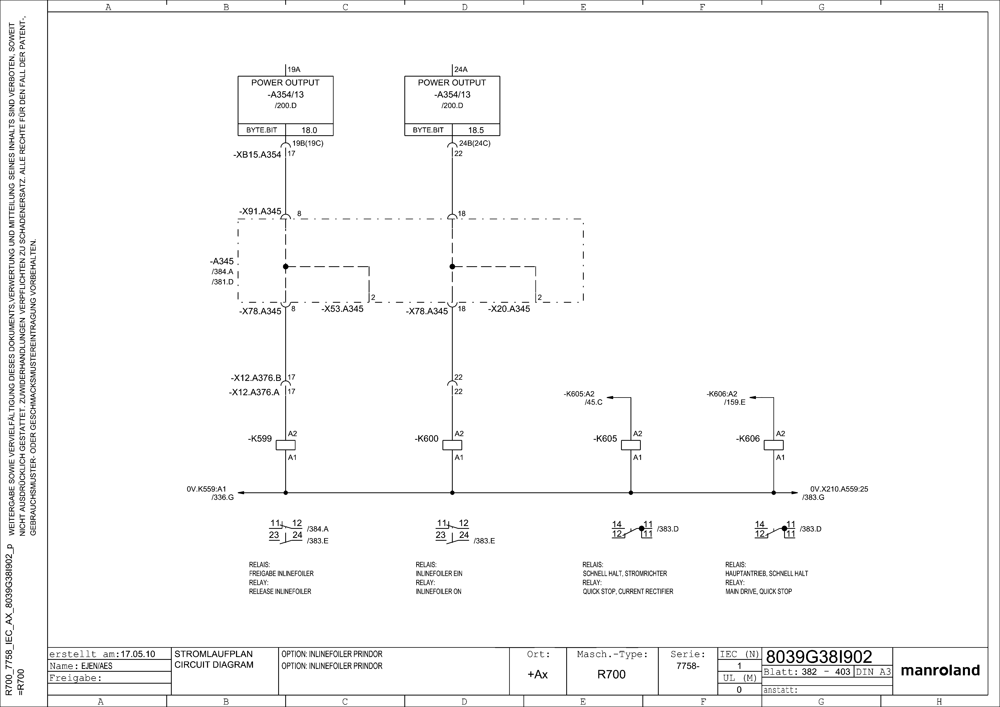

# +Ax — Sheet 382 of 403 — OPTION: INLINEFOILER PRINDOR

**OPTION: INLINEFOILER PRINDOR**

> Part of the manroland **R700** printing press IEC/UL circuit diagrams.
> Drawing class: **Stromlaufplan / Circuit diagram** (DIN A3).
> Document `+Ax` covers the **Central control console** machine section.

## At a glance

| Field | Value |
|---|---|
| Document | `+Ax`  (8039G38I902) |
| Sheet | **382** of 403 |
| Section (DE) | OPTION: INLINEFOILER PRINDOR |
| Section (EN) | OPTION: INLINEFOILER PRINDOR |
| Section type | CIRCUIT — Circuit diagram |
| Machine type | `R700` |
| Series | `7758` |
| Created | 17.05.10 |
| Replaces | — |
| Columns used | B, C, D, E, F, G |
| Path numbers | — |
| Labels on sheet | 91 |
| Cross-refs out | 10 |
| Cross-refs in | 25 |

**Previous:** [+Ax sheet 381](SHEET_0381.md) · **Next:** [+Ax sheet 383](SHEET_0383.md) · **Document TOC:** [_TOC.md](_TOC.md)  (+Ax) · **Master TOC:** [all sheets](../_MASTER_TOC.md)

## Sheet image (300 DPI, exact vector render)



_Rendered directly from the PDF vector layer at 300 DPI (1-bit), no OCR and no resampling. Use it to confirm anything ambiguous in the text below._

## Cross-references on this sheet

Each entry is a wire leaving this sheet. The printed token is `/sheet.column`; the link resolves to that sheet inside the same document.

| Ref | Target sheet | Col | Path | Destination on target | Target section | From col |
|---|---|---|---|---|---|---|
| `/200.D` | [+Ax sheet 200](SHEET_0200.md) | D | — | — | REFERENZMODUL | B |
| `/200.D` | [+Ax sheet 200](SHEET_0200.md) | D | — | — | REFERENZMODUL | D |
| `/384.A` | [+Ax sheet 384](SHEET_0384.md) | A | — | — | OPTION: INLINEFOILER PRINDOR | B |
| `/381.D` | [+Ax sheet 381](SHEET_0381.md) | D | — | — | OPTION: INLINEFOILER PRINDOR | B |
| `/45.C` | [+Ax sheet 45](SHEET_0045.md) | C | — | K605:A2 | HAUPTANTRIEB | E |
| `/159.E` | [+Ax sheet 159](SHEET_0159.md) | E | — | K606:A2 | ÜBERWACHUNGSRECHNER/ANSTEUERUNG NOT AUS | F |
| `/336.G` | [+Ax sheet 336](SHEET_0336.md) | G | — | 0V.K559:A1 | OPTION: LOGISTIK ANLEGER / | D |
| `/383.G` | [+Ax sheet 383](SHEET_0383.md) | G | — | 0V.K559:A1 | OPTION: INLINEFOILER PRINDOR | D |
| `/383.E` | [+Ax sheet 383](SHEET_0383.md) | E | — | — | OPTION: INLINEFOILER PRINDOR | C |
| `/383.E` | [+Ax sheet 383](SHEET_0383.md) | E | — | — | OPTION: INLINEFOILER PRINDOR | D |

### Incoming references (sheets that point here)

Every other sheet that sends a wire to this one. `Back-ref` is the token printed on *that* sheet; `Path` is its line number.

| From sheet | Cols | Back-ref | Path | Refs | What continues there |
|---|---|---|---|---|---|
| [+Ax#45](SHEET_0045.md) | C | `/45.C` | — | 1 | — |
| [+Ax#159](SHEET_0159.md) | F | `/159.F` | — | 1 | — |
| [+Ax#200](SHEET_0200.md) | D | `/200.D` | — | 2 | — |
| [+Ax#248](SHEET_0248.md) | G, H | `/248.G`, `/248.H` | — | 4 | — |
| [+Ax#253](SHEET_0253.md) | B | `/253.B` | — | 2 | — |
| [+Ax#260](SHEET_0260.md) | B | `/260.B` | — | 1 | — |
| [+Ax#283](SHEET_0283.md) | H | `/283.H` | — | 1 | — |
| [+Ax#286](SHEET_0286.md) | A | `/286.A` | — | 2 | — |
| [+Ax#289](SHEET_0289.md) | E | `/289.E` | — | 2 | — |
| [+Ax#336](SHEET_0336.md) | G | `/336.G` | — | 1 | — |
| [+Ax#381](SHEET_0381.md) | D | `/381.D` | — | 1 | — |
| [+Ax#383](SHEET_0383.md) | C, D, E, G | `/383.C`, `/383.D`, `/383.E`, `/383.G` | — | 5 | 0V.K616:A1 0V.X210.A559:25 |
| [+Ax#384](SHEET_0384.md) | A | `/384.A` | — | 2 | — |


## Devices on this sheet

| Tag | Class | Class meaning (IEC) | Col | Sub | Terminal | Sign |
|---|---|---|---|---|---|---|
| `A354/13` | A | Baugruppe / assembly, module, PC board | D | 13 | — | — |
| `A2` | A | Baugruppe / assembly, module, PC board | D | — | — | — |
| `A1` | A | Baugruppe / assembly, module, PC board | D | — | — | — |
| `K600` | K | Relais / relay, contactor | D | — | — | — |
| `A354/13` | A | Baugruppe / assembly, module, PC board | B | 13 | — | — |
| `A2` | A | Baugruppe / assembly, module, PC board | C | — | — | — |
| `A1` | A | Baugruppe / assembly, module, PC board | C | — | — | — |
| `K599` | K | Relais / relay, contactor | B | — | — | — |
| `A345` | A | Baugruppe / assembly, module, PC board | B | — | — | — |
| `A2` | A | Baugruppe / assembly, module, PC board | G | — | — | — |
| `A1` | A | Baugruppe / assembly, module, PC board | G | — | — | — |
| `K606` | K | Relais / relay, contactor | F | — | — | — |
| `A2` | A | Baugruppe / assembly, module, PC board | E | — | — | — |
| `A1` | A | Baugruppe / assembly, module, PC board | E | — | — | — |
| `K605` | K | Relais / relay, contactor | E | — | — | — |
| `K605:A2` | K | Relais / relay, contactor | E | — | A2 | — |
| `K606:A2` | K | Relais / relay, contactor | F | — | A2 | — |
| `18.5` | — | cross-device reference | D | — | — | — |
| `18.0` | — | cross-device reference | C | — | — | — |
| `XB15.A354` | — | cross-device reference | B | — | — | — |
| `X78.A345` | — | cross-device reference | D | — | — | — |
| `X91.A345` | — | cross-device reference | B | — | — | — |
| `X78.A345` | — | cross-device reference | B | — | — | — |
| `X12.A376.A` | — | cross-device reference | B | — | — | — |
| `X12.A376.B` | — | cross-device reference | B | — | — | — |
| `X20.A345` | — | cross-device reference | D | — | — | — |
| `X53.A345` | — | cross-device reference | C | — | — | — |

## Potentials / nets

| Potential | Count | Columns | Attached devices | Terminals |
|---|---|---|---|---|
| `0V` | 2 | B, G | `A559`, `K559`, `X210` | `25`, `A1` |


A potential such as `L24+/4` or `M24+` is a named supply/return rail; every place it appears on this sheet is electrically common.

## Wire-end annotations (grouped as printed)

A wire that continues elsewhere is annotated with a small cluster: the destination description, the path/line number `#NN`, and the `/sheet.column` cross reference. Each row below is one such cluster exactly as it is grouped on the drawing.

| Col | Y | Path | Cross-ref | Text on the wire |
|---|---|---|---|---|
| C | 79.0 | — | — | `19A` |
| D | 79.0 | — | — | `24A` |
| B | 94.1 | — | — | `POWER OUTPUT` |
| D | 94.1 | — | — | `POWER OUTPUT` |
| B | 108.0 | — | — | `A354/13` |
| D | 108.0 | — | — | `A354/13` |
| B | 121.8 | — | `/200.D` | — |
| D | 121.8 | — | `/200.D` | — |
| B | 150.9 | — | — | `BYTE.BIT 18.0` |
| D | 150.9 | — | — | `BYTE.BIT 18.5` |
| C | 166.9 | — | — | `19B(19C)` |
| D | 166.9 | — | — | `24B(24C)` |
| B | 178.9 | — | — | `XB15.A354 17` |
| D | 178.9 | — | — | `22` |
| B | 246.9 | — | — | `X91.A345 8` |
| D | 250.5 | — | — | `18` |
| B | 306.4 | — | — | `A345` |
| B | 319.5 | — | `/384.A`, `/381.D` | — |
| C | 350.4 | — | — | `2` |
| E | 350.4 | — | — | `2` |
| D | 363.1 | — | — | `X53.A345 X20.A345` |
| B | 363.9 | — | — | `X78.A345 8` |
| D | 363.9 | — | — | `X78.A345 18` |
| B | 445.4 | — | — | `X12.A376.B 17` |
| D | 445.4 | — | — | `22` |
| B | 462.4 | — | — | `X12.A376.A 17` |
| D | 462.4 | — | — | `22` |
| E | 465.2 | — | `/45.C` | `K605:A2` |
| F | 465.2 | — | `/159.E` | `K606:A2` |
| C | 512.6 | — | — | `A2` |
| D | 512.6 | — | — | `A2` |
| E | 512.6 | — | — | `A2` |
| G | 512.6 | — | — | `A2` |
| B | 517.6 | — | — | `K599` |
| D | 517.6 | — | — | `K600` |
| E | 517.6 | — | — | `K605` |
| F | 517.6 | — | — | `K606` |
| C | 541.0 | — | — | `A1` |
| D | 541.0 | — | — | `A1` |
| E | 541.0 | — | — | `A1` |
| G | 541.0 | — | — | `A1` |
| D | 578.5 | — | `/336.G`, `/383.G` | `0V.K559:A1` |
| G | 578.5 | — | — | `0V.X210.A559:25` |
| C | 618.2 | — | — | `23 11 12 /384.A 24` |
| D | 618.2 | — | — | `23 11 12 24` |
| F | 619.6 | — | — | `14 12 11 11 /383.D` |
| G | 619.6 | — | — | `14 12 11 11 /383.D` |
| C | 640.2 | — | `/383.E` | — |
| D | 640.2 | — | `/383.E` | — |
| B | 669.5 | — | — | `RELAIS: FREIGABE INLINEFOILER RELAY: RELEASE INLINEFOILER` |
| D | 669.5 | — | — | `RELAIS: INLINEFOILER EIN RELAY: INLINEFOILER ON` |
| E | 669.5 | — | — | `RELAIS:` |
| G | 669.5 | — | — | `RELAIS: HAUPTANTRIEB, SCHNELL HALT RELAY: MAIN DRIVE, QUICK STOP` |
| E | 680.3 | — | — | `RELAY: SCHNELL HALT, STROMRICHTER` |
| E | 701.5 | — | — | `QUICK STOP, CURRENT RECTIFIER` |


## Reconstructed tables

This sheet carries tabular content (pin map / terminal assignment / index). The grid below was rebuilt from the drawing's own rule lines, so each row is exactly one physical row of the table.

### Table 1 — 3 data rows × 7 columns (at x=283.5, y=90.7)

| POWER | OUTPUT A354/13 /200.D |  |  | POWER | OUTPUT A354/13 /200.D |  |
|---|---|---|---|---|---|---|
| `BYTE.BIT` | `18.0` |  |  | `BYTE.BIT` | `18.5` |  |
| `XB15.A354 X91.A345` | `19B(19C) 17 8` |  |  |  | `24B(24C) 22 18` |  |
| `X78.A345 X12.A376.B X12.A376.A K599` | `8 17 17 A2 A1` | `X53.A345` | `2` | `X78.A345 K600` | `18 22 22 A2 A1` | `X20.A345` |


## Notes and free text on this sheet

| Text | Col | Y (pt) |
|---|---|---|
| `24A` | D | 78.95 |
| `24B(24C)` | D | 166.86 |
| `POWER OUTPUT` | D | 94.1 |
| `BYTE.BIT` | D | 151.43 |
| `RELAIS:` | D | 669.53 |
| `INLINEFOILER EIN` | D | 680.22 |
| `RELAY:` | D | 690.8 |
| `INLINEFOILER ON` | D | 701.49 |
| `19A` | C | 78.95 |
| `19B(19C)` | C | 166.86 |
| `POWER OUTPUT` | B | 94.1 |
| `BYTE.BIT` | B | 151.43 |
| `12 /384.A` | C | 618.22 |
| `RELAIS:` | B | 669.53 |
| `FREIGABE INLINEFOILER` | B | 680.22 |
| `RELAY:` | B | 690.8 |
| `RELEASE INLINEFOILER` | B | 701.49 |
| `11 /383.D` | G | 626.04 |
| `RELAIS:` | F | 669.53 |
| `HAUPTANTRIEB, SCHNELL HALT` | G | 680.24 |
| `RELAY:` | F | 690.8 |
| `MAIN DRIVE, QUICK STOP` | F | 701.49 |
| `11 /383.D` | F | 626.04 |
| `RELAIS:` | E | 669.53 |
| `SCHNELL HALT, STROMRICHTER` | E | 680.26 |
| `RELAY:` | E | 690.8 |
| `QUICK STOP, CURRENT RECTIFIER` | E | 701.51 |

## Complete label inventory (exact text from the drawing)

Every text object inside the drawing area of this sheet, in DIN reading order (column A→H, then top→bottom). This is the authoritative list: if a string is not here it is not printed on this sheet.

| Col | Y | X | Dir | Type | Text |
|---|---|---|---|---|---|
| B | 94.1 | 299.3 | → | text | `POWER OUTPUT` |
| B | 108.0 | 318.8 | → | device tag | `A354/13` |
| B | 121.8 | 327.4 | → | cross-reference | `/200.D` |
| B | 151.4 | 293.4 | → | text | `BYTE.BIT` |
| B | 179.6 | 277.8 | → | device ref | `XB15.A354` |
| B | 246.9 | 284.9 | → | device ref | `X91.A345` |
| B | 306.4 | 250.0 | → | device tag | `A345` |
| B | 319.5 | 252.3 | → | cross-reference | `/384.A` |
| B | 331.9 | 252.3 | → | cross-reference | `/381.D` |
| B | 366.0 | 284.9 | → | device ref | `X78.A345` |
| B | 445.4 | 275.0 | → | device ref | `X12.A376.B` |
| B | 462.4 | 272.7 | → | device ref | `X12.A376.A` |
| B | 517.6 | 295.4 | → | device tag | `K599` |
| B | 578.5 | 222.5 | → | potential | `0V.K559:A1` |
| B | 588.5 | 252.0 | → | cross-reference | `/336.G` |
| B | 618.2 | 321.7 | → | number | `11` |
| B | 632.4 | 320.3 | → | number | `23` |
| B | 669.5 | 296.8 | → | text | `RELAIS:` |
| B | 680.2 | 296.8 | → | text | `FREIGABE INLINEFOILER` |
| B | 690.8 | 296.8 | → | text | `RELAY:` |
| B | 701.5 | 296.8 | → | text | `RELEASE INLINEFOILER` |
| C | 78.9 | 342.1 | → | text | `19A` |
| C | 150.9 | 358.7 | → | device ref | `18.0` |
| C | 166.9 | 347.8 | → | text | `19B(19C)` |
| C | 178.9 | 342.1 | → | number | `17` |
| C | 250.5 | 354.0 | → | number | `8` |
| C | 350.4 | 441.9 | → | number | `2` |
| C | 363.1 | 382.7 | → | device ref | `X53.A345` |
| C | 363.9 | 347.0 | → | number | `8` |
| C | 445.4 | 342.1 | → | number | `17` |
| C | 462.4 | 342.1 | → | number | `17` |
| C | 512.6 | 343.0 | → | device tag | `A2` |
| C | 541.0 | 343.0 | → | device tag | `A1` |
| C | 618.2 | 347.5 | → | text | `12 /384.A` |
| C | 632.4 | 348.4 | → | number | `24` |
| C | 640.2 | 365.7 | → | cross-reference | `/383.E` |
| D | 78.9 | 541.1 | → | text | `24A` |
| D | 94.1 | 497.8 | → | text | `POWER OUTPUT` |
| D | 108.0 | 517.2 | → | device tag | `A354/13` |
| D | 121.8 | 525.8 | → | cross-reference | `/200.D` |
| D | 150.9 | 557.1 | → | device ref | `18.5` |
| D | 151.4 | 491.8 | → | text | `BYTE.BIT` |
| D | 166.9 | 546.8 | → | text | `24B(24C)` |
| D | 178.9 | 541.1 | → | number | `22` |
| D | 250.5 | 544.8 | → | number | `18` |
| D | 363.1 | 581.1 | → | device ref | `X20.A345` |
| D | 363.9 | 544.8 | → | number | `18` |
| D | 366.0 | 483.3 | → | device ref | `X78.A345` |
| D | 445.4 | 541.1 | → | number | `22` |
| D | 462.4 | 541.1 | → | number | `22` |
| D | 512.6 | 541.4 | → | device tag | `A2` |
| D | 517.6 | 493.8 | → | device tag | `K600` |
| D | 541.0 | 541.4 | → | device tag | `A1` |
| D | 618.2 | 520.2 | → | number | `11` |
| D | 618.2 | 546.0 | → | number | `12` |
| D | 632.4 | 518.7 | → | number | `23` |
| D | 632.4 | 546.8 | → | number | `24` |
| D | 640.2 | 564.1 | → | cross-reference | `/383.E` |
| D | 669.5 | 495.2 | → | text | `RELAIS:` |
| D | 680.2 | 495.2 | → | text | `INLINEFOILER EIN` |
| D | 690.8 | 495.2 | → | text | `RELAY:` |
| D | 701.5 | 495.2 | → | text | `INLINEFOILER ON` |
| E | 350.4 | 640.3 | → | number | `2` |
| E | 465.2 | 671.2 | → | device tag | `K605:A2` |
| E | 475.1 | 696.5 | → | cross-reference | `/45.C` |
| E | 512.6 | 754.0 | → | device tag | `A2` |
| E | 517.6 | 706.4 | → | device tag | `K605` |
| E | 541.0 | 754.0 | → | device tag | `A1` |
| E | 619.6 | 728.5 | → | number | `14` |
| E | 631.0 | 728.5 | → | number | `12` |
| E | 669.5 | 693.6 | → | text | `RELAIS:` |
| E | 680.3 | 694.2 | → | text | `SCHNELL HALT, STROMRICHTER` |
| E | 690.8 | 693.6 | → | text | `RELAY:` |
| E | 701.5 | 694.2 | → | text | `QUICK STOP, CURRENT RECTIFIER` |
| F | 465.2 | 841.3 | → | device tag | `K606:A2` |
| F | 475.1 | 862.3 | → | cross-reference | `/159.E` |
| F | 517.6 | 876.5 | → | device tag | `K606` |
| F | 619.6 | 765.6 | → | number | `11` |
| F | 619.6 | 898.6 | → | number | `14` |
| F | 626.0 | 765.6 | → | text | `11 /383.D` |
| F | 631.0 | 898.6 | → | number | `12` |
| F | 669.5 | 863.7 | → | text | `RELAIS:` |
| F | 690.8 | 863.7 | → | text | `RELAY:` |
| F | 701.5 | 864.0 | → | text | `MAIN DRIVE, QUICK STOP` |
| G | 512.6 | 924.1 | → | device tag | `A2` |
| G | 541.0 | 924.1 | → | device tag | `A1` |
| G | 578.5 | 964.9 | → | potential | `0V.X210.A559:25` |
| G | 588.5 | 955.3 | → | cross-reference | `/383.G` |
| G | 619.6 | 935.7 | → | number | `11` |
| G | 626.0 | 935.7 | → | text | `11 /383.D` |
| G | 680.2 | 863.7 | → | text | `HAUPTANTRIEB, SCHNELL HALT` |

## Reading-order text block

The same content as a plain block, grouped by DIN column — convenient to paste or to match against a visual description.

```text
=== Column B ===
  94.1  299.3  text         POWER OUTPUT
 108.0  318.8  devtag       A354/13
 121.8  327.4  xref         /200.D
 151.4  293.4  text         BYTE.BIT
 179.6  277.8  devref       XB15.A354
 246.9  284.9  devref       X91.A345
 306.4  250.0  devtag       A345
 319.5  252.3  xref         /384.A
 331.9  252.3  xref         /381.D
 366.0  284.9  devref       X78.A345
 445.4  275.0  devref       X12.A376.B
 462.4  272.7  devref       X12.A376.A
 517.6  295.4  devtag       K599
 578.5  222.5  net          0V.K559:A1
 588.5  252.0  xref         /336.G
 618.2  321.7  numeric      11
 632.4  320.3  numeric      23
 669.5  296.8  text         RELAIS:
 680.2  296.8  text         FREIGABE INLINEFOILER
 690.8  296.8  text         RELAY:
 701.5  296.8  text         RELEASE INLINEFOILER
=== Column C ===
  78.9  342.1  text         19A
 150.9  358.7  devref       18.0
 166.9  347.8  text         19B(19C)
 178.9  342.1  numeric      17
 250.5  354.0  numeric      8
 350.4  441.9  numeric      2
 363.1  382.7  devref       X53.A345
 363.9  347.0  numeric      8
 445.4  342.1  numeric      17
 462.4  342.1  numeric      17
 512.6  343.0  devtag       A2
 541.0  343.0  devtag       A1
 618.2  347.5  text         12 /384.A
 632.4  348.4  numeric      24
 640.2  365.7  xref         /383.E
=== Column D ===
  78.9  541.1  text         24A
  94.1  497.8  text         POWER OUTPUT
 108.0  517.2  devtag       A354/13
 121.8  525.8  xref         /200.D
 150.9  557.1  devref       18.5
 151.4  491.8  text         BYTE.BIT
 166.9  546.8  text         24B(24C)
 178.9  541.1  numeric      22
 250.5  544.8  numeric      18
 363.1  581.1  devref       X20.A345
 363.9  544.8  numeric      18
 366.0  483.3  devref       X78.A345
 445.4  541.1  numeric      22
 462.4  541.1  numeric      22
 512.6  541.4  devtag       A2
 517.6  493.8  devtag       K600
 541.0  541.4  devtag       A1
 618.2  520.2  numeric      11
 618.2  546.0  numeric      12
 632.4  518.7  numeric      23
 632.4  546.8  numeric      24
 640.2  564.1  xref         /383.E
 669.5  495.2  text         RELAIS:
 680.2  495.2  text         INLINEFOILER EIN
 690.8  495.2  text         RELAY:
 701.5  495.2  text         INLINEFOILER ON
=== Column E ===
 350.4  640.3  numeric      2
 465.2  671.2  devtag       K605:A2
 475.1  696.5  xref         /45.C
 512.6  754.0  devtag       A2
 517.6  706.4  devtag       K605
 541.0  754.0  devtag       A1
 619.6  728.5  numeric      14
 631.0  728.5  numeric      12
 669.5  693.6  text         RELAIS:
 680.3  694.2  text         SCHNELL HALT, STROMRICHTER
 690.8  693.6  text         RELAY:
 701.5  694.2  text         QUICK STOP, CURRENT RECTIFIER
=== Column F ===
 465.2  841.3  devtag       K606:A2
 475.1  862.3  xref         /159.E
 517.6  876.5  devtag       K606
 619.6  765.6  numeric      11
 619.6  898.6  numeric      14
 626.0  765.6  text         11 /383.D
 631.0  898.6  numeric      12
 669.5  863.7  text         RELAIS:
 690.8  863.7  text         RELAY:
 701.5  864.0  text         MAIN DRIVE, QUICK STOP
=== Column G ===
 512.6  924.1  devtag       A2
 541.0  924.1  devtag       A1
 578.5  964.9  net          0V.X210.A559:25
 588.5  955.3  xref         /383.G
 619.6  935.7  numeric      11
 626.0  935.7  text         11 /383.D
 680.2  863.7  text         HAUPTANTRIEB, SCHNELL HALT
```

---
_Generated from the PDF vector text layer; no OCR. Source: `R700_7758_IEC_AX_8039G38I902_p`, sheet 382._
