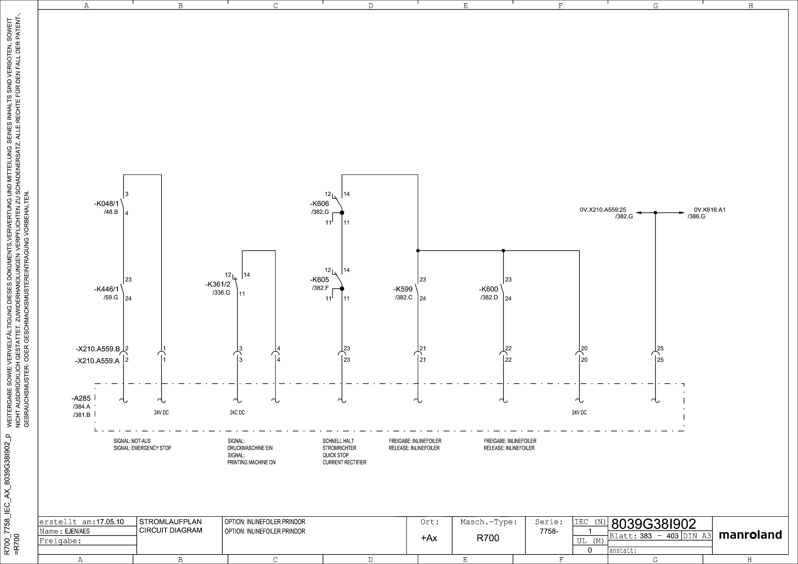

# +Ax — Sheet 383 of 403 — OPTION: INLINEFOILER PRINDOR

**OPTION: INLINEFOILER PRINDOR**

> Part of the manroland **R700** printing press IEC/UL circuit diagrams.
> Drawing class: **Stromlaufplan / Circuit diagram** (DIN A3).
> Document `+Ax` covers the **Central control console** machine section.

## At a glance

| Field | Value |
|---|---|
| Document | `+Ax`  (8039G38I902) |
| Sheet | **383** of 403 |
| Section (DE) | OPTION: INLINEFOILER PRINDOR |
| Section (EN) | OPTION: INLINEFOILER PRINDOR |
| Section type | CIRCUIT — Circuit diagram |
| Machine type | `R700` |
| Series | `7758` |
| Created | 17.05.10 |
| Replaces | — |
| Columns used | A, B, C, D, E, F, G, H |
| Path numbers | — |
| Labels on sheet | 77 |
| Cross-refs out | 11 |
| Cross-refs in | 26 |

**Previous:** [+Ax sheet 382](SHEET_0382.md) · **Next:** [+Ax sheet 384](SHEET_0384.md) · **Document TOC:** [_TOC.md](_TOC.md)  (+Ax) · **Master TOC:** [all sheets](../_MASTER_TOC.md)

## Sheet image (300 DPI, exact vector render)



_Rendered directly from the PDF vector layer at 300 DPI (1-bit), no OCR and no resampling. Use it to confirm anything ambiguous in the text below._

## Cross-references on this sheet

Each entry is a wire leaving this sheet. The printed token is `/sheet.column`; the link resolves to that sheet inside the same document.

| Ref | Target sheet | Col | Path | Destination on target | Target section | From col |
|---|---|---|---|---|---|---|
| `/382.G` | [+Ax sheet 382](SHEET_0382.md) | G | — | 0V.K616:A1 0V.X210.A559:25 | OPTION: INLINEFOILER PRINDOR | G |
| `/48.B` | [+Ax sheet 48](SHEET_0048.md) | B | — | — | NOT AUS | A |
| `/382.G` | [+Ax sheet 382](SHEET_0382.md) | G | — | — | OPTION: INLINEFOILER PRINDOR | E |
| `/386.G` | [+Ax sheet 386](SHEET_0386.md) | G | — | — | OPTION: INLINECOATER SMART | E |
| `/382.F` | [+Ax sheet 382](SHEET_0382.md) | F | — | — | OPTION: INLINEFOILER PRINDOR | C |
| `/336.G` | [+Ax sheet 336](SHEET_0336.md) | G | — | — | OPTION: LOGISTIK ANLEGER / | B |
| `/59.G` | [+Ax sheet 59](SHEET_0059.md) | G | — | — | DRUCKLUFTANLAGE | A |
| `/382.C` | [+Ax sheet 382](SHEET_0382.md) | C | — | — | OPTION: INLINEFOILER PRINDOR | D |
| `/382.D` | [+Ax sheet 382](SHEET_0382.md) | D | — | — | OPTION: INLINEFOILER PRINDOR | E |
| `/384.A` | [+Ax sheet 384](SHEET_0384.md) | A | — | — | OPTION: INLINEFOILER PRINDOR | A |
| `/381.B` | [+Ax sheet 381](SHEET_0381.md) | B | — | — | OPTION: INLINEFOILER PRINDOR | A |

### Incoming references (sheets that point here)

Every other sheet that sends a wire to this one. `Back-ref` is the token printed on *that* sheet; `Path` is its line number.

| From sheet | Cols | Back-ref | Path | Refs | What continues there |
|---|---|---|---|---|---|
| [+Ax#48](SHEET_0048.md) | B | `/48.B` | — | 1 | — |
| [+Ax#59](SHEET_0059.md) | G | `/59.G` | — | 1 | — |
| [+Ax#293](SHEET_0293.md) | C, E | `/293.C`, `/293.E` | — | 18 | — |
| [+Ax#381](SHEET_0381.md) | A | `/381.A` | — | 1 | — |
| [+Ax#382](SHEET_0382.md) | C, D | `/382.C`, `/382.D` | — | 3 | 0V.K559:A1 |
| [+Ax#384](SHEET_0384.md) | A | `/384.A` | — | 1 | — |
| [+Ax#386](SHEET_0386.md) | G | `/386.G` | — | 1 | 0V.K616:A1 |


## Devices on this sheet

| Tag | Class | Class meaning (IEC) | Col | Sub | Terminal | Sign |
|---|---|---|---|---|---|---|
| `A285` | A | Baugruppe / assembly, module, PC board | A | — | — | — |
| `K605` | K | Relais / relay, contactor | C | — | — | — |
| `K599` | K | Relais / relay, contactor | D | — | — | — |
| `K600` | K | Relais / relay, contactor | E | — | — | — |
| `K446/1` | K | Relais / relay, contactor | A | 1 | — | — |
| `K361/2` | K | Relais / relay, contactor | B | 2 | — | — |
| `K048/1` | K | Relais / relay, contactor | A | 1 | — | — |
| `K606` | K | Relais / relay, contactor | C | — | — | — |
| `X210.A559.A` | — | cross-device reference | A | — | — | — |
| `X210.A559.B` | — | cross-device reference | A | — | — | — |

## Potentials / nets

| Potential | Count | Columns | Attached devices | Terminals |
|---|---|---|---|---|
| `0V` | 2 | F, H | `A559`, `K616`, `X210` | `25`, `A1` |
| `24V` | 2 | B, F | — | — |


A potential such as `L24+/4` or `M24+` is a named supply/return rail; every place it appears on this sheet is electrically common.

## Wire-end annotations (grouped as printed)

A wire that continues elsewhere is annotated with a small cluster: the destination description, the path/line number `#NN`, and the `/sheet.column` cross reference. Each row below is one such cluster exactly as it is grouped on the drawing.

| Col | Y | Path | Cross-ref | Text on the wire |
|---|---|---|---|---|
| A | 285.9 | — | — | `3` |
| D | 285.9 | — | — | `K606 14` |
| D | 285.9 | — | — | `12` |
| A | 299.4 | — | — | `K048/1 4` |
| G | 309.2 | — | `/382.G` | `0V.X210.A559:25 0V.K616:A1` |
| A | 312.4 | — | `/48.B` | — |
| E | 312.4 | — | `/382.G`, `/386.G` | — |
| D | 328.4 | — | — | `11 11` |
| D | 399.3 | — | — | `K605 14` |
| D | 399.3 | — | — | `12` |
| B | 406.4 | — | — | `K361/2 14` |
| B | 406.4 | — | — | `12` |
| A | 413.5 | — | — | `23` |
| E | 413.5 | — | — | `23` |
| E | 413.5 | — | — | `23` |
| C | 425.8 | — | `/382.F` | — |
| A | 426.9 | — | — | `K446/1 24` |
| D | 426.9 | — | — | `K599 24` |
| E | 426.9 | — | — | `K600 24` |
| B | 432.9 | — | `/336.G` | — |
| C | 434.7 | — | — | `11` |
| A | 440.0 | — | `/59.G` | — |
| D | 440.0 | — | `/382.C` | — |
| E | 440.0 | — | `/382.D` | — |
| D | 441.8 | — | — | `11 11` |
| A | 516.2 | — | — | `X210.A559.B 2` |
| B | 516.2 | — | — | `1` |
| C | 516.2 | — | — | `3` |
| C | 516.2 | — | — | `4 23` |
| E | 516.2 | — | — | `21` |
| E | 516.2 | — | — | `22` |
| F | 516.2 | — | — | `20` |
| G | 516.2 | — | — | `25` |
| A | 533.2 | — | — | `X210.A559.A 2` |
| B | 533.2 | — | — | `1` |
| C | 533.2 | — | — | `3` |
| C | 533.2 | — | — | `4` |
| D | 533.2 | — | — | `23` |
| E | 533.2 | — | — | `21` |
| E | 533.2 | — | — | `22` |
| F | 533.2 | — | — | `20` |
| G | 533.2 | — | — | `25` |
| A | 589.9 | — | — | `A285` |
| A | 603.0 | — | `/384.A`, `/381.B` | — |
| B | 612.9 | — | — | `24V DC 24C DC` |
| F | 612.9 | — | — | `24V DC` |
| B | 655.4 | — | — | `SIGNAL: NOT AUS SIGNAL: EMERGENCY STOP` |
| C | 655.4 | — | — | `DRUCKMASCHINE EIN SIGNAL:` |
| D | 655.4 | — | — | `SCHNELL HALT STROMRICHTER QUICK STOP CURRENT RECTIFIER` |
| D | 655.4 | — | — | `FREIGABE: INLINEFOILER RELEASE: INLINEFOILER` |
| E | 655.4 | — | — | `FREIGABE: INLINEFOILER RELEASE: INLINEFOILER` |
| C | 676.7 | — | — | `PRINTING MACHINE ON SIGNAL:` |


## Notes and free text on this sheet

| Text | Col | Y (pt) |
|---|---|---|
| `24C DC` | C | 612.93 |
| `SCHNELL HALT` | D | 655.44 |
| `STROMRICHTER` | D | 666.09 |
| `QUICK STOP` | D | 676.69 |
| `CURRENT RECTIFIER` | D | 687.34 |
| `FREIGABE: INLINEFOILER` | D | 655.42 |
| `RELEASE: INLINEFOILER` | D | 666.05 |
| `FREIGABE: INLINEFOILER` | E | 655.42 |
| `RELEASE: INLINEFOILER` | E | 666.05 |
| `SIGNAL: NOT AUS` | A | 655.42 |
| `SIGNAL: EMERGENCY STOP` | B | 666.06 |
| `SIGNAL:` | C | 655.39 |
| `DRUCKMASCHINE EIN` | C | 666.06 |
| `PRINTING MACHINE ON` | C | 687.33 |

## Complete label inventory (exact text from the drawing)

Every text object inside the drawing area of this sheet, in DIN reading order (column A→H, then top→bottom). This is the authoritative list: if a string is not here it is not printed on this sheet.

| Col | Y | X | Dir | Type | Text |
|---|---|---|---|---|---|
| A | 285.9 | 186.8 | → | number | `3` |
| A | 299.4 | 140.6 | → | device tag | `K048/1` |
| A | 312.4 | 155.3 | → | cross-reference | `/48.B` |
| A | 314.3 | 186.8 | → | number | `4` |
| A | 413.5 | 186.8 | → | number | `23` |
| A | 426.9 | 140.6 | → | device tag | `K446/1` |
| A | 440.0 | 154.8 | → | cross-reference | `/59.G` |
| A | 441.8 | 186.8 | → | number | `24` |
| A | 516.2 | 113.1 | → | device ref | `X210.A559.B` |
| A | 516.2 | 186.8 | → | number | `2` |
| A | 533.2 | 186.8 | → | number | `2` |
| A | 533.9 | 112.3 | → | device ref | `X210.A559.A` |
| A | 589.9 | 106.9 | → | device tag | `A285` |
| A | 603.0 | 109.1 | → | cross-reference | `/384.A` |
| A | 615.4 | 109.4 | → | cross-reference | `/381.B` |
| A | 655.4 | 169.8 | → | text | `SIGNAL: NOT AUS` |
| B | 406.4 | 335.3 | → | number | `12` |
| B | 419.8 | 306.4 | → | device tag | `K361/2` |
| B | 432.9 | 317.2 | → | cross-reference | `/336.G` |
| B | 516.2 | 242.9 | → | number | `1` |
| B | 533.2 | 242.9 | → | number | `1` |
| B | 612.9 | 230.0 | → | potential | `24V DC` |
| B | 666.1 | 169.8 | → | text | `SIGNAL: EMERGENCY STOP` |
| C | 299.4 | 462.6 | → | device tag | `K606` |
| C | 312.4 | 464.6 | → | cross-reference | `/382.G` |
| C | 406.4 | 363.4 | → | number | `14` |
| C | 412.7 | 462.6 | → | device tag | `K605` |
| C | 425.8 | 465.7 | → | cross-reference | `/382.F` |
| C | 434.7 | 356.3 | → | number | `11` |
| C | 516.2 | 356.9 | → | number | `3` |
| C | 516.2 | 413.6 | → | number | `4` |
| C | 533.2 | 356.9 | → | number | `3` |
| C | 533.2 | 413.6 | → | number | `4` |
| C | 612.9 | 343.3 | → | text | `24C DC` |
| C | 655.4 | 339.9 | → | text | `SIGNAL:` |
| C | 666.1 | 339.3 | → | text | `DRUCKMASCHINE EIN` |
| C | 676.7 | 339.9 | → | text | `SIGNAL:` |
| C | 687.3 | 339.3 | → | text | `PRINTING MACHINE ON` |
| D | 285.9 | 484.2 | → | number | `12` |
| D | 285.9 | 512.2 | → | number | `14` |
| D | 328.4 | 485.3 | → | number | `11` |
| D | 328.4 | 512.2 | → | number | `11` |
| D | 399.3 | 484.2 | → | number | `12` |
| D | 399.3 | 512.2 | → | number | `14` |
| D | 426.9 | 587.3 | → | device tag | `K599` |
| D | 440.0 | 589.6 | → | cross-reference | `/382.C` |
| D | 441.8 | 485.3 | → | number | `11` |
| D | 441.8 | 512.2 | → | number | `11` |
| D | 516.2 | 512.8 | → | number | `23` |
| D | 533.2 | 512.8 | → | number | `23` |
| D | 655.4 | 481.6 | → | text | `SCHNELL HALT` |
| D | 655.4 | 580.3 | → | text | `FREIGABE: INLINEFOILER` |
| D | 666.0 | 580.3 | → | text | `RELEASE: INLINEFOILER` |
| D | 666.1 | 481.6 | → | text | `STROMRICHTER` |
| D | 676.7 | 481.6 | → | text | `QUICK STOP` |
| D | 687.3 | 481.6 | → | text | `CURRENT RECTIFIER` |
| E | 413.5 | 626.2 | → | number | `23` |
| E | 413.5 | 753.7 | → | number | `23` |
| E | 426.9 | 714.9 | → | device tag | `K600` |
| E | 440.0 | 717.2 | → | cross-reference | `/382.D` |
| E | 441.8 | 626.2 | → | number | `24` |
| E | 441.8 | 753.7 | → | number | `24` |
| E | 516.2 | 626.2 | → | number | `21` |
| E | 516.2 | 753.7 | → | number | `22` |
| E | 533.2 | 626.2 | → | number | `21` |
| E | 533.2 | 753.7 | → | number | `22` |
| E | 655.4 | 722.0 | → | text | `FREIGABE: INLINEFOILER` |
| E | 666.0 | 722.0 | → | text | `RELEASE: INLINEFOILER` |
| F | 309.3 | 865.4 | → | potential | `0V.X210.A559:25` |
| F | 516.2 | 867.1 | → | number | `20` |
| F | 533.2 | 867.1 | → | number | `20` |
| F | 612.9 | 853.6 | → | potential | `24V DC` |
| G | 319.2 | 918.1 | → | cross-reference | `/382.G` |
| G | 319.2 | 1026.1 | → | cross-reference | `/386.G` |
| G | 516.2 | 980.5 | → | number | `25` |
| G | 533.2 | 980.5 | → | number | `25` |
| H | 309.2 | 1035.8 | → | potential | `0V.K616:A1` |

## Reading-order text block

The same content as a plain block, grouped by DIN column — convenient to paste or to match against a visual description.

```text
=== Column A ===
 285.9  186.8  numeric      3
 299.4  140.6  devtag       K048/1
 312.4  155.3  xref         /48.B
 314.3  186.8  numeric      4
 413.5  186.8  numeric      23
 426.9  140.6  devtag       K446/1
 440.0  154.8  xref         /59.G
 441.8  186.8  numeric      24
 516.2  113.1  devref       X210.A559.B
 516.2  186.8  numeric      2
 533.2  186.8  numeric      2
 533.9  112.3  devref       X210.A559.A
 589.9  106.9  devtag       A285
 603.0  109.1  xref         /384.A
 615.4  109.4  xref         /381.B
 655.4  169.8  text         SIGNAL: NOT AUS
=== Column B ===
 406.4  335.3  numeric      12
 419.8  306.4  devtag       K361/2
 432.9  317.2  xref         /336.G
 516.2  242.9  numeric      1
 533.2  242.9  numeric      1
 612.9  230.0  net          24V DC
 666.1  169.8  text         SIGNAL: EMERGENCY STOP
=== Column C ===
 299.4  462.6  devtag       K606
 312.4  464.6  xref         /382.G
 406.4  363.4  numeric      14
 412.7  462.6  devtag       K605
 425.8  465.7  xref         /382.F
 434.7  356.3  numeric      11
 516.2  356.9  numeric      3
 516.2  413.6  numeric      4
 533.2  356.9  numeric      3
 533.2  413.6  numeric      4
 612.9  343.3  text         24C DC
 655.4  339.9  text         SIGNAL:
 666.1  339.3  text         DRUCKMASCHINE EIN
 676.7  339.9  text         SIGNAL:
 687.3  339.3  text         PRINTING MACHINE ON
=== Column D ===
 285.9  484.2  numeric      12
 285.9  512.2  numeric      14
 328.4  485.3  numeric      11
 328.4  512.2  numeric      11
 399.3  484.2  numeric      12
 399.3  512.2  numeric      14
 426.9  587.3  devtag       K599
 440.0  589.6  xref         /382.C
 441.8  485.3  numeric      11
 441.8  512.2  numeric      11
 516.2  512.8  numeric      23
 533.2  512.8  numeric      23
 655.4  481.6  text         SCHNELL HALT
 655.4  580.3  text         FREIGABE: INLINEFOILER
 666.0  580.3  text         RELEASE: INLINEFOILER
 666.1  481.6  text         STROMRICHTER
 676.7  481.6  text         QUICK STOP
 687.3  481.6  text         CURRENT RECTIFIER
=== Column E ===
 413.5  626.2  numeric      23
 413.5  753.7  numeric      23
 426.9  714.9  devtag       K600
 440.0  717.2  xref         /382.D
 441.8  626.2  numeric      24
 441.8  753.7  numeric      24
 516.2  626.2  numeric      21
 516.2  753.7  numeric      22
 533.2  626.2  numeric      21
 533.2  753.7  numeric      22
 655.4  722.0  text         FREIGABE: INLINEFOILER
 666.0  722.0  text         RELEASE: INLINEFOILER
=== Column F ===
 309.3  865.4  net          0V.X210.A559:25
 516.2  867.1  numeric      20
 533.2  867.1  numeric      20
 612.9  853.6  net          24V DC
=== Column G ===
 319.2  918.1  xref         /382.G
 319.2 1026.1  xref         /386.G
 516.2  980.5  numeric      25
 533.2  980.5  numeric      25
=== Column H ===
 309.2 1035.8  net          0V.K616:A1
```

---
_Generated from the PDF vector text layer; no OCR. Source: `R700_7758_IEC_AX_8039G38I902_p`, sheet 383._
