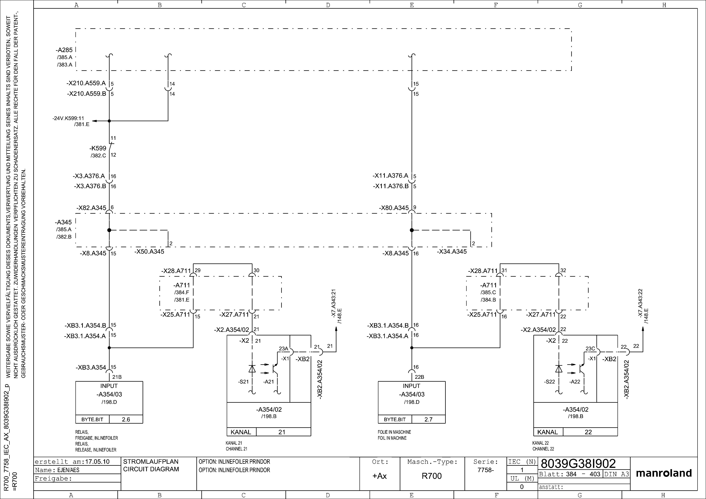

# +Ax — Sheet 384 of 403 — OPTION: INLINEFOILER PRINDOR

**OPTION: INLINEFOILER PRINDOR**

> Part of the manroland **R700** printing press IEC/UL circuit diagrams.
> Drawing class: **Stromlaufplan / Circuit diagram** (DIN A3).
> Document `+Ax` covers the **Central control console** machine section.

## At a glance

| Field | Value |
|---|---|
| Document | `+Ax`  (8039G38I902) |
| Sheet | **384** of 403 |
| Section (DE) | OPTION: INLINEFOILER PRINDOR |
| Section (EN) | OPTION: INLINEFOILER PRINDOR |
| Section type | CIRCUIT — Circuit diagram |
| Machine type | `R700` |
| Series | `7758` |
| Created | 17.05.10 |
| Replaces | — |
| Columns used | A, B, C, D, E, F, G, H |
| Path numbers | — |
| Labels on sheet | 129 |
| Cross-refs out | 16 |
| Cross-refs in | 49 |

**Previous:** [+Ax sheet 383](SHEET_0383.md) · **Next:** [+Ax sheet 385](SHEET_0385.md) · **Document TOC:** [_TOC.md](_TOC.md)  (+Ax) · **Master TOC:** [all sheets](../_MASTER_TOC.md)

## Sheet image (300 DPI, exact vector render)



_Rendered directly from the PDF vector layer at 300 DPI (1-bit), no OCR and no resampling. Use it to confirm anything ambiguous in the text below._

## Cross-references on this sheet

Each entry is a wire leaving this sheet. The printed token is `/sheet.column`; the link resolves to that sheet inside the same document.

| Ref | Target sheet | Col | Path | Destination on target | Target section | From col |
|---|---|---|---|---|---|---|
| `/385.A` | [+Ax sheet 385](SHEET_0385.md) | A | — | — | OPTION: INLINEFOILER PRINDOR | A |
| `/383.A` | [+Ax sheet 383](SHEET_0383.md) | A | — | — | OPTION: INLINEFOILER PRINDOR | A |
| `/381.E` | [+Ax sheet 381](SHEET_0381.md) | E | — | 24V.K599:11 | OPTION: INLINEFOILER PRINDOR | A |
| `/382.C` | [+Ax sheet 382](SHEET_0382.md) | C | — | — | OPTION: INLINEFOILER PRINDOR | A |
| `/385.A` | [+Ax sheet 385](SHEET_0385.md) | A | — | — | OPTION: INLINEFOILER PRINDOR | A |
| `/382.B` | [+Ax sheet 382](SHEET_0382.md) | B | — | — | OPTION: INLINEFOILER PRINDOR | A |
| `/148.E` | [+Ax sheet 148](SHEET_0148.md) | E | — | X7.A343:21 | ÜBERWACHUNGSRECHNER SICHERHEITSBUS | D |
| `/148.E` | [+Ax sheet 148](SHEET_0148.md) | E | — | X7.A343:22 | ÜBERWACHUNGSRECHNER SICHERHEITSBUS | H |
| `/384.F` | [+Ax sheet 384](SHEET_0384.md) | F | — | — | OPTION: INLINEFOILER PRINDOR | B |
| `/381.E` | [+Ax sheet 381](SHEET_0381.md) | E | — | — | OPTION: INLINEFOILER PRINDOR | B |
| `/385.C` | [+Ax sheet 385](SHEET_0385.md) | C | — | — | OPTION: INLINEFOILER PRINDOR | F |
| `/384.B` | [+Ax sheet 384](SHEET_0384.md) | B | — | — | OPTION: INLINEFOILER PRINDOR | F |
| `/198.D` | [+Ax sheet 198](SHEET_0198.md) | D | — | — | REFERENZMODUL | A |
| `/198.D` | [+Ax sheet 198](SHEET_0198.md) | D | — | — | REFERENZMODUL | E |
| `/198.B` | [+Ax sheet 198](SHEET_0198.md) | B | — | — | REFERENZMODUL | C |
| `/198.B` | [+Ax sheet 198](SHEET_0198.md) | B | — | — | REFERENZMODUL | G |

### Incoming references (sheets that point here)

Every other sheet that sends a wire to this one. `Back-ref` is the token printed on *that* sheet; `Path` is its line number.

| From sheet | Cols | Back-ref | Path | Refs | What continues there |
|---|---|---|---|---|---|
| [+Ax#148](SHEET_0148.md) | E | `/148.E` | — | 2 | X7.A343:21; X7.A343:22 |
| [+Ax#198](SHEET_0198.md) | B, D | `/198.B`, `/198.D` | — | 4 | — |
| [+Ax#219](SHEET_0219.md) | D, F | `/219.D`, `/219.F` | — | 4 | — |
| [+Ax#224](SHEET_0224.md) | A, B, C, E, F | `/224.A`, `/224.B`, `/224.C`, `/224.E`, `/224.F` | — | 8 | — |
| [+Ax#238](SHEET_0238.md) | A | `/238.A` | — | 2 | — |
| [+Ax#247](SHEET_0247.md) | C, E | `/247.C`, `/247.E` | — | 2 | — |
| [+Ax#268](SHEET_0268.md) | C | `/268.C` | — | 2 | — |
| [+Ax#271](SHEET_0271.md) | B | `/271.B` | — | 2 | — |
| [+Ax#272](SHEET_0272.md) | H | `/272.H` | — | 4 | — |
| [+Ax#278](SHEET_0278.md) | B | `/278.B` | — | 1 | — |
| [+Ax#283](SHEET_0283.md) | F | `/283.F` | — | 1 | — |
| [+Ax#286](SHEET_0286.md) | C, F | `/286.C`, `/286.F` | — | 2 | — |
| [+Ax#293](SHEET_0293.md) | C, E | `/293.C`, `/293.E` | — | 6 | — |
| [+Ax#381](SHEET_0381.md) | E | `/381.E` | — | 2 | A711 |
| [+Ax#382](SHEET_0382.md) | B | `/382.B` | — | 1 | — |
| [+Ax#383](SHEET_0383.md) | A | `/383.A` | — | 1 | — |
| [+Ax#384](SHEET_0384.md) | B, F | `/384.B`, `/384.F` | — | 2 | — |
| [+Ax#385](SHEET_0385.md) | A, C | `/385.A`, `/385.C` | — | 3 | A711 |


## Devices on this sheet

| Tag | Class | Class meaning (IEC) | Col | Sub | Terminal | Sign |
|---|---|---|---|---|---|---|
| `A354/03` | A | Baugruppe / assembly, module, PC board | E | 03 | — | — |
| `A285` | A | Baugruppe / assembly, module, PC board | A | — | — | — |
| `K599` | K | Relais / relay, contactor | A | — | — | — |
| `A345` | A | Baugruppe / assembly, module, PC board | A | — | — | — |
| `A354/03` | A | Baugruppe / assembly, module, PC board | A | 03 | — | — |
| `A711` | A | Baugruppe / assembly, module, PC board | B | — | — | — |
| `S21` | S | Schalter / switch | C | — | — | — |
| `A21` | A | Baugruppe / assembly, module, PC board | C | — | — | — |
| `X1` | X | Klemme / terminal, plug connector | C | — | — | — |
| `X2` | X | Klemme / terminal, plug connector | C | — | — | — |
| `XB2` | XB |  | D | — | — | — |
| `A354/02` | A | Baugruppe / assembly, module, PC board | C | 02 | — | — |
| `A711` | A | Baugruppe / assembly, module, PC board | F | — | — | — |
| `S22` | S | Schalter / switch | G | — | — | — |
| `A22` | A | Baugruppe / assembly, module, PC board | G | — | — | — |
| `X1` | X | Klemme / terminal, plug connector | G | — | — | — |
| `X2` | X | Klemme / terminal, plug connector | G | — | — | — |
| `XB2` | XB |  | G | — | — | — |
| `A354/02` | A | Baugruppe / assembly, module, PC board | G | 02 | — | — |
| `X80.A345` | — | cross-device reference | E | — | — | — |
| `X11.A376.B` | — | cross-device reference | E | — | — | — |
| `X11.A376.A` | — | cross-device reference | E | — | — | — |
| `2.7` | — | cross-device reference | E | — | — | — |
| `XB3.1.A354.B` | — | cross-device reference | E | — | — | — |
| `XB3.1.A354.A` | — | cross-device reference | E | — | — | — |
| `X3.A376.B` | — | cross-device reference | A | — | — | — |
| `X3.A376.A` | — | cross-device reference | A | — | — | — |
| `X210.A559.B` | — | cross-device reference | A | — | — | — |
| `X210.A559.A` | — | cross-device reference | A | — | — | — |
| `X82.A345` | — | cross-device reference | A | — | — | — |
| `XB3.A354` | — | cross-device reference | A | — | — | — |
| `2.6` | — | cross-device reference | B | — | — | — |
| `XB3.1.A354.B` | — | cross-device reference | A | — | — | — |
| `XB3.1.A354.A` | — | cross-device reference | A | — | — | — |
| `X28.A711` | — | cross-device reference | B | — | — | — |
| `X27.A711` | — | cross-device reference | C | — | — | — |
| `X25.A711` | — | cross-device reference | B | — | — | — |
| `X8.A345` | — | cross-device reference | E | — | — | — |
| `X8.A345` | — | cross-device reference | A | — | — | — |
| `X28.A711` | — | cross-device reference | F | — | — | — |
| `X27.A711` | — | cross-device reference | G | — | — | — |
| `X25.A711` | — | cross-device reference | F | — | — | — |
| `X7.A343:21` | — | cross-device reference | D | — | 21 | — |
| `X7.A343:22` | — | cross-device reference | H | — | 22 | — |
| `X34.A345` | — | cross-device reference | E | — | — | — |
| `X50.A345` | — | cross-device reference | B | — | — | — |

## Potentials / nets

| Potential | Count | Columns | Attached devices | Terminals |
|---|---|---|---|---|
| `24V` | 1 | A | `K599` | `11` |


A potential such as `L24+/4` or `M24+` is a named supply/return rail; every place it appears on this sheet is electrically common.

## Wire-end annotations (grouped as printed)

A wire that continues elsewhere is annotated with a small cluster: the destination description, the path/line number `#NN`, and the `/sheet.column` cross reference. Each row below is one such cluster exactly as it is grouped on the drawing.

| Col | Y | Path | Cross-ref | Text on the wire |
|---|---|---|---|---|
| A | 79.7 | — | — | `A285` |
| A | 92.7 | — | `/385.A`, `/383.A` | — |
| A | 135.7 | — | — | `X210.A559.A 5` |
| B | 137.8 | — | — | `14` |
| E | 137.8 | — | — | `15` |
| A | 153.4 | — | — | `X210.A559.B 5` |
| B | 154.8 | — | — | `14` |
| E | 154.8 | — | — | `15` |
| A | 195.9 | — | `/381.E` | `24V.K599:11` |
| A | 229.2 | — | — | `11` |
| A | 245.5 | — | — | `K599 12` |
| A | 258.6 | — | `/382.C` | — |
| E | 291.6 | — | — | `X11.A376.A 5` |
| A | 292.3 | — | — | `X3.A376.A 16` |
| A | 309.3 | — | — | `X3.A376.B 16` |
| E | 309.3 | — | — | `X11.A376.B 5` |
| A | 346.1 | — | — | `X82.A345 6` |
| E | 346.1 | — | — | `X80.A345 9` |
| A | 370.2 | — | — | `A345` |
| A | 383.3 | — | `/385.A`, `/382.B` | — |
| B | 407.1 | — | — | `2` |
| F | 407.1 | — | — | `2` |
| D | 419.8 | — | — | `X50.A345 X34.A345` |
| A | 422.7 | — | — | `X8.A345 15` |
| E | 422.7 | — | — | `X8.A345 16` |
| C | 452.4 | — | — | `X28.A711 29 30` |
| F | 452.4 | — | — | `X28.A711 31 32` |
| B | 476.5 | — | — | `A711` |
| F | 476.5 | — | — | `A711` |
| D | 487.3 | — | `/148.E` | `X7.A343:21` |
| H | 487.3 | — | `/148.E` | `X7.A343:22` |
| B | 489.6 | — | `/384.F`, `/381.E` | — |
| F | 489.6 | — | `/385.C`, `/384.B` | — |
| C | 526.1 | — | — | `X25.A711 15 X27.A711 21` |
| F | 526.1 | — | — | `X25.A711 16 X27.A711 22` |
| A | 544.6 | — | — | `XB3.1.A354.B 15` |
| E | 544.6 | — | — | `XB3.1.A354.B 16` |
| C | 551.6 | — | — | `X2.A354/02 21` |
| G | 551.6 | — | — | `X2.A354/02 22` |
| A | 561.6 | — | — | `XB3.1.A354.A 15` |
| E | 561.6 | — | — | `XB3.1.A354.A 16` |
| C | 570.1 | — | — | `X2` |
| G | 570.1 | — | — | `X2` |
| D | 571.5 | — | — | `21 21` |
| G | 571.5 | — | — | `22 22` |
| D | 580.0 | — | — | `21` |
| H | 580.0 | — | — | `22` |
| C | 584.2 | — | — | `23A` |
| G | 584.3 | — | — | `23C` |
| C | 601.2 | — | — | `X1` |
| G | 601.2 | — | — | `X1` |
| D | 601.3 | — | — | `XB2` |
| G | 601.3 | — | — | `XB2` |
| D | 607.5 | — | — | `XB2.A354/02` |
| H | 607.5 | — | — | `XB2.A354/02` |
| A | 615.4 | — | — | `XB3.A354 15` |
| E | 615.4 | — | — | `16` |
| A | 632.4 | — | — | `21B` |
| E | 632.4 | — | — | `22B` |
| C | 640.2 | — | — | `S21 A21` |
| G | 640.2 | — | — | `S22 A22` |
| A | 646.9 | — | — | `INPUT` |
| E | 646.9 | — | — | `INPUT` |
| A | 660.8 | — | — | `A354/03` |
| E | 660.8 | — | — | `A354/03` |
| A | 674.6 | — | `/198.D` | — |
| E | 674.6 | — | `/198.D` | — |
| C | 686.3 | — | — | `A354/02` |
| G | 686.3 | — | — | `A354/02` |
| C | 698.6 | — | `/198.B` | — |
| G | 698.6 | — | `/198.B` | — |
| A | 703.6 | — | — | `BYTE.BIT 2.6` |
| E | 703.6 | — | — | `BYTE.BIT 2.7` |
| C | 724.5 | — | — | `KANAL 21` |
| G | 724.5 | — | — | `KANAL 22` |
| A | 726.5 | — | — | `RELAIS, FREIGABE, INLINEFOILER RELAIS, RELEASE, INLINEFOILER` |
| E | 726.5 | — | — | `FOLIE IN MASCHINE FOIL IN MACHINE` |
| C | 744.9 | — | — | `KANAL 21 CHANNEL 21` |
| G | 744.9 | — | — | `KANAL 22 CHANNEL 22` |


## Reconstructed tables

This sheet carries tabular content (pin map / terminal assignment / index). The grid below was rebuilt from the drawing's own rule lines, so each row is exactly one physical row of the table.

### Table 1 — 8 data rows × 20 columns (at x=127.6, y=204.1)

| /381.E K599 /382.C X3.A376.A X3.A376.B X82.A345 | 11 12 16 16 6 |  |  |  |  |  |  |  |  |  | X11.A376.A X11.A376.B X80.A345 | 5 5 9 |  |  |  |  |  |  |  |
|---|---|---|---|---|---|---|---|---|---|---|---|---|---|---|---|---|---|---|---|
| `X8.A345` | `15` | `X50.A345` | `2` |  |  |  |  |  |  |  | `X8.A345` | `16` | `2 X34.A345` |  |  |  |  |  |  |
| `XB3.1.A354.B` | `15` |  | `X28.A711 A711 /384.F /381.E X25.A711` | `29 15` | `X27.A711 X2.A354/02` | `30 21 21` |  |  | `X7.A343:21` | `/148.E` | `XB3.1.A354.B` | `16` | `X28.A711 A711 /385.C /384.B X25.A711` | `31 16` | `X27.A711 X2.A354/02` | `32 22 22` |  |  | `X7.A343:22` |
| `XB3.1.A354.A` | `15` |  |  |  | `X2` | `21` |  |  | `21 21` |  | `XB3.1.A354.A` | `16` |  |  | `X2` | `22` |  |  | `22 22` |
| `XB3.A354` | `15 21B` |  |  |  |  |  | `23A X1` | `XB2` | `XB2.A354/02` |  |  | `16 22B` |  |  |  |  | `23C X1` | `XB2` | `XB2.A354/02` |
| `INPUT` | `A354/03` |  |  |  | `S21` | `A21` |  |  |  |  | `INPUT` | `A354/03` |  |  | `S22` | `A22` |  |  |  |
|  | `/198.D` |  |  |  |  | `A354/02` |  |  |  |  |  | `/198.D` |  |  |  | `A354/02` |  |  |  |
| `BYTE.BIT` | `2.6` |  |  |  |  | `/198.B` |  |  |  |  | `BYTE.BIT` | `2.7` |  |  |  | `/198.B` |  |  |  |
| `RELAIS,` |  |  |  |  | `KANAL` |  | `21` |  |  |  | `FOLIE IN MASCHINE` |  |  |  | `KANAL` |  | `22` |  |  |


## Notes and free text on this sheet

| Text | Col | Y (pt) |
|---|---|---|
| `22B` | E | 632.41 |
| `INPUT` | E | 646.94 |
| `BYTE.BIT` | E | 704.19 |
| `FOLIE IN MASCHINE` | E | 726.48 |
| `FOIL IN MACHINE` | E | 736.43 |
| `21B` | A | 632.41 |
| `INPUT` | A | 646.94 |
| `BYTE.BIT` | A | 704.19 |
| `RELAIS,` | A | 726.46 |
| `FREIGABE, INLINEFOILER` | A | 736.43 |
| `RELEASE, INLINEFOILER` | A | 756.32 |
| `KANAL 21` | C | 744.85 |
| `CHANNEL 21` | C | 754.8 |
| `23A` | C | 584.22 |
| `KANAL` | C | 724.55 |
| `X2.A354/02` | C | 551.65 |
| `XB2.A354/02` | D | 607.47 |
| `KANAL 22` | G | 744.87 |
| `CHANNEL 22` | G | 754.82 |
| `23C` | G | 584.27 |
| `KANAL` | G | 724.55 |
| `X2.A354/02` | G | 551.65 |
| `XB2.A354/02` | H | 607.47 |

## Complete label inventory (exact text from the drawing)

Every text object inside the drawing area of this sheet, in DIN reading order (column A→H, then top→bottom). This is the authoritative list: if a string is not here it is not printed on this sheet.

| Col | Y | X | Dir | Type | Text |
|---|---|---|---|---|---|
| A | 79.7 | 94.1 | → | device tag | `A285` |
| A | 92.7 | 96.4 | → | cross-reference | `/385.A` |
| A | 105.1 | 96.4 | → | cross-reference | `/383.A` |
| A | 135.7 | 112.3 | → | device ref | `X210.A559.A` |
| A | 137.8 | 186.8 | → | number | `5` |
| A | 153.4 | 113.1 | → | device ref | `X210.A559.B` |
| A | 154.8 | 186.8 | → | number | `5` |
| A | 195.9 | 88.4 | → | potential | `24V.K599:11` |
| A | 205.8 | 125.3 | → | cross-reference | `/381.E` |
| A | 229.2 | 186.2 | → | number | `11` |
| A | 245.5 | 150.8 | → | device tag | `K599` |
| A | 257.6 | 186.2 | → | number | `12` |
| A | 258.6 | 153.1 | → | cross-reference | `/382.C` |
| A | 292.3 | 122.7 | → | device ref | `X3.A376.A` |
| A | 293.7 | 186.2 | → | number | `16` |
| A | 309.3 | 125.0 | → | device ref | `X3.A376.B` |
| A | 310.7 | 186.2 | → | number | `16` |
| A | 346.1 | 129.0 | → | device ref | `X82.A345` |
| A | 346.2 | 186.8 | → | number | `6` |
| A | 370.2 | 92.7 | → | device tag | `A345` |
| A | 383.3 | 95.0 | → | cross-reference | `/385.A` |
| A | 395.7 | 95.2 | → | cross-reference | `/382.B` |
| A | 422.7 | 134.9 | → | device ref | `X8.A345` |
| A | 424.1 | 186.2 | → | number | `15` |
| A | 544.6 | 109.1 | → | device ref | `XB3.1.A354.B` |
| A | 544.6 | 186.2 | → | number | `15` |
| A | 561.6 | 186.2 | → | number | `15` |
| A | 562.3 | 108.3 | → | device ref | `XB3.1.A354.A` |
| A | 615.4 | 127.8 | → | device ref | `XB3.A354` |
| A | 615.4 | 186.2 | → | number | `15` |
| A | 632.4 | 189.6 | → | text | `21B` |
| A | 646.9 | 169.4 | → | text | `INPUT` |
| A | 660.8 | 162.9 | → | device tag | `A354/03` |
| A | 674.6 | 171.5 | → | cross-reference | `/198.D` |
| A | 704.2 | 137.5 | → | text | `BYTE.BIT` |
| A | 726.5 | 127.0 | → | text | `RELAIS,` |
| A | 736.4 | 127.0 | → | text | `FREIGABE, INLINEFOILER` |
| A | 746.4 | 127.0 | → | text | `RELAIS,` |
| A | 756.3 | 127.0 | → | text | `RELEASE, INLINEFOILER` |
| B | 137.8 | 285.4 | → | number | `14` |
| B | 154.8 | 285.4 | → | number | `14` |
| B | 407.1 | 286.0 | → | number | `2` |
| B | 419.8 | 226.8 | → | device ref | `X50.A345` |
| B | 452.4 | 272.1 | → | device ref | `X28.A711` |
| B | 452.5 | 328.5 | → | number | `29` |
| B | 476.5 | 292.5 | → | device tag | `A711` |
| B | 489.6 | 294.2 | → | cross-reference | `/384.F` |
| B | 502.0 | 294.0 | → | cross-reference | `/381.E` |
| B | 526.1 | 270.7 | → | device ref | `X25.A711` |
| B | 530.4 | 328.0 | → | number | `15` |
| B | 703.6 | 205.8 | → | device ref | `2.6` |
| C | 452.5 | 427.7 | → | number | `30` |
| C | 526.1 | 369.9 | → | device ref | `X27.A711` |
| C | 530.4 | 427.7 | → | number | `21` |
| C | 551.6 | 361.1 | → | text | `X2.A354/02` |
| C | 551.7 | 427.7 | → | number | `21` |
| C | 570.1 | 403.7 | → | device tag | `X2` |
| C | 571.5 | 430.6 | → | number | `21` |
| C | 584.2 | 470.6 | → | text | `23A` |
| C | 601.2 | 474.2 | → | device tag | `X1` |
| C | 640.2 | 401.4 | → | device tag | `S21` |
| C | 640.2 | 443.9 | → | device tag | `A21` |
| C | 686.3 | 432.1 | → | device tag | `A354/02` |
| C | 698.6 | 440.9 | → | cross-reference | `/198.B` |
| C | 724.5 | 469.7 | → | number | `21` |
| C | 724.6 | 388.9 | → | text | `KANAL` |
| C | 744.8 | 380.7 | → | text | `KANAL 21` |
| C | 754.8 | 381.0 | → | text | `CHANNEL 21` |
| D | 487.3 | 558.7 | ↕ | device ref | `X7.A343:21` |
| D | 520.2 | 568.6 | ↕ | cross-reference | `/148.E` |
| D | 580.0 | 551.9 | → | number | `21` |
| D | 581.4 | 529.8 | → | number | `21` |
| D | 601.3 | 498.6 | → | device tag | `XB2` |
| D | 607.5 | 534.6 | ↕ | text | `XB2.A354/02` |
| E | 137.8 | 696.5 | → | number | `15` |
| E | 154.8 | 696.5 | → | number | `15` |
| E | 291.6 | 628.4 | → | device ref | `X11.A376.A` |
| E | 293.7 | 697.0 | → | number | `5` |
| E | 309.3 | 629.3 | → | device ref | `X11.A376.B` |
| E | 310.7 | 697.0 | → | number | `5` |
| E | 346.1 | 639.2 | → | device ref | `X80.A345` |
| E | 346.2 | 697.0 | → | number | `9` |
| E | 419.8 | 737.0 | → | device ref | `X34.A345` |
| E | 422.7 | 645.2 | → | device ref | `X8.A345` |
| E | 424.1 | 696.5 | → | number | `16` |
| E | 544.6 | 619.4 | → | device ref | `XB3.1.A354.B` |
| E | 544.6 | 696.5 | → | number | `16` |
| E | 561.6 | 696.5 | → | number | `16` |
| E | 562.3 | 618.5 | → | device ref | `XB3.1.A354.A` |
| E | 615.4 | 696.5 | → | number | `16` |
| E | 632.4 | 699.9 | → | text | `22B` |
| E | 646.9 | 679.6 | → | text | `INPUT` |
| E | 660.8 | 673.1 | → | device tag | `A354/03` |
| E | 674.6 | 681.7 | → | cross-reference | `/198.D` |
| E | 703.6 | 716.0 | → | device ref | `2.7` |
| E | 704.2 | 647.7 | → | text | `BYTE.BIT` |
| E | 726.5 | 637.2 | → | text | `FOLIE IN MASCHINE` |
| E | 736.4 | 637.2 | → | text | `FOIL IN MACHINE` |
| F | 407.1 | 796.3 | → | number | `2` |
| F | 452.4 | 789.4 | → | device ref | `X28.A711` |
| F | 452.5 | 845.9 | → | number | `31` |
| F | 476.5 | 809.9 | → | device tag | `A711` |
| F | 489.6 | 810.7 | → | cross-reference | `/385.C` |
| F | 502.0 | 811.0 | → | cross-reference | `/384.B` |
| F | 526.1 | 788.0 | → | device ref | `X25.A711` |
| F | 530.4 | 845.3 | → | number | `16` |
| G | 452.5 | 945.1 | → | number | `32` |
| G | 526.1 | 887.2 | → | device ref | `X27.A711` |
| G | 530.4 | 945.1 | → | number | `22` |
| G | 551.6 | 878.5 | → | text | `X2.A354/02` |
| G | 551.7 | 945.1 | → | number | `22` |
| G | 570.1 | 921.0 | → | device tag | `X2` |
| G | 571.5 | 947.9 | → | number | `22` |
| G | 584.3 | 987.9 | → | text | `23C` |
| G | 601.2 | 991.6 | → | device tag | `X1` |
| G | 601.3 | 1015.9 | → | device tag | `XB2` |
| G | 640.2 | 917.6 | → | device tag | `S22` |
| G | 640.2 | 960.1 | → | device tag | `A22` |
| G | 686.3 | 949.5 | → | device tag | `A354/02` |
| G | 698.6 | 958.3 | → | cross-reference | `/198.B` |
| G | 724.5 | 986.3 | → | number | `22` |
| G | 724.6 | 906.2 | → | text | `KANAL` |
| G | 744.9 | 898.0 | → | text | `KANAL 22` |
| G | 754.8 | 898.3 | → | text | `CHANNEL 22` |
| H | 487.3 | 1076.0 | ↕ | device ref | `X7.A343:22` |
| H | 520.2 | 1085.9 | ↕ | cross-reference | `/148.E` |
| H | 580.0 | 1068.1 | → | number | `22` |
| H | 581.4 | 1047.1 | → | number | `22` |
| H | 607.5 | 1052.0 | ↕ | text | `XB2.A354/02` |

## Reading-order text block

The same content as a plain block, grouped by DIN column — convenient to paste or to match against a visual description.

```text
=== Column A ===
  79.7   94.1  devtag       A285
  92.7   96.4  xref         /385.A
 105.1   96.4  xref         /383.A
 135.7  112.3  devref       X210.A559.A
 137.8  186.8  numeric      5
 153.4  113.1  devref       X210.A559.B
 154.8  186.8  numeric      5
 195.9   88.4  net          24V.K599:11
 205.8  125.3  xref         /381.E
 229.2  186.2  numeric      11
 245.5  150.8  devtag       K599
 257.6  186.2  numeric      12
 258.6  153.1  xref         /382.C
 292.3  122.7  devref       X3.A376.A
 293.7  186.2  numeric      16
 309.3  125.0  devref       X3.A376.B
 310.7  186.2  numeric      16
 346.1  129.0  devref       X82.A345
 346.2  186.8  numeric      6
 370.2   92.7  devtag       A345
 383.3   95.0  xref         /385.A
 395.7   95.2  xref         /382.B
 422.7  134.9  devref       X8.A345
 424.1  186.2  numeric      15
 544.6  109.1  devref       XB3.1.A354.B
 544.6  186.2  numeric      15
 561.6  186.2  numeric      15
 562.3  108.3  devref       XB3.1.A354.A
 615.4  127.8  devref       XB3.A354
 615.4  186.2  numeric      15
 632.4  189.6  text         21B
 646.9  169.4  text         INPUT
 660.8  162.9  devtag       A354/03
 674.6  171.5  xref         /198.D
 704.2  137.5  text         BYTE.BIT
 726.5  127.0  text         RELAIS,
 736.4  127.0  text         FREIGABE, INLINEFOILER
 746.4  127.0  text         RELAIS,
 756.3  127.0  text         RELEASE, INLINEFOILER
=== Column B ===
 137.8  285.4  numeric      14
 154.8  285.4  numeric      14
 407.1  286.0  numeric      2
 419.8  226.8  devref       X50.A345
 452.4  272.1  devref       X28.A711
 452.5  328.5  numeric      29
 476.5  292.5  devtag       A711
 489.6  294.2  xref         /384.F
 502.0  294.0  xref         /381.E
 526.1  270.7  devref       X25.A711
 530.4  328.0  numeric      15
 703.6  205.8  devref       2.6
=== Column C ===
 452.5  427.7  numeric      30
 526.1  369.9  devref       X27.A711
 530.4  427.7  numeric      21
 551.6  361.1  text         X2.A354/02
 551.7  427.7  numeric      21
 570.1  403.7  devtag       X2
 571.5  430.6  numeric      21
 584.2  470.6  text         23A
 601.2  474.2  devtag       X1
 640.2  401.4  devtag       S21
 640.2  443.9  devtag       A21
 686.3  432.1  devtag       A354/02
 698.6  440.9  xref         /198.B
 724.5  469.7  numeric      21
 724.6  388.9  text         KANAL
 744.8  380.7  text         KANAL 21
 754.8  381.0  text         CHANNEL 21
=== Column D ===
 487.3  558.7  devref       X7.A343:21
 520.2  568.6  xref         /148.E
 580.0  551.9  numeric      21
 581.4  529.8  numeric      21
 601.3  498.6  devtag       XB2
 607.5  534.6  text         XB2.A354/02
=== Column E ===
 137.8  696.5  numeric      15
 154.8  696.5  numeric      15
 291.6  628.4  devref       X11.A376.A
 293.7  697.0  numeric      5
 309.3  629.3  devref       X11.A376.B
 310.7  697.0  numeric      5
 346.1  639.2  devref       X80.A345
 346.2  697.0  numeric      9
 419.8  737.0  devref       X34.A345
 422.7  645.2  devref       X8.A345
 424.1  696.5  numeric      16
 544.6  619.4  devref       XB3.1.A354.B
 544.6  696.5  numeric      16
 561.6  696.5  numeric      16
 562.3  618.5  devref       XB3.1.A354.A
 615.4  696.5  numeric      16
 632.4  699.9  text         22B
 646.9  679.6  text         INPUT
 660.8  673.1  devtag       A354/03
 674.6  681.7  xref         /198.D
 703.6  716.0  devref       2.7
 704.2  647.7  text         BYTE.BIT
 726.5  637.2  text         FOLIE IN MASCHINE
 736.4  637.2  text         FOIL IN MACHINE
=== Column F ===
 407.1  796.3  numeric      2
 452.4  789.4  devref       X28.A711
 452.5  845.9  numeric      31
 476.5  809.9  devtag       A711
 489.6  810.7  xref         /385.C
 502.0  811.0  xref         /384.B
 526.1  788.0  devref       X25.A711
 530.4  845.3  numeric      16
=== Column G ===
 452.5  945.1  numeric      32
 526.1  887.2  devref       X27.A711
 530.4  945.1  numeric      22
 551.6  878.5  text         X2.A354/02
 551.7  945.1  numeric      22
 570.1  921.0  devtag       X2
 571.5  947.9  numeric      22
 584.3  987.9  text         23C
 601.2  991.6  devtag       X1
 601.3 1015.9  devtag       XB2
 640.2  917.6  devtag       S22
 640.2  960.1  devtag       A22
 686.3  949.5  devtag       A354/02
 698.6  958.3  xref         /198.B
 724.5  986.3  numeric      22
 724.6  906.2  text         KANAL
 744.9  898.0  text         KANAL 22
 754.8  898.3  text         CHANNEL 22
=== Column H ===
 487.3 1076.0  devref       X7.A343:22
 520.2 1085.9  xref         /148.E
 580.0 1068.1  numeric      22
 581.4 1047.1  numeric      22
 607.5 1052.0  text         XB2.A354/02
```

---
_Generated from the PDF vector text layer; no OCR. Source: `R700_7758_IEC_AX_8039G38I902_p`, sheet 384._
