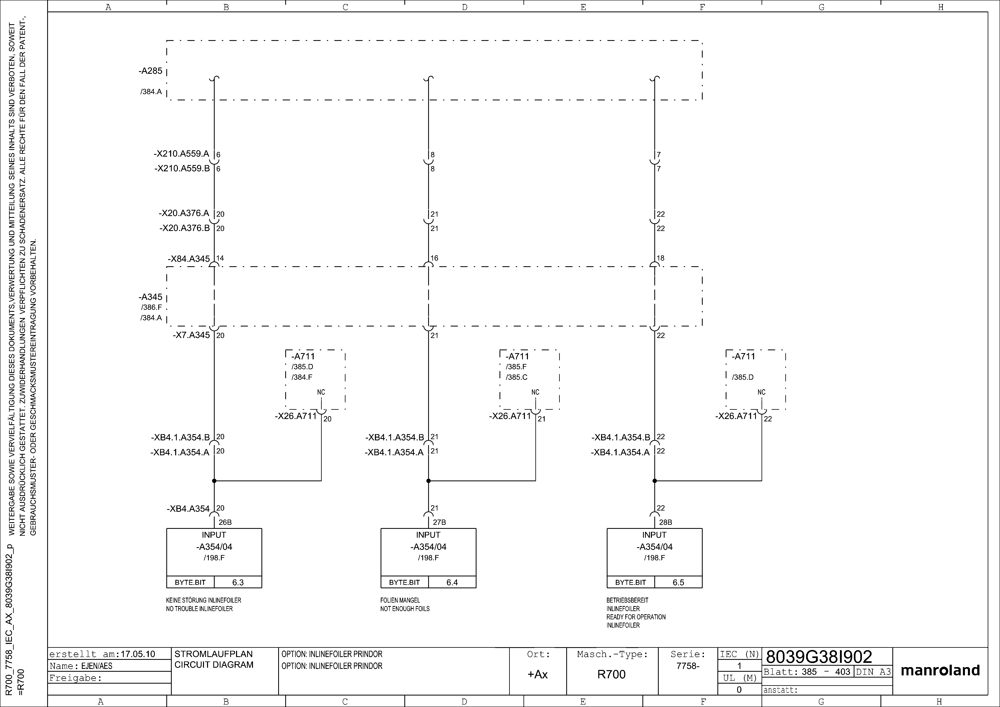

# +Ax — Sheet 385 of 403 — OPTION: INLINEFOILER PRINDOR

**OPTION: INLINEFOILER PRINDOR**

> Part of the manroland **R700** printing press IEC/UL circuit diagrams.
> Drawing class: **Stromlaufplan / Circuit diagram** (DIN A3).
> Document `+Ax` covers the **Central control console** machine section.

## At a glance

| Field | Value |
|---|---|
| Document | `+Ax`  (8039G38I902) |
| Sheet | **385** of 403 |
| Section (DE) | OPTION: INLINEFOILER PRINDOR |
| Section (EN) | OPTION: INLINEFOILER PRINDOR |
| Section type | CIRCUIT — Circuit diagram |
| Machine type | `R700` |
| Series | `7758` |
| Created | 17.05.10 |
| Replaces | — |
| Columns used | A, B, C, D, E, F, G |
| Path numbers | — |
| Labels on sheet | 88 |
| Cross-refs out | 11 |
| Cross-refs in | 41 |

**Previous:** [+Ax sheet 384](SHEET_0384.md) · **Next:** [+Ax sheet 386](SHEET_0386.md) · **Document TOC:** [_TOC.md](_TOC.md)  (+Ax) · **Master TOC:** [all sheets](../_MASTER_TOC.md)

## Sheet image (300 DPI, exact vector render)



_Rendered directly from the PDF vector layer at 300 DPI (1-bit), no OCR and no resampling. Use it to confirm anything ambiguous in the text below._

## Cross-references on this sheet

Each entry is a wire leaving this sheet. The printed token is `/sheet.column`; the link resolves to that sheet inside the same document.

| Ref | Target sheet | Col | Path | Destination on target | Target section | From col |
|---|---|---|---|---|---|---|
| `/384.A` | [+Ax sheet 384](SHEET_0384.md) | A | — | — | OPTION: INLINEFOILER PRINDOR | A |
| `/386.F` | [+Ax sheet 386](SHEET_0386.md) | F | — | — | OPTION: INLINECOATER SMART | A |
| `/384.A` | [+Ax sheet 384](SHEET_0384.md) | A | — | — | OPTION: INLINEFOILER PRINDOR | A |
| `/385.D` | [+Ax sheet 385](SHEET_0385.md) | D | — | A711 | OPTION: INLINEFOILER PRINDOR | C |
| `/384.F` | [+Ax sheet 384](SHEET_0384.md) | F | — | A711 | OPTION: INLINEFOILER PRINDOR | C |
| `/385.F` | [+Ax sheet 385](SHEET_0385.md) | F | — | A711 | OPTION: INLINEFOILER PRINDOR | D |
| `/385.C` | [+Ax sheet 385](SHEET_0385.md) | C | — | A711 | OPTION: INLINEFOILER PRINDOR | D |
| `/385.D` | [+Ax sheet 385](SHEET_0385.md) | D | — | — | OPTION: INLINEFOILER PRINDOR | F |
| `/198.F` | [+Ax sheet 198](SHEET_0198.md) | F | — | — | REFERENZMODUL | B |
| `/198.F` | [+Ax sheet 198](SHEET_0198.md) | F | — | — | REFERENZMODUL | D |
| `/198.F` | [+Ax sheet 198](SHEET_0198.md) | F | — | — | REFERENZMODUL | F |

### Incoming references (sheets that point here)

Every other sheet that sends a wire to this one. `Back-ref` is the token printed on *that* sheet; `Path` is its line number.

| From sheet | Cols | Back-ref | Path | Refs | What continues there |
|---|---|---|---|---|---|
| [+Ax#198](SHEET_0198.md) | F | `/198.F` | — | 3 | — |
| [+Ax#228](SHEET_0228.md) | A, B, C | `/228.A`, `/228.B`, `/228.C` | — | 9 | — |
| [+Ax#235](SHEET_0235.md) | H | `/235.H` | — | 3 | — |
| [+Ax#260](SHEET_0260.md) | E, F | `/260.E`, `/260.F` | — | 6 | — |
| [+Ax#269](SHEET_0269.md) | H | `/269.H` | — | 3 | — |
| [+Ax#287](SHEET_0287.md) | B | `/287.B` | — | 3 | — |
| [+Ax#293](SHEET_0293.md) | C, E | `/293.C`, `/293.E` | — | 6 | — |
| [+Ax#384](SHEET_0384.md) | A, F | `/384.A`, `/384.F` | — | 3 | — |
| [+Ax#385](SHEET_0385.md) | C, D, F | `/385.C`, `/385.D`, `/385.F` | — | 4 | A711 |
| [+Ax#386](SHEET_0386.md) | F | `/386.F` | — | 1 | — |


## Devices on this sheet

| Tag | Class | Class meaning (IEC) | Col | Sub | Terminal | Sign |
|---|---|---|---|---|---|---|
| `A285` | A | Baugruppe / assembly, module, PC board | A | — | — | — |
| `A354/04` | A | Baugruppe / assembly, module, PC board | B | 04 | — | — |
| `A354/04` | A | Baugruppe / assembly, module, PC board | F | 04 | — | — |
| `A345` | A | Baugruppe / assembly, module, PC board | A | — | — | — |
| `A711` | A | Baugruppe / assembly, module, PC board | C | — | — | — |
| `A711` | A | Baugruppe / assembly, module, PC board | F | — | — | — |
| `A354/04` | A | Baugruppe / assembly, module, PC board | D | 04 | — | — |
| `A711` | A | Baugruppe / assembly, module, PC board | D | — | — | — |
| `X210.A559.B` | — | cross-device reference | B | — | — | — |
| `X210.A559.A` | — | cross-device reference | B | — | — | — |
| `XB4.A354` | — | cross-device reference | B | — | — | — |
| `6.3` | — | cross-device reference | B | — | — | — |
| `6.5` | — | cross-device reference | F | — | — | — |
| `X7.A345` | — | cross-device reference | B | — | — | — |
| `X84.A345` | — | cross-device reference | B | — | — | — |
| `X20.A376.B` | — | cross-device reference | B | — | — | — |
| `X20.A376.A` | — | cross-device reference | B | — | — | — |
| `X26.A711` | — | cross-device reference | C | — | — | — |
| `XB4.1.A354.B` | — | cross-device reference | B | — | — | — |
| `XB4.1.A354.A` | — | cross-device reference | B | — | — | — |
| `XB4.1.A354.B` | — | cross-device reference | E | — | — | — |
| `XB4.1.A354.A` | — | cross-device reference | E | — | — | — |
| `X26.A711` | — | cross-device reference | F | — | — | — |
| `6.4` | — | cross-device reference | D | — | — | — |
| `XB4.1.A354.B` | — | cross-device reference | C | — | — | — |
| `XB4.1.A354.A` | — | cross-device reference | C | — | — | — |
| `X26.A711` | — | cross-device reference | D | — | — | — |

## Potentials / nets

_No named potentials on this sheet._

## Wire-end annotations (grouped as printed)

A wire that continues elsewhere is annotated with a small cluster: the destination description, the path/line number `#NN`, and the `/sheet.column` cross reference. Each row below is one such cluster exactly as it is grouped on the drawing.

| Col | Y | Path | Cross-ref | Text on the wire |
|---|---|---|---|---|
| A | 79.7 | — | — | `A285` |
| A | 105.2 | — | `/384.A` | — |
| B | 178.2 | — | — | `X210.A559.A 6` |
| D | 180.3 | — | — | `8` |
| F | 180.3 | — | — | `7` |
| B | 195.9 | — | — | `X210.A559.B 6` |
| D | 197.3 | — | — | `8` |
| F | 197.3 | — | — | `7` |
| B | 249.1 | — | — | `X20.A376.A 20` |
| D | 251.2 | — | — | `21` |
| F | 251.2 | — | — | `22` |
| B | 266.8 | — | — | `X20.A376.B 20` |
| D | 268.2 | — | — | `21` |
| F | 268.2 | — | — | `22` |
| B | 303.6 | — | — | `X84.A345 14` |
| D | 303.6 | — | — | `16` |
| F | 303.6 | — | — | `18` |
| A | 349.0 | — | — | `A345` |
| A | 362.0 | — | `/386.F`, `/384.A` | — |
| B | 394.3 | — | — | `X7.A345 20` |
| D | 395.8 | — | — | `21` |
| F | 395.8 | — | — | `22` |
| C | 419.8 | — | `/385.D`, `/384.F` | `A711` |
| D | 419.8 | — | `/385.F`, `/385.C` | `A711` |
| F | 419.8 | — | — | `A711` |
| F | 445.3 | — | `/385.D` | — |
| E | 464.1 | — | — | `NC NC NC` |
| C | 490.7 | — | — | `X26.A711 20` |
| D | 490.7 | — | — | `X26.A711 21` |
| F | 490.7 | — | — | `X26.A711 22` |
| B | 516.2 | — | — | `XB4.1.A354.B 20` |
| C | 516.2 | — | — | `XB4.1.A354.B 21` |
| E | 516.2 | — | — | `XB4.1.A354.B 22` |
| B | 533.2 | — | — | `XB4.1.A354.A 20` |
| C | 533.2 | — | — | `XB4.1.A354.A 21` |
| E | 533.2 | — | — | `XB4.1.A354.A 22` |
| B | 601.2 | — | — | `XB4.A354 20` |
| D | 601.3 | — | — | `21` |
| F | 601.3 | — | — | `22` |
| B | 618.2 | — | — | `26B` |
| D | 618.2 | — | — | `27B` |
| F | 618.2 | — | — | `28B` |
| B | 632.8 | — | — | `INPUT` |
| D | 632.8 | — | — | `INPUT` |
| F | 632.8 | — | — | `INPUT` |
| B | 646.6 | — | — | `A354/04` |
| D | 646.6 | — | — | `A354/04` |
| F | 646.6 | — | — | `A354/04` |
| B | 660.4 | — | `/198.F` | — |
| D | 660.4 | — | `/198.F` | — |
| F | 660.4 | — | `/198.F` | — |
| B | 689.4 | — | — | `BYTE.BIT 6.3` |
| D | 689.4 | — | — | `BYTE.BIT 6.4` |
| F | 689.4 | — | — | `BYTE.BIT 6.5` |
| B | 712.3 | — | — | `KEINE STÖRUNG INLINEFOILER NO TROUBLE INLINEFOILER` |
| D | 712.3 | — | — | `FOLIEN MANGEL NOT ENOUGH FOILS` |
| E | 712.3 | — | — | `BETRIEBSBEREIT INLINEFOILER READY FOR OPERATION INLINEFOILER` |


## Reconstructed tables

This sheet carries tabular content (pin map / terminal assignment / index). The grid below was rebuilt from the drawing's own rule lines, so each row is exactly one physical row of the table.

### Table 1 — 2 data rows × 2 columns (at x=198.4, y=572.6)

| XB4.A354 | 20 26B |
|---|---|
| `INPUT` | `A354/04 /198.F` |
| `BYTE.BIT` | `6.3` |


### Table 2 — 1 data rows × 2 columns (at x=453.5, y=572.6) — **21 27B**

| INPUT | A354/04 /198.F |
|---|---|
| `BYTE.BIT` | `6.4` |


### Table 3 — 1 data rows × 2 columns (at x=722.8, y=572.6) — **22 28B**

| INPUT | A354/04 /198.F |
|---|---|
| `BYTE.BIT` | `6.5` |


## Notes and free text on this sheet

| Text | Col | Y (pt) |
|---|---|---|
| `26B` | B | 618.24 |
| `INPUT` | B | 632.76 |
| `BYTE.BIT` | B | 690.01 |
| `KEINE STÖRUNG INLINEFOILER` | B | 712.29 |
| `NO TROUBLE INLINEFOILER` | B | 722.23 |
| `28B` | F | 618.24 |
| `INPUT` | F | 632.76 |
| `BYTE.BIT` | E | 690.01 |
| `BETRIEBSBEREIT` | E | 712.29 |
| `INLINEFOILER` | E | 722.26 |
| `READY FOR OPERATION` | E | 732.16 |
| `27B` | D | 618.24 |
| `INPUT` | D | 632.76 |
| `BYTE.BIT` | C | 690.01 |
| `FOLIEN MANGEL` | C | 712.29 |
| `NOT ENOUGH FOILS` | D | 722.19 |
| `NC` | C | 464.05 |
| `NC` | F | 464.05 |
| `NC` | E | 464.05 |

## Complete label inventory (exact text from the drawing)

Every text object inside the drawing area of this sheet, in DIN reading order (column A→H, then top→bottom). This is the authoritative list: if a string is not here it is not printed on this sheet.

| Col | Y | X | Dir | Type | Text |
|---|---|---|---|---|---|
| A | 79.7 | 165.0 | → | device tag | `A285` |
| A | 105.1 | 167.2 | → | cross-reference | `/384.A` |
| A | 349.0 | 165.0 | → | device tag | `A345` |
| A | 362.0 | 168.1 | → | cross-reference | `/386.F` |
| A | 374.4 | 167.2 | → | cross-reference | `/384.A` |
| B | 178.2 | 183.1 | → | device ref | `X210.A559.A` |
| B | 180.3 | 257.7 | → | number | `6` |
| B | 195.9 | 184.0 | → | device ref | `X210.A559.B` |
| B | 197.3 | 257.7 | → | number | `6` |
| B | 249.1 | 189.1 | → | device ref | `X20.A376.A` |
| B | 251.2 | 257.7 | → | number | `20` |
| B | 266.8 | 189.9 | → | device ref | `X20.A376.B` |
| B | 268.2 | 257.7 | → | number | `20` |
| B | 303.6 | 199.8 | → | device ref | `X84.A345` |
| B | 303.6 | 257.1 | → | number | `14` |
| B | 394.3 | 205.8 | → | device ref | `X7.A345` |
| B | 395.8 | 257.7 | → | number | `20` |
| B | 516.2 | 180.0 | → | device ref | `XB4.1.A354.B` |
| B | 516.2 | 257.7 | → | number | `20` |
| B | 533.2 | 257.7 | → | number | `20` |
| B | 533.9 | 179.1 | → | device ref | `XB4.1.A354.A` |
| B | 601.3 | 198.7 | → | device ref | `XB4.A354` |
| B | 601.3 | 257.7 | → | number | `20` |
| B | 618.2 | 260.5 | → | text | `26B` |
| B | 632.8 | 240.2 | → | text | `INPUT` |
| B | 646.6 | 233.7 | → | device tag | `A354/04` |
| B | 660.4 | 242.8 | → | cross-reference | `/198.F` |
| B | 689.4 | 276.7 | → | device ref | `6.3` |
| B | 690.0 | 208.3 | → | text | `BYTE.BIT` |
| B | 712.3 | 197.9 | → | text | `KEINE STÖRUNG INLINEFOILER` |
| B | 722.2 | 197.9 | → | text | `NO TROUBLE INLINEFOILER` |
| C | 419.8 | 347.0 | → | device tag | `A711` |
| C | 432.9 | 347.2 | → | cross-reference | `/385.D` |
| C | 445.3 | 347.2 | → | cross-reference | `/384.F` |
| C | 464.0 | 377.8 | → | text | `NC` |
| C | 490.7 | 327.4 | → | device ref | `X26.A711` |
| C | 495.0 | 385.2 | → | number | `20` |
| C | 516.2 | 435.1 | → | device ref | `XB4.1.A354.B` |
| C | 533.9 | 434.3 | → | device ref | `XB4.1.A354.A` |
| C | 690.0 | 463.5 | → | text | `BYTE.BIT` |
| C | 712.3 | 453.0 | → | text | `FOLIEN MANGEL` |
| D | 180.3 | 512.8 | → | number | `8` |
| D | 197.3 | 512.8 | → | number | `8` |
| D | 251.2 | 512.8 | → | number | `21` |
| D | 268.2 | 512.8 | → | number | `21` |
| D | 303.6 | 512.2 | → | number | `16` |
| D | 395.8 | 512.8 | → | number | `21` |
| D | 419.8 | 602.1 | → | device tag | `A711` |
| D | 432.9 | 602.4 | → | cross-reference | `/385.F` |
| D | 445.3 | 602.4 | → | cross-reference | `/385.C` |
| D | 490.7 | 582.5 | → | device ref | `X26.A711` |
| D | 516.2 | 512.8 | → | number | `21` |
| D | 533.2 | 512.8 | → | number | `21` |
| D | 601.3 | 512.8 | → | number | `21` |
| D | 618.2 | 515.6 | → | text | `27B` |
| D | 632.8 | 495.4 | → | text | `INPUT` |
| D | 646.6 | 488.8 | → | device tag | `A354/04` |
| D | 660.4 | 497.9 | → | cross-reference | `/198.F` |
| D | 689.4 | 531.8 | → | device ref | `6.4` |
| D | 722.2 | 453.0 | → | text | `NOT ENOUGH FOILS` |
| E | 464.0 | 632.9 | → | text | `NC` |
| E | 495.0 | 640.3 | → | number | `21` |
| E | 516.2 | 704.4 | → | device ref | `XB4.1.A354.B` |
| E | 533.9 | 703.6 | → | device ref | `XB4.1.A354.A` |
| E | 690.0 | 732.8 | → | text | `BYTE.BIT` |
| E | 712.3 | 722.3 | → | text | `BETRIEBSBEREIT` |
| E | 722.3 | 722.3 | → | text | `INLINEFOILER` |
| E | 732.2 | 722.3 | → | text | `READY FOR OPERATION` |
| E | 742.1 | 722.3 | → | text | `INLINEFOILER` |
| F | 180.3 | 782.1 | → | number | `7` |
| F | 197.3 | 782.1 | → | number | `7` |
| F | 251.2 | 782.1 | → | number | `22` |
| F | 268.2 | 782.1 | → | number | `22` |
| F | 303.6 | 781.5 | → | number | `18` |
| F | 395.8 | 782.1 | → | number | `22` |
| F | 419.8 | 871.4 | → | device tag | `A711` |
| F | 445.3 | 871.7 | → | cross-reference | `/385.D` |
| F | 464.0 | 902.2 | → | text | `NC` |
| F | 490.7 | 851.8 | → | device ref | `X26.A711` |
| F | 516.2 | 782.1 | → | number | `22` |
| F | 533.2 | 782.1 | → | number | `22` |
| F | 601.3 | 782.1 | → | number | `22` |
| F | 618.2 | 784.9 | → | text | `28B` |
| F | 632.8 | 764.6 | → | text | `INPUT` |
| F | 646.6 | 758.1 | → | device tag | `A354/04` |
| F | 660.4 | 767.2 | → | cross-reference | `/198.F` |
| F | 689.4 | 801.1 | → | device ref | `6.5` |
| G | 495.0 | 909.6 | → | number | `22` |

## Reading-order text block

The same content as a plain block, grouped by DIN column — convenient to paste or to match against a visual description.

```text
=== Column A ===
  79.7  165.0  devtag       A285
 105.1  167.2  xref         /384.A
 349.0  165.0  devtag       A345
 362.0  168.1  xref         /386.F
 374.4  167.2  xref         /384.A
=== Column B ===
 178.2  183.1  devref       X210.A559.A
 180.3  257.7  numeric      6
 195.9  184.0  devref       X210.A559.B
 197.3  257.7  numeric      6
 249.1  189.1  devref       X20.A376.A
 251.2  257.7  numeric      20
 266.8  189.9  devref       X20.A376.B
 268.2  257.7  numeric      20
 303.6  199.8  devref       X84.A345
 303.6  257.1  numeric      14
 394.3  205.8  devref       X7.A345
 395.8  257.7  numeric      20
 516.2  180.0  devref       XB4.1.A354.B
 516.2  257.7  numeric      20
 533.2  257.7  numeric      20
 533.9  179.1  devref       XB4.1.A354.A
 601.3  198.7  devref       XB4.A354
 601.3  257.7  numeric      20
 618.2  260.5  text         26B
 632.8  240.2  text         INPUT
 646.6  233.7  devtag       A354/04
 660.4  242.8  xref         /198.F
 689.4  276.7  devref       6.3
 690.0  208.3  text         BYTE.BIT
 712.3  197.9  text         KEINE STÖRUNG INLINEFOILER
 722.2  197.9  text         NO TROUBLE INLINEFOILER
=== Column C ===
 419.8  347.0  devtag       A711
 432.9  347.2  xref         /385.D
 445.3  347.2  xref         /384.F
 464.0  377.8  text         NC
 490.7  327.4  devref       X26.A711
 495.0  385.2  numeric      20
 516.2  435.1  devref       XB4.1.A354.B
 533.9  434.3  devref       XB4.1.A354.A
 690.0  463.5  text         BYTE.BIT
 712.3  453.0  text         FOLIEN MANGEL
=== Column D ===
 180.3  512.8  numeric      8
 197.3  512.8  numeric      8
 251.2  512.8  numeric      21
 268.2  512.8  numeric      21
 303.6  512.2  numeric      16
 395.8  512.8  numeric      21
 419.8  602.1  devtag       A711
 432.9  602.4  xref         /385.F
 445.3  602.4  xref         /385.C
 490.7  582.5  devref       X26.A711
 516.2  512.8  numeric      21
 533.2  512.8  numeric      21
 601.3  512.8  numeric      21
 618.2  515.6  text         27B
 632.8  495.4  text         INPUT
 646.6  488.8  devtag       A354/04
 660.4  497.9  xref         /198.F
 689.4  531.8  devref       6.4
 722.2  453.0  text         NOT ENOUGH FOILS
=== Column E ===
 464.0  632.9  text         NC
 495.0  640.3  numeric      21
 516.2  704.4  devref       XB4.1.A354.B
 533.9  703.6  devref       XB4.1.A354.A
 690.0  732.8  text         BYTE.BIT
 712.3  722.3  text         BETRIEBSBEREIT
 722.3  722.3  text         INLINEFOILER
 732.2  722.3  text         READY FOR OPERATION
 742.1  722.3  text         INLINEFOILER
=== Column F ===
 180.3  782.1  numeric      7
 197.3  782.1  numeric      7
 251.2  782.1  numeric      22
 268.2  782.1  numeric      22
 303.6  781.5  numeric      18
 395.8  782.1  numeric      22
 419.8  871.4  devtag       A711
 445.3  871.7  xref         /385.D
 464.0  902.2  text         NC
 490.7  851.8  devref       X26.A711
 516.2  782.1  numeric      22
 533.2  782.1  numeric      22
 601.3  782.1  numeric      22
 618.2  784.9  text         28B
 632.8  764.6  text         INPUT
 646.6  758.1  devtag       A354/04
 660.4  767.2  xref         /198.F
 689.4  801.1  devref       6.5
=== Column G ===
 495.0  909.6  numeric      22
```

---
_Generated from the PDF vector text layer; no OCR. Source: `R700_7758_IEC_AX_8039G38I902_p`, sheet 385._
