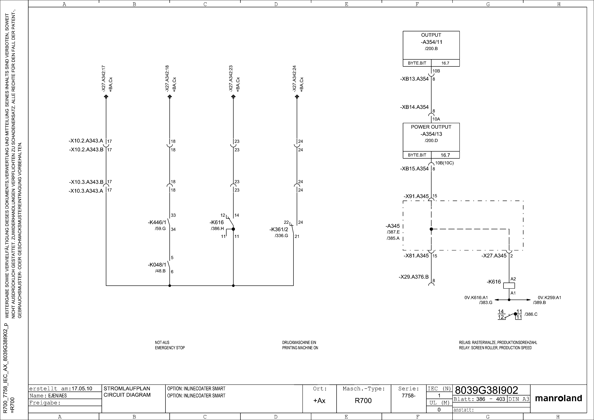

# +Ax — Sheet 386 of 403 — OPTION: INLINECOATER SMART

**OPTION: INLINECOATER SMART**

> Part of the manroland **R700** printing press IEC/UL circuit diagrams.
> Drawing class: **Stromlaufplan / Circuit diagram** (DIN A3).
> Document `+Ax` covers the **Central control console** machine section.

## At a glance

| Field | Value |
|---|---|
| Document | `+Ax`  (8039G38I902) |
| Sheet | **386** of 403 |
| Section (DE) | OPTION: INLINECOATER SMART |
| Section (EN) | OPTION: INLINECOATER SMART |
| Section type | CIRCUIT — Circuit diagram |
| Machine type | `R700` |
| Series | `7758` |
| Created | 17.05.10 |
| Replaces | — |
| Columns used | A, B, C, D, F, G, H |
| Path numbers | — |
| Labels on sheet | 94 |
| Cross-refs out | 10 |
| Cross-refs in | 33 |

**Previous:** [+Ax sheet 385](SHEET_0385.md) · **Next:** [+Ax sheet 387](SHEET_0387.md) · **Document TOC:** [_TOC.md](_TOC.md)  (+Ax) · **Master TOC:** [all sheets](../_MASTER_TOC.md)

## Sheet image (300 DPI, exact vector render)



_Rendered directly from the PDF vector layer at 300 DPI (1-bit), no OCR and no resampling. Use it to confirm anything ambiguous in the text below._

## Cross-references on this sheet

Each entry is a wire leaving this sheet. The printed token is `/sheet.column`; the link resolves to that sheet inside the same document.

| Ref | Target sheet | Col | Path | Destination on target | Target section | From col |
|---|---|---|---|---|---|---|
| `/200.B` | [+Ax sheet 200](SHEET_0200.md) | B | — | — | REFERENZMODUL | F |
| `/200.D` | [+Ax sheet 200](SHEET_0200.md) | D | — | — | REFERENZMODUL | F |
| `/59.G` | [+Ax sheet 59](SHEET_0059.md) | G | — | — | DRUCKLUFTANLAGE | B |
| `/386.H` | [+Ax sheet 386](SHEET_0386.md) | H | — | — | OPTION: INLINECOATER SMART | C |
| `/387.E` | [+Ax sheet 387](SHEET_0387.md) | E | — | — | OPTION: PUDERABSAUGEINRICHTUNG | F |
| `/385.A` | [+Ax sheet 385](SHEET_0385.md) | A | — | — | OPTION: INLINEFOILER PRINDOR | F |
| `/336.G` | [+Ax sheet 336](SHEET_0336.md) | G | — | — | OPTION: LOGISTIK ANLEGER / | D |
| `/48.B` | [+Ax sheet 48](SHEET_0048.md) | B | — | — | NOT AUS | B |
| `/389.B` | [+Ax sheet 389](SHEET_0389.md) | B | — | 0V.K616:A1 | OPTION: WASCHVORRICHTUNG MIT TUCH | G |
| `/383.G` | [+Ax sheet 383](SHEET_0383.md) | G | — | 0V.K616:A1 | OPTION: INLINEFOILER PRINDOR | G |

### Incoming references (sheets that point here)

Every other sheet that sends a wire to this one. `Back-ref` is the token printed on *that* sheet; `Path` is its line number.

| From sheet | Cols | Back-ref | Path | Refs | What continues there |
|---|---|---|---|---|---|
| [+Ax#48](SHEET_0048.md) | B | `/48.B` | — | 1 | — |
| [+Ax#59](SHEET_0059.md) | G | `/59.G` | — | 1 | — |
| [+Ax#200](SHEET_0200.md) | B, D | `/200.B`, `/200.D` | — | 2 | — |
| [+Ax#244](SHEET_0244.md) | A, B, C, E | `/244.A`, `/244.B`, `/244.C`, `/244.E` | — | 16 | — |
| [+Ax#250](SHEET_0250.md) | B | `/250.B` | — | 1 | — |
| [+Ax#251](SHEET_0251.md) | C | `/251.C` | — | 1 | — |
| [+Ax#253](SHEET_0253.md) | B | `/253.B` | — | 1 | — |
| [+Ax#270](SHEET_0270.md) | B | `/270.B` | — | 1 | — |
| [+Ax#273](SHEET_0273.md) | B | `/273.B` | — | 1 | — |
| [+Ax#286](SHEET_0286.md) | E | `/286.E` | — | 1 | — |
| [+Ax#289](SHEET_0289.md) | E | `/289.E` | — | 1 | — |
| [+Ax#336](SHEET_0336.md) | G | `/336.G` | — | 1 | — |
| [+Ax#383](SHEET_0383.md) | E | `/383.E` | — | 1 | — |
| [+Ax#385](SHEET_0385.md) | A | `/385.A` | — | 1 | — |
| [+Ax#386](SHEET_0386.md) | C | `/386.C` | — | 1 | — |
| [+Ax#387](SHEET_0387.md) | E | `/387.E` | — | 1 | — |
| [+Ax#389](SHEET_0389.md) | C | `/389.C` | — | 1 | 0V.K259:A1 0V.K549:A1 |


## Devices on this sheet

| Tag | Class | Class meaning (IEC) | Col | Sub | Terminal | Sign |
|---|---|---|---|---|---|---|
| `A354/13` | A | Baugruppe / assembly, module, PC board | F | 13 | — | — |
| `A354/11` | A | Baugruppe / assembly, module, PC board | F | 11 | — | — |
| `A345` | A | Baugruppe / assembly, module, PC board | F | — | — | — |
| `A2` | A | Baugruppe / assembly, module, PC board | G | — | — | — |
| `A1` | A | Baugruppe / assembly, module, PC board | G | — | — | — |
| `K616` | K | Relais / relay, contactor | G | — | — | — |
| `K446/1` | K | Relais / relay, contactor | B | 1 | — | — |
| `K616` | K | Relais / relay, contactor | C | — | — | — |
| `K361/2` | K | Relais / relay, contactor | D | 2 | — | — |
| `K048/1` | K | Relais / relay, contactor | B | 1 | — | — |
| `XB14.A354` | — | cross-device reference | F | — | — | — |
| `16.7` | — | cross-device reference | F | — | — | — |
| `XB15.A354` | — | cross-device reference | F | — | — | — |
| `X29.A376.B` | — | cross-device reference | F | — | — | — |
| `16.7` | — | cross-device reference | F | — | — | — |
| `XB13.A354` | — | cross-device reference | F | — | — | — |
| `X91.A345` | — | cross-device reference | F | — | — | — |
| `X81.A345` | — | cross-device reference | F | — | — | — |
| `X27.A345` | — | cross-device reference | G | — | — | — |
| `X27.A342:18` | — | cross-device reference | B | — | 18 | — |
| `X27.A342:23` | — | cross-device reference | C | — | 23 | — |
| `X27.A342:24` | — | cross-device reference | D | — | 24 | — |
| `X10.2.A343.B` | — | cross-device reference | A | — | — | — |
| `X10.2.A343.A` | — | cross-device reference | A | — | — | — |
| `X27.A342:17` | — | cross-device reference | B | — | 17 | — |
| `X10.3.A343.B` | — | cross-device reference | A | — | — | — |
| `X10.3.A343.A` | — | cross-device reference | A | — | — | — |

## Potentials / nets

| Potential | Count | Columns | Attached devices | Terminals |
|---|---|---|---|---|
| `0V` | 2 | G, H | `K259`, `K616` | `A1` |


A potential such as `L24+/4` or `M24+` is a named supply/return rail; every place it appears on this sheet is electrically common.

## Wire-end annotations (grouped as printed)

A wire that continues elsewhere is annotated with a small cluster: the destination description, the path/line number `#NN`, and the `/sheet.column` cross reference. Each row below is one such cluster exactly as it is grouped on the drawing.

| Col | Y | Path | Cross-ref | Text on the wire |
|---|---|---|---|---|
| F | 65.8 | — | — | `OUTPUT` |
| F | 79.7 | — | — | `A354/11` |
| F | 93.5 | — | `/200.B` | — |
| F | 123.1 | — | — | `BYTE.BIT 16.7` |
| B | 131.0 | — | — | `X27.A342:17` |
| B | 131.0 | — | — | `X27.A342:18` |
| C | 131.0 | — | — | `X27.A342:23` |
| D | 131.0 | — | — | `X27.A342:24` |
| F | 138.5 | — | — | `10B` |
| F | 153.4 | — | — | `XB13.A354 8` |
| B | 154.8 | — | — | `+BA,Cx` |
| C | 154.8 | — | — | `+BA,Cx` |
| C | 154.8 | — | — | `+BA,Cx` |
| D | 154.8 | — | — | `+BA,Cx` |
| F | 210.1 | — | — | `XB14.A354 8` |
| F | 234.8 | — | — | `10A` |
| F | 250.0 | — | — | `POWER OUTPUT` |
| F | 263.9 | — | — | `A354/13` |
| A | 277.4 | — | — | `X10.2.A343.A 17` |
| F | 277.7 | — | `/200.D` | — |
| C | 279.5 | — | — | `18` |
| C | 279.5 | — | — | `23` |
| D | 279.5 | — | — | `24` |
| A | 295.1 | — | — | `X10.2.A343.B 17` |
| C | 296.5 | — | — | `18` |
| C | 296.5 | — | — | `23` |
| D | 296.5 | — | — | `24` |
| F | 306.8 | — | — | `BYTE.BIT 16.7` |
| F | 322.8 | — | — | `10B(10C)` |
| F | 333.4 | — | — | `XB15.A354 8` |
| A | 360.3 | — | — | `X10.3.A343.B 17` |
| C | 360.3 | — | — | `18` |
| C | 360.3 | — | — | `23` |
| D | 360.3 | — | — | `24` |
| A | 377.3 | — | — | `X10.3.A343.A 17` |
| C | 377.3 | — | — | `18` |
| C | 377.3 | — | — | `23` |
| D | 377.3 | — | — | `24` |
| F | 388.6 | — | — | `X91.A345 15` |
| C | 427.6 | — | — | `33` |
| C | 427.6 | — | — | `K616 14` |
| C | 427.6 | — | — | `12` |
| B | 441.1 | — | — | `K446/1 34` |
| D | 441.8 | — | — | `K361/2 24` |
| D | 441.8 | — | — | `22` |
| F | 448.2 | — | — | `A345` |
| B | 454.2 | — | `/59.G` | — |
| C | 454.2 | — | `/386.H` | — |
| F | 461.2 | — | `/387.E`, `/385.A` | — |
| D | 468.4 | — | `/336.G` | — |
| C | 470.2 | — | — | `11 11` |
| D | 470.2 | — | — | `21` |
| F | 507.7 | — | — | `X81.A345 15` |
| G | 507.7 | — | — | `X27.A345 2` |
| C | 512.7 | — | — | `5` |
| B | 526.1 | — | — | `K048/1 6` |
| B | 539.2 | — | `/48.B` | — |
| F | 550.2 | — | — | `X29.A376.B 8` |
| G | 555.1 | — | — | `A2` |
| G | 560.1 | — | — | `K616` |
| G | 583.5 | — | — | `A1` |
| G | 592.7 | — | `/389.B`, `/383.G` | `0V.K616:A1` |
| H | 592.7 | — | — | `0V.K259:A1` |
| G | 619.6 | — | — | `14 12 11 11 /386.C` |
| C | 683.8 | — | — | `NOT AUS EMERGENCY STOP` |
| D | 683.8 | — | — | `DRUCKMASCHINE EIN PRINTING MACHINE ON` |
| G | 683.8 | — | — | `RELAIS: RASTERWALZE, PRODUKTIONSDREHZAHL RELAY: SCREEN ROLLER, PRODUCTION SPEED` |


## Reconstructed tables

This sheet carries tabular content (pin map / terminal assignment / index). The grid below was rebuilt from the drawing's own rule lines, so each row is exactly one physical row of the table.

### Table 1 — 5 data rows × 2 columns (at x=807.9, y=62.4)

| OUTPUT | A354/11 /200.B |
|---|---|
| `BYTE.BIT` | `16.7` |
| `XB13.A354 XB14.A354` | `10B 8 8 10A` |
| `POWER` | `OUTPUT A354/13 /200.D` |
| `BYTE.BIT` | `16.7` |
| `XB15.A354 X91.A345` | `10B(10C) 8 15` |


## Notes and free text on this sheet

| Text | Col | Y (pt) |
|---|---|---|
| `10A` | F | 234.85 |
| `10B(10C)` | F | 322.76 |
| `POWER OUTPUT` | F | 250.01 |
| `BYTE.BIT` | F | 307.34 |
| `10B` | F | 138.48 |
| `OUTPUT` | F | 65.81 |
| `11 /386.C` | H | 626.04 |
| `RELAIS: RASTERWALZE, PRODUKTIONSDREHZAHL` | G | 683.77 |
| `RELAY: SCREEN ROLLER, PRODUCTION SPEED` | G | 694.41 |
| `+BA,Cx` | C | 154.77 |
| `+BA,Cx` | D | 154.77 |
| `+BA,Cx` | B | 154.77 |
| `NOT AUS` | B | 683.76 |
| `EMERGENCY STOP` | C | 694.41 |
| `DRUCKMASCHINE EIN` | D | 683.78 |
| `PRINTING MACHINE ON` | D | 694.41 |

## Complete label inventory (exact text from the drawing)

Every text object inside the drawing area of this sheet, in DIN reading order (column A→H, then top→bottom). This is the authoritative list: if a string is not here it is not printed on this sheet.

| Col | Y | X | Dir | Type | Text |
|---|---|---|---|---|---|
| A | 277.4 | 137.8 | → | device ref | `X10.2.A343.A` |
| A | 295.1 | 138.6 | → | device ref | `X10.2.A343.B` |
| A | 360.3 | 138.6 | → | device ref | `X10.3.A343.B` |
| A | 378.0 | 137.8 | → | device ref | `X10.3.A343.A` |
| B | 131.0 | 203.7 | ↕ | device ref | `X27.A342:17` |
| B | 131.0 | 331.2 | ↕ | device ref | `X27.A342:18` |
| B | 154.8 | 217.9 | ↕ | text | `+BA,Cx` |
| B | 279.5 | 214.6 | → | number | `17` |
| B | 296.5 | 214.6 | → | number | `17` |
| B | 360.3 | 214.6 | → | number | `17` |
| B | 377.3 | 214.6 | → | number | `17` |
| B | 441.1 | 296.5 | → | device tag | `K446/1` |
| B | 454.2 | 310.7 | → | cross-reference | `/59.G` |
| B | 526.1 | 296.5 | → | device tag | `K048/1` |
| B | 539.2 | 311.2 | → | cross-reference | `/48.B` |
| B | 683.8 | 311.0 | → | text | `NOT AUS` |
| C | 131.0 | 458.8 | ↕ | device ref | `X27.A342:23` |
| C | 154.8 | 345.4 | ↕ | text | `+BA,Cx` |
| C | 154.8 | 473.0 | ↕ | text | `+BA,Cx` |
| C | 279.5 | 342.1 | → | number | `18` |
| C | 279.5 | 470.3 | → | number | `23` |
| C | 296.5 | 342.1 | → | number | `18` |
| C | 296.5 | 470.3 | → | number | `23` |
| C | 360.3 | 342.1 | → | number | `18` |
| C | 360.3 | 470.3 | → | number | `23` |
| C | 377.3 | 342.1 | → | number | `18` |
| C | 377.3 | 470.3 | → | number | `23` |
| C | 427.6 | 342.7 | → | number | `33` |
| C | 427.6 | 441.6 | → | number | `12` |
| C | 427.6 | 469.7 | → | number | `14` |
| C | 441.1 | 420.1 | → | device tag | `K616` |
| C | 454.2 | 422.9 | → | cross-reference | `/386.H` |
| C | 456.0 | 342.7 | → | number | `34` |
| C | 470.2 | 442.8 | → | number | `11` |
| C | 470.2 | 469.7 | → | number | `11` |
| C | 512.7 | 342.7 | → | number | `5` |
| C | 541.0 | 342.7 | → | number | `6` |
| C | 694.4 | 311.0 | → | text | `EMERGENCY STOP` |
| D | 131.0 | 586.4 | ↕ | device ref | `X27.A342:24` |
| D | 154.8 | 600.5 | ↕ | text | `+BA,Cx` |
| D | 279.5 | 597.8 | → | number | `24` |
| D | 296.5 | 597.8 | → | number | `24` |
| D | 360.3 | 597.8 | → | number | `24` |
| D | 377.3 | 597.8 | → | number | `24` |
| D | 441.8 | 569.2 | → | number | `22` |
| D | 441.8 | 597.8 | → | number | `24` |
| D | 455.3 | 540.3 | → | device tag | `K361/2` |
| D | 468.4 | 551.1 | → | cross-reference | `/336.G` |
| D | 470.2 | 590.7 | → | number | `21` |
| D | 683.8 | 566.1 | → | text | `DRUCKMASCHINE EIN` |
| D | 694.4 | 566.1 | → | text | `PRINTING MACHINE ON` |
| F | 65.8 | 844.3 | → | text | `OUTPUT` |
| F | 79.7 | 843.9 | → | device tag | `A354/11` |
| F | 93.5 | 852.0 | → | cross-reference | `/200.B` |
| F | 123.1 | 817.8 | → | text | `BYTE.BIT` |
| F | 123.1 | 884.7 | → | device ref | `16.7` |
| F | 138.5 | 866.6 | → | text | `10B` |
| F | 153.4 | 802.2 | → | device ref | `XB13.A354` |
| F | 154.8 | 867.1 | → | number | `8` |
| F | 210.1 | 802.2 | → | device ref | `XB14.A354` |
| F | 218.6 | 867.1 | → | number | `8` |
| F | 234.9 | 866.6 | → | text | `10A` |
| F | 250.0 | 823.7 | → | text | `POWER OUTPUT` |
| F | 263.9 | 843.2 | → | device tag | `A354/13` |
| F | 277.7 | 851.8 | → | cross-reference | `/200.D` |
| F | 306.8 | 883.1 | → | device ref | `16.7` |
| F | 307.3 | 817.8 | → | text | `BYTE.BIT` |
| F | 322.8 | 872.2 | → | text | `10B(10C)` |
| F | 333.4 | 802.2 | → | device ref | `XB15.A354` |
| F | 334.8 | 867.1 | → | number | `8` |
| F | 388.7 | 809.3 | → | device ref | `X91.A345` |
| F | 388.7 | 866.6 | → | number | `15` |
| F | 448.2 | 773.0 | → | device tag | `A345` |
| F | 461.2 | 775.8 | → | cross-reference | `/387.E` |
| F | 473.6 | 775.3 | → | cross-reference | `/385.A` |
| F | 507.7 | 809.3 | → | device ref | `X81.A345` |
| F | 509.1 | 866.6 | → | number | `15` |
| F | 550.2 | 799.4 | → | device ref | `X29.A376.B` |
| F | 558.7 | 867.1 | → | number | `8` |
| G | 507.7 | 965.2 | → | device ref | `X27.A345` |
| G | 509.1 | 1023.0 | → | number | `2` |
| G | 555.2 | 1023.3 | → | device tag | `A2` |
| G | 560.1 | 975.7 | → | device tag | `K616` |
| G | 583.5 | 1023.3 | → | device tag | `A1` |
| G | 592.7 | 931.2 | → | potential | `0V.K616:A1` |
| G | 602.6 | 960.7 | → | cross-reference | `/383.G` |
| G | 619.6 | 997.8 | → | number | `14` |
| G | 619.6 | 1034.9 | → | number | `11` |
| G | 631.0 | 997.8 | → | number | `12` |
| G | 683.8 | 920.4 | → | text | `RELAIS: RASTERWALZE, PRODUKTIONSDREHZAHL` |
| G | 694.4 | 920.4 | → | text | `RELAY: SCREEN ROLLER, PRODUCTION SPEED` |
| H | 592.7 | 1078.3 | → | potential | `0V.K259:A1` |
| H | 602.6 | 1068.7 | → | cross-reference | `/389.B` |
| H | 626.0 | 1034.9 | → | text | `11 /386.C` |

## Reading-order text block

The same content as a plain block, grouped by DIN column — convenient to paste or to match against a visual description.

```text
=== Column A ===
 277.4  137.8  devref       X10.2.A343.A
 295.1  138.6  devref       X10.2.A343.B
 360.3  138.6  devref       X10.3.A343.B
 378.0  137.8  devref       X10.3.A343.A
=== Column B ===
 131.0  203.7  devref       X27.A342:17
 131.0  331.2  devref       X27.A342:18
 154.8  217.9  text         +BA,Cx
 279.5  214.6  numeric      17
 296.5  214.6  numeric      17
 360.3  214.6  numeric      17
 377.3  214.6  numeric      17
 441.1  296.5  devtag       K446/1
 454.2  310.7  xref         /59.G
 526.1  296.5  devtag       K048/1
 539.2  311.2  xref         /48.B
 683.8  311.0  text         NOT AUS
=== Column C ===
 131.0  458.8  devref       X27.A342:23
 154.8  345.4  text         +BA,Cx
 154.8  473.0  text         +BA,Cx
 279.5  342.1  numeric      18
 279.5  470.3  numeric      23
 296.5  342.1  numeric      18
 296.5  470.3  numeric      23
 360.3  342.1  numeric      18
 360.3  470.3  numeric      23
 377.3  342.1  numeric      18
 377.3  470.3  numeric      23
 427.6  342.7  numeric      33
 427.6  441.6  numeric      12
 427.6  469.7  numeric      14
 441.1  420.1  devtag       K616
 454.2  422.9  xref         /386.H
 456.0  342.7  numeric      34
 470.2  442.8  numeric      11
 470.2  469.7  numeric      11
 512.7  342.7  numeric      5
 541.0  342.7  numeric      6
 694.4  311.0  text         EMERGENCY STOP
=== Column D ===
 131.0  586.4  devref       X27.A342:24
 154.8  600.5  text         +BA,Cx
 279.5  597.8  numeric      24
 296.5  597.8  numeric      24
 360.3  597.8  numeric      24
 377.3  597.8  numeric      24
 441.8  569.2  numeric      22
 441.8  597.8  numeric      24
 455.3  540.3  devtag       K361/2
 468.4  551.1  xref         /336.G
 470.2  590.7  numeric      21
 683.8  566.1  text         DRUCKMASCHINE EIN
 694.4  566.1  text         PRINTING MACHINE ON
=== Column F ===
  65.8  844.3  text         OUTPUT
  79.7  843.9  devtag       A354/11
  93.5  852.0  xref         /200.B
 123.1  817.8  text         BYTE.BIT
 123.1  884.7  devref       16.7
 138.5  866.6  text         10B
 153.4  802.2  devref       XB13.A354
 154.8  867.1  numeric      8
 210.1  802.2  devref       XB14.A354
 218.6  867.1  numeric      8
 234.9  866.6  text         10A
 250.0  823.7  text         POWER OUTPUT
 263.9  843.2  devtag       A354/13
 277.7  851.8  xref         /200.D
 306.8  883.1  devref       16.7
 307.3  817.8  text         BYTE.BIT
 322.8  872.2  text         10B(10C)
 333.4  802.2  devref       XB15.A354
 334.8  867.1  numeric      8
 388.7  809.3  devref       X91.A345
 388.7  866.6  numeric      15
 448.2  773.0  devtag       A345
 461.2  775.8  xref         /387.E
 473.6  775.3  xref         /385.A
 507.7  809.3  devref       X81.A345
 509.1  866.6  numeric      15
 550.2  799.4  devref       X29.A376.B
 558.7  867.1  numeric      8
=== Column G ===
 507.7  965.2  devref       X27.A345
 509.1 1023.0  numeric      2
 555.2 1023.3  devtag       A2
 560.1  975.7  devtag       K616
 583.5 1023.3  devtag       A1
 592.7  931.2  net          0V.K616:A1
 602.6  960.7  xref         /383.G
 619.6  997.8  numeric      14
 619.6 1034.9  numeric      11
 631.0  997.8  numeric      12
 683.8  920.4  text         RELAIS: RASTERWALZE, PRODUKTIONSDREHZAHL
 694.4  920.4  text         RELAY: SCREEN ROLLER, PRODUCTION SPEED
=== Column H ===
 592.7 1078.3  net          0V.K259:A1
 602.6 1068.7  xref         /389.B
 626.0 1034.9  text         11 /386.C
```

---
_Generated from the PDF vector text layer; no OCR. Source: `R700_7758_IEC_AX_8039G38I902_p`, sheet 386._
