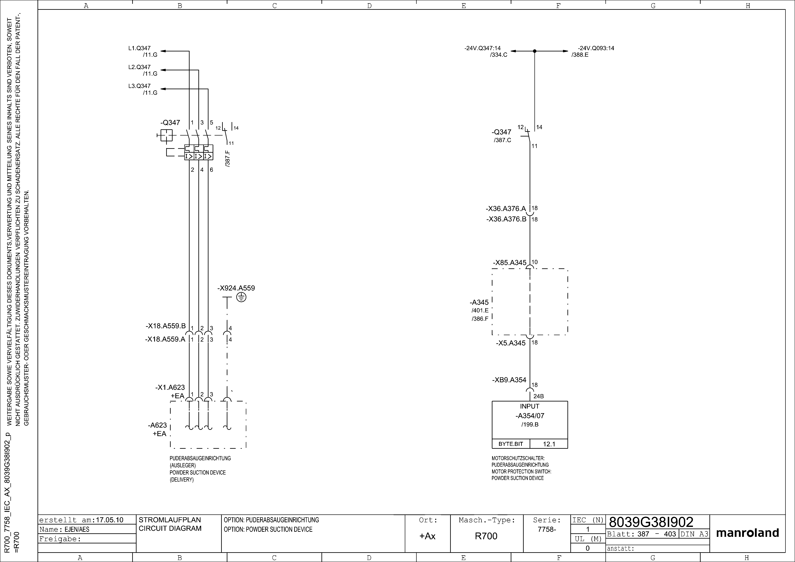

# +Ax — Sheet 387 of 403 — OPTION: PUDERABSAUGEINRICHTUNG

**OPTION: POWDER SUCTION DEVICE**

> Part of the manroland **R700** printing press IEC/UL circuit diagrams.
> Drawing class: **Stromlaufplan / Circuit diagram** (DIN A3).
> Document `+Ax` covers the **Central control console** machine section.

## At a glance

| Field | Value |
|---|---|
| Document | `+Ax`  (8039G38I902) |
| Sheet | **387** of 403 |
| Section (DE) | OPTION: PUDERABSAUGEINRICHTUNG |
| Section (EN) | OPTION: POWDER SUCTION DEVICE |
| Section type | CIRCUIT — Circuit diagram |
| Machine type | `R700` |
| Series | `7758` |
| Created | 17.05.10 |
| Replaces | — |
| Columns used | B, C, E, F |
| Path numbers | — |
| Labels on sheet | 72 |
| Cross-refs out | 10 |
| Cross-refs in | 27 |

**Previous:** [+Ax sheet 386](SHEET_0386.md) · **Next:** [+Ax sheet 388](SHEET_0388.md) · **Document TOC:** [_TOC.md](_TOC.md)  (+Ax) · **Master TOC:** [all sheets](../_MASTER_TOC.md)

## Sheet image (300 DPI, exact vector render)



_Rendered directly from the PDF vector layer at 300 DPI (1-bit), no OCR and no resampling. Use it to confirm anything ambiguous in the text below._

## Cross-references on this sheet

Each entry is a wire leaving this sheet. The printed token is `/sheet.column`; the link resolves to that sheet inside the same document.

| Ref | Target sheet | Col | Path | Destination on target | Target section | From col |
|---|---|---|---|---|---|---|
| `/334.C` | [+Ax sheet 334](SHEET_0334.md) | C | — | 24V.Q347:14 24V.Q093:14 | OPTION: INLINESORTER | F |
| `/11.G` | [+Ax sheet 11](SHEET_0011.md) | G | — | L1.Q347 | SPANNUNGSVERSORGUNG, SCHALTSCHRANKBELÜFTUNG | B |
| `/388.E` | [+Ax sheet 388](SHEET_0388.md) | E | — | — | OPTION: WASCHVORRICHTUNG MIT TUCH | F |
| `/11.G` | [+Ax sheet 11](SHEET_0011.md) | G | — | L2.Q347 | SPANNUNGSVERSORGUNG, SCHALTSCHRANKBELÜFTUNG | B |
| `/11.G` | [+Ax sheet 11](SHEET_0011.md) | G | — | L3.Q347 | SPANNUNGSVERSORGUNG, SCHALTSCHRANKBELÜFTUNG | B |
| `/387.C` | [+Ax sheet 387](SHEET_0387.md) | C | — | — | OPTION: PUDERABSAUGEINRICHTUNG | E |
| `/387.F` | [+Ax sheet 387](SHEET_0387.md) | F | — | — | OPTION: PUDERABSAUGEINRICHTUNG | C |
| `/401.E` | [+Ax sheet 401](SHEET_0401.md) | E | — | — | OPTION: INLINE COLORPILOT | E |
| `/386.F` | [+Ax sheet 386](SHEET_0386.md) | F | — | — | OPTION: INLINECOATER SMART | E |
| `/199.B` | [+Ax sheet 199](SHEET_0199.md) | B | — | — | REFERENZMODUL | F |

### Incoming references (sheets that point here)

Every other sheet that sends a wire to this one. `Back-ref` is the token printed on *that* sheet; `Path` is its line number.

| From sheet | Cols | Back-ref | Path | Refs | What continues there |
|---|---|---|---|---|---|
| [+Ax#11](SHEET_0011.md) | H | `/11.H` | — | 3 | L1.Q347; L2.Q347; L3.Q347 |
| [+Ax#199](SHEET_0199.md) | B | `/199.B` | — | 1 | — |
| [+Ax#210](SHEET_0210.md) | E | `/210.E` | — | 4 | — |
| [+Ax#231](SHEET_0231.md) | A | `/231.A` | — | 1 | — |
| [+Ax#242](SHEET_0242.md) | A | `/242.A` | — | 1 | — |
| [+Ax#257](SHEET_0257.md) | F | `/257.F` | — | 8 | — |
| [+Ax#279](SHEET_0279.md) | A, B | `/279.A`, `/279.B` | — | 2 | — |
| [+Ax#287](SHEET_0287.md) | C | `/287.C` | — | 1 | — |
| [+Ax#334](SHEET_0334.md) | C | `/334.C` | — | 1 | 24V.Q096:14 |
| [+Ax#386](SHEET_0386.md) | F | `/386.F` | — | 1 | — |
| [+Ax#387](SHEET_0387.md) | C, E | `/387.C`, `/387.E` | — | 2 | — |
| [+Ax#388](SHEET_0388.md) | C | `/388.C` | — | 1 | L1.Q093 24V.Q093:14 L2.Q093 |
| [+Ax#401](SHEET_0401.md) | E | `/401.E` | — | 1 | — |


## Devices on this sheet

| Tag | Class | Class meaning (IEC) | Col | Sub | Terminal | Sign |
|---|---|---|---|---|---|---|
| `A345` | A | Baugruppe / assembly, module, PC board | E | — | — | — |
| `A354/07` | A | Baugruppe / assembly, module, PC board | F | 07 | — | — |
| `Q347` | Q | Leistungsschalter / power switching device | E | — | — | — |
| `A623` | A | Baugruppe / assembly, module, PC board | B | — | — | — |
| `Q347` | Q | Leistungsschalter / power switching device | B | — | — | — |
| `X5.A345` | — | cross-device reference | E | — | — | — |
| `X36.A376.B` | — | cross-device reference | E | — | — | — |
| `12.1` | — | cross-device reference | F | — | — | — |
| `XB9.A354` | — | cross-device reference | E | — | — | — |
| `X36.A376.A` | — | cross-device reference | E | — | — | — |
| `X85.A345` | — | cross-device reference | E | — | — | — |
| `X18.A559.A` | — | cross-device reference | B | — | — | — |
| `X18.A559.B` | — | cross-device reference | B | — | — | — |
| `X1.A623` | — | cross-device reference | B | — | — | — |
| `X924.A559` | — | cross-device reference | C | — | — | — |

## Potentials / nets

| Potential | Count | Columns | Attached devices | Terminals |
|---|---|---|---|---|
| `24V` | 2 | E, F | `Q093`, `Q347` | `14` |
| `L1` | 1 | B | `Q347` | — |
| `L2` | 1 | B | `Q347` | — |
| `L3` | 1 | B | `Q347` | — |


A potential such as `L24+/4` or `M24+` is a named supply/return rail; every place it appears on this sheet is electrically common.

## Wire-end annotations (grouped as printed)

A wire that continues elsewhere is annotated with a small cluster: the destination description, the path/line number `#NN`, and the `/sheet.column` cross reference. Each row below is one such cluster exactly as it is grouped on the drawing.

| Col | Y | Path | Cross-ref | Text on the wire |
|---|---|---|---|---|
| B | 68.3 | — | `/11.G` | `L1.Q347` |
| F | 68.3 | — | `/334.C` | `24V.Q347:14 24V.Q093:14` |
| F | 78.2 | — | `/388.E` | — |
| B | 96.7 | — | `/11.G` | `L2.Q347` |
| B | 125.0 | — | `/11.G` | `L3.Q347` |
| B | 178.9 | — | — | `Q347` |
| B | 179.6 | — | — | `1` |
| B | 179.6 | — | — | `3` |
| B | 179.6 | — | — | `5` |
| F | 186.7 | — | — | `Q347 14` |
| F | 186.7 | — | — | `12` |
| B | 188.7 | — | — | `12 14` |
| E | 206.2 | — | `/387.C` | — |
| C | 211.4 | — | — | `11` |
| F | 215.1 | — | — | `11` |
| C | 225.1 | — | `/387.F` | — |
| B | 250.5 | — | — | `2` |
| B | 250.5 | — | — | `4` |
| B | 250.5 | — | — | `6` |
| F | 307.9 | — | — | `X36.A376.A 18` |
| F | 323.5 | — | — | `X36.A376.B 18` |
| F | 388.6 | — | — | `X85.A345 10` |
| C | 426.9 | — | — | `X924.A559` |
| E | 448.2 | — | — | `A345` |
| E | 461.2 | — | `/401.E`, `/386.F` | — |
| B | 483.6 | — | — | `X18.A559.B 1` |
| B | 487.9 | — | — | `2 3` |
| C | 487.9 | — | — | `4` |
| B | 503.5 | — | — | `X18.A559.A 1 2 3` |
| C | 504.9 | — | — | `4` |
| F | 509.1 | — | — | `X5.A345 18` |
| F | 564.4 | — | — | `XB9.A354 18` |
| B | 575.7 | — | — | `X1.A623 1 2 3` |
| C | 584.5 | — | — | `'` |
| B | 588.4 | — | — | `+EA` |
| F | 589.9 | — | — | `24B` |
| F | 604.4 | — | — | `INPUT` |
| F | 618.3 | — | — | `A354/07` |
| F | 632.0 | — | `/199.B` | — |
| B | 632.4 | — | — | `A623` |
| B | 645.1 | — | — | `+EA` |
| F | 661.1 | — | — | `BYTE.BIT 12.1` |
| B | 683.8 | — | — | `PUDERABSAUGEINRICHTUNG POWDER SUCTION DEVICE (AUSLEGER) (DELIVERY)` |
| F | 683.9 | — | — | `PUDERABSAUGEINRICHTUNG POWDER SUCTION DEVICE MOTORSCHUTZSCHALTER: MOTOR PROTECTION SWITCH:` |


## Reconstructed tables

This sheet carries tabular content (pin map / terminal assignment / index). The grid below was rebuilt from the drawing's own rule lines, so each row is exactly one physical row of the table.

### Table 1 — 1 data rows × 3 columns (at x=737.0, y=600.9)

| INPUT | A354/07 /199.B |  |
|---|---|---|
| `BYTE.BIT` |  | `12.1` |


## Notes and free text on this sheet

| Text | Col | Y (pt) |
|---|---|---|
| `24B` | F | 589.89 |
| `INPUT` | F | 604.42 |
| `BYTE.BIT` | E | 661.67 |
| `MOTORSCHUTZSCHALTER:` | F | 683.9 |
| `PUDERABSAUGEINRICHTUNG` | F | 693.88 |
| `MOTOR PROTECTION SWITCH:` | F | 703.78 |
| `POWDER SUCTION DEVICE` | F | 713.75 |
| `+EA` | B | 645.11 |
| `PUDERABSAUGEINRICHTUNG` | B | 683.78 |
| `(AUSLEGER)` | B | 694.41 |
| `POWDER SUCTION DEVICE` | B | 705.02 |
| `(DELIVERY)` | B | 715.66 |

## Complete label inventory (exact text from the drawing)

Every text object inside the drawing area of this sheet, in DIN reading order (column A→H, then top→bottom). This is the authoritative list: if a string is not here it is not printed on this sheet.

| Col | Y | X | Dir | Type | Text |
|---|---|---|---|---|---|
| B | 68.3 | 192.2 | → | potential | `L1.Q347` |
| B | 78.2 | 214.3 | → | cross-reference | `/11.G` |
| B | 96.7 | 192.2 | → | potential | `L2.Q347` |
| B | 106.6 | 214.3 | → | cross-reference | `/11.G` |
| B | 125.0 | 192.2 | → | potential | `L3.Q347` |
| B | 134.9 | 214.3 | → | cross-reference | `/11.G` |
| B | 178.9 | 240.4 | → | device tag | `Q347` |
| B | 179.6 | 285.4 | → | number | `1` |
| B | 179.6 | 300.2 | → | number | `3` |
| B | 179.6 | 314.4 | → | number | `5` |
| B | 188.7 | 322.6 | → | number | `12` |
| B | 250.5 | 286.0 | → | number | `2` |
| B | 250.5 | 300.2 | → | number | `4` |
| B | 250.5 | 314.4 | → | number | `6` |
| B | 483.6 | 218.3 | → | device ref | `X18.A559.B` |
| B | 487.9 | 285.4 | → | number | `1` |
| B | 487.9 | 300.2 | → | number | `2` |
| B | 487.9 | 314.4 | → | number | `3` |
| B | 503.5 | 217.4 | → | device ref | `X18.A559.A` |
| B | 504.9 | 285.4 | → | number | `1` |
| B | 504.9 | 300.2 | → | number | `2` |
| B | 504.9 | 314.4 | → | number | `3` |
| B | 575.7 | 232.7 | → | device ref | `X1.A623` |
| B | 587.1 | 285.4 | → | number | `1` |
| B | 587.1 | 300.2 | → | number | `2` |
| B | 587.1 | 314.4 | → | number | `3` |
| B | 588.4 | 255.7 | → | text | `+EA` |
| B | 632.4 | 221.7 | → | device tag | `A623` |
| B | 645.1 | 228.8 | → | text | `+EA` |
| B | 683.8 | 254.3 | → | text | `PUDERABSAUGEINRICHTUNG` |
| B | 694.4 | 254.6 | → | text | `(AUSLEGER)` |
| B | 705.0 | 254.3 | → | text | `POWDER SUCTION DEVICE` |
| B | 715.7 | 254.6 | → | text | `(DELIVERY)` |
| C | 188.7 | 349.5 | → | number | `14` |
| C | 211.4 | 342.4 | → | number | `11` |
| C | 225.1 | 336.9 | ↕ | cross-reference | `/387.F` |
| C | 426.9 | 325.7 | → | device ref | `X924.A559` |
| C | 487.9 | 342.7 | → | number | `4` |
| C | 504.9 | 342.7 | → | number | `4` |
| C | 584.5 | 345.5 | → | other | `'` |
| E | 68.3 | 695.6 | → | potential | `24V.Q347:14` |
| E | 78.2 | 734.2 | → | cross-reference | `/334.C` |
| E | 193.1 | 736.4 | → | device tag | `Q347` |
| E | 206.2 | 739.8 | → | cross-reference | `/387.C` |
| E | 307.9 | 727.7 | → | device ref | `X36.A376.A` |
| E | 323.5 | 728.5 | → | device ref | `X36.A376.B` |
| E | 388.7 | 738.4 | → | device ref | `X85.A345` |
| E | 448.2 | 703.6 | → | device tag | `A345` |
| E | 461.2 | 706.4 | → | cross-reference | `/401.E` |
| E | 473.7 | 706.7 | → | cross-reference | `/386.F` |
| E | 509.1 | 743.0 | → | device ref | `X5.A345` |
| E | 564.4 | 737.3 | → | device ref | `XB9.A354` |
| E | 661.7 | 746.9 | → | text | `BYTE.BIT` |
| F | 68.3 | 865.7 | → | potential | `24V.Q093:14` |
| F | 78.2 | 856.1 | → | cross-reference | `/388.E` |
| F | 186.7 | 774.7 | → | number | `12` |
| F | 186.7 | 802.8 | → | number | `14` |
| F | 215.0 | 795.7 | → | number | `11` |
| F | 307.9 | 795.7 | → | number | `18` |
| F | 324.9 | 795.7 | → | number | `18` |
| F | 388.7 | 795.7 | → | number | `10` |
| F | 509.1 | 795.7 | → | number | `18` |
| F | 572.9 | 795.7 | → | number | `18` |
| F | 589.9 | 799.1 | → | text | `24B` |
| F | 604.4 | 778.8 | → | text | `INPUT` |
| F | 618.3 | 772.3 | → | device tag | `A354/07` |
| F | 632.0 | 781.1 | → | cross-reference | `/199.B` |
| F | 661.1 | 813.1 | → | device ref | `12.1` |
| F | 683.9 | 736.7 | → | text | `MOTORSCHUTZSCHALTER:` |
| F | 693.9 | 736.4 | → | text | `PUDERABSAUGEINRICHTUNG` |
| F | 703.8 | 736.7 | → | text | `MOTOR PROTECTION SWITCH:` |
| F | 713.8 | 736.4 | → | text | `POWDER SUCTION DEVICE` |

## Reading-order text block

The same content as a plain block, grouped by DIN column — convenient to paste or to match against a visual description.

```text
=== Column B ===
  68.3  192.2  net          L1.Q347
  78.2  214.3  xref         /11.G
  96.7  192.2  net          L2.Q347
 106.6  214.3  xref         /11.G
 125.0  192.2  net          L3.Q347
 134.9  214.3  xref         /11.G
 178.9  240.4  devtag       Q347
 179.6  285.4  numeric      1
 179.6  300.2  numeric      3
 179.6  314.4  numeric      5
 188.7  322.6  numeric      12
 250.5  286.0  numeric      2
 250.5  300.2  numeric      4
 250.5  314.4  numeric      6
 483.6  218.3  devref       X18.A559.B
 487.9  285.4  numeric      1
 487.9  300.2  numeric      2
 487.9  314.4  numeric      3
 503.5  217.4  devref       X18.A559.A
 504.9  285.4  numeric      1
 504.9  300.2  numeric      2
 504.9  314.4  numeric      3
 575.7  232.7  devref       X1.A623
 587.1  285.4  numeric      1
 587.1  300.2  numeric      2
 587.1  314.4  numeric      3
 588.4  255.7  text         +EA
 632.4  221.7  devtag       A623
 645.1  228.8  text         +EA
 683.8  254.3  text         PUDERABSAUGEINRICHTUNG
 694.4  254.6  text         (AUSLEGER)
 705.0  254.3  text         POWDER SUCTION DEVICE
 715.7  254.6  text         (DELIVERY)
=== Column C ===
 188.7  349.5  numeric      14
 211.4  342.4  numeric      11
 225.1  336.9  xref         /387.F
 426.9  325.7  devref       X924.A559
 487.9  342.7  numeric      4
 504.9  342.7  numeric      4
 584.5  345.5  other        `
=== Column E ===
  68.3  695.6  net          24V.Q347:14
  78.2  734.2  xref         /334.C
 193.1  736.4  devtag       Q347
 206.2  739.8  xref         /387.C
 307.9  727.7  devref       X36.A376.A
 323.5  728.5  devref       X36.A376.B
 388.7  738.4  devref       X85.A345
 448.2  703.6  devtag       A345
 461.2  706.4  xref         /401.E
 473.7  706.7  xref         /386.F
 509.1  743.0  devref       X5.A345
 564.4  737.3  devref       XB9.A354
 661.7  746.9  text         BYTE.BIT
=== Column F ===
  68.3  865.7  net          24V.Q093:14
  78.2  856.1  xref         /388.E
 186.7  774.7  numeric      12
 186.7  802.8  numeric      14
 215.0  795.7  numeric      11
 307.9  795.7  numeric      18
 324.9  795.7  numeric      18
 388.7  795.7  numeric      10
 509.1  795.7  numeric      18
 572.9  795.7  numeric      18
 589.9  799.1  text         24B
 604.4  778.8  text         INPUT
 618.3  772.3  devtag       A354/07
 632.0  781.1  xref         /199.B
 661.1  813.1  devref       12.1
 683.9  736.7  text         MOTORSCHUTZSCHALTER:
 693.9  736.4  text         PUDERABSAUGEINRICHTUNG
 703.8  736.7  text         MOTOR PROTECTION SWITCH:
 713.8  736.4  text         POWDER SUCTION DEVICE
```

---
_Generated from the PDF vector text layer; no OCR. Source: `R700_7758_IEC_AX_8039G38I902_p`, sheet 387._
