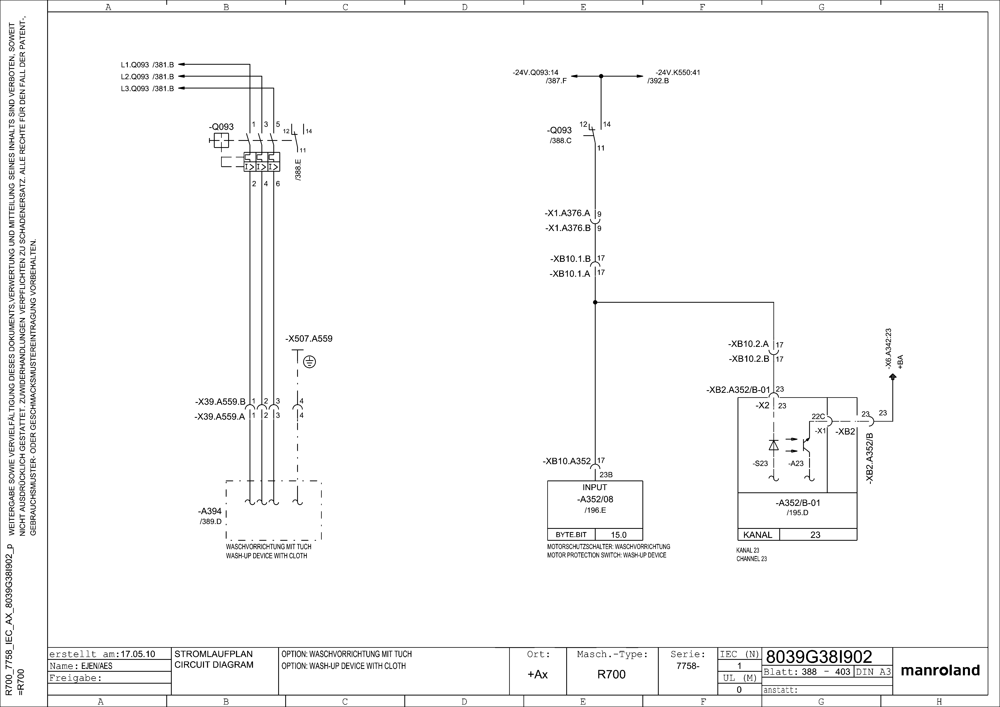

# +Ax — Sheet 388 of 403 — OPTION: WASCHVORRICHTUNG MIT TUCH

**OPTION: WASH UP DEVICE WITH CLOTH**

> Part of the manroland **R700** printing press IEC/UL circuit diagrams.
> Drawing class: **Stromlaufplan / Circuit diagram** (DIN A3).
> Document `+Ax` covers the **Central control console** machine section.

## At a glance

| Field | Value |
|---|---|
| Document | `+Ax`  (8039G38I902) |
| Sheet | **388** of 403 |
| Section (DE) | OPTION: WASCHVORRICHTUNG MIT TUCH |
| Section (EN) | OPTION: WASH UP DEVICE WITH CLOTH |
| Section type | CIRCUIT — Circuit diagram |
| Machine type | `R700` |
| Series | `7758` |
| Created | 17.05.10 |
| Replaces | — |
| Columns used | A, B, C, E, F, G, H |
| Path numbers | — |
| Labels on sheet | 83 |
| Cross-refs out | 10 |
| Cross-refs in | 27 |

**Previous:** [+Ax sheet 387](SHEET_0387.md) · **Next:** [+Ax sheet 389](SHEET_0389.md) · **Document TOC:** [_TOC.md](_TOC.md)  (+Ax) · **Master TOC:** [all sheets](../_MASTER_TOC.md)

## Sheet image (300 DPI, exact vector render)



_Rendered directly from the PDF vector layer at 300 DPI (1-bit), no OCR and no resampling. Use it to confirm anything ambiguous in the text below._

## Cross-references on this sheet

Each entry is a wire leaving this sheet. The printed token is `/sheet.column`; the link resolves to that sheet inside the same document.

| Ref | Target sheet | Col | Path | Destination on target | Target section | From col |
|---|---|---|---|---|---|---|
| `/381.B` | [+Ax sheet 381](SHEET_0381.md) | B | — | L1.Q093 24V.Q093:14 L2.Q093 | OPTION: INLINEFOILER PRINDOR | C |
| `/381.B` | [+Ax sheet 381](SHEET_0381.md) | B | — | L1.Q093 24V.Q093:14 L2.Q093 | OPTION: INLINEFOILER PRINDOR | C |
| `/387.F` | [+Ax sheet 387](SHEET_0387.md) | F | — | L1.Q093 24V.Q093:14 L2.Q093 | OPTION: PUDERABSAUGEINRICHTUNG | C |
| `/392.B` | [+Ax sheet 392](SHEET_0392.md) | B | — | — | OPTION: WASCHVORRICHTUNG MIT TUCH | F |
| `/381.B` | [+Ax sheet 381](SHEET_0381.md) | B | — | L3.Q093 | OPTION: INLINEFOILER PRINDOR | A |
| `/388.C` | [+Ax sheet 388](SHEET_0388.md) | C | — | — | OPTION: WASCHVORRICHTUNG MIT TUCH | E |
| `/388.E` | [+Ax sheet 388](SHEET_0388.md) | E | — | — | OPTION: WASCHVORRICHTUNG MIT TUCH | C |
| `/196.E` | [+Ax sheet 196](SHEET_0196.md) | E | — | — | REFERENZMODUL | E |
| `/195.D` | [+Ax sheet 195](SHEET_0195.md) | D | — | — | REFERENZMODUL | G |
| `/389.D` | [+Ax sheet 389](SHEET_0389.md) | D | — | — | OPTION: WASCHVORRICHTUNG MIT TUCH | B |

### Incoming references (sheets that point here)

Every other sheet that sends a wire to this one. `Back-ref` is the token printed on *that* sheet; `Path` is its line number.

| From sheet | Cols | Back-ref | Path | Refs | What continues there |
|---|---|---|---|---|---|
| [+Ax#195](SHEET_0195.md) | D | `/195.D` | — | 1 | — |
| [+Ax#196](SHEET_0196.md) | E | `/196.E` | — | 1 | — |
| [+Ax#208](SHEET_0208.md) | E, F | `/208.E`, `/208.F` | — | 2 | — |
| [+Ax#218](SHEET_0218.md) | C, E | `/218.C`, `/218.E` | — | 2 | — |
| [+Ax#243](SHEET_0243.md) | A, B, C, E | `/243.A`, `/243.B`, `/243.C`, `/243.E` | — | 4 | — |
| [+Ax#245](SHEET_0245.md) | A | `/245.A` | — | 1 | — |
| [+Ax#280](SHEET_0280.md) | B | `/280.B` | — | 8 | — |
| [+Ax#381](SHEET_0381.md) | C | `/381.C` | — | 3 | L1.Q093; L2.Q093; L3.Q093 |
| [+Ax#387](SHEET_0387.md) | F | `/387.F` | — | 1 | — |
| [+Ax#388](SHEET_0388.md) | C, E | `/388.C`, `/388.E` | — | 2 | — |
| [+Ax#389](SHEET_0389.md) | D | `/389.D` | — | 1 | — |
| [+Ax#392](SHEET_0392.md) | A | `/392.A` | — | 1 | 24V.K550:41 |


## Devices on this sheet

| Tag | Class | Class meaning (IEC) | Col | Sub | Terminal | Sign |
|---|---|---|---|---|---|---|
| `Q093` | Q | Leistungsschalter / power switching device | B | — | — | — |
| `A394` | A | Baugruppe / assembly, module, PC board | B | — | — | — |
| `Q093` | Q | Leistungsschalter / power switching device | E | — | — | — |
| `A352/08` | A | Baugruppe / assembly, module, PC board | E | 08 | — | — |
| `S23` | S | Schalter / switch | F | — | — | — |
| `A23` | A | Baugruppe / assembly, module, PC board | G | — | — | — |
| `X1` | X | Klemme / terminal, plug connector | G | — | — | — |
| `X2` | X | Klemme / terminal, plug connector | G | — | — | — |
| `XB2` | XB |  | G | — | — | — |
| `X39.A559.B` | — | cross-device reference | B | — | — | — |
| `X39.A559.A` | — | cross-device reference | B | — | — | — |
| `XB10.A352` | — | cross-device reference | E | — | — | — |
| `15.0` | — | cross-device reference | E | — | — | — |
| `X6.A342:23` | — | cross-device reference | H | — | 23 | — |
| `X1.A376.B` | — | cross-device reference | E | — | — | — |
| `X1.A376.A` | — | cross-device reference | E | — | — | — |
| `XB10.1.A` | — | cross-device reference | E | — | — | — |
| `XB10.1.B` | — | cross-device reference | E | — | — | — |
| `XB10.2.B` | — | cross-device reference | F | — | — | — |
| `XB10.2.A` | — | cross-device reference | F | — | — | — |
| `X507.A559` | — | cross-device reference | C | — | — | — |

## Potentials / nets

| Potential | Count | Columns | Attached devices | Terminals |
|---|---|---|---|---|
| `24V` | 2 | E, F | `K550`, `Q093` | `14`, `41` |
| `L1` | 1 | A | `Q093` | — |
| `L2` | 1 | A | `Q093` | — |
| `L3` | 1 | A | `Q093` | — |


A potential such as `L24+/4` or `M24+` is a named supply/return rail; every place it appears on this sheet is electrically common.

## Wire-end annotations (grouped as printed)

A wire that continues elsewhere is annotated with a small cluster: the destination description, the path/line number `#NN`, and the `/sheet.column` cross reference. Each row below is one such cluster exactly as it is grouped on the drawing.

| Col | Y | Path | Cross-ref | Text on the wire |
|---|---|---|---|---|
| C | 73.3 | — | `/381.B`, `/381.B`, `/387.F` | `L1.Q093 L2.Q093 24V.Q093:14` |
| F | 82.5 | — | — | `24V.K550:41` |
| F | 92.4 | — | `/392.B` | — |
| A | 101.6 | — | `/381.B` | `L3.Q093` |
| B | 144.2 | — | — | `1` |
| B | 144.2 | — | — | `3` |
| B | 144.2 | — | — | `5` |
| E | 144.2 | — | — | `Q093 14` |
| E | 144.2 | — | — | `12` |
| B | 146.3 | — | — | `Q093` |
| C | 153.2 | — | — | `12 14` |
| E | 163.6 | — | `/388.C` | — |
| E | 172.5 | — | — | `11` |
| C | 175.9 | — | — | `11` |
| C | 189.4 | — | `/388.E` | — |
| B | 215.1 | — | — | `2` |
| B | 215.1 | — | — | `4` |
| B | 215.1 | — | — | `6` |
| E | 249.1 | — | — | `X1.A376.A 9` |
| E | 266.8 | — | — | `X1.A376.B 9` |
| E | 303.6 | — | — | `XB10.1.B 17` |
| E | 320.6 | — | — | `XB10.1.A 17` |
| H | 390.9 | — | — | `X6.A342:23` |
| C | 398.6 | — | — | `X507.A559` |
| F | 405.0 | — | — | `XB10.2.A 17` |
| H | 422.6 | — | — | `+BA` |
| F | 422.7 | — | — | `XB10.2.B 17` |
| F | 459.5 | — | — | `XB2.A352/B 01 23` |
| B | 473.7 | — | — | `X39.A559.B 1 2 3 4` |
| G | 478.0 | — | — | `X2` |
| G | 479.4 | — | — | `23 23` |
| H | 487.9 | — | — | `23` |
| B | 490.7 | — | — | `X39.A559.A 1 2 3 4` |
| G | 492.1 | — | — | `22C` |
| G | 509.1 | — | — | `X1` |
| G | 509.1 | — | — | `XB2` |
| G | 515.3 | — | — | `XB2.A352/B` |
| E | 544.6 | — | — | `XB10.A352 17` |
| G | 548.1 | — | — | `S23 A23` |
| E | 561.5 | — | — | `23B` |
| E | 576.1 | — | — | `INPUT` |
| E | 589.9 | — | — | `A352/08` |
| G | 594.2 | — | — | `A352/B 01` |
| E | 603.7 | — | `/196.E` | — |
| B | 604.1 | — | — | `A394` |
| G | 606.5 | — | `/195.D` | — |
| B | 617.2 | — | `/389.D` | — |
| G | 632.4 | — | — | `KANAL 23` |
| E | 632.8 | — | — | `BYTE.BIT 15.0` |
| B | 648.4 | — | — | `WASCHVORRICHTUNG MIT TUCH WASH UP DEVICE WITH CLOTH` |
| E | 648.5 | — | — | `MOTORSCHUTZSCHALTER: WASCHVORRICHTUNG MOTOR PROTECTION SWITCH: WASH UP DEVICE` |
| F | 652.8 | — | — | `KANAL 23 CHANNEL 23` |


## Reconstructed tables

This sheet carries tabular content (pin map / terminal assignment / index). The grid below was rebuilt from the drawing's own rule lines, so each row is exactly one physical row of the table.

### Table 1 — 2 data rows × 3 columns (at x=652.0, y=360.0)

| XB10.A352 | 17 | 23B |
|---|---|---|
| `INPUT` | `A352/08 /196.E` |  |
| `BYTE.BIT` |  | `15.0` |


### Table 2 — 3 data rows × 5 columns (at x=878.7, y=360.0)

| XB10.2.A XB10.2.B XB2.A352/B 01 | 17 17 23 |  |  | X6.A342:23 |
|---|---|---|---|---|
| `X2 S23` | `23 A23` | `22C X1` | `XB2` | `23 23 XB2.A352/B` |
|  | `A352/B 01 /195.D` |  |  |  |
| `KANAL` |  | `23` |  |  |


## Notes and free text on this sheet

| Text | Col | Y (pt) |
|---|---|---|
| `WASCHVORRICHTUNG MIT TUCH` | B | 648.35 |
| `WASH UP DEVICE WITH CLOTH` | B | 658.95 |
| `23B` | E | 561.55 |
| `INPUT` | E | 576.07 |
| `BYTE.BIT` | E | 633.32 |
| `MOTORSCHUTZSCHALTER: WASCHVORRICHTUNG` | E | 648.47 |
| `MOTOR PROTECTION SWITCH: WASH UP DEVICE` | E | 658.42 |
| `KANAL 23` | F | 652.75 |
| `CHANNEL 23` | F | 662.7 |
| `22C` | G | 492.14 |
| `KANAL` | F | 632.42 |
| `A352/B 01` | G | 594.17 |
| `XB2.A352/B 01` | F | 459.53 |
| `XB2.A352/B` | G | 515.34 |
| `+BA` | H | 422.65 |

## Complete label inventory (exact text from the drawing)

Every text object inside the drawing area of this sheet, in DIN reading order (column A→H, then top→bottom). This is the authoritative list: if a string is not here it is not printed on this sheet.

| Col | Y | X | Dir | Type | Text |
|---|---|---|---|---|---|
| A | 73.3 | 144.0 | → | potential | `L1.Q093` |
| A | 73.3 | 181.7 | → | cross-reference | `/381.B` |
| A | 87.4 | 181.7 | → | cross-reference | `/381.B` |
| A | 87.5 | 144.0 | → | potential | `L2.Q093` |
| A | 101.6 | 144.0 | → | potential | `L3.Q093` |
| A | 101.6 | 181.7 | → | cross-reference | `/381.B` |
| B | 144.2 | 299.6 | → | number | `1` |
| B | 144.2 | 314.4 | → | number | `3` |
| B | 144.2 | 328.5 | → | number | `5` |
| B | 146.3 | 248.9 | → | device tag | `Q093` |
| B | 215.0 | 300.2 | → | number | `2` |
| B | 215.0 | 314.4 | → | number | `4` |
| B | 215.0 | 328.5 | → | number | `6` |
| B | 473.7 | 232.4 | → | device ref | `X39.A559.B` |
| B | 473.7 | 299.6 | → | number | `1` |
| B | 473.7 | 314.4 | → | number | `2` |
| B | 473.7 | 328.5 | → | number | `3` |
| B | 490.7 | 299.6 | → | number | `1` |
| B | 490.7 | 314.4 | → | number | `2` |
| B | 490.7 | 328.5 | → | number | `3` |
| B | 491.4 | 231.6 | → | device ref | `X39.A559.A` |
| B | 604.1 | 235.8 | → | device tag | `A394` |
| B | 617.2 | 238.1 | → | cross-reference | `/389.D` |
| B | 648.3 | 269.3 | → | text | `WASCHVORRICHTUNG MIT TUCH` |
| B | 658.9 | 269.3 | → | text | `WASH UP DEVICE WITH CLOTH` |
| C | 153.3 | 336.8 | → | number | `12` |
| C | 153.3 | 363.7 | → | number | `14` |
| C | 175.9 | 356.6 | → | number | `11` |
| C | 189.4 | 351.1 | ↕ | cross-reference | `/388.E` |
| C | 398.6 | 339.9 | → | device ref | `X507.A559` |
| C | 473.7 | 356.9 | → | number | `4` |
| C | 490.7 | 356.9 | → | number | `4` |
| E | 82.5 | 610.6 | → | potential | `24V.Q093:14` |
| E | 92.4 | 650.0 | → | cross-reference | `/387.F` |
| E | 144.2 | 689.7 | → | number | `12` |
| E | 144.2 | 717.7 | → | number | `14` |
| E | 150.5 | 651.4 | → | device tag | `Q093` |
| E | 163.6 | 654.8 | → | cross-reference | `/388.C` |
| E | 172.5 | 710.6 | → | number | `11` |
| E | 249.1 | 648.6 | → | device ref | `X1.A376.A` |
| E | 251.2 | 711.2 | → | number | `9` |
| E | 266.8 | 649.4 | → | device ref | `X1.A376.B` |
| E | 268.2 | 711.2 | → | number | `9` |
| E | 303.6 | 655.4 | → | device ref | `XB10.1.B` |
| E | 303.6 | 710.6 | → | number | `17` |
| E | 320.6 | 710.6 | → | number | `17` |
| E | 321.3 | 654.5 | → | device ref | `XB10.1.A` |
| E | 544.6 | 646.3 | → | device ref | `XB10.A352` |
| E | 544.6 | 710.6 | → | number | `17` |
| E | 561.5 | 714.0 | → | text | `23B` |
| E | 576.1 | 693.8 | → | text | `INPUT` |
| E | 589.9 | 687.3 | → | device tag | `A352/08` |
| E | 603.7 | 696.2 | → | cross-reference | `/196.E` |
| E | 632.8 | 727.2 | → | device ref | `15.0` |
| E | 633.3 | 661.9 | → | text | `BYTE.BIT` |
| E | 648.5 | 651.7 | → | text | `MOTORSCHUTZSCHALTER: WASCHVORRICHTUNG` |
| E | 658.4 | 651.7 | → | text | `MOTOR PROTECTION SWITCH: WASH UP DEVICE` |
| F | 82.5 | 780.7 | → | potential | `24V.K550:41` |
| F | 92.4 | 771.0 | → | cross-reference | `/392.B` |
| F | 405.0 | 867.1 | → | device ref | `XB10.2.A` |
| F | 422.7 | 868.0 | → | device ref | `XB10.2.B` |
| F | 459.5 | 841.0 | → | text | `XB2.A352/B 01` |
| F | 548.1 | 896.0 | → | device tag | `S23` |
| F | 632.4 | 885.0 | → | text | `KANAL` |
| F | 652.8 | 876.8 | → | text | `KANAL 23` |
| F | 662.7 | 877.0 | → | text | `CHANNEL 23` |
| G | 407.1 | 923.2 | → | number | `17` |
| G | 424.1 | 923.2 | → | number | `17` |
| G | 459.5 | 923.8 | → | number | `23` |
| G | 478.0 | 899.7 | → | device tag | `X2` |
| G | 479.4 | 926.6 | → | number | `23` |
| G | 489.3 | 1025.9 | → | number | `23` |
| G | 492.1 | 966.6 | → | text | `22C` |
| G | 509.1 | 970.3 | → | device tag | `X1` |
| G | 509.1 | 994.7 | → | device tag | `XB2` |
| G | 515.3 | 1030.7 | ↕ | text | `XB2.A352/B` |
| G | 548.1 | 938.6 | → | device tag | `A23` |
| G | 594.2 | 923.7 | → | text | `A352/B 01` |
| G | 606.5 | 936.9 | → | cross-reference | `/195.D` |
| G | 632.4 | 965.1 | → | number | `23` |
| H | 390.9 | 1054.1 | ↕ | device ref | `X6.A342:23` |
| H | 422.6 | 1068.2 | ↕ | text | `+BA` |
| H | 487.9 | 1046.6 | → | number | `23` |

## Reading-order text block

The same content as a plain block, grouped by DIN column — convenient to paste or to match against a visual description.

```text
=== Column A ===
  73.3  144.0  net          L1.Q093
  73.3  181.7  xref         /381.B
  87.4  181.7  xref         /381.B
  87.5  144.0  net          L2.Q093
 101.6  144.0  net          L3.Q093
 101.6  181.7  xref         /381.B
=== Column B ===
 144.2  299.6  numeric      1
 144.2  314.4  numeric      3
 144.2  328.5  numeric      5
 146.3  248.9  devtag       Q093
 215.0  300.2  numeric      2
 215.0  314.4  numeric      4
 215.0  328.5  numeric      6
 473.7  232.4  devref       X39.A559.B
 473.7  299.6  numeric      1
 473.7  314.4  numeric      2
 473.7  328.5  numeric      3
 490.7  299.6  numeric      1
 490.7  314.4  numeric      2
 490.7  328.5  numeric      3
 491.4  231.6  devref       X39.A559.A
 604.1  235.8  devtag       A394
 617.2  238.1  xref         /389.D
 648.3  269.3  text         WASCHVORRICHTUNG MIT TUCH
 658.9  269.3  text         WASH UP DEVICE WITH CLOTH
=== Column C ===
 153.3  336.8  numeric      12
 153.3  363.7  numeric      14
 175.9  356.6  numeric      11
 189.4  351.1  xref         /388.E
 398.6  339.9  devref       X507.A559
 473.7  356.9  numeric      4
 490.7  356.9  numeric      4
=== Column E ===
  82.5  610.6  net          24V.Q093:14
  92.4  650.0  xref         /387.F
 144.2  689.7  numeric      12
 144.2  717.7  numeric      14
 150.5  651.4  devtag       Q093
 163.6  654.8  xref         /388.C
 172.5  710.6  numeric      11
 249.1  648.6  devref       X1.A376.A
 251.2  711.2  numeric      9
 266.8  649.4  devref       X1.A376.B
 268.2  711.2  numeric      9
 303.6  655.4  devref       XB10.1.B
 303.6  710.6  numeric      17
 320.6  710.6  numeric      17
 321.3  654.5  devref       XB10.1.A
 544.6  646.3  devref       XB10.A352
 544.6  710.6  numeric      17
 561.5  714.0  text         23B
 576.1  693.8  text         INPUT
 589.9  687.3  devtag       A352/08
 603.7  696.2  xref         /196.E
 632.8  727.2  devref       15.0
 633.3  661.9  text         BYTE.BIT
 648.5  651.7  text         MOTORSCHUTZSCHALTER: WASCHVORRICHTUNG
 658.4  651.7  text         MOTOR PROTECTION SWITCH: WASH UP DEVICE
=== Column F ===
  82.5  780.7  net          24V.K550:41
  92.4  771.0  xref         /392.B
 405.0  867.1  devref       XB10.2.A
 422.7  868.0  devref       XB10.2.B
 459.5  841.0  text         XB2.A352/B 01
 548.1  896.0  devtag       S23
 632.4  885.0  text         KANAL
 652.8  876.8  text         KANAL 23
 662.7  877.0  text         CHANNEL 23
=== Column G ===
 407.1  923.2  numeric      17
 424.1  923.2  numeric      17
 459.5  923.8  numeric      23
 478.0  899.7  devtag       X2
 479.4  926.6  numeric      23
 489.3 1025.9  numeric      23
 492.1  966.6  text         22C
 509.1  970.3  devtag       X1
 509.1  994.7  devtag       XB2
 515.3 1030.7  text         XB2.A352/B
 548.1  938.6  devtag       A23
 594.2  923.7  text         A352/B 01
 606.5  936.9  xref         /195.D
 632.4  965.1  numeric      23
=== Column H ===
 390.9 1054.1  devref       X6.A342:23
 422.6 1068.2  text         +BA
 487.9 1046.6  numeric      23
```

---
_Generated from the PDF vector text layer; no OCR. Source: `R700_7758_IEC_AX_8039G38I902_p`, sheet 388._
