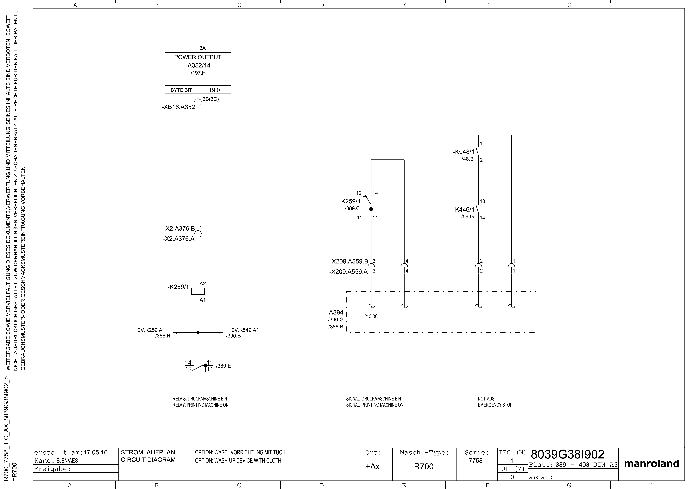

# +Ax — Sheet 389 of 403 — OPTION: WASCHVORRICHTUNG MIT TUCH

**OPTION: WASH UP DEVICE WITH CLOTH**

> Part of the manroland **R700** printing press IEC/UL circuit diagrams.
> Drawing class: **Stromlaufplan / Circuit diagram** (DIN A3).
> Document `+Ax` covers the **Central control console** machine section.

## At a glance

| Field | Value |
|---|---|
| Document | `+Ax`  (8039G38I902) |
| Sheet | **389** of 403 |
| Section (DE) | OPTION: WASCHVORRICHTUNG MIT TUCH |
| Section (EN) | OPTION: WASH UP DEVICE WITH CLOTH |
| Section type | CIRCUIT — Circuit diagram |
| Machine type | `R700` |
| Series | `7758` |
| Created | 17.05.10 |
| Replaces | — |
| Columns used | B, C, D, E, F |
| Path numbers | — |
| Labels on sheet | 58 |
| Cross-refs out | 8 |
| Cross-refs in | 19 |

**Previous:** [+Ax sheet 388](SHEET_0388.md) · **Next:** [+Ax sheet 390](SHEET_0390.md) · **Document TOC:** [_TOC.md](_TOC.md)  (+Ax) · **Master TOC:** [all sheets](../_MASTER_TOC.md)

## Sheet image (300 DPI, exact vector render)



_Rendered directly from the PDF vector layer at 300 DPI (1-bit), no OCR and no resampling. Use it to confirm anything ambiguous in the text below._

## Cross-references on this sheet

Each entry is a wire leaving this sheet. The printed token is `/sheet.column`; the link resolves to that sheet inside the same document.

| Ref | Target sheet | Col | Path | Destination on target | Target section | From col |
|---|---|---|---|---|---|---|
| `/197.H` | [+Ax sheet 197](SHEET_0197.md) | H | — | — | REFERENZMODUL | C |
| `/48.B` | [+Ax sheet 48](SHEET_0048.md) | B | — | — | NOT AUS | F |
| `/389.C` | [+Ax sheet 389](SHEET_0389.md) | C | — | — | OPTION: WASCHVORRICHTUNG MIT TUCH | D |
| `/59.G` | [+Ax sheet 59](SHEET_0059.md) | G | — | — | DRUCKLUFTANLAGE | F |
| `/390.G` | [+Ax sheet 390](SHEET_0390.md) | G | — | — | OPTION: WASCHVORRICHTUNG MIT TUCH | D |
| `/388.B` | [+Ax sheet 388](SHEET_0388.md) | B | — | — | OPTION: WASCHVORRICHTUNG MIT TUCH | D |
| `/386.H` | [+Ax sheet 386](SHEET_0386.md) | H | — | 0V.K259:A1 0V.K549:A1 | OPTION: INLINECOATER SMART | C |
| `/390.B` | [+Ax sheet 390](SHEET_0390.md) | B | — | — | OPTION: WASCHVORRICHTUNG MIT TUCH | C |

### Incoming references (sheets that point here)

Every other sheet that sends a wire to this one. `Back-ref` is the token printed on *that* sheet; `Path` is its line number.

| From sheet | Cols | Back-ref | Path | Refs | What continues there |
|---|---|---|---|---|---|
| [+Ax#48](SHEET_0048.md) | B | `/48.B` | — | 1 | — |
| [+Ax#59](SHEET_0059.md) | G | `/59.G` | — | 1 | — |
| [+Ax#197](SHEET_0197.md) | H | `/197.H` | — | 1 | — |
| [+Ax#220](SHEET_0220.md) | A, B | `/220.A`, `/220.B` | — | 2 | — |
| [+Ax#254](SHEET_0254.md) | C | `/254.C` | — | 1 | — |
| [+Ax#293](SHEET_0293.md) | A, B | `/293.A`, `/293.B` | — | 8 | — |
| [+Ax#386](SHEET_0386.md) | G | `/386.G` | — | 1 | 0V.K616:A1 |
| [+Ax#388](SHEET_0388.md) | B | `/388.B` | — | 1 | — |
| [+Ax#389](SHEET_0389.md) | D | `/389.D` | — | 1 | — |
| [+Ax#390](SHEET_0390.md) | A, G | `/390.A`, `/390.G` | — | 2 | 0V.K549:A1 |


## Devices on this sheet

| Tag | Class | Class meaning (IEC) | Col | Sub | Terminal | Sign |
|---|---|---|---|---|---|---|
| `A352/14` | A | Baugruppe / assembly, module, PC board | B | 14 | — | — |
| `A2` | A | Baugruppe / assembly, module, PC board | C | — | — | — |
| `A1` | A | Baugruppe / assembly, module, PC board | C | — | — | — |
| `K259/1` | K | Relais / relay, contactor | B | 1 | — | — |
| `A394` | A | Baugruppe / assembly, module, PC board | D | — | — | — |
| `K259/1` | K | Relais / relay, contactor | D | 1 | — | — |
| `K446/1` | K | Relais / relay, contactor | F | 1 | — | — |
| `K048/1` | K | Relais / relay, contactor | F | 1 | — | — |
| `19.0` | — | cross-device reference | C | — | — | — |
| `XB16.A352` | — | cross-device reference | B | — | — | — |
| `X209.A559.A` | — | cross-device reference | D | — | — | — |
| `X209.A559.B` | — | cross-device reference | D | — | — | — |
| `X2.A376.A` | — | cross-device reference | B | — | — | — |
| `X2.A376.B` | — | cross-device reference | B | — | — | — |

## Potentials / nets

| Potential | Count | Columns | Attached devices | Terminals |
|---|---|---|---|---|
| `0V` | 2 | B, C | `K259`, `K549` | `A1` |


A potential such as `L24+/4` or `M24+` is a named supply/return rail; every place it appears on this sheet is electrically common.

## Wire-end annotations (grouped as printed)

A wire that continues elsewhere is annotated with a small cluster: the destination description, the path/line number `#NN`, and the `/sheet.column` cross reference. Each row below is one such cluster exactly as it is grouped on the drawing.

| Col | Y | Path | Cross-ref | Text on the wire |
|---|---|---|---|---|
| C | 78.9 | — | — | `3A` |
| B | 94.1 | — | — | `POWER OUTPUT` |
| B | 108.0 | — | — | `A352/14` |
| C | 121.8 | — | `/197.H` | — |
| B | 150.9 | — | — | `BYTE.BIT 19.0` |
| C | 166.8 | — | — | `3B(3C)` |
| B | 178.9 | — | — | `XB16.A352 1` |
| F | 243.4 | — | — | `1` |
| F | 256.9 | — | — | `K048/1 2` |
| F | 269.9 | — | `/48.B` | — |
| D | 328.4 | — | — | `K259/1 14` |
| D | 328.4 | — | — | `12` |
| F | 342.6 | — | — | `13` |
| D | 355.0 | — | `/389.C` | — |
| F | 356.1 | — | — | `K446/1 14` |
| F | 369.1 | — | `/59.G` | — |
| E | 370.9 | — | — | `11 11` |
| B | 388.7 | — | — | `X2.A376.B 1` |
| B | 405.7 | — | — | `X2.A376.A 1` |
| D | 445.4 | — | — | `X209.A559.B 3` |
| E | 445.4 | — | — | `4` |
| F | 445.4 | — | — | `2` |
| F | 445.4 | — | — | `1` |
| D | 462.4 | — | — | `X209.A559.A 3` |
| E | 462.4 | — | — | `4` |
| F | 462.4 | — | — | `2` |
| F | 462.4 | — | — | `1` |
| C | 484.3 | — | — | `A2` |
| B | 489.3 | — | — | `K259/1` |
| C | 512.6 | — | — | `A1` |
| D | 533.2 | — | — | `A394` |
| E | 542.1 | — | — | `24C DC` |
| D | 546.3 | — | `/390.G` | — |
| D | 558.7 | — | `/388.B` | — |
| C | 564.4 | — | `/386.H` | `0V.K259:A1 0V.K549:A1` |
| C | 574.3 | — | `/390.B` | — |
| C | 619.6 | — | — | `14 12 11 11 /389.E` |
| C | 683.8 | — | — | `RELAIS: DRUCKMASCHINE EIN RELAY: PRINTING MACHINE ON` |
| E | 683.8 | — | — | `SIGNAL: DRUCKMASCHINE EIN SIGNAL: PRINTING MACHINE ON` |
| F | 683.8 | — | — | `NOT AUS EMERGENCY STOP` |


## Reconstructed tables

This sheet carries tabular content (pin map / terminal assignment / index). The grid below was rebuilt from the drawing's own rule lines, so each row is exactly one physical row of the table.

### Table 1 — 1 data rows × 2 columns (at x=283.5, y=90.7)

| POWER | OUTPUT A352/14 /197.H |
|---|---|
| `BYTE.BIT` | `19.0` |


## Notes and free text on this sheet

| Text | Col | Y (pt) |
|---|---|---|
| `3A` | C | 78.93 |
| `3B(3C)` | C | 166.85 |
| `POWER OUTPUT` | B | 94.1 |
| `BYTE.BIT` | B | 151.43 |
| `11 /389.E` | C | 626.01 |
| `RELAIS: DRUCKMASCHINE EIN` | C | 683.77 |
| `RELAY: PRINTING MACHINE ON` | C | 694.41 |
| `SIGNAL: DRUCKMASCHINE EIN` | E | 683.78 |
| `SIGNAL: PRINTING MACHINE ON` | E | 694.41 |
| `24C DC` | E | 542.07 |
| `NOT AUS` | F | 683.76 |
| `EMERGENCY STOP` | F | 694.41 |

## Complete label inventory (exact text from the drawing)

Every text object inside the drawing area of this sheet, in DIN reading order (column A→H, then top→bottom). This is the authoritative list: if a string is not here it is not printed on this sheet.

| Col | Y | X | Dir | Type | Text |
|---|---|---|---|---|---|
| B | 94.1 | 299.3 | → | text | `POWER OUTPUT` |
| B | 108.0 | 318.8 | → | device tag | `A352/14` |
| B | 151.4 | 293.4 | → | text | `BYTE.BIT` |
| B | 179.6 | 277.8 | → | device ref | `XB16.A352` |
| B | 388.7 | 280.9 | → | device ref | `X2.A376.B` |
| B | 406.4 | 280.1 | → | device ref | `X2.A376.A` |
| B | 489.3 | 288.0 | → | device tag | `K259/1` |
| B | 564.4 | 236.7 | → | potential | `0V.K259:A1` |
| B | 574.3 | 267.0 | → | cross-reference | `/386.H` |
| B | 619.6 | 317.5 | → | number | `14` |
| B | 631.0 | 317.5 | → | number | `12` |
| C | 78.9 | 342.7 | → | text | `3A` |
| C | 121.8 | 327.7 | → | cross-reference | `/197.H` |
| C | 150.9 | 358.7 | → | device ref | `19.0` |
| C | 166.9 | 348.4 | → | text | `3B(3C)` |
| C | 178.9 | 342.1 | → | number | `1` |
| C | 388.7 | 342.1 | → | number | `1` |
| C | 405.7 | 342.1 | → | number | `1` |
| C | 484.3 | 343.0 | → | device tag | `A2` |
| C | 512.6 | 343.0 | → | device tag | `A1` |
| C | 564.4 | 398.0 | → | potential | `0V.K549:A1` |
| C | 574.3 | 388.3 | → | cross-reference | `/390.B` |
| C | 619.6 | 354.6 | → | number | `11` |
| C | 626.0 | 354.6 | → | text | `11 /389.E` |
| C | 683.8 | 296.8 | → | text | `RELAIS: DRUCKMASCHINE EIN` |
| C | 694.4 | 296.8 | → | text | `RELAY: PRINTING MACHINE ON` |
| D | 328.4 | 611.7 | → | number | `12` |
| D | 341.9 | 582.8 | → | device tag | `K259/1` |
| D | 355.0 | 592.4 | → | cross-reference | `/389.C` |
| D | 371.0 | 612.9 | → | number | `11` |
| D | 445.3 | 566.6 | → | device ref | `X209.A559.B` |
| D | 463.1 | 565.8 | → | device ref | `X209.A559.A` |
| D | 533.2 | 561.8 | → | device tag | `A394` |
| D | 546.3 | 563.8 | → | cross-reference | `/390.G` |
| D | 558.7 | 564.4 | → | cross-reference | `/388.B` |
| E | 328.4 | 639.8 | → | number | `14` |
| E | 371.0 | 639.8 | → | number | `11` |
| E | 445.4 | 640.3 | → | number | `3` |
| E | 445.4 | 697.0 | → | number | `4` |
| E | 462.4 | 640.3 | → | number | `3` |
| E | 462.4 | 697.0 | → | number | `4` |
| E | 542.1 | 626.7 | → | text | `24C DC` |
| E | 683.8 | 595.0 | → | text | `SIGNAL: DRUCKMASCHINE EIN` |
| E | 694.4 | 595.0 | → | text | `SIGNAL: PRINTING MACHINE ON` |
| F | 243.4 | 824.0 | → | number | `1` |
| F | 256.8 | 778.4 | → | device tag | `K048/1` |
| F | 269.9 | 793.1 | → | cross-reference | `/48.B` |
| F | 271.7 | 824.6 | → | number | `2` |
| F | 342.6 | 824.0 | → | number | `13` |
| F | 356.1 | 778.4 | → | device tag | `K446/1` |
| F | 369.1 | 792.6 | → | cross-reference | `/59.G` |
| F | 371.0 | 824.0 | → | number | `14` |
| F | 445.4 | 824.6 | → | number | `2` |
| F | 445.4 | 880.7 | → | number | `1` |
| F | 462.4 | 824.6 | → | number | `2` |
| F | 462.4 | 880.7 | → | number | `1` |
| F | 683.8 | 821.2 | → | text | `NOT AUS` |
| F | 694.4 | 821.2 | → | text | `EMERGENCY STOP` |

## Reading-order text block

The same content as a plain block, grouped by DIN column — convenient to paste or to match against a visual description.

```text
=== Column B ===
  94.1  299.3  text         POWER OUTPUT
 108.0  318.8  devtag       A352/14
 151.4  293.4  text         BYTE.BIT
 179.6  277.8  devref       XB16.A352
 388.7  280.9  devref       X2.A376.B
 406.4  280.1  devref       X2.A376.A
 489.3  288.0  devtag       K259/1
 564.4  236.7  net          0V.K259:A1
 574.3  267.0  xref         /386.H
 619.6  317.5  numeric      14
 631.0  317.5  numeric      12
=== Column C ===
  78.9  342.7  text         3A
 121.8  327.7  xref         /197.H
 150.9  358.7  devref       19.0
 166.9  348.4  text         3B(3C)
 178.9  342.1  numeric      1
 388.7  342.1  numeric      1
 405.7  342.1  numeric      1
 484.3  343.0  devtag       A2
 512.6  343.0  devtag       A1
 564.4  398.0  net          0V.K549:A1
 574.3  388.3  xref         /390.B
 619.6  354.6  numeric      11
 626.0  354.6  text         11 /389.E
 683.8  296.8  text         RELAIS: DRUCKMASCHINE EIN
 694.4  296.8  text         RELAY: PRINTING MACHINE ON
=== Column D ===
 328.4  611.7  numeric      12
 341.9  582.8  devtag       K259/1
 355.0  592.4  xref         /389.C
 371.0  612.9  numeric      11
 445.3  566.6  devref       X209.A559.B
 463.1  565.8  devref       X209.A559.A
 533.2  561.8  devtag       A394
 546.3  563.8  xref         /390.G
 558.7  564.4  xref         /388.B
=== Column E ===
 328.4  639.8  numeric      14
 371.0  639.8  numeric      11
 445.4  640.3  numeric      3
 445.4  697.0  numeric      4
 462.4  640.3  numeric      3
 462.4  697.0  numeric      4
 542.1  626.7  text         24C DC
 683.8  595.0  text         SIGNAL: DRUCKMASCHINE EIN
 694.4  595.0  text         SIGNAL: PRINTING MACHINE ON
=== Column F ===
 243.4  824.0  numeric      1
 256.8  778.4  devtag       K048/1
 269.9  793.1  xref         /48.B
 271.7  824.6  numeric      2
 342.6  824.0  numeric      13
 356.1  778.4  devtag       K446/1
 369.1  792.6  xref         /59.G
 371.0  824.0  numeric      14
 445.4  824.6  numeric      2
 445.4  880.7  numeric      1
 462.4  824.6  numeric      2
 462.4  880.7  numeric      1
 683.8  821.2  text         NOT AUS
 694.4  821.2  text         EMERGENCY STOP
```

---
_Generated from the PDF vector text layer; no OCR. Source: `R700_7758_IEC_AX_8039G38I902_p`, sheet 389._
