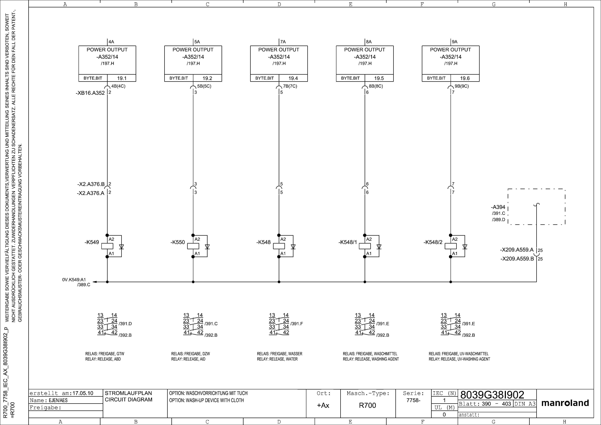

# +Ax — Sheet 390 of 403 — OPTION: WASCHVORRICHTUNG MIT TUCH

**OPTION: WASH UP DEVICE WITH CLOTH**

> Part of the manroland **R700** printing press IEC/UL circuit diagrams.
> Drawing class: **Stromlaufplan / Circuit diagram** (DIN A3).
> Document `+Ax` covers the **Central control console** machine section.

## At a glance

| Field | Value |
|---|---|
| Document | `+Ax`  (8039G38I902) |
| Sheet | **390** of 403 |
| Section (DE) | OPTION: WASCHVORRICHTUNG MIT TUCH |
| Section (EN) | OPTION: WASH UP DEVICE WITH CLOTH |
| Section type | CIRCUIT — Circuit diagram |
| Machine type | `R700` |
| Series | `7758` |
| Created | 17.05.10 |
| Replaces | — |
| Columns used | A, B, C, D, E, F, G, H |
| Path numbers | — |
| Labels on sheet | 136 |
| Cross-refs out | 17 |
| Cross-refs in | 34 |

**Previous:** [+Ax sheet 389](SHEET_0389.md) · **Next:** [+Ax sheet 391](SHEET_0391.md) · **Document TOC:** [_TOC.md](_TOC.md)  (+Ax) · **Master TOC:** [all sheets](../_MASTER_TOC.md)

## Sheet image (300 DPI, exact vector render)



_Rendered directly from the PDF vector layer at 300 DPI (1-bit), no OCR and no resampling. Use it to confirm anything ambiguous in the text below._

## Cross-references on this sheet

Each entry is a wire leaving this sheet. The printed token is `/sheet.column`; the link resolves to that sheet inside the same document.

| Ref | Target sheet | Col | Path | Destination on target | Target section | From col |
|---|---|---|---|---|---|---|
| `/197.H` | [+Ax sheet 197](SHEET_0197.md) | H | — | — | REFERENZMODUL | B |
| `/197.H` | [+Ax sheet 197](SHEET_0197.md) | H | — | — | REFERENZMODUL | C |
| `/197.H` | [+Ax sheet 197](SHEET_0197.md) | H | — | — | REFERENZMODUL | D |
| `/197.H` | [+Ax sheet 197](SHEET_0197.md) | H | — | — | REFERENZMODUL | E |
| `/197.H` | [+Ax sheet 197](SHEET_0197.md) | H | — | — | REFERENZMODUL | F |
| `/391.C` | [+Ax sheet 391](SHEET_0391.md) | C | — | — | OPTION: WASCHVORRICHTUNG MIT TUCH | G |
| `/389.D` | [+Ax sheet 389](SHEET_0389.md) | D | — | — | OPTION: WASCHVORRICHTUNG MIT TUCH | G |
| `/389.C` | [+Ax sheet 389](SHEET_0389.md) | C | — | 0V.K549:A1 | OPTION: WASCHVORRICHTUNG MIT TUCH | A |
| `/391.E` | [+Ax sheet 391](SHEET_0391.md) | E | — | — | OPTION: WASCHVORRICHTUNG MIT TUCH | E |
| `/391.E` | [+Ax sheet 391](SHEET_0391.md) | E | — | — | OPTION: WASCHVORRICHTUNG MIT TUCH | G |
| `/391.F` | [+Ax sheet 391](SHEET_0391.md) | F | — | — | OPTION: WASCHVORRICHTUNG MIT TUCH | D |
| `/391.D` | [+Ax sheet 391](SHEET_0391.md) | D | — | — | OPTION: WASCHVORRICHTUNG MIT TUCH | B |
| `/391.C` | [+Ax sheet 391](SHEET_0391.md) | C | — | — | OPTION: WASCHVORRICHTUNG MIT TUCH | C |
| `/392.B` | [+Ax sheet 392](SHEET_0392.md) | B | — | — | OPTION: WASCHVORRICHTUNG MIT TUCH | B |
| `/392.B` | [+Ax sheet 392](SHEET_0392.md) | B | — | — | OPTION: WASCHVORRICHTUNG MIT TUCH | C |
| `/392.B` | [+Ax sheet 392](SHEET_0392.md) | B | — | — | OPTION: WASCHVORRICHTUNG MIT TUCH | E |
| `/392.B` | [+Ax sheet 392](SHEET_0392.md) | B | — | — | OPTION: WASCHVORRICHTUNG MIT TUCH | G |

### Incoming references (sheets that point here)

Every other sheet that sends a wire to this one. `Back-ref` is the token printed on *that* sheet; `Path` is its line number.

| From sheet | Cols | Back-ref | Path | Refs | What continues there |
|---|---|---|---|---|---|
| [+Ax#197](SHEET_0197.md) | H | `/197.H` | — | 5 | — |
| [+Ax#220](SHEET_0220.md) | A, B | `/220.A`, `/220.B` | — | 10 | — |
| [+Ax#254](SHEET_0254.md) | C | `/254.C` | — | 5 | — |
| [+Ax#293](SHEET_0293.md) | A, B | `/293.A`, `/293.B` | — | 2 | — |
| [+Ax#389](SHEET_0389.md) | C, D | `/389.C`, `/389.D` | — | 2 | — |
| [+Ax#391](SHEET_0391.md) | C, D, E, F | `/391.C`, `/391.D`, `/391.E`, `/391.F` | — | 6 | — |
| [+Ax#392](SHEET_0392.md) | A, B | `/392.A`, `/392.B` | — | 4 | A394 |


## Devices on this sheet

| Tag | Class | Class meaning (IEC) | Col | Sub | Terminal | Sign |
|---|---|---|---|---|---|---|
| `A2` | A | Baugruppe / assembly, module, PC board | B | — | — | — |
| `A1` | A | Baugruppe / assembly, module, PC board | B | — | — | — |
| `K549` | K | Relais / relay, contactor | A | — | — | — |
| `A352/14` | A | Baugruppe / assembly, module, PC board | B | 14 | — | — |
| `A2` | A | Baugruppe / assembly, module, PC board | C | — | — | — |
| `A1` | A | Baugruppe / assembly, module, PC board | C | — | — | — |
| `K550` | K | Relais / relay, contactor | C | — | — | — |
| `A352/14` | A | Baugruppe / assembly, module, PC board | C | 14 | — | — |
| `A2` | A | Baugruppe / assembly, module, PC board | D | — | — | — |
| `A1` | A | Baugruppe / assembly, module, PC board | D | — | — | — |
| `K548` | K | Relais / relay, contactor | D | — | — | — |
| `A352/14` | A | Baugruppe / assembly, module, PC board | D | 14 | — | — |
| `A2` | A | Baugruppe / assembly, module, PC board | E | — | — | — |
| `A1` | A | Baugruppe / assembly, module, PC board | E | — | — | — |
| `K548/1` | K | Relais / relay, contactor | E | 1 | — | — |
| `A352/14` | A | Baugruppe / assembly, module, PC board | E | 14 | — | — |
| `A2` | A | Baugruppe / assembly, module, PC board | F | — | — | — |
| `A1` | A | Baugruppe / assembly, module, PC board | F | — | — | — |
| `K548/2` | K | Relais / relay, contactor | F | 2 | — | — |
| `A352/14` | A | Baugruppe / assembly, module, PC board | F | 14 | — | — |
| `A394` | A | Baugruppe / assembly, module, PC board | G | — | — | — |
| `19.1` | — | cross-device reference | B | — | — | — |
| `XB16.A352` | — | cross-device reference | A | — | — | — |
| `19.2` | — | cross-device reference | C | — | — | — |
| `19.4` | — | cross-device reference | D | — | — | — |
| `19.5` | — | cross-device reference | E | — | — | — |
| `19.6` | — | cross-device reference | G | — | — | — |
| `X209.A559.B` | — | cross-device reference | G | — | — | — |
| `X209.A559.A` | — | cross-device reference | G | — | — | — |
| `X2.A376.A` | — | cross-device reference | A | — | — | — |
| `X2.A376.B` | — | cross-device reference | A | — | — | — |

## Potentials / nets

| Potential | Count | Columns | Attached devices | Terminals |
|---|---|---|---|---|
| `0V` | 1 | A | `K549` | `A1` |


A potential such as `L24+/4` or `M24+` is a named supply/return rail; every place it appears on this sheet is electrically common.

## Wire-end annotations (grouped as printed)

A wire that continues elsewhere is annotated with a small cluster: the destination description, the path/line number `#NN`, and the `/sheet.column` cross reference. Each row below is one such cluster exactly as it is grouped on the drawing.

| Col | Y | Path | Cross-ref | Text on the wire |
|---|---|---|---|---|
| B | 78.9 | — | — | `4A` |
| C | 78.9 | — | — | `5A` |
| D | 78.9 | — | — | `7A` |
| E | 78.9 | — | — | `8A` |
| F | 78.9 | — | — | `9A` |
| B | 94.1 | — | — | `POWER OUTPUT` |
| C | 94.1 | — | — | `POWER OUTPUT` |
| D | 94.1 | — | — | `POWER OUTPUT` |
| E | 94.1 | — | — | `POWER OUTPUT` |
| F | 94.1 | — | — | `POWER OUTPUT` |
| B | 108.0 | — | — | `A352/14` |
| C | 108.0 | — | — | `A352/14` |
| D | 108.0 | — | — | `A352/14` |
| E | 108.0 | — | — | `A352/14` |
| F | 108.0 | — | — | `A352/14` |
| B | 121.8 | — | `/197.H` | — |
| C | 121.8 | — | `/197.H` | — |
| D | 121.8 | — | `/197.H` | — |
| E | 121.8 | — | `/197.H` | — |
| F | 121.8 | — | `/197.H` | — |
| B | 150.9 | — | — | `BYTE.BIT 19.1` |
| C | 150.9 | — | — | `BYTE.BIT 19.2` |
| D | 150.9 | — | — | `BYTE.BIT 19.4` |
| E | 150.9 | — | — | `BYTE.BIT 19.5` |
| F | 150.9 | — | — | `BYTE.BIT 19.6` |
| B | 166.8 | — | — | `4B(4C)` |
| C | 166.8 | — | — | `5B(5C)` |
| D | 166.8 | — | — | `7B(7C)` |
| E | 166.8 | — | — | `8B(8C)` |
| G | 166.8 | — | — | `9B(9C)` |
| A | 178.9 | — | — | `XB16.A352 2` |
| C | 178.9 | — | — | `3` |
| D | 178.9 | — | — | `5` |
| E | 178.9 | — | — | `6` |
| F | 178.9 | — | — | `7` |
| A | 360.3 | — | — | `X2.A376.B 2` |
| C | 360.3 | — | — | `3` |
| D | 360.3 | — | — | `5` |
| E | 360.3 | — | — | `6` |
| F | 360.3 | — | — | `7` |
| A | 377.3 | — | — | `X2.A376.A 2` |
| C | 377.3 | — | — | `3` |
| D | 377.3 | — | — | `5` |
| E | 377.3 | — | — | `6` |
| F | 377.3 | — | — | `7` |
| G | 405.7 | — | — | `A394` |
| G | 418.8 | — | `/391.C`, `/389.D` | — |
| B | 470.1 | — | — | `A2` |
| C | 470.1 | — | — | `A2` |
| D | 470.1 | — | — | `A2` |
| E | 470.1 | — | — | `A2` |
| F | 470.1 | — | — | `A2` |
| A | 475.1 | — | — | `K549` |
| C | 475.1 | — | — | `K550` |
| D | 475.1 | — | — | `K548` |
| E | 475.1 | — | — | `K548/1` |
| F | 475.1 | — | — | `K548/2` |
| G | 490.0 | — | — | `X209.A559.A 25` |
| B | 498.5 | — | — | `A1` |
| C | 498.5 | — | — | `A1` |
| D | 498.5 | — | — | `A1` |
| E | 498.5 | — | — | `A1` |
| F | 498.5 | — | — | `A1` |
| G | 507.7 | — | — | `X209.A559.B 25` |
| A | 550.2 | — | `/389.C` | `0V.K549:A1` |
| B | 619.6 | — | — | `13 14` |
| C | 619.6 | — | — | `13 14` |
| D | 619.6 | — | — | `13 14` |
| E | 619.6 | — | — | `13 14` |
| F | 619.6 | — | — | `13 14` |
| B | 631.0 | — | — | `23 33 34 24` |
| C | 631.0 | — | — | `23 33 34 24` |
| D | 631.0 | — | — | `23 33 34 24` |
| E | 631.0 | — | — | `23 33 34 24` |
| F | 631.0 | — | — | `23 33 34 24` |
| B | 637.4 | — | `/391.D` | — |
| C | 637.4 | — | `/391.C` | — |
| D | 637.4 | — | `/391.F` | — |
| E | 637.4 | — | `/391.E` | — |
| G | 637.4 | — | `/391.E` | — |
| B | 653.7 | — | — | `41 42` |
| C | 653.7 | — | — | `41 42` |
| D | 653.7 | — | — | `41 42` |
| E | 653.7 | — | — | `41 42` |
| F | 653.7 | — | — | `41 42` |
| B | 660.0 | — | `/392.B` | — |
| C | 660.0 | — | `/392.B` | — |
| E | 660.0 | — | `/392.B` | — |
| G | 660.0 | — | `/392.B` | — |
| B | 697.9 | — | — | `RELAIS: FREIGABE, GTW RELAY: RELEASE, ABD` |
| C | 697.9 | — | — | `RELAIS: FREIGABE, DZW RELAY: RELEASE, AID` |
| D | 697.9 | — | — | `RELAIS: FREIGABE, WASSER RELAY: RELEASE, WATER` |
| E | 697.9 | — | — | `RELAIS: FREIGABE, WASCHMITTEL RELAY: RELEASE, WASHING AGENT` |
| G | 697.9 | — | — | `RELAIS: FREIGABE, UV WASCHMITTEL RELAY: RELEASE, UV WASHING AGENT` |


## Reconstructed tables

This sheet carries tabular content (pin map / terminal assignment / index). The grid below was rebuilt from the drawing's own rule lines, so each row is exactly one physical row of the table.

### Table 1 — 2 data rows × 3 columns (at x=155.9, y=90.7)

| POWER | OUTPUT A352/14 /197.H |  |
|---|---|---|
| `BYTE.BIT` |  | `19.1` |
| `XB16.A352 X2.A376.B X2.A376.A K549` | `4B(4C) 2 2 2 A2 A1` |  |


### Table 2 — 2 data rows × 3 columns (at x=326.0, y=90.7)

| POWER | OUTPUT A352/14 /197.H |  |
|---|---|---|
| `BYTE.BIT` |  | `19.2` |
| `K550` | `5B(5C) 3 3 3 A2 A1` |  |


### Table 3 — 2 data rows × 3 columns (at x=496.1, y=90.7)

| POWER | OUTPUT A352/14 /197.H |  |
|---|---|---|
| `BYTE.BIT` |  | `19.4` |
| `K548` | `7B(7C) 5 5 5 A2 A1` |  |


### Table 4 — 2 data rows × 2 columns (at x=666.1, y=90.7)

| POWER | OUTPUT A352/14 /197.H |
|---|---|
| `BYTE.BIT` | `19.5` |
| `K548/1` | `8B(8C) 6 6 6 A2 A1` |


### Table 5 — 2 data rows × 2 columns (at x=836.2, y=90.7)

| POWER | OUTPUT A352/14 /197.H |
|---|---|
| `BYTE.BIT` | `19.6` |
| `K548/2` | `9B(9C) 7 7 7 A2 A1` |


## Notes and free text on this sheet

| Text | Col | Y (pt) |
|---|---|---|
| `RELAIS: FREIGABE, GTW` | B | 697.9 |
| `RELAY: RELEASE, ABD` | B | 708.56 |
| `4A` | B | 78.93 |
| `4B(4C)` | B | 166.85 |
| `POWER OUTPUT` | B | 94.1 |
| `BYTE.BIT` | A | 151.43 |
| `RELAIS: FREIGABE, DZW` | C | 697.91 |
| `RELAY: RELEASE, AID` | C | 708.55 |
| `5A` | C | 78.93 |
| `5B(5C)` | C | 166.85 |
| `POWER OUTPUT` | C | 94.1 |
| `BYTE.BIT` | C | 151.43 |
| `RELAIS: FREIGABE, WASSER` | D | 697.91 |
| `RELAY: RELEASE, WATER` | D | 708.54 |
| `7A` | D | 78.93 |
| `7B(7C)` | D | 166.85 |
| `POWER OUTPUT` | D | 94.1 |
| `BYTE.BIT` | D | 151.43 |
| `RELAIS: FREIGABE, WASCHMITTEL` | E | 697.92 |
| `RELAY: RELEASE, WASHING AGENT` | E | 708.55 |
| `8A` | E | 78.93 |
| `8B(8C)` | E | 166.85 |
| `POWER OUTPUT` | E | 94.1 |
| `BYTE.BIT` | E | 151.43 |
| `RELAIS: FREIGABE, UV WASCHMITTEL` | G | 697.93 |
| `RELAY: RELEASE, UV WASHING AGENT` | G | 708.56 |
| `9A` | F | 78.93 |
| `9B(9C)` | G | 166.85 |
| `POWER OUTPUT` | F | 94.1 |
| `BYTE.BIT` | F | 151.43 |

## Complete label inventory (exact text from the drawing)

Every text object inside the drawing area of this sheet, in DIN reading order (column A→H, then top→bottom). This is the authoritative list: if a string is not here it is not printed on this sheet.

| Col | Y | X | Dir | Type | Text |
|---|---|---|---|---|---|
| A | 151.4 | 165.8 | → | text | `BYTE.BIT` |
| A | 179.6 | 150.2 | → | device ref | `XB16.A352` |
| A | 360.3 | 153.4 | → | device ref | `X2.A376.B` |
| A | 378.0 | 152.5 | → | device ref | `X2.A376.A` |
| A | 475.1 | 167.8 | → | device tag | `K549` |
| A | 550.2 | 123.3 | → | potential | `0V.K549:A1` |
| A | 560.1 | 153.1 | → | cross-reference | `/389.C` |
| A | 619.6 | 192.8 | → | number | `13` |
| A | 631.0 | 192.8 | → | number | `23` |
| A | 642.3 | 192.8 | → | number | `33` |
| B | 78.9 | 215.1 | → | text | `4A` |
| B | 94.1 | 171.8 | → | text | `POWER OUTPUT` |
| B | 108.0 | 191.2 | → | device tag | `A352/14` |
| B | 121.8 | 200.1 | → | cross-reference | `/197.H` |
| B | 150.9 | 232.0 | → | device ref | `19.1` |
| B | 166.9 | 220.8 | → | text | `4B(4C)` |
| B | 178.9 | 215.1 | → | number | `2` |
| B | 360.3 | 215.1 | → | number | `2` |
| B | 377.3 | 215.1 | → | number | `2` |
| B | 470.1 | 215.4 | → | device tag | `A2` |
| B | 498.5 | 215.4 | → | device tag | `A1` |
| B | 619.6 | 220.0 | → | number | `14` |
| B | 631.0 | 220.8 | → | number | `24` |
| B | 637.4 | 235.3 | → | cross-reference | `/391.D` |
| B | 642.3 | 220.5 | → | number | `34` |
| B | 653.7 | 194.2 | → | number | `41` |
| B | 653.7 | 220.8 | → | number | `42` |
| B | 660.0 | 235.3 | → | cross-reference | `/392.B` |
| B | 697.9 | 169.2 | → | text | `RELAIS: FREIGABE, GTW` |
| B | 708.6 | 169.2 | → | text | `RELAY: RELEASE, ABD` |
| C | 78.9 | 385.2 | → | text | `5A` |
| C | 94.1 | 341.9 | → | text | `POWER OUTPUT` |
| C | 108.0 | 361.3 | → | device tag | `A352/14` |
| C | 121.8 | 370.2 | → | cross-reference | `/197.H` |
| C | 150.9 | 401.2 | → | device ref | `19.2` |
| C | 151.4 | 335.9 | → | text | `BYTE.BIT` |
| C | 166.9 | 390.9 | → | text | `5B(5C)` |
| C | 178.9 | 385.2 | → | number | `3` |
| C | 360.3 | 385.2 | → | number | `3` |
| C | 377.3 | 385.2 | → | number | `3` |
| C | 470.1 | 385.5 | → | device tag | `A2` |
| C | 475.1 | 337.9 | → | device tag | `K550` |
| C | 498.5 | 385.5 | → | device tag | `A1` |
| C | 619.6 | 362.8 | → | number | `13` |
| C | 619.6 | 390.0 | → | number | `14` |
| C | 631.0 | 362.8 | → | number | `23` |
| C | 631.0 | 390.9 | → | number | `24` |
| C | 637.4 | 405.4 | → | cross-reference | `/391.C` |
| C | 642.3 | 362.8 | → | number | `33` |
| C | 642.3 | 390.6 | → | number | `34` |
| C | 653.7 | 364.3 | → | number | `41` |
| C | 653.7 | 390.9 | → | number | `42` |
| C | 660.0 | 405.4 | → | cross-reference | `/392.B` |
| C | 697.9 | 339.3 | → | text | `RELAIS: FREIGABE, DZW` |
| C | 708.6 | 339.3 | → | text | `RELAY: RELEASE, AID` |
| D | 78.9 | 555.3 | → | text | `7A` |
| D | 94.1 | 511.9 | → | text | `POWER OUTPUT` |
| D | 108.0 | 531.4 | → | device tag | `A352/14` |
| D | 121.8 | 540.3 | → | cross-reference | `/197.H` |
| D | 150.9 | 571.3 | → | device ref | `19.4` |
| D | 151.4 | 506.0 | → | text | `BYTE.BIT` |
| D | 166.9 | 561.0 | → | text | `7B(7C)` |
| D | 178.9 | 555.3 | → | number | `5` |
| D | 360.3 | 555.3 | → | number | `5` |
| D | 377.3 | 555.3 | → | number | `5` |
| D | 470.1 | 555.6 | → | device tag | `A2` |
| D | 475.1 | 508.0 | → | device tag | `K548` |
| D | 498.5 | 555.6 | → | device tag | `A1` |
| D | 619.6 | 532.9 | → | number | `13` |
| D | 619.6 | 560.1 | → | number | `14` |
| D | 631.0 | 532.9 | → | number | `23` |
| D | 631.0 | 561.0 | → | number | `24` |
| D | 637.4 | 575.4 | → | cross-reference | `/391.F` |
| D | 642.3 | 532.9 | → | number | `33` |
| D | 642.3 | 560.7 | → | number | `34` |
| D | 653.7 | 534.3 | → | number | `41` |
| D | 653.7 | 561.0 | → | number | `42` |
| D | 697.9 | 509.4 | → | text | `RELAIS: FREIGABE, WASSER` |
| D | 708.5 | 509.4 | → | text | `RELAY: RELEASE, WATER` |
| E | 78.9 | 725.4 | → | text | `8A` |
| E | 94.1 | 682.0 | → | text | `POWER OUTPUT` |
| E | 108.0 | 701.4 | → | device tag | `A352/14` |
| E | 121.8 | 710.4 | → | cross-reference | `/197.H` |
| E | 150.9 | 741.4 | → | device ref | `19.5` |
| E | 151.4 | 676.1 | → | text | `BYTE.BIT` |
| E | 166.9 | 731.1 | → | text | `8B(8C)` |
| E | 178.9 | 725.4 | → | number | `6` |
| E | 360.3 | 725.4 | → | number | `6` |
| E | 377.3 | 725.4 | → | number | `6` |
| E | 470.1 | 725.7 | → | device tag | `A2` |
| E | 475.1 | 670.7 | → | device tag | `K548/1` |
| E | 498.5 | 725.7 | → | device tag | `A1` |
| E | 619.6 | 703.0 | → | number | `13` |
| E | 619.6 | 730.2 | → | number | `14` |
| E | 631.0 | 703.0 | → | number | `23` |
| E | 631.0 | 731.1 | → | number | `24` |
| E | 637.4 | 745.5 | → | cross-reference | `/391.E` |
| E | 642.3 | 703.0 | → | number | `33` |
| E | 642.3 | 730.8 | → | number | `34` |
| E | 653.7 | 704.4 | → | number | `41` |
| E | 653.7 | 731.1 | → | number | `42` |
| E | 660.0 | 745.5 | → | cross-reference | `/392.B` |
| E | 697.9 | 679.5 | → | text | `RELAIS: FREIGABE, WASCHMITTEL` |
| E | 708.6 | 679.5 | → | text | `RELAY: RELEASE, WASHING AGENT` |
| F | 78.9 | 895.5 | → | text | `9A` |
| F | 94.1 | 852.1 | → | text | `POWER OUTPUT` |
| F | 108.0 | 871.5 | → | device tag | `A352/14` |
| F | 121.8 | 880.4 | → | cross-reference | `/197.H` |
| F | 151.4 | 846.1 | → | text | `BYTE.BIT` |
| F | 178.9 | 895.5 | → | number | `7` |
| F | 360.3 | 895.5 | → | number | `7` |
| F | 377.3 | 895.5 | → | number | `7` |
| F | 470.1 | 895.7 | → | device tag | `A2` |
| F | 475.1 | 839.3 | → | device tag | `K548/2` |
| F | 498.5 | 895.7 | → | device tag | `A1` |
| F | 619.6 | 873.1 | → | number | `13` |
| F | 619.6 | 900.3 | → | number | `14` |
| F | 631.0 | 873.1 | → | number | `23` |
| F | 631.0 | 901.1 | → | number | `24` |
| F | 642.3 | 873.1 | → | number | `33` |
| F | 642.3 | 900.9 | → | number | `34` |
| F | 653.7 | 874.5 | → | number | `41` |
| F | 653.7 | 901.1 | → | number | `42` |
| G | 150.9 | 911.5 | → | device ref | `19.6` |
| G | 166.9 | 901.1 | → | text | `9B(9C)` |
| G | 405.7 | 972.9 | → | device tag | `A394` |
| G | 418.8 | 975.1 | → | cross-reference | `/391.C` |
| G | 431.2 | 975.1 | → | cross-reference | `/389.D` |
| G | 490.0 | 991.0 | → | device ref | `X209.A559.A` |
| G | 507.7 | 991.8 | → | device ref | `X209.A559.B` |
| G | 637.4 | 915.6 | → | cross-reference | `/391.E` |
| G | 660.0 | 915.6 | → | cross-reference | `/392.B` |
| G | 697.9 | 849.5 | → | text | `RELAIS: FREIGABE, UV WASCHMITTEL` |
| G | 708.6 | 849.5 | → | text | `RELAY: RELEASE, UV WASHING AGENT` |
| H | 492.1 | 1065.5 | → | number | `25` |
| H | 509.1 | 1065.5 | → | number | `25` |

## Reading-order text block

The same content as a plain block, grouped by DIN column — convenient to paste or to match against a visual description.

```text
=== Column A ===
 151.4  165.8  text         BYTE.BIT
 179.6  150.2  devref       XB16.A352
 360.3  153.4  devref       X2.A376.B
 378.0  152.5  devref       X2.A376.A
 475.1  167.8  devtag       K549
 550.2  123.3  net          0V.K549:A1
 560.1  153.1  xref         /389.C
 619.6  192.8  numeric      13
 631.0  192.8  numeric      23
 642.3  192.8  numeric      33
=== Column B ===
  78.9  215.1  text         4A
  94.1  171.8  text         POWER OUTPUT
 108.0  191.2  devtag       A352/14
 121.8  200.1  xref         /197.H
 150.9  232.0  devref       19.1
 166.9  220.8  text         4B(4C)
 178.9  215.1  numeric      2
 360.3  215.1  numeric      2
 377.3  215.1  numeric      2
 470.1  215.4  devtag       A2
 498.5  215.4  devtag       A1
 619.6  220.0  numeric      14
 631.0  220.8  numeric      24
 637.4  235.3  xref         /391.D
 642.3  220.5  numeric      34
 653.7  194.2  numeric      41
 653.7  220.8  numeric      42
 660.0  235.3  xref         /392.B
 697.9  169.2  text         RELAIS: FREIGABE, GTW
 708.6  169.2  text         RELAY: RELEASE, ABD
=== Column C ===
  78.9  385.2  text         5A
  94.1  341.9  text         POWER OUTPUT
 108.0  361.3  devtag       A352/14
 121.8  370.2  xref         /197.H
 150.9  401.2  devref       19.2
 151.4  335.9  text         BYTE.BIT
 166.9  390.9  text         5B(5C)
 178.9  385.2  numeric      3
 360.3  385.2  numeric      3
 377.3  385.2  numeric      3
 470.1  385.5  devtag       A2
 475.1  337.9  devtag       K550
 498.5  385.5  devtag       A1
 619.6  362.8  numeric      13
 619.6  390.0  numeric      14
 631.0  362.8  numeric      23
 631.0  390.9  numeric      24
 637.4  405.4  xref         /391.C
 642.3  362.8  numeric      33
 642.3  390.6  numeric      34
 653.7  364.3  numeric      41
 653.7  390.9  numeric      42
 660.0  405.4  xref         /392.B
 697.9  339.3  text         RELAIS: FREIGABE, DZW
 708.6  339.3  text         RELAY: RELEASE, AID
=== Column D ===
  78.9  555.3  text         7A
  94.1  511.9  text         POWER OUTPUT
 108.0  531.4  devtag       A352/14
 121.8  540.3  xref         /197.H
 150.9  571.3  devref       19.4
 151.4  506.0  text         BYTE.BIT
 166.9  561.0  text         7B(7C)
 178.9  555.3  numeric      5
 360.3  555.3  numeric      5
 377.3  555.3  numeric      5
 470.1  555.6  devtag       A2
 475.1  508.0  devtag       K548
 498.5  555.6  devtag       A1
 619.6  532.9  numeric      13
 619.6  560.1  numeric      14
 631.0  532.9  numeric      23
 631.0  561.0  numeric      24
 637.4  575.4  xref         /391.F
 642.3  532.9  numeric      33
 642.3  560.7  numeric      34
 653.7  534.3  numeric      41
 653.7  561.0  numeric      42
 697.9  509.4  text         RELAIS: FREIGABE, WASSER
 708.5  509.4  text         RELAY: RELEASE, WATER
=== Column E ===
  78.9  725.4  text         8A
  94.1  682.0  text         POWER OUTPUT
 108.0  701.4  devtag       A352/14
 121.8  710.4  xref         /197.H
 150.9  741.4  devref       19.5
 151.4  676.1  text         BYTE.BIT
 166.9  731.1  text         8B(8C)
 178.9  725.4  numeric      6
 360.3  725.4  numeric      6
 377.3  725.4  numeric      6
 470.1  725.7  devtag       A2
 475.1  670.7  devtag       K548/1
 498.5  725.7  devtag       A1
 619.6  703.0  numeric      13
 619.6  730.2  numeric      14
 631.0  703.0  numeric      23
 631.0  731.1  numeric      24
 637.4  745.5  xref         /391.E
 642.3  703.0  numeric      33
 642.3  730.8  numeric      34
 653.7  704.4  numeric      41
 653.7  731.1  numeric      42
 660.0  745.5  xref         /392.B
 697.9  679.5  text         RELAIS: FREIGABE, WASCHMITTEL
 708.6  679.5  text         RELAY: RELEASE, WASHING AGENT
=== Column F ===
  78.9  895.5  text         9A
  94.1  852.1  text         POWER OUTPUT
 108.0  871.5  devtag       A352/14
 121.8  880.4  xref         /197.H
 151.4  846.1  text         BYTE.BIT
 178.9  895.5  numeric      7
 360.3  895.5  numeric      7
 377.3  895.5  numeric      7
 470.1  895.7  devtag       A2
 475.1  839.3  devtag       K548/2
 498.5  895.7  devtag       A1
 619.6  873.1  numeric      13
 619.6  900.3  numeric      14
 631.0  873.1  numeric      23
 631.0  901.1  numeric      24
 642.3  873.1  numeric      33
 642.3  900.9  numeric      34
 653.7  874.5  numeric      41
 653.7  901.1  numeric      42
=== Column G ===
 150.9  911.5  devref       19.6
 166.9  901.1  text         9B(9C)
 405.7  972.9  devtag       A394
 418.8  975.1  xref         /391.C
 431.2  975.1  xref         /389.D
 490.0  991.0  devref       X209.A559.A
 507.7  991.8  devref       X209.A559.B
 637.4  915.6  xref         /391.E
 660.0  915.6  xref         /392.B
 697.9  849.5  text         RELAIS: FREIGABE, UV WASCHMITTEL
 708.6  849.5  text         RELAY: RELEASE, UV WASHING AGENT
=== Column H ===
 492.1 1065.5  numeric      25
 509.1 1065.5  numeric      25
```

---
_Generated from the PDF vector text layer; no OCR. Source: `R700_7758_IEC_AX_8039G38I902_p`, sheet 390._
