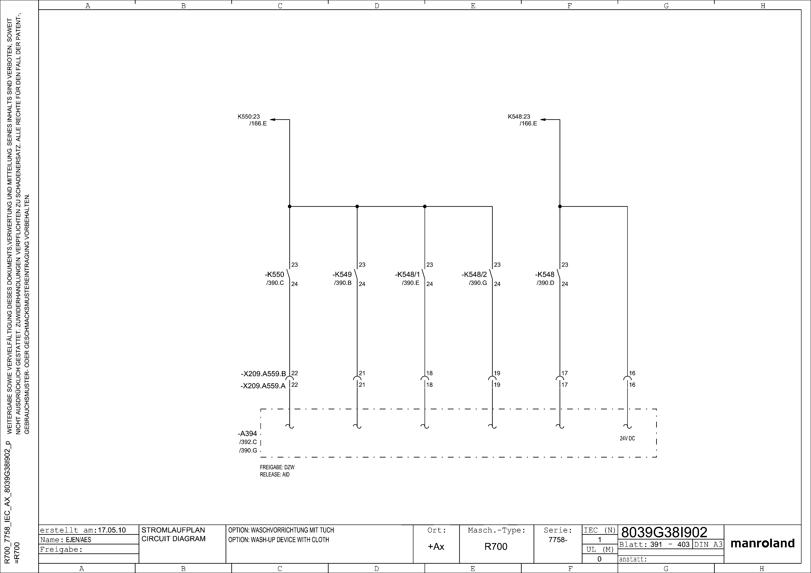

# +Ax — Sheet 391 of 403 — OPTION: WASCHVORRICHTUNG MIT TUCH

**OPTION: WASH UP DEVICE WITH CLOTH**

> Part of the manroland **R700** printing press IEC/UL circuit diagrams.
> Drawing class: **Stromlaufplan / Circuit diagram** (DIN A3).
> Document `+Ax` covers the **Central control console** machine section.

## At a glance

| Field | Value |
|---|---|
| Document | `+Ax`  (8039G38I902) |
| Sheet | **391** of 403 |
| Section (DE) | OPTION: WASCHVORRICHTUNG MIT TUCH |
| Section (EN) | OPTION: WASH UP DEVICE WITH CLOTH |
| Section type | CIRCUIT — Circuit diagram |
| Machine type | `R700` |
| Series | `7758` |
| Created | 17.05.10 |
| Replaces | — |
| Columns used | C, D, E, F, G |
| Path numbers | — |
| Labels on sheet | 44 |
| Cross-refs out | 9 |
| Cross-refs in | 21 |

**Previous:** [+Ax sheet 390](SHEET_0390.md) · **Next:** [+Ax sheet 392](SHEET_0392.md) · **Document TOC:** [_TOC.md](_TOC.md)  (+Ax) · **Master TOC:** [all sheets](../_MASTER_TOC.md)

## Sheet image (300 DPI, exact vector render)



_Rendered directly from the PDF vector layer at 300 DPI (1-bit), no OCR and no resampling. Use it to confirm anything ambiguous in the text below._

## Cross-references on this sheet

Each entry is a wire leaving this sheet. The printed token is `/sheet.column`; the link resolves to that sheet inside the same document.

| Ref | Target sheet | Col | Path | Destination on target | Target section | From col |
|---|---|---|---|---|---|---|
| `/166.E` | [+Ax sheet 166](SHEET_0166.md) | E | — | K550:23 | ÜBERWACHUNGSRECHNER/ANSTEUERUNG NOT AUS | C |
| `/166.E` | [+Ax sheet 166](SHEET_0166.md) | E | — | K548:23 | ÜBERWACHUNGSRECHNER/ANSTEUERUNG NOT AUS | F |
| `/390.B` | [+Ax sheet 390](SHEET_0390.md) | B | — | — | OPTION: WASCHVORRICHTUNG MIT TUCH | D |
| `/390.E` | [+Ax sheet 390](SHEET_0390.md) | E | — | — | OPTION: WASCHVORRICHTUNG MIT TUCH | D |
| `/390.G` | [+Ax sheet 390](SHEET_0390.md) | G | — | — | OPTION: WASCHVORRICHTUNG MIT TUCH | E |
| `/390.C` | [+Ax sheet 390](SHEET_0390.md) | C | — | — | OPTION: WASCHVORRICHTUNG MIT TUCH | C |
| `/390.D` | [+Ax sheet 390](SHEET_0390.md) | D | — | — | OPTION: WASCHVORRICHTUNG MIT TUCH | F |
| `/392.C` | [+Ax sheet 392](SHEET_0392.md) | C | — | — | OPTION: WASCHVORRICHTUNG MIT TUCH | C |
| `/390.G` | [+Ax sheet 390](SHEET_0390.md) | G | — | — | OPTION: WASCHVORRICHTUNG MIT TUCH | C |

### Incoming references (sheets that point here)

Every other sheet that sends a wire to this one. `Back-ref` is the token printed on *that* sheet; `Path` is its line number.

| From sheet | Cols | Back-ref | Path | Refs | What continues there |
|---|---|---|---|---|---|
| [+Ax#166](SHEET_0166.md) | E | `/166.E` | — | 2 | — |
| [+Ax#293](SHEET_0293.md) | A, B | `/293.A`, `/293.B` | — | 12 | — |
| [+Ax#390](SHEET_0390.md) | B, C, D, E, G | `/390.B`, `/390.C`, `/390.D`, `/390.E`, `/390.G` | — | 6 | — |
| [+Ax#392](SHEET_0392.md) | C | `/392.C` | — | 1 | — |


## Devices on this sheet

| Tag | Class | Class meaning (IEC) | Col | Sub | Terminal | Sign |
|---|---|---|---|---|---|---|
| `A394` | A | Baugruppe / assembly, module, PC board | C | — | — | — |
| `K550` | K | Relais / relay, contactor | C | — | — | — |
| `K549` | K | Relais / relay, contactor | D | — | — | — |
| `K548/1` | K | Relais / relay, contactor | D | 1 | — | — |
| `K548/2` | K | Relais / relay, contactor | E | 2 | — | — |
| `K548` | K | Relais / relay, contactor | F | — | — | — |
| `K550:23` | K | Relais / relay, contactor | C | — | 23 | — |
| `K548:23` | K | Relais / relay, contactor | E | — | 23 | — |
| `X209.A559.B` | — | cross-device reference | C | — | — | — |
| `X209.A559.A` | — | cross-device reference | C | — | — | — |

## Potentials / nets

| Potential | Count | Columns | Attached devices | Terminals |
|---|---|---|---|---|
| `24V` | 1 | G | — | — |


A potential such as `L24+/4` or `M24+` is a named supply/return rail; every place it appears on this sheet is electrically common.

## Wire-end annotations (grouped as printed)

A wire that continues elsewhere is annotated with a small cluster: the destination description, the path/line number `#NN`, and the `/sheet.column` cross reference. Each row below is one such cluster exactly as it is grouped on the drawing.

| Col | Y | Path | Cross-ref | Text on the wire |
|---|---|---|---|---|
| C | 167.5 | — | `/166.E` | `K550:23` |
| F | 167.5 | — | `/166.E` | `K548:23` |
| C | 385.1 | — | — | `23` |
| D | 385.1 | — | — | `23` |
| E | 385.1 | — | — | `23` |
| E | 385.1 | — | — | `23` |
| F | 385.1 | — | — | `23` |
| C | 398.6 | — | — | `K550 24` |
| D | 398.6 | — | — | `K549 24` |
| D | 398.6 | — | — | `K548/1 24` |
| E | 398.6 | — | — | `K548/2 24` |
| F | 398.6 | — | — | `K548 24` |
| D | 411.6 | — | `/390.B` | — |
| D | 411.6 | — | `/390.E` | — |
| C | 411.7 | — | `/390.C` | — |
| E | 411.7 | — | `/390.G` | — |
| F | 411.7 | — | `/390.D` | — |
| C | 544.6 | — | — | `X209.A559.B 22` |
| D | 544.6 | — | — | `21` |
| E | 544.6 | — | — | `18` |
| E | 544.6 | — | — | `19` |
| F | 544.6 | — | — | `17` |
| G | 544.6 | — | — | `16` |
| C | 561.6 | — | — | `X209.A559.A 22` |
| D | 561.6 | — | — | `21` |
| E | 561.6 | — | — | `18` |
| E | 561.6 | — | — | `19` |
| F | 561.6 | — | — | `17` |
| G | 561.6 | — | — | `16` |
| C | 632.4 | — | — | `A394` |
| G | 641.3 | — | — | `24V DC` |
| C | 645.5 | — | `/392.C`, `/390.G` | — |
| C | 683.7 | — | — | `FREIGABE: DZW RELEASE: AID` |


## Notes and free text on this sheet

| Text | Col | Y (pt) |
|---|---|---|
| `FREIGABE: DZW` | C | 683.72 |
| `RELEASE: AID` | C | 694.37 |

## Complete label inventory (exact text from the drawing)

Every text object inside the drawing area of this sheet, in DIN reading order (column A→H, then top→bottom). This is the authoritative list: if a string is not here it is not printed on this sheet.

| Col | Y | X | Dir | Type | Text |
|---|---|---|---|---|---|
| C | 167.5 | 348.9 | → | device tag | `K550:23` |
| C | 177.4 | 366.2 | → | cross-reference | `/166.E` |
| C | 385.1 | 427.7 | → | number | `23` |
| C | 398.6 | 388.9 | → | device tag | `K550` |
| C | 411.7 | 391.2 | → | cross-reference | `/390.C` |
| C | 413.5 | 427.7 | → | number | `24` |
| C | 544.6 | 354.0 | → | device ref | `X209.A559.B` |
| C | 544.6 | 427.7 | → | number | `22` |
| C | 561.6 | 427.7 | → | number | `22` |
| C | 562.3 | 353.2 | → | device ref | `X209.A559.A` |
| C | 632.4 | 349.2 | → | device tag | `A394` |
| C | 645.5 | 351.5 | → | cross-reference | `/392.C` |
| C | 657.9 | 351.2 | → | cross-reference | `/390.G` |
| C | 683.7 | 381.8 | → | text | `FREIGABE: DZW` |
| C | 694.4 | 381.8 | → | text | `RELEASE: AID` |
| D | 385.1 | 527.0 | → | number | `23` |
| D | 398.6 | 488.1 | → | device tag | `K549` |
| D | 398.6 | 580.0 | → | device tag | `K548/1` |
| D | 411.6 | 490.7 | → | cross-reference | `/390.B` |
| D | 411.6 | 590.2 | → | cross-reference | `/390.E` |
| D | 413.5 | 527.0 | → | number | `24` |
| D | 544.6 | 527.0 | → | number | `21` |
| D | 561.6 | 527.0 | → | number | `21` |
| E | 167.5 | 745.8 | → | device tag | `K548:23` |
| E | 385.1 | 626.2 | → | number | `23` |
| E | 385.1 | 725.4 | → | number | `23` |
| E | 398.6 | 677.8 | → | device tag | `K548/2` |
| E | 411.7 | 688.5 | → | cross-reference | `/390.G` |
| E | 413.5 | 626.2 | → | number | `24` |
| E | 413.5 | 725.4 | → | number | `24` |
| E | 544.6 | 625.6 | → | number | `18` |
| E | 544.6 | 724.8 | → | number | `19` |
| E | 561.6 | 625.6 | → | number | `18` |
| E | 561.6 | 724.8 | → | number | `19` |
| F | 177.4 | 763.1 | → | cross-reference | `/166.E` |
| F | 385.1 | 824.6 | → | number | `23` |
| F | 398.6 | 785.8 | → | device tag | `K548` |
| F | 411.7 | 788.0 | → | cross-reference | `/390.D` |
| F | 413.5 | 824.6 | → | number | `24` |
| F | 544.6 | 824.0 | → | number | `17` |
| F | 561.6 | 824.0 | → | number | `17` |
| G | 544.6 | 923.2 | → | number | `16` |
| G | 561.6 | 923.2 | → | number | `16` |
| G | 641.3 | 910.3 | → | potential | `24V DC` |

## Reading-order text block

The same content as a plain block, grouped by DIN column — convenient to paste or to match against a visual description.

```text
=== Column C ===
 167.5  348.9  devtag       K550:23
 177.4  366.2  xref         /166.E
 385.1  427.7  numeric      23
 398.6  388.9  devtag       K550
 411.7  391.2  xref         /390.C
 413.5  427.7  numeric      24
 544.6  354.0  devref       X209.A559.B
 544.6  427.7  numeric      22
 561.6  427.7  numeric      22
 562.3  353.2  devref       X209.A559.A
 632.4  349.2  devtag       A394
 645.5  351.5  xref         /392.C
 657.9  351.2  xref         /390.G
 683.7  381.8  text         FREIGABE: DZW
 694.4  381.8  text         RELEASE: AID
=== Column D ===
 385.1  527.0  numeric      23
 398.6  488.1  devtag       K549
 398.6  580.0  devtag       K548/1
 411.6  490.7  xref         /390.B
 411.6  590.2  xref         /390.E
 413.5  527.0  numeric      24
 544.6  527.0  numeric      21
 561.6  527.0  numeric      21
=== Column E ===
 167.5  745.8  devtag       K548:23
 385.1  626.2  numeric      23
 385.1  725.4  numeric      23
 398.6  677.8  devtag       K548/2
 411.7  688.5  xref         /390.G
 413.5  626.2  numeric      24
 413.5  725.4  numeric      24
 544.6  625.6  numeric      18
 544.6  724.8  numeric      19
 561.6  625.6  numeric      18
 561.6  724.8  numeric      19
=== Column F ===
 177.4  763.1  xref         /166.E
 385.1  824.6  numeric      23
 398.6  785.8  devtag       K548
 411.7  788.0  xref         /390.D
 413.5  824.6  numeric      24
 544.6  824.0  numeric      17
 561.6  824.0  numeric      17
=== Column G ===
 544.6  923.2  numeric      16
 561.6  923.2  numeric      16
 641.3  910.3  net          24V DC
```

---
_Generated from the PDF vector text layer; no OCR. Source: `R700_7758_IEC_AX_8039G38I902_p`, sheet 391._
