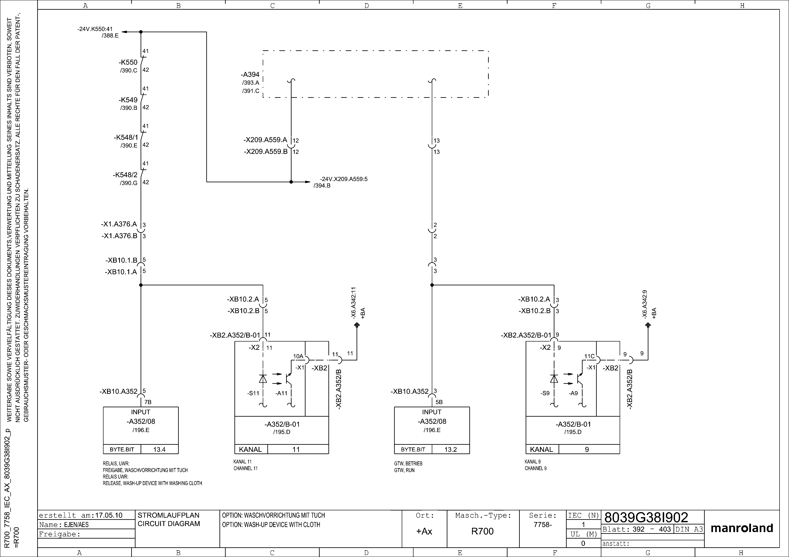

# +Ax — Sheet 392 of 403 — OPTION: WASCHVORRICHTUNG MIT TUCH

**OPTION: WASH UP DEVICE WITH CLOTH**

> Part of the manroland **R700** printing press IEC/UL circuit diagrams.
> Drawing class: **Stromlaufplan / Circuit diagram** (DIN A3).
> Document `+Ax` covers the **Central control console** machine section.

## At a glance

| Field | Value |
|---|---|
| Document | `+Ax`  (8039G38I902) |
| Sheet | **392** of 403 |
| Section (DE) | OPTION: WASCHVORRICHTUNG MIT TUCH |
| Section (EN) | OPTION: WASH UP DEVICE WITH CLOTH |
| Section type | CIRCUIT — Circuit diagram |
| Machine type | `R700` |
| Series | `7758` |
| Created | 17.05.10 |
| Replaces | — |
| Columns used | A, B, C, D, E, F, G |
| Path numbers | — |
| Labels on sheet | 111 |
| Cross-refs out | 12 |
| Cross-refs in | 34 |

**Previous:** [+Ax sheet 391](SHEET_0391.md) · **Next:** [+Ax sheet 393](SHEET_0393.md) · **Document TOC:** [_TOC.md](_TOC.md)  (+Ax) · **Master TOC:** [all sheets](../_MASTER_TOC.md)

## Sheet image (300 DPI, exact vector render)



_Rendered directly from the PDF vector layer at 300 DPI (1-bit), no OCR and no resampling. Use it to confirm anything ambiguous in the text below._

## Cross-references on this sheet

Each entry is a wire leaving this sheet. The printed token is `/sheet.column`; the link resolves to that sheet inside the same document.

| Ref | Target sheet | Col | Path | Destination on target | Target section | From col |
|---|---|---|---|---|---|---|
| `/388.E` | [+Ax sheet 388](SHEET_0388.md) | E | — | 24V.K550:41 | OPTION: WASCHVORRICHTUNG MIT TUCH | A |
| `/390.C` | [+Ax sheet 390](SHEET_0390.md) | C | — | A394 | OPTION: WASCHVORRICHTUNG MIT TUCH | B |
| `/393.A` | [+Ax sheet 393](SHEET_0393.md) | A | — | — | OPTION: WASCHVORRICHTUNG MIT TUCH | C |
| `/391.C` | [+Ax sheet 391](SHEET_0391.md) | C | — | — | OPTION: WASCHVORRICHTUNG MIT TUCH | C |
| `/390.B` | [+Ax sheet 390](SHEET_0390.md) | B | — | — | OPTION: WASCHVORRICHTUNG MIT TUCH | A |
| `/390.E` | [+Ax sheet 390](SHEET_0390.md) | E | — | — | OPTION: WASCHVORRICHTUNG MIT TUCH | A |
| `/390.G` | [+Ax sheet 390](SHEET_0390.md) | G | — | — | OPTION: WASCHVORRICHTUNG MIT TUCH | A |
| `/394.B` | [+Ax sheet 394](SHEET_0394.md) | B | — | — | OPTION: WASCHVORRICHTUNG MIT TUCH | D |
| `/196.E` | [+Ax sheet 196](SHEET_0196.md) | E | — | — | REFERENZMODUL | B |
| `/196.E` | [+Ax sheet 196](SHEET_0196.md) | E | — | — | REFERENZMODUL | E |
| `/195.D` | [+Ax sheet 195](SHEET_0195.md) | D | — | — | REFERENZMODUL | C |
| `/195.D` | [+Ax sheet 195](SHEET_0195.md) | D | — | — | REFERENZMODUL | F |

### Incoming references (sheets that point here)

Every other sheet that sends a wire to this one. `Back-ref` is the token printed on *that* sheet; `Path` is its line number.

| From sheet | Cols | Back-ref | Path | Refs | What continues there |
|---|---|---|---|---|---|
| [+Ax#195](SHEET_0195.md) | D | `/195.D` | — | 2 | — |
| [+Ax#196](SHEET_0196.md) | E | `/196.E` | — | 2 | — |
| [+Ax#208](SHEET_0208.md) | E, F | `/208.E`, `/208.F` | — | 4 | — |
| [+Ax#218](SHEET_0218.md) | B, D | `/218.B`, `/218.D` | — | 4 | — |
| [+Ax#243](SHEET_0243.md) | A, B, C, E | `/243.A`, `/243.B`, `/243.C`, `/243.E` | — | 8 | — |
| [+Ax#245](SHEET_0245.md) | A | `/245.A` | — | 2 | — |
| [+Ax#293](SHEET_0293.md) | A, B | `/293.A`, `/293.B` | — | 4 | — |
| [+Ax#388](SHEET_0388.md) | F | `/388.F` | — | 1 | — |
| [+Ax#390](SHEET_0390.md) | B, C, E, G | `/390.B`, `/390.C`, `/390.E`, `/390.G` | — | 4 | — |
| [+Ax#391](SHEET_0391.md) | C | `/391.C` | — | 1 | — |
| [+Ax#393](SHEET_0393.md) | A | `/393.A` | — | 1 | — |
| [+Ax#394](SHEET_0394.md) | A | `/394.A` | — | 1 | 24V.X209.A559:5 |


## Devices on this sheet

| Tag | Class | Class meaning (IEC) | Col | Sub | Terminal | Sign |
|---|---|---|---|---|---|---|
| `K548/1` | K | Relais / relay, contactor | A | 1 | — | — |
| `K548/2` | K | Relais / relay, contactor | A | 2 | — | — |
| `K549` | K | Relais / relay, contactor | A | — | — | — |
| `K550` | K | Relais / relay, contactor | A | — | — | — |
| `A394` | A | Baugruppe / assembly, module, PC board | C | — | — | — |
| `A352/08` | A | Baugruppe / assembly, module, PC board | B | 08 | — | — |
| `A352/08` | A | Baugruppe / assembly, module, PC board | E | 08 | — | — |
| `S11` | S | Schalter / switch | C | — | — | — |
| `A11` | A | Baugruppe / assembly, module, PC board | C | — | — | — |
| `X1` | X | Klemme / terminal, plug connector | C | — | — | — |
| `X2` | X | Klemme / terminal, plug connector | C | — | — | — |
| `XB2` | XB |  | C | — | — | — |
| `S9` | S | Schalter / switch | F | — | — | — |
| `A9` | A | Baugruppe / assembly, module, PC board | F | — | — | — |
| `X1` | X | Klemme / terminal, plug connector | F | — | — | — |
| `X2` | X | Klemme / terminal, plug connector | F | — | — | — |
| `XB2` | XB |  | G | — | — | — |
| `X209.A559.B` | — | cross-device reference | C | — | — | — |
| `X209.A559.A` | — | cross-device reference | C | — | — | — |
| `X1.A376.B` | — | cross-device reference | A | — | — | — |
| `X1.A376.A` | — | cross-device reference | A | — | — | — |
| `XB10.A352` | — | cross-device reference | A | — | — | — |
| `13.4` | — | cross-device reference | B | — | — | — |
| `XB10.A352` | — | cross-device reference | D | — | — | — |
| `13.2` | — | cross-device reference | E | — | — | — |
| `XB10.1.A` | — | cross-device reference | A | — | — | — |
| `XB10.1.B` | — | cross-device reference | A | — | — | — |
| `X6.A342:11` | — | cross-device reference | D | — | 11 | — |
| `XB10.2.B` | — | cross-device reference | C | — | — | — |
| `XB10.2.A` | — | cross-device reference | C | — | — | — |
| `X6.A342:9` | — | cross-device reference | G | — | 9 | — |
| `XB10.2.B` | — | cross-device reference | F | — | — | — |
| `XB10.2.A` | — | cross-device reference | F | — | — | — |

## Potentials / nets

| Potential | Count | Columns | Attached devices | Terminals |
|---|---|---|---|---|
| `24V` | 2 | A, D | `A559`, `K550`, `X209` | `41`, `5` |


A potential such as `L24+/4` or `M24+` is a named supply/return rail; every place it appears on this sheet is electrically common.

## Wire-end annotations (grouped as printed)

A wire that continues elsewhere is annotated with a small cluster: the destination description, the path/line number `#NN`, and the `/sheet.column` cross reference. Each row below is one such cluster exactly as it is grouped on the drawing.

| Col | Y | Path | Cross-ref | Text on the wire |
|---|---|---|---|---|
| A | 40.0 | — | `/388.E` | `24V.K550:41` |
| B | 73.3 | — | — | `41` |
| B | 89.6 | — | — | `K550 42` |
| B | 102.7 | — | `/390.C` | `A394` |
| C | 121.1 | — | `/393.A`, `/391.C` | — |
| B | 130.0 | — | — | `41` |
| B | 146.3 | — | — | `K549 42` |
| A | 159.4 | — | `/390.B` | — |
| B | 186.7 | — | — | `41` |
| A | 203.0 | — | — | `K548/1 42` |
| C | 206.5 | — | — | `X209.A559.A 12` |
| E | 208.7 | — | — | `13` |
| A | 216.1 | — | `/390.E` | — |
| C | 224.2 | — | — | `X209.A559.B 12` |
| E | 225.7 | — | — | `13` |
| B | 243.4 | — | — | `41` |
| A | 259.7 | — | — | `K548/2 42` |
| D | 266.7 | — | — | `24V.X209.A559:5` |
| A | 272.8 | — | `/390.G` | — |
| D | 276.6 | — | `/394.B` | — |
| A | 334.1 | — | — | `X1.A376.A 3` |
| E | 336.2 | — | — | `2` |
| A | 351.8 | — | — | `X1.A376.B 3` |
| E | 353.2 | — | — | `2` |
| A | 388.7 | — | — | `XB10.1.B 5` |
| E | 388.7 | — | — | `3` |
| A | 405.7 | — | — | `XB10.1.A 5` |
| E | 405.7 | — | — | `3` |
| D | 433.4 | — | — | `X6.A342:11` |
| G | 438.2 | — | — | `X6.A342:9` |
| C | 447.5 | — | — | `XB10.2.A 5` |
| F | 447.5 | — | — | `XB10.2.A 3` |
| C | 465.2 | — | — | `XB10.2.B 5` |
| D | 465.2 | — | — | `+BA` |
| F | 465.2 | — | — | `XB10.2.B 3` |
| G | 465.2 | — | — | `+BA` |
| C | 502.1 | — | — | `XB2.A352/B 01 11` |
| F | 502.1 | — | — | `XB2.A352/B 01 9` |
| C | 520.5 | — | — | `X2` |
| F | 520.5 | — | — | `X2` |
| C | 521.9 | — | — | `11 11` |
| F | 521.9 | — | — | `9 9` |
| D | 530.4 | — | — | `11` |
| G | 530.4 | — | — | `9` |
| C | 534.6 | — | — | `10A` |
| F | 534.7 | — | — | `11C` |
| C | 551.6 | — | — | `X1` |
| F | 551.6 | — | — | `X1` |
| C | 551.7 | — | — | `XB2` |
| G | 551.7 | — | — | `XB2` |
| D | 557.9 | — | — | `XB2.A352/B` |
| G | 557.9 | — | — | `XB2.A352/B` |
| A | 587.1 | — | — | `XB10.A352 5` |
| E | 587.1 | — | — | `XB10.A352 3` |
| C | 590.6 | — | — | `S11 A11` |
| F | 590.6 | — | — | `S9 A9` |
| B | 604.0 | — | — | `7B` |
| E | 604.0 | — | — | `5B` |
| B | 618.6 | — | — | `INPUT` |
| E | 618.6 | — | — | `INPUT` |
| B | 632.4 | — | — | `A352/08` |
| E | 632.4 | — | — | `A352/08` |
| C | 636.7 | — | — | `A352/B 01` |
| F | 636.7 | — | — | `A352/B 01` |
| B | 646.2 | — | `/196.E` | — |
| E | 646.2 | — | `/196.E` | — |
| C | 649.1 | — | `/195.D` | — |
| F | 649.1 | — | `/195.D` | — |
| C | 674.9 | — | — | `KANAL 11` |
| F | 674.9 | — | — | `KANAL 9` |
| B | 675.3 | — | — | `BYTE.BIT 13.4` |
| E | 675.3 | — | — | `BYTE.BIT 13.2` |
| C | 695.2 | — | — | `KANAL 11 CHANNEL 11` |
| F | 695.3 | — | — | `KANAL 9 CHANNEL 9` |
| D | 698.0 | — | — | `GTW, BETRIEB GTW, RUN` |
| B | 698.1 | — | — | `RELAIS, UWR: FREIGABE, WASCHVORRICHTUNG MIT TUCH RELAIS UWR: RELEASE, WASH UP DEVICE WITH WASHING CLOTH` |


## Reconstructed tables

This sheet carries tabular content (pin map / terminal assignment / index). The grid below was rebuilt from the drawing's own rule lines, so each row is exactly one physical row of the table.

### Table 1 — 5 data rows × 2 columns (at x=155.9, y=48.2)

| /388.E K550 /390.C K549 /390.B K548/1 /390.E K548/2 | 41 42 41 42 41 42 41 |
|---|---|
| `/390.G X1.A376.A X1.A376.B XB10.1.B XB10.1.A` | `42 3 3 5 5` |
| `XB10.A352` | `5 7B` |
| `INPUT` |  |
|  | `A352/08 /196.E` |
| `BYTE.BIT` | `13.4` |


### Table 2 — 6 data rows × 8 columns (at x=354.3, y=48.2)

| A394 /393.A /391.C | X209.A559.A X209.A559.B | 12 12 |  | 24V.X209.A559:5 |  |  | 13 13 |
|---|---|---|---|---|---|---|---|
|  |  |  | `/394.B` |  |  |  | `2 2 3 3` |
| `XB10.2.A XB10.2.B XB2.A352/B 01` | `5 5 11` |  |  | `X6.A342:11` | `+BA` |  |  |
| `X2 S11` | `11 A11` | `10A X1` | `XB2` | `11 11 XB2.A352/B` |  | `XB10.A352` | `3 5B` |
|  |  |  |  |  |  | `INPUT` |  |
|  | `A352/B 01 /195.D` |  |  |  |  |  | `A352/08 /196.E` |
| `KANAL` |  | `11` |  |  |  | `BYTE.BIT` | `13.2` |


### Table 3 — 3 data rows × 5 columns (at x=793.7, y=48.2)

| XB10.2.A XB10.2.B XB2.A352/B 01 | 3 3 9 |  |  | X6.A342:9 |
|---|---|---|---|---|
| `X2 S9` | `9 A9` | `11C X1` | `XB2` | `9 9 XB2.A352/B` |
|  | `A352/B 01 /195.D` |  |  |  |
| `KANAL` |  | `9` |  |  |


## Notes and free text on this sheet

| Text | Col | Y (pt) |
|---|---|---|
| `7B` | B | 604.05 |
| `INPUT` | B | 618.59 |
| `BYTE.BIT` | A | 675.84 |
| `RELAIS, UWR:` | A | 698.08 |
| `FREIGABE, WASCHVORRICHTUNG MIT TUCH` | B | 708.04 |
| `RELAIS UWR:` | A | 717.97 |
| `RELEASE, WASH UP DEVICE WITH WASHING CLOTH` | B | 727.92 |
| `5B` | E | 604.05 |
| `INPUT` | E | 618.59 |
| `BYTE.BIT` | D | 675.84 |
| `GTW, BETRIEB` | D | 698.05 |
| `GTW, RUN` | D | 707.95 |
| `KANAL 11` | C | 695.24 |
| `CHANNEL 11` | C | 705.19 |
| `10A` | C | 534.62 |
| `KANAL` | C | 674.94 |
| `A352/B 01` | C | 636.69 |
| `XB2.A352/B 01` | C | 502.05 |
| `XB2.A352/B` | D | 557.86 |
| `+BA` | D | 465.17 |
| `KANAL 9` | F | 695.27 |
| `CHANNEL 9` | F | 705.21 |
| `11C` | F | 534.66 |
| `KANAL` | F | 674.94 |
| `A352/B 01` | F | 636.69 |
| `XB2.A352/B 01` | F | 502.05 |
| `XB2.A352/B` | G | 557.86 |
| `+BA` | G | 465.17 |

## Complete label inventory (exact text from the drawing)

Every text object inside the drawing area of this sheet, in DIN reading order (column A→H, then top→bottom). This is the authoritative list: if a string is not here it is not printed on this sheet.

| Col | Y | X | Dir | Type | Text |
|---|---|---|---|---|---|
| A | 40.0 | 116.8 | → | potential | `24V.K550:41` |
| A | 49.9 | 153.6 | → | cross-reference | `/388.E` |
| A | 89.6 | 179.1 | → | device tag | `K550` |
| A | 102.7 | 181.4 | → | cross-reference | `/390.C` |
| A | 146.3 | 179.1 | → | device tag | `K549` |
| A | 159.4 | 181.7 | → | cross-reference | `/390.B` |
| A | 203.0 | 171.8 | → | device tag | `K548/1` |
| A | 216.1 | 182.0 | → | cross-reference | `/390.E` |
| A | 259.7 | 170.4 | → | device tag | `K548/2` |
| A | 272.8 | 181.1 | → | cross-reference | `/390.G` |
| A | 334.1 | 152.5 | → | device ref | `X1.A376.A` |
| A | 351.8 | 153.4 | → | device ref | `X1.A376.B` |
| A | 388.7 | 159.3 | → | device ref | `XB10.1.B` |
| A | 406.4 | 158.5 | → | device ref | `XB10.1.A` |
| A | 587.1 | 150.2 | → | device ref | `XB10.A352` |
| A | 675.8 | 165.8 | → | text | `BYTE.BIT` |
| A | 698.1 | 155.3 | → | text | `RELAIS, UWR:` |
| A | 718.0 | 155.3 | → | text | `RELAIS UWR:` |
| B | 73.3 | 215.1 | → | number | `41` |
| B | 101.7 | 215.1 | → | number | `42` |
| B | 130.0 | 215.1 | → | number | `41` |
| B | 158.4 | 215.1 | → | number | `42` |
| B | 186.7 | 215.1 | → | number | `41` |
| B | 215.0 | 215.1 | → | number | `42` |
| B | 243.4 | 215.1 | → | number | `41` |
| B | 271.7 | 215.1 | → | number | `42` |
| B | 336.2 | 215.1 | → | number | `3` |
| B | 353.2 | 215.1 | → | number | `3` |
| B | 388.7 | 215.1 | → | number | `5` |
| B | 405.7 | 215.1 | → | number | `5` |
| B | 587.1 | 215.1 | → | number | `5` |
| B | 604.0 | 218.0 | → | text | `7B` |
| B | 618.6 | 197.7 | → | text | `INPUT` |
| B | 632.4 | 191.2 | → | device tag | `A352/08` |
| B | 646.2 | 200.1 | → | cross-reference | `/196.E` |
| B | 675.3 | 231.2 | → | device ref | `13.4` |
| B | 708.0 | 155.3 | → | text | `FREIGABE, WASCHVORRICHTUNG MIT TUCH` |
| B | 727.9 | 155.3 | → | text | `RELEASE, WASH UP DEVICE WITH WASHING CLOTH` |
| C | 108.0 | 363.4 | → | device tag | `A394` |
| C | 121.1 | 365.7 | → | cross-reference | `/393.A` |
| C | 133.5 | 365.7 | → | cross-reference | `/391.C` |
| C | 206.5 | 367.4 | → | device ref | `X209.A559.A` |
| C | 208.7 | 441.4 | → | number | `12` |
| C | 224.2 | 368.2 | → | device ref | `X209.A559.B` |
| C | 225.7 | 441.4 | → | number | `12` |
| C | 447.5 | 342.7 | → | device ref | `XB10.2.A` |
| C | 449.6 | 399.4 | → | number | `5` |
| C | 465.2 | 343.6 | → | device ref | `XB10.2.B` |
| C | 466.6 | 399.4 | → | number | `5` |
| C | 502.0 | 316.6 | → | text | `XB2.A352/B 01` |
| C | 502.1 | 398.8 | → | number | `11` |
| C | 520.5 | 375.3 | → | device tag | `X2` |
| C | 521.9 | 401.7 | → | number | `11` |
| C | 534.6 | 442.2 | → | text | `10A` |
| C | 551.6 | 445.9 | → | device tag | `X1` |
| C | 551.7 | 470.3 | → | device tag | `XB2` |
| C | 590.6 | 373.0 | → | device tag | `S11` |
| C | 590.6 | 415.6 | → | device tag | `A11` |
| C | 636.7 | 399.3 | → | text | `A352/B 01` |
| C | 649.1 | 412.4 | → | cross-reference | `/195.D` |
| C | 674.9 | 360.6 | → | text | `KANAL` |
| C | 674.9 | 440.9 | → | number | `11` |
| C | 695.2 | 352.3 | → | text | `KANAL 11` |
| C | 705.2 | 352.6 | → | text | `CHANNEL 11` |
| D | 266.7 | 483.0 | → | potential | `24V.X209.A559:5` |
| D | 276.6 | 473.4 | → | cross-reference | `/394.B` |
| D | 433.4 | 529.7 | ↕ | device ref | `X6.A342:11` |
| D | 465.2 | 543.8 | ↕ | text | `+BA` |
| D | 530.4 | 523.6 | → | number | `11` |
| D | 531.8 | 500.9 | → | number | `11` |
| D | 557.9 | 506.3 | ↕ | text | `XB2.A352/B` |
| D | 587.1 | 589.6 | → | device ref | `XB10.A352` |
| D | 675.8 | 605.2 | → | text | `BYTE.BIT` |
| D | 698.1 | 595.0 | → | text | `GTW, BETRIEB` |
| D | 707.9 | 595.0 | → | text | `GTW, RUN` |
| E | 208.7 | 654.0 | → | number | `13` |
| E | 225.7 | 654.0 | → | number | `13` |
| E | 336.2 | 654.5 | → | number | `2` |
| E | 353.2 | 654.5 | → | number | `2` |
| E | 388.7 | 654.5 | → | number | `3` |
| E | 405.7 | 654.5 | → | number | `3` |
| E | 587.1 | 654.5 | → | number | `3` |
| E | 604.0 | 657.4 | → | text | `5B` |
| E | 618.6 | 637.1 | → | text | `INPUT` |
| E | 632.4 | 630.6 | → | device tag | `A352/08` |
| E | 646.2 | 639.5 | → | cross-reference | `/196.E` |
| E | 675.3 | 670.5 | → | device ref | `13.2` |
| F | 447.5 | 782.1 | → | device ref | `XB10.2.A` |
| F | 449.6 | 838.8 | → | number | `3` |
| F | 465.2 | 782.9 | → | device ref | `XB10.2.B` |
| F | 466.6 | 838.8 | → | number | `3` |
| F | 502.0 | 756.0 | → | text | `XB2.A352/B 01` |
| F | 502.1 | 838.8 | → | number | `9` |
| F | 520.5 | 814.7 | → | device tag | `X2` |
| F | 521.9 | 841.6 | → | number | `9` |
| F | 534.7 | 881.6 | → | text | `11C` |
| F | 551.6 | 885.3 | → | device tag | `X1` |
| F | 590.6 | 815.8 | → | device tag | `S9` |
| F | 590.6 | 858.3 | → | device tag | `A9` |
| F | 636.7 | 838.6 | → | text | `A352/B 01` |
| F | 649.1 | 851.8 | → | cross-reference | `/195.D` |
| F | 674.9 | 799.9 | → | text | `KANAL` |
| F | 674.9 | 882.9 | → | number | `9` |
| F | 695.3 | 791.7 | → | text | `KANAL 9` |
| F | 705.2 | 792.0 | → | text | `CHANNEL 9` |
| G | 438.2 | 969.0 | ↕ | device ref | `X6.A342:9` |
| G | 465.2 | 983.2 | ↕ | text | `+BA` |
| G | 530.4 | 966.3 | → | number | `9` |
| G | 531.8 | 940.8 | → | number | `9` |
| G | 551.7 | 909.6 | → | device tag | `XB2` |
| G | 557.9 | 945.7 | ↕ | text | `XB2.A352/B` |

## Reading-order text block

The same content as a plain block, grouped by DIN column — convenient to paste or to match against a visual description.

```text
=== Column A ===
  40.0  116.8  net          24V.K550:41
  49.9  153.6  xref         /388.E
  89.6  179.1  devtag       K550
 102.7  181.4  xref         /390.C
 146.3  179.1  devtag       K549
 159.4  181.7  xref         /390.B
 203.0  171.8  devtag       K548/1
 216.1  182.0  xref         /390.E
 259.7  170.4  devtag       K548/2
 272.8  181.1  xref         /390.G
 334.1  152.5  devref       X1.A376.A
 351.8  153.4  devref       X1.A376.B
 388.7  159.3  devref       XB10.1.B
 406.4  158.5  devref       XB10.1.A
 587.1  150.2  devref       XB10.A352
 675.8  165.8  text         BYTE.BIT
 698.1  155.3  text         RELAIS, UWR:
 718.0  155.3  text         RELAIS UWR:
=== Column B ===
  73.3  215.1  numeric      41
 101.7  215.1  numeric      42
 130.0  215.1  numeric      41
 158.4  215.1  numeric      42
 186.7  215.1  numeric      41
 215.0  215.1  numeric      42
 243.4  215.1  numeric      41
 271.7  215.1  numeric      42
 336.2  215.1  numeric      3
 353.2  215.1  numeric      3
 388.7  215.1  numeric      5
 405.7  215.1  numeric      5
 587.1  215.1  numeric      5
 604.0  218.0  text         7B
 618.6  197.7  text         INPUT
 632.4  191.2  devtag       A352/08
 646.2  200.1  xref         /196.E
 675.3  231.2  devref       13.4
 708.0  155.3  text         FREIGABE, WASCHVORRICHTUNG MIT TUCH
 727.9  155.3  text         RELEASE, WASH UP DEVICE WITH WASHING CLOTH
=== Column C ===
 108.0  363.4  devtag       A394
 121.1  365.7  xref         /393.A
 133.5  365.7  xref         /391.C
 206.5  367.4  devref       X209.A559.A
 208.7  441.4  numeric      12
 224.2  368.2  devref       X209.A559.B
 225.7  441.4  numeric      12
 447.5  342.7  devref       XB10.2.A
 449.6  399.4  numeric      5
 465.2  343.6  devref       XB10.2.B
 466.6  399.4  numeric      5
 502.0  316.6  text         XB2.A352/B 01
 502.1  398.8  numeric      11
 520.5  375.3  devtag       X2
 521.9  401.7  numeric      11
 534.6  442.2  text         10A
 551.6  445.9  devtag       X1
 551.7  470.3  devtag       XB2
 590.6  373.0  devtag       S11
 590.6  415.6  devtag       A11
 636.7  399.3  text         A352/B 01
 649.1  412.4  xref         /195.D
 674.9  360.6  text         KANAL
 674.9  440.9  numeric      11
 695.2  352.3  text         KANAL 11
 705.2  352.6  text         CHANNEL 11
=== Column D ===
 266.7  483.0  net          24V.X209.A559:5
 276.6  473.4  xref         /394.B
 433.4  529.7  devref       X6.A342:11
 465.2  543.8  text         +BA
 530.4  523.6  numeric      11
 531.8  500.9  numeric      11
 557.9  506.3  text         XB2.A352/B
 587.1  589.6  devref       XB10.A352
 675.8  605.2  text         BYTE.BIT
 698.1  595.0  text         GTW, BETRIEB
 707.9  595.0  text         GTW, RUN
=== Column E ===
 208.7  654.0  numeric      13
 225.7  654.0  numeric      13
 336.2  654.5  numeric      2
 353.2  654.5  numeric      2
 388.7  654.5  numeric      3
 405.7  654.5  numeric      3
 587.1  654.5  numeric      3
 604.0  657.4  text         5B
 618.6  637.1  text         INPUT
 632.4  630.6  devtag       A352/08
 646.2  639.5  xref         /196.E
 675.3  670.5  devref       13.2
=== Column F ===
 447.5  782.1  devref       XB10.2.A
 449.6  838.8  numeric      3
 465.2  782.9  devref       XB10.2.B
 466.6  838.8  numeric      3
 502.0  756.0  text         XB2.A352/B 01
 502.1  838.8  numeric      9
 520.5  814.7  devtag       X2
 521.9  841.6  numeric      9
 534.7  881.6  text         11C
 551.6  885.3  devtag       X1
 590.6  815.8  devtag       S9
 590.6  858.3  devtag       A9
 636.7  838.6  text         A352/B 01
 649.1  851.8  xref         /195.D
 674.9  799.9  text         KANAL
 674.9  882.9  numeric      9
 695.3  791.7  text         KANAL 9
 705.2  792.0  text         CHANNEL 9
=== Column G ===
 438.2  969.0  devref       X6.A342:9
 465.2  983.2  text         +BA
 530.4  966.3  numeric      9
 531.8  940.8  numeric      9
 551.7  909.6  devtag       XB2
 557.9  945.7  text         XB2.A352/B
```

---
_Generated from the PDF vector text layer; no OCR. Source: `R700_7758_IEC_AX_8039G38I902_p`, sheet 392._
