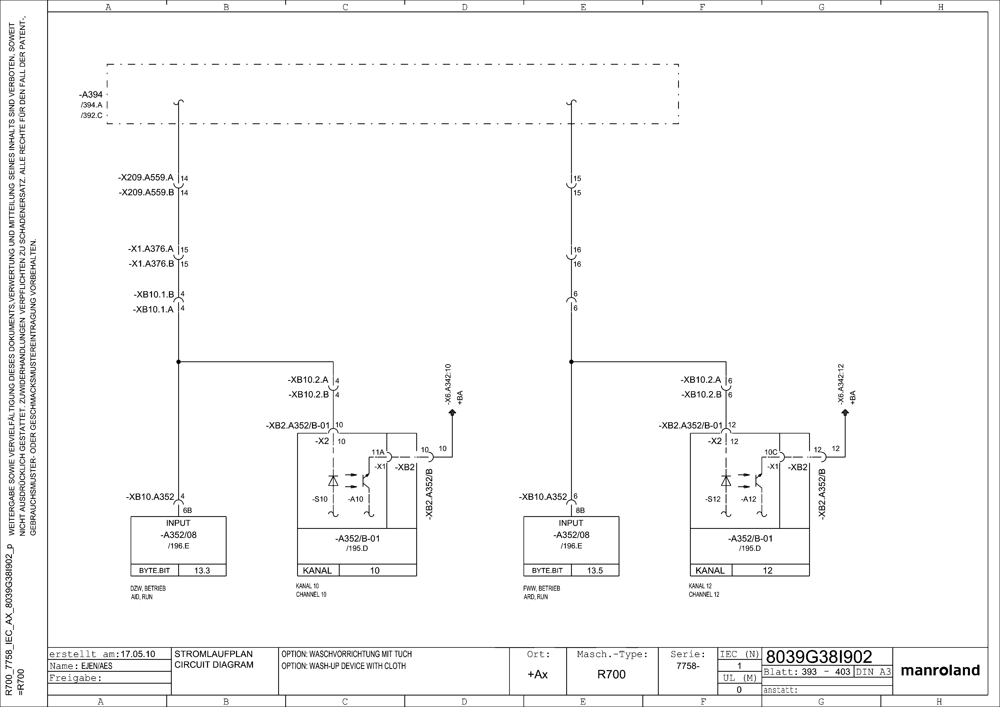

# +Ax — Sheet 393 of 403 — OPTION: WASCHVORRICHTUNG MIT TUCH

**OPTION: WASH UP DEVICE WITH CLOTH**

> Part of the manroland **R700** printing press IEC/UL circuit diagrams.
> Drawing class: **Stromlaufplan / Circuit diagram** (DIN A3).
> Document `+Ax` covers the **Central control console** machine section.

## At a glance

| Field | Value |
|---|---|
| Document | `+Ax`  (8039G38I902) |
| Sheet | **393** of 403 |
| Section (DE) | OPTION: WASCHVORRICHTUNG MIT TUCH |
| Section (EN) | OPTION: WASH UP DEVICE WITH CLOTH |
| Section type | CIRCUIT — Circuit diagram |
| Machine type | `R700` |
| Series | `7758` |
| Created | 17.05.10 |
| Replaces | — |
| Columns used | A, B, C, D, E, F, G |
| Path numbers | — |
| Labels on sheet | 89 |
| Cross-refs out | 6 |
| Cross-refs in | 28 |

**Previous:** [+Ax sheet 392](SHEET_0392.md) · **Next:** [+Ax sheet 394](SHEET_0394.md) · **Document TOC:** [_TOC.md](_TOC.md)  (+Ax) · **Master TOC:** [all sheets](../_MASTER_TOC.md)

## Sheet image (300 DPI, exact vector render)



_Rendered directly from the PDF vector layer at 300 DPI (1-bit), no OCR and no resampling. Use it to confirm anything ambiguous in the text below._

## Cross-references on this sheet

Each entry is a wire leaving this sheet. The printed token is `/sheet.column`; the link resolves to that sheet inside the same document.

| Ref | Target sheet | Col | Path | Destination on target | Target section | From col |
|---|---|---|---|---|---|---|
| `/394.A` | [+Ax sheet 394](SHEET_0394.md) | A | — | — | OPTION: WASCHVORRICHTUNG MIT TUCH | A |
| `/392.C` | [+Ax sheet 392](SHEET_0392.md) | C | — | — | OPTION: WASCHVORRICHTUNG MIT TUCH | A |
| `/196.E` | [+Ax sheet 196](SHEET_0196.md) | E | — | — | REFERENZMODUL | B |
| `/196.E` | [+Ax sheet 196](SHEET_0196.md) | E | — | — | REFERENZMODUL | E |
| `/195.D` | [+Ax sheet 195](SHEET_0195.md) | D | — | — | REFERENZMODUL | C |
| `/195.D` | [+Ax sheet 195](SHEET_0195.md) | D | — | — | REFERENZMODUL | F |

### Incoming references (sheets that point here)

Every other sheet that sends a wire to this one. `Back-ref` is the token printed on *that* sheet; `Path` is its line number.

| From sheet | Cols | Back-ref | Path | Refs | What continues there |
|---|---|---|---|---|---|
| [+Ax#195](SHEET_0195.md) | D | `/195.D` | — | 2 | — |
| [+Ax#196](SHEET_0196.md) | E | `/196.E` | — | 2 | — |
| [+Ax#208](SHEET_0208.md) | E, F | `/208.E`, `/208.F` | — | 4 | — |
| [+Ax#218](SHEET_0218.md) | B, D | `/218.B`, `/218.D` | — | 4 | — |
| [+Ax#243](SHEET_0243.md) | A, B, C, E | `/243.A`, `/243.B`, `/243.C`, `/243.E` | — | 8 | — |
| [+Ax#245](SHEET_0245.md) | A | `/245.A` | — | 2 | — |
| [+Ax#293](SHEET_0293.md) | A, B | `/293.A`, `/293.B` | — | 4 | — |
| [+Ax#392](SHEET_0392.md) | C | `/392.C` | — | 1 | — |
| [+Ax#394](SHEET_0394.md) | A | `/394.A` | — | 1 | — |


## Devices on this sheet

| Tag | Class | Class meaning (IEC) | Col | Sub | Terminal | Sign |
|---|---|---|---|---|---|---|
| `S10` | S | Schalter / switch | C | — | — | — |
| `A10` | A | Baugruppe / assembly, module, PC board | C | — | — | — |
| `X1` | X | Klemme / terminal, plug connector | C | — | — | — |
| `X2` | X | Klemme / terminal, plug connector | C | — | — | — |
| `XB2` | XB |  | C | — | — | — |
| `A394` | A | Baugruppe / assembly, module, PC board | A | — | — | — |
| `A352/08` | A | Baugruppe / assembly, module, PC board | B | 08 | — | — |
| `A352/08` | A | Baugruppe / assembly, module, PC board | E | 08 | — | — |
| `S12` | S | Schalter / switch | F | — | — | — |
| `A12` | A | Baugruppe / assembly, module, PC board | F | — | — | — |
| `X1` | X | Klemme / terminal, plug connector | G | — | — | — |
| `X2` | X | Klemme / terminal, plug connector | F | — | — | — |
| `XB2` | XB |  | G | — | — | — |
| `X6.A342:10` | — | cross-device reference | D | — | 10 | — |
| `XB10.2.B` | — | cross-device reference | C | — | — | — |
| `XB10.2.A` | — | cross-device reference | C | — | — | — |
| `X209.A559.B` | — | cross-device reference | A | — | — | — |
| `X209.A559.A` | — | cross-device reference | A | — | — | — |
| `XB10.A352` | — | cross-device reference | A | — | — | — |
| `13.3` | — | cross-device reference | B | — | — | — |
| `XB10.A352` | — | cross-device reference | E | — | — | — |
| `13.5` | — | cross-device reference | E | — | — | — |
| `X6.A342:12` | — | cross-device reference | G | — | 12 | — |
| `XB10.2.B` | — | cross-device reference | F | — | — | — |
| `XB10.2.A` | — | cross-device reference | F | — | — | — |
| `X1.A376.B` | — | cross-device reference | A | — | — | — |
| `X1.A376.A` | — | cross-device reference | A | — | — | — |
| `XB10.1.A` | — | cross-device reference | A | — | — | — |
| `XB10.1.B` | — | cross-device reference | A | — | — | — |

## Potentials / nets

_No named potentials on this sheet._

## Wire-end annotations (grouped as printed)

A wire that continues elsewhere is annotated with a small cluster: the destination description, the path/line number `#NN`, and the `/sheet.column` cross reference. Each row below is one such cluster exactly as it is grouped on the drawing.

| Col | Y | Path | Cross-ref | Text on the wire |
|---|---|---|---|---|
| A | 108.0 | — | — | `A394` |
| A | 121.1 | — | `/394.A`, `/392.C` | — |
| A | 206.5 | — | — | `X209.A559.A 14` |
| E | 208.7 | — | — | `15` |
| A | 224.2 | — | — | `X209.A559.B 14` |
| E | 225.7 | — | — | `15` |
| A | 291.6 | — | — | `X1.A376.A 15` |
| E | 293.7 | — | — | `16` |
| A | 309.3 | — | — | `X1.A376.B 15` |
| E | 310.7 | — | — | `16` |
| A | 346.1 | — | — | `XB10.1.B 4` |
| E | 346.1 | — | — | `6` |
| A | 363.2 | — | — | `XB10.1.A 4` |
| E | 363.2 | — | — | `6` |
| D | 433.4 | — | — | `X6.A342:10` |
| G | 433.4 | — | — | `X6.A342:12` |
| C | 447.5 | — | — | `XB10.2.A 4` |
| F | 447.5 | — | — | `XB10.2.A 6` |
| C | 465.2 | — | — | `XB10.2.B 4` |
| D | 465.2 | — | — | `+BA` |
| F | 465.2 | — | — | `XB10.2.B 6` |
| G | 465.2 | — | — | `+BA` |
| C | 502.1 | — | — | `XB2.A352/B 01 10` |
| F | 502.1 | — | — | `XB2.A352/B 01 12` |
| C | 520.5 | — | — | `X2` |
| F | 520.5 | — | — | `X2` |
| C | 521.9 | — | — | `10 10` |
| G | 521.9 | — | — | `12 12` |
| D | 530.4 | — | — | `10` |
| G | 530.4 | — | — | `12` |
| C | 534.6 | — | — | `11A` |
| G | 534.7 | — | — | `10C` |
| C | 551.6 | — | — | `X1` |
| G | 551.6 | — | — | `X1` |
| C | 551.7 | — | — | `XB2` |
| G | 551.7 | — | — | `XB2` |
| D | 557.9 | — | — | `XB2.A352/B` |
| G | 557.9 | — | — | `XB2.A352/B` |
| A | 587.1 | — | — | `XB10.A352 4` |
| E | 587.1 | — | — | `XB10.A352 6` |
| C | 590.6 | — | — | `S10 A10` |
| F | 590.6 | — | — | `S12 A12` |
| B | 604.0 | — | — | `6B` |
| E | 604.0 | — | — | `8B` |
| B | 618.6 | — | — | `INPUT` |
| E | 618.6 | — | — | `INPUT` |
| B | 632.4 | — | — | `A352/08` |
| E | 632.4 | — | — | `A352/08` |
| C | 636.7 | — | — | `A352/B 01` |
| F | 636.7 | — | — | `A352/B 01` |
| B | 646.2 | — | `/196.E` | — |
| E | 646.2 | — | `/196.E` | — |
| C | 649.1 | — | `/195.D` | — |
| F | 649.1 | — | `/195.D` | — |
| C | 674.9 | — | — | `KANAL 10` |
| F | 674.9 | — | — | `KANAL 12` |
| B | 675.3 | — | — | `BYTE.BIT 13.3` |
| E | 675.3 | — | — | `BYTE.BIT 13.5` |
| C | 695.3 | — | — | `KANAL 10 CHANNEL 10` |
| F | 695.3 | — | — | `KANAL 12 CHANNEL 12` |
| E | 698.0 | — | — | `FWW, BETRIEB` |
| A | 698.1 | — | — | `DZW, BETRIEB` |
| E | 708.0 | — | — | `ARD, RUN` |
| A | 708.1 | — | — | `AID, RUN` |


## Reconstructed tables

This sheet carries tabular content (pin map / terminal assignment / index). The grid below was rebuilt from the drawing's own rule lines, so each row is exactly one physical row of the table.

### Table 1 — 3 data rows × 2 columns (at x=155.9, y=430.9)

| XB10.A352 | 4 6B |
|---|---|
| `INPUT` |  |
|  | `A352/08 /196.E` |
| `BYTE.BIT` | `13.3` |


### Table 2 — 4 data rows × 8 columns (at x=354.3, y=430.9)

| XB10.2.A XB10.2.B XB2.A352/B 01 | 4 4 10 |  |  | X6.A342:10 | +BA |  |  |
|---|---|---|---|---|---|---|---|
| `X2 S10` | `10 A10` | `11A X1` | `XB2` | `10 10 XB2.A352/B` |  | `XB10.A352` | `6 8B` |
|  |  |  |  |  |  | `INPUT` |  |
|  | `A352/B 01 /195.D` |  |  |  |  |  | `A352/08 /196.E` |
| `KANAL` |  | `10` |  |  |  | `BYTE.BIT` | `13.5` |


### Table 3 — 3 data rows × 5 columns (at x=822.0, y=430.9)

| XB10.2.A XB10.2.B XB2.A352/B 01 | 6 6 12 |  |  | X6.A342:12 |
|---|---|---|---|---|
| `X2 S12` | `12 A12` | `10C X1` | `XB2` | `12 12 XB2.A352/B` |
|  | `A352/B 01 /195.D` |  |  |  |
| `KANAL` |  | `12` |  |  |


## Notes and free text on this sheet

| Text | Col | Y (pt) |
|---|---|---|
| `KANAL 10` | C | 695.27 |
| `CHANNEL 10` | C | 705.22 |
| `11A` | C | 534.62 |
| `KANAL` | C | 674.94 |
| `A352/B 01` | C | 636.69 |
| `XB2.A352/B 01` | C | 502.05 |
| `XB2.A352/B` | D | 557.86 |
| `+BA` | D | 465.17 |
| `6B` | B | 604.05 |
| `INPUT` | B | 618.59 |
| `BYTE.BIT` | A | 675.84 |
| `DZW, BETRIEB` | A | 698.06 |
| `AID, RUN` | A | 708.07 |
| `8B` | E | 604.05 |
| `INPUT` | E | 618.59 |
| `BYTE.BIT` | E | 675.84 |
| `FWW, BETRIEB` | E | 698.03 |
| `ARD, RUN` | E | 708.05 |
| `KANAL 12` | F | 695.26 |
| `CHANNEL 12` | F | 705.21 |
| `10C` | G | 534.66 |
| `KANAL` | F | 674.94 |
| `A352/B 01` | F | 636.69 |
| `XB2.A352/B 01` | F | 502.05 |
| `XB2.A352/B` | G | 557.86 |
| `+BA` | G | 465.17 |

## Complete label inventory (exact text from the drawing)

Every text object inside the drawing area of this sheet, in DIN reading order (column A→H, then top→bottom). This is the authoritative list: if a string is not here it is not printed on this sheet.

| Col | Y | X | Dir | Type | Text |
|---|---|---|---|---|---|
| A | 108.0 | 94.1 | → | device tag | `A394` |
| A | 121.1 | 96.4 | → | cross-reference | `/394.A` |
| A | 133.5 | 96.4 | → | cross-reference | `/392.C` |
| A | 206.5 | 140.6 | → | device ref | `X209.A559.A` |
| A | 224.2 | 141.4 | → | device ref | `X209.A559.B` |
| A | 291.6 | 152.5 | → | device ref | `X1.A376.A` |
| A | 309.3 | 153.4 | → | device ref | `X1.A376.B` |
| A | 346.1 | 159.3 | → | device ref | `XB10.1.B` |
| A | 363.9 | 158.5 | → | device ref | `XB10.1.A` |
| A | 587.1 | 150.2 | → | device ref | `XB10.A352` |
| A | 675.8 | 165.8 | → | text | `BYTE.BIT` |
| A | 698.1 | 155.3 | → | text | `DZW, BETRIEB` |
| A | 708.1 | 156.2 | → | text | `AID, RUN` |
| B | 208.7 | 214.6 | → | number | `14` |
| B | 225.7 | 214.6 | → | number | `14` |
| B | 293.7 | 214.6 | → | number | `15` |
| B | 310.7 | 214.6 | → | number | `15` |
| B | 346.2 | 215.1 | → | number | `4` |
| B | 363.2 | 215.1 | → | number | `4` |
| B | 587.1 | 215.1 | → | number | `4` |
| B | 604.0 | 218.0 | → | text | `6B` |
| B | 618.6 | 197.7 | → | text | `INPUT` |
| B | 632.4 | 191.2 | → | device tag | `A352/08` |
| B | 646.2 | 200.1 | → | cross-reference | `/196.E` |
| B | 675.3 | 231.2 | → | device ref | `13.3` |
| C | 447.5 | 342.7 | → | device ref | `XB10.2.A` |
| C | 449.6 | 399.4 | → | number | `4` |
| C | 465.2 | 343.6 | → | device ref | `XB10.2.B` |
| C | 466.6 | 399.4 | → | number | `4` |
| C | 502.0 | 316.6 | → | text | `XB2.A352/B 01` |
| C | 502.1 | 398.8 | → | number | `10` |
| C | 520.5 | 375.3 | → | device tag | `X2` |
| C | 521.9 | 401.7 | → | number | `10` |
| C | 534.6 | 442.2 | → | text | `11A` |
| C | 551.6 | 445.9 | → | device tag | `X1` |
| C | 551.7 | 470.3 | → | device tag | `XB2` |
| C | 590.6 | 371.6 | → | device tag | `S10` |
| C | 590.6 | 414.1 | → | device tag | `A10` |
| C | 636.7 | 399.3 | → | text | `A352/B 01` |
| C | 649.1 | 412.4 | → | cross-reference | `/195.D` |
| C | 674.9 | 360.6 | → | text | `KANAL` |
| C | 674.9 | 440.2 | → | number | `10` |
| C | 695.3 | 352.3 | → | text | `KANAL 10` |
| C | 705.2 | 352.6 | → | text | `CHANNEL 10` |
| D | 433.4 | 529.7 | ↕ | device ref | `X6.A342:10` |
| D | 465.2 | 543.8 | ↕ | text | `+BA` |
| D | 530.4 | 522.1 | → | number | `10` |
| D | 531.8 | 500.9 | → | number | `10` |
| D | 557.9 | 506.3 | ↕ | text | `XB2.A352/B` |
| E | 208.7 | 682.3 | → | number | `15` |
| E | 225.7 | 682.3 | → | number | `15` |
| E | 293.7 | 682.3 | → | number | `16` |
| E | 310.7 | 682.3 | → | number | `16` |
| E | 346.2 | 682.9 | → | number | `6` |
| E | 363.2 | 682.9 | → | number | `6` |
| E | 587.1 | 618.0 | → | device ref | `XB10.A352` |
| E | 587.1 | 682.9 | → | number | `6` |
| E | 604.0 | 685.7 | → | text | `8B` |
| E | 618.6 | 665.4 | → | text | `INPUT` |
| E | 632.4 | 658.9 | → | device tag | `A352/08` |
| E | 646.2 | 667.8 | → | cross-reference | `/196.E` |
| E | 675.3 | 698.9 | → | device ref | `13.5` |
| E | 675.8 | 633.5 | → | text | `BYTE.BIT` |
| E | 698.0 | 623.1 | → | text | `FWW, BETRIEB` |
| E | 708.0 | 623.9 | → | text | `ARD, RUN` |
| F | 447.5 | 810.4 | → | device ref | `XB10.2.A` |
| F | 449.6 | 867.1 | → | number | `6` |
| F | 465.2 | 811.3 | → | device ref | `XB10.2.B` |
| F | 466.6 | 867.1 | → | number | `6` |
| F | 502.0 | 784.3 | → | text | `XB2.A352/B 01` |
| F | 502.1 | 866.6 | → | number | `12` |
| F | 520.5 | 843.0 | → | device tag | `X2` |
| F | 521.9 | 869.4 | → | number | `12` |
| F | 590.6 | 839.6 | → | device tag | `S12` |
| F | 590.6 | 882.1 | → | device tag | `A12` |
| F | 636.7 | 867.0 | → | text | `A352/B 01` |
| F | 649.1 | 880.2 | → | cross-reference | `/195.D` |
| F | 674.9 | 828.3 | → | text | `KANAL` |
| F | 695.3 | 820.1 | → | text | `KANAL 12` |
| F | 705.2 | 820.3 | → | text | `CHANNEL 12` |
| G | 433.4 | 997.4 | ↕ | device ref | `X6.A342:12` |
| G | 465.2 | 1011.5 | ↕ | text | `+BA` |
| G | 530.4 | 990.1 | → | number | `12` |
| G | 531.8 | 968.6 | → | number | `12` |
| G | 534.7 | 909.9 | → | text | `10C` |
| G | 551.6 | 913.6 | → | device tag | `X1` |
| G | 551.7 | 938.0 | → | device tag | `XB2` |
| G | 557.9 | 974.0 | ↕ | text | `XB2.A352/B` |
| G | 674.9 | 907.9 | → | number | `12` |

## Reading-order text block

The same content as a plain block, grouped by DIN column — convenient to paste or to match against a visual description.

```text
=== Column A ===
 108.0   94.1  devtag       A394
 121.1   96.4  xref         /394.A
 133.5   96.4  xref         /392.C
 206.5  140.6  devref       X209.A559.A
 224.2  141.4  devref       X209.A559.B
 291.6  152.5  devref       X1.A376.A
 309.3  153.4  devref       X1.A376.B
 346.1  159.3  devref       XB10.1.B
 363.9  158.5  devref       XB10.1.A
 587.1  150.2  devref       XB10.A352
 675.8  165.8  text         BYTE.BIT
 698.1  155.3  text         DZW, BETRIEB
 708.1  156.2  text         AID, RUN
=== Column B ===
 208.7  214.6  numeric      14
 225.7  214.6  numeric      14
 293.7  214.6  numeric      15
 310.7  214.6  numeric      15
 346.2  215.1  numeric      4
 363.2  215.1  numeric      4
 587.1  215.1  numeric      4
 604.0  218.0  text         6B
 618.6  197.7  text         INPUT
 632.4  191.2  devtag       A352/08
 646.2  200.1  xref         /196.E
 675.3  231.2  devref       13.3
=== Column C ===
 447.5  342.7  devref       XB10.2.A
 449.6  399.4  numeric      4
 465.2  343.6  devref       XB10.2.B
 466.6  399.4  numeric      4
 502.0  316.6  text         XB2.A352/B 01
 502.1  398.8  numeric      10
 520.5  375.3  devtag       X2
 521.9  401.7  numeric      10
 534.6  442.2  text         11A
 551.6  445.9  devtag       X1
 551.7  470.3  devtag       XB2
 590.6  371.6  devtag       S10
 590.6  414.1  devtag       A10
 636.7  399.3  text         A352/B 01
 649.1  412.4  xref         /195.D
 674.9  360.6  text         KANAL
 674.9  440.2  numeric      10
 695.3  352.3  text         KANAL 10
 705.2  352.6  text         CHANNEL 10
=== Column D ===
 433.4  529.7  devref       X6.A342:10
 465.2  543.8  text         +BA
 530.4  522.1  numeric      10
 531.8  500.9  numeric      10
 557.9  506.3  text         XB2.A352/B
=== Column E ===
 208.7  682.3  numeric      15
 225.7  682.3  numeric      15
 293.7  682.3  numeric      16
 310.7  682.3  numeric      16
 346.2  682.9  numeric      6
 363.2  682.9  numeric      6
 587.1  618.0  devref       XB10.A352
 587.1  682.9  numeric      6
 604.0  685.7  text         8B
 618.6  665.4  text         INPUT
 632.4  658.9  devtag       A352/08
 646.2  667.8  xref         /196.E
 675.3  698.9  devref       13.5
 675.8  633.5  text         BYTE.BIT
 698.0  623.1  text         FWW, BETRIEB
 708.0  623.9  text         ARD, RUN
=== Column F ===
 447.5  810.4  devref       XB10.2.A
 449.6  867.1  numeric      6
 465.2  811.3  devref       XB10.2.B
 466.6  867.1  numeric      6
 502.0  784.3  text         XB2.A352/B 01
 502.1  866.6  numeric      12
 520.5  843.0  devtag       X2
 521.9  869.4  numeric      12
 590.6  839.6  devtag       S12
 590.6  882.1  devtag       A12
 636.7  867.0  text         A352/B 01
 649.1  880.2  xref         /195.D
 674.9  828.3  text         KANAL
 695.3  820.1  text         KANAL 12
 705.2  820.3  text         CHANNEL 12
=== Column G ===
 433.4  997.4  devref       X6.A342:12
 465.2 1011.5  text         +BA
 530.4  990.1  numeric      12
 531.8  968.6  numeric      12
 534.7  909.9  text         10C
 551.6  913.6  devtag       X1
 551.7  938.0  devtag       XB2
 557.9  974.0  text         XB2.A352/B
 674.9  907.9  numeric      12
```

---
_Generated from the PDF vector text layer; no OCR. Source: `R700_7758_IEC_AX_8039G38I902_p`, sheet 393._
