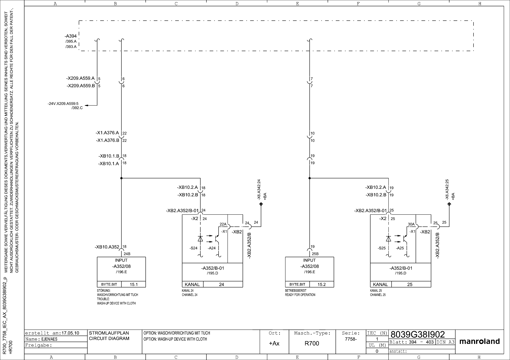

# +Ax — Sheet 394 of 403 — OPTION: WASCHVORRICHTUNG MIT TUCH

**OPTION: WASH UP DEVICE WITH CLOTH**

> Part of the manroland **R700** printing press IEC/UL circuit diagrams.
> Drawing class: **Stromlaufplan / Circuit diagram** (DIN A3).
> Document `+Ax` covers the **Central control console** machine section.

## At a glance

| Field | Value |
|---|---|
| Document | `+Ax`  (8039G38I902) |
| Sheet | **394** of 403 |
| Section (DE) | OPTION: WASCHVORRICHTUNG MIT TUCH |
| Section (EN) | OPTION: WASH UP DEVICE WITH CLOTH |
| Section type | CIRCUIT — Circuit diagram |
| Machine type | `R700` |
| Series | `7758` |
| Created | 17.05.10 |
| Replaces | — |
| Columns used | A, B, C, D, E, F, G, H |
| Path numbers | — |
| Labels on sheet | 94 |
| Cross-refs out | 7 |
| Cross-refs in | 31 |

**Previous:** [+Ax sheet 393](SHEET_0393.md) · **Next:** [+Ax sheet 395](SHEET_0395.md) · **Document TOC:** [_TOC.md](_TOC.md)  (+Ax) · **Master TOC:** [all sheets](../_MASTER_TOC.md)

## Sheet image (300 DPI, exact vector render)



_Rendered directly from the PDF vector layer at 300 DPI (1-bit), no OCR and no resampling. Use it to confirm anything ambiguous in the text below._

## Cross-references on this sheet

Each entry is a wire leaving this sheet. The printed token is `/sheet.column`; the link resolves to that sheet inside the same document.

| Ref | Target sheet | Col | Path | Destination on target | Target section | From col |
|---|---|---|---|---|---|---|
| `/395.A` | [+Ax sheet 395](SHEET_0395.md) | A | — | — | OPTION: WASCHVORRICHTUNG MIT TUCH | A |
| `/393.A` | [+Ax sheet 393](SHEET_0393.md) | A | — | — | OPTION: WASCHVORRICHTUNG MIT TUCH | A |
| `/392.C` | [+Ax sheet 392](SHEET_0392.md) | C | — | 24V.X209.A559:5 | OPTION: WASCHVORRICHTUNG MIT TUCH | A |
| `/196.E` | [+Ax sheet 196](SHEET_0196.md) | E | — | — | REFERENZMODUL | B |
| `/196.E` | [+Ax sheet 196](SHEET_0196.md) | E | — | — | REFERENZMODUL | E |
| `/195.D` | [+Ax sheet 195](SHEET_0195.md) | D | — | — | REFERENZMODUL | D |
| `/195.D` | [+Ax sheet 195](SHEET_0195.md) | D | — | — | REFERENZMODUL | G |

### Incoming references (sheets that point here)

Every other sheet that sends a wire to this one. `Back-ref` is the token printed on *that* sheet; `Path` is its line number.

| From sheet | Cols | Back-ref | Path | Refs | What continues there |
|---|---|---|---|---|---|
| [+Ax#195](SHEET_0195.md) | D | `/195.D` | — | 2 | — |
| [+Ax#196](SHEET_0196.md) | E | `/196.E` | — | 2 | — |
| [+Ax#208](SHEET_0208.md) | E, F | `/208.E`, `/208.F` | — | 4 | — |
| [+Ax#218](SHEET_0218.md) | C, E | `/218.C`, `/218.E` | — | 4 | — |
| [+Ax#243](SHEET_0243.md) | A, B, C, E | `/243.A`, `/243.B`, `/243.C`, `/243.E` | — | 8 | — |
| [+Ax#245](SHEET_0245.md) | A | `/245.A` | — | 2 | — |
| [+Ax#293](SHEET_0293.md) | A, B | `/293.A`, `/293.B` | — | 6 | — |
| [+Ax#392](SHEET_0392.md) | D | `/392.D` | — | 1 | — |
| [+Ax#393](SHEET_0393.md) | A | `/393.A` | — | 1 | — |
| [+Ax#395](SHEET_0395.md) | A | `/395.A` | — | 1 | — |


## Devices on this sheet

| Tag | Class | Class meaning (IEC) | Col | Sub | Terminal | Sign |
|---|---|---|---|---|---|---|
| `A352/08` | A | Baugruppe / assembly, module, PC board | B | 08 | — | — |
| `A394` | A | Baugruppe / assembly, module, PC board | A | — | — | — |
| `S24` | S | Schalter / switch | C | — | — | — |
| `A24` | A | Baugruppe / assembly, module, PC board | D | — | — | — |
| `X1` | X | Klemme / terminal, plug connector | D | — | — | — |
| `X2` | X | Klemme / terminal, plug connector | C | — | — | — |
| `XB2` | XB |  | D | — | — | — |
| `A352/08` | A | Baugruppe / assembly, module, PC board | E | 08 | — | — |
| `S25` | S | Schalter / switch | F | — | — | — |
| `A25` | A | Baugruppe / assembly, module, PC board | G | — | — | — |
| `X1` | X | Klemme / terminal, plug connector | G | — | — | — |
| `X2` | X | Klemme / terminal, plug connector | F | — | — | — |
| `XB2` | XB |  | G | — | — | — |
| `XB10.A352` | — | cross-device reference | B | — | — | — |
| `15.1` | — | cross-device reference | B | — | — | — |
| `X209.A559.B` | — | cross-device reference | A | — | — | — |
| `X209.A559.A` | — | cross-device reference | A | — | — | — |
| `X1.A376.B` | — | cross-device reference | B | — | — | — |
| `X1.A376.A` | — | cross-device reference | B | — | — | — |
| `XB10.1.A` | — | cross-device reference | B | — | — | — |
| `XB10.1.B` | — | cross-device reference | B | — | — | — |
| `X6.A342:24` | — | cross-device reference | D | — | 24 | — |
| `XB10.2.B` | — | cross-device reference | C | — | — | — |
| `XB10.2.A` | — | cross-device reference | C | — | — | — |
| `15.2` | — | cross-device reference | E | — | — | — |
| `X6.A342:25` | — | cross-device reference | G | — | 25 | — |
| `XB10.2.B` | — | cross-device reference | F | — | — | — |
| `XB10.2.A` | — | cross-device reference | F | — | — | — |

## Potentials / nets

| Potential | Count | Columns | Attached devices | Terminals |
|---|---|---|---|---|
| `24V` | 1 | A | `A559`, `X209` | `5` |


A potential such as `L24+/4` or `M24+` is a named supply/return rail; every place it appears on this sheet is electrically common.

## Wire-end annotations (grouped as printed)

A wire that continues elsewhere is annotated with a small cluster: the destination description, the path/line number `#NN`, and the `/sheet.column` cross reference. Each row below is one such cluster exactly as it is grouped on the drawing.

| Col | Y | Path | Cross-ref | Text on the wire |
|---|---|---|---|---|
| A | 79.7 | — | — | `A394` |
| A | 92.7 | — | `/395.A`, `/393.A` | — |
| A | 178.2 | — | — | `X209.A559.A 5` |
| B | 180.3 | — | — | `6` |
| E | 180.3 | — | — | `7` |
| A | 195.9 | — | — | `X209.A559.B 5` |
| B | 197.3 | — | — | `6` |
| E | 197.3 | — | — | `7` |
| A | 238.4 | — | `/392.C` | `24V.X209.A559:5` |
| B | 305.8 | — | — | `X1.A376.A 22` |
| E | 307.9 | — | — | `10` |
| B | 323.5 | — | — | `X1.A376.B 22` |
| E | 324.9 | — | — | `10` |
| B | 360.3 | — | — | `XB10.1.B 18` |
| E | 360.3 | — | — | `19` |
| B | 377.3 | — | — | `XB10.1.A 18` |
| E | 377.3 | — | — | `19` |
| D | 419.2 | — | — | `X6.A342:24` |
| G | 419.2 | — | — | `X6.A342:25` |
| C | 433.3 | — | — | `XB10.2.A 18` |
| F | 433.3 | — | — | `XB10.2.A 19` |
| C | 451.0 | — | — | `XB10.2.B 18` |
| D | 451.0 | — | — | `+BA` |
| F | 451.0 | — | — | `XB10.2.B 19` |
| H | 451.0 | — | — | `+BA` |
| C | 487.9 | — | — | `XB2.A352/B 01 24` |
| F | 487.9 | — | — | `XB2.A352/B 01 25` |
| C | 506.3 | — | — | `X2` |
| F | 506.3 | — | — | `X2` |
| D | 507.7 | — | — | `24 24` |
| G | 507.7 | — | — | `25 25` |
| D | 516.2 | — | — | `24` |
| G | 516.2 | — | — | `25` |
| D | 520.4 | — | — | `22A` |
| G | 520.4 | — | — | `30A` |
| D | 537.5 | — | — | `X1` |
| D | 537.5 | — | — | `XB2` |
| G | 537.5 | — | — | `X1` |
| G | 537.5 | — | — | `XB2` |
| D | 543.7 | — | — | `XB2.A352/B` |
| G | 543.7 | — | — | `XB2.A352/B` |
| B | 572.9 | — | — | `XB10.A352 18` |
| E | 572.9 | — | — | `19` |
| C | 576.4 | — | — | `S24 A24` |
| G | 576.4 | — | — | `S25 A25` |
| B | 589.9 | — | — | `24B` |
| E | 589.9 | — | — | `25B` |
| B | 604.4 | — | — | `INPUT` |
| E | 604.4 | — | — | `INPUT` |
| B | 618.3 | — | — | `A352/08` |
| E | 618.3 | — | — | `A352/08` |
| D | 622.5 | — | — | `A352/B 01` |
| G | 622.5 | — | — | `A352/B 01` |
| B | 632.0 | — | `/196.E` | — |
| E | 632.0 | — | `/196.E` | — |
| D | 634.9 | — | `/195.D` | — |
| G | 634.9 | — | `/195.D` | — |
| C | 660.7 | — | — | `KANAL 24` |
| G | 660.7 | — | — | `KANAL 25` |
| B | 661.1 | — | — | `BYTE.BIT 15.1` |
| E | 661.1 | — | — | `BYTE.BIT 15.2` |
| B | 676.8 | — | — | `STÖRUNG: TROUBLE: WASCHVORRICHTUNG MIT TUCH WASH UP DEVICE WITH CLOTH` |
| C | 676.9 | — | — | `KANAL 24 CHANNEL 24` |
| E | 676.9 | — | — | `BETRIEBSBEREIT READY FOR OPERATION` |
| F | 676.9 | — | — | `KANAL 25 CHANNEL 25` |


## Reconstructed tables

This sheet carries tabular content (pin map / terminal assignment / index). The grid below was rebuilt from the drawing's own rule lines, so each row is exactly one physical row of the table.

### Table 1 — 3 data rows × 2 columns (at x=226.8, y=416.7)

| XB10.A352 | 18 24B |
|---|---|
| `INPUT` |  |
|  | `A352/08 /196.E` |
| `BYTE.BIT` | `15.1` |


### Table 2 — 4 data rows × 8 columns (at x=425.2, y=416.7)

| XB10.2.A XB10.2.B XB2.A352/B 01 | 18 18 24 |  |  | X6.A342:24 | +BA |  |  |
|---|---|---|---|---|---|---|---|
| `X2 S24` | `24 A24` | `22A X1` | `XB2` | `24 24 XB2.A352/B` |  |  | `19 25B` |
|  |  |  |  |  |  | `INPUT` |  |
|  | `A352/B 01 /195.D` |  |  |  |  |  | `A352/08 /196.E` |
| `KANAL` |  | `24` |  |  |  | `BYTE.BIT` | `15.2` |


### Table 3 — 3 data rows × 5 columns (at x=864.6, y=416.7)

| XB10.2.A XB10.2.B XB2.A352/B 01 | 19 19 25 |  |  | X6.A342:25 |
|---|---|---|---|---|
| `X2 S25` | `25 A25` | `30A X1` | `XB2` | `25 25 XB2.A352/B` |
|  | `A352/B 01 /195.D` |  |  |  |
| `KANAL` |  | `25` |  |  |


## Notes and free text on this sheet

| Text | Col | Y (pt) |
|---|---|---|
| `24B` | B | 589.89 |
| `INPUT` | B | 604.42 |
| `BYTE.BIT` | B | 661.67 |
| `STÖRUNG:` | B | 676.79 |
| `WASCHVORRICHTUNG MIT TUCH` | B | 686.77 |
| `TROUBLE:` | B | 696.7 |
| `WASH UP DEVICE WITH CLOTH` | B | 706.65 |
| `KANAL 24` | C | 676.85 |
| `CHANNEL 24` | C | 686.79 |
| `22A` | D | 520.44 |
| `KANAL` | C | 660.77 |
| `A352/B 01` | D | 622.52 |
| `XB2.A352/B 01` | C | 487.87 |
| `XB2.A352/B` | D | 543.68 |
| `+BA` | D | 450.99 |
| `25B` | E | 589.89 |
| `INPUT` | E | 604.42 |
| `BYTE.BIT` | E | 661.67 |
| `BETRIEBSBEREIT` | E | 676.85 |
| `READY FOR OPERATION` | E | 686.78 |
| `KANAL 25` | F | 676.85 |
| `CHANNEL 25` | F | 686.79 |
| `30A` | G | 520.44 |
| `KANAL` | F | 660.77 |
| `A352/B 01` | G | 622.52 |
| `XB2.A352/B 01` | F | 487.87 |
| `XB2.A352/B` | G | 543.68 |
| `+BA` | H | 450.99 |

## Complete label inventory (exact text from the drawing)

Every text object inside the drawing area of this sheet, in DIN reading order (column A→H, then top→bottom). This is the authoritative list: if a string is not here it is not printed on this sheet.

| Col | Y | X | Dir | Type | Text |
|---|---|---|---|---|---|
| A | 79.7 | 150.8 | → | device tag | `A394` |
| A | 92.7 | 153.1 | → | cross-reference | `/395.A` |
| A | 105.1 | 153.1 | → | cross-reference | `/393.A` |
| A | 178.2 | 154.8 | → | device ref | `X209.A559.A` |
| A | 195.9 | 155.6 | → | device ref | `X209.A559.B` |
| A | 238.4 | 111.4 | → | potential | `24V.X209.A559:5` |
| A | 248.3 | 167.2 | → | cross-reference | `/392.C` |
| B | 180.3 | 229.3 | → | number | `5` |
| B | 180.3 | 286.0 | → | number | `6` |
| B | 197.3 | 229.3 | → | number | `5` |
| B | 197.3 | 286.0 | → | number | `6` |
| B | 305.7 | 223.4 | → | device ref | `X1.A376.A` |
| B | 307.9 | 286.0 | → | number | `22` |
| B | 323.5 | 224.2 | → | device ref | `X1.A376.B` |
| B | 324.9 | 286.0 | → | number | `22` |
| B | 360.3 | 230.2 | → | device ref | `XB10.1.B` |
| B | 360.3 | 285.4 | → | number | `18` |
| B | 377.3 | 285.4 | → | number | `18` |
| B | 378.0 | 229.3 | → | device ref | `XB10.1.A` |
| B | 572.9 | 221.1 | → | device ref | `XB10.A352` |
| B | 572.9 | 285.4 | → | number | `18` |
| B | 589.9 | 288.9 | → | text | `24B` |
| B | 604.4 | 268.6 | → | text | `INPUT` |
| B | 618.3 | 262.1 | → | device tag | `A352/08` |
| B | 632.0 | 271.0 | → | cross-reference | `/196.E` |
| B | 661.1 | 302.9 | → | device ref | `15.1` |
| B | 661.7 | 236.7 | → | text | `BYTE.BIT` |
| B | 676.8 | 226.5 | → | text | `STÖRUNG:` |
| B | 686.8 | 226.8 | → | text | `WASCHVORRICHTUNG MIT TUCH` |
| B | 696.7 | 226.5 | → | text | `TROUBLE:` |
| B | 706.7 | 226.8 | → | text | `WASH UP DEVICE WITH CLOTH` |
| C | 433.3 | 413.6 | → | device ref | `XB10.2.A` |
| C | 435.4 | 469.7 | → | number | `18` |
| C | 451.0 | 414.4 | → | device ref | `XB10.2.B` |
| C | 452.5 | 469.7 | → | number | `18` |
| C | 487.9 | 387.5 | → | text | `XB2.A352/B 01` |
| C | 487.9 | 470.3 | → | number | `24` |
| C | 506.3 | 446.2 | → | device tag | `X2` |
| C | 507.7 | 473.1 | → | number | `24` |
| C | 576.4 | 442.5 | → | device tag | `S24` |
| C | 660.8 | 431.4 | → | text | `KANAL` |
| C | 676.8 | 424.6 | → | text | `KANAL 24` |
| C | 686.8 | 424.9 | → | text | `CHANNEL 24` |
| D | 419.2 | 600.5 | ↕ | device ref | `X6.A342:24` |
| D | 451.0 | 614.7 | ↕ | text | `+BA` |
| D | 516.2 | 593.0 | → | number | `24` |
| D | 517.6 | 572.3 | → | number | `24` |
| D | 520.4 | 513.1 | → | text | `22A` |
| D | 537.5 | 516.8 | → | device tag | `X1` |
| D | 537.5 | 541.1 | → | device tag | `XB2` |
| D | 543.7 | 577.2 | ↕ | text | `XB2.A352/B` |
| D | 576.4 | 485.0 | → | device tag | `A24` |
| D | 622.5 | 470.1 | → | text | `A352/B 01` |
| D | 634.9 | 483.3 | → | cross-reference | `/195.D` |
| D | 660.7 | 511.5 | → | number | `24` |
| E | 180.3 | 725.4 | → | number | `7` |
| E | 197.3 | 725.4 | → | number | `7` |
| E | 307.9 | 724.8 | → | number | `10` |
| E | 324.9 | 724.8 | → | number | `10` |
| E | 360.3 | 724.8 | → | number | `19` |
| E | 377.3 | 724.8 | → | number | `19` |
| E | 572.9 | 724.8 | → | number | `19` |
| E | 589.9 | 728.2 | → | text | `25B` |
| E | 604.4 | 708.0 | → | text | `INPUT` |
| E | 618.3 | 701.4 | → | device tag | `A352/08` |
| E | 632.0 | 710.4 | → | cross-reference | `/196.E` |
| E | 661.1 | 741.4 | → | device ref | `15.2` |
| E | 661.7 | 676.1 | → | text | `BYTE.BIT` |
| E | 676.9 | 665.6 | → | text | `BETRIEBSBEREIT` |
| E | 686.8 | 665.6 | → | text | `READY FOR OPERATION` |
| F | 433.3 | 852.9 | → | device ref | `XB10.2.A` |
| F | 451.0 | 853.8 | → | device ref | `XB10.2.B` |
| F | 487.9 | 826.9 | → | text | `XB2.A352/B 01` |
| F | 506.3 | 885.5 | → | device tag | `X2` |
| F | 576.4 | 881.9 | → | device tag | `S25` |
| F | 660.8 | 870.8 | → | text | `KANAL` |
| F | 676.8 | 864.0 | → | text | `KANAL 25` |
| F | 686.8 | 864.3 | → | text | `CHANNEL 25` |
| G | 419.2 | 1039.9 | ↕ | device ref | `X6.A342:25` |
| G | 435.4 | 909.1 | → | number | `19` |
| G | 452.5 | 909.1 | → | number | `19` |
| G | 487.9 | 909.6 | → | number | `25` |
| G | 507.7 | 912.5 | → | number | `25` |
| G | 516.2 | 1032.4 | → | number | `25` |
| G | 517.6 | 1011.7 | → | number | `25` |
| G | 520.4 | 952.4 | → | text | `30A` |
| G | 537.5 | 956.1 | → | device tag | `X1` |
| G | 537.5 | 980.5 | → | device tag | `XB2` |
| G | 543.7 | 1016.5 | ↕ | text | `XB2.A352/B` |
| G | 576.4 | 924.4 | → | device tag | `A25` |
| G | 622.5 | 909.5 | → | text | `A352/B 01` |
| G | 634.9 | 922.7 | → | cross-reference | `/195.D` |
| G | 660.7 | 950.9 | → | number | `25` |
| H | 451.0 | 1054.0 | ↕ | text | `+BA` |

## Reading-order text block

The same content as a plain block, grouped by DIN column — convenient to paste or to match against a visual description.

```text
=== Column A ===
  79.7  150.8  devtag       A394
  92.7  153.1  xref         /395.A
 105.1  153.1  xref         /393.A
 178.2  154.8  devref       X209.A559.A
 195.9  155.6  devref       X209.A559.B
 238.4  111.4  net          24V.X209.A559:5
 248.3  167.2  xref         /392.C
=== Column B ===
 180.3  229.3  numeric      5
 180.3  286.0  numeric      6
 197.3  229.3  numeric      5
 197.3  286.0  numeric      6
 305.7  223.4  devref       X1.A376.A
 307.9  286.0  numeric      22
 323.5  224.2  devref       X1.A376.B
 324.9  286.0  numeric      22
 360.3  230.2  devref       XB10.1.B
 360.3  285.4  numeric      18
 377.3  285.4  numeric      18
 378.0  229.3  devref       XB10.1.A
 572.9  221.1  devref       XB10.A352
 572.9  285.4  numeric      18
 589.9  288.9  text         24B
 604.4  268.6  text         INPUT
 618.3  262.1  devtag       A352/08
 632.0  271.0  xref         /196.E
 661.1  302.9  devref       15.1
 661.7  236.7  text         BYTE.BIT
 676.8  226.5  text         STÖRUNG:
 686.8  226.8  text         WASCHVORRICHTUNG MIT TUCH
 696.7  226.5  text         TROUBLE:
 706.7  226.8  text         WASH UP DEVICE WITH CLOTH
=== Column C ===
 433.3  413.6  devref       XB10.2.A
 435.4  469.7  numeric      18
 451.0  414.4  devref       XB10.2.B
 452.5  469.7  numeric      18
 487.9  387.5  text         XB2.A352/B 01
 487.9  470.3  numeric      24
 506.3  446.2  devtag       X2
 507.7  473.1  numeric      24
 576.4  442.5  devtag       S24
 660.8  431.4  text         KANAL
 676.8  424.6  text         KANAL 24
 686.8  424.9  text         CHANNEL 24
=== Column D ===
 419.2  600.5  devref       X6.A342:24
 451.0  614.7  text         +BA
 516.2  593.0  numeric      24
 517.6  572.3  numeric      24
 520.4  513.1  text         22A
 537.5  516.8  devtag       X1
 537.5  541.1  devtag       XB2
 543.7  577.2  text         XB2.A352/B
 576.4  485.0  devtag       A24
 622.5  470.1  text         A352/B 01
 634.9  483.3  xref         /195.D
 660.7  511.5  numeric      24
=== Column E ===
 180.3  725.4  numeric      7
 197.3  725.4  numeric      7
 307.9  724.8  numeric      10
 324.9  724.8  numeric      10
 360.3  724.8  numeric      19
 377.3  724.8  numeric      19
 572.9  724.8  numeric      19
 589.9  728.2  text         25B
 604.4  708.0  text         INPUT
 618.3  701.4  devtag       A352/08
 632.0  710.4  xref         /196.E
 661.1  741.4  devref       15.2
 661.7  676.1  text         BYTE.BIT
 676.9  665.6  text         BETRIEBSBEREIT
 686.8  665.6  text         READY FOR OPERATION
=== Column F ===
 433.3  852.9  devref       XB10.2.A
 451.0  853.8  devref       XB10.2.B
 487.9  826.9  text         XB2.A352/B 01
 506.3  885.5  devtag       X2
 576.4  881.9  devtag       S25
 660.8  870.8  text         KANAL
 676.8  864.0  text         KANAL 25
 686.8  864.3  text         CHANNEL 25
=== Column G ===
 419.2 1039.9  devref       X6.A342:25
 435.4  909.1  numeric      19
 452.5  909.1  numeric      19
 487.9  909.6  numeric      25
 507.7  912.5  numeric      25
 516.2 1032.4  numeric      25
 517.6 1011.7  numeric      25
 520.4  952.4  text         30A
 537.5  956.1  devtag       X1
 537.5  980.5  devtag       XB2
 543.7 1016.5  text         XB2.A352/B
 576.4  924.4  devtag       A25
 622.5  909.5  text         A352/B 01
 634.9  922.7  xref         /195.D
 660.7  950.9  numeric      25
=== Column H ===
 451.0 1054.0  text         +BA
```

---
_Generated from the PDF vector text layer; no OCR. Source: `R700_7758_IEC_AX_8039G38I902_p`, sheet 394._
