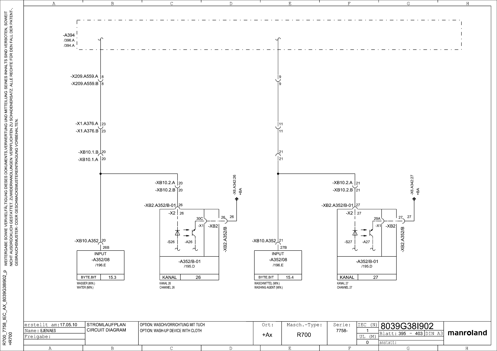

# +Ax — Sheet 395 of 403 — OPTION: WASCHVORRICHTUNG MIT TUCH

**OPTION: WASH UP DEVICE WITH CLOTH**

> Part of the manroland **R700** printing press IEC/UL circuit diagrams.
> Drawing class: **Stromlaufplan / Circuit diagram** (DIN A3).
> Document `+Ax` covers the **Central control console** machine section.

## At a glance

| Field | Value |
|---|---|
| Document | `+Ax`  (8039G38I902) |
| Sheet | **395** of 403 |
| Section (DE) | OPTION: WASCHVORRICHTUNG MIT TUCH |
| Section (EN) | OPTION: WASH UP DEVICE WITH CLOTH |
| Section type | CIRCUIT — Circuit diagram |
| Machine type | `R700` |
| Series | `7758` |
| Created | 17.05.10 |
| Replaces | — |
| Columns used | A, B, C, D, E, F, G |
| Path numbers | — |
| Labels on sheet | 89 |
| Cross-refs out | 6 |
| Cross-refs in | 28 |

**Previous:** [+Ax sheet 394](SHEET_0394.md) · **Next:** [+Ax sheet 396](SHEET_0396.md) · **Document TOC:** [_TOC.md](_TOC.md)  (+Ax) · **Master TOC:** [all sheets](../_MASTER_TOC.md)

## Sheet image (300 DPI, exact vector render)



_Rendered directly from the PDF vector layer at 300 DPI (1-bit), no OCR and no resampling. Use it to confirm anything ambiguous in the text below._

## Cross-references on this sheet

Each entry is a wire leaving this sheet. The printed token is `/sheet.column`; the link resolves to that sheet inside the same document.

| Ref | Target sheet | Col | Path | Destination on target | Target section | From col |
|---|---|---|---|---|---|---|
| `/396.A` | [+Ax sheet 396](SHEET_0396.md) | A | — | — | OPTION: WASCHVORRICHTUNG MIT TUCH | A |
| `/394.A` | [+Ax sheet 394](SHEET_0394.md) | A | — | — | OPTION: WASCHVORRICHTUNG MIT TUCH | A |
| `/196.E` | [+Ax sheet 196](SHEET_0196.md) | E | — | — | REFERENZMODUL | B |
| `/196.E` | [+Ax sheet 196](SHEET_0196.md) | E | — | — | REFERENZMODUL | E |
| `/195.D` | [+Ax sheet 195](SHEET_0195.md) | D | — | — | REFERENZMODUL | C |
| `/195.D` | [+Ax sheet 195](SHEET_0195.md) | D | — | — | REFERENZMODUL | F |

### Incoming references (sheets that point here)

Every other sheet that sends a wire to this one. `Back-ref` is the token printed on *that* sheet; `Path` is its line number.

| From sheet | Cols | Back-ref | Path | Refs | What continues there |
|---|---|---|---|---|---|
| [+Ax#195](SHEET_0195.md) | D | `/195.D` | — | 2 | — |
| [+Ax#196](SHEET_0196.md) | E | `/196.E` | — | 2 | — |
| [+Ax#208](SHEET_0208.md) | E, F | `/208.E`, `/208.F` | — | 4 | — |
| [+Ax#218](SHEET_0218.md) | C, E | `/218.C`, `/218.E` | — | 4 | — |
| [+Ax#243](SHEET_0243.md) | A, B, C, E | `/243.A`, `/243.B`, `/243.C`, `/243.E` | — | 8 | — |
| [+Ax#245](SHEET_0245.md) | A | `/245.A` | — | 2 | — |
| [+Ax#293](SHEET_0293.md) | A, B | `/293.A`, `/293.B` | — | 4 | — |
| [+Ax#394](SHEET_0394.md) | A | `/394.A` | — | 1 | — |
| [+Ax#396](SHEET_0396.md) | A | `/396.A` | — | 1 | — |


## Devices on this sheet

| Tag | Class | Class meaning (IEC) | Col | Sub | Terminal | Sign |
|---|---|---|---|---|---|---|
| `A352/08` | A | Baugruppe / assembly, module, PC board | E | 08 | — | — |
| `A394` | A | Baugruppe / assembly, module, PC board | A | — | — | — |
| `A352/08` | A | Baugruppe / assembly, module, PC board | B | 08 | — | — |
| `S26` | S | Schalter / switch | C | — | — | — |
| `A26` | A | Baugruppe / assembly, module, PC board | C | — | — | — |
| `X1` | X | Klemme / terminal, plug connector | C | — | — | — |
| `X2` | X | Klemme / terminal, plug connector | C | — | — | — |
| `XB2` | XB |  | D | — | — | — |
| `S27` | S | Schalter / switch | F | — | — | — |
| `A27` | A | Baugruppe / assembly, module, PC board | F | — | — | — |
| `X1` | X | Klemme / terminal, plug connector | F | — | — | — |
| `X2` | X | Klemme / terminal, plug connector | F | — | — | — |
| `XB2` | XB |  | G | — | — | — |
| `XB10.A352` | — | cross-device reference | E | — | — | — |
| `15.4` | — | cross-device reference | E | — | — | — |
| `XB10.A352` | — | cross-device reference | B | — | — | — |
| `15.3` | — | cross-device reference | B | — | — | — |
| `X209.A559.B` | — | cross-device reference | B | — | — | — |
| `X209.A559.A` | — | cross-device reference | B | — | — | — |
| `X6.A342:26` | — | cross-device reference | D | — | 26 | — |
| `XB10.2.B` | — | cross-device reference | C | — | — | — |
| `XB10.2.A` | — | cross-device reference | C | — | — | — |
| `X6.A342:27` | — | cross-device reference | G | — | 27 | — |
| `XB10.2.B` | — | cross-device reference | F | — | — | — |
| `XB10.2.A` | — | cross-device reference | F | — | — | — |
| `X1.A376.B` | — | cross-device reference | B | — | — | — |
| `X1.A376.A` | — | cross-device reference | B | — | — | — |
| `XB10.1.A` | — | cross-device reference | B | — | — | — |
| `XB10.1.B` | — | cross-device reference | B | — | — | — |

## Potentials / nets

_No named potentials on this sheet._

## Wire-end annotations (grouped as printed)

A wire that continues elsewhere is annotated with a small cluster: the destination description, the path/line number `#NN`, and the `/sheet.column` cross reference. Each row below is one such cluster exactly as it is grouped on the drawing.

| Col | Y | Path | Cross-ref | Text on the wire |
|---|---|---|---|---|
| A | 79.7 | — | — | `A394` |
| A | 92.7 | — | `/396.A`, `/394.A` | — |
| B | 178.2 | — | — | `X209.A559.A 8` |
| E | 180.3 | — | — | `9` |
| B | 195.9 | — | — | `X209.A559.B 8` |
| E | 197.3 | — | — | `9` |
| B | 291.6 | — | — | `X1.A376.A 23` |
| E | 293.7 | — | — | `11` |
| B | 309.3 | — | — | `X1.A376.B 23` |
| E | 310.7 | — | — | `11` |
| B | 360.3 | — | — | `XB10.1.B 20` |
| E | 360.3 | — | — | `21` |
| B | 377.3 | — | — | `XB10.1.A 20` |
| E | 377.3 | — | — | `21` |
| D | 419.2 | — | — | `X6.A342:26` |
| G | 419.2 | — | — | `X6.A342:27` |
| C | 433.3 | — | — | `XB10.2.A 20` |
| F | 433.3 | — | — | `XB10.2.A 21` |
| C | 451.0 | — | — | `XB10.2.B 20` |
| D | 451.0 | — | — | `+BA` |
| F | 451.0 | — | — | `XB10.2.B 21` |
| G | 451.0 | — | — | `+BA` |
| C | 487.9 | — | — | `XB2.A352/B 01 26` |
| F | 487.9 | — | — | `XB2.A352/B 01 27` |
| C | 506.3 | — | — | `X2` |
| F | 506.3 | — | — | `X2` |
| D | 507.7 | — | — | `26 26` |
| G | 507.7 | — | — | `27 27` |
| D | 516.2 | — | — | `26` |
| G | 516.2 | — | — | `27` |
| F | 520.4 | — | — | `29A` |
| C | 520.5 | — | — | `30C` |
| C | 537.5 | — | — | `X1` |
| D | 537.5 | — | — | `XB2` |
| F | 537.5 | — | — | `X1` |
| G | 537.5 | — | — | `XB2` |
| D | 543.7 | — | — | `XB2.A352/B` |
| G | 543.7 | — | — | `XB2.A352/B` |
| B | 572.9 | — | — | `XB10.A352 20` |
| E | 572.9 | — | — | `XB10.A352 21` |
| C | 576.4 | — | — | `S26 A26` |
| F | 576.4 | — | — | `S27 A27` |
| B | 589.9 | — | — | `26B` |
| E | 589.9 | — | — | `27B` |
| B | 604.4 | — | — | `INPUT` |
| E | 604.4 | — | — | `INPUT` |
| B | 618.3 | — | — | `A352/08` |
| E | 618.3 | — | — | `A352/08` |
| C | 622.5 | — | — | `A352/B 01` |
| F | 622.5 | — | — | `A352/B 01` |
| B | 632.0 | — | `/196.E` | — |
| E | 632.0 | — | `/196.E` | — |
| C | 634.9 | — | `/195.D` | — |
| F | 634.9 | — | `/195.D` | — |
| C | 660.7 | — | — | `KANAL 26` |
| F | 660.7 | — | — | `KANAL 27` |
| B | 661.1 | — | — | `BYTE.BIT 15.3` |
| E | 661.1 | — | — | `BYTE.BIT 15.4` |
| B | 676.8 | — | — | `WASSER (MIN.) WATER (MIN.)` |
| E | 676.8 | — | — | `WASCHMITTEL (MIN.) WASHING AGENT (MIN.)` |
| C | 676.9 | — | — | `KANAL 26 CHANNEL 26` |
| F | 676.9 | — | — | `KANAL 27 CHANNEL 27` |


## Reconstructed tables

This sheet carries tabular content (pin map / terminal assignment / index). The grid below was rebuilt from the drawing's own rule lines, so each row is exactly one physical row of the table.

### Table 1 — 3 data rows × 2 columns (at x=184.3, y=416.7)

| XB10.A352 | 20 26B |
|---|---|
| `INPUT` |  |
|  | `A352/08 /196.E` |
| `BYTE.BIT` | `15.3` |


### Table 2 — 4 data rows × 8 columns (at x=382.7, y=416.7)

| XB10.2.A XB10.2.B XB2.A352/B 01 | 20 20 26 |  |  | X6.A342:26 | +BA |  |  |
|---|---|---|---|---|---|---|---|
| `X2 S26` | `26 A26` | `30C X1` | `XB2` | `26 26 XB2.A352/B` |  | `XB10.A352` | `21 27B` |
|  |  |  |  |  |  | `INPUT` |  |
|  | `A352/B 01 /195.D` |  |  |  |  |  | `A352/08 /196.E` |
| `KANAL` |  | `26` |  |  |  | `BYTE.BIT` | `15.4` |


### Table 3 — 3 data rows × 5 columns (at x=807.9, y=416.7)

| XB10.2.A XB10.2.B XB2.A352/B 01 | 21 21 27 |  |  | X6.A342:27 |
|---|---|---|---|---|
| `X2 S27` | `27 A27` | `29A X1` | `XB2` | `27 27 XB2.A352/B` |
|  | `A352/B 01 /195.D` |  |  |  |
| `KANAL` |  | `27` |  |  |


## Notes and free text on this sheet

| Text | Col | Y (pt) |
|---|---|---|
| `27B` | E | 589.89 |
| `INPUT` | E | 604.42 |
| `BYTE.BIT` | E | 661.67 |
| `WASCHMITTEL (MIN.)` | E | 676.83 |
| `WASHING AGENT (MIN.)` | E | 686.78 |
| `26B` | B | 589.89 |
| `INPUT` | B | 604.42 |
| `BYTE.BIT` | B | 661.67 |
| `WASSER (MIN.)` | B | 676.84 |
| `WATER (MIN.)` | B | 686.76 |
| `KANAL 26` | C | 676.85 |
| `CHANNEL 26` | C | 686.79 |
| `30C` | C | 520.49 |
| `KANAL` | C | 660.77 |
| `A352/B 01` | C | 622.52 |
| `XB2.A352/B 01` | C | 487.87 |
| `XB2.A352/B` | D | 543.68 |
| `+BA` | D | 450.99 |
| `KANAL 27` | F | 676.85 |
| `CHANNEL 27` | F | 686.79 |
| `29A` | F | 520.44 |
| `KANAL` | F | 660.77 |
| `A352/B 01` | F | 622.52 |
| `XB2.A352/B 01` | F | 487.87 |
| `XB2.A352/B` | G | 543.68 |
| `+BA` | G | 450.99 |

## Complete label inventory (exact text from the drawing)

Every text object inside the drawing area of this sheet, in DIN reading order (column A→H, then top→bottom). This is the authoritative list: if a string is not here it is not printed on this sheet.

| Col | Y | X | Dir | Type | Text |
|---|---|---|---|---|---|
| A | 79.7 | 150.8 | → | device tag | `A394` |
| A | 92.7 | 153.1 | → | cross-reference | `/396.A` |
| A | 105.1 | 153.1 | → | cross-reference | `/394.A` |
| B | 178.2 | 168.9 | → | device ref | `X209.A559.A` |
| B | 180.3 | 243.5 | → | number | `8` |
| B | 195.9 | 169.8 | → | device ref | `X209.A559.B` |
| B | 197.3 | 243.5 | → | number | `8` |
| B | 291.6 | 180.9 | → | device ref | `X1.A376.A` |
| B | 293.7 | 243.5 | → | number | `23` |
| B | 309.3 | 181.7 | → | device ref | `X1.A376.B` |
| B | 310.7 | 243.5 | → | number | `23` |
| B | 360.3 | 187.7 | → | device ref | `XB10.1.B` |
| B | 360.3 | 243.5 | → | number | `20` |
| B | 377.3 | 243.5 | → | number | `20` |
| B | 378.0 | 186.8 | → | device ref | `XB10.1.A` |
| B | 572.9 | 178.6 | → | device ref | `XB10.A352` |
| B | 572.9 | 243.5 | → | number | `20` |
| B | 589.9 | 246.3 | → | text | `26B` |
| B | 604.4 | 226.1 | → | text | `INPUT` |
| B | 618.3 | 219.5 | → | device tag | `A352/08` |
| B | 632.0 | 228.5 | → | cross-reference | `/196.E` |
| B | 661.1 | 259.5 | → | device ref | `15.3` |
| B | 661.7 | 194.2 | → | text | `BYTE.BIT` |
| B | 676.8 | 184.3 | → | text | `WASSER (MIN.)` |
| B | 686.8 | 184.3 | → | text | `WATER (MIN.)` |
| C | 433.3 | 371.1 | → | device ref | `XB10.2.A` |
| C | 435.4 | 427.7 | → | number | `20` |
| C | 451.0 | 371.9 | → | device ref | `XB10.2.B` |
| C | 452.5 | 427.7 | → | number | `20` |
| C | 487.9 | 345.0 | → | text | `XB2.A352/B 01` |
| C | 487.9 | 427.7 | → | number | `26` |
| C | 506.3 | 403.7 | → | device tag | `X2` |
| C | 507.7 | 430.6 | → | number | `26` |
| C | 520.5 | 470.6 | → | text | `30C` |
| C | 537.5 | 474.2 | → | device tag | `X1` |
| C | 576.4 | 400.0 | → | device tag | `S26` |
| C | 576.4 | 442.5 | → | device tag | `A26` |
| C | 622.5 | 427.6 | → | text | `A352/B 01` |
| C | 634.9 | 440.8 | → | cross-reference | `/195.D` |
| C | 660.7 | 469.0 | → | number | `26` |
| C | 660.8 | 388.9 | → | text | `KANAL` |
| C | 676.8 | 382.1 | → | text | `KANAL 26` |
| C | 686.8 | 382.4 | → | text | `CHANNEL 26` |
| D | 419.2 | 558.0 | ↕ | device ref | `X6.A342:26` |
| D | 451.0 | 572.1 | ↕ | text | `+BA` |
| D | 516.2 | 550.5 | → | number | `26` |
| D | 517.6 | 529.8 | → | number | `26` |
| D | 537.5 | 498.6 | → | device tag | `XB2` |
| D | 543.7 | 534.6 | ↕ | text | `XB2.A352/B` |
| E | 180.3 | 668.7 | → | number | `9` |
| E | 197.3 | 668.7 | → | number | `9` |
| E | 293.7 | 668.1 | → | number | `11` |
| E | 310.7 | 668.1 | → | number | `11` |
| E | 360.3 | 668.7 | → | number | `21` |
| E | 377.3 | 668.7 | → | number | `21` |
| E | 572.9 | 603.8 | → | device ref | `XB10.A352` |
| E | 572.9 | 668.7 | → | number | `21` |
| E | 589.9 | 671.5 | → | text | `27B` |
| E | 604.4 | 651.3 | → | text | `INPUT` |
| E | 618.3 | 644.7 | → | device tag | `A352/08` |
| E | 632.0 | 653.7 | → | cross-reference | `/196.E` |
| E | 661.1 | 684.7 | → | device ref | `15.4` |
| E | 661.7 | 619.4 | → | text | `BYTE.BIT` |
| E | 676.8 | 609.4 | → | text | `WASCHMITTEL (MIN.)` |
| E | 686.8 | 609.4 | → | text | `WASHING AGENT (MIN.)` |
| F | 433.3 | 796.3 | → | device ref | `XB10.2.A` |
| F | 435.4 | 852.9 | → | number | `21` |
| F | 451.0 | 797.1 | → | device ref | `XB10.2.B` |
| F | 452.5 | 852.9 | → | number | `21` |
| F | 487.9 | 770.2 | → | text | `XB2.A352/B 01` |
| F | 487.9 | 852.9 | → | number | `27` |
| F | 506.3 | 828.9 | → | device tag | `X2` |
| F | 507.7 | 855.8 | → | number | `27` |
| F | 520.4 | 895.7 | → | text | `29A` |
| F | 537.5 | 899.4 | → | device tag | `X1` |
| F | 576.4 | 825.2 | → | device tag | `S27` |
| F | 576.4 | 867.7 | → | device tag | `A27` |
| F | 622.5 | 852.8 | → | text | `A352/B 01` |
| F | 634.9 | 866.0 | → | cross-reference | `/195.D` |
| F | 660.7 | 894.2 | → | number | `27` |
| F | 660.8 | 814.1 | → | text | `KANAL` |
| F | 676.8 | 807.3 | → | text | `KANAL 27` |
| F | 686.8 | 807.6 | → | text | `CHANNEL 27` |
| G | 419.2 | 983.2 | ↕ | device ref | `X6.A342:27` |
| G | 451.0 | 997.3 | ↕ | text | `+BA` |
| G | 516.2 | 975.7 | → | number | `27` |
| G | 517.6 | 955.0 | → | number | `27` |
| G | 537.5 | 923.8 | → | device tag | `XB2` |
| G | 543.7 | 959.8 | ↕ | text | `XB2.A352/B` |

## Reading-order text block

The same content as a plain block, grouped by DIN column — convenient to paste or to match against a visual description.

```text
=== Column A ===
  79.7  150.8  devtag       A394
  92.7  153.1  xref         /396.A
 105.1  153.1  xref         /394.A
=== Column B ===
 178.2  168.9  devref       X209.A559.A
 180.3  243.5  numeric      8
 195.9  169.8  devref       X209.A559.B
 197.3  243.5  numeric      8
 291.6  180.9  devref       X1.A376.A
 293.7  243.5  numeric      23
 309.3  181.7  devref       X1.A376.B
 310.7  243.5  numeric      23
 360.3  187.7  devref       XB10.1.B
 360.3  243.5  numeric      20
 377.3  243.5  numeric      20
 378.0  186.8  devref       XB10.1.A
 572.9  178.6  devref       XB10.A352
 572.9  243.5  numeric      20
 589.9  246.3  text         26B
 604.4  226.1  text         INPUT
 618.3  219.5  devtag       A352/08
 632.0  228.5  xref         /196.E
 661.1  259.5  devref       15.3
 661.7  194.2  text         BYTE.BIT
 676.8  184.3  text         WASSER (MIN.)
 686.8  184.3  text         WATER (MIN.)
=== Column C ===
 433.3  371.1  devref       XB10.2.A
 435.4  427.7  numeric      20
 451.0  371.9  devref       XB10.2.B
 452.5  427.7  numeric      20
 487.9  345.0  text         XB2.A352/B 01
 487.9  427.7  numeric      26
 506.3  403.7  devtag       X2
 507.7  430.6  numeric      26
 520.5  470.6  text         30C
 537.5  474.2  devtag       X1
 576.4  400.0  devtag       S26
 576.4  442.5  devtag       A26
 622.5  427.6  text         A352/B 01
 634.9  440.8  xref         /195.D
 660.7  469.0  numeric      26
 660.8  388.9  text         KANAL
 676.8  382.1  text         KANAL 26
 686.8  382.4  text         CHANNEL 26
=== Column D ===
 419.2  558.0  devref       X6.A342:26
 451.0  572.1  text         +BA
 516.2  550.5  numeric      26
 517.6  529.8  numeric      26
 537.5  498.6  devtag       XB2
 543.7  534.6  text         XB2.A352/B
=== Column E ===
 180.3  668.7  numeric      9
 197.3  668.7  numeric      9
 293.7  668.1  numeric      11
 310.7  668.1  numeric      11
 360.3  668.7  numeric      21
 377.3  668.7  numeric      21
 572.9  603.8  devref       XB10.A352
 572.9  668.7  numeric      21
 589.9  671.5  text         27B
 604.4  651.3  text         INPUT
 618.3  644.7  devtag       A352/08
 632.0  653.7  xref         /196.E
 661.1  684.7  devref       15.4
 661.7  619.4  text         BYTE.BIT
 676.8  609.4  text         WASCHMITTEL (MIN.)
 686.8  609.4  text         WASHING AGENT (MIN.)
=== Column F ===
 433.3  796.3  devref       XB10.2.A
 435.4  852.9  numeric      21
 451.0  797.1  devref       XB10.2.B
 452.5  852.9  numeric      21
 487.9  770.2  text         XB2.A352/B 01
 487.9  852.9  numeric      27
 506.3  828.9  devtag       X2
 507.7  855.8  numeric      27
 520.4  895.7  text         29A
 537.5  899.4  devtag       X1
 576.4  825.2  devtag       S27
 576.4  867.7  devtag       A27
 622.5  852.8  text         A352/B 01
 634.9  866.0  xref         /195.D
 660.7  894.2  numeric      27
 660.8  814.1  text         KANAL
 676.8  807.3  text         KANAL 27
 686.8  807.6  text         CHANNEL 27
=== Column G ===
 419.2  983.2  devref       X6.A342:27
 451.0  997.3  text         +BA
 516.2  975.7  numeric      27
 517.6  955.0  numeric      27
 537.5  923.8  devtag       XB2
 543.7  959.8  text         XB2.A352/B
```

---
_Generated from the PDF vector text layer; no OCR. Source: `R700_7758_IEC_AX_8039G38I902_p`, sheet 395._
