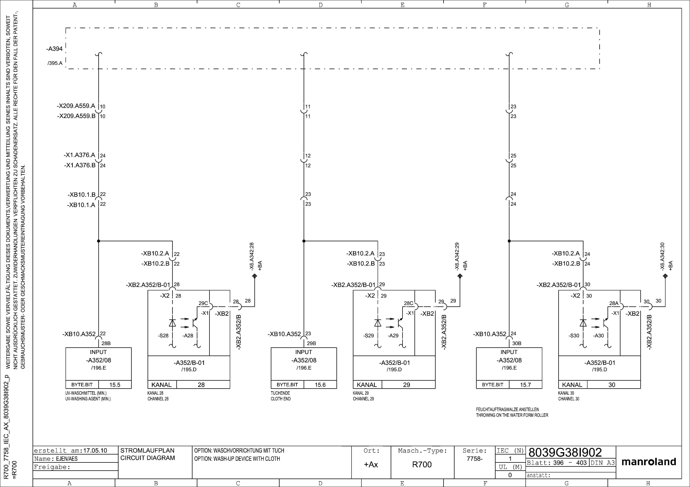

# +Ax — Sheet 396 of 403 — OPTION: WASCHVORRICHTUNG MIT TUCH

**OPTION: WASH UP DEVICE WITH CLOTH**

> Part of the manroland **R700** printing press IEC/UL circuit diagrams.
> Drawing class: **Stromlaufplan / Circuit diagram** (DIN A3).
> Document `+Ax` covers the **Central control console** machine section.

## At a glance

| Field | Value |
|---|---|
| Document | `+Ax`  (8039G38I902) |
| Sheet | **396** of 403 |
| Section (DE) | OPTION: WASCHVORRICHTUNG MIT TUCH |
| Section (EN) | OPTION: WASH UP DEVICE WITH CLOTH |
| Section type | CIRCUIT — Circuit diagram |
| Machine type | `R700` |
| Series | `7758` |
| Created | 17.05.10 |
| Replaces | — |
| Columns used | A, B, C, D, E, F, G, H |
| Path numbers | — |
| Labels on sheet | 128 |
| Cross-refs out | 7 |
| Cross-refs in | 40 |

**Previous:** [+Ax sheet 395](SHEET_0395.md) · **Next:** [+Ax sheet 397](SHEET_0397.md) · **Document TOC:** [_TOC.md](_TOC.md)  (+Ax) · **Master TOC:** [all sheets](../_MASTER_TOC.md)

## Sheet image (300 DPI, exact vector render)



_Rendered directly from the PDF vector layer at 300 DPI (1-bit), no OCR and no resampling. Use it to confirm anything ambiguous in the text below._

## Cross-references on this sheet

Each entry is a wire leaving this sheet. The printed token is `/sheet.column`; the link resolves to that sheet inside the same document.

| Ref | Target sheet | Col | Path | Destination on target | Target section | From col |
|---|---|---|---|---|---|---|
| `/395.A` | [+Ax sheet 395](SHEET_0395.md) | A | — | — | OPTION: WASCHVORRICHTUNG MIT TUCH | A |
| `/196.E` | [+Ax sheet 196](SHEET_0196.md) | E | — | — | REFERENZMODUL | A |
| `/196.E` | [+Ax sheet 196](SHEET_0196.md) | E | — | — | REFERENZMODUL | D |
| `/196.E` | [+Ax sheet 196](SHEET_0196.md) | E | — | — | REFERENZMODUL | F |
| `/195.D` | [+Ax sheet 195](SHEET_0195.md) | D | — | — | REFERENZMODUL | B |
| `/195.D` | [+Ax sheet 195](SHEET_0195.md) | D | — | — | REFERENZMODUL | E |
| `/195.D` | [+Ax sheet 195](SHEET_0195.md) | D | — | — | REFERENZMODUL | G |

### Incoming references (sheets that point here)

Every other sheet that sends a wire to this one. `Back-ref` is the token printed on *that* sheet; `Path` is its line number.

| From sheet | Cols | Back-ref | Path | Refs | What continues there |
|---|---|---|---|---|---|
| [+Ax#195](SHEET_0195.md) | D | `/195.D` | — | 3 | — |
| [+Ax#196](SHEET_0196.md) | E | `/196.E` | — | 3 | — |
| [+Ax#208](SHEET_0208.md) | E, F | `/208.E`, `/208.F` | — | 6 | — |
| [+Ax#218](SHEET_0218.md) | C, E | `/218.C`, `/218.E` | — | 6 | — |
| [+Ax#243](SHEET_0243.md) | A, B, C, E | `/243.A`, `/243.B`, `/243.C`, `/243.E` | — | 12 | — |
| [+Ax#245](SHEET_0245.md) | A | `/245.A` | — | 3 | — |
| [+Ax#293](SHEET_0293.md) | A, B | `/293.A`, `/293.B` | — | 6 | — |
| [+Ax#395](SHEET_0395.md) | A | `/395.A` | — | 1 | — |


## Devices on this sheet

| Tag | Class | Class meaning (IEC) | Col | Sub | Terminal | Sign |
|---|---|---|---|---|---|---|
| `S30` | S | Schalter / switch | G | — | — | — |
| `A30` | A | Baugruppe / assembly, module, PC board | G | — | — | — |
| `X1` | X | Klemme / terminal, plug connector | H | — | — | — |
| `X2` | X | Klemme / terminal, plug connector | G | — | — | — |
| `XB2` | XB |  | H | — | — | — |
| `A352/08` | A | Baugruppe / assembly, module, PC board | D | 08 | — | — |
| `S29` | S | Schalter / switch | E | — | — | — |
| `A29` | A | Baugruppe / assembly, module, PC board | E | — | — | — |
| `X1` | X | Klemme / terminal, plug connector | E | — | — | — |
| `X2` | X | Klemme / terminal, plug connector | E | — | — | — |
| `XB2` | XB |  | E | — | — | — |
| `A394` | A | Baugruppe / assembly, module, PC board | A | — | — | — |
| `A352/08` | A | Baugruppe / assembly, module, PC board | F | 08 | — | — |
| `S28` | S | Schalter / switch | B | — | — | — |
| `A28` | A | Baugruppe / assembly, module, PC board | B | — | — | — |
| `X1` | X | Klemme / terminal, plug connector | C | — | — | — |
| `X2` | X | Klemme / terminal, plug connector | B | — | — | — |
| `XB2` | XB |  | C | — | — | — |
| `A352/08` | A | Baugruppe / assembly, module, PC board | A | 08 | — | — |
| `X6.A342:30` | — | cross-device reference | H | — | 30 | — |
| `XB10.2.B` | — | cross-device reference | G | — | — | — |
| `XB10.2.A` | — | cross-device reference | G | — | — | — |
| `XB10.A352` | — | cross-device reference | D | — | — | — |
| `15.6` | — | cross-device reference | D | — | — | — |
| `X6.A342:29` | — | cross-device reference | F | — | 29 | — |
| `XB10.2.B` | — | cross-device reference | D | — | — | — |
| `XB10.2.A` | — | cross-device reference | D | — | — | — |
| `XB10.A352` | — | cross-device reference | F | — | — | — |
| `15.7` | — | cross-device reference | F | — | — | — |
| `X6.A342:28` | — | cross-device reference | C | — | 28 | — |
| `XB10.2.B` | — | cross-device reference | B | — | — | — |
| `XB10.2.A` | — | cross-device reference | B | — | — | — |
| `XB10.A352` | — | cross-device reference | A | — | — | — |
| `15.5` | — | cross-device reference | A | — | — | — |
| `X209.A559.B` | — | cross-device reference | A | — | — | — |
| `X209.A559.A` | — | cross-device reference | A | — | — | — |
| `X1.A376.B` | — | cross-device reference | A | — | — | — |
| `X1.A376.A` | — | cross-device reference | A | — | — | — |
| `XB10.1.A` | — | cross-device reference | A | — | — | — |
| `XB10.1.B` | — | cross-device reference | A | — | — | — |

## Potentials / nets

_No named potentials on this sheet._

## Wire-end annotations (grouped as printed)

A wire that continues elsewhere is annotated with a small cluster: the destination description, the path/line number `#NN`, and the `/sheet.column` cross reference. Each row below is one such cluster exactly as it is grouped on the drawing.

| Col | Y | Path | Cross-ref | Text on the wire |
|---|---|---|---|---|
| A | 79.7 | — | — | `A394` |
| A | 105.2 | — | `/395.A` | — |
| A | 178.2 | — | — | `X209.A559.A 10` |
| D | 180.3 | — | — | `11` |
| F | 180.3 | — | — | `23` |
| A | 195.9 | — | — | `X209.A559.B 10` |
| D | 197.3 | — | — | `11` |
| F | 197.3 | — | — | `23` |
| A | 263.2 | — | — | `X1.A376.A 24` |
| D | 265.4 | — | — | `12` |
| F | 265.4 | — | — | `25` |
| A | 280.9 | — | — | `X1.A376.B 24` |
| D | 282.4 | — | — | `12` |
| F | 282.4 | — | — | `25` |
| A | 332.0 | — | — | `XB10.1.B 22` |
| D | 332.0 | — | — | `23` |
| F | 332.0 | — | — | `24` |
| A | 349.0 | — | — | `XB10.1.A 22` |
| D | 349.0 | — | — | `23` |
| F | 349.0 | — | — | `24` |
| C | 419.2 | — | — | `X6.A342:28` |
| F | 419.2 | — | — | `X6.A342:29` |
| H | 419.2 | — | — | `X6.A342:30` |
| B | 433.3 | — | — | `XB10.2.A 22` |
| E | 433.3 | — | — | `XB10.2.A 23` |
| G | 433.3 | — | — | `XB10.2.A 24` |
| B | 451.0 | — | — | `XB10.2.B 22` |
| C | 451.0 | — | — | `+BA` |
| E | 451.0 | — | — | `XB10.2.B 23` |
| F | 451.0 | — | — | `+BA` |
| G | 451.0 | — | — | `XB10.2.B 24` |
| H | 451.0 | — | — | `+BA` |
| B | 487.9 | — | — | `XB2.A352/B 01 28` |
| D | 487.9 | — | — | `XB2.A352/B 01 29` |
| G | 487.9 | — | — | `XB2.A352/B 01 30` |
| B | 506.3 | — | — | `X2` |
| E | 506.3 | — | — | `X2` |
| G | 506.3 | — | — | `X2` |
| C | 507.7 | — | — | `28 28` |
| E | 507.7 | — | — | `29 29` |
| H | 507.7 | — | — | `30 30` |
| C | 516.2 | — | — | `28` |
| F | 516.2 | — | — | `29` |
| H | 516.2 | — | — | `30` |
| H | 520.4 | — | — | `28A` |
| C | 520.5 | — | — | `29C` |
| E | 520.5 | — | — | `28C` |
| C | 537.5 | — | — | `X1` |
| C | 537.5 | — | — | `XB2` |
| E | 537.5 | — | — | `X1` |
| E | 537.5 | — | — | `XB2` |
| H | 537.5 | — | — | `X1` |
| H | 537.5 | — | — | `XB2` |
| C | 543.7 | — | — | `XB2.A352/B` |
| F | 543.7 | — | — | `XB2.A352/B` |
| H | 543.7 | — | — | `XB2.A352/B` |
| A | 572.9 | — | — | `XB10.A352 22` |
| D | 572.9 | — | — | `XB10.A352 23` |
| F | 572.9 | — | — | `XB10.A352 24` |
| B | 576.4 | — | — | `S28 A28` |
| E | 576.4 | — | — | `S29 A29` |
| G | 576.4 | — | — | `S30 A30` |
| A | 589.9 | — | — | `28B` |
| D | 589.9 | — | — | `29B` |
| F | 589.9 | — | — | `30B` |
| A | 604.4 | — | — | `INPUT` |
| D | 604.4 | — | — | `INPUT` |
| F | 604.4 | — | — | `INPUT` |
| A | 618.3 | — | — | `A352/08` |
| D | 618.3 | — | — | `A352/08` |
| F | 618.3 | — | — | `A352/08` |
| B | 622.5 | — | — | `A352/B 01` |
| E | 622.5 | — | — | `A352/B 01` |
| G | 622.5 | — | — | `A352/B 01` |
| A | 632.0 | — | `/196.E` | — |
| D | 632.0 | — | `/196.E` | — |
| F | 632.0 | — | `/196.E` | — |
| B | 634.9 | — | `/195.D` | — |
| E | 634.9 | — | `/195.D` | — |
| G | 634.9 | — | `/195.D` | — |
| B | 660.7 | — | — | `KANAL 28` |
| E | 660.7 | — | — | `KANAL 29` |
| G | 660.7 | — | — | `KANAL 30` |
| A | 661.1 | — | — | `BYTE.BIT 15.5` |
| D | 661.1 | — | — | `BYTE.BIT 15.6` |
| F | 661.1 | — | — | `BYTE.BIT 15.7` |
| A | 676.8 | — | — | `UV WASCHMITTEL (MIN.) UV WASHING AGENT (MIN.)` |
| D | 676.8 | — | — | `TUCHENDE CLOTH END` |
| B | 676.9 | — | — | `KANAL 28 CHANNEL 28` |
| E | 676.9 | — | — | `KANAL 29 CHANNEL 29` |
| G | 676.9 | — | — | `KANAL 30 CHANNEL 30` |
| F | 705.2 | — | — | `FEUCHTAUFTRAGWALZE ANSTELLEN THROWING ON THE WATER FORM ROLLER` |


## Reconstructed tables

This sheet carries tabular content (pin map / terminal assignment / index). The grid below was rebuilt from the drawing's own rule lines, so each row is exactly one physical row of the table.

### Table 1 — 3 data rows × 2 columns (at x=113.4, y=416.7)

| XB10.A352 | 22 28B |
|---|---|
| `INPUT` |  |
|  | `A352/08 /196.E` |
| `BYTE.BIT` | `15.5` |


### Table 2 — 4 data rows × 8 columns (at x=255.1, y=416.7)

| XB10.2.A XB10.2.B XB2.A352/B 01 | 22 22 28 |  |  | X6.A342:28 | +BA |  |  |
|---|---|---|---|---|---|---|---|
| `X2 S28` | `28 A28` | `29C X1` | `XB2` | `28 28 XB2.A352/B` |  | `XB10.A352` | `23 29B` |
|  |  |  |  |  |  | `INPUT` |  |
|  | `A352/B 01 /195.D` |  |  |  |  |  | `A352/08 /196.E` |
| `KANAL` |  | `28` |  |  |  | `BYTE.BIT` | `15.6` |


### Table 3 — 4 data rows × 8 columns (at x=609.4, y=416.7)

| XB10.2.A XB10.2.B XB2.A352/B 01 | 23 23 29 |  |  | X6.A342:29 | +BA |  |  |
|---|---|---|---|---|---|---|---|
| `X2 S29` | `29 A29` | `28C X1` | `XB2` | `29 29 XB2.A352/B` |  | `XB10.A352` | `24 30B` |
|  |  |  |  |  |  | `INPUT` |  |
|  | `A352/B 01 /195.D` |  |  |  |  |  | `A352/08 /196.E` |
| `KANAL` |  | `29` |  |  |  | `BYTE.BIT` | `15.7` |


### Table 4 — 3 data rows × 5 columns (at x=963.8, y=416.7)

| XB10.2.A XB10.2.B XB2.A352/B 01 | 24 24 30 |  |  | X6.A342:30 |
|---|---|---|---|---|
| `X2 S30` | `30 A30` | `28A X1` | `XB2` | `30 30 XB2.A352/B` |
|  | `A352/B 01 /195.D` |  |  |  |
| `KANAL` |  | `30` |  |  |


## Notes and free text on this sheet

| Text | Col | Y (pt) |
|---|---|---|
| `KANAL 30` | G | 676.85 |
| `CHANNEL 30` | G | 686.79 |
| `28A` | H | 520.44 |
| `KANAL` | G | 660.77 |
| `A352/B 01` | G | 622.52 |
| `XB2.A352/B 01` | G | 487.87 |
| `XB2.A352/B` | H | 543.68 |
| `+BA` | H | 450.99 |
| `29B` | D | 589.89 |
| `INPUT` | D | 604.42 |
| `BYTE.BIT` | D | 661.67 |
| `TUCHENDE` | D | 676.81 |
| `CLOTH END` | D | 686.75 |
| `KANAL 29` | D | 676.85 |
| `CHANNEL 29` | E | 686.79 |
| `28C` | E | 520.49 |
| `KANAL` | E | 660.77 |
| `A352/B 01` | E | 622.52 |
| `XB2.A352/B 01` | D | 487.87 |
| `XB2.A352/B` | F | 543.68 |
| `+BA` | F | 450.99 |
| `30B` | F | 589.89 |
| `INPUT` | F | 604.42 |
| `BYTE.BIT` | F | 661.67 |
| `FEUCHTAUFTRAGWALZE ANSTELLEN` | F | 705.16 |
| `THROWING ON THE WATER FORM ROLLER` | F | 715.1 |
| `KANAL 28` | B | 676.85 |
| `CHANNEL 28` | B | 686.79 |
| `29C` | C | 520.49 |
| `KANAL` | B | 660.77 |
| `A352/B 01` | B | 622.52 |
| `XB2.A352/B 01` | B | 487.87 |
| `XB2.A352/B` | C | 543.68 |
| `+BA` | C | 450.99 |
| `28B` | A | 589.89 |
| `INPUT` | A | 604.42 |
| `BYTE.BIT` | A | 661.67 |
| `UV WASCHMITTEL (MIN.)` | A | 676.83 |
| `UV WASHING AGENT (MIN.)` | A | 686.77 |

## Complete label inventory (exact text from the drawing)

Every text object inside the drawing area of this sheet, in DIN reading order (column A→H, then top→bottom). This is the authoritative list: if a string is not here it is not printed on this sheet.

| Col | Y | X | Dir | Type | Text |
|---|---|---|---|---|---|
| A | 79.7 | 79.9 | → | device tag | `A394` |
| A | 105.1 | 82.2 | → | cross-reference | `/395.A` |
| A | 178.2 | 98.1 | → | device ref | `X209.A559.A` |
| A | 180.3 | 172.1 | → | number | `10` |
| A | 195.9 | 98.9 | → | device ref | `X209.A559.B` |
| A | 197.3 | 172.1 | → | number | `10` |
| A | 263.2 | 110.0 | → | device ref | `X1.A376.A` |
| A | 265.4 | 172.6 | → | number | `24` |
| A | 280.9 | 110.8 | → | device ref | `X1.A376.B` |
| A | 282.4 | 172.6 | → | number | `24` |
| A | 332.0 | 116.8 | → | device ref | `XB10.1.B` |
| A | 332.0 | 172.6 | → | number | `22` |
| A | 349.0 | 172.6 | → | number | `22` |
| A | 349.7 | 115.9 | → | device ref | `XB10.1.A` |
| A | 572.9 | 107.7 | → | device ref | `XB10.A352` |
| A | 572.9 | 172.6 | → | number | `22` |
| A | 589.9 | 175.5 | → | text | `28B` |
| A | 604.4 | 155.2 | → | text | `INPUT` |
| A | 618.3 | 148.7 | → | device tag | `A352/08` |
| A | 632.0 | 157.6 | → | cross-reference | `/196.E` |
| A | 661.1 | 188.6 | → | device ref | `15.5` |
| A | 661.7 | 123.3 | → | text | `BYTE.BIT` |
| A | 676.8 | 112.8 | → | text | `UV WASCHMITTEL (MIN.)` |
| A | 686.8 | 112.8 | → | text | `UV WASHING AGENT (MIN.)` |
| B | 433.3 | 243.5 | → | device ref | `XB10.2.A` |
| B | 435.4 | 300.2 | → | number | `22` |
| B | 451.0 | 244.3 | → | device ref | `XB10.2.B` |
| B | 452.5 | 300.2 | → | number | `22` |
| B | 487.9 | 217.4 | → | text | `XB2.A352/B 01` |
| B | 487.9 | 300.2 | → | number | `28` |
| B | 506.3 | 276.1 | → | device tag | `X2` |
| B | 507.7 | 303.0 | → | number | `28` |
| B | 576.4 | 272.4 | → | device tag | `S28` |
| B | 576.4 | 314.9 | → | device tag | `A28` |
| B | 622.5 | 300.0 | → | text | `A352/B 01` |
| B | 634.9 | 313.2 | → | cross-reference | `/195.D` |
| B | 660.8 | 261.4 | → | text | `KANAL` |
| B | 676.8 | 254.6 | → | text | `KANAL 28` |
| B | 686.8 | 254.8 | → | text | `CHANNEL 28` |
| C | 419.2 | 430.4 | ↕ | device ref | `X6.A342:28` |
| C | 451.0 | 444.6 | ↕ | text | `+BA` |
| C | 516.2 | 422.9 | → | number | `28` |
| C | 517.6 | 402.2 | → | number | `28` |
| C | 520.5 | 343.0 | → | text | `29C` |
| C | 537.5 | 346.7 | → | device tag | `X1` |
| C | 537.5 | 371.1 | → | device tag | `XB2` |
| C | 543.7 | 407.1 | ↕ | text | `XB2.A352/B` |
| C | 660.7 | 341.4 | → | number | `28` |
| D | 180.3 | 526.4 | → | number | `11` |
| D | 197.3 | 526.4 | → | number | `11` |
| D | 265.4 | 526.4 | → | number | `12` |
| D | 282.4 | 526.4 | → | number | `12` |
| D | 332.0 | 527.0 | → | number | `23` |
| D | 349.0 | 527.0 | → | number | `23` |
| D | 433.3 | 597.8 | → | device ref | `XB10.2.A` |
| D | 451.0 | 598.7 | → | device ref | `XB10.2.B` |
| D | 487.9 | 571.7 | → | text | `XB2.A352/B 01` |
| D | 572.9 | 462.0 | → | device ref | `XB10.A352` |
| D | 572.9 | 527.0 | → | number | `23` |
| D | 589.9 | 529.8 | → | text | `29B` |
| D | 604.4 | 509.5 | → | text | `INPUT` |
| D | 618.3 | 503.0 | → | device tag | `A352/08` |
| D | 632.0 | 511.9 | → | cross-reference | `/196.E` |
| D | 661.1 | 543.0 | → | device ref | `15.6` |
| D | 661.7 | 477.6 | → | text | `BYTE.BIT` |
| D | 676.8 | 467.4 | → | text | `TUCHENDE` |
| D | 676.8 | 608.9 | → | text | `KANAL 29` |
| D | 686.8 | 467.4 | → | text | `CLOTH END` |
| E | 435.4 | 654.5 | → | number | `23` |
| E | 452.5 | 654.5 | → | number | `23` |
| E | 487.9 | 654.5 | → | number | `29` |
| E | 506.3 | 630.4 | → | device tag | `X2` |
| E | 507.7 | 657.4 | → | number | `29` |
| E | 517.6 | 756.6 | → | number | `29` |
| E | 520.5 | 697.3 | → | text | `28C` |
| E | 537.5 | 701.0 | → | device tag | `X1` |
| E | 537.5 | 725.4 | → | device tag | `XB2` |
| E | 576.4 | 626.7 | → | device tag | `S29` |
| E | 576.4 | 669.3 | → | device tag | `A29` |
| E | 622.5 | 654.4 | → | text | `A352/B 01` |
| E | 634.9 | 667.6 | → | cross-reference | `/195.D` |
| E | 660.7 | 695.8 | → | number | `29` |
| E | 660.8 | 615.7 | → | text | `KANAL` |
| E | 686.8 | 609.2 | → | text | `CHANNEL 29` |
| F | 180.3 | 881.3 | → | number | `23` |
| F | 197.3 | 881.3 | → | number | `23` |
| F | 265.4 | 881.3 | → | number | `25` |
| F | 282.4 | 881.3 | → | number | `25` |
| F | 332.0 | 881.3 | → | number | `24` |
| F | 349.0 | 881.3 | → | number | `24` |
| F | 419.2 | 784.8 | ↕ | device ref | `X6.A342:29` |
| F | 451.0 | 798.9 | ↕ | text | `+BA` |
| F | 516.2 | 777.3 | → | number | `29` |
| F | 543.7 | 761.4 | ↕ | text | `XB2.A352/B` |
| F | 572.9 | 816.4 | → | device ref | `XB10.A352` |
| F | 572.9 | 881.3 | → | number | `24` |
| F | 589.9 | 884.1 | → | text | `30B` |
| F | 604.4 | 863.9 | → | text | `INPUT` |
| F | 618.3 | 857.3 | → | device tag | `A352/08` |
| F | 632.0 | 866.3 | → | cross-reference | `/196.E` |
| F | 661.1 | 897.3 | → | device ref | `15.7` |
| F | 661.7 | 832.0 | → | text | `BYTE.BIT` |
| F | 705.2 | 821.5 | → | text | `FEUCHTAUFTRAGWALZE ANSTELLEN` |
| F | 715.1 | 821.8 | → | text | `THROWING ON THE WATER FORM ROLLER` |
| G | 433.3 | 952.2 | → | device ref | `XB10.2.A` |
| G | 435.4 | 1008.9 | → | number | `24` |
| G | 451.0 | 953.0 | → | device ref | `XB10.2.B` |
| G | 452.5 | 1008.9 | → | number | `24` |
| G | 487.9 | 926.1 | → | text | `XB2.A352/B 01` |
| G | 487.9 | 1008.9 | → | number | `30` |
| G | 506.3 | 984.8 | → | device tag | `X2` |
| G | 507.7 | 1011.7 | → | number | `30` |
| G | 576.4 | 981.1 | → | device tag | `S30` |
| G | 576.4 | 1023.6 | → | device tag | `A30` |
| G | 622.5 | 1008.7 | → | text | `A352/B 01` |
| G | 634.9 | 1021.9 | → | cross-reference | `/195.D` |
| G | 660.8 | 970.0 | → | text | `KANAL` |
| G | 676.8 | 963.2 | → | text | `KANAL 30` |
| G | 686.8 | 963.5 | → | text | `CHANNEL 30` |
| H | 419.2 | 1139.1 | ↕ | device ref | `X6.A342:30` |
| H | 451.0 | 1153.2 | ↕ | text | `+BA` |
| H | 516.2 | 1131.6 | → | number | `30` |
| H | 517.6 | 1110.9 | → | number | `30` |
| H | 520.4 | 1051.7 | → | text | `28A` |
| H | 537.5 | 1055.3 | → | device tag | `X1` |
| H | 537.5 | 1079.7 | → | device tag | `XB2` |
| H | 543.7 | 1115.7 | ↕ | text | `XB2.A352/B` |
| H | 660.7 | 1050.0 | → | number | `30` |

## Reading-order text block

The same content as a plain block, grouped by DIN column — convenient to paste or to match against a visual description.

```text
=== Column A ===
  79.7   79.9  devtag       A394
 105.1   82.2  xref         /395.A
 178.2   98.1  devref       X209.A559.A
 180.3  172.1  numeric      10
 195.9   98.9  devref       X209.A559.B
 197.3  172.1  numeric      10
 263.2  110.0  devref       X1.A376.A
 265.4  172.6  numeric      24
 280.9  110.8  devref       X1.A376.B
 282.4  172.6  numeric      24
 332.0  116.8  devref       XB10.1.B
 332.0  172.6  numeric      22
 349.0  172.6  numeric      22
 349.7  115.9  devref       XB10.1.A
 572.9  107.7  devref       XB10.A352
 572.9  172.6  numeric      22
 589.9  175.5  text         28B
 604.4  155.2  text         INPUT
 618.3  148.7  devtag       A352/08
 632.0  157.6  xref         /196.E
 661.1  188.6  devref       15.5
 661.7  123.3  text         BYTE.BIT
 676.8  112.8  text         UV WASCHMITTEL (MIN.)
 686.8  112.8  text         UV WASHING AGENT (MIN.)
=== Column B ===
 433.3  243.5  devref       XB10.2.A
 435.4  300.2  numeric      22
 451.0  244.3  devref       XB10.2.B
 452.5  300.2  numeric      22
 487.9  217.4  text         XB2.A352/B 01
 487.9  300.2  numeric      28
 506.3  276.1  devtag       X2
 507.7  303.0  numeric      28
 576.4  272.4  devtag       S28
 576.4  314.9  devtag       A28
 622.5  300.0  text         A352/B 01
 634.9  313.2  xref         /195.D
 660.8  261.4  text         KANAL
 676.8  254.6  text         KANAL 28
 686.8  254.8  text         CHANNEL 28
=== Column C ===
 419.2  430.4  devref       X6.A342:28
 451.0  444.6  text         +BA
 516.2  422.9  numeric      28
 517.6  402.2  numeric      28
 520.5  343.0  text         29C
 537.5  346.7  devtag       X1
 537.5  371.1  devtag       XB2
 543.7  407.1  text         XB2.A352/B
 660.7  341.4  numeric      28
=== Column D ===
 180.3  526.4  numeric      11
 197.3  526.4  numeric      11
 265.4  526.4  numeric      12
 282.4  526.4  numeric      12
 332.0  527.0  numeric      23
 349.0  527.0  numeric      23
 433.3  597.8  devref       XB10.2.A
 451.0  598.7  devref       XB10.2.B
 487.9  571.7  text         XB2.A352/B 01
 572.9  462.0  devref       XB10.A352
 572.9  527.0  numeric      23
 589.9  529.8  text         29B
 604.4  509.5  text         INPUT
 618.3  503.0  devtag       A352/08
 632.0  511.9  xref         /196.E
 661.1  543.0  devref       15.6
 661.7  477.6  text         BYTE.BIT
 676.8  467.4  text         TUCHENDE
 676.8  608.9  text         KANAL 29
 686.8  467.4  text         CLOTH END
=== Column E ===
 435.4  654.5  numeric      23
 452.5  654.5  numeric      23
 487.9  654.5  numeric      29
 506.3  630.4  devtag       X2
 507.7  657.4  numeric      29
 517.6  756.6  numeric      29
 520.5  697.3  text         28C
 537.5  701.0  devtag       X1
 537.5  725.4  devtag       XB2
 576.4  626.7  devtag       S29
 576.4  669.3  devtag       A29
 622.5  654.4  text         A352/B 01
 634.9  667.6  xref         /195.D
 660.7  695.8  numeric      29
 660.8  615.7  text         KANAL
 686.8  609.2  text         CHANNEL 29
=== Column F ===
 180.3  881.3  numeric      23
 197.3  881.3  numeric      23
 265.4  881.3  numeric      25
 282.4  881.3  numeric      25
 332.0  881.3  numeric      24
 349.0  881.3  numeric      24
 419.2  784.8  devref       X6.A342:29
 451.0  798.9  text         +BA
 516.2  777.3  numeric      29
 543.7  761.4  text         XB2.A352/B
 572.9  816.4  devref       XB10.A352
 572.9  881.3  numeric      24
 589.9  884.1  text         30B
 604.4  863.9  text         INPUT
 618.3  857.3  devtag       A352/08
 632.0  866.3  xref         /196.E
 661.1  897.3  devref       15.7
 661.7  832.0  text         BYTE.BIT
 705.2  821.5  text         FEUCHTAUFTRAGWALZE ANSTELLEN
 715.1  821.8  text         THROWING ON THE WATER FORM ROLLER
=== Column G ===
 433.3  952.2  devref       XB10.2.A
 435.4 1008.9  numeric      24
 451.0  953.0  devref       XB10.2.B
 452.5 1008.9  numeric      24
 487.9  926.1  text         XB2.A352/B 01
 487.9 1008.9  numeric      30
 506.3  984.8  devtag       X2
 507.7 1011.7  numeric      30
 576.4  981.1  devtag       S30
 576.4 1023.6  devtag       A30
 622.5 1008.7  text         A352/B 01
 634.9 1021.9  xref         /195.D
 660.8  970.0  text         KANAL
 676.8  963.2  text         KANAL 30
 686.8  963.5  text         CHANNEL 30
=== Column H ===
 419.2 1139.1  devref       X6.A342:30
 451.0 1153.2  text         +BA
 516.2 1131.6  numeric      30
 517.6 1110.9  numeric      30
 520.4 1051.7  text         28A
 537.5 1055.3  devtag       X1
 537.5 1079.7  devtag       XB2
 543.7 1115.7  text         XB2.A352/B
 660.7 1050.0  numeric      30
```

---
_Generated from the PDF vector text layer; no OCR. Source: `R700_7758_IEC_AX_8039G38I902_p`, sheet 396._
