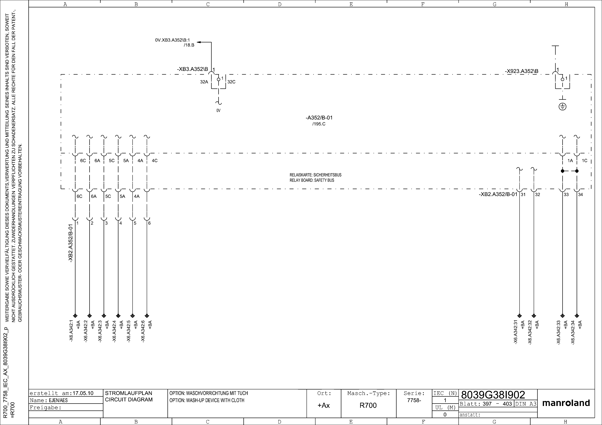

# +Ax — Sheet 397 of 403 — OPTION: WASCHVORRICHTUNG MIT TUCH

**OPTION: WASH UP DEVICE WITH CLOTH**

> Part of the manroland **R700** printing press IEC/UL circuit diagrams.
> Drawing class: **Stromlaufplan / Circuit diagram** (DIN A3).
> Document `+Ax` covers the **Central control console** machine section.

## At a glance

| Field | Value |
|---|---|
| Document | `+Ax`  (8039G38I902) |
| Sheet | **397** of 403 |
| Section (DE) | OPTION: WASCHVORRICHTUNG MIT TUCH |
| Section (EN) | OPTION: WASH UP DEVICE WITH CLOTH |
| Section type | CIRCUIT — Circuit diagram |
| Machine type | `R700` |
| Series | `7758` |
| Created | 17.05.10 |
| Replaces | — |
| Columns used | A, B, C, D, E, G, H |
| Path numbers | — |
| Labels on sheet | 60 |
| Cross-refs out | 2 |
| Cross-refs in | 12 |

**Previous:** [+Ax sheet 396](SHEET_0396.md) · **Next:** [+Ax sheet 398](SHEET_0398.md) · **Document TOC:** [_TOC.md](_TOC.md)  (+Ax) · **Master TOC:** [all sheets](../_MASTER_TOC.md)

## Sheet image (300 DPI, exact vector render)



_Rendered directly from the PDF vector layer at 300 DPI (1-bit), no OCR and no resampling. Use it to confirm anything ambiguous in the text below._

## Cross-references on this sheet

Each entry is a wire leaving this sheet. The printed token is `/sheet.column`; the link resolves to that sheet inside the same document.

| Ref | Target sheet | Col | Path | Destination on target | Target section | From col |
|---|---|---|---|---|---|---|
| `/18.B` | [+Ax sheet 18](SHEET_0018.md) | B | — | 0V.XB3.A352\B:1 | SPANNUNGSVERSORGUNG, SCHALTSCHRANKBELÜFTUNG | C |
| `/195.C` | [+Ax sheet 195](SHEET_0195.md) | C | — | — | REFERENZMODUL | E |

### Incoming references (sheets that point here)

Every other sheet that sends a wire to this one. `Back-ref` is the token printed on *that* sheet; `Path` is its line number.

| From sheet | Cols | Back-ref | Path | Refs | What continues there |
|---|---|---|---|---|---|
| [+Ax#18](SHEET_0018.md) | B | `/18.B` | — | 1 | 0V.XB3.A352\B:1 |
| [+Ax#195](SHEET_0195.md) | C | `/195.C` | — | 1 | — |
| [+Ax#218](SHEET_0218.md) | D, E | `/218.D`, `/218.E` | — | 10 | — |


## Devices on this sheet

| Tag | Class | Class meaning (IEC) | Col | Sub | Terminal | Sign |
|---|---|---|---|---|---|---|
| `X6.A342:31` | — | cross-device reference | G | — | 31 | — |
| `X6.A342:32` | — | cross-device reference | G | — | 32 | — |
| `X6.A342:33` | — | cross-device reference | H | — | 33 | — |
| `X6.A342:34` | — | cross-device reference | H | — | 34 | — |
| `X6.A342:1` | — | cross-device reference | A | — | 1 | — |
| `X6.A342:2` | — | cross-device reference | A | — | 2 | — |
| `X6.A342:3` | — | cross-device reference | A | — | 3 | — |
| `X6.A342:4` | — | cross-device reference | B | — | 4 | — |
| `X6.A342:5` | — | cross-device reference | B | — | 5 | — |
| `X6.A342:6` | — | cross-device reference | B | — | 6 | — |

## Potentials / nets

| Potential | Count | Columns | Attached devices | Terminals |
|---|---|---|---|---|
| `0V` | 1 | C | — | — |


A potential such as `L24+/4` or `M24+` is a named supply/return rail; every place it appears on this sheet is electrically common.

## Wire-end annotations (grouped as printed)

A wire that continues elsewhere is annotated with a small cluster: the destination description, the path/line number `#NN`, and the `/sheet.column` cross reference. Each row below is one such cluster exactly as it is grouped on the drawing.

| Col | Y | Path | Cross-ref | Text on the wire |
|---|---|---|---|---|
| C | 75.4 | — | `/18.B` | `0V.XB3.A352\B:1` |
| E | 132.1 | — | — | `XB3.A352\B 1 X923.A352\B 1` |
| C | 151.3 | — | — | `32A 1 32C` |
| H | 151.3 | — | — | `1` |
| C | 216.0 | — | — | `0V` |
| E | 228.5 | — | — | `A352/B 01` |
| E | 241.6 | — | `/195.C` | — |
| B | 314.2 | — | — | `6C 6A 5C 5A 4A 4C` |
| H | 314.2 | — | — | `1A 1C` |
| E | 343.6 | — | — | `RELAISKARTE: SICHERHEITSBUS RELAY BOARD: SAFETY BUS` |
| H | 380.2 | — | — | `XB2.A352/B 01 31 32 33 34` |
| B | 385.1 | — | — | `6C 6A 5C 5A 4A` |
| A | 438.3 | — | — | `1` |
| B | 438.3 | — | — | `2 3 4 5 6` |
| A | 443.1 | — | — | `XB2.A352/B 01` |
| A | 633.3 | — | — | `X6.A342:1` |
| G | 633.3 | — | — | `X6.A342:31` |
| A | 634.4 | — | — | `X6.A342:2` |
| G | 634.4 | — | — | `X6.A342:32` |
| A | 634.7 | — | — | `X6.A342:3` |
| B | 634.7 | — | — | `X6.A342:4` |
| B | 634.7 | — | — | `X6.A342:5` |
| B | 634.7 | — | — | `X6.A342:6` |
| H | 634.7 | — | — | `X6.A342:33` |
| H | 634.7 | — | — | `X6.A342:34` |
| A | 635.0 | — | — | `+BA` |
| A | 635.0 | — | — | `+BA` |
| B | 635.0 | — | — | `+BA` |
| B | 635.0 | — | — | `+BA` |
| B | 635.0 | — | — | `+BA` |
| B | 635.0 | — | — | `+BA` |
| G | 635.0 | — | — | `+BA` |
| H | 635.0 | — | — | `+BA` |
| H | 635.0 | — | — | `+BA` |
| H | 635.0 | — | — | `+BA` |


## Reconstructed tables

This sheet carries tabular content (pin map / terminal assignment / index). The grid below was rebuilt from the drawing's own rule lines, so each row is exactly one physical row of the table.

### Table 1 — 0 data rows × 2 columns (at x=1112.6, y=147.4) — **1**

_none_


## Notes and free text on this sheet

| Text | Col | Y (pt) |
|---|---|---|
| `6C` | A | 314.27 |
| `6A` | A | 314.21 |
| `5C` | B | 314.27 |
| `5A` | B | 314.21 |
| `4A` | B | 314.21 |
| `4C` | B | 314.27 |
| `32C` | C | 158.36 |
| `32A` | C | 158.32 |
| `1A` | H | 314.21 |
| `1C` | H | 314.27 |
| `A352/B 01` | E | 228.5 |
| `X923.A352\B` | G | 136.37 |
| `XB3.A352\B` | C | 132.13 |
| `XB2.A352/B 01` | A | 443.06 |
| `XB2.A352/B 01` | G | 380.16 |
| `+BA` | G | 634.96 |
| `+BA` | H | 634.96 |
| `+BA` | A | 634.96 |
| `+BA` | B | 634.96 |
| `0V.XB3.A352\B:1` | C | 75.37 |
| `RELAISKARTE: SICHERHEITSBUS` | E | 343.6 |
| `RELAY BOARD: SAFETY BUS` | D | 354.23 |

## Complete label inventory (exact text from the drawing)

Every text object inside the drawing area of this sheet, in DIN reading order (column A→H, then top→bottom). This is the authoritative list: if a string is not here it is not printed on this sheet.

| Col | Y | X | Dir | Type | Text |
|---|---|---|---|---|---|
| A | 314.2 | 187.2 | → | text | `6A` |
| A | 314.3 | 158.9 | → | text | `6C` |
| A | 385.1 | 151.8 | → | text | `6C` |
| A | 385.1 | 180.1 | → | text | `6A` |
| A | 438.3 | 150.8 | → | number | `1` |
| A | 438.3 | 179.7 | → | number | `2` |
| A | 443.1 | 135.0 | ↕ | text | `XB2.A352/B 01` |
| A | 633.3 | 137.1 | ↕ | device ref | `X6.A342:1` |
| A | 634.4 | 165.4 | ↕ | device ref | `X6.A342:2` |
| A | 634.7 | 193.7 | ↕ | device ref | `X6.A342:3` |
| A | 635.0 | 151.2 | ↕ | text | `+BA` |
| A | 635.0 | 179.5 | ↕ | text | `+BA` |
| B | 314.2 | 243.9 | → | text | `5A` |
| B | 314.2 | 272.3 | → | text | `4A` |
| B | 314.3 | 215.6 | → | text | `5C` |
| B | 314.3 | 300.6 | → | text | `4C` |
| B | 385.1 | 208.5 | → | text | `5C` |
| B | 385.1 | 236.8 | → | text | `5A` |
| B | 385.1 | 265.2 | → | text | `4A` |
| B | 438.3 | 208.1 | → | number | `3` |
| B | 438.3 | 236.4 | → | number | `4` |
| B | 438.3 | 264.8 | → | number | `5` |
| B | 438.3 | 293.1 | → | number | `6` |
| B | 634.7 | 222.1 | ↕ | device ref | `X6.A342:4` |
| B | 634.7 | 250.4 | ↕ | device ref | `X6.A342:5` |
| B | 634.7 | 278.8 | ↕ | device ref | `X6.A342:6` |
| B | 635.0 | 207.9 | ↕ | text | `+BA` |
| B | 635.0 | 236.2 | ↕ | text | `+BA` |
| B | 635.0 | 264.6 | ↕ | text | `+BA` |
| B | 635.0 | 292.9 | ↕ | text | `+BA` |
| C | 75.4 | 307.0 | → | text | `0V.XB3.A352\B:1` |
| C | 85.3 | 363.7 | → | cross-reference | `/18.B` |
| C | 132.1 | 350.4 | → | text | `XB3.A352\B` |
| C | 133.5 | 419.8 | → | number | `1` |
| C | 151.3 | 437.4 | → | number | `1` |
| C | 158.3 | 396.0 | → | text | `32A` |
| C | 158.4 | 449.9 | → | text | `32C` |
| C | 216.0 | 428.3 | → | potential | `0V` |
| D | 354.2 | 573.2 | → | text | `RELAY BOARD: SAFETY BUS` |
| E | 228.5 | 604.8 | → | text | `A352/B 01` |
| E | 241.6 | 618.0 | → | cross-reference | `/195.C` |
| E | 343.6 | 573.2 | → | text | `RELAISKARTE: SICHERHEITSBUS` |
| G | 136.4 | 998.9 | → | text | `X923.A352\B` |
| G | 380.2 | 947.3 | → | text | `XB2.A352/B 01` |
| G | 381.6 | 1030.1 | → | number | `31` |
| G | 633.3 | 1015.8 | ↕ | device ref | `X6.A342:31` |
| G | 634.4 | 1044.1 | ↕ | device ref | `X6.A342:32` |
| G | 635.0 | 1029.9 | ↕ | text | `+BA` |
| H | 133.5 | 1100.1 | → | number | `1` |
| H | 151.3 | 1117.7 | → | number | `1` |
| H | 314.2 | 1122.4 | → | text | `1A` |
| H | 314.3 | 1150.7 | → | text | `1C` |
| H | 381.6 | 1058.5 | → | number | `32` |
| H | 381.6 | 1115.1 | → | number | `33` |
| H | 381.6 | 1143.5 | → | number | `34` |
| H | 634.7 | 1100.8 | ↕ | device ref | `X6.A342:33` |
| H | 634.7 | 1129.2 | ↕ | device ref | `X6.A342:34` |
| H | 635.0 | 1058.3 | ↕ | text | `+BA` |
| H | 635.0 | 1115.0 | ↕ | text | `+BA` |
| H | 635.0 | 1143.3 | ↕ | text | `+BA` |

## Reading-order text block

The same content as a plain block, grouped by DIN column — convenient to paste or to match against a visual description.

```text
=== Column A ===
 314.2  187.2  text         6A
 314.3  158.9  text         6C
 385.1  151.8  text         6C
 385.1  180.1  text         6A
 438.3  150.8  numeric      1
 438.3  179.7  numeric      2
 443.1  135.0  text         XB2.A352/B 01
 633.3  137.1  devref       X6.A342:1
 634.4  165.4  devref       X6.A342:2
 634.7  193.7  devref       X6.A342:3
 635.0  151.2  text         +BA
 635.0  179.5  text         +BA
=== Column B ===
 314.2  243.9  text         5A
 314.2  272.3  text         4A
 314.3  215.6  text         5C
 314.3  300.6  text         4C
 385.1  208.5  text         5C
 385.1  236.8  text         5A
 385.1  265.2  text         4A
 438.3  208.1  numeric      3
 438.3  236.4  numeric      4
 438.3  264.8  numeric      5
 438.3  293.1  numeric      6
 634.7  222.1  devref       X6.A342:4
 634.7  250.4  devref       X6.A342:5
 634.7  278.8  devref       X6.A342:6
 635.0  207.9  text         +BA
 635.0  236.2  text         +BA
 635.0  264.6  text         +BA
 635.0  292.9  text         +BA
=== Column C ===
  75.4  307.0  text         0V.XB3.A352\B:1
  85.3  363.7  xref         /18.B
 132.1  350.4  text         XB3.A352\B
 133.5  419.8  numeric      1
 151.3  437.4  numeric      1
 158.3  396.0  text         32A
 158.4  449.9  text         32C
 216.0  428.3  net          0V
=== Column D ===
 354.2  573.2  text         RELAY BOARD: SAFETY BUS
=== Column E ===
 228.5  604.8  text         A352/B 01
 241.6  618.0  xref         /195.C
 343.6  573.2  text         RELAISKARTE: SICHERHEITSBUS
=== Column G ===
 136.4  998.9  text         X923.A352\B
 380.2  947.3  text         XB2.A352/B 01
 381.6 1030.1  numeric      31
 633.3 1015.8  devref       X6.A342:31
 634.4 1044.1  devref       X6.A342:32
 635.0 1029.9  text         +BA
=== Column H ===
 133.5 1100.1  numeric      1
 151.3 1117.7  numeric      1
 314.2 1122.4  text         1A
 314.3 1150.7  text         1C
 381.6 1058.5  numeric      32
 381.6 1115.1  numeric      33
 381.6 1143.5  numeric      34
 634.7 1100.8  devref       X6.A342:33
 634.7 1129.2  devref       X6.A342:34
 635.0 1058.3  text         +BA
 635.0 1115.0  text         +BA
 635.0 1143.3  text         +BA
```

---
_Generated from the PDF vector text layer; no OCR. Source: `R700_7758_IEC_AX_8039G38I902_p`, sheet 397._
