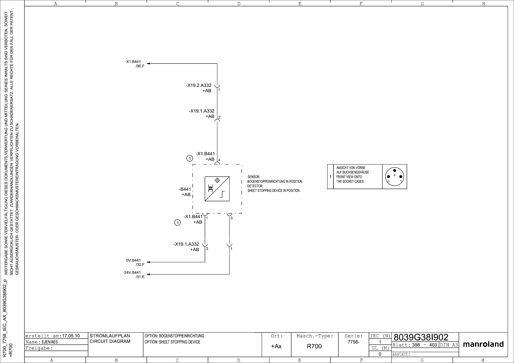

# +Ax — Sheet 398 of 403 — OPTION: BOGENSTOPPEINRICHTUNG

**OPTION: SHEET STOPPING DEVICE**

> Part of the manroland **R700** printing press IEC/UL circuit diagrams.
> Drawing class: **Stromlaufplan / Circuit diagram** (DIN A3).
> Document `+Ax` covers the **Central control console** machine section.

## At a glance

| Field | Value |
|---|---|
| Document | `+Ax`  (8039G38I902) |
| Sheet | **398** of 403 |
| Section (DE) | OPTION: BOGENSTOPPEINRICHTUNG |
| Section (EN) | OPTION: SHEET STOPPING DEVICE |
| Section type | CIRCUIT — Circuit diagram |
| Machine type | `R700` |
| Series | `7758` |
| Created | 17.05.10 |
| Replaces | — |
| Columns used | B, C, D, E, F, G |
| Path numbers | — |
| Labels on sheet | 39 |
| Cross-refs out | 3 |
| Cross-refs in | 10 |

**Previous:** [+Ax sheet 397](SHEET_0397.md) · **Next:** [+Ax sheet 399](SHEET_0399.md) · **Document TOC:** [_TOC.md](_TOC.md)  (+Ax) · **Master TOC:** [all sheets](../_MASTER_TOC.md)

## Sheet image (300 DPI, exact vector render)



_Rendered directly from the PDF vector layer at 300 DPI (1-bit), no OCR and no resampling. Use it to confirm anything ambiguous in the text below._

## Cross-references on this sheet

Each entry is a wire leaving this sheet. The printed token is `/sheet.column`; the link resolves to that sheet inside the same document.

| Ref | Target sheet | Col | Path | Destination on target | Target section | From col |
|---|---|---|---|---|---|---|
| `/90.F` | [+Ax sheet 90](SHEET_0090.md) | F | — | X1.B441 | ANLEGER | B |
| `/32.F` | [+Ax sheet 32](SHEET_0032.md) | F | — | 0V.B441 | SPANNUNGSVERSORGUNG, SCHALTSCHRANKBELÜFTUNG | B |
| `/31.E` | [+Ax sheet 31](SHEET_0031.md) | E | — | 24V.B441 | SPANNUNGSVERSORGUNG, SCHALTSCHRANKBELÜFTUNG | B |

### Incoming references (sheets that point here)

Every other sheet that sends a wire to this one. `Back-ref` is the token printed on *that* sheet; `Path` is its line number.

| From sheet | Cols | Back-ref | Path | Refs | What continues there |
|---|---|---|---|---|---|
| [+Ax#31](SHEET_0031.md) | E | `/31.E` | — | 1 | 24V.B441 |
| [+Ax#32](SHEET_0032.md) | F | `/32.F` | — | 1 | 0V.B441 |
| [+Ax#90](SHEET_0090.md) | F | `/90.F` | — | 1 | X1.B441 |
| [+Ax#213](SHEET_0213.md) | H | `/213.H` | — | 3 | — |
| [+Ax#258](SHEET_0258.md) | D, E | `/258.D`, `/258.E` | — | 4 | STROMPFAD PIN 1 2 |


## Devices on this sheet

| Tag | Class | Class meaning (IEC) | Col | Sub | Terminal | Sign |
|---|---|---|---|---|---|---|
| `B441` | B | Umformer / transducer, sensor | C | — | — | — |
| `X19.2.A332` | — | cross-device reference | C | — | — | — |
| `X19.1.A332` | — | cross-device reference | C | — | — | — |
| `X1.B441` | — | cross-device reference | C | — | — | — |
| `X19.1.A332` | — | cross-device reference | C | — | — | — |
| `X1.B441` | — | cross-device reference | C | — | — | — |
| `X1.B441` | — | cross-device reference | B | — | — | — |

## Potentials / nets

| Potential | Count | Columns | Attached devices | Terminals |
|---|---|---|---|---|
| `0V` | 1 | B | `B441` | — |
| `24V` | 1 | B | `B441` | — |


A potential such as `L24+/4` or `M24+` is a named supply/return rail; every place it appears on this sheet is electrically common.

## Wire-end annotations (grouped as printed)

A wire that continues elsewhere is annotated with a small cluster: the destination description, the path/line number `#NN`, and the `/sheet.column` cross reference. Each row below is one such cluster exactly as it is grouped on the drawing.

| Col | Y | Path | Cross-ref | Text on the wire |
|---|---|---|---|---|
| B | 139.2 | — | `/90.F` | `X1.B441` |
| C | 193.1 | — | — | `X19.2.A332 1` |
| C | 205.7 | — | — | `+AB` |
| C | 252.6 | — | — | `X19.1.A332 2` |
| D | 265.3 | — | — | `+AB` |
| D | 351.8 | — | — | `X1.B441 4` |
| C | 364.0 | — | — | `1` |
| D | 364.5 | — | — | `+AB` |
| F | 386.1 | — | — | `FRONT VIEW ONTO ANSICHT VON VORNE AUF BUCHSENGEHÄUSE` |
| G | 402.7 | — | — | `4` |
| F | 405.6 | — | — | `1 THE SOCKET CASES` |
| E | 407.4 | — | — | `BOGENSTOPPEINRICHTUNG IN POSITION DETECTOR: SENSOR:` |
| G | 416.9 | — | — | `3 1` |
| C | 434.0 | — | — | `B441` |
| E | 439.3 | — | — | `SHEET STOPPING DEVICE IN POSITION` |
| C | 446.7 | — | — | `+AB` |
| C | 497.8 | — | — | `X1.B441 1` |
| D | 502.1 | — | — | `3` |
| C | 510.5 | — | — | `+AB` |
| C | 512.9 | — | — | `1` |
| C | 561.6 | — | — | `X19.1.A332 3` |
| D | 572.9 | — | — | `+AB 1` |
| B | 599.8 | — | `/32.F` | `0V.B441` |
| B | 628.2 | — | `/31.E` | `24V.B441` |


## Reconstructed tables

This sheet carries tabular content (pin map / terminal assignment / index). The grid below was rebuilt from the drawing's own rule lines, so each row is exactly one physical row of the table.

### Table 1 — 1 data rows × 2 columns (at x=474.8, y=147.4)

| +AB +AB X1.B441 +AB | 1 2 4 |
|---|---|
| `1 3` |  |


## Notes and free text on this sheet

| Text | Col | Y (pt) |
|---|---|---|
| `+AB` | C | 205.74 |
| `+AB` | D | 265.27 |
| `SENSOR:` | D | 407.37 |
| `BOGENSTOPPEINRICHTUNG IN POSITION` | E | 418.03 |
| `DETECTOR:` | D | 428.64 |
| `SHEET STOPPING DEVICE IN POSITION` | E | 439.28 |
| `ANSICHT VON VORNE` | F | 386.14 |
| `AUF BUCHSENGEHÄUSE` | F | 396.78 |
| `FRONT VIEW ONTO` | F | 407.37 |
| `THE SOCKET CASES` | F | 418.02 |

## Complete label inventory (exact text from the drawing)

Every text object inside the drawing area of this sheet, in DIN reading order (column A→H, then top→bottom). This is the authoritative list: if a string is not here it is not printed on this sheet.

| Col | Y | X | Dir | Type | Text |
|---|---|---|---|---|---|
| B | 139.2 | 289.7 | → | device ref | `X1.B441` |
| B | 149.1 | 314.6 | → | cross-reference | `/90.F` |
| B | 599.8 | 292.5 | → | potential | `0V.B441` |
| B | 609.7 | 314.6 | → | cross-reference | `/32.F` |
| B | 628.2 | 284.9 | → | potential | `24V.B441` |
| B | 638.0 | 314.4 | → | cross-reference | `/31.E` |
| C | 193.1 | 430.6 | → | device ref | `X19.2.A332` |
| C | 205.7 | 469.1 | → | text | `+AB` |
| C | 252.6 | 437.7 | → | device ref | `X19.1.A332` |
| C | 351.8 | 453.8 | → | device ref | `X1.B441` |
| C | 364.0 | 437.6 | → | number | `1` |
| C | 434.0 | 414.4 | → | device tag | `B441` |
| C | 446.7 | 420.9 | → | text | `+AB` |
| C | 497.8 | 425.5 | → | device ref | `X1.B441` |
| C | 502.1 | 476.8 | → | number | `1` |
| C | 510.5 | 447.9 | → | text | `+AB` |
| C | 512.8 | 409.3 | → | number | `1` |
| C | 561.6 | 402.2 | → | device ref | `X19.1.A332` |
| C | 572.9 | 477.4 | → | number | `3` |
| C | 574.2 | 440.8 | → | text | `+AB` |
| D | 204.4 | 505.1 | → | number | `1` |
| D | 265.3 | 476.2 | → | text | `+AB` |
| D | 268.2 | 505.7 | → | number | `2` |
| D | 364.5 | 476.2 | → | text | `+AB` |
| D | 367.4 | 505.7 | → | number | `4` |
| D | 407.4 | 573.7 | → | text | `SENSOR:` |
| D | 428.6 | 573.2 | → | text | `DETECTOR:` |
| D | 502.1 | 534.0 | → | number | `3` |
| D | 572.9 | 533.5 | → | number | `1` |
| E | 418.0 | 573.2 | → | text | `BOGENSTOPPEINRICHTUNG IN POSITION` |
| E | 439.3 | 573.7 | → | text | `SHEET STOPPING DEVICE IN POSITION` |
| F | 386.1 | 779.5 | → | text | `ANSICHT VON VORNE` |
| F | 396.8 | 779.5 | → | text | `AUF BUCHSENGEHÄUSE` |
| F | 405.6 | 762.8 | → | number | `1` |
| F | 407.4 | 778.7 | → | text | `FRONT VIEW ONTO` |
| F | 416.9 | 898.0 | → | number | `3` |
| F | 418.0 | 779.2 | → | text | `THE SOCKET CASES` |
| G | 402.7 | 912.2 | → | number | `4` |
| G | 416.9 | 926.8 | → | number | `1` |

## Reading-order text block

The same content as a plain block, grouped by DIN column — convenient to paste or to match against a visual description.

```text
=== Column B ===
 139.2  289.7  devref       X1.B441
 149.1  314.6  xref         /90.F
 599.8  292.5  net          0V.B441
 609.7  314.6  xref         /32.F
 628.2  284.9  net          24V.B441
 638.0  314.4  xref         /31.E
=== Column C ===
 193.1  430.6  devref       X19.2.A332
 205.7  469.1  text         +AB
 252.6  437.7  devref       X19.1.A332
 351.8  453.8  devref       X1.B441
 364.0  437.6  numeric      1
 434.0  414.4  devtag       B441
 446.7  420.9  text         +AB
 497.8  425.5  devref       X1.B441
 502.1  476.8  numeric      1
 510.5  447.9  text         +AB
 512.8  409.3  numeric      1
 561.6  402.2  devref       X19.1.A332
 572.9  477.4  numeric      3
 574.2  440.8  text         +AB
=== Column D ===
 204.4  505.1  numeric      1
 265.3  476.2  text         +AB
 268.2  505.7  numeric      2
 364.5  476.2  text         +AB
 367.4  505.7  numeric      4
 407.4  573.7  text         SENSOR:
 428.6  573.2  text         DETECTOR:
 502.1  534.0  numeric      3
 572.9  533.5  numeric      1
=== Column E ===
 418.0  573.2  text         BOGENSTOPPEINRICHTUNG IN POSITION
 439.3  573.7  text         SHEET STOPPING DEVICE IN POSITION
=== Column F ===
 386.1  779.5  text         ANSICHT VON VORNE
 396.8  779.5  text         AUF BUCHSENGEHÄUSE
 405.6  762.8  numeric      1
 407.4  778.7  text         FRONT VIEW ONTO
 416.9  898.0  numeric      3
 418.0  779.2  text         THE SOCKET CASES
=== Column G ===
 402.7  912.2  numeric      4
 416.9  926.8  numeric      1
```

---
_Generated from the PDF vector text layer; no OCR. Source: `R700_7758_IEC_AX_8039G38I902_p`, sheet 398._
