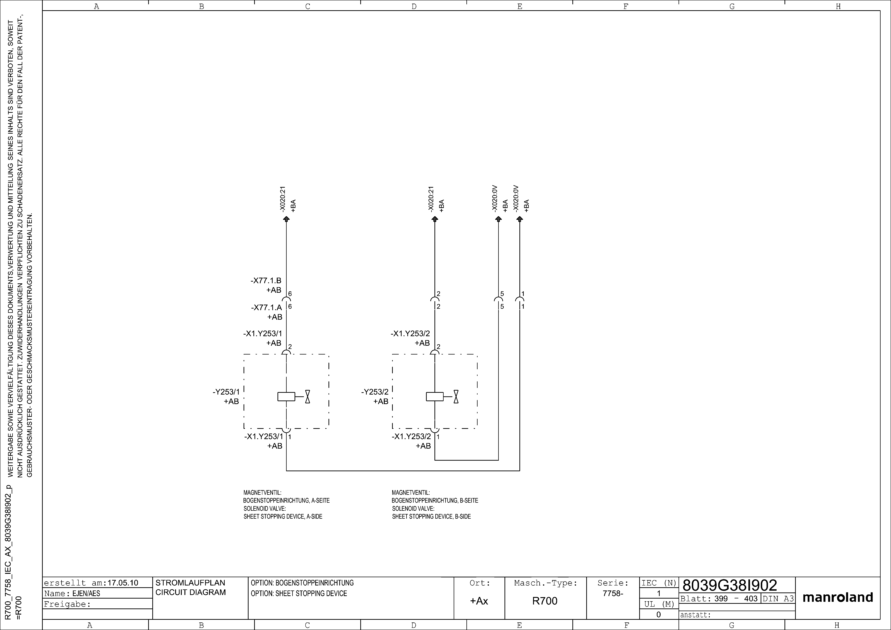

# +Ax — Sheet 399 of 403 — OPTION: BOGENSTOPPEINRICHTUNG

**OPTION: SHEET STOPPING DEVICE**

> Part of the manroland **R700** printing press IEC/UL circuit diagrams.
> Drawing class: **Stromlaufplan / Circuit diagram** (DIN A3).
> Document `+Ax` covers the **Central control console** machine section.

## At a glance

| Field | Value |
|---|---|
| Document | `+Ax`  (8039G38I902) |
| Sheet | **399** of 403 |
| Section (DE) | OPTION: BOGENSTOPPEINRICHTUNG |
| Section (EN) | OPTION: SHEET STOPPING DEVICE |
| Section type | CIRCUIT — Circuit diagram |
| Machine type | `R700` |
| Series | `7758` |
| Created | 17.05.10 |
| Replaces | — |
| Columns used | B, C, D, E |
| Path numbers | — |
| Labels on sheet | 44 |
| Cross-refs out | 0 |
| Cross-refs in | 12 |

**Previous:** [+Ax sheet 398](SHEET_0398.md) · **Next:** [+Ax sheet 400](SHEET_0400.md) · **Document TOC:** [_TOC.md](_TOC.md)  (+Ax) · **Master TOC:** [all sheets](../_MASTER_TOC.md)

## Sheet image (300 DPI, exact vector render)



_Rendered directly from the PDF vector layer at 300 DPI (1-bit), no OCR and no resampling. Use it to confirm anything ambiguous in the text below._

## Cross-references on this sheet

Each entry is a wire leaving this sheet. The printed token is `/sheet.column`; the link resolves to that sheet inside the same document.

_No outgoing cross-references on this sheet._

### Incoming references (sheets that point here)

Every other sheet that sends a wire to this one. `Back-ref` is the token printed on *that* sheet; `Path` is its line number.

| From sheet | Cols | Back-ref | Path | Refs | What continues there |
|---|---|---|---|---|---|
| [+Ax#216](SHEET_0216.md) | G | `/216.G` | — | 4 | — |
| [+Ax#285](SHEET_0285.md) | G | `/285.G` | — | 8 | — |


## Devices on this sheet

| Tag | Class | Class meaning (IEC) | Col | Sub | Terminal | Sign |
|---|---|---|---|---|---|---|
| `Y253/2` | Y | Magnetventil / solenoid valve, actuator | D | 2 | — | — |
| `Y253/1` | Y | Magnetventil / solenoid valve, actuator | B | 1 | — | — |
| `X020:21` | X | Klemme / terminal, plug connector | C | — | 21 | — |
| `X020:21` | X | Klemme / terminal, plug connector | D | — | 21 | — |
| `X020:0V` | X | Klemme / terminal, plug connector | E | — | 0V | — |
| `X020:0V` | X | Klemme / terminal, plug connector | E | — | 0V | — |
| `X77.1.B` | — | cross-device reference | C | — | — | — |
| `X77.1.A` | — | cross-device reference | C | — | — | — |

## Potentials / nets

_No named potentials on this sheet._

## Wire-end annotations (grouped as printed)

A wire that continues elsewhere is annotated with a small cluster: the destination description, the path/line number `#NN`, and the `/sheet.column` cross reference. Each row below is one such cluster exactly as it is grouped on the drawing.

| Col | Y | Path | Cross-ref | Text on the wire |
|---|---|---|---|---|
| E | 247.2 | — | — | `X020:0V` |
| E | 247.2 | — | — | `X020:0V` |
| C | 248.3 | — | — | `X020:21` |
| D | 248.3 | — | — | `X020:21` |
| C | 266.7 | — | — | `+BA` |
| D | 266.7 | — | — | `+BA` |
| E | 266.7 | — | — | `+BA` |
| E | 266.7 | — | — | `+BA` |
| C | 370.2 | — | — | `X77.1.B` |
| C | 382.9 | — | — | `+AB` |
| C | 388.7 | — | — | `6` |
| D | 388.7 | — | — | `2` |
| E | 388.7 | — | — | `5` |
| E | 388.7 | — | — | `1` |
| C | 405.7 | — | — | `X77.1.A 6` |
| D | 405.7 | — | — | `2` |
| E | 405.7 | — | — | `5` |
| E | 405.7 | — | — | `1` |
| C | 419.1 | — | — | `+AB` |
| C | 441.1 | — | — | `X1.Y253/1` |
| D | 441.1 | — | — | `X1.Y253/2` |
| C | 453.8 | — | — | `+AB` |
| D | 453.8 | — | — | `+AB` |
| C | 459.5 | — | — | `2` |
| D | 459.5 | — | — | `2` |
| B | 519.1 | — | — | `Y253/1` |
| D | 519.1 | — | — | `Y253/2` |
| B | 531.7 | — | — | `+AB` |
| D | 531.7 | — | — | `+AB` |
| C | 578.6 | — | — | `X1.Y253/1 1 +AB` |
| D | 578.6 | — | — | `X1.Y253/2 1` |
| C | 591.2 | — | — | `+AB` |
| C | 655.4 | — | — | `BOGENSTOPPEINRICHTUNG, A SEITE MAGNETVENTIL:` |
| D | 655.4 | — | — | `BOGENSTOPPEINRICHTUNG, B SEITE MAGNETVENTIL:` |
| C | 676.7 | — | — | `SOLENOID VALVE: SHEET STOPPING DEVICE, A SIDE` |
| D | 676.7 | — | — | `SOLENOID VALVE: SHEET STOPPING DEVICE, B SIDE` |


## Notes and free text on this sheet

| Text | Col | Y (pt) |
|---|---|---|
| `X1.Y253/2` | D | 578.63 |
| `+AB` | D | 591.25 |
| `X1.Y253/1` | C | 578.63 |
| `+AB` | C | 591.25 |
| `MAGNETVENTIL:` | D | 655.42 |
| `BOGENSTOPPEINRICHTUNG, B SEITE` | D | 666.06 |
| `SOLENOID VALVE:` | D | 676.68 |
| `SHEET STOPPING DEVICE, B SIDE` | D | 687.31 |
| `+AB` | B | 531.73 |
| `MAGNETVENTIL:` | C | 655.42 |
| `BOGENSTOPPEINRICHTUNG, A SEITE` | C | 666.06 |
| `SOLENOID VALVE:` | C | 676.68 |
| `SHEET STOPPING DEVICE, A SIDE` | C | 687.31 |
| `+BA` | C | 266.74 |
| `+BA` | D | 266.74 |
| `+BA` | E | 266.74 |

## Complete label inventory (exact text from the drawing)

Every text object inside the drawing area of this sheet, in DIN reading order (column A→H, then top→bottom). This is the authoritative list: if a string is not here it is not printed on this sheet.

| Col | Y | X | Dir | Type | Text |
|---|---|---|---|---|---|
| B | 519.1 | 284.3 | → | device tag | `Y253/1` |
| B | 531.7 | 299.1 | → | text | `+AB` |
| C | 248.3 | 373.8 | ↕ | device tag | `X020:21` |
| C | 266.7 | 387.9 | ↕ | text | `+BA` |
| C | 370.2 | 335.1 | → | device ref | `X77.1.B` |
| C | 382.9 | 355.7 | → | text | `+AB` |
| C | 388.7 | 385.2 | → | number | `6` |
| C | 405.7 | 385.2 | → | number | `6` |
| C | 406.4 | 335.6 | → | device ref | `X77.1.A` |
| C | 419.0 | 357.2 | → | text | `+AB` |
| C | 441.1 | 325.1 | → | text | `X1.Y253/1` |
| C | 453.8 | 355.7 | → | text | `+AB` |
| C | 459.5 | 385.2 | → | number | `2` |
| C | 578.6 | 326.6 | → | text | `X1.Y253/1` |
| C | 580.0 | 384.7 | → | number | `1` |
| C | 591.3 | 357.2 | → | text | `+AB` |
| C | 655.4 | 325.4 | → | text | `MAGNETVENTIL:` |
| C | 666.1 | 325.1 | → | text | `BOGENSTOPPEINRICHTUNG, A SEITE` |
| C | 676.7 | 325.7 | → | text | `SOLENOID VALVE:` |
| C | 687.3 | 325.7 | → | text | `SHEET STOPPING DEVICE, A SIDE` |
| D | 248.3 | 572.2 | ↕ | device tag | `X020:21` |
| D | 266.7 | 586.3 | ↕ | text | `+BA` |
| D | 388.7 | 583.7 | → | number | `2` |
| D | 405.7 | 583.7 | → | number | `2` |
| D | 441.1 | 522.1 | → | text | `X1.Y253/2` |
| D | 453.8 | 554.2 | → | text | `+AB` |
| D | 459.5 | 583.7 | → | number | `2` |
| D | 519.1 | 482.7 | → | device tag | `Y253/2` |
| D | 531.7 | 498.9 | → | text | `+AB` |
| D | 578.6 | 523.6 | → | text | `X1.Y253/2` |
| D | 580.0 | 583.1 | → | number | `1` |
| D | 591.3 | 555.6 | → | text | `+AB` |
| D | 655.4 | 523.8 | → | text | `MAGNETVENTIL:` |
| D | 666.1 | 523.6 | → | text | `BOGENSTOPPEINRICHTUNG, B SEITE` |
| D | 676.7 | 524.1 | → | text | `SOLENOID VALVE:` |
| D | 687.3 | 524.1 | → | text | `SHEET STOPPING DEVICE, B SIDE` |
| E | 247.2 | 657.2 | ↕ | device tag | `X020:0V` |
| E | 247.2 | 685.6 | ↕ | device tag | `X020:0V` |
| E | 266.7 | 671.3 | ↕ | text | `+BA` |
| E | 266.7 | 699.7 | ↕ | text | `+BA` |
| E | 388.7 | 668.7 | → | number | `5` |
| E | 388.7 | 696.5 | → | number | `1` |
| E | 405.7 | 668.7 | → | number | `5` |
| E | 405.7 | 696.5 | → | number | `1` |

## Reading-order text block

The same content as a plain block, grouped by DIN column — convenient to paste or to match against a visual description.

```text
=== Column B ===
 519.1  284.3  devtag       Y253/1
 531.7  299.1  text         +AB
=== Column C ===
 248.3  373.8  devtag       X020:21
 266.7  387.9  text         +BA
 370.2  335.1  devref       X77.1.B
 382.9  355.7  text         +AB
 388.7  385.2  numeric      6
 405.7  385.2  numeric      6
 406.4  335.6  devref       X77.1.A
 419.0  357.2  text         +AB
 441.1  325.1  text         X1.Y253/1
 453.8  355.7  text         +AB
 459.5  385.2  numeric      2
 578.6  326.6  text         X1.Y253/1
 580.0  384.7  numeric      1
 591.3  357.2  text         +AB
 655.4  325.4  text         MAGNETVENTIL:
 666.1  325.1  text         BOGENSTOPPEINRICHTUNG, A SEITE
 676.7  325.7  text         SOLENOID VALVE:
 687.3  325.7  text         SHEET STOPPING DEVICE, A SIDE
=== Column D ===
 248.3  572.2  devtag       X020:21
 266.7  586.3  text         +BA
 388.7  583.7  numeric      2
 405.7  583.7  numeric      2
 441.1  522.1  text         X1.Y253/2
 453.8  554.2  text         +AB
 459.5  583.7  numeric      2
 519.1  482.7  devtag       Y253/2
 531.7  498.9  text         +AB
 578.6  523.6  text         X1.Y253/2
 580.0  583.1  numeric      1
 591.3  555.6  text         +AB
 655.4  523.8  text         MAGNETVENTIL:
 666.1  523.6  text         BOGENSTOPPEINRICHTUNG, B SEITE
 676.7  524.1  text         SOLENOID VALVE:
 687.3  524.1  text         SHEET STOPPING DEVICE, B SIDE
=== Column E ===
 247.2  657.2  devtag       X020:0V
 247.2  685.6  devtag       X020:0V
 266.7  671.3  text         +BA
 266.7  699.7  text         +BA
 388.7  668.7  numeric      5
 388.7  696.5  numeric      1
 405.7  668.7  numeric      5
 405.7  696.5  numeric      1
```

---
_Generated from the PDF vector text layer; no OCR. Source: `R700_7758_IEC_AX_8039G38I902_p`, sheet 399._
