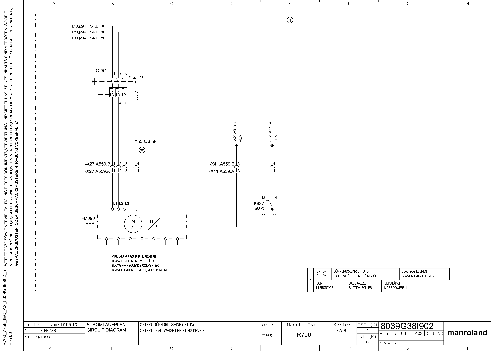

# +Ax — Sheet 400 of 403 — OPTION: DÜNNDRUCKEINRICHTUNG

**OPTION: LIGHT WEIGHT PRINTING DEVICE**

> Part of the manroland **R700** printing press IEC/UL circuit diagrams.
> Drawing class: **Stromlaufplan / Circuit diagram** (DIN A3).
> Document `+Ax` covers the **Central control console** machine section.

## At a glance

| Field | Value |
|---|---|
| Document | `+Ax`  (8039G38I902) |
| Sheet | **400** of 403 |
| Section (DE) | OPTION: DÜNNDRUCKEINRICHTUNG |
| Section (EN) | OPTION: LIGHT WEIGHT PRINTING DEVICE |
| Section type | CIRCUIT — Circuit diagram |
| Machine type | `R700` |
| Series | `7758` |
| Created | 17.05.10 |
| Replaces | — |
| Columns used | A, B, C, D, E, F, G |
| Path numbers | — |
| Labels on sheet | 70 |
| Cross-refs out | 5 |
| Cross-refs in | 16 |

**Previous:** [+Ax sheet 399](SHEET_0399.md) · **Next:** [+Ax sheet 401](SHEET_0401.md) · **Document TOC:** [_TOC.md](_TOC.md)  (+Ax) · **Master TOC:** [all sheets](../_MASTER_TOC.md)

## Sheet image (300 DPI, exact vector render)



_Rendered directly from the PDF vector layer at 300 DPI (1-bit), no OCR and no resampling. Use it to confirm anything ambiguous in the text below._

## Cross-references on this sheet

Each entry is a wire leaving this sheet. The printed token is `/sheet.column`; the link resolves to that sheet inside the same document.

| Ref | Target sheet | Col | Path | Destination on target | Target section | From col |
|---|---|---|---|---|---|---|
| `/54.B` | [+Ax sheet 54](SHEET_0054.md) | B | — | L1.Q294 | LUFTVERSORGUNG | B |
| `/54.B` | [+Ax sheet 54](SHEET_0054.md) | B | — | L2.Q294 | LUFTVERSORGUNG | B |
| `/54.B` | [+Ax sheet 54](SHEET_0054.md) | B | — | L3.Q294 | LUFTVERSORGUNG | B |
| `/58.C` | [+Ax sheet 58](SHEET_0058.md) | C | — | — | LUFTVERSORGUNG | B |
| `/58.G` | [+Ax sheet 58](SHEET_0058.md) | G | — | — | LUFTVERSORGUNG | D |

### Incoming references (sheets that point here)

Every other sheet that sends a wire to this one. `Back-ref` is the token printed on *that* sheet; `Path` is its line number.

| From sheet | Cols | Back-ref | Path | Refs | What continues there |
|---|---|---|---|---|---|
| [+Ax#54](SHEET_0054.md) | B | `/54.B` | — | 3 | L1.Q294; L2.Q294; L3.Q294 |
| [+Ax#58](SHEET_0058.md) | C | `/58.C` | — | 1 | — |
| [+Ax#270](SHEET_0270.md) | F | `/270.F` | — | 8 | — |
| [+Ax#280](SHEET_0280.md) | F, G | `/280.F`, `/280.G` | — | 4 | — |


## Devices on this sheet

| Tag | Class | Class meaning (IEC) | Col | Sub | Terminal | Sign |
|---|---|---|---|---|---|---|
| `K687` | K | Relais / relay, contactor | D | — | — | — |
| `Q294` | Q | Leistungsschalter / power switching device | B | — | — | — |
| `X41.A559.B` | — | cross-device reference | D | — | — | — |
| `X41.A559.A` | — | cross-device reference | D | — | — | — |
| `X51.A373:3` | — | cross-device reference | D | — | 3 | — |
| `X51.A373:4` | — | cross-device reference | E | — | 4 | — |
| `X27.A559.B` | — | cross-device reference | B | — | — | — |
| `X27.A559.A` | — | cross-device reference | B | — | — | — |
| `X506.A559` | — | cross-device reference | C | — | — | — |

## Potentials / nets

| Potential | Count | Columns | Attached devices | Terminals |
|---|---|---|---|---|
| `L1` | 1 | A | `Q294` | — |
| `L2` | 1 | A | `Q294` | — |
| `L3` | 1 | A | `Q294` | — |
| `M090` | 1 | B | — | — |


A potential such as `L24+/4` or `M24+` is a named supply/return rail; every place it appears on this sheet is electrically common.

## Wire-end annotations (grouped as printed)

A wire that continues elsewhere is annotated with a small cluster: the destination description, the path/line number `#NN`, and the `/sheet.column` cross reference. Each row below is one such cluster exactly as it is grouped on the drawing.

| Col | Y | Path | Cross-ref | Text on the wire |
|---|---|---|---|---|
| E | 45.1 | — | — | `1` |
| B | 59.1 | — | `/54.B` | `L1.Q294` |
| B | 73.2 | — | `/54.B` | `L2.Q294` |
| B | 87.4 | — | `/54.B` | `L3.Q294` |
| B | 164.7 | — | — | `Q294` |
| B | 172.5 | — | — | `1` |
| B | 172.5 | — | — | `3` |
| B | 172.5 | — | — | `5` |
| B | 181.6 | — | — | `12 14` |
| B | 204.3 | — | — | `11` |
| B | 218.0 | — | `/58.C` | — |
| B | 243.4 | — | — | `2` |
| B | 243.4 | — | — | `4` |
| B | 243.4 | — | — | `6` |
| D | 291.7 | — | — | `X51.A373:3` |
| E | 291.7 | — | — | `X51.A373:4` |
| D | 323.4 | — | — | `+EA` |
| E | 323.4 | — | — | `+EA` |
| C | 334.8 | — | — | `X506.A559` |
| B | 388.7 | — | — | `X27.A559.B 1 2 3 4` |
| D | 388.7 | — | — | `X41.A559.B 3` |
| E | 388.7 | — | — | `4` |
| B | 405.7 | — | — | `X27.A559.A 1 2 3 4` |
| D | 405.7 | — | — | `X41.A559.A 3` |
| E | 405.7 | — | — | `4` |
| E | 470.2 | — | — | `K687 14` |
| E | 470.2 | — | — | `12` |
| B | 483.1 | — | — | `L1 L2 L3 '` |
| D | 496.7 | — | `/58.G` | — |
| E | 512.7 | — | — | `11 11` |
| B | 519.0 | — | — | `M090` |
| B | 526.4 | — | — | `3~ M U` |
| B | 531.7 | — | — | `+EA` |
| C | 540.5 | — | — | `f` |
| B | 612.9 | — | — | `BLAS SOG ELEMENT, VERSTÄRKT BLOWER+FREQUENCY CONVERTER: BLAST SUCTION ELEMENT, MORE POWERFUL GEBLÄSE+FREQUENZUMRICHTER:` |
| F | 648.3 | — | — | `OPTION OPTION` |
| G | 648.3 | — | — | `BLAS SOG ELEMENT BLAST SUCTION ELEMENT` |
| F | 648.4 | — | — | `DÜNNDRUCKEINRICHTUNG LIGHT WEIGHT PRINTING DEVICE` |
| E | 667.8 | — | — | `1` |
| F | 676.6 | — | — | `SAUGWALZE SUCTION ROLLER` |
| F | 676.7 | — | — | `IN FRONT OF VOR` |
| G | 676.7 | — | — | `MORE POWERFUL VERSTÄRKT` |


## Notes and free text on this sheet

| Text | Col | Y (pt) |
|---|---|---|
| `+EA` | D | 323.43 |
| `+EA` | E | 323.43 |
| `L1 L2 L3` | B | 484.34 |
| `M` | B | 526.41 |
| `U` | C | 527.55 |
| `f` | C | 540.47 |
| `+EA` | B | 531.73 |
| `GEBLÄSE+FREQUENZUMRICHTER:` | B | 612.92 |
| `BLAS SOG ELEMENT, VERSTÄRKT` | B | 623.54 |
| `BLOWER+FREQUENCY CONVERTER:` | B | 634.17 |
| `BLAST SUCTION ELEMENT, MORE POWERFUL` | B | 644.81 |
| `OPTION` | F | 648.31 |
| `DÜNNDRUCKEINRICHTUNG` | F | 648.37 |
| `LIGHT WEIGHT PRINTING DEVICE` | F | 658.96 |
| `BLAS SOG ELEMENT` | G | 648.34 |
| `BLAST SUCTION ELEMENT` | G | 658.98 |
| `VOR` | E | 676.69 |
| `IN FRONT OF` | F | 687.31 |
| `SAUGWALZE` | F | 676.64 |
| `SUCTION ROLLER` | F | 687.34 |
| `VERSTÄRKT` | G | 676.68 |
| `MORE POWERFUL` | G | 687.31 |

## Complete label inventory (exact text from the drawing)

Every text object inside the drawing area of this sheet, in DIN reading order (column A→H, then top→bottom). This is the authoritative list: if a string is not here it is not printed on this sheet.

| Col | Y | X | Dir | Type | Text |
|---|---|---|---|---|---|
| A | 59.1 | 172.3 | → | potential | `L1.Q294` |
| A | 73.3 | 172.3 | → | potential | `L2.Q294` |
| A | 87.5 | 172.3 | → | potential | `L3.Q294` |
| B | 59.1 | 214.9 | → | cross-reference | `/54.B` |
| B | 73.2 | 214.9 | → | cross-reference | `/54.B` |
| B | 87.4 | 214.9 | → | cross-reference | `/54.B` |
| B | 164.7 | 226.2 | → | device tag | `Q294` |
| B | 172.5 | 271.3 | → | number | `1` |
| B | 172.5 | 286.0 | → | number | `3` |
| B | 172.5 | 300.2 | → | number | `5` |
| B | 181.6 | 308.4 | → | number | `12` |
| B | 181.6 | 335.3 | → | number | `14` |
| B | 204.3 | 328.3 | → | number | `11` |
| B | 218.0 | 322.7 | ↕ | cross-reference | `/58.C` |
| B | 243.4 | 271.8 | → | number | `2` |
| B | 243.4 | 286.0 | → | number | `4` |
| B | 243.4 | 300.2 | → | number | `6` |
| B | 388.7 | 204.1 | → | device ref | `X27.A559.B` |
| B | 388.7 | 271.3 | → | number | `1` |
| B | 388.7 | 286.0 | → | number | `2` |
| B | 388.7 | 300.2 | → | number | `3` |
| B | 388.7 | 328.5 | → | number | `4` |
| B | 405.7 | 271.3 | → | number | `1` |
| B | 405.7 | 286.0 | → | number | `2` |
| B | 405.7 | 300.2 | → | number | `3` |
| B | 405.7 | 328.5 | → | number | `4` |
| B | 406.4 | 203.2 | → | device ref | `X27.A559.A` |
| B | 483.1 | 328.3 | → | other | `'` |
| B | 484.3 | 271.3 | → | text | `L1 L2 L3` |
| B | 519.1 | 197.3 | → | potential | `M090` |
| B | 526.4 | 314.8 | → | text | `M` |
| B | 531.7 | 206.1 | → | text | `+EA` |
| B | 540.7 | 313.5 | → | other | `3~` |
| B | 612.9 | 269.0 | → | text | `GEBLÄSE+FREQUENZUMRICHTER:` |
| B | 623.5 | 268.4 | → | text | `BLAS SOG ELEMENT, VERSTÄRKT` |
| B | 634.2 | 268.4 | → | text | `BLOWER+FREQUENCY CONVERTER:` |
| B | 644.8 | 268.4 | → | text | `BLAST SUCTION ELEMENT, MORE POWERFUL` |
| C | 334.8 | 318.6 | → | device ref | `X506.A559` |
| C | 527.6 | 359.0 | → | text | `U` |
| C | 540.5 | 372.6 | → | text | `f` |
| D | 291.7 | 558.0 | ↕ | device ref | `X51.A373:3` |
| D | 323.4 | 572.1 | ↕ | text | `+EA` |
| D | 388.7 | 501.7 | → | device ref | `X41.A559.B` |
| D | 388.7 | 569.5 | → | number | `3` |
| D | 405.7 | 569.5 | → | number | `3` |
| D | 406.4 | 500.9 | → | device ref | `X41.A559.A` |
| D | 483.6 | 604.3 | → | device tag | `K687` |
| D | 496.7 | 611.1 | → | cross-reference | `/58.G` |
| E | 45.1 | 692.7 | → | number | `1` |
| E | 291.7 | 643.0 | ↕ | device ref | `X51.A373:4` |
| E | 323.4 | 657.2 | ↕ | text | `+EA` |
| E | 388.7 | 654.5 | → | number | `4` |
| E | 405.7 | 654.5 | → | number | `4` |
| E | 470.2 | 625.9 | → | number | `12` |
| E | 470.2 | 654.0 | → | number | `14` |
| E | 512.7 | 627.0 | → | number | `11` |
| E | 512.7 | 654.0 | → | number | `11` |
| E | 667.8 | 741.5 | → | number | `1` |
| E | 676.7 | 758.3 | → | text | `VOR` |
| F | 648.3 | 758.0 | → | text | `OPTION` |
| F | 648.4 | 799.9 | → | text | `DÜNNDRUCKEINRICHTUNG` |
| F | 658.9 | 758.0 | → | text | `OPTION` |
| F | 659.0 | 799.9 | → | text | `LIGHT WEIGHT PRINTING DEVICE` |
| F | 676.6 | 835.9 | → | text | `SAUGWALZE` |
| F | 687.3 | 757.4 | → | text | `IN FRONT OF` |
| F | 687.3 | 835.9 | → | text | `SUCTION ROLLER` |
| G | 648.3 | 962.9 | → | text | `BLAS SOG ELEMENT` |
| G | 659.0 | 962.9 | → | text | `BLAST SUCTION ELEMENT` |
| G | 676.7 | 921.3 | → | text | `VERSTÄRKT` |
| G | 687.3 | 920.7 | → | text | `MORE POWERFUL` |

## Reading-order text block

The same content as a plain block, grouped by DIN column — convenient to paste or to match against a visual description.

```text
=== Column A ===
  59.1  172.3  net          L1.Q294
  73.3  172.3  net          L2.Q294
  87.5  172.3  net          L3.Q294
=== Column B ===
  59.1  214.9  xref         /54.B
  73.2  214.9  xref         /54.B
  87.4  214.9  xref         /54.B
 164.7  226.2  devtag       Q294
 172.5  271.3  numeric      1
 172.5  286.0  numeric      3
 172.5  300.2  numeric      5
 181.6  308.4  numeric      12
 181.6  335.3  numeric      14
 204.3  328.3  numeric      11
 218.0  322.7  xref         /58.C
 243.4  271.8  numeric      2
 243.4  286.0  numeric      4
 243.4  300.2  numeric      6
 388.7  204.1  devref       X27.A559.B
 388.7  271.3  numeric      1
 388.7  286.0  numeric      2
 388.7  300.2  numeric      3
 388.7  328.5  numeric      4
 405.7  271.3  numeric      1
 405.7  286.0  numeric      2
 405.7  300.2  numeric      3
 405.7  328.5  numeric      4
 406.4  203.2  devref       X27.A559.A
 483.1  328.3  other        `
 484.3  271.3  text         L1 L2 L3
 519.1  197.3  net          M090
 526.4  314.8  text         M
 531.7  206.1  text         +EA
 540.7  313.5  other        3~
 612.9  269.0  text         GEBLÄSE+FREQUENZUMRICHTER:
 623.5  268.4  text         BLAS SOG ELEMENT, VERSTÄRKT
 634.2  268.4  text         BLOWER+FREQUENCY CONVERTER:
 644.8  268.4  text         BLAST SUCTION ELEMENT, MORE POWERFUL
=== Column C ===
 334.8  318.6  devref       X506.A559
 527.6  359.0  text         U
 540.5  372.6  text         f
=== Column D ===
 291.7  558.0  devref       X51.A373:3
 323.4  572.1  text         +EA
 388.7  501.7  devref       X41.A559.B
 388.7  569.5  numeric      3
 405.7  569.5  numeric      3
 406.4  500.9  devref       X41.A559.A
 483.6  604.3  devtag       K687
 496.7  611.1  xref         /58.G
=== Column E ===
  45.1  692.7  numeric      1
 291.7  643.0  devref       X51.A373:4
 323.4  657.2  text         +EA
 388.7  654.5  numeric      4
 405.7  654.5  numeric      4
 470.2  625.9  numeric      12
 470.2  654.0  numeric      14
 512.7  627.0  numeric      11
 512.7  654.0  numeric      11
 667.8  741.5  numeric      1
 676.7  758.3  text         VOR
=== Column F ===
 648.3  758.0  text         OPTION
 648.4  799.9  text         DÜNNDRUCKEINRICHTUNG
 658.9  758.0  text         OPTION
 659.0  799.9  text         LIGHT WEIGHT PRINTING DEVICE
 676.6  835.9  text         SAUGWALZE
 687.3  757.4  text         IN FRONT OF
 687.3  835.9  text         SUCTION ROLLER
=== Column G ===
 648.3  962.9  text         BLAS SOG ELEMENT
 659.0  962.9  text         BLAST SUCTION ELEMENT
 676.7  921.3  text         VERSTÄRKT
 687.3  920.7  text         MORE POWERFUL
```

---
_Generated from the PDF vector text layer; no OCR. Source: `R700_7758_IEC_AX_8039G38I902_p`, sheet 400._
