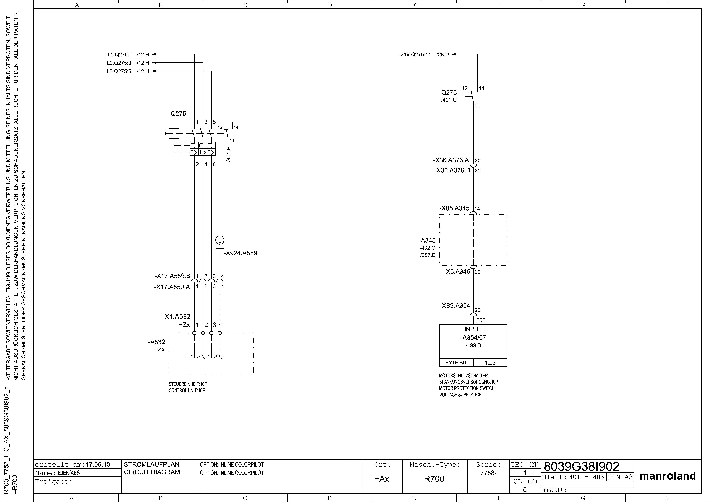

# +Ax — Sheet 401 of 403 — OPTION: INLINE COLORPILOT

**OPTION: INLINE COLORPILOT**

> Part of the manroland **R700** printing press IEC/UL circuit diagrams.
> Drawing class: **Stromlaufplan / Circuit diagram** (DIN A3).
> Document `+Ax` covers the **Central control console** machine section.

## At a glance

| Field | Value |
|---|---|
| Document | `+Ax`  (8039G38I902) |
| Sheet | **401** of 403 |
| Section (DE) | OPTION: INLINE COLORPILOT |
| Section (EN) | OPTION: INLINE COLORPILOT |
| Section type | OPTION — ColorPilot |
| Machine type | `R700` |
| Series | `7758` |
| Created | 17.05.10 |
| Replaces | — |
| Columns used | B, C, E, F |
| Path numbers | — |
| Labels on sheet | 67 |
| Cross-refs out | 9 |
| Cross-refs in | 22 |

**Previous:** [+Ax sheet 400](SHEET_0400.md) · **Next:** [+Ax sheet 402](SHEET_0402.md) · **Document TOC:** [_TOC.md](_TOC.md)  (+Ax) · **Master TOC:** [all sheets](../_MASTER_TOC.md)

## Sheet image (300 DPI, exact vector render)



_Rendered directly from the PDF vector layer at 300 DPI (1-bit), no OCR and no resampling. Use it to confirm anything ambiguous in the text below._

## Cross-references on this sheet

Each entry is a wire leaving this sheet. The printed token is `/sheet.column`; the link resolves to that sheet inside the same document.

| Ref | Target sheet | Col | Path | Destination on target | Target section | From col |
|---|---|---|---|---|---|---|
| `/12.H` | [+Ax sheet 12](SHEET_0012.md) | H | — | 24V.Q275:14 L1.Q275:1 | SPANNUNGSVERSORGUNG, SCHALTSCHRANKBELÜFTUNG | C |
| `/28.D` | [+Ax sheet 28](SHEET_0028.md) | D | — | 24V.Q275:14 L1.Q275:1 | SPANNUNGSVERSORGUNG, SCHALTSCHRANKBELÜFTUNG | C |
| `/12.H` | [+Ax sheet 12](SHEET_0012.md) | H | — | L2.Q275:3 | SPANNUNGSVERSORGUNG, SCHALTSCHRANKBELÜFTUNG | B |
| `/12.H` | [+Ax sheet 12](SHEET_0012.md) | H | — | L3.Q275:5 | SPANNUNGSVERSORGUNG, SCHALTSCHRANKBELÜFTUNG | B |
| `/401.C` | [+Ax sheet 401](SHEET_0401.md) | C | — | — | OPTION: INLINE COLORPILOT | E |
| `/401.F` | [+Ax sheet 401](SHEET_0401.md) | F | — | — | OPTION: INLINE COLORPILOT | C |
| `/402.C` | [+Ax sheet 402](SHEET_0402.md) | C | — | — | OPTION: INLINE COLORPILOT | E |
| `/387.E` | [+Ax sheet 387](SHEET_0387.md) | E | — | — | OPTION: PUDERABSAUGEINRICHTUNG | E |
| `/199.B` | [+Ax sheet 199](SHEET_0199.md) | B | — | — | REFERENZMODUL | F |

### Incoming references (sheets that point here)

Every other sheet that sends a wire to this one. `Back-ref` is the token printed on *that* sheet; `Path` is its line number.

| From sheet | Cols | Back-ref | Path | Refs | What continues there |
|---|---|---|---|---|---|
| [+Ax#12](SHEET_0012.md) | H | `/12.H` | — | 3 | — |
| [+Ax#28](SHEET_0028.md) | D | `/28.D` | — | 1 | — |
| [+Ax#199](SHEET_0199.md) | B | `/199.B` | — | 1 | — |
| [+Ax#231](SHEET_0231.md) | A | `/231.A` | — | 1 | — |
| [+Ax#242](SHEET_0242.md) | A | `/242.A` | — | 1 | — |
| [+Ax#255](SHEET_0255.md) | G | `/255.G` | — | 8 | — |
| [+Ax#279](SHEET_0279.md) | A, B | `/279.A`, `/279.B` | — | 2 | — |
| [+Ax#287](SHEET_0287.md) | C | `/287.C` | — | 1 | — |
| [+Ax#387](SHEET_0387.md) | E | `/387.E` | — | 1 | — |
| [+Ax#401](SHEET_0401.md) | C, E | `/401.C`, `/401.E` | — | 2 | — |
| [+Ax#402](SHEET_0402.md) | B | `/402.B` | — | 1 | — |


## Devices on this sheet

| Tag | Class | Class meaning (IEC) | Col | Sub | Terminal | Sign |
|---|---|---|---|---|---|---|
| `A532` | A | Baugruppe / assembly, module, PC board | B | — | — | — |
| `Q275` | Q | Leistungsschalter / power switching device | B | — | — | — |
| `A354/07` | A | Baugruppe / assembly, module, PC board | F | 07 | — | — |
| `A345` | A | Baugruppe / assembly, module, PC board | E | — | — | — |
| `Q275` | Q | Leistungsschalter / power switching device | E | — | — | — |
| `X1.A532` | — | cross-device reference | B | — | — | — |
| `X17.A559.B` | — | cross-device reference | B | — | — | — |
| `X17.A559.A` | — | cross-device reference | B | — | — | — |
| `12.3` | — | cross-device reference | F | — | — | — |
| `XB9.A354` | — | cross-device reference | E | — | — | — |
| `X85.A345` | — | cross-device reference | E | — | — | — |
| `X5.A345` | — | cross-device reference | F | — | — | — |
| `X36.A376.B` | — | cross-device reference | E | — | — | — |
| `X36.A376.A` | — | cross-device reference | E | — | — | — |
| `X924.A559` | — | cross-device reference | C | — | — | — |

## Potentials / nets

| Potential | Count | Columns | Attached devices | Terminals |
|---|---|---|---|---|
| `24V` | 1 | E | `Q275` | `14` |
| `L1` | 1 | B | `Q275` | `1` |
| `L2` | 1 | B | `Q275` | `3` |
| `L3` | 1 | B | `Q275` | `5` |


A potential such as `L24+/4` or `M24+` is a named supply/return rail; every place it appears on this sheet is electrically common.

## Wire-end annotations (grouped as printed)

A wire that continues elsewhere is annotated with a small cluster: the destination description, the path/line number `#NN`, and the `/sheet.column` cross reference. Each row below is one such cluster exactly as it is grouped on the drawing.

| Col | Y | Path | Cross-ref | Text on the wire |
|---|---|---|---|---|
| C | 87.5 | — | `/12.H`, `/28.D` | `L1.Q275:1 24V.Q275:14` |
| B | 101.6 | — | `/12.H` | `L2.Q275:3` |
| B | 115.8 | — | `/12.H` | `L3.Q275:5` |
| F | 144.2 | — | — | `Q275 14` |
| F | 144.2 | — | — | `12` |
| E | 163.6 | — | `/401.C` | — |
| F | 172.5 | — | — | `11` |
| B | 186.0 | — | — | `Q275` |
| B | 200.9 | — | — | `1` |
| C | 200.9 | — | — | `3` |
| C | 200.9 | — | — | `5` |
| C | 209.9 | — | — | `12 14` |
| C | 232.6 | — | — | `11` |
| C | 246.3 | — | `/401.F` | — |
| F | 263.9 | — | — | `X36.A376.A 20` |
| B | 271.7 | — | — | `2` |
| C | 271.7 | — | — | `4` |
| C | 271.7 | — | — | `6` |
| F | 280.9 | — | — | `X36.A376.B 20` |
| F | 344.7 | — | — | `X85.A345 14` |
| E | 398.6 | — | — | `A345` |
| E | 411.7 | — | `/402.C` | — |
| C | 419.8 | — | — | `X924.A559` |
| E | 424.0 | — | `/387.E` | — |
| F | 451.0 | — | — | `X5.A345 20` |
| B | 458.1 | — | — | `X17.A559.B 1 2 3 4` |
| B | 476.5 | — | — | `X17.A559.A 1 2 3 4` |
| F | 507.7 | — | — | `XB9.A354 20` |
| B | 525.9 | — | — | `X1.A532 1` |
| F | 533.2 | — | — | `26B` |
| B | 539.8 | — | — | `+Zx 2 3 '` |
| F | 547.7 | — | — | `INPUT` |
| F | 561.6 | — | — | `A354/07` |
| B | 568.6 | — | — | `A532` |
| F | 575.3 | — | `/199.B` | — |
| B | 581.4 | — | — | `+Zx` |
| F | 604.4 | — | — | `BYTE.BIT 12.3` |
| F | 627.1 | — | — | `MOTORSCHUTZSCHALTER: MOTOR PROTECTION SWITCH: SPANNUNGSVERSORGUNG, ICP` |
| B | 641.2 | — | — | `STEUEREINHEIT: ICP CONTROL UNIT: ICP` |
| F | 659.0 | — | — | `VOLTAGE SUPPLY, ICP` |


## Reconstructed tables

This sheet carries tabular content (pin map / terminal assignment / index). The grid below was rebuilt from the drawing's own rule lines, so each row is exactly one physical row of the table.

### Table 1 — 1 data rows × 3 columns (at x=737.0, y=544.3)

| INPUT | A354/07 /199.B |  |
|---|---|---|
| `BYTE.BIT` |  | `12.3` |


## Notes and free text on this sheet

| Text | Col | Y (pt) |
|---|---|---|
| `+Zx` | B | 581.44 |
| `STEUEREINHEIT: ICP` | B | 641.24 |
| `CONTROL UNIT: ICP` | B | 651.9 |
| `26B` | F | 533.2 |
| `INPUT` | F | 547.72 |
| `BYTE.BIT` | E | 604.97 |
| `MOTORSCHUTZSCHALTER:` | F | 627.1 |
| `SPANNUNGSVERSORGUNG, ICP` | F | 637.73 |
| `MOTOR PROTECTION SWITCH:` | F | 648.34 |
| `VOLTAGE SUPPLY, ICP` | F | 658.97 |

## Complete label inventory (exact text from the drawing)

Every text object inside the drawing area of this sheet, in DIN reading order (column A→H, then top→bottom). This is the authoritative list: if a string is not here it is not printed on this sheet.

| Col | Y | X | Dir | Type | Text |
|---|---|---|---|---|---|
| B | 87.4 | 229.3 | → | cross-reference | `/12.H` |
| B | 87.5 | 180.6 | → | potential | `L1.Q275:1` |
| B | 101.6 | 179.1 | → | potential | `L2.Q275:3` |
| B | 101.6 | 229.3 | → | cross-reference | `/12.H` |
| B | 115.8 | 179.1 | → | potential | `L3.Q275:5` |
| B | 115.8 | 229.3 | → | cross-reference | `/12.H` |
| B | 186.0 | 282.9 | → | device tag | `Q275` |
| B | 200.9 | 328.0 | → | number | `1` |
| B | 271.7 | 328.5 | → | number | `2` |
| B | 458.1 | 259.4 | → | device ref | `X17.A559.B` |
| B | 459.5 | 328.0 | → | number | `1` |
| B | 476.5 | 258.5 | → | device ref | `X17.A559.A` |
| B | 476.5 | 328.0 | → | number | `1` |
| B | 525.9 | 272.4 | → | device ref | `X1.A532` |
| B | 539.8 | 300.2 | → | text | `+Zx` |
| B | 540.3 | 327.7 | → | number | `1` |
| B | 568.6 | 248.6 | → | device tag | `A532` |
| B | 581.4 | 258.5 | → | text | `+Zx` |
| B | 641.2 | 283.2 | → | text | `STEUEREINHEIT: ICP` |
| B | 651.9 | 283.2 | → | text | `CONTROL UNIT: ICP` |
| C | 200.9 | 342.7 | → | number | `3` |
| C | 200.9 | 356.9 | → | number | `5` |
| C | 209.9 | 365.1 | → | number | `12` |
| C | 209.9 | 392.0 | → | number | `14` |
| C | 232.6 | 384.9 | → | number | `11` |
| C | 246.3 | 379.4 | ↕ | cross-reference | `/401.F` |
| C | 271.7 | 342.7 | → | number | `4` |
| C | 271.7 | 356.9 | → | number | `6` |
| C | 419.8 | 375.3 | → | device ref | `X924.A559` |
| C | 459.5 | 342.7 | → | number | `2` |
| C | 459.5 | 356.9 | → | number | `3` |
| C | 459.5 | 371.1 | → | number | `4` |
| C | 476.5 | 342.7 | → | number | `2` |
| C | 476.5 | 356.9 | → | number | `3` |
| C | 476.5 | 371.1 | → | number | `4` |
| C | 540.3 | 342.7 | → | number | `2 3` |
| C | 540.5 | 371.1 | → | other | `'` |
| E | 87.4 | 731.9 | → | cross-reference | `/28.D` |
| E | 87.5 | 668.7 | → | potential | `24V.Q275:14` |
| E | 150.5 | 736.4 | → | device tag | `Q275` |
| E | 163.6 | 739.8 | → | cross-reference | `/401.C` |
| E | 263.9 | 726.2 | → | device ref | `X36.A376.A` |
| E | 280.9 | 728.5 | → | device ref | `X36.A376.B` |
| E | 344.7 | 737.0 | → | device ref | `X85.A345` |
| E | 398.6 | 702.1 | → | device tag | `A345` |
| E | 411.7 | 704.4 | → | cross-reference | `/402.C` |
| E | 424.0 | 705.0 | → | cross-reference | `/387.E` |
| E | 507.7 | 737.3 | → | device ref | `XB9.A354` |
| E | 605.0 | 746.9 | → | text | `BYTE.BIT` |
| F | 144.2 | 774.7 | → | number | `12` |
| F | 144.2 | 802.8 | → | number | `14` |
| F | 172.5 | 795.7 | → | number | `11` |
| F | 265.4 | 796.3 | → | number | `20` |
| F | 282.4 | 796.3 | → | number | `20` |
| F | 346.2 | 795.7 | → | number | `14` |
| F | 451.0 | 744.4 | → | device ref | `X5.A345` |
| F | 452.5 | 796.3 | → | number | `20` |
| F | 516.2 | 796.3 | → | number | `20` |
| F | 533.2 | 799.1 | → | text | `26B` |
| F | 547.7 | 778.8 | → | text | `INPUT` |
| F | 561.6 | 772.3 | → | device tag | `A354/07` |
| F | 575.3 | 781.1 | → | cross-reference | `/199.B` |
| F | 604.4 | 812.3 | → | device ref | `12.3` |
| F | 627.1 | 736.4 | → | text | `MOTORSCHUTZSCHALTER:` |
| F | 637.7 | 736.7 | → | text | `SPANNUNGSVERSORGUNG, ICP` |
| F | 648.3 | 736.4 | → | text | `MOTOR PROTECTION SWITCH:` |
| F | 659.0 | 737.0 | → | text | `VOLTAGE SUPPLY, ICP` |

## Reading-order text block

The same content as a plain block, grouped by DIN column — convenient to paste or to match against a visual description.

```text
=== Column B ===
  87.4  229.3  xref         /12.H
  87.5  180.6  net          L1.Q275:1
 101.6  179.1  net          L2.Q275:3
 101.6  229.3  xref         /12.H
 115.8  179.1  net          L3.Q275:5
 115.8  229.3  xref         /12.H
 186.0  282.9  devtag       Q275
 200.9  328.0  numeric      1
 271.7  328.5  numeric      2
 458.1  259.4  devref       X17.A559.B
 459.5  328.0  numeric      1
 476.5  258.5  devref       X17.A559.A
 476.5  328.0  numeric      1
 525.9  272.4  devref       X1.A532
 539.8  300.2  text         +Zx
 540.3  327.7  numeric      1
 568.6  248.6  devtag       A532
 581.4  258.5  text         +Zx
 641.2  283.2  text         STEUEREINHEIT: ICP
 651.9  283.2  text         CONTROL UNIT: ICP
=== Column C ===
 200.9  342.7  numeric      3
 200.9  356.9  numeric      5
 209.9  365.1  numeric      12
 209.9  392.0  numeric      14
 232.6  384.9  numeric      11
 246.3  379.4  xref         /401.F
 271.7  342.7  numeric      4
 271.7  356.9  numeric      6
 419.8  375.3  devref       X924.A559
 459.5  342.7  numeric      2
 459.5  356.9  numeric      3
 459.5  371.1  numeric      4
 476.5  342.7  numeric      2
 476.5  356.9  numeric      3
 476.5  371.1  numeric      4
 540.3  342.7  numeric      2 3
 540.5  371.1  other        `
=== Column E ===
  87.4  731.9  xref         /28.D
  87.5  668.7  net          24V.Q275:14
 150.5  736.4  devtag       Q275
 163.6  739.8  xref         /401.C
 263.9  726.2  devref       X36.A376.A
 280.9  728.5  devref       X36.A376.B
 344.7  737.0  devref       X85.A345
 398.6  702.1  devtag       A345
 411.7  704.4  xref         /402.C
 424.0  705.0  xref         /387.E
 507.7  737.3  devref       XB9.A354
 605.0  746.9  text         BYTE.BIT
=== Column F ===
 144.2  774.7  numeric      12
 144.2  802.8  numeric      14
 172.5  795.7  numeric      11
 265.4  796.3  numeric      20
 282.4  796.3  numeric      20
 346.2  795.7  numeric      14
 451.0  744.4  devref       X5.A345
 452.5  796.3  numeric      20
 516.2  796.3  numeric      20
 533.2  799.1  text         26B
 547.7  778.8  text         INPUT
 561.6  772.3  devtag       A354/07
 575.3  781.1  xref         /199.B
 604.4  812.3  devref       12.3
 627.1  736.4  text         MOTORSCHUTZSCHALTER:
 637.7  736.7  text         SPANNUNGSVERSORGUNG, ICP
 648.3  736.4  text         MOTOR PROTECTION SWITCH:
 659.0  737.0  text         VOLTAGE SUPPLY, ICP
```

---
_Generated from the PDF vector text layer; no OCR. Source: `R700_7758_IEC_AX_8039G38I902_p`, sheet 401._
