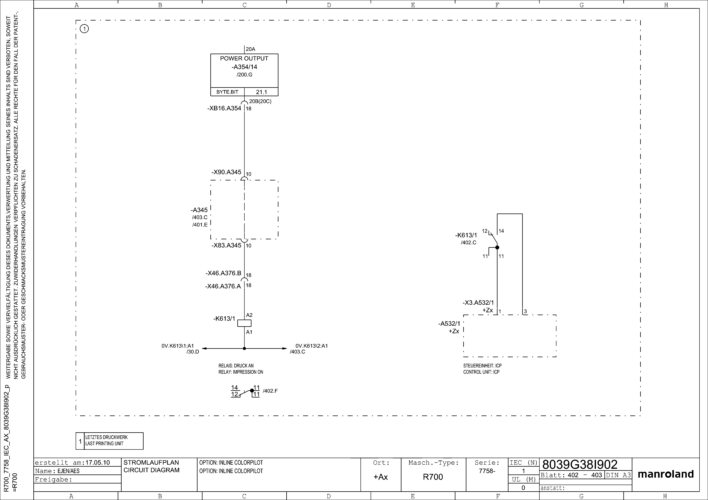

# +Ax — Sheet 402 of 403 — OPTION: INLINE COLORPILOT

**OPTION: INLINE COLORPILOT**

> Part of the manroland **R700** printing press IEC/UL circuit diagrams.
> Drawing class: **Stromlaufplan / Circuit diagram** (DIN A3).
> Document `+Ax` covers the **Central control console** machine section.

## At a glance

| Field | Value |
|---|---|
| Document | `+Ax`  (8039G38I902) |
| Sheet | **402** of 403 |
| Section (DE) | OPTION: INLINE COLORPILOT |
| Section (EN) | OPTION: INLINE COLORPILOT |
| Section type | OPTION — ColorPilot |
| Machine type | `R700` |
| Series | `7758` |
| Created | 17.05.10 |
| Replaces | — |
| Columns used | A, B, C, D, E, F |
| Path numbers | — |
| Labels on sheet | 51 |
| Cross-refs out | 6 |
| Cross-refs in | 13 |

**Previous:** [+Ax sheet 401](SHEET_0401.md) · **Next:** [+Ax sheet 403](SHEET_0403.md) · **Document TOC:** [_TOC.md](_TOC.md)  (+Ax) · **Master TOC:** [all sheets](../_MASTER_TOC.md)

## Sheet image (300 DPI, exact vector render)



_Rendered directly from the PDF vector layer at 300 DPI (1-bit), no OCR and no resampling. Use it to confirm anything ambiguous in the text below._

## Cross-references on this sheet

Each entry is a wire leaving this sheet. The printed token is `/sheet.column`; the link resolves to that sheet inside the same document.

| Ref | Target sheet | Col | Path | Destination on target | Target section | From col |
|---|---|---|---|---|---|---|
| `/200.G` | [+Ax sheet 200](SHEET_0200.md) | G | — | — | REFERENZMODUL | C |
| `/403.C` | [+Ax sheet 403](SHEET_0403.md) | C | — | — | OPTION: INLINE COLORPILOT | B |
| `/401.E` | [+Ax sheet 401](SHEET_0401.md) | E | — | — | OPTION: INLINE COLORPILOT | B |
| `/402.C` | [+Ax sheet 402](SHEET_0402.md) | C | — | — | OPTION: INLINE COLORPILOT | F |
| `/30.D` | [+Ax sheet 30](SHEET_0030.md) | D | — | 0V.K613\1:A1 | SPANNUNGSVERSORGUNG, SCHALTSCHRANKBELÜFTUNG | C |
| `/403.C` | [+Ax sheet 403](SHEET_0403.md) | C | — | 0V.K613\1:A1 | OPTION: INLINE COLORPILOT | C |

### Incoming references (sheets that point here)

Every other sheet that sends a wire to this one. `Back-ref` is the token printed on *that* sheet; `Path` is its line number.

| From sheet | Cols | Back-ref | Path | Refs | What continues there |
|---|---|---|---|---|---|
| [+Ax#30](SHEET_0030.md) | D | `/30.D` | — | 1 | — |
| [+Ax#200](SHEET_0200.md) | F | `/200.F` | — | 1 | — |
| [+Ax#223](SHEET_0223.md) | F | `/223.F` | — | 2 | — |
| [+Ax#254](SHEET_0254.md) | F | `/254.F` | — | 1 | — |
| [+Ax#283](SHEET_0283.md) | A, B | `/283.A`, `/283.B` | — | 2 | — |
| [+Ax#287](SHEET_0287.md) | A | `/287.A` | — | 1 | — |
| [+Ax#289](SHEET_0289.md) | C | `/289.C` | — | 1 | — |
| [+Ax#401](SHEET_0401.md) | E | `/401.E` | — | 1 | — |
| [+Ax#402](SHEET_0402.md) | F | `/402.F` | — | 1 | — |
| [+Ax#403](SHEET_0403.md) | B | `/403.B` | — | 2 | 0V.K613\2:A1 |


## Devices on this sheet

| Tag | Class | Class meaning (IEC) | Col | Sub | Terminal | Sign |
|---|---|---|---|---|---|---|
| `A532/1` | A | Baugruppe / assembly, module, PC board | E | 1 | — | — |
| `K613/1` | K | Relais / relay, contactor | F | 1 | — | — |
| `A354/14` | A | Baugruppe / assembly, module, PC board | C | 14 | — | — |
| `A345` | A | Baugruppe / assembly, module, PC board | B | — | — | — |
| `A2` | A | Baugruppe / assembly, module, PC board | C | — | — | — |
| `A1` | A | Baugruppe / assembly, module, PC board | C | — | — | — |
| `K613/1` | K | Relais / relay, contactor | C | 1 | — | — |
| `21.1` | — | cross-device reference | C | — | — | — |
| `XB16.A354` | — | cross-device reference | C | — | — | — |
| `X46.A376.B` | — | cross-device reference | C | — | — | — |
| `X83.A345` | — | cross-device reference | C | — | — | — |
| `X90.A345` | — | cross-device reference | C | — | — | — |
| `X46.A376.A` | — | cross-device reference | C | — | — | — |

## Potentials / nets

| Potential | Count | Columns | Attached devices | Terminals |
|---|---|---|---|---|
| `0V` | 2 | B, D | `K613\1`, `K613\2` | `A1` |


A potential such as `L24+/4` or `M24+` is a named supply/return rail; every place it appears on this sheet is electrically common.

## Wire-end annotations (grouped as printed)

A wire that continues elsewhere is annotated with a small cluster: the destination description, the path/line number `#NN`, and the `/sheet.column` cross reference. Each row below is one such cluster exactly as it is grouped on the drawing.

| Col | Y | Path | Cross-ref | Text on the wire |
|---|---|---|---|---|
| A | 45.1 | — | — | `1` |
| C | 79.0 | — | — | `20A` |
| C | 94.1 | — | — | `POWER OUTPUT` |
| C | 108.0 | — | — | `A354/14` |
| C | 121.8 | — | `/200.G` | — |
| C | 150.9 | — | — | `BYTE.BIT 21.1` |
| C | 166.9 | — | — | `20B(20C)` |
| C | 177.5 | — | — | `XB16.A354 18` |
| C | 285.2 | — | — | `X90.A345 10` |
| B | 349.0 | — | — | `A345` |
| B | 362.1 | — | `/403.C` | — |
| B | 374.4 | — | `/401.E` | — |
| F | 385.1 | — | — | `K613/1 14` |
| F | 385.1 | — | — | `12` |
| F | 404.6 | — | `/402.C` | — |
| C | 408.5 | — | — | `X83.A345 10` |
| F | 427.6 | — | — | `11 11` |
| C | 455.3 | — | — | `X46.A376.B 18` |
| C | 476.5 | — | — | `X46.A376.A 18` |
| F | 504.9 | — | — | `X3.A532/1 1` |
| F | 517.7 | — | — | `+Zx 3` |
| C | 526.8 | — | — | `A2` |
| C | 531.8 | — | — | `K613/1` |
| E | 540.3 | — | — | `A532/1` |
| E | 553.1 | — | — | `+Zx` |
| C | 555.1 | — | — | `A1` |
| C | 578.5 | — | `/30.D`, `/403.C` | `0V.K613\1:A1` |
| D | 578.5 | — | — | `0V.K613\2:A1` |
| C | 612.9 | — | — | `RELAIS: DRUCK AN RELAY: IMPRESSION ON` |
| F | 612.9 | — | — | `STEUEREINHEIT: ICP CONTROL UNIT: ICP` |
| C | 648.0 | — | — | `14 12 11 11 /402.F` |
| A | 733.4 | — | — | `1 LETZTES DRUCKWERK LAST PRINTING UNIT` |


## Reconstructed tables

This sheet carries tabular content (pin map / terminal assignment / index). The grid below was rebuilt from the drawing's own rule lines, so each row is exactly one physical row of the table.

### Table 1 — 2 data rows × 2 columns (at x=354.3, y=90.7)

| POWER | OUTPUT A354/14 /200.G |
|---|---|
| `BYTE.BIT` | `21.1` |
| `XB16.A354 X90.A345 X83.A345 X46.A376.B X46.A376.A K613/1` | `20B(20C) 18 10 10 18 18 A2 A1` |


## Notes and free text on this sheet

| Text | Col | Y (pt) |
|---|---|---|
| `+Zx` | E | 553.09 |
| `STEUEREINHEIT: ICP` | F | 612.9 |
| `CONTROL UNIT: ICP` | F | 623.55 |
| `X3.A532/1` | F | 504.88 |
| `+Zx` | F | 517.66 |
| `20A` | C | 78.95 |
| `20B(20C)` | C | 166.86 |
| `POWER OUTPUT` | C | 94.1 |
| `BYTE.BIT` | C | 151.43 |
| `11 /402.F` | C | 654.37 |
| `RELAIS: DRUCK AN` | C | 612.89 |
| `RELAY: IMPRESSION ON` | C | 623.53 |
| `LETZTES DRUCKWERK` | A | 733.36 |
| `LAST PRINTING UNIT` | A | 744.01 |

## Complete label inventory (exact text from the drawing)

Every text object inside the drawing area of this sheet, in DIN reading order (column A→H, then top→bottom). This is the authoritative list: if a string is not here it is not printed on this sheet.

| Col | Y | X | Dir | Type | Text |
|---|---|---|---|---|---|
| A | 45.1 | 140.0 | → | number | `1` |
| A | 733.4 | 143.7 | → | text | `LETZTES DRUCKWERK` |
| A | 738.7 | 132.1 | → | number | `1` |
| A | 744.0 | 143.7 | → | text | `LAST PRINTING UNIT` |
| B | 349.0 | 320.9 | → | device tag | `A345` |
| B | 362.1 | 323.1 | → | cross-reference | `/403.C` |
| B | 374.4 | 323.7 | → | cross-reference | `/401.E` |
| B | 578.5 | 271.8 | → | potential | `0V.K613\1:A1` |
| B | 588.5 | 313.8 | → | cross-reference | `/30.D` |
| C | 78.9 | 413.6 | → | text | `20A` |
| C | 94.1 | 370.2 | → | text | `POWER OUTPUT` |
| C | 108.0 | 389.6 | → | device tag | `A354/14` |
| C | 121.8 | 398.1 | → | cross-reference | `/200.G` |
| C | 150.9 | 430.7 | → | device ref | `21.1` |
| C | 151.4 | 364.3 | → | text | `BYTE.BIT` |
| C | 166.9 | 419.2 | → | text | `20B(20C)` |
| C | 177.5 | 348.7 | → | device ref | `XB16.A354` |
| C | 178.9 | 413.0 | → | number | `18` |
| C | 285.2 | 355.7 | → | device ref | `X90.A345` |
| C | 289.5 | 413.0 | → | number | `10` |
| C | 408.5 | 355.7 | → | device ref | `X83.A345` |
| C | 409.9 | 413.0 | → | number | `10` |
| C | 455.3 | 345.8 | → | device ref | `X46.A376.B` |
| C | 459.5 | 413.0 | → | number | `18` |
| C | 476.5 | 413.0 | → | number | `18` |
| C | 477.2 | 345.0 | → | device ref | `X46.A376.A` |
| C | 526.8 | 413.9 | → | device tag | `A2` |
| C | 531.8 | 358.9 | → | device tag | `K613/1` |
| C | 555.2 | 413.9 | → | device tag | `A1` |
| C | 612.9 | 367.7 | → | text | `RELAIS: DRUCK AN` |
| C | 623.5 | 367.7 | → | text | `RELAY: IMPRESSION ON` |
| C | 648.0 | 388.3 | → | number | `14` |
| C | 648.0 | 425.5 | → | number | `11` |
| C | 654.4 | 425.5 | → | text | `11 /402.F` |
| C | 659.3 | 388.3 | → | number | `12` |
| D | 578.5 | 497.2 | → | potential | `0V.K613\2:A1` |
| D | 588.5 | 487.6 | → | cross-reference | `/403.C` |
| E | 540.3 | 737.3 | → | device tag | `A532/1` |
| E | 553.1 | 754.6 | → | text | `+Zx` |
| F | 385.1 | 810.1 | → | number | `12` |
| F | 385.1 | 838.2 | → | number | `14` |
| F | 391.5 | 765.6 | → | device tag | `K613/1` |
| F | 404.6 | 775.3 | → | cross-reference | `/402.C` |
| F | 427.6 | 811.3 | → | number | `11` |
| F | 427.6 | 838.2 | → | number | `11` |
| F | 504.9 | 778.1 | → | text | `X3.A532/1` |
| F | 517.7 | 811.3 | → | text | `+Zx` |
| F | 520.5 | 838.2 | → | number | `1` |
| F | 520.5 | 881.3 | → | number | `3` |
| F | 612.9 | 779.2 | → | text | `STEUEREINHEIT: ICP` |
| F | 623.6 | 779.2 | → | text | `CONTROL UNIT: ICP` |

## Reading-order text block

The same content as a plain block, grouped by DIN column — convenient to paste or to match against a visual description.

```text
=== Column A ===
  45.1  140.0  numeric      1
 733.4  143.7  text         LETZTES DRUCKWERK
 738.7  132.1  numeric      1
 744.0  143.7  text         LAST PRINTING UNIT
=== Column B ===
 349.0  320.9  devtag       A345
 362.1  323.1  xref         /403.C
 374.4  323.7  xref         /401.E
 578.5  271.8  net          0V.K613\1:A1
 588.5  313.8  xref         /30.D
=== Column C ===
  78.9  413.6  text         20A
  94.1  370.2  text         POWER OUTPUT
 108.0  389.6  devtag       A354/14
 121.8  398.1  xref         /200.G
 150.9  430.7  devref       21.1
 151.4  364.3  text         BYTE.BIT
 166.9  419.2  text         20B(20C)
 177.5  348.7  devref       XB16.A354
 178.9  413.0  numeric      18
 285.2  355.7  devref       X90.A345
 289.5  413.0  numeric      10
 408.5  355.7  devref       X83.A345
 409.9  413.0  numeric      10
 455.3  345.8  devref       X46.A376.B
 459.5  413.0  numeric      18
 476.5  413.0  numeric      18
 477.2  345.0  devref       X46.A376.A
 526.8  413.9  devtag       A2
 531.8  358.9  devtag       K613/1
 555.2  413.9  devtag       A1
 612.9  367.7  text         RELAIS: DRUCK AN
 623.5  367.7  text         RELAY: IMPRESSION ON
 648.0  388.3  numeric      14
 648.0  425.5  numeric      11
 654.4  425.5  text         11 /402.F
 659.3  388.3  numeric      12
=== Column D ===
 578.5  497.2  net          0V.K613\2:A1
 588.5  487.6  xref         /403.C
=== Column E ===
 540.3  737.3  devtag       A532/1
 553.1  754.6  text         +Zx
=== Column F ===
 385.1  810.1  numeric      12
 385.1  838.2  numeric      14
 391.5  765.6  devtag       K613/1
 404.6  775.3  xref         /402.C
 427.6  811.3  numeric      11
 427.6  838.2  numeric      11
 504.9  778.1  text         X3.A532/1
 517.7  811.3  text         +Zx
 520.5  838.2  numeric      1
 520.5  881.3  numeric      3
 612.9  779.2  text         STEUEREINHEIT: ICP
 623.6  779.2  text         CONTROL UNIT: ICP
```

---
_Generated from the PDF vector text layer; no OCR. Source: `R700_7758_IEC_AX_8039G38I902_p`, sheet 402._
