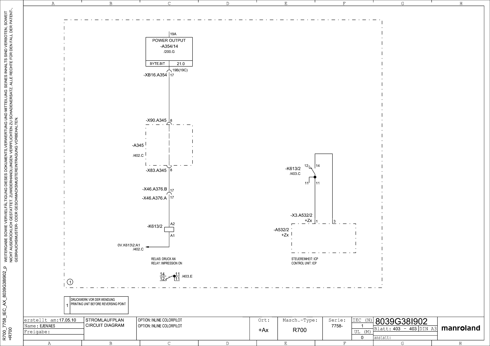

# +Ax — Sheet 403 of 403 — OPTION: INLINE COLORPILOT

**OPTION: INLINE COLORPILOT**

> Part of the manroland **R700** printing press IEC/UL circuit diagrams.
> Drawing class: **Stromlaufplan / Circuit diagram** (DIN A3).
> Document `+Ax` covers the **Central control console** machine section.

## At a glance

| Field | Value |
|---|---|
| Document | `+Ax`  (8039G38I902) |
| Sheet | **403** of 403 |
| Section (DE) | OPTION: INLINE COLORPILOT |
| Section (EN) | OPTION: INLINE COLORPILOT |
| Section type | OPTION — ColorPilot |
| Machine type | `R700` |
| Series | `7758` |
| Created | 17.05.10 |
| Replaces | — |
| Columns used | A, B, C, E, F |
| Path numbers | — |
| Labels on sheet | 48 |
| Cross-refs out | 4 |
| Cross-refs in | 11 |

**Previous:** [+Ax sheet 402](SHEET_0402.md) · **Next:** [+BA_Cx_DA sheet 1](../BA_Cx_DA/SHEET_0001.md) · **Document TOC:** [_TOC.md](_TOC.md)  (+Ax) · **Master TOC:** [all sheets](../_MASTER_TOC.md)

## Sheet image (300 DPI, exact vector render)



_Rendered directly from the PDF vector layer at 300 DPI (1-bit), no OCR and no resampling. Use it to confirm anything ambiguous in the text below._

## Cross-references on this sheet

Each entry is a wire leaving this sheet. The printed token is `/sheet.column`; the link resolves to that sheet inside the same document.

| Ref | Target sheet | Col | Path | Destination on target | Target section | From col |
|---|---|---|---|---|---|---|
| `/200.G` | [+Ax sheet 200](SHEET_0200.md) | G | — | — | REFERENZMODUL | C |
| `/402.C` | [+Ax sheet 402](SHEET_0402.md) | C | — | — | OPTION: INLINE COLORPILOT | B |
| `/403.C` | [+Ax sheet 403](SHEET_0403.md) | C | — | — | OPTION: INLINE COLORPILOT | E |
| `/402.C` | [+Ax sheet 402](SHEET_0402.md) | C | — | 0V.K613\2:A1 | OPTION: INLINE COLORPILOT | B |

### Incoming references (sheets that point here)

Every other sheet that sends a wire to this one. `Back-ref` is the token printed on *that* sheet; `Path` is its line number.

| From sheet | Cols | Back-ref | Path | Refs | What continues there |
|---|---|---|---|---|---|
| [+Ax#200](SHEET_0200.md) | F | `/200.F` | — | 1 | — |
| [+Ax#223](SHEET_0223.md) | F | `/223.F` | — | 2 | — |
| [+Ax#254](SHEET_0254.md) | F | `/254.F` | — | 1 | — |
| [+Ax#283](SHEET_0283.md) | A, B | `/283.A`, `/283.B` | — | 2 | — |
| [+Ax#287](SHEET_0287.md) | A | `/287.A` | — | 1 | — |
| [+Ax#289](SHEET_0289.md) | C | `/289.C` | — | 1 | — |
| [+Ax#402](SHEET_0402.md) | B, C | `/402.B`, `/402.C` | — | 2 | 0V.K613\1:A1 |
| [+Ax#403](SHEET_0403.md) | E | `/403.E` | — | 1 | — |


## Devices on this sheet

| Tag | Class | Class meaning (IEC) | Col | Sub | Terminal | Sign |
|---|---|---|---|---|---|---|
| `A354/14` | A | Baugruppe / assembly, module, PC board | C | 14 | — | — |
| `A345` | A | Baugruppe / assembly, module, PC board | B | — | — | — |
| `A2` | A | Baugruppe / assembly, module, PC board | C | — | — | — |
| `A1` | A | Baugruppe / assembly, module, PC board | C | — | — | — |
| `K613/2` | K | Relais / relay, contactor | C | 2 | — | — |
| `A532/2` | A | Baugruppe / assembly, module, PC board | E | 2 | — | — |
| `K613/2` | K | Relais / relay, contactor | E | 2 | — | — |
| `21.0` | — | cross-device reference | C | — | — | — |
| `XB16.A354` | — | cross-device reference | C | — | — | — |
| `X46.A376.B` | — | cross-device reference | C | — | — | — |
| `X83.A345` | — | cross-device reference | C | — | — | — |
| `X90.A345` | — | cross-device reference | C | — | — | — |
| `X46.A376.A` | — | cross-device reference | C | — | — | — |

## Potentials / nets

| Potential | Count | Columns | Attached devices | Terminals |
|---|---|---|---|---|
| `0V` | 1 | B | `K613\2` | `A1` |


A potential such as `L24+/4` or `M24+` is a named supply/return rail; every place it appears on this sheet is electrically common.

## Wire-end annotations (grouped as printed)

A wire that continues elsewhere is annotated with a small cluster: the destination description, the path/line number `#NN`, and the `/sheet.column` cross reference. Each row below is one such cluster exactly as it is grouped on the drawing.

| Col | Y | Path | Cross-ref | Text on the wire |
|---|---|---|---|---|
| C | 79.0 | — | — | `19A` |
| C | 94.1 | — | — | `POWER OUTPUT` |
| C | 108.0 | — | — | `A354/14` |
| C | 121.8 | — | `/200.G` | — |
| C | 150.9 | — | — | `BYTE.BIT 21.0` |
| C | 166.9 | — | — | `19B(19C)` |
| C | 177.5 | — | — | `XB16.A354 17` |
| C | 288.0 | — | — | `X90.A345 8` |
| B | 349.0 | — | — | `A345` |
| B | 374.5 | — | `/402.C` | — |
| E | 399.3 | — | — | `K613/2 14` |
| E | 399.3 | — | — | `12` |
| C | 409.9 | — | — | `X83.A345 8` |
| E | 418.8 | — | `/403.C` | — |
| E | 441.8 | — | — | `11 11` |
| C | 455.3 | — | — | `X46.A376.B 17` |
| C | 476.5 | — | — | `X46.A376.A 17` |
| E | 519.0 | — | — | `X3.A532/2 1` |
| F | 531.8 | — | — | `+Zx 3` |
| C | 541.0 | — | — | `A2` |
| C | 546.0 | — | — | `K613/2` |
| E | 554.5 | — | — | `A532/2` |
| E | 567.3 | — | — | `+Zx` |
| C | 569.3 | — | — | `A1` |
| B | 592.7 | — | `/402.C` | `0V.K613\2:A1` |
| C | 627.1 | — | — | `RELAIS: DRUCK AN RELAY: IMPRESSION ON` |
| E | 627.1 | — | — | `STEUEREINHEIT: ICP CONTROL UNIT: ICP` |
| C | 662.2 | — | — | `14 12 11 11 /403.E` |
| A | 682.9 | — | — | `1` |
| B | 726.3 | — | — | `1 DRUCKWERK VOR DER WENDUNG PRINTING UNIT BEFORE REVERSING POINT` |


## Reconstructed tables

This sheet carries tabular content (pin map / terminal assignment / index). The grid below was rebuilt from the drawing's own rule lines, so each row is exactly one physical row of the table.

### Table 1 — 2 data rows × 2 columns (at x=354.3, y=90.7)

| POWER | OUTPUT A354/14 /200.G |
|---|---|
| `BYTE.BIT` | `21.0` |
| `XB16.A354 X90.A345 X83.A345 X46.A376.B X46.A376.A K613/2` | `19B(19C) 17 8 8 17 17 A2 A1` |


## Notes and free text on this sheet

| Text | Col | Y (pt) |
|---|---|---|
| `19A` | C | 78.95 |
| `19B(19C)` | C | 166.86 |
| `POWER OUTPUT` | C | 94.1 |
| `BYTE.BIT` | C | 151.43 |
| `11 /403.E` | C | 668.53 |
| `RELAIS: DRUCK AN` | C | 627.07 |
| `RELAY: IMPRESSION ON` | C | 637.7 |
| `+Zx` | E | 567.27 |
| `STEUEREINHEIT: ICP` | E | 627.07 |
| `CONTROL UNIT: ICP` | E | 637.73 |
| `X3.A532/2` | E | 519.05 |
| `DRUCKWERK VOR DER WENDUNG` | B | 726.28 |
| `PRINTING UNIT BEFORE REVERSING POINT` | B | 736.93 |

## Complete label inventory (exact text from the drawing)

Every text object inside the drawing area of this sheet, in DIN reading order (column A→H, then top→bottom). This is the authoritative list: if a string is not here it is not printed on this sheet.

| Col | Y | X | Dir | Type | Text |
|---|---|---|---|---|---|
| A | 682.9 | 168.3 | → | number | `1` |
| A | 738.7 | 160.4 | → | number | `1` |
| B | 349.0 | 320.9 | → | device tag | `A345` |
| B | 374.5 | 323.1 | → | cross-reference | `/402.C` |
| B | 592.7 | 286.0 | → | potential | `0V.K613\2:A1` |
| B | 602.7 | 323.1 | → | cross-reference | `/402.C` |
| B | 726.3 | 172.1 | → | text | `DRUCKWERK VOR DER WENDUNG` |
| B | 736.9 | 172.1 | → | text | `PRINTING UNIT BEFORE REVERSING POINT` |
| C | 78.9 | 413.0 | → | text | `19A` |
| C | 94.1 | 370.2 | → | text | `POWER OUTPUT` |
| C | 108.0 | 389.6 | → | device tag | `A354/14` |
| C | 121.8 | 398.1 | → | cross-reference | `/200.G` |
| C | 150.9 | 429.9 | → | device ref | `21.0` |
| C | 151.4 | 364.3 | → | text | `BYTE.BIT` |
| C | 166.9 | 418.7 | → | text | `19B(19C)` |
| C | 177.5 | 348.7 | → | device ref | `XB16.A354` |
| C | 178.9 | 413.0 | → | number | `17` |
| C | 288.0 | 354.3 | → | device ref | `X90.A345` |
| C | 289.5 | 413.6 | → | number | `8` |
| C | 409.9 | 354.3 | → | device ref | `X83.A345` |
| C | 409.9 | 413.6 | → | number | `8` |
| C | 455.3 | 345.8 | → | device ref | `X46.A376.B` |
| C | 459.5 | 413.0 | → | number | `17` |
| C | 476.5 | 413.0 | → | number | `17` |
| C | 477.2 | 345.0 | → | device ref | `X46.A376.A` |
| C | 541.0 | 413.9 | → | device tag | `A2` |
| C | 546.0 | 357.4 | → | device tag | `K613/2` |
| C | 569.3 | 413.9 | → | device tag | `A1` |
| C | 627.1 | 367.7 | → | text | `RELAIS: DRUCK AN` |
| C | 637.7 | 367.7 | → | text | `RELAY: IMPRESSION ON` |
| C | 662.2 | 388.3 | → | number | `14` |
| C | 662.2 | 425.5 | → | number | `11` |
| C | 668.5 | 425.5 | → | text | `11 /403.E` |
| C | 673.5 | 388.3 | → | number | `12` |
| E | 399.3 | 739.3 | → | number | `12` |
| E | 405.7 | 693.4 | → | device tag | `K613/2` |
| E | 418.8 | 704.4 | → | cross-reference | `/403.C` |
| E | 441.8 | 740.4 | → | number | `11` |
| E | 519.1 | 705.8 | → | text | `X3.A532/2` |
| E | 531.8 | 740.4 | → | text | `+Zx` |
| E | 554.5 | 665.0 | → | device tag | `A532/2` |
| E | 567.3 | 683.7 | → | text | `+Zx` |
| E | 627.1 | 708.4 | → | text | `STEUEREINHEIT: ICP` |
| E | 637.7 | 708.4 | → | text | `CONTROL UNIT: ICP` |
| F | 399.3 | 767.3 | → | number | `14` |
| F | 441.8 | 767.3 | → | number | `11` |
| F | 534.7 | 767.3 | → | number | `1` |
| F | 534.7 | 810.4 | → | number | `3` |

## Reading-order text block

The same content as a plain block, grouped by DIN column — convenient to paste or to match against a visual description.

```text
=== Column A ===
 682.9  168.3  numeric      1
 738.7  160.4  numeric      1
=== Column B ===
 349.0  320.9  devtag       A345
 374.5  323.1  xref         /402.C
 592.7  286.0  net          0V.K613\2:A1
 602.7  323.1  xref         /402.C
 726.3  172.1  text         DRUCKWERK VOR DER WENDUNG
 736.9  172.1  text         PRINTING UNIT BEFORE REVERSING POINT
=== Column C ===
  78.9  413.0  text         19A
  94.1  370.2  text         POWER OUTPUT
 108.0  389.6  devtag       A354/14
 121.8  398.1  xref         /200.G
 150.9  429.9  devref       21.0
 151.4  364.3  text         BYTE.BIT
 166.9  418.7  text         19B(19C)
 177.5  348.7  devref       XB16.A354
 178.9  413.0  numeric      17
 288.0  354.3  devref       X90.A345
 289.5  413.6  numeric      8
 409.9  354.3  devref       X83.A345
 409.9  413.6  numeric      8
 455.3  345.8  devref       X46.A376.B
 459.5  413.0  numeric      17
 476.5  413.0  numeric      17
 477.2  345.0  devref       X46.A376.A
 541.0  413.9  devtag       A2
 546.0  357.4  devtag       K613/2
 569.3  413.9  devtag       A1
 627.1  367.7  text         RELAIS: DRUCK AN
 637.7  367.7  text         RELAY: IMPRESSION ON
 662.2  388.3  numeric      14
 662.2  425.5  numeric      11
 668.5  425.5  text         11 /403.E
 673.5  388.3  numeric      12
=== Column E ===
 399.3  739.3  numeric      12
 405.7  693.4  devtag       K613/2
 418.8  704.4  xref         /403.C
 441.8  740.4  numeric      11
 519.1  705.8  text         X3.A532/2
 531.8  740.4  text         +Zx
 554.5  665.0  devtag       A532/2
 567.3  683.7  text         +Zx
 627.1  708.4  text         STEUEREINHEIT: ICP
 637.7  708.4  text         CONTROL UNIT: ICP
=== Column F ===
 399.3  767.3  numeric      14
 441.8  767.3  numeric      11
 534.7  767.3  numeric      1
 534.7  810.4  numeric      3
```

---
_Generated from the PDF vector text layer; no OCR. Source: `R700_7758_IEC_AX_8039G38I902_p`, sheet 403._
