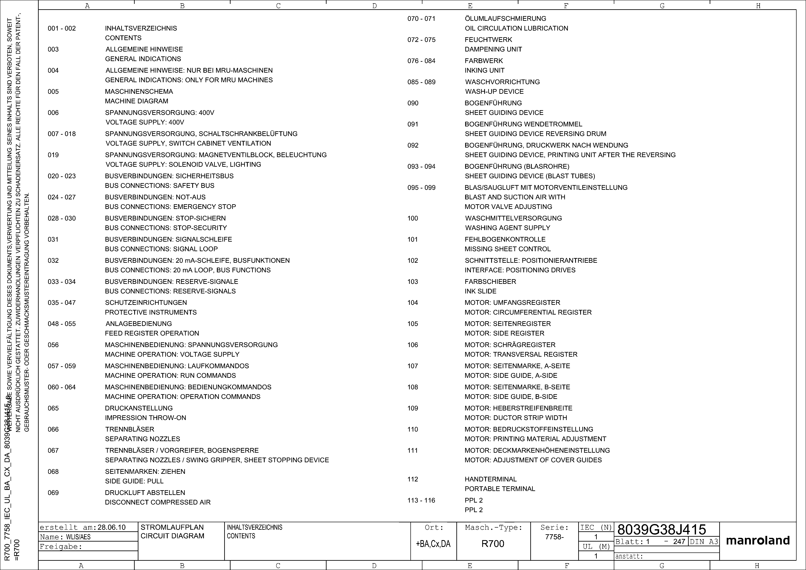

# +BA_Cx_DA — Sheet 1 of 247 — INHALTSVERZEICHNIS

**CONTENTS**

> Part of the manroland **R700** printing press IEC/UL circuit diagrams.
> Drawing class: **Stromlaufplan / Circuit diagram** (DIN A3).
> Document `+BA_Cx_DA` covers the **Printing units / main switch cabinet** machine section.

## At a glance

| Field | Value |
|---|---|
| Document | `+BA_Cx_DA`  (8039G38J415) |
| Sheet | **1** of 247 |
| Section (DE) | INHALTSVERZEICHNIS |
| Section (EN) | CONTENTS |
| Section type | TOC — Contents |
| Machine type | `R700` |
| Series | `7758` |
| Created | 28.06.10 |
| Replaces | — |
| Columns used | A, B, D, E, F |
| Path numbers | — |
| Labels on sheet | 139 |
| Cross-refs out | 0 |
| Cross-refs in | 0 |

**Previous:** [+Ax sheet 403](../Ax/SHEET_0403.md) · **Next:** [+BA_Cx_DA sheet 2](SHEET_0002.md) · **Document TOC:** [_TOC.md](_TOC.md)  (+BA_Cx_DA) · **Master TOC:** [all sheets](../_MASTER_TOC.md)

## Sheet image (300 DPI, exact vector render)



_Rendered directly from the PDF vector layer at 300 DPI (1-bit), no OCR and no resampling. Use it to confirm anything ambiguous in the text below._

## Cross-references on this sheet

Each entry is a wire leaving this sheet. The printed token is `/sheet.column`; the link resolves to that sheet inside the same document.

_No outgoing cross-references on this sheet._

## Devices on this sheet

_No device designators on this sheet._

## Potentials / nets

_No named potentials on this sheet._

## Wire-end annotations (grouped as printed)

A wire that continues elsewhere is annotated with a small cluster: the destination description, the path/line number `#NN`, and the `/sheet.column` cross reference. Each row below is one such cluster exactly as it is grouped on the drawing.

| Col | Y | Path | Cross-ref | Text on the wire |
|---|---|---|---|---|
| E | 23.3 | — | — | `070 071 ÖLUMLAUFSCHMIERUNG OIL CIRCULATION LUBRICATION` |
| A | 37.5 | — | — | `001 002 INHALTSVERZEICHNIS CONTENTS` |
| E | 54.4 | — | — | `072 075 FEUCHTWERK DAMPENING UNIT` |
| A | 68.6 | — | — | `003 GENERAL INDICATIONS ALLGEMEINE HINWEISE` |
| E | 85.6 | — | — | `076 084 FARBWERK INKING UNIT` |
| B | 99.8 | — | — | `004 GENERAL INDICATIONS: ONLY FOR MRU MACHINES ALLGEMEINE HINWEISE: NUR BEI MRU MASCHINEN` |
| E | 116.8 | — | — | `085 089 WASCHVORRICHTUNG WASH UP DEVICE` |
| A | 131.0 | — | — | `005 MASCHINENSCHEMA MACHINE DIAGRAM` |
| E | 148.0 | — | — | `090 BOGENFÜHRUNG SHEET GUIDING DEVICE` |
| A | 162.2 | — | — | `006 SPANNUNGSVERSORGUNG: 400V` |
| B | 176.4 | — | — | `VOLTAGE SUPPLY: 400V` |
| E | 179.2 | — | — | `091 BOGENFÜHRUNG WENDETROMMEL SHEET GUIDING DEVICE REVERSING DRUM` |
| B | 193.4 | — | — | `007 018 SPANNUNGSVERSORGUNG, SCHALTSCHRANKBELÜFTUNG` |
| B | 207.5 | — | — | `VOLTAGE SUPPLY, SWITCH CABINET VENTILATION` |
| F | 210.3 | — | — | `092 BOGENFÜHRUNG, DRUCKWERK NACH WENDUNG SHEET GUIDING DEVICE, PRINTING UNIT AFTER THE REVERSING` |
| B | 224.5 | — | — | `019 SPANNUNGSVERSORGUNG: MAGNETVENTILBLOCK, BELEUCHTUNG` |
| B | 238.7 | — | — | `VOLTAGE SUPPLY: SOLENOID VALVE, LIGHTING` |
| E | 241.5 | — | — | `093 094 BOGENFÜHRUNG (BLASROHRE) SHEET GUIDING DEVICE (BLAST TUBES)` |
| B | 255.7 | — | — | `020 023 BUSVERBINDUNGEN: SICHERHEITSBUS BUS CONNECTIONS: SAFETY BUS` |
| E | 272.7 | — | — | `095 099 BLAS/SAUGLUFT MIT MOTORVENTILEINSTELLUNG BLAST AND SUCTION AIR WITH MOTOR VALVE ADJUSTING` |
| B | 286.9 | — | — | `024 027 BUSVERBINDUNGEN: NOT AUS BUS CONNECTIONS: EMERGENCY STOP` |
| B | 318.1 | — | — | `028 030 BUSVERBINDUNGEN: STOP SICHERN BUS CONNECTIONS: STOP SECURITY` |
| E | 318.1 | — | — | `100 WASCHMITTELVERSORGUNG WASHING AGENT SUPPLY` |
| B | 349.3 | — | — | `031 BUSVERBINDUNGEN: SIGNALSCHLEIFE BUS CONNECTIONS: SIGNAL LOOP` |
| E | 349.3 | — | — | `101 FEHLBOGENKONTROLLE MISSING SHEET CONTROL` |
| B | 380.4 | — | — | `032 BUSVERBINDUNGEN: 20 mA SCHLEIFE, BUSFUNKTIONEN BUS CONNECTIONS: 20 mA LOOP, BUS FUNCTIONS` |
| E | 380.5 | — | — | `102 INTERFACE: POSITIONING DRIVES SCHNITTSTELLE: POSITIONIERANTRIEBE` |
| B | 411.6 | — | — | `033 034 BUSVERBINDUNGEN: RESERVE SIGNALE BUS CONNECTIONS: RESERVE SIGNALS` |
| E | 411.6 | — | — | `103 FARBSCHIEBER INK SLIDE` |
| A | 442.8 | — | — | `035 047 PROTECTIVE INSTRUMENTS SCHUTZEINRICHTUNGEN` |
| E | 442.8 | — | — | `104 MOTOR: UMFANGSREGISTER MOTOR: CIRCUMFERENTIAL REGISTER` |
| A | 474.0 | — | — | `048 055 FEED REGISTER OPERATION ANLAGEBEDIENUNG` |
| E | 474.0 | — | — | `105 MOTOR: SEITENREGISTER MOTOR: SIDE REGISTER` |
| B | 505.2 | — | — | `056 MASCHINENBEDIENUNG: SPANNUNGSVERSORGUNG MACHINE OPERATION: VOLTAGE SUPPLY` |
| E | 505.2 | — | — | `106 MOTOR: SCHRÄGREGISTER MOTOR: TRANSVERSAL REGISTER` |
| B | 536.4 | — | — | `057 059 MASCHINENBEDIENUNG: LAUFKOMMANDOS MACHINE OPERATION: RUN COMMANDS` |
| E | 536.4 | — | — | `107 MOTOR: SEITENMARKE, A SEITE MOTOR: SIDE GUIDE, A SIDE` |
| B | 567.5 | — | — | `060 064 MASCHINENBEDIENUNG: BEDIENUNGKOMMANDOS MACHINE OPERATION: OPERATION COMMANDS` |
| E | 567.5 | — | — | `108 MOTOR: SEITENMARKE, B SEITE MOTOR: SIDE GUIDE, B SIDE` |
| A | 598.7 | — | — | `065 DRUCKANSTELLUNG IMPRESSION THROW ON` |
| E | 598.7 | — | — | `109 MOTOR: HEBERSTREIFENBREITE MOTOR: DUCTOR STRIP WIDTH` |
| A | 629.9 | — | — | `066 SEPARATING NOZZLES TRENNBLÄSER` |
| E | 629.9 | — | — | `110 MOTOR: BEDRUCKSTOFFEINSTELLUNG MOTOR: PRINTING MATERIAL ADJUSTMENT` |
| B | 661.1 | — | — | `067 SEPARATING NOZZLES / SWING GRIPPER, SHEET STOPPING DEVICE TRENNBLÄSER / VORGREIFER, BOGENSPERRE` |
| E | 661.1 | — | — | `111 MOTOR: DECKMARKENHÖHENEINSTELLUNG MOTOR: ADJUSTMENT OF COVER GUIDES` |
| A | 692.3 | — | — | `068 SEITENMARKEN: ZIEHEN SIDE GUIDE: PULL` |
| E | 703.6 | — | — | `112 HANDTERMINAL PORTABLE TERMINAL` |
| A | 723.5 | — | — | `069 DRUCKLUFT ABSTELLEN DISCONNECT COMPRESSED AIR` |
| E | 734.8 | — | — | `113 116 PPL 2 PPL 2` |


## Notes and free text on this sheet

| Text | Col | Y (pt) |
|---|---|---|
| `INHALTSVERZEICHNIS` | B | 37.48 |
| `CONTENTS` | A | 51.63 |
| `ALLGEMEINE HINWEISE` | B | 68.63 |
| `GENERAL INDICATIONS` | B | 82.83 |
| `ALLGEMEINE HINWEISE: NUR BEI MRU MASCHINEN` | B | 99.81 |
| `GENERAL INDICATIONS: ONLY FOR MRU MACHINES` | B | 113.99 |
| `MASCHINENSCHEMA` | B | 131 |
| `MACHINE DIAGRAM` | B | 145.18 |
| `SPANNUNGSVERSORGUNG: 400V` | B | 162.18 |
| `VOLTAGE SUPPLY: 400V` | B | 176.36 |
| `SPANNUNGSVERSORGUNG, SCHALTSCHRANKBELÜFTUNG` | B | 193.36 |
| `VOLTAGE SUPPLY, SWITCH CABINET VENTILATION` | B | 207.53 |
| `SPANNUNGSVERSORGUNG: MAGNETVENTILBLOCK, BELEUCHTUNG` | B | 224.54 |
| `VOLTAGE SUPPLY: SOLENOID VALVE, LIGHTING` | B | 238.72 |
| `BUSVERBINDUNGEN: SICHERHEITSBUS` | B | 255.73 |
| `BUS CONNECTIONS: SAFETY BUS` | B | 269.9 |
| `BUSVERBINDUNGEN: NOT AUS` | B | 286.9 |
| `BUS CONNECTIONS: EMERGENCY STOP` | B | 301.07 |
| `BUSVERBINDUNGEN: STOP SICHERN` | B | 318.09 |
| `BUS CONNECTIONS: STOP SECURITY` | B | 332.26 |
| `BUSVERBINDUNGEN: SIGNALSCHLEIFE` | B | 349.28 |
| `BUS CONNECTIONS: SIGNAL LOOP` | B | 363.44 |
| `BUSVERBINDUNGEN: 20 mA SCHLEIFE, BUSFUNKTIONEN` | B | 380.45 |
| `BUS CONNECTIONS: 20 mA LOOP, BUS FUNCTIONS` | B | 394.62 |
| `BUSVERBINDUNGEN: RESERVE SIGNALE` | B | 411.63 |
| `BUS CONNECTIONS: RESERVE SIGNALS` | B | 425.8 |
| `SCHUTZEINRICHTUNGEN` | B | 442.82 |
| `PROTECTIVE INSTRUMENTS` | B | 457 |
| `ANLAGEBEDIENUNG` | B | 474 |
| `FEED REGISTER OPERATION` | B | 488.17 |
| `MASCHINENBEDIENUNG: SPANNUNGSVERSORGUNG` | B | 505.17 |
| `MACHINE OPERATION: VOLTAGE SUPPLY` | B | 519.35 |
| `MASCHINENBEDIENUNG: LAUFKOMMANDOS` | B | 536.36 |
| `MACHINE OPERATION: RUN COMMANDS` | B | 550.52 |
| `MASCHINENBEDIENUNG: BEDIENUNGKOMMANDOS` | B | 567.54 |
| `MACHINE OPERATION: OPERATION COMMANDS` | B | 581.71 |
| `DRUCKANSTELLUNG` | B | 598.72 |
| `IMPRESSION THROW ON` | B | 612.86 |
| `TRENNBLÄSER` | A | 629.91 |
| `SEPARATING NOZZLES` | B | 644.08 |
| `TRENNBLÄSER / VORGREIFER, BOGENSPERRE` | B | 661.08 |
| `SEPARATING NOZZLES / SWING GRIPPER, SHEET STOPPING DEVICE` | B | 675.24 |
| `SEITENMARKEN: ZIEHEN` | B | 692.27 |
| `SIDE GUIDE: PULL` | A | 706.44 |
| `DRUCKLUFT ABSTELLEN` | B | 723.45 |
| `DISCONNECT COMPRESSED AIR` | B | 737.62 |
| `ÖLUMLAUFSCHMIERUNG` | E | 23.29 |
| `OIL CIRCULATION LUBRICATION` | E | 37.48 |
| `FEUCHTWERK` | E | 54.42 |
| `DAMPENING UNIT` | E | 68.65 |
| `FARBWERK` | E | 85.59 |
| `INKING UNIT` | E | 99.85 |
| `WASCHVORRICHTUNG` | E | 116.8 |
| `WASH UP DEVICE` | E | 130.96 |
| `BOGENFÜHRUNG` | E | 148.01 |
| `SHEET GUIDING DEVICE` | E | 162.19 |
| `BOGENFÜHRUNG WENDETROMMEL` | F | 179.16 |
| `SHEET GUIDING DEVICE REVERSING DRUM` | F | 193.37 |
| `BOGENFÜHRUNG, DRUCKWERK NACH WENDUNG` | F | 210.33 |
| `SHEET GUIDING DEVICE, PRINTING UNIT AFTER THE REVERSING` | F | 224.55 |
| `BOGENFÜHRUNG (BLASROHRE)` | E | 241.54 |
| `SHEET GUIDING DEVICE (BLAST TUBES)` | F | 255.73 |
| `BLAS/SAUGLUFT MIT MOTORVENTILEINSTELLUNG` | F | 272.74 |
| `BLAST AND SUCTION AIR WITH` | E | 286.89 |
| `MOTOR VALVE ADJUSTING` | E | 301.07 |
| `WASCHMITTELVERSORGUNG` | E | 318.07 |
| `WASHING AGENT SUPPLY` | E | 332.23 |
| `FEHLBOGENKONTROLLE` | E | 349.28 |
| `MISSING SHEET CONTROL` | E | 363.45 |
| `SCHNITTSTELLE: POSITIONIERANTRIEBE` | F | 380.47 |
| `INTERFACE: POSITIONING DRIVES` | F | 394.64 |
| `FARBSCHIEBER` | E | 411.64 |
| `INK SLIDE` | E | 425.83 |
| `MOTOR: UMFANGSREGISTER` | E | 442.81 |
| `MOTOR: CIRCUMFERENTIAL REGISTER` | F | 456.99 |
| `MOTOR: SEITENREGISTER` | E | 474 |
| `MOTOR: SIDE REGISTER` | E | 488.17 |
| `MOTOR: SCHRÄGREGISTER` | E | 505.17 |
| `MOTOR: TRANSVERSAL REGISTER` | F | 519.35 |
| `MOTOR: SEITENMARKE, A SEITE` | E | 536.35 |
| `MOTOR: SIDE GUIDE, A SIDE` | E | 550.52 |
| `MOTOR: SEITENMARKE, B SEITE` | E | 567.53 |
| `MOTOR: SIDE GUIDE, B SIDE` | E | 581.7 |
| `MOTOR: HEBERSTREIFENBREITE` | F | 598.72 |
| `MOTOR: DUCTOR STRIP WIDTH` | E | 612.86 |
| `MOTOR: BEDRUCKSTOFFEINSTELLUNG` | F | 629.9 |
| `MOTOR: PRINTING MATERIAL ADJUSTMENT` | F | 644.07 |
| `MOTOR: DECKMARKENHÖHENEINSTELLUNG` | F | 661.08 |
| `MOTOR: ADJUSTMENT OF COVER GUIDES` | F | 675.24 |
| `HANDTERMINAL` | E | 703.61 |
| `PORTABLE TERMINAL` | E | 717.78 |
| `PPL 2` | E | 734.79 |

## Complete label inventory (exact text from the drawing)

Every text object inside the drawing area of this sheet, in DIN reading order (column A→H, then top→bottom). This is the authoritative list: if a string is not here it is not printed on this sheet.

| Col | Y | X | Dir | Type | Text |
|---|---|---|---|---|---|
| A | 37.5 | 70.6 | → | number | `001 002` |
| A | 51.6 | 155.3 | → | text | `CONTENTS` |
| A | 68.7 | 70.6 | → | number | `003` |
| A | 99.9 | 70.6 | → | number | `004` |
| A | 131.0 | 70.6 | → | number | `005` |
| A | 162.2 | 70.6 | → | number | `006` |
| A | 193.4 | 70.6 | → | number | `007 018` |
| A | 224.6 | 70.6 | → | number | `019` |
| A | 255.7 | 70.6 | → | number | `020 023` |
| A | 286.9 | 70.6 | → | number | `024 027` |
| A | 318.1 | 70.6 | → | number | `028 030` |
| A | 349.3 | 70.6 | → | number | `031` |
| A | 380.5 | 70.6 | → | number | `032` |
| A | 411.6 | 70.6 | → | number | `033 034` |
| A | 442.8 | 70.6 | → | number | `035 047` |
| A | 474.0 | 70.6 | → | number | `048 055` |
| A | 505.2 | 70.6 | → | number | `056` |
| A | 536.4 | 70.6 | → | number | `057 059` |
| A | 567.5 | 70.6 | → | number | `060 064` |
| A | 598.8 | 70.6 | → | number | `065` |
| A | 629.9 | 70.6 | → | number | `066` |
| A | 629.9 | 155.6 | → | text | `TRENNBLÄSER` |
| A | 661.1 | 70.6 | → | number | `067` |
| A | 692.3 | 70.6 | → | number | `068` |
| A | 706.4 | 155.3 | → | text | `SIDE GUIDE: PULL` |
| A | 723.5 | 70.6 | → | number | `069` |
| B | 37.5 | 155.1 | → | text | `INHALTSVERZEICHNIS` |
| B | 68.6 | 156.2 | → | text | `ALLGEMEINE HINWEISE` |
| B | 82.8 | 155.3 | → | text | `GENERAL INDICATIONS` |
| B | 99.8 | 156.2 | → | text | `ALLGEMEINE HINWEISE: NUR BEI MRU MASCHINEN` |
| B | 114.0 | 155.3 | → | text | `GENERAL INDICATIONS: ONLY FOR MRU MACHINES` |
| B | 131.0 | 155.1 | → | text | `MASCHINENSCHEMA` |
| B | 145.2 | 155.1 | → | text | `MACHINE DIAGRAM` |
| B | 162.2 | 155.3 | → | text | `SPANNUNGSVERSORGUNG: 400V` |
| B | 176.4 | 156.2 | → | text | `VOLTAGE SUPPLY: 400V` |
| B | 193.4 | 155.3 | → | text | `SPANNUNGSVERSORGUNG, SCHALTSCHRANKBELÜFTUNG` |
| B | 207.5 | 156.2 | → | text | `VOLTAGE SUPPLY, SWITCH CABINET VENTILATION` |
| B | 224.5 | 155.3 | → | text | `SPANNUNGSVERSORGUNG: MAGNETVENTILBLOCK, BELEUCHTUNG` |
| B | 238.7 | 156.2 | → | text | `VOLTAGE SUPPLY: SOLENOID VALVE, LIGHTING` |
| B | 255.7 | 155.1 | → | text | `BUSVERBINDUNGEN: SICHERHEITSBUS` |
| B | 269.9 | 155.1 | → | text | `BUS CONNECTIONS: SAFETY BUS` |
| B | 286.9 | 155.1 | → | text | `BUSVERBINDUNGEN: NOT AUS` |
| B | 301.1 | 155.1 | → | text | `BUS CONNECTIONS: EMERGENCY STOP` |
| B | 318.1 | 155.1 | → | text | `BUSVERBINDUNGEN: STOP SICHERN` |
| B | 332.3 | 155.1 | → | text | `BUS CONNECTIONS: STOP SECURITY` |
| B | 349.3 | 155.1 | → | text | `BUSVERBINDUNGEN: SIGNALSCHLEIFE` |
| B | 363.4 | 155.1 | → | text | `BUS CONNECTIONS: SIGNAL LOOP` |
| B | 380.5 | 155.1 | → | text | `BUSVERBINDUNGEN: 20 mA SCHLEIFE, BUSFUNKTIONEN` |
| B | 394.6 | 155.1 | → | text | `BUS CONNECTIONS: 20 mA LOOP, BUS FUNCTIONS` |
| B | 411.6 | 155.1 | → | text | `BUSVERBINDUNGEN: RESERVE SIGNALE` |
| B | 425.8 | 155.1 | → | text | `BUS CONNECTIONS: RESERVE SIGNALS` |
| B | 442.8 | 155.3 | → | text | `SCHUTZEINRICHTUNGEN` |
| B | 457.0 | 155.1 | → | text | `PROTECTIVE INSTRUMENTS` |
| B | 474.0 | 156.2 | → | text | `ANLAGEBEDIENUNG` |
| B | 488.2 | 155.1 | → | text | `FEED REGISTER OPERATION` |
| B | 505.2 | 155.1 | → | text | `MASCHINENBEDIENUNG: SPANNUNGSVERSORGUNG` |
| B | 519.3 | 155.1 | → | text | `MACHINE OPERATION: VOLTAGE SUPPLY` |
| B | 536.4 | 155.1 | → | text | `MASCHINENBEDIENUNG: LAUFKOMMANDOS` |
| B | 550.5 | 155.1 | → | text | `MACHINE OPERATION: RUN COMMANDS` |
| B | 567.5 | 155.1 | → | text | `MASCHINENBEDIENUNG: BEDIENUNGKOMMANDOS` |
| B | 581.7 | 155.1 | → | text | `MACHINE OPERATION: OPERATION COMMANDS` |
| B | 598.7 | 155.1 | → | text | `DRUCKANSTELLUNG` |
| B | 612.9 | 155.1 | → | text | `IMPRESSION THROW ON` |
| B | 644.1 | 155.3 | → | text | `SEPARATING NOZZLES` |
| B | 661.1 | 155.6 | → | text | `TRENNBLÄSER / VORGREIFER, BOGENSPERRE` |
| B | 675.2 | 155.3 | → | text | `SEPARATING NOZZLES / SWING GRIPPER, SHEET STOPPING DEVICE` |
| B | 692.3 | 155.3 | → | text | `SEITENMARKEN: ZIEHEN` |
| B | 723.4 | 155.1 | → | text | `DRUCKLUFT ABSTELLEN` |
| B | 737.6 | 155.1 | → | text | `DISCONNECT COMPRESSED AIR` |
| D | 23.3 | 602.1 | → | number | `070 071` |
| D | 54.5 | 602.1 | → | number | `072 075` |
| D | 85.6 | 602.1 | → | number | `076 084` |
| D | 116.8 | 602.1 | → | number | `085 089` |
| D | 148.1 | 602.1 | → | number | `090` |
| D | 179.2 | 602.1 | → | number | `091` |
| D | 210.4 | 602.1 | → | number | `092` |
| D | 241.6 | 602.1 | → | number | `093 094` |
| D | 272.7 | 602.1 | → | number | `095 099` |
| D | 318.1 | 601.5 | → | number | `100` |
| D | 349.3 | 601.5 | → | number | `101` |
| D | 380.5 | 601.5 | → | number | `102` |
| D | 411.7 | 601.5 | → | number | `103` |
| D | 442.9 | 601.5 | → | number | `104` |
| D | 474.0 | 601.5 | → | number | `105` |
| D | 505.2 | 601.5 | → | number | `106` |
| D | 536.4 | 601.5 | → | number | `107` |
| D | 567.6 | 601.5 | → | number | `108` |
| D | 598.8 | 601.5 | → | number | `109` |
| D | 629.9 | 601.5 | → | number | `110` |
| D | 661.1 | 601.5 | → | number | `111` |
| D | 703.6 | 601.5 | → | number | `112` |
| D | 734.8 | 601.5 | → | number | `113 116` |
| E | 23.3 | 686.8 | → | text | `ÖLUMLAUFSCHMIERUNG` |
| E | 37.5 | 686.8 | → | text | `OIL CIRCULATION LUBRICATION` |
| E | 54.4 | 686.6 | → | text | `FEUCHTWERK` |
| E | 68.6 | 686.6 | → | text | `DAMPENING UNIT` |
| E | 85.6 | 686.6 | → | text | `FARBWERK` |
| E | 99.8 | 686.6 | → | text | `INKING UNIT` |
| E | 116.8 | 687.4 | → | text | `WASCHVORRICHTUNG` |
| E | 131.0 | 687.4 | → | text | `WASH UP DEVICE` |
| E | 148.0 | 686.6 | → | text | `BOGENFÜHRUNG` |
| E | 162.2 | 686.8 | → | text | `SHEET GUIDING DEVICE` |
| E | 241.5 | 686.6 | → | text | `BOGENFÜHRUNG (BLASROHRE)` |
| E | 286.9 | 686.6 | → | text | `BLAST AND SUCTION AIR WITH` |
| E | 301.1 | 686.6 | → | text | `MOTOR VALVE ADJUSTING` |
| E | 318.1 | 687.4 | → | text | `WASCHMITTELVERSORGUNG` |
| E | 332.2 | 687.4 | → | text | `WASHING AGENT SUPPLY` |
| E | 349.3 | 686.6 | → | text | `FEHLBOGENKONTROLLE` |
| E | 363.4 | 686.6 | → | text | `MISSING SHEET CONTROL` |
| E | 411.6 | 686.6 | → | text | `FARBSCHIEBER` |
| E | 425.8 | 686.6 | → | text | `INK SLIDE` |
| E | 442.8 | 686.6 | → | text | `MOTOR: UMFANGSREGISTER` |
| E | 474.0 | 686.6 | → | text | `MOTOR: SEITENREGISTER` |
| E | 488.2 | 686.6 | → | text | `MOTOR: SIDE REGISTER` |
| E | 505.2 | 686.6 | → | text | `MOTOR: SCHRÄGREGISTER` |
| E | 536.4 | 686.6 | → | text | `MOTOR: SEITENMARKE, A SEITE` |
| E | 550.5 | 686.6 | → | text | `MOTOR: SIDE GUIDE, A SIDE` |
| E | 567.5 | 686.6 | → | text | `MOTOR: SEITENMARKE, B SEITE` |
| E | 581.7 | 686.6 | → | text | `MOTOR: SIDE GUIDE, B SIDE` |
| E | 612.9 | 686.6 | → | text | `MOTOR: DUCTOR STRIP WIDTH` |
| E | 703.6 | 686.6 | → | text | `HANDTERMINAL` |
| E | 717.8 | 686.6 | → | text | `PORTABLE TERMINAL` |
| E | 734.8 | 686.6 | → | text | `PPL 2` |
| E | 749.0 | 686.6 | → | text | `PPL 2` |
| F | 179.2 | 686.6 | → | text | `BOGENFÜHRUNG WENDETROMMEL` |
| F | 193.4 | 686.8 | → | text | `SHEET GUIDING DEVICE REVERSING DRUM` |
| F | 210.3 | 686.6 | → | text | `BOGENFÜHRUNG, DRUCKWERK NACH WENDUNG` |
| F | 224.6 | 686.8 | → | text | `SHEET GUIDING DEVICE, PRINTING UNIT AFTER THE REVERSING` |
| F | 255.7 | 686.8 | → | text | `SHEET GUIDING DEVICE (BLAST TUBES)` |
| F | 272.7 | 686.6 | → | text | `BLAS/SAUGLUFT MIT MOTORVENTILEINSTELLUNG` |
| F | 380.5 | 686.8 | → | text | `SCHNITTSTELLE: POSITIONIERANTRIEBE` |
| F | 394.6 | 686.6 | → | text | `INTERFACE: POSITIONING DRIVES` |
| F | 457.0 | 686.6 | → | text | `MOTOR: CIRCUMFERENTIAL REGISTER` |
| F | 519.3 | 686.6 | → | text | `MOTOR: TRANSVERSAL REGISTER` |
| F | 598.7 | 686.6 | → | text | `MOTOR: HEBERSTREIFENBREITE` |
| F | 629.9 | 686.6 | → | text | `MOTOR: BEDRUCKSTOFFEINSTELLUNG` |
| F | 644.1 | 686.6 | → | text | `MOTOR: PRINTING MATERIAL ADJUSTMENT` |
| F | 661.1 | 686.6 | → | text | `MOTOR: DECKMARKENHÖHENEINSTELLUNG` |
| F | 675.2 | 686.6 | → | text | `MOTOR: ADJUSTMENT OF COVER GUIDES` |

## Reading-order text block

The same content as a plain block, grouped by DIN column — convenient to paste or to match against a visual description.

```text
=== Column A ===
  37.5   70.6  numeric      001 002
  51.6  155.3  text         CONTENTS
  68.7   70.6  numeric      003
  99.9   70.6  numeric      004
 131.0   70.6  numeric      005
 162.2   70.6  numeric      006
 193.4   70.6  numeric      007 018
 224.6   70.6  numeric      019
 255.7   70.6  numeric      020 023
 286.9   70.6  numeric      024 027
 318.1   70.6  numeric      028 030
 349.3   70.6  numeric      031
 380.5   70.6  numeric      032
 411.6   70.6  numeric      033 034
 442.8   70.6  numeric      035 047
 474.0   70.6  numeric      048 055
 505.2   70.6  numeric      056
 536.4   70.6  numeric      057 059
 567.5   70.6  numeric      060 064
 598.8   70.6  numeric      065
 629.9   70.6  numeric      066
 629.9  155.6  text         TRENNBLÄSER
 661.1   70.6  numeric      067
 692.3   70.6  numeric      068
 706.4  155.3  text         SIDE GUIDE: PULL
 723.5   70.6  numeric      069
=== Column B ===
  37.5  155.1  text         INHALTSVERZEICHNIS
  68.6  156.2  text         ALLGEMEINE HINWEISE
  82.8  155.3  text         GENERAL INDICATIONS
  99.8  156.2  text         ALLGEMEINE HINWEISE: NUR BEI MRU MASCHINEN
 114.0  155.3  text         GENERAL INDICATIONS: ONLY FOR MRU MACHINES
 131.0  155.1  text         MASCHINENSCHEMA
 145.2  155.1  text         MACHINE DIAGRAM
 162.2  155.3  text         SPANNUNGSVERSORGUNG: 400V
 176.4  156.2  text         VOLTAGE SUPPLY: 400V
 193.4  155.3  text         SPANNUNGSVERSORGUNG, SCHALTSCHRANKBELÜFTUNG
 207.5  156.2  text         VOLTAGE SUPPLY, SWITCH CABINET VENTILATION
 224.5  155.3  text         SPANNUNGSVERSORGUNG: MAGNETVENTILBLOCK, BELEUCHTUNG
 238.7  156.2  text         VOLTAGE SUPPLY: SOLENOID VALVE, LIGHTING
 255.7  155.1  text         BUSVERBINDUNGEN: SICHERHEITSBUS
 269.9  155.1  text         BUS CONNECTIONS: SAFETY BUS
 286.9  155.1  text         BUSVERBINDUNGEN: NOT AUS
 301.1  155.1  text         BUS CONNECTIONS: EMERGENCY STOP
 318.1  155.1  text         BUSVERBINDUNGEN: STOP SICHERN
 332.3  155.1  text         BUS CONNECTIONS: STOP SECURITY
 349.3  155.1  text         BUSVERBINDUNGEN: SIGNALSCHLEIFE
 363.4  155.1  text         BUS CONNECTIONS: SIGNAL LOOP
 380.5  155.1  text         BUSVERBINDUNGEN: 20 mA SCHLEIFE, BUSFUNKTIONEN
 394.6  155.1  text         BUS CONNECTIONS: 20 mA LOOP, BUS FUNCTIONS
 411.6  155.1  text         BUSVERBINDUNGEN: RESERVE SIGNALE
 425.8  155.1  text         BUS CONNECTIONS: RESERVE SIGNALS
 442.8  155.3  text         SCHUTZEINRICHTUNGEN
 457.0  155.1  text         PROTECTIVE INSTRUMENTS
 474.0  156.2  text         ANLAGEBEDIENUNG
 488.2  155.1  text         FEED REGISTER OPERATION
 505.2  155.1  text         MASCHINENBEDIENUNG: SPANNUNGSVERSORGUNG
 519.3  155.1  text         MACHINE OPERATION: VOLTAGE SUPPLY
 536.4  155.1  text         MASCHINENBEDIENUNG: LAUFKOMMANDOS
 550.5  155.1  text         MACHINE OPERATION: RUN COMMANDS
 567.5  155.1  text         MASCHINENBEDIENUNG: BEDIENUNGKOMMANDOS
 581.7  155.1  text         MACHINE OPERATION: OPERATION COMMANDS
 598.7  155.1  text         DRUCKANSTELLUNG
 612.9  155.1  text         IMPRESSION THROW ON
 644.1  155.3  text         SEPARATING NOZZLES
 661.1  155.6  text         TRENNBLÄSER / VORGREIFER, BOGENSPERRE
 675.2  155.3  text         SEPARATING NOZZLES / SWING GRIPPER, SHEET STOPPING DEVICE
 692.3  155.3  text         SEITENMARKEN: ZIEHEN
 723.4  155.1  text         DRUCKLUFT ABSTELLEN
 737.6  155.1  text         DISCONNECT COMPRESSED AIR
=== Column D ===
  23.3  602.1  numeric      070 071
  54.5  602.1  numeric      072 075
  85.6  602.1  numeric      076 084
 116.8  602.1  numeric      085 089
 148.1  602.1  numeric      090
 179.2  602.1  numeric      091
 210.4  602.1  numeric      092
 241.6  602.1  numeric      093 094
 272.7  602.1  numeric      095 099
 318.1  601.5  numeric      100
 349.3  601.5  numeric      101
 380.5  601.5  numeric      102
 411.7  601.5  numeric      103
 442.9  601.5  numeric      104
 474.0  601.5  numeric      105
 505.2  601.5  numeric      106
 536.4  601.5  numeric      107
 567.6  601.5  numeric      108
 598.8  601.5  numeric      109
 629.9  601.5  numeric      110
 661.1  601.5  numeric      111
 703.6  601.5  numeric      112
 734.8  601.5  numeric      113 116
=== Column E ===
  23.3  686.8  text         ÖLUMLAUFSCHMIERUNG
  37.5  686.8  text         OIL CIRCULATION LUBRICATION
  54.4  686.6  text         FEUCHTWERK
  68.6  686.6  text         DAMPENING UNIT
  85.6  686.6  text         FARBWERK
  99.8  686.6  text         INKING UNIT
 116.8  687.4  text         WASCHVORRICHTUNG
 131.0  687.4  text         WASH UP DEVICE
 148.0  686.6  text         BOGENFÜHRUNG
 162.2  686.8  text         SHEET GUIDING DEVICE
 241.5  686.6  text         BOGENFÜHRUNG (BLASROHRE)
 286.9  686.6  text         BLAST AND SUCTION AIR WITH
 301.1  686.6  text         MOTOR VALVE ADJUSTING
 318.1  687.4  text         WASCHMITTELVERSORGUNG
 332.2  687.4  text         WASHING AGENT SUPPLY
 349.3  686.6  text         FEHLBOGENKONTROLLE
 363.4  686.6  text         MISSING SHEET CONTROL
 411.6  686.6  text         FARBSCHIEBER
 425.8  686.6  text         INK SLIDE
 442.8  686.6  text         MOTOR: UMFANGSREGISTER
 474.0  686.6  text         MOTOR: SEITENREGISTER
 488.2  686.6  text         MOTOR: SIDE REGISTER
 505.2  686.6  text         MOTOR: SCHRÄGREGISTER
 536.4  686.6  text         MOTOR: SEITENMARKE, A SEITE
 550.5  686.6  text         MOTOR: SIDE GUIDE, A SIDE
 567.5  686.6  text         MOTOR: SEITENMARKE, B SEITE
 581.7  686.6  text         MOTOR: SIDE GUIDE, B SIDE
 612.9  686.6  text         MOTOR: DUCTOR STRIP WIDTH
 703.6  686.6  text         HANDTERMINAL
 717.8  686.6  text         PORTABLE TERMINAL
 734.8  686.6  text         PPL 2
 749.0  686.6  text         PPL 2
=== Column F ===
 179.2  686.6  text         BOGENFÜHRUNG WENDETROMMEL
 193.4  686.8  text         SHEET GUIDING DEVICE REVERSING DRUM
 210.3  686.6  text         BOGENFÜHRUNG, DRUCKWERK NACH WENDUNG
 224.6  686.8  text         SHEET GUIDING DEVICE, PRINTING UNIT AFTER THE REVERSING
 255.7  686.8  text         SHEET GUIDING DEVICE (BLAST TUBES)
 272.7  686.6  text         BLAS/SAUGLUFT MIT MOTORVENTILEINSTELLUNG
 380.5  686.8  text         SCHNITTSTELLE: POSITIONIERANTRIEBE
 394.6  686.6  text         INTERFACE: POSITIONING DRIVES
 457.0  686.6  text         MOTOR: CIRCUMFERENTIAL REGISTER
 519.3  686.6  text         MOTOR: TRANSVERSAL REGISTER
 598.7  686.6  text         MOTOR: HEBERSTREIFENBREITE
 629.9  686.6  text         MOTOR: BEDRUCKSTOFFEINSTELLUNG
 644.1  686.6  text         MOTOR: PRINTING MATERIAL ADJUSTMENT
 661.1  686.6  text         MOTOR: DECKMARKENHÖHENEINSTELLUNG
 675.2  686.6  text         MOTOR: ADJUSTMENT OF COVER GUIDES
```

---
_Generated from the PDF vector text layer; no OCR. Source: `R700_7758_IEC_UL_BA_CX_DA_8039G38J415_p`, sheet 1._
