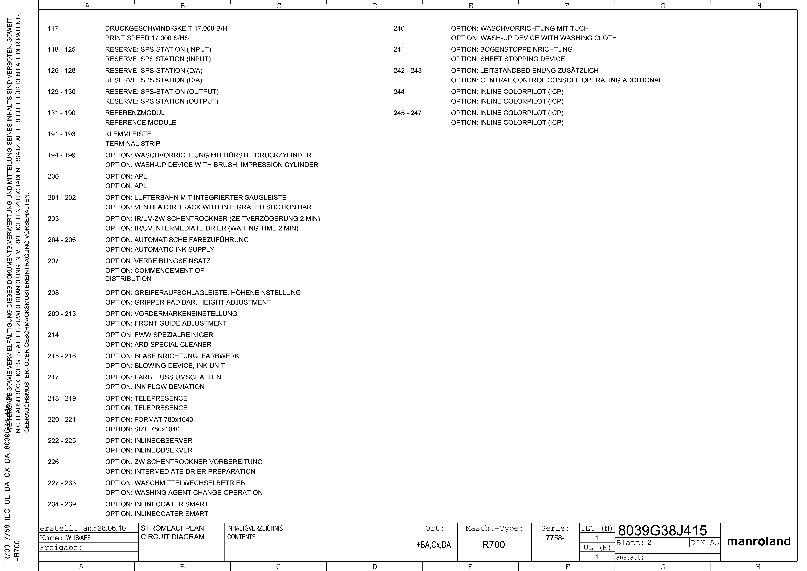

# +BA_Cx_DA — Sheet 2 of 247 — INHALTSVERZEICHNIS

**CONTENTS**

> Part of the manroland **R700** printing press IEC/UL circuit diagrams.
> Drawing class: **Stromlaufplan / Circuit diagram** (DIN A3).
> Document `+BA_Cx_DA` covers the **Printing units / main switch cabinet** machine section.

## At a glance

| Field | Value |
|---|---|
| Document | `+BA_Cx_DA`  (8039G38J415) |
| Sheet | **2** of 247 |
| Section (DE) | INHALTSVERZEICHNIS |
| Section (EN) | CONTENTS |
| Section type | TOC — Contents |
| Machine type | `R700` |
| Series | `7758` |
| Created | 28.06.10 |
| Replaces | — |
| Columns used | A, B, D, E, F |
| Path numbers | — |
| Labels on sheet | 85 |
| Cross-refs out | 0 |
| Cross-refs in | 0 |

**Previous:** [+BA_Cx_DA sheet 1](SHEET_0001.md) · **Next:** [+BA_Cx_DA sheet 3](SHEET_0003.md) · **Document TOC:** [_TOC.md](_TOC.md)  (+BA_Cx_DA) · **Master TOC:** [all sheets](../_MASTER_TOC.md)

## Sheet image (300 DPI, exact vector render)



_Rendered directly from the PDF vector layer at 300 DPI (1-bit), no OCR and no resampling. Use it to confirm anything ambiguous in the text below._

## Cross-references on this sheet

Each entry is a wire leaving this sheet. The printed token is `/sheet.column`; the link resolves to that sheet inside the same document.

_No outgoing cross-references on this sheet._

## Devices on this sheet

_No device designators on this sheet._

## Potentials / nets

_No named potentials on this sheet._

## Wire-end annotations (grouped as printed)

A wire that continues elsewhere is annotated with a small cluster: the destination description, the path/line number `#NN`, and the `/sheet.column` cross reference. Each row below is one such cluster exactly as it is grouped on the drawing.

| Col | Y | Path | Cross-ref | Text on the wire |
|---|---|---|---|---|
| E | 37.4 | — | — | `240 OPTION: WASCHVORRICHTUNG MIT TUCH OPTION: WASH UP DEVICE WITH WASHING CLOTH` |
| B | 37.5 | — | — | `117 DRUCKGESCHWINDIGKEIT 17.000 B/H PRINT SPEED 17.000 S/HS` |
| A | 68.6 | — | — | `118 125 RESERVE: SPS STATION (INPUT) RESERVE: SPS STATION (INPUT)` |
| E | 68.6 | — | — | `241 OPTION: BOGENSTOPPEINRICHTUNG OPTION: SHEET STOPPING DEVICE` |
| A | 99.8 | — | — | `126 128 RESERVE: SPS STATION (D/A) RESERVE: SPS STATION (D/A)` |
| F | 99.8 | — | — | `242 243 OPTION: LEITSTANDBEDIENUNG ZUSÄTZLICH OPTION: CENTRAL CONTROL CONSOLE OPERATING ADDITIONAL` |
| A | 131.0 | — | — | `129 130 RESERVE: SPS STATION (OUTPUT) RESERVE: SPS STATION (OUTPUT)` |
| E | 131.0 | — | — | `244 OPTION: INLINE COLORPILOT (ICP) OPTION: INLINE COLORPILOT (ICP)` |
| A | 162.2 | — | — | `131 190 REFERENZMODUL REFERENCE MODULE` |
| E | 162.2 | — | — | `245 247 OPTION: INLINE COLORPILOT (ICP) OPTION: INLINE COLORPILOT (ICP)` |
| A | 193.4 | — | — | `191 193 KLEMMLEISTE` |
| A | 207.6 | — | — | `TERMINAL STRIP` |
| B | 224.5 | — | — | `194 199 OPTION: WASCHVORRICHTUNG MIT BÜRSTE, DRUCKZYLINDER OPTION: WASH UP DEVICE WITH BRUSH, IMPRESSION CYLINDER` |
| A | 255.7 | — | — | `200 OPTION: APL OPTION: APL` |
| B | 286.9 | — | — | `201 202 OPTION: LÜFTERBAHN MIT INTEGRIERTER SAUGLEISTE OPTION: VENTILATOR TRACK WITH INTEGRATED SUCTION BAR` |
| B | 318.1 | — | — | `203 OPTION: IR/UV ZWISCHENTROCKNER (ZEITVERZÖGERUNG 2 MIN) OPTION: IR/UV INTERMEDIATE DRIER (WAITING TIME 2 MIN)` |
| B | 349.3 | — | — | `204 206 OPTION: AUTOMATISCHE FARBZUFÜHRUNG OPTION: AUTOMATIC INK SUPPLY` |
| A | 380.5 | — | — | `207 DISTRIBUTION OPTION: VERREIBUNGSEINSATZ OPTION: COMMENCEMENT OF` |
| B | 427.2 | — | — | `208 OPTION: GREIFERAUFSCHLAGLEISTE, HÖHENEINSTELLUNG OPTION: GRIPPER PAD BAR, HEIGHT ADJUSTMENT` |
| B | 458.4 | — | — | `209 213 OPTION: VORDERMARKENEINSTELLUNG OPTION: FRONT GUIDE ADJUSTMENT` |
| A | 489.6 | — | — | `214 OPTION: FWW SPEZIALREINIGER OPTION: ARD SPECIAL CLEANER` |
| B | 520.8 | — | — | `215 216 OPTION: BLASEINRICHTUNG, FARBWERK OPTION: BLOWING DEVICE, INK UNIT` |
| A | 552.0 | — | — | `217 OPTION: FARBFLUSS UMSCHALTEN OPTION: INK FLOW DEVIATION` |
| A | 583.1 | — | — | `218 219 OPTION: TELEPRESENCE OPTION: TELEPRESENCE` |
| A | 614.3 | — | — | `220 221 OPTION: FORMAT 780x1040 OPTION: SIZE 780x1040` |
| A | 645.5 | — | — | `222 225 OPTION: INLINEOBSERVER OPTION: INLINEOBSERVER` |
| B | 676.7 | — | — | `226 OPTION: ZWISCHENTROCKNER VORBEREITUNG OPTION: INTERMEDIATE DRIER PREPARATION` |
| B | 707.8 | — | — | `227 233 OPTION: WASCHMITTELWECHSELBETRIEB OPTION: WASHING AGENT CHANGE OPERATION` |
| A | 739.0 | — | — | `234 239 OPTION: INLINECOATER SMART OPTION: INLINECOATER SMART` |


## Notes and free text on this sheet

| Text | Col | Y (pt) |
|---|---|---|
| `DRUCKGESCHWINDIGKEIT 17.000 B/H` | B | 37.45 |
| `PRINT SPEED 17.000 S/HS` | B | 51.63 |
| `RESERVE: SPS STATION (INPUT)` | B | 68.63 |
| `RESERVE: SPS STATION (D/A)` | B | 99.81 |
| `RESERVE: SPS STATION (OUTPUT)` | B | 130.99 |
| `REFERENZMODUL` | A | 162.18 |
| `REFERENCE MODULE` | B | 176.35 |
| `KLEMMLEISTE` | A | 193.38 |
| `TERMINAL STRIP` | A | 207.55 |
| `OPTION: WASCHVORRICHTUNG MIT BÜRSTE, DRUCKZYLINDER` | B | 224.53 |
| `OPTION: WASH UP DEVICE WITH BRUSH, IMPRESSION CYLINDER` | B | 238.7 |
| `OPTION: APL` | A | 255.73 |
| `OPTION: LÜFTERBAHN MIT INTEGRIERTER SAUGLEISTE` | B | 286.92 |
| `OPTION: VENTILATOR TRACK WITH INTEGRATED SUCTION BAR` | B | 301.07 |
| `OPTION: IR/UV ZWISCHENTROCKNER (ZEITVERZÖGERUNG 2 MIN)` | B | 318.07 |
| `OPTION: IR/UV INTERMEDIATE DRIER (WAITING TIME 2 MIN)` | B | 332.25 |
| `OPTION: AUTOMATISCHE FARBZUFÜHRUNG` | B | 349.27 |
| `OPTION: AUTOMATIC INK SUPPLY` | B | 363.45 |
| `OPTION: VERREIBUNGSEINSATZ` | B | 380.46 |
| `OPTION: COMMENCEMENT OF` | B | 394.61 |
| `DISTRIBUTION` | A | 406.66 |
| `OPTION: WASCHVORRICHTUNG MIT TUCH` | F | 37.44 |
| `OPTION: WASH UP DEVICE WITH WASHING CLOTH` | F | 51.59 |
| `OPTION: BOGENSTOPPEINRICHTUNG` | E | 68.64 |
| `OPTION: SHEET STOPPING DEVICE` | E | 82.82 |
| `OPTION: LEITSTANDBEDIENUNG ZUSÄTZLICH` | F | 99.83 |
| `OPTION: CENTRAL CONTROL CONSOLE OPERATING ADDITIONAL` | F | 114 |
| `OPTION: INLINE COLORPILOT (ICP)` | E | 131.01 |
| `OPTION: GREIFERAUFSCHLAGLEISTE, HÖHENEINSTELLUNG` | B | 427.23 |
| `OPTION: GRIPPER PAD BAR, HEIGHT ADJUSTMENT` | B | 441.39 |
| `OPTION: VORDERMARKENEINSTELLUNG` | B | 458.41 |
| `OPTION: FRONT GUIDE ADJUSTMENT` | B | 472.57 |
| `OPTION: FWW SPEZIALREINIGER` | B | 489.55 |
| `OPTION: ARD SPECIAL CLEANER` | B | 503.76 |
| `OPTION: BLASEINRICHTUNG, FARBWERK` | B | 520.75 |
| `OPTION: BLOWING DEVICE, INK UNIT` | B | 534.92 |
| `OPTION: FARBFLUSS UMSCHALTEN` | B | 551.95 |
| `OPTION: INK FLOW DEVIATION` | B | 566.1 |
| `OPTION: TELEPRESENCE` | B | 583.13 |
| `OPTION: FORMAT 780x1040` | B | 614.33 |
| `OPTION: SIZE 780x1040` | B | 628.51 |
| `OPTION: INLINEOBSERVER` | B | 645.5 |
| `OPTION: ZWISCHENTROCKNER VORBEREITUNG` | B | 676.66 |
| `OPTION: INTERMEDIATE DRIER PREPARATION` | B | 690.85 |
| `OPTION: WASCHMITTELWECHSELBETRIEB` | B | 707.83 |
| `OPTION: WASHING AGENT CHANGE OPERATION` | B | 722.01 |
| `OPTION: INLINECOATER SMART` | B | 739.04 |

## Complete label inventory (exact text from the drawing)

Every text object inside the drawing area of this sheet, in DIN reading order (column A→H, then top→bottom). This is the authoritative list: if a string is not here it is not printed on this sheet.

| Col | Y | X | Dir | Type | Text |
|---|---|---|---|---|---|
| A | 37.5 | 70.0 | → | number | `117` |
| A | 68.6 | 70.0 | → | number | `118 125` |
| A | 99.8 | 70.0 | → | number | `126 128` |
| A | 131.0 | 70.0 | → | number | `129 130` |
| A | 162.2 | 70.0 | → | number | `131 190` |
| A | 162.2 | 155.1 | → | text | `REFERENZMODUL` |
| A | 193.4 | 70.0 | → | number | `191 193` |
| A | 193.4 | 155.1 | → | text | `KLEMMLEISTE` |
| A | 207.6 | 155.6 | → | text | `TERMINAL STRIP` |
| A | 224.5 | 70.0 | → | number | `194 199` |
| A | 255.7 | 155.3 | → | text | `OPTION: APL` |
| A | 255.8 | 70.6 | → | number | `200` |
| A | 269.9 | 155.3 | → | text | `OPTION: APL` |
| A | 286.9 | 70.6 | → | number | `201 202` |
| A | 318.1 | 70.6 | → | number | `203` |
| A | 349.3 | 70.6 | → | number | `204 206` |
| A | 380.5 | 70.6 | → | number | `207` |
| A | 406.7 | 155.1 | → | text | `DISTRIBUTION` |
| A | 427.3 | 70.6 | → | number | `208` |
| A | 458.4 | 70.6 | → | number | `209 213` |
| A | 489.6 | 70.6 | → | number | `214` |
| A | 520.8 | 70.6 | → | number | `215 216` |
| A | 552.0 | 70.6 | → | number | `217` |
| A | 583.1 | 70.6 | → | number | `218 219` |
| A | 614.3 | 70.6 | → | number | `220 221` |
| A | 645.5 | 70.6 | → | number | `222 225` |
| A | 676.7 | 70.6 | → | number | `226` |
| A | 707.9 | 70.6 | → | number | `227 233` |
| A | 739.0 | 70.6 | → | number | `234 239` |
| B | 37.4 | 155.1 | → | text | `DRUCKGESCHWINDIGKEIT 17.000 B/H` |
| B | 51.6 | 155.1 | → | text | `PRINT SPEED 17.000 S/HS` |
| B | 68.6 | 155.1 | → | text | `RESERVE: SPS STATION (INPUT)` |
| B | 82.8 | 155.1 | → | text | `RESERVE: SPS STATION (INPUT)` |
| B | 99.8 | 155.1 | → | text | `RESERVE: SPS STATION (D/A)` |
| B | 114.0 | 155.1 | → | text | `RESERVE: SPS STATION (D/A)` |
| B | 131.0 | 155.1 | → | text | `RESERVE: SPS STATION (OUTPUT)` |
| B | 145.2 | 155.1 | → | text | `RESERVE: SPS STATION (OUTPUT)` |
| B | 176.4 | 155.1 | → | text | `REFERENCE MODULE` |
| B | 224.5 | 155.3 | → | text | `OPTION: WASCHVORRICHTUNG MIT BÜRSTE, DRUCKZYLINDER` |
| B | 238.7 | 155.3 | → | text | `OPTION: WASH UP DEVICE WITH BRUSH, IMPRESSION CYLINDER` |
| B | 286.9 | 155.3 | → | text | `OPTION: LÜFTERBAHN MIT INTEGRIERTER SAUGLEISTE` |
| B | 301.1 | 155.3 | → | text | `OPTION: VENTILATOR TRACK WITH INTEGRATED SUCTION BAR` |
| B | 318.1 | 155.3 | → | text | `OPTION: IR/UV ZWISCHENTROCKNER (ZEITVERZÖGERUNG 2 MIN)` |
| B | 332.3 | 155.3 | → | text | `OPTION: IR/UV INTERMEDIATE DRIER (WAITING TIME 2 MIN)` |
| B | 349.3 | 155.3 | → | text | `OPTION: AUTOMATISCHE FARBZUFÜHRUNG` |
| B | 363.4 | 155.3 | → | text | `OPTION: AUTOMATIC INK SUPPLY` |
| B | 380.5 | 155.3 | → | text | `OPTION: VERREIBUNGSEINSATZ` |
| B | 394.6 | 155.3 | → | text | `OPTION: COMMENCEMENT OF` |
| B | 427.2 | 155.3 | → | text | `OPTION: GREIFERAUFSCHLAGLEISTE, HÖHENEINSTELLUNG` |
| B | 441.4 | 155.3 | → | text | `OPTION: GRIPPER PAD BAR, HEIGHT ADJUSTMENT` |
| B | 458.4 | 155.3 | → | text | `OPTION: VORDERMARKENEINSTELLUNG` |
| B | 472.6 | 155.3 | → | text | `OPTION: FRONT GUIDE ADJUSTMENT` |
| B | 489.6 | 155.3 | → | text | `OPTION: FWW SPEZIALREINIGER` |
| B | 503.8 | 155.3 | → | text | `OPTION: ARD SPECIAL CLEANER` |
| B | 520.8 | 155.3 | → | text | `OPTION: BLASEINRICHTUNG, FARBWERK` |
| B | 534.9 | 155.3 | → | text | `OPTION: BLOWING DEVICE, INK UNIT` |
| B | 551.9 | 155.3 | → | text | `OPTION: FARBFLUSS UMSCHALTEN` |
| B | 566.1 | 155.3 | → | text | `OPTION: INK FLOW DEVIATION` |
| B | 583.1 | 155.3 | → | text | `OPTION: TELEPRESENCE` |
| B | 597.3 | 155.3 | → | text | `OPTION: TELEPRESENCE` |
| B | 614.3 | 155.3 | → | text | `OPTION: FORMAT 780x1040` |
| B | 628.5 | 155.3 | → | text | `OPTION: SIZE 780x1040` |
| B | 645.5 | 155.3 | → | text | `OPTION: INLINEOBSERVER` |
| B | 659.7 | 155.3 | → | text | `OPTION: INLINEOBSERVER` |
| B | 676.7 | 155.3 | → | text | `OPTION: ZWISCHENTROCKNER VORBEREITUNG` |
| B | 690.9 | 155.3 | → | text | `OPTION: INTERMEDIATE DRIER PREPARATION` |
| B | 707.8 | 155.3 | → | text | `OPTION: WASCHMITTELWECHSELBETRIEB` |
| B | 722.0 | 155.3 | → | text | `OPTION: WASHING AGENT CHANGE OPERATION` |
| B | 739.0 | 155.3 | → | text | `OPTION: INLINECOATER SMART` |
| B | 753.2 | 155.3 | → | text | `OPTION: INLINECOATER SMART` |
| D | 37.5 | 580.8 | → | number | `240` |
| D | 68.7 | 580.8 | → | number | `241` |
| D | 99.8 | 580.8 | → | number | `242 243` |
| D | 131.0 | 580.8 | → | number | `244` |
| D | 162.2 | 580.8 | → | number | `245 247` |
| E | 68.6 | 665.6 | → | text | `OPTION: BOGENSTOPPEINRICHTUNG` |
| E | 82.8 | 665.6 | → | text | `OPTION: SHEET STOPPING DEVICE` |
| E | 131.0 | 665.6 | → | text | `OPTION: INLINE COLORPILOT (ICP)` |
| E | 145.2 | 665.6 | → | text | `OPTION: INLINE COLORPILOT (ICP)` |
| E | 162.2 | 665.6 | → | text | `OPTION: INLINE COLORPILOT (ICP)` |
| E | 176.4 | 665.6 | → | text | `OPTION: INLINE COLORPILOT (ICP)` |
| F | 37.4 | 665.6 | → | text | `OPTION: WASCHVORRICHTUNG MIT TUCH` |
| F | 51.6 | 665.6 | → | text | `OPTION: WASH UP DEVICE WITH WASHING CLOTH` |
| F | 99.8 | 665.6 | → | text | `OPTION: LEITSTANDBEDIENUNG ZUSÄTZLICH` |
| F | 114.0 | 665.6 | → | text | `OPTION: CENTRAL CONTROL CONSOLE OPERATING ADDITIONAL` |

## Reading-order text block

The same content as a plain block, grouped by DIN column — convenient to paste or to match against a visual description.

```text
=== Column A ===
  37.5   70.0  numeric      117
  68.6   70.0  numeric      118 125
  99.8   70.0  numeric      126 128
 131.0   70.0  numeric      129 130
 162.2   70.0  numeric      131 190
 162.2  155.1  text         REFERENZMODUL
 193.4   70.0  numeric      191 193
 193.4  155.1  text         KLEMMLEISTE
 207.6  155.6  text         TERMINAL STRIP
 224.5   70.0  numeric      194 199
 255.7  155.3  text         OPTION: APL
 255.8   70.6  numeric      200
 269.9  155.3  text         OPTION: APL
 286.9   70.6  numeric      201 202
 318.1   70.6  numeric      203
 349.3   70.6  numeric      204 206
 380.5   70.6  numeric      207
 406.7  155.1  text         DISTRIBUTION
 427.3   70.6  numeric      208
 458.4   70.6  numeric      209 213
 489.6   70.6  numeric      214
 520.8   70.6  numeric      215 216
 552.0   70.6  numeric      217
 583.1   70.6  numeric      218 219
 614.3   70.6  numeric      220 221
 645.5   70.6  numeric      222 225
 676.7   70.6  numeric      226
 707.9   70.6  numeric      227 233
 739.0   70.6  numeric      234 239
=== Column B ===
  37.4  155.1  text         DRUCKGESCHWINDIGKEIT 17.000 B/H
  51.6  155.1  text         PRINT SPEED 17.000 S/HS
  68.6  155.1  text         RESERVE: SPS STATION (INPUT)
  82.8  155.1  text         RESERVE: SPS STATION (INPUT)
  99.8  155.1  text         RESERVE: SPS STATION (D/A)
 114.0  155.1  text         RESERVE: SPS STATION (D/A)
 131.0  155.1  text         RESERVE: SPS STATION (OUTPUT)
 145.2  155.1  text         RESERVE: SPS STATION (OUTPUT)
 176.4  155.1  text         REFERENCE MODULE
 224.5  155.3  text         OPTION: WASCHVORRICHTUNG MIT BÜRSTE, DRUCKZYLINDER
 238.7  155.3  text         OPTION: WASH UP DEVICE WITH BRUSH, IMPRESSION CYLINDER
 286.9  155.3  text         OPTION: LÜFTERBAHN MIT INTEGRIERTER SAUGLEISTE
 301.1  155.3  text         OPTION: VENTILATOR TRACK WITH INTEGRATED SUCTION BAR
 318.1  155.3  text         OPTION: IR/UV ZWISCHENTROCKNER (ZEITVERZÖGERUNG 2 MIN)
 332.3  155.3  text         OPTION: IR/UV INTERMEDIATE DRIER (WAITING TIME 2 MIN)
 349.3  155.3  text         OPTION: AUTOMATISCHE FARBZUFÜHRUNG
 363.4  155.3  text         OPTION: AUTOMATIC INK SUPPLY
 380.5  155.3  text         OPTION: VERREIBUNGSEINSATZ
 394.6  155.3  text         OPTION: COMMENCEMENT OF
 427.2  155.3  text         OPTION: GREIFERAUFSCHLAGLEISTE, HÖHENEINSTELLUNG
 441.4  155.3  text         OPTION: GRIPPER PAD BAR, HEIGHT ADJUSTMENT
 458.4  155.3  text         OPTION: VORDERMARKENEINSTELLUNG
 472.6  155.3  text         OPTION: FRONT GUIDE ADJUSTMENT
 489.6  155.3  text         OPTION: FWW SPEZIALREINIGER
 503.8  155.3  text         OPTION: ARD SPECIAL CLEANER
 520.8  155.3  text         OPTION: BLASEINRICHTUNG, FARBWERK
 534.9  155.3  text         OPTION: BLOWING DEVICE, INK UNIT
 551.9  155.3  text         OPTION: FARBFLUSS UMSCHALTEN
 566.1  155.3  text         OPTION: INK FLOW DEVIATION
 583.1  155.3  text         OPTION: TELEPRESENCE
 597.3  155.3  text         OPTION: TELEPRESENCE
 614.3  155.3  text         OPTION: FORMAT 780x1040
 628.5  155.3  text         OPTION: SIZE 780x1040
 645.5  155.3  text         OPTION: INLINEOBSERVER
 659.7  155.3  text         OPTION: INLINEOBSERVER
 676.7  155.3  text         OPTION: ZWISCHENTROCKNER VORBEREITUNG
 690.9  155.3  text         OPTION: INTERMEDIATE DRIER PREPARATION
 707.8  155.3  text         OPTION: WASCHMITTELWECHSELBETRIEB
 722.0  155.3  text         OPTION: WASHING AGENT CHANGE OPERATION
 739.0  155.3  text         OPTION: INLINECOATER SMART
 753.2  155.3  text         OPTION: INLINECOATER SMART
=== Column D ===
  37.5  580.8  numeric      240
  68.7  580.8  numeric      241
  99.8  580.8  numeric      242 243
 131.0  580.8  numeric      244
 162.2  580.8  numeric      245 247
=== Column E ===
  68.6  665.6  text         OPTION: BOGENSTOPPEINRICHTUNG
  82.8  665.6  text         OPTION: SHEET STOPPING DEVICE
 131.0  665.6  text         OPTION: INLINE COLORPILOT (ICP)
 145.2  665.6  text         OPTION: INLINE COLORPILOT (ICP)
 162.2  665.6  text         OPTION: INLINE COLORPILOT (ICP)
 176.4  665.6  text         OPTION: INLINE COLORPILOT (ICP)
=== Column F ===
  37.4  665.6  text         OPTION: WASCHVORRICHTUNG MIT TUCH
  51.6  665.6  text         OPTION: WASH UP DEVICE WITH WASHING CLOTH
  99.8  665.6  text         OPTION: LEITSTANDBEDIENUNG ZUSÄTZLICH
 114.0  665.6  text         OPTION: CENTRAL CONTROL CONSOLE OPERATING ADDITIONAL
```

---
_Generated from the PDF vector text layer; no OCR. Source: `R700_7758_IEC_UL_BA_CX_DA_8039G38J415_p`, sheet 2._
