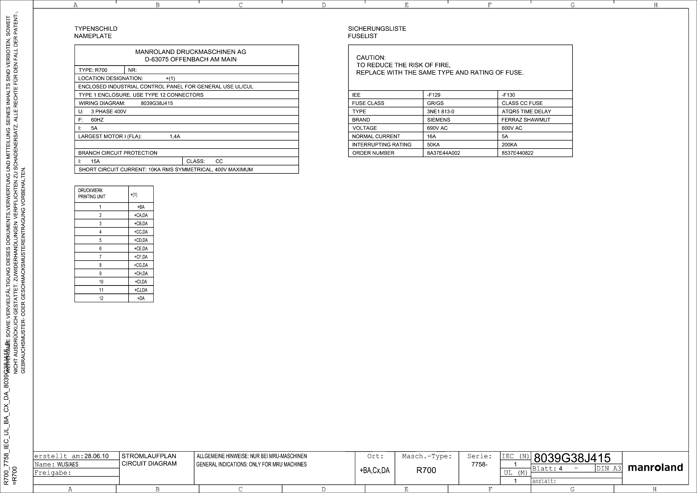

# +BA_Cx_DA — Sheet 4 of 247 — ALLGEMEINE HINWEISE: NUR BEI MRU MASCHINEN

**GENERAL INDICATIONS: ONLY FOR MRU MACHINES**

> Part of the manroland **R700** printing press IEC/UL circuit diagrams.
> Drawing class: **Stromlaufplan / Circuit diagram** (DIN A3).
> Document `+BA_Cx_DA` covers the **Printing units / main switch cabinet** machine section.

## At a glance

| Field | Value |
|---|---|
| Document | `+BA_Cx_DA`  (8039G38J415) |
| Sheet | **4** of 247 |
| Section (DE) | ALLGEMEINE HINWEISE: NUR BEI MRU MASCHINEN |
| Section (EN) | GENERAL INDICATIONS: ONLY FOR MRU MACHINES |
| Section type | LEGEND — General indications |
| Machine type | `R700` |
| Series | `7758` |
| Created | 28.06.10 |
| Replaces | — |
| Columns used | A, B, C, D, E, F |
| Path numbers | — |
| Labels on sheet | 82 |
| Cross-refs out | 0 |
| Cross-refs in | 0 |

**Previous:** [+BA_Cx_DA sheet 3](SHEET_0003.md) · **Next:** [+BA_Cx_DA sheet 5](SHEET_0005.md) · **Document TOC:** [_TOC.md](_TOC.md)  (+BA_Cx_DA) · **Master TOC:** [all sheets](../_MASTER_TOC.md)

## Sheet image (300 DPI, exact vector render)



_Rendered directly from the PDF vector layer at 300 DPI (1-bit), no OCR and no resampling. Use it to confirm anything ambiguous in the text below._

## Cross-references on this sheet

Each entry is a wire leaving this sheet. The printed token is `/sheet.column`; the link resolves to that sheet inside the same document.

_No outgoing cross-references on this sheet._

## Devices on this sheet

| Tag | Class | Class meaning (IEC) | Col | Sub | Terminal | Sign |
|---|---|---|---|---|---|---|
| `F129` | F | Schutz / protection device (fuse, circuit breaker) | E | — | — | — |
| `F130` | F | Schutz / protection device (fuse, circuit breaker) | F | — | — | — |

## Potentials / nets

| Potential | Count | Columns | Attached devices | Terminals |
|---|---|---|---|---|
| `600V` | 1 | F | — | — |
| `690V` | 1 | E | — | — |


A potential such as `L24+/4` or `M24+` is a named supply/return rail; every place it appears on this sheet is electrically common.

## Wire-end annotations (grouped as printed)

A wire that continues elsewhere is annotated with a small cluster: the destination description, the path/line number `#NN`, and the `/sheet.column` cross reference. Each row below is one such cluster exactly as it is grouped on the drawing.

| Col | Y | Path | Cross-ref | Text on the wire |
|---|---|---|---|---|
| A | 44.3 | — | — | `NAMEPLATE TYPENSCHILD` |
| E | 44.3 | — | — | `FUSELIST SICHERUNGSLISTE` |
| B | 84.0 | — | — | `MANROLAND DRUCKMASCHINEN AG` |
| E | 93.9 | — | — | `REPLACE WITH THE SAME TYPE AND RATING OF FUSE. CAUTION: TO REDUCE THE RISK OF FIRE,` |
| B | 96.6 | — | — | `D 63075 OFFENBACH AM MAIN` |
| A | 115.8 | — | — | `TYPE: R700` |
| B | 115.8 | — | — | `NR:` |
| A | 130.0 | — | — | `LOCATION DESIGNATION:` |
| B | 130.0 | — | — | `+(1)` |
| B | 144.1 | — | — | `ENCLOSED INDUSTRIAL CONTROL PANEL FOR GENERAL USE UL/CUL` |
| D | 158.2 | — | — | `IEE` |
| B | 158.3 | — | — | `TYPE 1 ENCLOSURE. USE TYPE 12 CONNECTORS` |
| F | 158.3 | — | — | `F129 F130` |
| A | 172.4 | — | — | `WIRING DIAGRAM:` |
| B | 172.5 | — | — | `8039G38J415` |
| E | 172.5 | — | — | `FUSE CLASS` |
| E | 172.5 | — | — | `GR/GS` |
| F | 172.5 | — | — | `CLASS CC FUSE` |
| A | 186.6 | — | — | `3 PHASE 400V` |
| D | 186.6 | — | — | `TYPE` |
| A | 186.7 | — | — | `U:` |
| E | 186.7 | — | — | `3NE1 813 0` |
| F | 186.7 | — | — | `ATQR5 TIME DELAY` |
| A | 200.8 | — | — | `F:` |
| D | 200.8 | — | — | `BRAND` |
| E | 200.8 | — | — | `SIEMENS` |
| F | 200.8 | — | — | `FERRAZ SHAWMUT` |
| A | 200.9 | — | — | `60HZ` |
| A | 214.8 | — | — | `I:` |
| A | 215.0 | — | — | `5A` |
| D | 215.0 | — | — | `VOLTAGE` |
| E | 215.0 | — | — | `690V AC` |
| F | 215.0 | — | — | `600V AC` |
| A | 229.2 | — | — | `LARGEST MOTOR I (FLA):` |
| B | 229.2 | — | — | `1,4A` |
| E | 229.2 | — | — | `NORMAL CURRENT` |
| E | 229.2 | — | — | `16A` |
| F | 229.2 | — | — | `5A` |
| E | 243.3 | — | — | `INTERRUPTING RATING` |
| E | 243.3 | — | — | `50KA` |
| F | 243.3 | — | — | `200KA` |
| B | 257.5 | — | — | `BRANCH CIRCUIT PROTECTION` |
| E | 257.5 | — | — | `8A37E44A002` |
| E | 257.6 | — | — | `ORDER NUMBER` |
| F | 257.6 | — | — | `8537E440822` |
| A | 271.6 | — | — | `I:` |
| A | 271.7 | — | — | `15A` |
| B | 271.7 | — | — | `CLASS:` |
| C | 271.8 | — | — | `CC` |
| B | 285.9 | — | — | `SHORT CIRCUIT CURRENT: 10KA RMS SYMMETRICAL, 400V MAXIMUM` |
| A | 322.3 | — | — | `DRUCKWERK PRINTING UNIT +(1)` |
| A | 350.2 | — | — | `1` |
| B | 350.7 | — | — | `+BA` |
| A | 364.7 | — | — | `2` |
| B | 364.9 | — | — | `+CA,DA` |
| A | 379.0 | — | — | `3` |
| B | 379.1 | — | — | `+CB,DA` |
| A | 393.1 | — | — | `4` |
| B | 393.2 | — | — | `+CC,DA` |
| A | 407.3 | — | — | `5` |
| B | 407.4 | — | — | `+CD,DA` |
| A | 421.5 | — | — | `6` |
| B | 421.6 | — | — | `+CE,DA` |
| A | 435.7 | — | — | `7` |
| B | 435.8 | — | — | `+CF,DA` |
| A | 449.8 | — | — | `8` |
| B | 449.9 | — | — | `+CG,DA` |
| A | 464.0 | — | — | `9` |
| B | 464.1 | — | — | `+CH,DA` |
| A | 478.2 | — | — | `10` |
| B | 478.3 | — | — | `+CI,DA` |
| A | 492.2 | — | — | `11` |
| B | 492.4 | — | — | `+CJ,DA` |
| A | 506.5 | — | — | `12` |
| B | 506.6 | — | — | `+DA` |


## Device order codes printed on this sheet

> **These are NOT device part numbers and must not be attributed to a single device.** They are order/manufacturing codes that sit inside the same annotation cluster as a device, with no printed label and no leader line binding them to one item. Measured across the whole set: such codes appear on **8 of 1,351 sheets** (see `01_SYSTEM/A_HOW_TO_READ.md` §8.1).

| Token | Col | Y (pt) | What it is |
|---|---|---|---|
| `8537E440822` | F | 257.6 | order code |


## Notes and free text on this sheet

| Text | Col | Y (pt) |
|---|---|---|
| `TYPE: R700` | A | 115.78 |
| `LOCATION DESIGNATION:` | A | 129.96 |
| `MANROLAND DRUCKMASCHINEN AG` | B | 83.95 |
| `D 63075 OFFENBACH AM MAIN` | B | 96.64 |
| `TYPE 1 ENCLOSURE. USE TYPE 12 CONNECTORS` | B | 158.3 |
| `WIRING DIAGRAM:` | A | 172.45 |
| `U:` | A | 186.66 |
| `F:` | A | 200.77 |
| `I:` | A | 214.85 |
| `LARGEST MOTOR I (FLA):` | A | 229.17 |
| `BRANCH CIRCUIT PROTECTION` | B | 257.53 |
| `SHORT CIRCUIT CURRENT: 10KA RMS SYMMETRICAL, 400V MAXIMUM` | B | 285.88 |
| `ENCLOSED INDUSTRIAL CONTROL PANEL FOR GENERAL USE UL/CUL` | B | 144.14 |
| `NR:` | B | 115.81 |
| `CLASS:` | B | 271.67 |
| `3 PHASE 400V` | A | 186.64 |
| `60HZ` | A | 200.86 |
| `5A` | A | 214.99 |
| `15A` | A | 271.7 |
| `1,4A` | B | 229.16 |
| `TYPENSCHILD` | A | 44.29 |
| `NAMEPLATE` | A | 56.93 |
| `SICHERUNGSLISTE` | E | 44.27 |
| `FUSELIST` | D | 56.96 |
| `DRUCKWERK` | A | 322.33 |
| `PRINTING UNIT` | A | 332.99 |
| `+BA` | B | 350.67 |
| `+CA,DA` | B | 364.88 |
| `+CB,DA` | B | 379.05 |
| `+CC,DA` | B | 393.24 |
| `+CD,DA` | B | 407.42 |
| `+CE,DA` | B | 421.57 |
| `+CF,DA` | B | 435.75 |
| `+CG,DA` | B | 449.93 |
| `+CH,DA` | B | 464.11 |
| `+CI,DA` | B | 478.26 |
| `+CJ,DA` | B | 492.43 |
| `+DA` | B | 506.61 |
| `IEE` | D | 158.24 |
| `FUSE CLASS` | E | 172.46 |
| `TYPE` | D | 186.61 |
| `BRAND` | D | 200.84 |
| `VOLTAGE` | D | 214.99 |
| `NORMAL CURRENT` | E | 229.21 |
| `INTERRUPTING RATING` | E | 243.35 |
| `ORDER NUMBER` | E | 257.55 |
| `CAUTION:` | E | 93.89 |
| `TO REDUCE THE RISK OF FIRE,` | E | 106.58 |
| `REPLACE WITH THE SAME TYPE AND RATING OF FUSE.` | E | 119.25 |
| `CLASS CC FUSE` | F | 172.47 |
| `ATQR5 TIME DELAY` | F | 186.65 |
| `FERRAZ SHAWMUT` | F | 200.8 |
| `5A` | F | 229.17 |
| `200KA` | F | 243.35 |
| `GR/GS` | E | 172.48 |
| `3NE1 813 0` | E | 186.68 |
| `SIEMENS` | E | 200.82 |
| `16A` | E | 229.18 |
| `50KA` | E | 243.34 |
| `8A37E44A002` | E | 257.54 |
| `CC` | C | 271.75 |
| `8039G38J415` | B | 172.51 |

## Complete label inventory (exact text from the drawing)

Every text object inside the drawing area of this sheet, in DIN reading order (column A→H, then top→bottom). This is the authoritative list: if a string is not here it is not printed on this sheet.

| Col | Y | X | Dir | Type | Text |
|---|---|---|---|---|---|
| A | 44.3 | 127.3 | → | text | `TYPENSCHILD` |
| A | 56.9 | 126.7 | → | text | `NAMEPLATE` |
| A | 115.8 | 134.4 | → | text | `TYPE: R700` |
| A | 130.0 | 133.8 | → | text | `LOCATION DESIGNATION:` |
| A | 172.4 | 134.6 | → | text | `WIRING DIAGRAM:` |
| A | 186.6 | 155.6 | → | text | `3 PHASE 400V` |
| A | 186.7 | 133.8 | → | text | `U:` |
| A | 200.8 | 133.8 | → | text | `F:` |
| A | 200.9 | 155.6 | → | text | `60HZ` |
| A | 214.9 | 133.8 | → | text | `I:` |
| A | 215.0 | 155.6 | → | text | `5A` |
| A | 229.2 | 133.8 | → | text | `LARGEST MOTOR I (FLA):` |
| A | 271.5 | 133.8 | → | text | `I:` |
| A | 271.7 | 155.1 | → | text | `15A` |
| A | 322.3 | 133.8 | → | text | `DRUCKWERK` |
| A | 333.0 | 133.8 | → | text | `PRINTING UNIT` |
| A | 350.2 | 169.2 | → | number | `1` |
| A | 364.7 | 169.8 | → | number | `2` |
| A | 379.0 | 169.8 | → | number | `3` |
| A | 393.1 | 169.8 | → | number | `4` |
| A | 407.3 | 169.8 | → | number | `5` |
| A | 421.5 | 169.8 | → | number | `6` |
| A | 435.7 | 169.8 | → | number | `7` |
| A | 449.8 | 169.8 | → | number | `8` |
| A | 464.0 | 169.8 | → | number | `9` |
| A | 478.2 | 169.2 | → | number | `10` |
| A | 492.2 | 169.2 | → | number | `11` |
| A | 506.5 | 169.2 | → | number | `12` |
| B | 83.9 | 231.0 | → | text | `MANROLAND DRUCKMASCHINEN AG` |
| B | 96.6 | 247.6 | → | text | `D 63075 OFFENBACH AM MAIN` |
| B | 115.8 | 218.8 | → | text | `NR:` |
| B | 130.0 | 283.2 | → | other | `+(1)` |
| B | 144.1 | 133.8 | → | text | `ENCLOSED INDUSTRIAL CONTROL PANEL FOR GENERAL USE UL/CUL` |
| B | 158.3 | 134.4 | → | text | `TYPE 1 ENCLOSURE. USE TYPE 12 CONNECTORS` |
| B | 172.5 | 240.7 | → | text | `8039G38J415` |
| B | 229.2 | 289.7 | → | text | `1,4A` |
| B | 257.5 | 133.8 | → | text | `BRANCH CIRCUIT PROTECTION` |
| B | 271.7 | 318.6 | → | text | `CLASS:` |
| B | 285.9 | 134.4 | → | text | `SHORT CIRCUIT CURRENT: 10KA RMS SYMMETRICAL, 400V MAXIMUM` |
| B | 329.4 | 222.9 | → | other | `+(1)` |
| B | 350.7 | 234.7 | → | text | `+BA` |
| B | 364.9 | 229.4 | → | text | `+CA,DA` |
| B | 379.1 | 229.4 | → | text | `+CB,DA` |
| B | 393.2 | 229.3 | → | text | `+CC,DA` |
| B | 407.4 | 229.3 | → | text | `+CD,DA` |
| B | 421.6 | 229.4 | → | text | `+CE,DA` |
| B | 435.8 | 229.6 | → | text | `+CF,DA` |
| B | 449.9 | 229.1 | → | text | `+CG,DA` |
| B | 464.1 | 229.3 | → | text | `+CH,DA` |
| B | 478.3 | 230.6 | → | text | `+CI,DA` |
| B | 492.4 | 229.9 | → | text | `+CJ,DA` |
| B | 506.6 | 234.6 | → | text | `+DA` |
| C | 271.8 | 368.2 | → | text | `CC` |
| D | 57.0 | 594.4 | → | text | `FUSELIST` |
| D | 158.2 | 601.5 | → | text | `IEE` |
| D | 186.6 | 602.1 | → | text | `TYPE` |
| D | 200.8 | 601.5 | → | text | `BRAND` |
| D | 215.0 | 602.4 | → | text | `VOLTAGE` |
| E | 44.3 | 594.7 | → | text | `SICHERUNGSLISTE` |
| E | 93.9 | 608.9 | → | text | `CAUTION:` |
| E | 106.6 | 609.2 | → | text | `TO REDUCE THE RISK OF FIRE,` |
| E | 119.3 | 608.6 | → | text | `REPLACE WITH THE SAME TYPE AND RATING OF FUSE.` |
| E | 158.3 | 729.6 | → | device tag | `F129` |
| E | 172.5 | 601.5 | → | text | `FUSE CLASS` |
| E | 172.5 | 729.6 | → | text | `GR/GS` |
| E | 186.7 | 729.6 | → | text | `3NE1 813 0` |
| E | 200.8 | 729.6 | → | text | `SIEMENS` |
| E | 215.0 | 729.6 | → | potential | `690V AC` |
| E | 229.2 | 601.5 | → | text | `NORMAL CURRENT` |
| E | 229.2 | 729.1 | → | text | `16A` |
| E | 243.3 | 729.6 | → | text | `50KA` |
| E | 243.4 | 601.5 | → | text | `INTERRUPTING RATING` |
| E | 257.5 | 602.1 | → | text | `ORDER NUMBER` |
| E | 257.5 | 729.6 | → | text | `8A37E44A002` |
| F | 158.3 | 857.2 | → | device tag | `F130` |
| F | 172.5 | 857.2 | → | text | `CLASS CC FUSE` |
| F | 186.6 | 857.5 | → | text | `ATQR5 TIME DELAY` |
| F | 200.8 | 856.6 | → | text | `FERRAZ SHAWMUT` |
| F | 215.0 | 857.2 | → | potential | `600V AC` |
| F | 229.2 | 857.2 | → | text | `5A` |
| F | 243.4 | 857.2 | → | text | `200KA` |
| F | 257.6 | 857.2 | → | ordercode | `8537E440822` |

## Reading-order text block

The same content as a plain block, grouped by DIN column — convenient to paste or to match against a visual description.

```text
=== Column A ===
  44.3  127.3  text         TYPENSCHILD
  56.9  126.7  text         NAMEPLATE
 115.8  134.4  text         TYPE: R700
 130.0  133.8  text         LOCATION DESIGNATION:
 172.4  134.6  text         WIRING DIAGRAM:
 186.6  155.6  text         3 PHASE 400V
 186.7  133.8  text         U:
 200.8  133.8  text         F:
 200.9  155.6  text         60HZ
 214.9  133.8  text         I:
 215.0  155.6  text         5A
 229.2  133.8  text         LARGEST MOTOR I (FLA):
 271.5  133.8  text         I:
 271.7  155.1  text         15A
 322.3  133.8  text         DRUCKWERK
 333.0  133.8  text         PRINTING UNIT
 350.2  169.2  numeric      1
 364.7  169.8  numeric      2
 379.0  169.8  numeric      3
 393.1  169.8  numeric      4
 407.3  169.8  numeric      5
 421.5  169.8  numeric      6
 435.7  169.8  numeric      7
 449.8  169.8  numeric      8
 464.0  169.8  numeric      9
 478.2  169.2  numeric      10
 492.2  169.2  numeric      11
 506.5  169.2  numeric      12
=== Column B ===
  83.9  231.0  text         MANROLAND DRUCKMASCHINEN AG
  96.6  247.6  text         D 63075 OFFENBACH AM MAIN
 115.8  218.8  text         NR:
 130.0  283.2  other        +(1)
 144.1  133.8  text         ENCLOSED INDUSTRIAL CONTROL PANEL FOR GENERAL USE UL/CUL
 158.3  134.4  text         TYPE 1 ENCLOSURE. USE TYPE 12 CONNECTORS
 172.5  240.7  text         8039G38J415
 229.2  289.7  text         1,4A
 257.5  133.8  text         BRANCH CIRCUIT PROTECTION
 271.7  318.6  text         CLASS:
 285.9  134.4  text         SHORT CIRCUIT CURRENT: 10KA RMS SYMMETRICAL, 400V MAXIMUM
 329.4  222.9  other        +(1)
 350.7  234.7  text         +BA
 364.9  229.4  text         +CA,DA
 379.1  229.4  text         +CB,DA
 393.2  229.3  text         +CC,DA
 407.4  229.3  text         +CD,DA
 421.6  229.4  text         +CE,DA
 435.8  229.6  text         +CF,DA
 449.9  229.1  text         +CG,DA
 464.1  229.3  text         +CH,DA
 478.3  230.6  text         +CI,DA
 492.4  229.9  text         +CJ,DA
 506.6  234.6  text         +DA
=== Column C ===
 271.8  368.2  text         CC
=== Column D ===
  57.0  594.4  text         FUSELIST
 158.2  601.5  text         IEE
 186.6  602.1  text         TYPE
 200.8  601.5  text         BRAND
 215.0  602.4  text         VOLTAGE
=== Column E ===
  44.3  594.7  text         SICHERUNGSLISTE
  93.9  608.9  text         CAUTION:
 106.6  609.2  text         TO REDUCE THE RISK OF FIRE,
 119.3  608.6  text         REPLACE WITH THE SAME TYPE AND RATING OF FUSE.
 158.3  729.6  devtag       F129
 172.5  601.5  text         FUSE CLASS
 172.5  729.6  text         GR/GS
 186.7  729.6  text         3NE1 813 0
 200.8  729.6  text         SIEMENS
 215.0  729.6  net          690V AC
 229.2  601.5  text         NORMAL CURRENT
 229.2  729.1  text         16A
 243.3  729.6  text         50KA
 243.4  601.5  text         INTERRUPTING RATING
 257.5  602.1  text         ORDER NUMBER
 257.5  729.6  text         8A37E44A002
=== Column F ===
 158.3  857.2  devtag       F130
 172.5  857.2  text         CLASS CC FUSE
 186.6  857.5  text         ATQR5 TIME DELAY
 200.8  856.6  text         FERRAZ SHAWMUT
 215.0  857.2  net          600V AC
 229.2  857.2  text         5A
 243.4  857.2  text         200KA
 257.6  857.2  ordercode    8537E440822
```

---
_Generated from the PDF vector text layer; no OCR. Source: `R700_7758_IEC_UL_BA_CX_DA_8039G38J415_p`, sheet 4._
