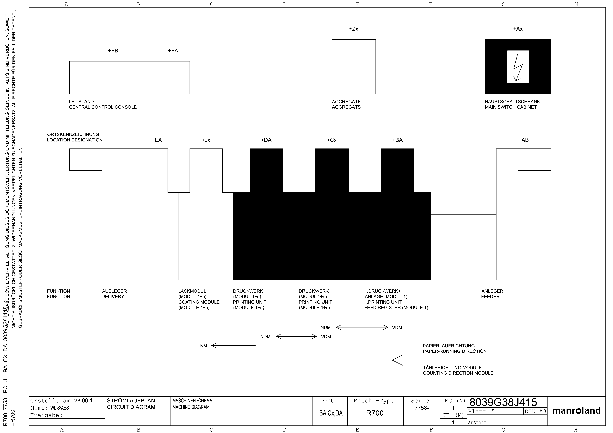

# +BA_Cx_DA — Sheet 5 of 247 — MASCHINENSCHEMA

**MACHINE**

> Part of the manroland **R700** printing press IEC/UL circuit diagrams.
> Drawing class: **Stromlaufplan / Circuit diagram** (DIN A3).
> Document `+BA_Cx_DA` covers the **Printing units / main switch cabinet** machine section.

## At a glance

| Field | Value |
|---|---|
| Document | `+BA_Cx_DA`  (8039G38J415) |
| Sheet | **5** of 247 |
| Section (DE) | MASCHINENSCHEMA |
| Section (EN) | MACHINE |
| Section type | MACHINE_LAYOUT — Machine diagram |
| Machine type | `R700` |
| Series | `7758` |
| Created | 28.06.10 |
| Replaces | — |
| Columns used | A, B, C, D, E, F, G |
| Path numbers | — |
| Labels on sheet | 49 |
| Cross-refs out | 0 |
| Cross-refs in | 0 |

**Previous:** [+BA_Cx_DA sheet 4](SHEET_0004.md) · **Next:** [+BA_Cx_DA sheet 6](SHEET_0006.md) · **Document TOC:** [_TOC.md](_TOC.md)  (+BA_Cx_DA) · **Master TOC:** [all sheets](../_MASTER_TOC.md)

## Sheet image (300 DPI, exact vector render)



_Rendered directly from the PDF vector layer at 300 DPI (1-bit), no OCR and no resampling. Use it to confirm anything ambiguous in the text below._

## Cross-references on this sheet

Each entry is a wire leaving this sheet. The printed token is `/sheet.column`; the link resolves to that sheet inside the same document.

_No outgoing cross-references on this sheet._

## Devices on this sheet

_No device designators on this sheet._

## Potentials / nets

_No named potentials on this sheet._

## Wire-end annotations (grouped as printed)

A wire that continues elsewhere is annotated with a small cluster: the destination description, the path/line number `#NN`, and the `/sheet.column` cross reference. Each row below is one such cluster exactly as it is grouped on the drawing.

| Col | Y | Path | Cross-ref | Text on the wire |
|---|---|---|---|---|
| F | 51.4 | — | — | `+Zx +Ax` |
| B | 93.8 | — | — | `+FB +FA` |
| A | 193.7 | — | — | `LEITSTAND` |
| E | 193.7 | — | — | `AGGREGATE AGGREGATS` |
| G | 193.8 | — | — | `HAUPTSCHALTSCHRANK MAIN SWITCH CABINET` |
| B | 204.4 | — | — | `CENTRAL CONTROL CONSOLE` |
| D | 257.5 | — | — | `LOCATION DESIGNATION ORTSKENNZEICHNUNG +EA +Jx +DA +Cx +BA +AB` |
| A | 562.2 | — | — | `FUNKTION FUNCTION DELIVERY AUSLEGER` |
| D | 562.2 | — | — | `DRUCKWERK PRINTING UNIT (MODUL 1+n) (MODULE 1+n)` |
| D | 562.2 | — | — | `DRUCKWERK PRINTING UNIT (MODUL 1+n) (MODULE 1+n)` |
| F | 562.2 | — | — | `1.DRUCKWERK+ 1.PRINTING UNIT+ FEED REGISTER (MODULE 1) ANLAGE (MODUL 1)` |
| G | 562.2 | — | — | `FEEDER ANLEGER` |
| C | 562.3 | — | — | `LACKMODUL (MODUL 1+n) (MODULE 1+n) COATING MODULE` |
| E | 633.2 | — | — | `NDM VDM` |
| D | 650.9 | — | — | `NDM VDM` |
| F | 668.5 | — | — | `PAPIERLAUFRICHTUNG PAPER RUNNING DIRECTION` |
| C | 668.6 | — | — | `NM` |
| F | 711.1 | — | — | `TÄHLERICHTUNG MODULE COUNTING DIRECTION MODULE` |


## Reconstructed tables

This sheet carries tabular content (pin map / terminal assignment / index). The grid below was rebuilt from the drawing's own rule lines, so each row is exactly one physical row of the table.

### Table 1 — 1 data rows × 2 columns (at x=134.6, y=76.5) — **+FB**

| LEITSTAND CENTRAL ORTSKENNZEICHNUNG DESIGNATION | CONTROL CONSOLE +EA |
|---|---|
|  | `AUSLEGER DELIVERY` |


### Table 2 — 1 data rows × 3 columns (at x=326.0, y=76.5) — **+FA +Jx**

|  | (MODUL COATING (MODULE | LACKMODUL 1+n) MODULE 1+n) |
|---|---|---|
|  |  | `NM` |


### Table 3 — 1 data rows × 2 columns (at x=453.5, y=76.5) — **+DA**

| DRUCKWERK (MODUL PRINTING (MODULE | 1+n) UNIT 1+n) |
|---|---|
|  | `NDM` |


### Table 4 — 2 data rows × 2 columns (at x=581.1, y=76.5) — **AGGREGATE AGGREGATS +Cx**

| DRUCKWERK (MODUL PRINTING (MODULE | 1+n) UNIT 1+n) |
|---|---|
|  | `NDM` |
|  | `VDM` |


### Table 5 — 3 data rows × 8 columns (at x=708.7, y=76.5)

|  | +BA |  |  | MAIN | SWITCH | HAUPTSCHALTSCHRANK | CABINET +AB |
|---|---|---|---|---|---|---|---|
| `ANLAGE 1.PRINTING FEED` | `1.DRUCKWERK+ (MODUL 1) UNIT+ REGISTER (MODULE` | `1)` |  | `ANLEGER FEEDER` |  |  |  |
|  | `VDM` |  |  |  |  |  |  |
|  |  |  | `PAPIERLAUFRICHTUNG PAPER RUNNING DIRECTION` |  |  |  |  |


## Notes and free text on this sheet

| Text | Col | Y (pt) |
|---|---|---|
| `AUSLEGER` | B | 562.24 |
| `DELIVERY` | B | 572.86 |
| `FUNKTION` | A | 562.26 |
| `FUNCTION` | A | 572.9 |
| `PAPIERLAUFRICHTUNG` | F | 668.55 |
| `PAPER RUNNING DIRECTION` | F | 679.19 |
| `TÄHLERICHTUNG MODULE` | F | 711.09 |
| `COUNTING DIRECTION MODULE` | F | 721.72 |
| `LACKMODUL` | C | 562.28 |
| `(MODUL 1+n)` | C | 572.93 |
| `COATING MODULE` | C | 583.53 |
| `(MODULE 1+n)` | C | 594.18 |
| `DRUCKWERK` | C | 562.22 |
| `PRINTING UNIT` | D | 583.51 |
| `(MODULE 1+n)` | D | 594.18 |
| `DRUCKWERK` | D | 562.22 |
| `(MODUL 1+n)` | D | 572.93 |
| `1.DRUCKWERK+` | E | 562.22 |
| `ANLAGE (MODUL 1)` | E | 572.9 |
| `1.PRINTING UNIT+` | E | 583.51 |
| `FEED REGISTER (MODULE 1)` | F | 594.15 |
| `NDM` | E | 633.19 |
| `VDM` | F | 633.16 |
| `VDM` | E | 650.87 |
| `NDM` | D | 650.91 |
| `NM` | C | 668.63 |
| `ANLEGER` | G | 562.25 |
| `FEEDER` | G | 572.87 |
| `+Jx` | C | 267.56 |
| `+EA` | B | 267.46 |
| `ORTSKENNZEICHNUNG` | A | 257.54 |
| `LOCATION DESIGNATION` | A | 268.15 |
| `+AB` | G | 267.46 |
| `+BA` | F | 267.46 |
| `+Cx` | E | 267.57 |
| `+DA` | D | 267.46 |
| `LEITSTAND` | A | 193.73 |
| `CENTRAL CONTROL CONSOLE` | B | 204.39 |
| `AGGREGATE` | E | 193.73 |
| `AGGREGATS` | E | 204.36 |
| `HAUPTSCHALTSCHRANK` | G | 193.75 |
| `MAIN SWITCH CABINET` | G | 204.34 |
| `+FB` | B | 93.83 |
| `+FA` | B | 93.83 |
| `+Zx` | E | 51.43 |
| `+Ax` | G | 51.43 |

## Complete label inventory (exact text from the drawing)

Every text object inside the drawing area of this sheet, in DIN reading order (column A→H, then top→bottom). This is the authoritative list: if a string is not here it is not printed on this sheet.

| Col | Y | X | Dir | Type | Text |
|---|---|---|---|---|---|
| A | 193.7 | 133.8 | → | text | `LEITSTAND` |
| A | 257.5 | 91.8 | → | text | `ORTSKENNZEICHNUNG` |
| A | 268.2 | 91.3 | → | text | `LOCATION DESIGNATION` |
| A | 562.3 | 91.3 | → | text | `FUNKTION` |
| A | 572.9 | 91.3 | → | text | `FUNCTION` |
| B | 93.8 | 209.8 | → | text | `+FB` |
| B | 93.8 | 326.3 | → | text | `+FA` |
| B | 204.4 | 134.4 | → | text | `CENTRAL CONTROL CONSOLE` |
| B | 267.5 | 294.1 | → | text | `+EA` |
| B | 562.2 | 198.4 | → | text | `AUSLEGER` |
| B | 572.9 | 197.6 | → | text | `DELIVERY` |
| C | 267.6 | 391.7 | → | text | `+Jx` |
| C | 562.2 | 452.7 | → | text | `DRUCKWERK` |
| C | 562.3 | 346.4 | → | text | `LACKMODUL` |
| C | 572.9 | 346.7 | → | text | `(MODUL 1+n)` |
| C | 572.9 | 453.0 | → | text | `(MODUL 1+n)` |
| C | 583.5 | 347.0 | → | text | `COATING MODULE` |
| C | 594.2 | 346.7 | → | text | `(MODULE 1+n)` |
| C | 668.6 | 388.9 | → | text | `NM` |
| D | 267.5 | 506.4 | → | text | `+DA` |
| D | 562.2 | 580.3 | → | text | `DRUCKWERK` |
| D | 572.9 | 580.5 | → | text | `(MODUL 1+n)` |
| D | 583.5 | 452.7 | → | text | `PRINTING UNIT` |
| D | 583.5 | 580.3 | → | text | `PRINTING UNIT` |
| D | 594.2 | 453.0 | → | text | `(MODULE 1+n)` |
| D | 594.2 | 580.5 | → | text | `(MODULE 1+n)` |
| D | 650.9 | 505.8 | → | text | `NDM` |
| E | 51.4 | 678.2 | → | text | `+Zx` |
| E | 193.7 | 644.9 | → | text | `AGGREGATE` |
| E | 204.4 | 644.9 | → | text | `AGGREGATS` |
| E | 267.6 | 635.1 | → | text | `+Cx` |
| E | 562.2 | 707.8 | → | text | `1.DRUCKWERK+` |
| E | 572.9 | 708.7 | → | text | `ANLAGE (MODUL 1)` |
| E | 583.5 | 707.8 | → | text | `1.PRINTING UNIT+` |
| E | 633.2 | 622.8 | → | text | `NDM` |
| E | 650.9 | 623.6 | → | text | `VDM` |
| F | 267.5 | 761.8 | → | text | `+BA` |
| F | 594.1 | 707.8 | → | text | `FEED REGISTER (MODULE 1)` |
| F | 633.2 | 761.8 | → | text | `VDM` |
| F | 668.6 | 821.2 | → | text | `PAPIERLAUFRICHTUNG` |
| F | 679.2 | 821.2 | → | text | `PAPER RUNNING DIRECTION` |
| F | 711.1 | 821.8 | → | text | `TÄHLERICHTUNG MODULE` |
| F | 721.7 | 821.8 | → | text | `COUNTING DIRECTION MODULE` |
| G | 51.4 | 996.8 | → | text | `+Ax` |
| G | 193.8 | 941.7 | → | text | `HAUPTSCHALTSCHRANK` |
| G | 204.3 | 942.0 | → | text | `MAIN SWITCH CABINET` |
| G | 267.5 | 1006.7 | → | text | `+AB` |
| G | 562.2 | 935.4 | → | text | `ANLEGER` |
| G | 572.9 | 934.6 | → | text | `FEEDER` |

## Reading-order text block

The same content as a plain block, grouped by DIN column — convenient to paste or to match against a visual description.

```text
=== Column A ===
 193.7  133.8  text         LEITSTAND
 257.5   91.8  text         ORTSKENNZEICHNUNG
 268.2   91.3  text         LOCATION DESIGNATION
 562.3   91.3  text         FUNKTION
 572.9   91.3  text         FUNCTION
=== Column B ===
  93.8  209.8  text         +FB
  93.8  326.3  text         +FA
 204.4  134.4  text         CENTRAL CONTROL CONSOLE
 267.5  294.1  text         +EA
 562.2  198.4  text         AUSLEGER
 572.9  197.6  text         DELIVERY
=== Column C ===
 267.6  391.7  text         +Jx
 562.2  452.7  text         DRUCKWERK
 562.3  346.4  text         LACKMODUL
 572.9  346.7  text         (MODUL 1+n)
 572.9  453.0  text         (MODUL 1+n)
 583.5  347.0  text         COATING MODULE
 594.2  346.7  text         (MODULE 1+n)
 668.6  388.9  text         NM
=== Column D ===
 267.5  506.4  text         +DA
 562.2  580.3  text         DRUCKWERK
 572.9  580.5  text         (MODUL 1+n)
 583.5  452.7  text         PRINTING UNIT
 583.5  580.3  text         PRINTING UNIT
 594.2  453.0  text         (MODULE 1+n)
 594.2  580.5  text         (MODULE 1+n)
 650.9  505.8  text         NDM
=== Column E ===
  51.4  678.2  text         +Zx
 193.7  644.9  text         AGGREGATE
 204.4  644.9  text         AGGREGATS
 267.6  635.1  text         +Cx
 562.2  707.8  text         1.DRUCKWERK+
 572.9  708.7  text         ANLAGE (MODUL 1)
 583.5  707.8  text         1.PRINTING UNIT+
 633.2  622.8  text         NDM
 650.9  623.6  text         VDM
=== Column F ===
 267.5  761.8  text         +BA
 594.1  707.8  text         FEED REGISTER (MODULE 1)
 633.2  761.8  text         VDM
 668.6  821.2  text         PAPIERLAUFRICHTUNG
 679.2  821.2  text         PAPER RUNNING DIRECTION
 711.1  821.8  text         TÄHLERICHTUNG MODULE
 721.7  821.8  text         COUNTING DIRECTION MODULE
=== Column G ===
  51.4  996.8  text         +Ax
 193.8  941.7  text         HAUPTSCHALTSCHRANK
 204.3  942.0  text         MAIN SWITCH CABINET
 267.5 1006.7  text         +AB
 562.2  935.4  text         ANLEGER
 572.9  934.6  text         FEEDER
```

---
_Generated from the PDF vector text layer; no OCR. Source: `R700_7758_IEC_UL_BA_CX_DA_8039G38J415_p`, sheet 5._
