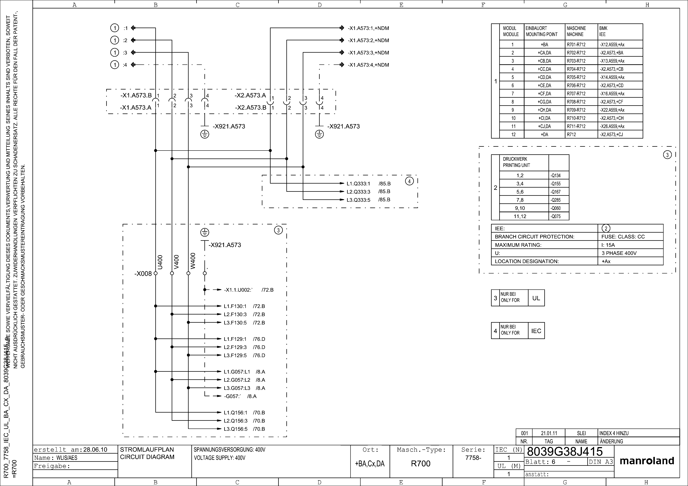

# +BA_Cx_DA — Sheet 6 of 247 — SPANNUNGSVERSORGUNG: 400V

**VOLTAGE SUPPLY: 400V**

> Part of the manroland **R700** printing press IEC/UL circuit diagrams.
> Drawing class: **Stromlaufplan / Circuit diagram** (DIN A3).
> Document `+BA_Cx_DA` covers the **Printing units / main switch cabinet** machine section.

## At a glance

| Field | Value |
|---|---|
| Document | `+BA_Cx_DA`  (8039G38J415) |
| Sheet | **6** of 247 |
| Section (DE) | SPANNUNGSVERSORGUNG: 400V |
| Section (EN) | VOLTAGE SUPPLY: 400V |
| Section type | POWER_SUPPLY — Voltage supply |
| Machine type | `R700` |
| Series | `7758` |
| Created | 28.06.10 |
| Replaces | — |
| Columns used | A, B, C, D, E, F, G, H |
| Path numbers | — |
| Labels on sheet | 175 |
| Cross-refs out | 17 |
| Cross-refs in | 33 |

**Previous:** [+BA_Cx_DA sheet 5](SHEET_0005.md) · **Next:** [+BA_Cx_DA sheet 7](SHEET_0007.md) · **Document TOC:** [_TOC.md](_TOC.md)  (+BA_Cx_DA) · **Master TOC:** [all sheets](../_MASTER_TOC.md)

## Sheet image (300 DPI, exact vector render)



_Rendered directly from the PDF vector layer at 300 DPI (1-bit), no OCR and no resampling. Use it to confirm anything ambiguous in the text below._

## Cross-references on this sheet

Each entry is a wire leaving this sheet. The printed token is `/sheet.column`; the link resolves to that sheet inside the same document.

| Ref | Target sheet | Col | Path | Destination on target | Target section | From col |
|---|---|---|---|---|---|---|
| `/85.B` | [+BA_Cx_DA sheet 85](SHEET_0085.md) | B | — | L1.Q333:1 | WASCHVORRICHTUNG | E |
| `/85.B` | [+BA_Cx_DA sheet 85](SHEET_0085.md) | B | — | L2.Q333:3 | WASCHVORRICHTUNG | E |
| `/85.B` | [+BA_Cx_DA sheet 85](SHEET_0085.md) | B | — | L3.Q333:5 | WASCHVORRICHTUNG | E |
| `/72.B` | [+BA_Cx_DA sheet 72](SHEET_0072.md) | B | — | X1.1.U002:` | FEUCHTWERK | C |
| `/72.B` | [+BA_Cx_DA sheet 72](SHEET_0072.md) | B | — | L1.F130:1 | FEUCHTWERK | C |
| `/72.B` | [+BA_Cx_DA sheet 72](SHEET_0072.md) | B | — | L2.F130:3 | FEUCHTWERK | C |
| `/72.B` | [+BA_Cx_DA sheet 72](SHEET_0072.md) | B | — | L3.F130:5 | FEUCHTWERK | C |
| `/76.D` | [+BA_Cx_DA sheet 76](SHEET_0076.md) | D | — | L1.F129:1 | FARBWERK | C |
| `/76.D` | [+BA_Cx_DA sheet 76](SHEET_0076.md) | D | — | L2.F129:3 | FARBWERK | C |
| `/76.D` | [+BA_Cx_DA sheet 76](SHEET_0076.md) | D | — | L3.F129:5 | FARBWERK | C |
| `/8.A` | [+BA_Cx_DA sheet 8](SHEET_0008.md) | A | — | L1.G057:L1 | SPANNUNGSVERSORGUNG, SCHALTSCHRANKBELÜFTUNG | C |
| `/8.A` | [+BA_Cx_DA sheet 8](SHEET_0008.md) | A | — | L2.G057:L2 | SPANNUNGSVERSORGUNG, SCHALTSCHRANKBELÜFTUNG | C |
| `/8.A` | [+BA_Cx_DA sheet 8](SHEET_0008.md) | A | — | L3.G057:L3 | SPANNUNGSVERSORGUNG, SCHALTSCHRANKBELÜFTUNG | C |
| `/8.A` | [+BA_Cx_DA sheet 8](SHEET_0008.md) | A | — | G057:` | SPANNUNGSVERSORGUNG, SCHALTSCHRANKBELÜFTUNG | C |
| `/70.B` | [+BA_Cx_DA sheet 70](SHEET_0070.md) | B | — | L1.Q156:1 | ÖLUMLAUFSCHMIERUNG | C |
| `/70.B` | [+BA_Cx_DA sheet 70](SHEET_0070.md) | B | — | L2.Q156:3 | ÖLUMLAUFSCHMIERUNG | C |
| `/70.B` | [+BA_Cx_DA sheet 70](SHEET_0070.md) | B | — | L3.Q156:5 | ÖLUMLAUFSCHMIERUNG | C |

### Incoming references (sheets that point here)

Every other sheet that sends a wire to this one. `Back-ref` is the token printed on *that* sheet; `Path` is its line number.

| From sheet | Cols | Back-ref | Path | Refs | What continues there |
|---|---|---|---|---|---|
| [+BA_Cx_DA#8](SHEET_0008.md) | A, B | `/8.A`, `/8.B` | — | 4 | G057:`; L1.G057:L1; L2.G057:L2; L3.G057:L3 L3.G059 |
| [+BA_Cx_DA#70](SHEET_0070.md) | B | `/70.B` | — | 3 | L1.Q156:1 L1.Q348:1; L2.Q156:3 L2.Q348:3; L3.Q156:5 L3.Q348:5 |
| [+BA_Cx_DA#72](SHEET_0072.md) | A | `/72.A` | — | 4 | L1.F130:1; L2.F130:3; L3.F130:5; X1.1.U002:` |
| [+BA_Cx_DA#76](SHEET_0076.md) | C | `/76.C` | — | 3 | L1.F129:1; L2.F129:3; L3.F129:5 |
| [+BA_Cx_DA#85](SHEET_0085.md) | A | `/85.A` | — | 3 | L1.Q333:1; L2.Q333:3; L3.Q333:5 |
| [+BA_Cx_DA#142](SHEET_0142.md) | A | `/142.A` | — | 8 | — |
| [+BA_Cx_DA#154](SHEET_0154.md) | A | `/154.A` | — | 8 | — |


## Devices on this sheet

| Tag | Class | Class meaning (IEC) | Col | Sub | Terminal | Sign |
|---|---|---|---|---|---|---|
| `U400` | U | Umrichter / frequency converter | B | — | — | — |
| `X008` | X | Klemme / terminal, plug connector | B | — | — | — |
| `V400` | V | Diode / semiconductor valve | B | — | — | — |
| `W400` | W | Kabel / cable, line, bus | B | — | — | — |
| `R712` | R | Widerstand / resistor | G | — | — | — |
| `Q134` | Q | Leistungsschalter / power switching device | G | — | — | — |
| `Q155` | Q | Leistungsschalter / power switching device | G | — | — | — |
| `Q167` | Q | Leistungsschalter / power switching device | G | — | — | — |
| `Q285` | Q | Leistungsschalter / power switching device | G | — | — | — |
| `Q060` | Q | Leistungsschalter / power switching device | G | — | — | — |
| `Q075` | Q | Leistungsschalter / power switching device | G | — | — | — |
| `X1.A573.B` | — | cross-device reference | B | — | — | — |
| `X1.A573.A` | — | cross-device reference | B | — | — | — |
| `X2.A573.B` | — | cross-device reference | C | — | — | — |
| `X2.A573.A` | — | cross-device reference | C | — | — | — |
| `NR.` | — | cross-device reference | G | — | — | — |
| `21.01.11` | — | cross-device reference | G | — | — | — |
| `X921.A573` | — | cross-device reference | C | — | — | — |
| `X921.A573` | — | cross-device reference | D | — | — | — |
| `X921.A573` | — | cross-device reference | C | — | — | — |

## Potentials / nets

| Potential | Count | Columns | Attached devices | Terminals |
|---|---|---|---|---|
| `L1` | 5 | C, D | `F129`, `F130`, `G057`, `Q156`, `Q333` | `1`, `L1` |
| `L2` | 5 | C, D | `F129`, `F130`, `G057`, `Q156`, `Q333` | `3`, `L2` |
| `L3` | 5 | C, D | `F129`, `F130`, `G057`, `Q156`, `Q333` | `5`, `L3` |


A potential such as `L24+/4` or `M24+` is a named supply/return rail; every place it appears on this sheet is electrically common.

## Wire-end annotations (grouped as printed)

A wire that continues elsewhere is annotated with a small cluster: the destination description, the path/line number `#NN`, and the `/sheet.column` cross reference. Each row below is one such cluster exactly as it is grouped on the drawing.

| Col | Y | Path | Cross-ref | Text on the wire |
|---|---|---|---|---|
| B | 44.9 | — | — | `:1` |
| E | 44.9 | — | — | `X1.A573:1,+NDM` |
| A | 45.1 | — | — | `1` |
| F | 46.0 | — | — | `MODUL MODULE` |
| G | 46.0 | — | — | `EINBAUORT MOUNTING POINT` |
| G | 46.0 | — | — | `MASCHINE MACHINE` |
| G | 46.0 | — | — | `BMK IEE` |
| B | 66.2 | — | — | `:2` |
| E | 66.2 | — | — | `X1.A573:2,+NDM` |
| A | 66.4 | — | — | `1` |
| F | 73.8 | — | — | `1` |
| G | 74.3 | — | — | `+BA` |
| G | 74.3 | — | — | `R701 R712` |
| H | 74.3 | — | — | `X12.A559,+Ax` |
| B | 87.4 | — | — | `:3` |
| E | 87.5 | — | — | `X1.A573:3,+NDM` |
| A | 87.7 | — | — | `1` |
| F | 88.3 | — | — | `2` |
| G | 88.5 | — | — | `+CA,DA` |
| G | 88.5 | — | — | `R702 R712` |
| H | 88.5 | — | — | `X2.A573,+BA` |
| F | 102.6 | — | — | `3` |
| G | 102.7 | — | — | `+CB,DA` |
| G | 102.7 | — | — | `R703 R712` |
| H | 102.7 | — | — | `X13.A559,+Ax` |
| B | 108.7 | — | — | `:4` |
| E | 108.7 | — | — | `X1.A573:4,+NDM` |
| A | 108.9 | — | — | `1` |
| F | 116.8 | — | — | `4` |
| H | 116.8 | — | — | `X2.A573,+CB` |
| G | 116.9 | — | — | `+CC,DA` |
| G | 116.9 | — | — | `R704 R712` |
| F | 130.9 | — | — | `5` |
| G | 131.0 | — | — | `+CD,DA` |
| G | 131.0 | — | — | `R705 R712` |
| H | 131.1 | — | — | `X14.A559,+Ax` |
| F | 136.3 | — | — | `1` |
| F | 145.1 | — | — | `6` |
| G | 145.2 | — | — | `+CE,DA` |
| G | 145.2 | — | — | `R706 R712` |
| H | 145.2 | — | — | `X2.A573,+CD` |
| F | 159.3 | — | — | `7` |
| G | 159.4 | — | — | `+CF,DA` |
| G | 159.4 | — | — | `R707 R712` |
| H | 159.4 | — | — | `X16.A559,+Ax` |
| B | 160.5 | — | — | `X1.A573.B 1 2 3 4` |
| D | 160.5 | — | — | `X2.A573.A 1 2 3 4` |
| F | 173.5 | — | — | `8` |
| G | 173.6 | — | — | `+CG,DA` |
| G | 173.6 | — | — | `R708 R712` |
| H | 173.6 | — | — | `X2.A573,+CF` |
| C | 178.9 | — | — | `X1.A573.A 1 2 3 4 X2.A573.B 1 2 3 4` |
| F | 187.6 | — | — | `9` |
| G | 187.7 | — | — | `+CH,DA` |
| G | 187.7 | — | — | `R709 R712` |
| H | 187.7 | — | — | `X22.A559,+Ax` |
| F | 201.8 | — | — | `10` |
| G | 201.9 | — | — | `+CI,DA` |
| G | 201.9 | — | — | `R710 R712` |
| H | 201.9 | — | — | `X2.A573,+CH` |
| D | 214.3 | — | — | `X921.A573 X921.A573` |
| F | 215.8 | — | — | `11` |
| G | 216.1 | — | — | `+CJ,DA` |
| G | 216.1 | — | — | `R711 R712` |
| H | 216.1 | — | — | `X26.A559,+Ax` |
| F | 230.1 | — | — | `12` |
| G | 230.2 | — | — | `+DA` |
| G | 230.2 | — | — | `R712` |
| H | 230.2 | — | — | `X2.A573,+CJ` |
| H | 265.3 | — | — | `3` |
| F | 272.7 | — | — | `DRUCKWERK PRINTING UNIT` |
| G | 300.1 | — | — | `1,2 Q134` |
| E | 311.0 | — | — | `4` |
| E | 314.2 | — | `/85.B` | `L1.Q333:1` |
| G | 314.2 | — | — | `3,4 Q155` |
| F | 320.6 | — | — | `2` |
| E | 327.6 | — | `/85.B` | `L2.Q333:3` |
| G | 328.4 | — | — | `5,6 Q167` |
| E | 341.8 | — | `/85.B` | `L3.Q333:5` |
| G | 342.6 | — | — | `7,8 Q285` |
| G | 356.8 | — | — | `9,10 Q060` |
| G | 370.9 | — | — | `11,12 Q075` |
| E | 392.1 | — | — | `3 IEE:` |
| G | 392.9 | — | — | `2` |
| H | 406.3 | — | — | `FUSE: CLASS: CC` |
| G | 406.4 | — | — | `BRANCH CIRCUIT PROTECTION:` |
| C | 419.8 | — | — | `X921.A573` |
| F | 420.5 | — | — | `MAXIMUM RATING:` |
| H | 420.5 | — | — | `I: 15A` |
| F | 434.7 | — | — | `U:` |
| H | 434.7 | — | — | `3 PHASE 400V` |
| B | 437.7 | — | — | `W400` |
| B | 441.4 | — | — | `V400` |
| B | 441.6 | — | — | `U400` |
| G | 448.9 | — | — | `LOCATION DESIGNATION:` |
| G | 448.9 | — | — | `+Ax` |
| C | 463.2 | — | — | `'` |
| B | 469.2 | — | — | `X008` |
| C | 498.4 | — | `/72.B` | `X1.1.U002:'` |
| F | 506.6 | — | — | `3 NUR BEI` |
| F | 511.9 | — | — | `ONLY FOR UL` |
| C | 526.8 | — | `/72.B` | `L1.F130:1` |
| C | 541.0 | — | `/72.B` | `L2.F130:3` |
| C | 555.1 | — | `/72.B` | `L3.F130:5` |
| F | 563.3 | — | — | `4 NUR BEI` |
| F | 568.8 | — | — | `ONLY FOR IEC` |
| C | 583.5 | — | `/76.D` | `L1.F129:1` |
| C | 597.7 | — | `/76.D` | `L2.F129:3` |
| C | 611.9 | — | `/76.D` | `L3.F129:5` |
| C | 640.1 | — | `/8.A` | `L1.G057:L1` |
| C | 654.3 | — | `/8.A` | `L2.G057:L2` |
| C | 668.5 | — | `/8.A` | `L3.G057:L3` |
| C | 682.7 | — | `/8.A` | `G057:'` |
| C | 711.0 | — | `/70.B` | `L1.Q156:1` |
| C | 725.2 | — | `/70.B` | `L2.Q156:3` |
| C | 739.4 | — | `/70.B` | `L3.Q156:5` |
| G | 747.2 | — | — | `001 21.01.11 SLEI INDEX 4 HINZU` |
| G | 761.3 | — | — | `NR. TAG NAME ÄNDERUNG` |


## Reconstructed tables

This sheet carries tabular content (pin map / terminal assignment / index). The grid below was rebuilt from the drawing's own rule lines, so each row is exactly one physical row of the table.

### Table 1 — 1 data rows × 3 columns (at x=269.3, y=69.4)

| 1 1 | 2 2 | 3 3 |
|---|---|---|
| `U400` | `V400` | `W400` |


## Notes and free text on this sheet

| Text | Col | Y (pt) |
|---|---|---|
| `X1.A573:1,+NDM` | E | 44.94 |
| `X1.A573:2,+NDM` | E | 66.2 |
| `X1.A573:3,+NDM` | E | 87.46 |
| `X1.A573:4,+NDM` | E | 108.72 |
| `G057:'` | C | 682.75 |
| `X1.1.U002:'` | C | 498.48 |
| `TAG` | G | 761.44 |
| `NAME` | G | 761.42 |
| `ÄNDERUNG` | H | 761.48 |
| `SLEI` | G | 747.27 |
| `INDEX 4 HINZU` | H | 747.3 |
| `MODUL` | F | 46.01 |
| `MODULE` | F | 56.63 |
| `EINBAUORT` | G | 45.97 |
| `MOUNTING POINT` | G | 56.63 |
| `+BA` | G | 74.3 |
| `+CA,DA` | G | 88.5 |
| `+CB,DA` | G | 102.67 |
| `+CC,DA` | G | 116.86 |
| `+CD,DA` | G | 131.04 |
| `+CE,DA` | G | 145.19 |
| `+CF,DA` | G | 159.37 |
| `+CG,DA` | G | 173.55 |
| `+CH,DA` | G | 187.73 |
| `+CI,DA` | G | 201.88 |
| `+CJ,DA` | G | 216.05 |
| `+DA` | G | 230.24 |
| `MASCHINE` | G | 45.98 |
| `MACHINE` | G | 56.61 |
| `BMK` | G | 45.95 |
| `IEE` | G | 56.45 |
| `R701 R712` | G | 74.35 |
| `R702 R712` | G | 88.52 |
| `R703 R712` | G | 102.7 |
| `R704 R712` | G | 116.87 |
| `R705 R712` | G | 131.04 |
| `R706 R712` | G | 145.22 |
| `R707 R712` | G | 159.39 |
| `R708 R712` | G | 173.56 |
| `R709 R712` | G | 187.74 |
| `R710 R712` | G | 201.91 |
| `R711 R712` | G | 216.08 |
| `X12.A559,+Ax` | H | 74.35 |
| `X2.A573,+BA` | H | 88.5 |
| `X13.A559,+Ax` | H | 102.7 |
| `X2.A573,+CB` | H | 116.85 |
| `X14.A559,+Ax` | H | 131.05 |
| `X2.A573,+CD` | H | 145.21 |
| `X16.A559,+Ax` | H | 159.39 |
| `X2.A573,+CF` | H | 173.55 |
| `X22.A559,+Ax` | H | 187.74 |
| `X2.A573,+CH` | H | 201.89 |
| `X26.A559,+Ax` | H | 216.09 |
| `X2.A573,+CJ` | H | 230.22 |
| `DRUCKWERK` | F | 272.72 |
| `PRINTING UNIT` | F | 283.38 |
| `IEE:` | F | 392.09 |
| `BRANCH CIRCUIT PROTECTION:` | G | 406.35 |
| `MAXIMUM RATING:` | F | 420.53 |
| `U:` | F | 434.69 |
| `LOCATION DESIGNATION:` | G | 448.85 |
| `FUSE: CLASS: CC` | H | 406.32 |
| `I: 15A` | H | 420.47 |
| `3 PHASE 400V` | H | 434.67 |
| `+Ax` | G | 448.94 |
| `NUR BEI` | F | 506.56 |
| `ONLY FOR` | F | 517.25 |
| `UL` | G | 511.95 |
| `IEC` | G | 568.75 |

## Complete label inventory (exact text from the drawing)

Every text object inside the drawing area of this sheet, in DIN reading order (column A→H, then top→bottom). This is the authoritative list: if a string is not here it is not printed on this sheet.

| Col | Y | X | Dir | Type | Text |
|---|---|---|---|---|---|
| A | 45.1 | 196.7 | → | number | `1` |
| A | 66.4 | 196.7 | → | number | `1` |
| A | 87.7 | 196.7 | → | number | `1` |
| A | 108.9 | 196.7 | → | number | `1` |
| B | 44.9 | 214.0 | → | other | `:1` |
| B | 66.2 | 212.9 | → | other | `:2` |
| B | 87.4 | 212.6 | → | other | `:3` |
| B | 108.7 | 212.6 | → | other | `:4` |
| B | 160.5 | 208.6 | → | device ref | `X1.A573.B` |
| B | 161.9 | 271.3 | → | number | `1` |
| B | 161.9 | 300.2 | → | number | `2` |
| B | 161.9 | 328.5 | → | number | `3` |
| B | 178.9 | 271.3 | → | number | `1` |
| B | 178.9 | 300.2 | → | number | `2` |
| B | 178.9 | 328.5 | → | number | `3` |
| B | 181.7 | 207.8 | → | device ref | `X1.A573.A` |
| B | 437.7 | 329.0 | ↕ | device tag | `W400` |
| B | 441.4 | 300.8 | ↕ | device tag | `V400` |
| B | 441.6 | 272.4 | ↕ | device tag | `U400` |
| B | 469.2 | 232.7 | → | device tag | `X008` |
| C | 160.5 | 406.2 | → | device ref | `X2.A573.A` |
| C | 161.9 | 356.9 | → | number | `4` |
| C | 166.2 | 469.7 | → | number | `1` |
| C | 178.9 | 356.9 | → | number | `4` |
| C | 181.7 | 407.1 | → | device ref | `X2.A573.B` |
| C | 183.2 | 469.7 | → | number | `1` |
| C | 214.3 | 368.2 | → | device ref | `X921.A573` |
| C | 396.0 | 479.9 | → | number | `3` |
| C | 419.8 | 361.1 | → | device ref | `X921.A573` |
| C | 463.2 | 357.6 | ↕ | other | `'` |
| C | 498.4 | 452.8 | → | cross-reference | `/72.B` |
| C | 498.5 | 388.1 | → | text | `X1.1.U002:'` |
| C | 526.8 | 387.5 | → | potential | `L1.F130:1` |
| C | 526.8 | 438.0 | → | cross-reference | `/72.B` |
| C | 541.0 | 387.5 | → | potential | `L2.F130:3` |
| C | 541.0 | 438.0 | → | cross-reference | `/72.B` |
| C | 555.1 | 438.0 | → | cross-reference | `/72.B` |
| C | 555.2 | 387.5 | → | potential | `L3.F130:5` |
| C | 583.5 | 387.5 | → | potential | `L1.F129:1` |
| C | 583.5 | 438.0 | → | cross-reference | `/76.D` |
| C | 597.7 | 387.5 | → | potential | `L2.F129:3` |
| C | 597.7 | 438.0 | → | cross-reference | `/76.D` |
| C | 611.9 | 387.5 | → | potential | `L3.F129:5` |
| C | 611.9 | 438.0 | → | cross-reference | `/76.D` |
| C | 640.1 | 442.9 | → | cross-reference | `/8.A` |
| C | 640.2 | 387.5 | → | potential | `L1.G057:L1` |
| C | 654.3 | 442.9 | → | cross-reference | `/8.A` |
| C | 654.4 | 387.5 | → | potential | `L2.G057:L2` |
| C | 668.5 | 442.9 | → | cross-reference | `/8.A` |
| C | 668.6 | 387.5 | → | potential | `L3.G057:L3` |
| C | 682.7 | 428.0 | → | cross-reference | `/8.A` |
| C | 682.8 | 388.1 | → | text | `G057:'` |
| C | 711.0 | 438.0 | → | cross-reference | `/70.B` |
| C | 711.1 | 387.5 | → | potential | `L1.Q156:1` |
| C | 725.2 | 438.0 | → | cross-reference | `/70.B` |
| C | 725.3 | 387.5 | → | potential | `L2.Q156:3` |
| C | 739.4 | 387.5 | → | potential | `L3.Q156:5` |
| C | 739.4 | 438.0 | → | cross-reference | `/70.B` |
| D | 166.2 | 498.6 | → | number | `2` |
| D | 166.2 | 527.0 | → | number | `3` |
| D | 166.2 | 555.3 | → | number | `4` |
| D | 183.2 | 498.6 | → | number | `2` |
| D | 183.2 | 527.0 | → | number | `3` |
| D | 183.2 | 555.3 | → | number | `4` |
| D | 214.3 | 566.6 | → | device ref | `X921.A573` |
| D | 314.2 | 600.1 | → | potential | `L1.Q333:1` |
| D | 328.4 | 600.1 | → | potential | `L2.Q333:3` |
| D | 342.6 | 600.1 | → | potential | `L3.Q333:5` |
| E | 44.9 | 602.1 | → | text | `X1.A573:1,+NDM` |
| E | 66.2 | 602.1 | → | text | `X1.A573:2,+NDM` |
| E | 87.5 | 602.1 | → | text | `X1.A573:3,+NDM` |
| E | 108.7 | 602.1 | → | text | `X1.A573:4,+NDM` |
| E | 311.0 | 706.7 | → | number | `4` |
| E | 314.2 | 655.5 | → | cross-reference | `/85.B` |
| E | 327.7 | 654.8 | → | cross-reference | `/85.B` |
| E | 341.8 | 654.8 | → | cross-reference | `/85.B` |
| F | 46.0 | 871.1 | → | text | `MODUL` |
| F | 56.6 | 871.1 | → | text | `MODULE` |
| F | 73.8 | 885.0 | → | number | `1` |
| F | 88.4 | 885.5 | → | number | `2` |
| F | 102.6 | 885.5 | → | number | `3` |
| F | 116.8 | 885.5 | → | number | `4` |
| F | 130.9 | 885.5 | → | number | `5` |
| F | 136.3 | 854.9 | → | number | `1` |
| F | 145.1 | 885.5 | → | number | `6` |
| F | 159.3 | 885.5 | → | number | `7` |
| F | 173.5 | 885.5 | → | number | `8` |
| F | 187.6 | 885.5 | → | number | `9` |
| F | 201.8 | 885.0 | → | number | `10` |
| F | 215.8 | 885.0 | → | number | `11` |
| F | 230.1 | 885.0 | → | number | `12` |
| F | 272.7 | 870.8 | → | text | `DRUCKWERK` |
| F | 283.4 | 870.8 | → | text | `PRINTING UNIT` |
| F | 300.0 | 893.8 | → | number | `1,2` |
| F | 314.2 | 893.9 | → | number | `3,4` |
| F | 320.6 | 854.6 | → | number | `2` |
| F | 328.4 | 893.9 | → | number | `5,6` |
| F | 342.6 | 893.9 | → | number | `7,8` |
| F | 356.8 | 891.5 | → | number | `9,10` |
| F | 370.9 | 888.9 | → | number | `11,12` |
| F | 392.1 | 856.6 | → | text | `IEE:` |
| F | 420.5 | 856.9 | → | text | `MAXIMUM RATING:` |
| F | 434.7 | 856.6 | → | text | `U:` |
| F | 506.6 | 866.6 | → | text | `NUR BEI` |
| F | 511.9 | 854.5 | → | number | `3` |
| F | 517.3 | 867.1 | → | text | `ONLY FOR` |
| F | 563.3 | 866.6 | → | text | `NUR BEI` |
| F | 568.6 | 854.6 | → | number | `4` |
| F | 573.9 | 867.1 | → | text | `ONLY FOR` |
| G | 46.0 | 909.8 | → | text | `EINBAUORT` |
| G | 46.0 | 980.9 | → | text | `MASCHINE` |
| G | 46.0 | 1037.3 | → | text | `BMK` |
| G | 56.5 | 1037.3 | → | text | `IEE` |
| G | 56.6 | 910.1 | → | text | `MOUNTING POINT` |
| G | 56.6 | 980.9 | → | text | `MACHINE` |
| G | 74.3 | 936.3 | → | text | `+BA` |
| G | 74.3 | 981.4 | → | text | `R701 R712` |
| G | 88.5 | 931.0 | → | text | `+CA,DA` |
| G | 88.5 | 981.4 | → | text | `R702 R712` |
| G | 102.7 | 931.0 | → | text | `+CB,DA` |
| G | 102.7 | 981.4 | → | text | `R703 R712` |
| G | 116.9 | 930.9 | → | text | `+CC,DA` |
| G | 116.9 | 981.4 | → | text | `R704 R712` |
| G | 131.0 | 930.9 | → | text | `+CD,DA` |
| G | 131.0 | 981.4 | → | text | `R705 R712` |
| G | 145.2 | 931.0 | → | text | `+CE,DA` |
| G | 145.2 | 981.4 | → | text | `R706 R712` |
| G | 159.4 | 931.2 | → | text | `+CF,DA` |
| G | 159.4 | 981.4 | → | text | `R707 R712` |
| G | 173.6 | 930.7 | → | text | `+CG,DA` |
| G | 173.6 | 981.4 | → | text | `R708 R712` |
| G | 187.7 | 930.9 | → | text | `+CH,DA` |
| G | 187.7 | 981.4 | → | text | `R709 R712` |
| G | 201.9 | 932.2 | → | text | `+CI,DA` |
| G | 201.9 | 981.4 | → | text | `R710 R712` |
| G | 216.1 | 931.5 | → | text | `+CJ,DA` |
| G | 216.1 | 981.4 | → | text | `R711 R712` |
| G | 230.2 | 936.2 | → | text | `+DA` |
| G | 230.2 | 981.4 | → | device tag | `R712` |
| G | 301.1 | 952.9 | → | device tag | `Q134` |
| G | 315.3 | 952.9 | → | device tag | `Q155` |
| G | 329.5 | 952.9 | → | device tag | `Q167` |
| G | 343.6 | 952.9 | → | device tag | `Q285` |
| G | 357.8 | 952.9 | → | device tag | `Q060` |
| G | 372.0 | 952.9 | → | device tag | `Q075` |
| G | 392.9 | 1046.8 | → | number | `2` |
| G | 406.3 | 856.6 | → | text | `BRANCH CIRCUIT PROTECTION:` |
| G | 448.9 | 856.6 | → | text | `LOCATION DESIGNATION:` |
| G | 448.9 | 1041.4 | → | text | `+Ax` |
| G | 511.9 | 921.3 | → | text | `UL` |
| G | 568.7 | 919.6 | → | text | `IEC` |
| G | 747.2 | 901.9 | → | number | `001` |
| G | 747.3 | 936.6 | → | device ref | `21.01.11` |
| G | 747.3 | 998.8 | → | text | `SLEI` |
| G | 761.3 | 900.9 | → | device ref | `NR.` |
| G | 761.4 | 942.5 | → | text | `TAG` |
| G | 761.4 | 995.9 | → | text | `NAME` |
| H | 74.4 | 1038.6 | → | text | `X12.A559,+Ax` |
| H | 88.5 | 1038.6 | → | text | `X2.A573,+BA` |
| H | 102.7 | 1038.6 | → | text | `X13.A559,+Ax` |
| H | 116.8 | 1038.6 | → | text | `X2.A573,+CB` |
| H | 131.0 | 1038.6 | → | text | `X14.A559,+Ax` |
| H | 145.2 | 1038.6 | → | text | `X2.A573,+CD` |
| H | 159.4 | 1038.6 | → | text | `X16.A559,+Ax` |
| H | 173.5 | 1038.6 | → | text | `X2.A573,+CF` |
| H | 187.7 | 1038.6 | → | text | `X22.A559,+Ax` |
| H | 201.9 | 1038.6 | → | text | `X2.A573,+CH` |
| H | 216.1 | 1038.6 | → | text | `X26.A559,+Ax` |
| H | 230.2 | 1038.6 | → | text | `X2.A573,+CJ` |
| H | 265.3 | 1153.1 | → | number | `3` |
| H | 406.3 | 1040.9 | → | text | `FUSE: CLASS: CC` |
| H | 420.5 | 1040.9 | → | text | `I: 15A` |
| H | 434.7 | 1041.4 | → | text | `3 PHASE 400V` |
| H | 747.3 | 1037.3 | → | text | `INDEX 4 HINZU` |
| H | 761.5 | 1038.5 | → | text | `ÄNDERUNG` |

## Reading-order text block

The same content as a plain block, grouped by DIN column — convenient to paste or to match against a visual description.

```text
=== Column A ===
  45.1  196.7  numeric      1
  66.4  196.7  numeric      1
  87.7  196.7  numeric      1
 108.9  196.7  numeric      1
=== Column B ===
  44.9  214.0  other        :1
  66.2  212.9  other        :2
  87.4  212.6  other        :3
 108.7  212.6  other        :4
 160.5  208.6  devref       X1.A573.B
 161.9  271.3  numeric      1
 161.9  300.2  numeric      2
 161.9  328.5  numeric      3
 178.9  271.3  numeric      1
 178.9  300.2  numeric      2
 178.9  328.5  numeric      3
 181.7  207.8  devref       X1.A573.A
 437.7  329.0  devtag       W400
 441.4  300.8  devtag       V400
 441.6  272.4  devtag       U400
 469.2  232.7  devtag       X008
=== Column C ===
 160.5  406.2  devref       X2.A573.A
 161.9  356.9  numeric      4
 166.2  469.7  numeric      1
 178.9  356.9  numeric      4
 181.7  407.1  devref       X2.A573.B
 183.2  469.7  numeric      1
 214.3  368.2  devref       X921.A573
 396.0  479.9  numeric      3
 419.8  361.1  devref       X921.A573
 463.2  357.6  other        `
 498.4  452.8  xref         /72.B
 498.5  388.1  text         X1.1.U002:`
 526.8  387.5  net          L1.F130:1
 526.8  438.0  xref         /72.B
 541.0  387.5  net          L2.F130:3
 541.0  438.0  xref         /72.B
 555.1  438.0  xref         /72.B
 555.2  387.5  net          L3.F130:5
 583.5  387.5  net          L1.F129:1
 583.5  438.0  xref         /76.D
 597.7  387.5  net          L2.F129:3
 597.7  438.0  xref         /76.D
 611.9  387.5  net          L3.F129:5
 611.9  438.0  xref         /76.D
 640.1  442.9  xref         /8.A
 640.2  387.5  net          L1.G057:L1
 654.3  442.9  xref         /8.A
 654.4  387.5  net          L2.G057:L2
 668.5  442.9  xref         /8.A
 668.6  387.5  net          L3.G057:L3
 682.7  428.0  xref         /8.A
 682.8  388.1  text         G057:`
 711.0  438.0  xref         /70.B
 711.1  387.5  net          L1.Q156:1
 725.2  438.0  xref         /70.B
 725.3  387.5  net          L2.Q156:3
 739.4  387.5  net          L3.Q156:5
 739.4  438.0  xref         /70.B
=== Column D ===
 166.2  498.6  numeric      2
 166.2  527.0  numeric      3
 166.2  555.3  numeric      4
 183.2  498.6  numeric      2
 183.2  527.0  numeric      3
 183.2  555.3  numeric      4
 214.3  566.6  devref       X921.A573
 314.2  600.1  net          L1.Q333:1
 328.4  600.1  net          L2.Q333:3
 342.6  600.1  net          L3.Q333:5
=== Column E ===
  44.9  602.1  text         X1.A573:1,+NDM
  66.2  602.1  text         X1.A573:2,+NDM
  87.5  602.1  text         X1.A573:3,+NDM
 108.7  602.1  text         X1.A573:4,+NDM
 311.0  706.7  numeric      4
 314.2  655.5  xref         /85.B
 327.7  654.8  xref         /85.B
 341.8  654.8  xref         /85.B
=== Column F ===
  46.0  871.1  text         MODUL
  56.6  871.1  text         MODULE
  73.8  885.0  numeric      1
  88.4  885.5  numeric      2
 102.6  885.5  numeric      3
 116.8  885.5  numeric      4
 130.9  885.5  numeric      5
 136.3  854.9  numeric      1
 145.1  885.5  numeric      6
 159.3  885.5  numeric      7
 173.5  885.5  numeric      8
 187.6  885.5  numeric      9
 201.8  885.0  numeric      10
 215.8  885.0  numeric      11
 230.1  885.0  numeric      12
 272.7  870.8  text         DRUCKWERK
 283.4  870.8  text         PRINTING UNIT
 300.0  893.8  numeric      1,2
 314.2  893.9  numeric      3,4
 320.6  854.6  numeric      2
 328.4  893.9  numeric      5,6
 342.6  893.9  numeric      7,8
 356.8  891.5  numeric      9,10
 370.9  888.9  numeric      11,12
 392.1  856.6  text         IEE:
 420.5  856.9  text         MAXIMUM RATING:
 434.7  856.6  text         U:
 506.6  866.6  text         NUR BEI
 511.9  854.5  numeric      3
 517.3  867.1  text         ONLY FOR
 563.3  866.6  text         NUR BEI
 568.6  854.6  numeric      4
 573.9  867.1  text         ONLY FOR
=== Column G ===
  46.0  909.8  text         EINBAUORT
  46.0  980.9  text         MASCHINE
  46.0 1037.3  text         BMK
  56.5 1037.3  text         IEE
  56.6  910.1  text         MOUNTING POINT
  56.6  980.9  text         MACHINE
  74.3  936.3  text         +BA
  74.3  981.4  text         R701 R712
  88.5  931.0  text         +CA,DA
  88.5  981.4  text         R702 R712
 102.7  931.0  text         +CB,DA
 102.7  981.4  text         R703 R712
 116.9  930.9  text         +CC,DA
 116.9  981.4  text         R704 R712
 131.0  930.9  text         +CD,DA
 131.0  981.4  text         R705 R712
 145.2  931.0  text         +CE,DA
 145.2  981.4  text         R706 R712
 159.4  931.2  text         +CF,DA
 159.4  981.4  text         R707 R712
 173.6  930.7  text         +CG,DA
 173.6  981.4  text         R708 R712
 187.7  930.9  text         +CH,DA
 187.7  981.4  text         R709 R712
 201.9  932.2  text         +CI,DA
 201.9  981.4  text         R710 R712
 216.1  931.5  text         +CJ,DA
 216.1  981.4  text         R711 R712
 230.2  936.2  text         +DA
 230.2  981.4  devtag       R712
 301.1  952.9  devtag       Q134
 315.3  952.9  devtag       Q155
 329.5  952.9  devtag       Q167
 343.6  952.9  devtag       Q285
 357.8  952.9  devtag       Q060
 372.0  952.9  devtag       Q075
 392.9 1046.8  numeric      2
 406.3  856.6  text         BRANCH CIRCUIT PROTECTION:
 448.9  856.6  text         LOCATION DESIGNATION:
 448.9 1041.4  text         +Ax
 511.9  921.3  text         UL
 568.7  919.6  text         IEC
 747.2  901.9  numeric      001
 747.3  936.6  devref       21.01.11
 747.3  998.8  text         SLEI
 761.3  900.9  devref       NR.
 761.4  942.5  text         TAG
 761.4  995.9  text         NAME
=== Column H ===
  74.4 1038.6  text         X12.A559,+Ax
  88.5 1038.6  text         X2.A573,+BA
 102.7 1038.6  text         X13.A559,+Ax
 116.8 1038.6  text         X2.A573,+CB
 131.0 1038.6  text         X14.A559,+Ax
 145.2 1038.6  text         X2.A573,+CD
 159.4 1038.6  text         X16.A559,+Ax
 173.5 1038.6  text         X2.A573,+CF
 187.7 1038.6  text         X22.A559,+Ax
 201.9 1038.6  text         X2.A573,+CH
 216.1 1038.6  text         X26.A559,+Ax
 230.2 1038.6  text         X2.A573,+CJ
 265.3 1153.1  numeric      3
 406.3 1040.9  text         FUSE: CLASS: CC
 420.5 1040.9  text         I: 15A
 434.7 1041.4  text         3 PHASE 400V
 747.3 1037.3  text         INDEX 4 HINZU
 761.5 1038.5  text         ÄNDERUNG
```

---
_Generated from the PDF vector text layer; no OCR. Source: `R700_7758_IEC_UL_BA_CX_DA_8039G38J415_p`, sheet 6._
