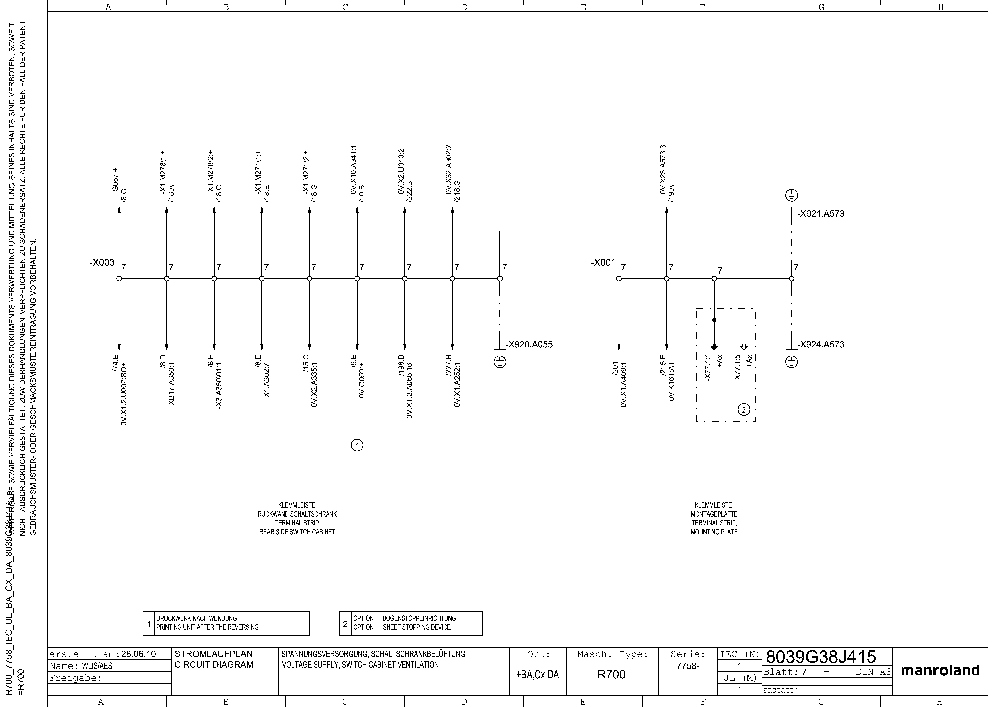

# +BA_Cx_DA — Sheet 7 of 247 — SPANNUNGSVERSORGUNG, SCHALTSCHRANKBELÜFTUNG

**VOLTAGE SUPPLY, SWITCH CABINET VENTILATION**

> Part of the manroland **R700** printing press IEC/UL circuit diagrams.
> Drawing class: **Stromlaufplan / Circuit diagram** (DIN A3).
> Document `+BA_Cx_DA` covers the **Printing units / main switch cabinet** machine section.

## At a glance

| Field | Value |
|---|---|
| Document | `+BA_Cx_DA`  (8039G38J415) |
| Sheet | **7** of 247 |
| Section (DE) | SPANNUNGSVERSORGUNG, SCHALTSCHRANKBELÜFTUNG |
| Section (EN) | VOLTAGE SUPPLY, SWITCH CABINET VENTILATION |
| Section type | POWER_SUPPLY — Voltage supply |
| Machine type | `R700` |
| Series | `7758` |
| Created | 28.06.10 |
| Replaces | — |
| Columns used | A, B, C, D, E, F, G |
| Path numbers | — |
| Labels on sheet | 78 |
| Cross-refs out | 19 |
| Cross-refs in | 19 |

**Previous:** [+BA_Cx_DA sheet 6](SHEET_0006.md) · **Next:** [+BA_Cx_DA sheet 8](SHEET_0008.md) · **Document TOC:** [_TOC.md](_TOC.md)  (+BA_Cx_DA) · **Master TOC:** [all sheets](../_MASTER_TOC.md)

## Sheet image (300 DPI, exact vector render)



_Rendered directly from the PDF vector layer at 300 DPI (1-bit), no OCR and no resampling. Use it to confirm anything ambiguous in the text below._

## Cross-references on this sheet

Each entry is a wire leaving this sheet. The printed token is `/sheet.column`; the link resolves to that sheet inside the same document.

| Ref | Target sheet | Col | Path | Destination on target | Target section | From col |
|---|---|---|---|---|---|---|
| `/10.B` | [+BA_Cx_DA sheet 10](SHEET_0010.md) | B | — | 0V.X10.A341:1 | SPANNUNGSVERSORGUNG, SCHALTSCHRANKBELÜFTUNG | C |
| `/218.G` | [+BA_Cx_DA sheet 218](SHEET_0218.md) | G | — | 0V.X32.A302:2 | OPTION: TELEPRESENCE | D |
| `/19.A` | [+BA_Cx_DA sheet 19](SHEET_0019.md) | A | — | 0V.X23.A573:3 | SPANNUNGSVERSORGUNG: MAGNETVENTILBLOCK | F |
| `/222.B` | [+BA_Cx_DA sheet 222](SHEET_0222.md) | B | — | 0V.X2.U043:2 | OPTION: INLINEOBSERVER | D |
| `/18.A` | [+BA_Cx_DA sheet 18](SHEET_0018.md) | A | — | X1.M278\1:+ | SPANNUNGSVERSORGUNG, SCHALTSCHRANKBELÜFTUNG | B |
| `/18.C` | [+BA_Cx_DA sheet 18](SHEET_0018.md) | C | — | X1.M278\2:+ | SPANNUNGSVERSORGUNG, SCHALTSCHRANKBELÜFTUNG | B |
| `/18.E` | [+BA_Cx_DA sheet 18](SHEET_0018.md) | E | — | X1.M271\1:+ | SPANNUNGSVERSORGUNG, SCHALTSCHRANKBELÜFTUNG | B |
| `/18.G` | [+BA_Cx_DA sheet 18](SHEET_0018.md) | G | — | X1.M271\2:+ | SPANNUNGSVERSORGUNG, SCHALTSCHRANKBELÜFTUNG | C |
| `/8.C` | [+BA_Cx_DA sheet 8](SHEET_0008.md) | C | — | G057:+ | SPANNUNGSVERSORGUNG, SCHALTSCHRANKBELÜFTUNG | A |
| `/74.E` | [+BA_Cx_DA sheet 74](SHEET_0074.md) | E | — | — | FEUCHTWERK | A |
| `/8.E` | [+BA_Cx_DA sheet 8](SHEET_0008.md) | E | — | — | SPANNUNGSVERSORGUNG, SCHALTSCHRANKBELÜFTUNG | B |
| `/9.E` | [+BA_Cx_DA sheet 9](SHEET_0009.md) | E | — | — | SPANNUNGSVERSORGUNG, SCHALTSCHRANKBELÜFTUNG | C |
| `/215.E` | [+BA_Cx_DA sheet 215](SHEET_0215.md) | E | — | — | OPTION: BLASEINRICHTUNG, FARBWERK | F |
| `/8.D` | [+BA_Cx_DA sheet 8](SHEET_0008.md) | D | — | — | SPANNUNGSVERSORGUNG, SCHALTSCHRANKBELÜFTUNG | A |
| `/8.F` | [+BA_Cx_DA sheet 8](SHEET_0008.md) | F | — | — | SPANNUNGSVERSORGUNG, SCHALTSCHRANKBELÜFTUNG | B |
| `/15.C` | [+BA_Cx_DA sheet 15](SHEET_0015.md) | C | — | — | SPANNUNGSVERSORGUNG, SCHALTSCHRANKBELÜFTUNG | C |
| `/198.B` | [+BA_Cx_DA sheet 198](SHEET_0198.md) | B | — | — | OPTION: WASCHVORRICHTUNG MIT BÜRSTE | C |
| `/227.B` | [+BA_Cx_DA sheet 227](SHEET_0227.md) | B | — | — | OPTION: WASCHMITTELWECHSELBETRIEB | D |
| `/201.F` | [+BA_Cx_DA sheet 201](SHEET_0201.md) | F | — | — | OPTION: | E |

### Incoming references (sheets that point here)

Every other sheet that sends a wire to this one. `Back-ref` is the token printed on *that* sheet; `Path` is its line number.

| From sheet | Cols | Back-ref | Path | Refs | What continues there |
|---|---|---|---|---|---|
| [+BA_Cx_DA#8](SHEET_0008.md) | B, D, E, F | `/8.B`, `/8.D`, `/8.E`, `/8.F` | — | 4 | G057:+; X1.A302:7; X3.A350\01:1; XB17.A350:1 |
| [+BA_Cx_DA#9](SHEET_0009.md) | E | `/9.E` | — | 1 | 0V.G059:+ |
| [+BA_Cx_DA#10](SHEET_0010.md) | A | `/10.A` | — | 1 | 0V.X10.A341:1 |
| [+BA_Cx_DA#15](SHEET_0015.md) | B | `/15.B` | — | 1 | 0V.X2.A335:1 |
| [+BA_Cx_DA#18](SHEET_0018.md) | A, C, F | `/18.A`, `/18.C`, `/18.F` | — | 4 | X1.M271\1:+ X1.M271\2:+; X1.M278\1:+; X1.M278\2:+ |
| [+BA_Cx_DA#19](SHEET_0019.md) | A | `/19.A` | — | 1 | 0V.X23.A573:3 |
| [+BA_Cx_DA#74](SHEET_0074.md) | D | `/74.D` | — | 1 | 0V.X1.2.U002:SO+ |
| [+BA_Cx_DA#198](SHEET_0198.md) | B | `/198.B` | — | 1 | 2 0V.X1.3.A066:16 |
| [+BA_Cx_DA#201](SHEET_0201.md) | E | `/201.E` | — | 1 | 0V.X1.A409:1 |
| [+BA_Cx_DA#215](SHEET_0215.md) | E | `/215.E` | — | 1 | 0V.K161:A1 |
| [+BA_Cx_DA#218](SHEET_0218.md) | G | `/218.G` | — | 1 | 0V.X32.A302:2 |
| [+BA_Cx_DA#222](SHEET_0222.md) | A | `/222.A` | — | 1 | 0V.X2.U043:2 |
| [+BA_Cx_DA#227](SHEET_0227.md) | A | `/227.A` | — | 1 | 0V.X1.A252:1 |


## Devices on this sheet

| Tag | Class | Class meaning (IEC) | Col | Sub | Terminal | Sign |
|---|---|---|---|---|---|---|
| `X001` | X | Klemme / terminal, plug connector | E | — | — | — |
| `X003` | X | Klemme / terminal, plug connector | A | — | — | — |
| `X77.1:1` | — | cross-device reference | F | — | 1 | — |
| `X77.1:5` | — | cross-device reference | F | — | 5 | — |
| `XB17.A350:1` | — | cross-device reference | B | — | 1 | — |
| `X3.A350\01:1` | — | cross-device reference | B | — | 1 | — |
| `X1.A302:7` | — | cross-device reference | B | — | 7 | — |
| `X1.M278\1:+` | — | cross-device reference | A | — | — | — |
| `X1.M278\2:+` | — | cross-device reference | B | — | — | — |
| `X1.M271\2:+` | — | cross-device reference | C | — | — | — |
| `X1.M271\1:+` | — | cross-device reference | B | — | — | — |
| `X920.A055` | — | cross-device reference | E | — | — | — |
| `X924.A573` | — | cross-device reference | G | — | — | — |
| `X921.A573` | — | cross-device reference | G | — | — | — |

## Potentials / nets

| Potential | Count | Columns | Attached devices | Terminals |
|---|---|---|---|---|
| `0V` | 10 | C, D, E, F | `3`, `A066`, `A252`, `A302`, `A335`, `A341`, `A409`, `A573`, `G059`, `K161`, `U043`, `X1`, `X10`, `X2`, `X23`, `X32` | `1`, `16`, `2`, `3`, `A1` |


A potential such as `L24+/4` or `M24+` is a named supply/return rail; every place it appears on this sheet is electrically common.

## Wire-end annotations (grouped as printed)

A wire that continues elsewhere is annotated with a small cluster: the destination description, the path/line number `#NN`, and the `/sheet.column` cross reference. Each row below is one such cluster exactly as it is grouped on the drawing.

| Col | Y | Path | Cross-ref | Text on the wire |
|---|---|---|---|---|
| C | 172.1 | — | `/10.B` | `0V.X10.A341:1` |
| D | 172.1 | — | `/218.G` | `0V.X32.A302:2` |
| F | 172.1 | — | `/19.A` | `0V.X23.A573:3` |
| D | 176.6 | — | `/222.B` | `0V.X2.U043:2` |
| B | 178.6 | — | `/18.A` | `X1.M278\1:+` |
| B | 178.6 | — | `/18.C` | `X1.M278\2:+` |
| B | 178.6 | — | `/18.E` | `X1.M271\1:+` |
| C | 178.6 | — | `/18.G` | `X1.M271\2:+` |
| A | 199.6 | — | `/8.C` | `G057:+` |
| G | 249.8 | — | — | `X921.A573` |
| C | 307.6 | — | — | `X003 7 7 7 7 7 7 7 7 7 X001 7 7` |
| G | 313.5 | — | — | `7` |
| F | 317.8 | — | — | `7` |
| E | 405.7 | — | — | `X920.A055` |
| G | 405.7 | — | — | `X924.A573` |
| F | 420.7 | — | — | `X77.1:1` |
| A | 421.8 | — | `/74.E` | — |
| B | 421.8 | — | `/8.E` | — |
| C | 421.8 | — | `/9.E` | — |
| F | 421.8 | — | `/215.E` | — |
| A | 422.1 | — | `/8.D` | — |
| B | 422.1 | — | `/8.F` | — |
| C | 422.1 | — | `/15.C` | — |
| C | 422.1 | — | `/198.B` | — |
| D | 422.1 | — | `/227.B` | — |
| E | 422.1 | — | `/201.F` | — |
| F | 422.1 | — | — | `X77.1:5` |
| F | 422.4 | — | — | `+Ax` |
| F | 422.4 | — | — | `+Ax` |
| B | 430.6 | — | — | `XB17.A350:1` |
| B | 430.6 | — | — | `X3.A350\01:1` |
| C | 430.6 | — | — | `0V.X2.A335:1` |
| D | 430.6 | — | — | `0V.X1.A252:1` |
| E | 430.6 | — | — | `0V.X1.A409:1` |
| F | 430.6 | — | — | `0V.K161:A1` |
| A | 431.7 | — | — | `0V.X1.2.U002:SO+` |
| C | 431.7 | — | — | `0V.G059:+` |
| B | 432.0 | — | — | `X1.A302:7` |
| D | 432.0 | — | — | `0V.X1.3.A066:16` |
| F | 485.0 | — | — | `2` |
| C | 527.0 | — | — | `1` |
| C | 598.7 | — | — | `RÜCKWAND SCHALTSCHRANK KLEMMLEISTE,` |
| F | 598.7 | — | — | `MONTAGEPLATTE KLEMMLEISTE,` |
| C | 620.0 | — | — | `REAR SIDE SWITCH CABINET TERMINAL STRIP,` |
| F | 620.0 | — | — | `MOUNTING PLATE TERMINAL STRIP,` |
| B | 733.4 | — | — | `1 DRUCKWERK NACH WENDUNG PRINTING UNIT AFTER THE REVERSING` |
| C | 733.4 | — | — | `2 OPTION OPTION` |
| D | 733.4 | — | — | `BOGENSTOPPEINRICHTUNG` |
| D | 744.0 | — | — | `SHEET STOPPING DEVICE` |


## Notes and free text on this sheet

| Text | Col | Y (pt) |
|---|---|---|
| `+Ax` | F | 422.36 |
| `G057:+` | A | 199.56 |
| `0V.X1.2.U002:SO+` | A | 431.72 |
| `KLEMMLEISTE,` | C | 598.72 |
| `RÜCKWAND SCHALTSCHRANK` | C | 609.37 |
| `TERMINAL STRIP,` | C | 619.99 |
| `REAR SIDE SWITCH CABINET` | C | 630.61 |
| `KLEMMLEISTE,` | F | 598.72 |
| `MONTAGEPLATTE` | F | 609.37 |
| `TERMINAL STRIP,` | F | 619.99 |
| `MOUNTING PLATE` | F | 630.64 |
| `DRUCKWERK NACH WENDUNG` | B | 733.36 |
| `PRINTING UNIT AFTER THE REVERSING` | B | 744.01 |
| `OPTION` | C | 733.35 |
| `BOGENSTOPPEINRICHTUNG` | D | 733.39 |
| `SHEET STOPPING DEVICE` | D | 744 |

## Complete label inventory (exact text from the drawing)

Every text object inside the drawing area of this sheet, in DIN reading order (column A→H, then top→bottom). This is the authoritative list: if a string is not here it is not printed on this sheet.

| Col | Y | X | Dir | Type | Text |
|---|---|---|---|---|---|
| A | 178.6 | 190.2 | ↕ | device ref | `X1.M278\1:+` |
| A | 199.6 | 133.5 | ↕ | text | `G057:+` |
| A | 224.8 | 143.4 | ↕ | cross-reference | `/8.C` |
| A | 307.6 | 106.6 | → | device tag | `X003` |
| A | 313.5 | 144.3 | → | number | `7` |
| A | 421.8 | 133.5 | ↕ | cross-reference | `/74.E` |
| A | 422.1 | 190.2 | ↕ | cross-reference | `/8.D` |
| A | 431.7 | 143.4 | ↕ | text | `0V.X1.2.U002:SO+` |
| A | 738.7 | 174.6 | → | number | `1` |
| B | 178.6 | 246.9 | ↕ | device ref | `X1.M278\2:+` |
| B | 178.6 | 303.6 | ↕ | device ref | `X1.M271\1:+` |
| B | 220.0 | 256.8 | ↕ | cross-reference | `/18.C` |
| B | 220.3 | 200.1 | ↕ | cross-reference | `/18.A` |
| B | 220.3 | 313.5 | ↕ | cross-reference | `/18.E` |
| B | 313.5 | 201.0 | → | number | `7` |
| B | 313.5 | 257.7 | → | number | `7` |
| B | 313.5 | 314.4 | → | number | `7` |
| B | 421.8 | 303.5 | ↕ | cross-reference | `/8.E` |
| B | 422.1 | 246.9 | ↕ | cross-reference | `/8.F` |
| B | 430.6 | 200.1 | ↕ | device ref | `XB17.A350:1` |
| B | 430.6 | 256.8 | ↕ | device ref | `X3.A350\01:1` |
| B | 432.0 | 313.5 | ↕ | device ref | `X1.A302:7` |
| B | 733.4 | 186.2 | → | text | `DRUCKWERK NACH WENDUNG` |
| B | 744.0 | 186.2 | → | text | `PRINTING UNIT AFTER THE REVERSING` |
| C | 172.1 | 417.0 | ↕ | potential | `0V.X10.A341:1` |
| C | 176.6 | 473.7 | ↕ | potential | `0V.X2.U043:2` |
| C | 178.6 | 360.3 | ↕ | device ref | `X1.M271\2:+` |
| C | 219.4 | 370.2 | ↕ | cross-reference | `/18.G` |
| C | 220.3 | 426.9 | ↕ | cross-reference | `/10.B` |
| C | 313.5 | 371.1 | → | number | `7` |
| C | 313.5 | 427.7 | → | number | `7` |
| C | 421.8 | 416.9 | ↕ | cross-reference | `/9.E` |
| C | 422.1 | 360.3 | ↕ | cross-reference | `/15.C` |
| C | 422.1 | 473.6 | ↕ | cross-reference | `/198.B` |
| C | 430.6 | 370.2 | ↕ | potential | `0V.X2.A335:1` |
| C | 431.7 | 426.9 | ↕ | potential | `0V.G059:+` |
| C | 527.0 | 423.4 | → | number | `1` |
| C | 598.7 | 331.3 | → | text | `KLEMMLEISTE,` |
| C | 609.4 | 306.9 | → | text | `RÜCKWAND SCHALTSCHRANK` |
| C | 620.0 | 327.7 | → | text | `TERMINAL STRIP,` |
| C | 630.6 | 309.0 | → | text | `REAR SIDE SWITCH CABINET` |
| C | 733.4 | 420.7 | → | text | `OPTION` |
| C | 738.7 | 408.2 | → | number | `2` |
| C | 744.0 | 420.7 | → | text | `OPTION` |
| D | 172.1 | 530.3 | ↕ | potential | `0V.X32.A302:2` |
| D | 214.6 | 540.3 | ↕ | cross-reference | `/218.G` |
| D | 215.4 | 483.6 | ↕ | cross-reference | `/222.B` |
| D | 313.5 | 484.4 | → | number | `7` |
| D | 313.5 | 541.1 | → | number | `7` |
| D | 313.5 | 597.8 | → | number | `7` |
| D | 422.1 | 530.3 | ↕ | cross-reference | `/227.B` |
| D | 430.6 | 540.3 | ↕ | potential | `0V.X1.A252:1` |
| D | 432.0 | 483.6 | ↕ | potential | `0V.X1.3.A066:16` |
| D | 733.4 | 455.5 | → | text | `BOGENSTOPPEINRICHTUNG` |
| D | 744.0 | 456.1 | → | text | `SHEET STOPPING DEVICE` |
| E | 307.6 | 703.6 | → | device tag | `X001` |
| E | 313.5 | 739.6 | → | number | `7` |
| E | 405.7 | 602.1 | → | device ref | `X920.A055` |
| E | 422.1 | 728.8 | ↕ | cross-reference | `/201.F` |
| E | 430.6 | 738.7 | ↕ | potential | `0V.X1.A409:1` |
| F | 172.1 | 785.5 | ↕ | potential | `0V.X23.A573:3` |
| F | 220.3 | 795.4 | ↕ | cross-reference | `/19.A` |
| F | 313.5 | 796.3 | → | number | `7` |
| F | 317.8 | 854.6 | → | number | `7` |
| F | 420.7 | 838.6 | ↕ | device ref | `X77.1:1` |
| F | 421.8 | 785.5 | ↕ | cross-reference | `/215.E` |
| F | 422.1 | 874.1 | ↕ | device ref | `X77.1:5` |
| F | 422.4 | 852.9 | ↕ | text | `+Ax` |
| F | 422.4 | 888.3 | ↕ | text | `+Ax` |
| F | 430.6 | 795.4 | ↕ | potential | `0V.K161:A1` |
| F | 485.0 | 883.8 | → | number | `2` |
| F | 598.7 | 827.4 | → | text | `KLEMMLEISTE,` |
| F | 609.4 | 822.7 | → | text | `MONTAGEPLATTE` |
| F | 620.0 | 823.7 | → | text | `TERMINAL STRIP,` |
| F | 630.6 | 822.6 | → | text | `MOUNTING PLATE` |
| G | 249.7 | 949.3 | → | device ref | `X921.A573` |
| G | 313.5 | 945.1 | → | number | `7` |
| G | 405.7 | 949.3 | → | device ref | `X924.A573` |

## Reading-order text block

The same content as a plain block, grouped by DIN column — convenient to paste or to match against a visual description.

```text
=== Column A ===
 178.6  190.2  devref       X1.M278\1:+
 199.6  133.5  text         G057:+
 224.8  143.4  xref         /8.C
 307.6  106.6  devtag       X003
 313.5  144.3  numeric      7
 421.8  133.5  xref         /74.E
 422.1  190.2  xref         /8.D
 431.7  143.4  text         0V.X1.2.U002:SO+
 738.7  174.6  numeric      1
=== Column B ===
 178.6  246.9  devref       X1.M278\2:+
 178.6  303.6  devref       X1.M271\1:+
 220.0  256.8  xref         /18.C
 220.3  200.1  xref         /18.A
 220.3  313.5  xref         /18.E
 313.5  201.0  numeric      7
 313.5  257.7  numeric      7
 313.5  314.4  numeric      7
 421.8  303.5  xref         /8.E
 422.1  246.9  xref         /8.F
 430.6  200.1  devref       XB17.A350:1
 430.6  256.8  devref       X3.A350\01:1
 432.0  313.5  devref       X1.A302:7
 733.4  186.2  text         DRUCKWERK NACH WENDUNG
 744.0  186.2  text         PRINTING UNIT AFTER THE REVERSING
=== Column C ===
 172.1  417.0  net          0V.X10.A341:1
 176.6  473.7  net          0V.X2.U043:2
 178.6  360.3  devref       X1.M271\2:+
 219.4  370.2  xref         /18.G
 220.3  426.9  xref         /10.B
 313.5  371.1  numeric      7
 313.5  427.7  numeric      7
 421.8  416.9  xref         /9.E
 422.1  360.3  xref         /15.C
 422.1  473.6  xref         /198.B
 430.6  370.2  net          0V.X2.A335:1
 431.7  426.9  net          0V.G059:+
 527.0  423.4  numeric      1
 598.7  331.3  text         KLEMMLEISTE,
 609.4  306.9  text         RÜCKWAND SCHALTSCHRANK
 620.0  327.7  text         TERMINAL STRIP,
 630.6  309.0  text         REAR SIDE SWITCH CABINET
 733.4  420.7  text         OPTION
 738.7  408.2  numeric      2
 744.0  420.7  text         OPTION
=== Column D ===
 172.1  530.3  net          0V.X32.A302:2
 214.6  540.3  xref         /218.G
 215.4  483.6  xref         /222.B
 313.5  484.4  numeric      7
 313.5  541.1  numeric      7
 313.5  597.8  numeric      7
 422.1  530.3  xref         /227.B
 430.6  540.3  net          0V.X1.A252:1
 432.0  483.6  net          0V.X1.3.A066:16
 733.4  455.5  text         BOGENSTOPPEINRICHTUNG
 744.0  456.1  text         SHEET STOPPING DEVICE
=== Column E ===
 307.6  703.6  devtag       X001
 313.5  739.6  numeric      7
 405.7  602.1  devref       X920.A055
 422.1  728.8  xref         /201.F
 430.6  738.7  net          0V.X1.A409:1
=== Column F ===
 172.1  785.5  net          0V.X23.A573:3
 220.3  795.4  xref         /19.A
 313.5  796.3  numeric      7
 317.8  854.6  numeric      7
 420.7  838.6  devref       X77.1:1
 421.8  785.5  xref         /215.E
 422.1  874.1  devref       X77.1:5
 422.4  852.9  text         +Ax
 422.4  888.3  text         +Ax
 430.6  795.4  net          0V.K161:A1
 485.0  883.8  numeric      2
 598.7  827.4  text         KLEMMLEISTE,
 609.4  822.7  text         MONTAGEPLATTE
 620.0  823.7  text         TERMINAL STRIP,
 630.6  822.6  text         MOUNTING PLATE
=== Column G ===
 249.7  949.3  devref       X921.A573
 313.5  945.1  numeric      7
 405.7  949.3  devref       X924.A573
```

---
_Generated from the PDF vector text layer; no OCR. Source: `R700_7758_IEC_UL_BA_CX_DA_8039G38J415_p`, sheet 7._
