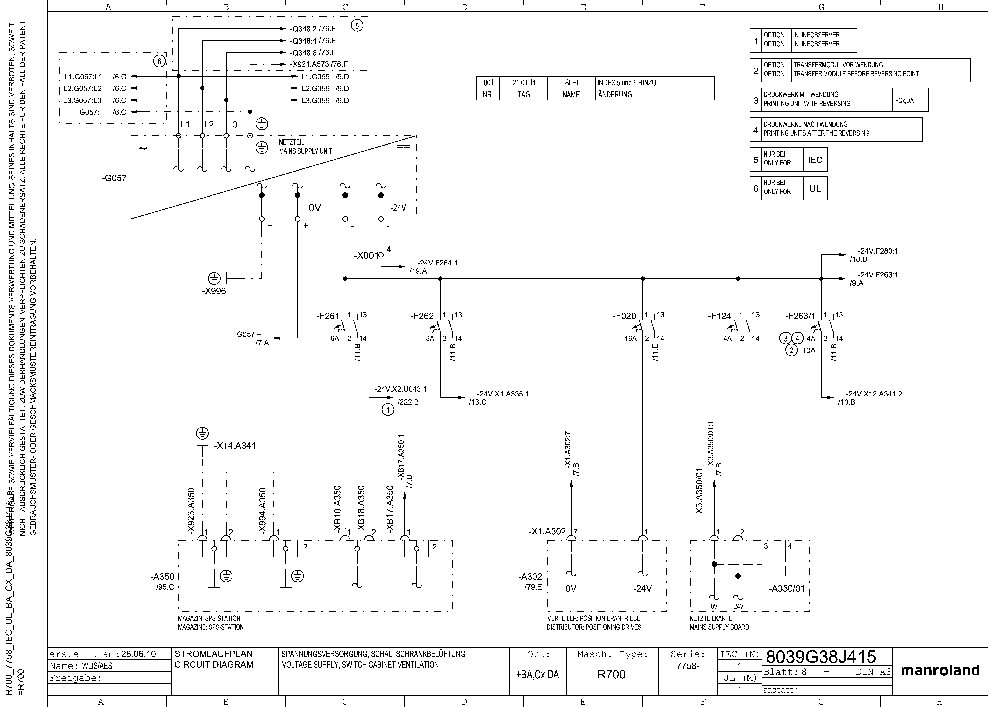

# +BA_Cx_DA — Sheet 8 of 247 — SPANNUNGSVERSORGUNG, SCHALTSCHRANKBELÜFTUNG

**VOLTAGE SUPPLY, SWITCH CABINET VENTILATION**

> Part of the manroland **R700** printing press IEC/UL circuit diagrams.
> Drawing class: **Stromlaufplan / Circuit diagram** (DIN A3).
> Document `+BA_Cx_DA` covers the **Printing units / main switch cabinet** machine section.

## At a glance

| Field | Value |
|---|---|
| Document | `+BA_Cx_DA`  (8039G38J415) |
| Sheet | **8** of 247 |
| Section (DE) | SPANNUNGSVERSORGUNG, SCHALTSCHRANKBELÜFTUNG |
| Section (EN) | VOLTAGE SUPPLY, SWITCH CABINET VENTILATION |
| Section type | POWER_SUPPLY — Voltage supply |
| Machine type | `R700` |
| Series | `7758` |
| Created | 28.06.10 |
| Replaces | — |
| Columns used | A, B, C, D, E, F, G, H |
| Path numbers | — |
| Labels on sheet | 167 |
| Cross-refs out | 27 |
| Cross-refs in | 31 |

**Previous:** [+BA_Cx_DA sheet 7](SHEET_0007.md) · **Next:** [+BA_Cx_DA sheet 9](SHEET_0009.md) · **Document TOC:** [_TOC.md](_TOC.md)  (+BA_Cx_DA) · **Master TOC:** [all sheets](../_MASTER_TOC.md)

## Sheet image (300 DPI, exact vector render)



_Rendered directly from the PDF vector layer at 300 DPI (1-bit), no OCR and no resampling. Use it to confirm anything ambiguous in the text below._

## Cross-references on this sheet

Each entry is a wire leaving this sheet. The printed token is `/sheet.column`; the link resolves to that sheet inside the same document.

| Ref | Target sheet | Col | Path | Destination on target | Target section | From col |
|---|---|---|---|---|---|---|
| `/76.F` | [+BA_Cx_DA sheet 76](SHEET_0076.md) | F | — | Q348:2 | FARBWERK | C |
| `/76.F` | [+BA_Cx_DA sheet 76](SHEET_0076.md) | F | — | Q348:4 | FARBWERK | C |
| `/76.F` | [+BA_Cx_DA sheet 76](SHEET_0076.md) | F | — | Q348:6 | FARBWERK | C |
| `/76.F` | [+BA_Cx_DA sheet 76](SHEET_0076.md) | F | — | X921.A573 | FARBWERK | C |
| `/6.C` | [+BA_Cx_DA sheet 6](SHEET_0006.md) | C | — | L1.G057:L1 | SPANNUNGSVERSORGUNG: 400V | A |
| `/9.D` | [+BA_Cx_DA sheet 9](SHEET_0009.md) | D | — | L1.G059 | SPANNUNGSVERSORGUNG, SCHALTSCHRANKBELÜFTUNG | C |
| `/6.C` | [+BA_Cx_DA sheet 6](SHEET_0006.md) | C | — | L2.G057:L2 | SPANNUNGSVERSORGUNG: 400V | A |
| `/9.D` | [+BA_Cx_DA sheet 9](SHEET_0009.md) | D | — | L2.G059 | SPANNUNGSVERSORGUNG, SCHALTSCHRANKBELÜFTUNG | C |
| `/6.C` | [+BA_Cx_DA sheet 6](SHEET_0006.md) | C | — | L3.G057:L3 L3.G059 | SPANNUNGSVERSORGUNG: 400V | B |
| `/9.D` | [+BA_Cx_DA sheet 9](SHEET_0009.md) | D | — | L3.G057:L3 L3.G059 | SPANNUNGSVERSORGUNG, SCHALTSCHRANKBELÜFTUNG | B |
| `/6.C` | [+BA_Cx_DA sheet 6](SHEET_0006.md) | C | — | G057:` | SPANNUNGSVERSORGUNG: 400V | A |
| `/18.D` | [+BA_Cx_DA sheet 18](SHEET_0018.md) | D | — | — | SPANNUNGSVERSORGUNG, SCHALTSCHRANKBELÜFTUNG | G |
| `/19.A` | [+BA_Cx_DA sheet 19](SHEET_0019.md) | A | — | 24V.F263:1 | SPANNUNGSVERSORGUNG: MAGNETVENTILBLOCK | F |
| `/9.A` | [+BA_Cx_DA sheet 9](SHEET_0009.md) | A | — | — | SPANNUNGSVERSORGUNG, SCHALTSCHRANKBELÜFTUNG | G |
| `/7.A` | [+BA_Cx_DA sheet 7](SHEET_0007.md) | A | — | G057:+ | SPANNUNGSVERSORGUNG, SCHALTSCHRANKBELÜFTUNG | B |
| `/11.E` | [+BA_Cx_DA sheet 11](SHEET_0011.md) | E | — | — | SPANNUNGSVERSORGUNG, SCHALTSCHRANKBELÜFTUNG | F |
| `/11.B` | [+BA_Cx_DA sheet 11](SHEET_0011.md) | B | — | — | SPANNUNGSVERSORGUNG, SCHALTSCHRANKBELÜFTUNG | C |
| `/11.B` | [+BA_Cx_DA sheet 11](SHEET_0011.md) | B | — | — | SPANNUNGSVERSORGUNG, SCHALTSCHRANKBELÜFTUNG | D |
| `/11.B` | [+BA_Cx_DA sheet 11](SHEET_0011.md) | B | — | — | SPANNUNGSVERSORGUNG, SCHALTSCHRANKBELÜFTUNG | G |
| `/10.B` | [+BA_Cx_DA sheet 10](SHEET_0010.md) | B | — | — | SPANNUNGSVERSORGUNG, SCHALTSCHRANKBELÜFTUNG | G |
| `/222.B` | [+BA_Cx_DA sheet 222](SHEET_0222.md) | B | — | — | OPTION: INLINEOBSERVER | D |
| `/13.C` | [+BA_Cx_DA sheet 13](SHEET_0013.md) | C | — | — | SPANNUNGSVERSORGUNG, SCHALTSCHRANKBELÜFTUNG | D |
| `/7.B` | [+BA_Cx_DA sheet 7](SHEET_0007.md) | B | — | X3.A350\01:1 | SPANNUNGSVERSORGUNG, SCHALTSCHRANKBELÜFTUNG | F |
| `/7.B` | [+BA_Cx_DA sheet 7](SHEET_0007.md) | B | — | X1.A302:7 | SPANNUNGSVERSORGUNG, SCHALTSCHRANKBELÜFTUNG | E |
| `/7.B` | [+BA_Cx_DA sheet 7](SHEET_0007.md) | B | — | XB17.A350:1 | SPANNUNGSVERSORGUNG, SCHALTSCHRANKBELÜFTUNG | D |
| `/79.E` | [+BA_Cx_DA sheet 79](SHEET_0079.md) | E | — | — | FARBWERK | E |
| `/95.C` | [+BA_Cx_DA sheet 95](SHEET_0095.md) | C | — | — | BLAS/SAUGLUFT MIT MOTORVENTILEINSTELLUNG | A |

### Incoming references (sheets that point here)

Every other sheet that sends a wire to this one. `Back-ref` is the token printed on *that* sheet; `Path` is its line number.

| From sheet | Cols | Back-ref | Path | Refs | What continues there |
|---|---|---|---|---|---|
| [+BA_Cx_DA#6](SHEET_0006.md) | C | `/6.C` | — | 4 | G057:`; L1.G057:L1; L2.G057:L2; L3.G057:L3 |
| [+BA_Cx_DA#7](SHEET_0007.md) | A, B | `/7.A`, `/7.B` | — | 4 | G057:+ |
| [+BA_Cx_DA#9](SHEET_0009.md) | A, D | `/9.A`, `/9.D` | — | 4 | 24V.F263:1; L1.G059; L2.G059; L3.G059 |
| [+BA_Cx_DA#10](SHEET_0010.md) | A | `/10.A` | — | 1 | 24V.X12.A341:2 |
| [+BA_Cx_DA#11](SHEET_0011.md) | B, E | `/11.B`, `/11.E` | — | 4 | — |
| [+BA_Cx_DA#13](SHEET_0013.md) | B | `/13.B` | — | 1 | 24V.X1.A335:1 |
| [+BA_Cx_DA#18](SHEET_0018.md) | D | `/18.D` | — | 1 | 24V.F280:1 |
| [+BA_Cx_DA#19](SHEET_0019.md) | A | `/19.A` | — | 1 | 24V.F264:1 |
| [+BA_Cx_DA#76](SHEET_0076.md) | F | `/76.F` | — | 4 | Q348:2; Q348:4; Q348:6; X921.A573 |
| [+BA_Cx_DA#79](SHEET_0079.md) | E | `/79.E` | — | 1 | — |
| [+BA_Cx_DA#95](SHEET_0095.md) | C | `/95.C` | — | 1 | — |
| [+BA_Cx_DA#141](SHEET_0141.md) | B | `/141.B` | — | 2 | — |
| [+BA_Cx_DA#157](SHEET_0157.md) | G | `/157.G` | — | 2 | — |
| [+BA_Cx_DA#222](SHEET_0222.md) | A | `/222.A` | — | 1 | 24V.X2.U043:1 |


## Devices on this sheet

| Tag | Class | Class meaning (IEC) | Col | Sub | Terminal | Sign |
|---|---|---|---|---|---|---|
| `A350` | A | Baugruppe / assembly, module, PC board | A | — | — | — |
| `A350/01` | A | Baugruppe / assembly, module, PC board | G | 01 | — | — |
| `A302` | A | Baugruppe / assembly, module, PC board | E | — | — | — |
| `G057` | G | Stromversorgung / power supply | A | — | — | — |
| `F261` | F | Schutz / protection device (fuse, circuit breaker) | C | — | — | — |
| `F124` | F | Schutz / protection device (fuse, circuit breaker) | F | — | — | — |
| `F020` | F | Schutz / protection device (fuse, circuit breaker) | E | — | — | — |
| `F262` | F | Schutz / protection device (fuse, circuit breaker) | D | — | — | — |
| `X001` | X | Klemme / terminal, plug connector | C | — | — | — |
| `F263/1` | F | Schutz / protection device (fuse, circuit breaker) | G | 1 | — | — |
| `Q348:2` | Q | Leistungsschalter / power switching device | C | — | 2 | — |
| `Q348:4` | Q | Leistungsschalter / power switching device | C | — | 4 | — |
| `Q348:6` | Q | Leistungsschalter / power switching device | C | — | 6 | — |
| `X996` | X | Klemme / terminal, plug connector | B | — | — | — |
| `X923.A350` | — | cross-device reference | B | — | — | — |
| `X994.A350` | — | cross-device reference | B | — | — | — |
| `XB18.A350` | — | cross-device reference | C | — | — | — |
| `X1.A302` | — | cross-device reference | E | — | — | — |
| `XB17.A350` | — | cross-device reference | C | — | — | — |
| `X3.A350\01:1` | — | cross-device reference | F | — | 1 | — |
| `XB17.A350:1` | — | cross-device reference | C | — | 1 | — |
| `X1.A302:7` | — | cross-device reference | E | — | 7 | — |
| `NR.` | — | cross-device reference | D | — | — | — |
| `21.01.11` | — | cross-device reference | E | — | — | — |
| `X921.A573` | — | cross-device reference | C | — | — | — |
| `XB18.A350` | — | cross-device reference | C | — | — | — |
| `X14.A341` | — | cross-device reference | B | — | — | — |

## Potentials / nets

| Potential | Count | Columns | Attached devices | Terminals |
|---|---|---|---|---|
| `0V` | 3 | C, E, F | — | — |
| `24V` | 9 | C, D, E, F, G | `A335`, `A341`, `F263`, `F264`, `F280`, `U043`, `X1`, `X12`, `X2` | `1`, `2` |
| `L1` | 3 | A, B, C | `G057`, `G059` | `L1` |
| `L2` | 3 | A, B, C | `G057`, `G059` | `L2` |
| `L3` | 3 | A, B, C | `G057`, `G059` | `L3` |


A potential such as `L24+/4` or `M24+` is a named supply/return rail; every place it appears on this sheet is electrically common.

## Wire-end annotations (grouped as printed)

A wire that continues elsewhere is annotated with a small cluster: the destination description, the path/line number `#NN`, and the `/sheet.column` cross reference. Each row below is one such cluster exactly as it is grouped on the drawing.

| Col | Y | Path | Cross-ref | Text on the wire |
|---|---|---|---|---|
| C | 27.5 | — | — | `5` |
| C | 30.0 | — | `/76.F` | `Q348:2` |
| G | 38.9 | — | — | `1 INLINEOBSERVER INLINEOBSERVER` |
| G | 38.9 | — | — | `OPTION OPTION` |
| C | 44.2 | — | `/76.F` | `Q348:4` |
| C | 58.4 | — | `/76.F` | `Q348:6` |
| A | 70.0 | — | — | `6` |
| C | 72.5 | — | `/76.F` | `X921.A573` |
| G | 74.3 | — | — | `2 TRANSFERMODUL VOR WENDUNG TRANSFER MODULE BEFORE REVERSING POINT` |
| G | 74.3 | — | — | `OPTION OPTION` |
| A | 87.4 | — | `/6.C` | `L1.G057:L1` |
| C | 87.4 | — | `/9.D` | `L1.G059` |
| E | 95.2 | — | — | `001 21.01.11 SLEI INDEX 5 und 6 HINZU` |
| A | 101.6 | — | `/6.C` | `L2.G057:L2` |
| C | 101.6 | — | `/9.D` | `L2.G059` |
| E | 109.3 | — | — | `NR. TAG NAME ÄNDERUNG` |
| G | 109.7 | — | — | `3 DRUCKWERK MIT WENDUNG PRINTING UNIT WITH REVERSING +Cx,DA` |
| B | 115.8 | — | `/6.C`, `/9.D` | `L3.G057:L3 L3.G059` |
| A | 129.9 | — | `/6.C` | `G057:'` |
| B | 143.4 | — | — | `L1 L2 L3` |
| G | 145.2 | — | — | `4 DRUCKWERKE NACH WENDUNG PRINTING UNITS AFTER THE REVERSING` |
| C | 166.4 | — | — | `NETZTEIL MAINS SUPPLY UNIT` |
| A | 169.2 | — | — | `~` |
| G | 180.6 | — | — | `5 NUR BEI` |
| G | 186.1 | — | — | `ONLY FOR IEC` |
| A | 207.2 | — | — | `G057` |
| G | 214.6 | — | — | `6 NUR BEI` |
| G | 220.0 | — | — | `ONLY FOR UL` |
| C | 242.1 | — | — | `0V` |
| C | 243.6 | — | — | `24V` |
| C | 263.9 | — | — | `+ +` |
| C | 292.2 | — | — | `X001 4` |
| G | 295.1 | — | — | `24V.F280:1` |
| G | 305.0 | — | `/18.D` | — |
| D | 309.3 | — | — | `24V.F264:1` |
| F | 319.1 | — | `/19.A` | `24V.F263:1` |
| G | 333.3 | — | `/9.A` | — |
| B | 341.9 | — | — | `X996` |
| E | 370.9 | — | — | `F261 1` |
| C | 370.9 | — | — | `1` |
| C | 370.9 | — | — | `13` |
| D | 370.9 | — | — | `1` |
| D | 370.9 | — | — | `13` |
| F | 370.9 | — | — | `1` |
| F | 370.9 | — | — | `13` |
| F | 370.9 | — | — | `13` |
| G | 370.9 | — | — | `1` |
| G | 370.9 | — | — | `13` |
| D | 371.6 | — | — | `F262` |
| E | 371.6 | — | — | `F020` |
| F | 371.6 | — | — | `F124` |
| G | 371.6 | — | — | `F263/1` |
| B | 394.3 | — | `/7.A` | `G057:+` |
| C | 399.3 | — | — | `6A 2` |
| C | 399.3 | — | — | `14` |
| D | 399.3 | — | — | `3A 2` |
| D | 399.3 | — | — | `14` |
| E | 399.3 | — | — | `16A 2` |
| F | 399.3 | — | — | `14` |
| F | 399.3 | — | — | `4A 2` |
| F | 399.3 | — | — | `14` |
| G | 399.3 | — | — | `4A 2` |
| G | 399.3 | — | — | `14` |
| G | 400.0 | — | — | `3 4` |
| F | 409.0 | — | `/11.E` | — |
| C | 409.3 | — | `/11.B` | — |
| D | 409.3 | — | `/11.B` | — |
| G | 409.3 | — | `/11.B` | — |
| G | 413.4 | — | — | `2 10A` |
| C | 459.5 | — | — | `24V.X2.U043:1` |
| D | 465.2 | — | — | `24V.X1.A335:1` |
| G | 465.2 | — | — | `24V.X12.A341:2` |
| D | 475.1 | — | `/222.B` | — |
| D | 475.1 | — | `/13.C` | — |
| G | 475.1 | — | `/10.B` | — |
| C | 484.5 | — | — | `1` |
| F | 501.2 | — | `/7.B` | `X3.A350\01:1` |
| E | 513.4 | — | `/7.B` | `X1.A302:7` |
| D | 516.8 | — | `/7.B` | `XB17.A350:1` |
| B | 526.1 | — | — | `X14.A341` |
| F | 556.4 | — | — | `X3.A350/01` |
| C | 577.7 | — | — | `XB18.A350` |
| C | 577.7 | — | — | `XB18.A350` |
| C | 577.7 | — | — | `XB17.A350` |
| B | 580.5 | — | — | `X923.A350` |
| B | 580.5 | — | — | `X994.A350` |
| E | 628.2 | — | — | `X1.A302 7 1` |
| B | 629.6 | — | — | `1` |
| B | 629.6 | — | — | `2 1` |
| C | 629.6 | — | — | `1` |
| C | 629.6 | — | — | `2` |
| D | 629.6 | — | — | `1` |
| F | 629.6 | — | — | `1` |
| F | 629.6 | — | — | `2` |
| G | 646.6 | — | — | `3 4` |
| C | 647.3 | — | — | `2` |
| D | 647.3 | — | — | `2` |
| A | 682.0 | — | — | `A350` |
| E | 682.0 | — | — | `A302` |
| A | 695.1 | — | `/95.C` | — |
| E | 695.1 | — | `/79.E` | — |
| E | 696.2 | — | — | `0V 24V` |
| G | 696.2 | — | — | `A350/01` |
| F | 719.2 | — | — | `0V 24V` |
| B | 733.4 | — | — | `MAGAZIN: SPS STATION MAGAZINE: SPS STATION` |
| E | 733.4 | — | — | `DISTRIBUTOR: POSITIONING DRIVES VERTEILER: POSITIONIERANTRIEBE` |
| F | 733.4 | — | — | `NETZTEILKARTE MAINS SUPPLY BOARD` |


## Reconstructed tables

This sheet carries tabular content (pin map / terminal assignment / index). The grid below was rebuilt from the drawing's own rule lines, so each row is exactly one physical row of the table.

### Table 1 — 1 data rows × 2 columns (at x=212.6, y=34.0)

| L1 | L2 |
|---|---|
|  | `X996` |


### Table 2 — 2 data rows × 1 columns (at x=269.3, y=34.0)

| C1 |
|---|
| `L3` |
| `G057:+ X14.A341` |


### Table 3 — 2 data rows × 1 columns (at x=311.8, y=34.0)

| C1 |
|---|
| `+` |
| `/7.A` |


### Table 4 — 9 data rows × 7 columns (at x=340.2, y=34.0)

| C1 | C2 | C3 | C4 | C5 | C6 | C7 |
|---|---|---|---|---|---|---|
|  | `/76.F Q348:2` |  |  |  |  |  |
|  | `/76.F Q348:4` |  |  |  |  |  |
|  | `/76.F Q348:6 /76.F X921.A573` |  |  |  |  |  |
|  | `/9.D L1.G059` |  |  |  |  |  |
|  | `/9.D L2.G059` |  |  |  |  |  |
|  | `/9.D L3.G059` |  |  |  |  |  |
| `NETZTEIL MAINS` | `SUPPLY UNIT` |  |  |  |  |  |
|  | `0V +` |  | `X001` | `24V 4` |  | `24V.F264:1 /19.A` |
|  | `F261 6A` | `1 2` | `13 14 /11.B` | `24V.X2.U043:1 1 XB17.A350:1` | `/222.B` | `F262 3A` |


## Notes and free text on this sheet

| Text | Col | Y (pt) |
|---|---|---|
| `MAGAZIN: SPS STATION` | B | 733.37 |
| `MAGAZINE: SPS STATION` | B | 744 |
| `NETZTEILKARTE` | F | 733.36 |
| `MAINS SUPPLY BOARD` | F | 744.01 |
| `X3.A350/01` | F | 556.44 |
| `VERTEILER: POSITIONIERANTRIEBE` | E | 733.37 |
| `DISTRIBUTOR: POSITIONING DRIVES` | E | 744.01 |
| `NETZTEIL` | C | 166.42 |
| `MAINS SUPPLY UNIT` | C | 177.08 |
| `6A` | C | 399.51 |
| `4A` | F | 399.51 |
| `16A` | E | 399.5 |
| `3A` | D | 399.51 |
| `4A` | G | 399.51 |
| `G057:+` | B | 394.32 |
| `G057:'` | A | 130 |
| `TAG` | E | 109.47 |
| `NAME` | E | 109.46 |
| `ÄNDERUNG` | E | 109.52 |
| `SLEI` | E | 95.31 |
| `INDEX 5 und 6 HINZU` | E | 95.34 |
| `OPTION` | G | 38.87 |
| `INLINEOBSERVER` | G | 38.88 |
| `TRANSFERMODUL VOR WENDUNG` | G | 74.33 |
| `TRANSFER MODULE BEFORE REVERSING POINT` | G | 84.97 |
| `10A` | G | 413.44 |
| `DRUCKWERK MIT WENDUNG` | G | 109.74 |
| `PRINTING UNIT WITH REVERSING` | G | 120.37 |
| `+Cx,DA` | H | 116.89 |
| `DRUCKWERKE NACH WENDUNG` | G | 145.18 |
| `PRINTING UNITS AFTER THE REVERSING` | G | 155.82 |
| `NUR BEI` | G | 214.59 |
| `ONLY FOR` | G | 225.28 |
| `UL` | G | 219.98 |
| `IEC` | G | 186.07 |

## Complete label inventory (exact text from the drawing)

Every text object inside the drawing area of this sheet, in DIN reading order (column A→H, then top→bottom). This is the authoritative list: if a string is not here it is not printed on this sheet.

| Col | Y | X | Dir | Type | Text |
|---|---|---|---|---|---|
| A | 70.0 | 187.9 | → | number | `6` |
| A | 87.4 | 134.4 | → | cross-reference | `/6.C` |
| A | 87.5 | 76.5 | → | potential | `L1.G057:L1` |
| A | 101.6 | 75.4 | → | potential | `L2.G057:L2` |
| A | 101.6 | 134.4 | → | cross-reference | `/6.C` |
| A | 115.8 | 75.1 | → | potential | `L3.G057:L3` |
| A | 115.8 | 134.4 | → | cross-reference | `/6.C` |
| A | 130.0 | 91.8 | → | text | `G057:'` |
| A | 130.0 | 134.4 | → | cross-reference | `/6.C` |
| A | 169.3 | 164.8 | → | other | `~` |
| A | 207.2 | 121.3 | → | device tag | `G057` |
| A | 682.0 | 179.1 | → | device tag | `A350` |
| A | 695.1 | 186.2 | → | cross-reference | `/95.C` |
| B | 143.4 | 214.6 | → | potential | `L1` |
| B | 143.4 | 242.9 | → | potential | `L2` |
| B | 143.4 | 271.3 | → | potential | `L3` |
| B | 263.9 | 318.3 | → | number | `+` |
| B | 341.9 | 240.7 | → | device tag | `X996` |
| B | 394.3 | 279.2 | → | text | `G057:+` |
| B | 404.2 | 304.4 | → | cross-reference | `/7.A` |
| B | 526.1 | 254.8 | → | device ref | `X14.A341` |
| B | 580.5 | 222.8 | ↕ | device ref | `X923.A350` |
| B | 580.5 | 307.9 | ↕ | device ref | `X994.A350` |
| B | 629.6 | 242.6 | → | number | `1` |
| B | 629.6 | 271.8 | → | number | `2` |
| B | 629.6 | 327.7 | → | number | `1` |
| B | 733.4 | 212.0 | → | text | `MAGAZIN: SPS STATION` |
| B | 744.0 | 212.0 | → | text | `MAGAZINE: SPS STATION` |
| C | 27.5 | 423.2 | → | number | `5` |
| C | 30.0 | 379.8 | → | cross-reference | `/76.F` |
| C | 30.8 | 345.5 | → | device tag | `Q348:2` |
| C | 44.2 | 379.8 | → | cross-reference | `/76.F` |
| C | 45.0 | 345.5 | → | device tag | `Q348:4` |
| C | 58.4 | 379.8 | → | cross-reference | `/76.F` |
| C | 59.1 | 345.5 | → | device tag | `Q348:6` |
| C | 72.5 | 394.0 | → | cross-reference | `/76.F` |
| C | 72.6 | 345.5 | → | device ref | `X921.A573` |
| C | 87.4 | 399.7 | → | cross-reference | `/9.D` |
| C | 87.5 | 359.1 | → | potential | `L1.G059` |
| C | 101.6 | 359.1 | → | potential | `L2.G059` |
| C | 101.6 | 399.7 | → | cross-reference | `/9.D` |
| C | 115.8 | 359.1 | → | potential | `L3.G059` |
| C | 115.8 | 399.7 | → | cross-reference | `/9.D` |
| C | 166.4 | 332.2 | → | text | `NETZTEIL` |
| C | 177.1 | 332.5 | → | text | `MAINS SUPPLY UNIT` |
| C | 242.0 | 367.7 | → | potential | `0V` |
| C | 243.6 | 465.4 | → | potential | `24V` |
| C | 263.9 | 360.9 | → | number | `+` |
| C | 292.2 | 460.3 | → | number | `4` |
| C | 299.1 | 421.5 | → | device tag | `X001` |
| C | 371.0 | 413.0 | → | number | `1` |
| C | 371.0 | 427.2 | → | number | `13` |
| C | 371.6 | 376.7 | → | device tag | `F261` |
| C | 399.3 | 413.6 | → | number | `2` |
| C | 399.3 | 427.2 | → | number | `14` |
| C | 399.5 | 393.7 | → | text | `6A` |
| C | 409.3 | 421.9 | ↕ | cross-reference | `/11.B` |
| C | 459.5 | 446.2 | → | potential | `24V.X2.U043:1` |
| C | 484.5 | 460.2 | → | number | `1` |
| C | 516.8 | 473.7 | ↕ | device ref | `XB17.A350:1` |
| C | 577.7 | 397.2 | ↕ | device ref | `XB18.A350` |
| C | 577.7 | 425.5 | ↕ | device ref | `XB18.A350` |
| C | 577.7 | 459.5 | ↕ | device ref | `XB17.A350` |
| C | 629.6 | 412.7 | → | number | `1` |
| C | 629.6 | 441.9 | → | number | `2` |
| C | 647.3 | 361.1 | → | number | `2` |
| D | 95.2 | 575.9 | → | number | `001` |
| D | 109.3 | 574.9 | → | device ref | `NR.` |
| D | 309.3 | 497.2 | → | potential | `24V.F264:1` |
| D | 319.1 | 487.6 | → | cross-reference | `/19.A` |
| D | 371.0 | 526.4 | → | number | `1` |
| D | 371.0 | 540.6 | → | number | `13` |
| D | 371.6 | 488.7 | → | device tag | `F262` |
| D | 399.3 | 527.0 | → | number | `2` |
| D | 399.3 | 540.6 | → | number | `14` |
| D | 399.5 | 507.1 | → | text | `3A` |
| D | 409.3 | 535.3 | ↕ | cross-reference | `/11.B` |
| D | 465.2 | 568.1 | → | potential | `24V.X1.A335:1` |
| D | 475.1 | 473.4 | → | cross-reference | `/222.B` |
| D | 475.1 | 558.4 | → | cross-reference | `/13.C` |
| D | 565.2 | 483.5 | ↕ | cross-reference | `/7.B` |
| D | 629.6 | 483.6 | → | number | `1` |
| D | 647.3 | 515.1 | → | number | `2` |
| E | 95.3 | 610.7 | → | device ref | `21.01.11` |
| E | 95.3 | 672.8 | → | text | `SLEI` |
| E | 95.3 | 711.4 | → | text | `INDEX 5 und 6 HINZU` |
| E | 109.5 | 616.5 | → | text | `TAG` |
| E | 109.5 | 669.9 | → | text | `NAME` |
| E | 109.5 | 712.5 | → | text | `ÄNDERUNG` |
| E | 371.6 | 729.6 | → | device tag | `F020` |
| E | 399.5 | 743.5 | → | text | `16A` |
| E | 513.4 | 672.1 | ↕ | device ref | `X1.A302:7` |
| E | 551.1 | 682.0 | ↕ | cross-reference | `/7.B` |
| E | 628.2 | 629.6 | → | device ref | `X1.A302` |
| E | 629.6 | 682.9 | → | number | `7` |
| E | 682.0 | 617.1 | → | device tag | `A302` |
| E | 695.1 | 624.8 | → | cross-reference | `/79.E` |
| E | 696.2 | 673.5 | → | potential | `0V` |
| E | 696.2 | 754.0 | → | potential | `24V` |
| E | 733.4 | 652.0 | → | text | `VERTEILER: POSITIONIERANTRIEBE` |
| E | 744.0 | 651.1 | → | text | `DISTRIBUTOR: POSITIONING DRIVES` |
| F | 44.2 | 897.4 | → | number | `1` |
| F | 79.6 | 897.2 | → | number | `2` |
| F | 115.1 | 897.0 | → | number | `3` |
| F | 150.5 | 897.2 | → | number | `4` |
| F | 185.9 | 897.0 | → | number | `5` |
| F | 220.0 | 897.2 | → | number | `6` |
| F | 371.0 | 767.3 | → | number | `1` |
| F | 371.0 | 781.5 | → | number | `13` |
| F | 371.0 | 880.7 | → | number | `1` |
| F | 371.0 | 894.9 | → | number | `13` |
| F | 371.6 | 843.0 | → | device tag | `F124` |
| F | 399.3 | 767.9 | → | number | `2` |
| F | 399.3 | 781.5 | → | number | `14` |
| F | 399.3 | 881.3 | → | number | `2` |
| F | 399.3 | 894.9 | → | number | `14` |
| F | 399.5 | 861.4 | → | text | `4A` |
| F | 409.0 | 776.2 | ↕ | cross-reference | `/11.E` |
| F | 501.2 | 842.2 | ↕ | device ref | `X3.A350\01:1` |
| F | 551.1 | 852.0 | ↕ | cross-reference | `/7.B` |
| F | 556.4 | 828.0 | ↕ | text | `X3.A350/01` |
| F | 629.6 | 767.3 | → | number | `1` |
| F | 629.6 | 852.4 | → | number | `1` |
| F | 629.6 | 881.3 | → | number | `2` |
| F | 719.2 | 846.4 | → | potential | `0V` |
| F | 719.2 | 872.0 | → | potential | `24V` |
| F | 733.4 | 821.2 | → | text | `NETZTEILKARTE` |
| F | 744.0 | 821.5 | → | text | `MAINS SUPPLY BOARD` |
| G | 38.9 | 909.6 | → | text | `OPTION` |
| G | 38.9 | 944.5 | → | text | `INLINEOBSERVER` |
| G | 49.5 | 909.6 | → | text | `OPTION` |
| G | 49.5 | 944.5 | → | text | `INLINEOBSERVER` |
| G | 74.3 | 909.6 | → | text | `OPTION` |
| G | 74.3 | 945.1 | → | text | `TRANSFERMODUL VOR WENDUNG` |
| G | 84.9 | 909.6 | → | text | `OPTION` |
| G | 85.0 | 945.1 | → | text | `TRANSFER MODULE BEFORE REVERSING POINT` |
| G | 109.7 | 909.1 | → | text | `DRUCKWERK MIT WENDUNG` |
| G | 120.4 | 909.1 | → | text | `PRINTING UNIT WITH REVERSING` |
| G | 145.2 | 909.1 | → | text | `DRUCKWERKE NACH WENDUNG` |
| G | 155.8 | 909.1 | → | text | `PRINTING UNITS AFTER THE REVERSING` |
| G | 180.6 | 909.1 | → | text | `NUR BEI` |
| G | 186.1 | 962.1 | → | text | `IEC` |
| G | 191.3 | 909.6 | → | text | `ONLY FOR` |
| G | 214.6 | 909.1 | → | text | `NUR BEI` |
| G | 220.0 | 963.8 | → | text | `UL` |
| G | 225.3 | 909.6 | → | text | `ONLY FOR` |
| G | 295.1 | 1021.6 | → | potential | `24V.F280:1` |
| G | 305.0 | 1012.0 | → | cross-reference | `/18.D` |
| G | 323.4 | 1021.6 | → | potential | `24V.F263:1` |
| G | 333.3 | 1012.0 | → | cross-reference | `/9.A` |
| G | 371.0 | 979.9 | → | number | `1` |
| G | 371.0 | 994.1 | → | number | `13` |
| G | 371.6 | 934.9 | → | device tag | `F263/1` |
| G | 399.3 | 980.5 | → | number | `2` |
| G | 399.3 | 994.1 | → | number | `14` |
| G | 399.5 | 960.7 | → | text | `4A` |
| G | 400.0 | 933.4 | → | number | `3` |
| G | 400.0 | 947.6 | → | number | `4` |
| G | 409.3 | 988.8 | ↕ | cross-reference | `/11.B` |
| G | 413.4 | 955.3 | → | text | `10A` |
| G | 414.2 | 940.5 | → | number | `2` |
| G | 465.2 | 1007.4 | → | potential | `24V.X12.A341:2` |
| G | 475.1 | 997.8 | → | cross-reference | `/10.B` |
| G | 646.6 | 909.6 | → | number | `3` |
| G | 646.6 | 938.0 | → | number | `4` |
| G | 696.2 | 915.6 | → | device tag | `A350/01` |
| H | 116.9 | 1066.3 | → | text | `+Cx,DA` |

## Reading-order text block

The same content as a plain block, grouped by DIN column — convenient to paste or to match against a visual description.

```text
=== Column A ===
  70.0  187.9  numeric      6
  87.4  134.4  xref         /6.C
  87.5   76.5  net          L1.G057:L1
 101.6   75.4  net          L2.G057:L2
 101.6  134.4  xref         /6.C
 115.8   75.1  net          L3.G057:L3
 115.8  134.4  xref         /6.C
 130.0   91.8  text         G057:`
 130.0  134.4  xref         /6.C
 169.3  164.8  other        ~
 207.2  121.3  devtag       G057
 682.0  179.1  devtag       A350
 695.1  186.2  xref         /95.C
=== Column B ===
 143.4  214.6  net          L1
 143.4  242.9  net          L2
 143.4  271.3  net          L3
 263.9  318.3  numeric      +
 341.9  240.7  devtag       X996
 394.3  279.2  text         G057:+
 404.2  304.4  xref         /7.A
 526.1  254.8  devref       X14.A341
 580.5  222.8  devref       X923.A350
 580.5  307.9  devref       X994.A350
 629.6  242.6  numeric      1
 629.6  271.8  numeric      2
 629.6  327.7  numeric      1
 733.4  212.0  text         MAGAZIN: SPS STATION
 744.0  212.0  text         MAGAZINE: SPS STATION
=== Column C ===
  27.5  423.2  numeric      5
  30.0  379.8  xref         /76.F
  30.8  345.5  devtag       Q348:2
  44.2  379.8  xref         /76.F
  45.0  345.5  devtag       Q348:4
  58.4  379.8  xref         /76.F
  59.1  345.5  devtag       Q348:6
  72.5  394.0  xref         /76.F
  72.6  345.5  devref       X921.A573
  87.4  399.7  xref         /9.D
  87.5  359.1  net          L1.G059
 101.6  359.1  net          L2.G059
 101.6  399.7  xref         /9.D
 115.8  359.1  net          L3.G059
 115.8  399.7  xref         /9.D
 166.4  332.2  text         NETZTEIL
 177.1  332.5  text         MAINS SUPPLY UNIT
 242.0  367.7  net          0V
 243.6  465.4  net          24V
 263.9  360.9  numeric      +
 292.2  460.3  numeric      4
 299.1  421.5  devtag       X001
 371.0  413.0  numeric      1
 371.0  427.2  numeric      13
 371.6  376.7  devtag       F261
 399.3  413.6  numeric      2
 399.3  427.2  numeric      14
 399.5  393.7  text         6A
 409.3  421.9  xref         /11.B
 459.5  446.2  net          24V.X2.U043:1
 484.5  460.2  numeric      1
 516.8  473.7  devref       XB17.A350:1
 577.7  397.2  devref       XB18.A350
 577.7  425.5  devref       XB18.A350
 577.7  459.5  devref       XB17.A350
 629.6  412.7  numeric      1
 629.6  441.9  numeric      2
 647.3  361.1  numeric      2
=== Column D ===
  95.2  575.9  numeric      001
 109.3  574.9  devref       NR.
 309.3  497.2  net          24V.F264:1
 319.1  487.6  xref         /19.A
 371.0  526.4  numeric      1
 371.0  540.6  numeric      13
 371.6  488.7  devtag       F262
 399.3  527.0  numeric      2
 399.3  540.6  numeric      14
 399.5  507.1  text         3A
 409.3  535.3  xref         /11.B
 465.2  568.1  net          24V.X1.A335:1
 475.1  473.4  xref         /222.B
 475.1  558.4  xref         /13.C
 565.2  483.5  xref         /7.B
 629.6  483.6  numeric      1
 647.3  515.1  numeric      2
=== Column E ===
  95.3  610.7  devref       21.01.11
  95.3  672.8  text         SLEI
  95.3  711.4  text         INDEX 5 und 6 HINZU
 109.5  616.5  text         TAG
 109.5  669.9  text         NAME
 109.5  712.5  text         ÄNDERUNG
 371.6  729.6  devtag       F020
 399.5  743.5  text         16A
 513.4  672.1  devref       X1.A302:7
 551.1  682.0  xref         /7.B
 628.2  629.6  devref       X1.A302
 629.6  682.9  numeric      7
 682.0  617.1  devtag       A302
 695.1  624.8  xref         /79.E
 696.2  673.5  net          0V
 696.2  754.0  net          24V
 733.4  652.0  text         VERTEILER: POSITIONIERANTRIEBE
 744.0  651.1  text         DISTRIBUTOR: POSITIONING DRIVES
=== Column F ===
  44.2  897.4  numeric      1
  79.6  897.2  numeric      2
 115.1  897.0  numeric      3
 150.5  897.2  numeric      4
 185.9  897.0  numeric      5
 220.0  897.2  numeric      6
 371.0  767.3  numeric      1
 371.0  781.5  numeric      13
 371.0  880.7  numeric      1
 371.0  894.9  numeric      13
 371.6  843.0  devtag       F124
 399.3  767.9  numeric      2
 399.3  781.5  numeric      14
 399.3  881.3  numeric      2
 399.3  894.9  numeric      14
 399.5  861.4  text         4A
 409.0  776.2  xref         /11.E
 501.2  842.2  devref       X3.A350\01:1
 551.1  852.0  xref         /7.B
 556.4  828.0  text         X3.A350/01
 629.6  767.3  numeric      1
 629.6  852.4  numeric      1
 629.6  881.3  numeric      2
 719.2  846.4  net          0V
 719.2  872.0  net          24V
 733.4  821.2  text         NETZTEILKARTE
 744.0  821.5  text         MAINS SUPPLY BOARD
=== Column G ===
  38.9  909.6  text         OPTION
  38.9  944.5  text         INLINEOBSERVER
  49.5  909.6  text         OPTION
  49.5  944.5  text         INLINEOBSERVER
  74.3  909.6  text         OPTION
  74.3  945.1  text         TRANSFERMODUL VOR WENDUNG
  84.9  909.6  text         OPTION
  85.0  945.1  text         TRANSFER MODULE BEFORE REVERSING POINT
 109.7  909.1  text         DRUCKWERK MIT WENDUNG
 120.4  909.1  text         PRINTING UNIT WITH REVERSING
 145.2  909.1  text         DRUCKWERKE NACH WENDUNG
 155.8  909.1  text         PRINTING UNITS AFTER THE REVERSING
 180.6  909.1  text         NUR BEI
 186.1  962.1  text         IEC
 191.3  909.6  text         ONLY FOR
 214.6  909.1  text         NUR BEI
 220.0  963.8  text         UL
 225.3  909.6  text         ONLY FOR
 295.1 1021.6  net          24V.F280:1
 305.0 1012.0  xref         /18.D
 323.4 1021.6  net          24V.F263:1
 333.3 1012.0  xref         /9.A
 371.0  979.9  numeric      1
 371.0  994.1  numeric      13
 371.6  934.9  devtag       F263/1
 399.3  980.5  numeric      2
 399.3  994.1  numeric      14
 399.5  960.7  text         4A
 400.0  933.4  numeric      3
 400.0  947.6  numeric      4
 409.3  988.8  xref         /11.B
 413.4  955.3  text         10A
 414.2  940.5  numeric      2
 465.2 1007.4  net          24V.X12.A341:2
 475.1  997.8  xref         /10.B
 646.6  909.6  numeric      3
 646.6  938.0  numeric      4
 696.2  915.6  devtag       A350/01
=== Column H ===
 116.9 1066.3  text         +Cx,DA
```

---
_Generated from the PDF vector text layer; no OCR. Source: `R700_7758_IEC_UL_BA_CX_DA_8039G38J415_p`, sheet 8._
