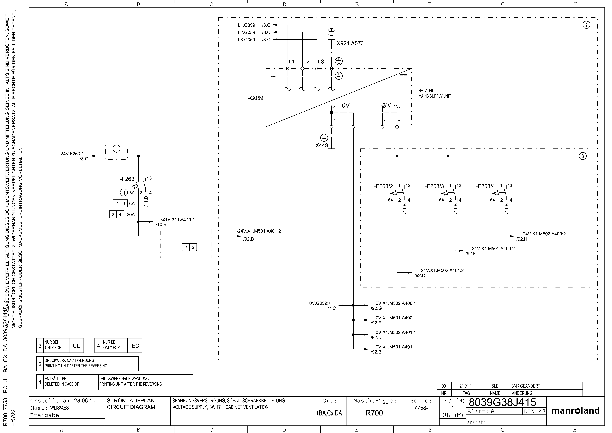

# +BA_Cx_DA — Sheet 9 of 247 — SPANNUNGSVERSORGUNG, SCHALTSCHRANKBELÜFTUNG

**VOLTAGE SUPPLY, SWITCH CABINET VENTILATION**

> Part of the manroland **R700** printing press IEC/UL circuit diagrams.
> Drawing class: **Stromlaufplan / Circuit diagram** (DIN A3).
> Document `+BA_Cx_DA` covers the **Printing units / main switch cabinet** machine section.

## At a glance

| Field | Value |
|---|---|
| Document | `+BA_Cx_DA`  (8039G38J415) |
| Sheet | **9** of 247 |
| Section (DE) | SPANNUNGSVERSORGUNG, SCHALTSCHRANKBELÜFTUNG |
| Section (EN) | VOLTAGE SUPPLY, SWITCH CABINET VENTILATION |
| Section type | POWER_SUPPLY — Voltage supply |
| Machine type | `R700` |
| Series | `7758` |
| Created | 28.06.10 |
| Replaces | — |
| Columns used | A, B, C, D, E, F, G, H |
| Path numbers | — |
| Labels on sheet | 105 |
| Cross-refs out | 18 |
| Cross-refs in | 18 |

**Previous:** [+BA_Cx_DA sheet 8](SHEET_0008.md) · **Next:** [+BA_Cx_DA sheet 10](SHEET_0010.md) · **Document TOC:** [_TOC.md](_TOC.md)  (+BA_Cx_DA) · **Master TOC:** [all sheets](../_MASTER_TOC.md)

## Sheet image (300 DPI, exact vector render)



_Rendered directly from the PDF vector layer at 300 DPI (1-bit), no OCR and no resampling. Use it to confirm anything ambiguous in the text below._

## Cross-references on this sheet

Each entry is a wire leaving this sheet. The printed token is `/sheet.column`; the link resolves to that sheet inside the same document.

| Ref | Target sheet | Col | Path | Destination on target | Target section | From col |
|---|---|---|---|---|---|---|
| `/8.C` | [+BA_Cx_DA sheet 8](SHEET_0008.md) | C | — | L1.G059 | SPANNUNGSVERSORGUNG, SCHALTSCHRANKBELÜFTUNG | D |
| `/8.C` | [+BA_Cx_DA sheet 8](SHEET_0008.md) | C | — | L2.G059 | SPANNUNGSVERSORGUNG, SCHALTSCHRANKBELÜFTUNG | D |
| `/8.C` | [+BA_Cx_DA sheet 8](SHEET_0008.md) | C | — | L3.G059 | SPANNUNGSVERSORGUNG, SCHALTSCHRANKBELÜFTUNG | D |
| `/8.G` | [+BA_Cx_DA sheet 8](SHEET_0008.md) | G | — | 24V.F263:1 | SPANNUNGSVERSORGUNG, SCHALTSCHRANKBELÜFTUNG | A |
| `/11.B` | [+BA_Cx_DA sheet 11](SHEET_0011.md) | B | — | — | SPANNUNGSVERSORGUNG, SCHALTSCHRANKBELÜFTUNG | B |
| `/11.B` | [+BA_Cx_DA sheet 11](SHEET_0011.md) | B | — | — | SPANNUNGSVERSORGUNG, SCHALTSCHRANKBELÜFTUNG | F |
| `/11.B` | [+BA_Cx_DA sheet 11](SHEET_0011.md) | B | — | — | SPANNUNGSVERSORGUNG, SCHALTSCHRANKBELÜFTUNG | F |
| `/11.B` | [+BA_Cx_DA sheet 11](SHEET_0011.md) | B | — | — | SPANNUNGSVERSORGUNG, SCHALTSCHRANKBELÜFTUNG | G |
| `/10.B` | [+BA_Cx_DA sheet 10](SHEET_0010.md) | B | — | — | SPANNUNGSVERSORGUNG, SCHALTSCHRANKBELÜFTUNG | B |
| `/92.B` | [+BA_Cx_DA sheet 92](SHEET_0092.md) | B | — | — | BOGENFÜHRUNG, DRUCKWERK NACH WENDUNG | D |
| `/92.H` | [+BA_Cx_DA sheet 92](SHEET_0092.md) | H | — | — | BOGENFÜHRUNG, DRUCKWERK NACH WENDUNG | G |
| `/92.F` | [+BA_Cx_DA sheet 92](SHEET_0092.md) | F | — | — | BOGENFÜHRUNG, DRUCKWERK NACH WENDUNG | G |
| `/92.D` | [+BA_Cx_DA sheet 92](SHEET_0092.md) | D | — | — | BOGENFÜHRUNG, DRUCKWERK NACH WENDUNG | F |
| `/7.C` | [+BA_Cx_DA sheet 7](SHEET_0007.md) | C | — | 0V.G059:+ | SPANNUNGSVERSORGUNG, SCHALTSCHRANKBELÜFTUNG | E |
| `/92.G` | [+BA_Cx_DA sheet 92](SHEET_0092.md) | G | — | — | BOGENFÜHRUNG, DRUCKWERK NACH WENDUNG | E |
| `/92.F` | [+BA_Cx_DA sheet 92](SHEET_0092.md) | F | — | — | BOGENFÜHRUNG, DRUCKWERK NACH WENDUNG | E |
| `/92.D` | [+BA_Cx_DA sheet 92](SHEET_0092.md) | D | — | — | BOGENFÜHRUNG, DRUCKWERK NACH WENDUNG | E |
| `/92.B` | [+BA_Cx_DA sheet 92](SHEET_0092.md) | B | — | — | BOGENFÜHRUNG, DRUCKWERK NACH WENDUNG | E |

### Incoming references (sheets that point here)

Every other sheet that sends a wire to this one. `Back-ref` is the token printed on *that* sheet; `Path` is its line number.

| From sheet | Cols | Back-ref | Path | Refs | What continues there |
|---|---|---|---|---|---|
| [+BA_Cx_DA#7](SHEET_0007.md) | C | `/7.C` | — | 1 | — |
| [+BA_Cx_DA#8](SHEET_0008.md) | B, C, G | `/8.B`, `/8.C`, `/8.G` | — | 4 | L1.G059; L2.G059; L3.G057:L3 L3.G059 |
| [+BA_Cx_DA#10](SHEET_0010.md) | A | `/10.A` | — | 1 | 24V.X11.A341:1 |
| [+BA_Cx_DA#11](SHEET_0011.md) | B | `/11.B` | — | 4 | — |
| [+BA_Cx_DA#92](SHEET_0092.md) | B, D, F, G, H | `/92.B`, `/92.D`, `/92.F`, `/92.G`, `/92.H` | — | 8 | 0V.X1.M501.A400:1; 0V.X1.M501.A401:1; 0V.X1.M502.A400:1; 0V.X1.M502.A401:1; 24V.X1.M501.A400:2; 24V.X1.M501.A401:2; 24V.X1.M502.A400:2; 24V.X1.M502.A401:2 |


## Devices on this sheet

| Tag | Class | Class meaning (IEC) | Col | Sub | Terminal | Sign |
|---|---|---|---|---|---|---|
| `F263` | F | Schutz / protection device (fuse, circuit breaker) | B | — | — | — |
| `F263/2` | F | Schutz / protection device (fuse, circuit breaker) | E | 2 | — | — |
| `F263/3` | F | Schutz / protection device (fuse, circuit breaker) | F | 3 | — | — |
| `F263/4` | F | Schutz / protection device (fuse, circuit breaker) | G | 4 | — | — |
| `G059` | G | Stromversorgung / power supply | D | — | — | — |
| `X449` | X | Klemme / terminal, plug connector | E | — | — | — |
| `NR.` | — | cross-device reference | F | — | — | — |
| `21.01.11` | — | cross-device reference | G | — | — | — |
| `X921.A573` | — | cross-device reference | E | — | — | — |

## Potentials / nets

| Potential | Count | Columns | Attached devices | Terminals |
|---|---|---|---|---|
| `0V` | 6 | D, E, F | `A400`, `A401`, `G059`, `M501`, `M502`, `X1` | `1` |
| `24V` | 7 | A, C, D, E, F, G, H | `A341`, `A400`, `A401`, `F263`, `M501`, `M502`, `X1`, `X11` | `1`, `2` |
| `L1` | 2 | C, D | `G059` | — |
| `L2` | 2 | C, D | `G059` | — |
| `L3` | 2 | C, E | `G059` | — |


A potential such as `L24+/4` or `M24+` is a named supply/return rail; every place it appears on this sheet is electrically common.

## Wire-end annotations (grouped as printed)

A wire that continues elsewhere is annotated with a small cluster: the destination description, the path/line number `#NN`, and the `/sheet.column` cross reference. Each row below is one such cluster exactly as it is grouped on the drawing.

| Col | Y | Path | Cross-ref | Text on the wire |
|---|---|---|---|---|
| D | 44.9 | — | `/8.C` | `L1.G059` |
| H | 45.6 | — | — | `2` |
| D | 59.1 | — | `/8.C` | `L2.G059` |
| D | 73.3 | — | `/8.C` | `L3.G059` |
| E | 79.7 | — | — | `X921.A573` |
| D | 115.1 | — | — | `L1 L2 L3` |
| D | 140.9 | — | — | `~` |
| F | 173.5 | — | — | `NETZTEIL MAINS SUPPLY UNIT` |
| D | 186.0 | — | — | `G059` |
| E | 199.5 | — | — | `0V 24V` |
| E | 228.5 | — | — | `+ +` |
| E | 278.1 | — | — | `X449` |
| B | 286.1 | — | — | `1` |
| A | 295.1 | — | `/8.G` | `24V.F263:1` |
| H | 300.8 | — | — | `3` |
| B | 342.6 | — | — | `1` |
| B | 342.6 | — | — | `13` |
| B | 343.3 | — | — | `F263` |
| F | 356.8 | — | — | `1` |
| F | 356.8 | — | — | `13` |
| F | 356.8 | — | — | `1` |
| F | 356.8 | — | — | `13` |
| G | 356.8 | — | — | `1` |
| G | 356.8 | — | — | `13` |
| E | 357.5 | — | — | `F263/2` |
| F | 357.5 | — | — | `F263/3` |
| G | 357.5 | — | — | `F263/4` |
| B | 370.9 | — | — | `8A 2` |
| B | 370.9 | — | — | `14` |
| B | 371.1 | — | — | `1` |
| B | 381.0 | — | `/11.B` | — |
| F | 385.1 | — | — | `6A 2` |
| F | 385.1 | — | — | `14` |
| F | 385.1 | — | — | `6A 2` |
| F | 385.1 | — | — | `14` |
| G | 385.1 | — | — | `6A 2` |
| G | 385.1 | — | — | `14` |
| B | 392.2 | — | — | `2 3` |
| B | 392.2 | — | — | `6A` |
| F | 395.1 | — | `/11.B` | — |
| F | 395.1 | — | `/11.B` | — |
| G | 395.1 | — | `/11.B` | — |
| B | 413.4 | — | — | `20A` |
| B | 413.5 | — | — | `2 4` |
| C | 422.6 | — | — | `24V.X11.A341:1` |
| B | 432.5 | — | `/10.B` | — |
| D | 445.3 | — | — | `24V.X1.M501.A401:2` |
| H | 451.0 | — | — | `24V.X1.M502.A400:2` |
| D | 460.9 | — | `/92.B` | — |
| G | 460.9 | — | `/92.H` | — |
| C | 477.2 | — | — | `2 3` |
| G | 479.3 | — | — | `24V.X1.M501.A400:2` |
| G | 489.2 | — | `/92.F` | — |
| F | 521.9 | — | — | `24V.X1.M502.A401:2` |
| F | 531.8 | — | `/92.D` | — |
| E | 585.6 | — | `/7.C` | `0V.G059:+` |
| F | 585.6 | — | — | `0V.X1.M502.A400:1` |
| E | 595.5 | — | `/92.G` | — |
| F | 614.0 | — | — | `0V.X1.M501.A400:1` |
| E | 623.9 | — | `/92.F` | — |
| F | 642.3 | — | — | `0V.X1.M502.A401:1` |
| E | 652.2 | — | `/92.D` | — |
| A | 662.5 | — | — | `3 NUR BEI` |
| A | 662.5 | — | — | `ONLY FOR UL 4 NUR BEI` |
| B | 668.0 | — | — | `ONLY FOR IEC` |
| F | 670.7 | — | — | `0V.X1.M501.A401:1` |
| E | 680.6 | — | `/92.B` | — |
| A | 697.9 | — | — | `2 DRUCKWERK NACH WENDUNG PRINTING UNIT AFTER THE REVERSING` |
| A | 733.4 | — | — | `1 DRUCKWERK NACH WENDUNG PRINTING UNIT AFTER THE REVERSING` |
| A | 733.4 | — | — | `ENTFÄLLT BEI DELETED IN CASE OF` |
| G | 747.2 | — | — | `001 21.01.11 SLEI BMK GEÄNDERT` |
| G | 761.3 | — | — | `NR. TAG NAME ÄNDERUNG` |


## Reconstructed tables

This sheet carries tabular content (pin map / terminal assignment / index). The grid below was rebuilt from the drawing's own rule lines, so each row is exactly one physical row of the table.

### Table 1 — 1 data rows × 6 columns (at x=559.8, y=62.4)

| L1 | L2 | L3 | X921.A573 0V | 24V | NETZTEIL MAINS SUPPLY UNIT |
|---|---|---|---|---|---|
|  |  | `X449` | `+` | `+` |  |


## Notes and free text on this sheet

| Text | Col | Y (pt) |
|---|---|---|
| `8A` | B | 371.16 |
| `6A` | E | 385.33 |
| `6A` | F | 385.33 |
| `6A` | G | 385.33 |
| `NETZTEIL` | F | 173.51 |
| `MAINS SUPPLY UNIT` | F | 184.17 |
| `TAG` | G | 761.44 |
| `NAME` | G | 761.42 |
| `ÄNDERUNG` | G | 761.48 |
| `SLEI` | G | 747.27 |
| `BMK GEÄNDERT` | G | 747.3 |
| `ENTFÄLLT BEI` | A | 733.35 |
| `DELETED IN CASE OF` | A | 744 |
| `DRUCKWERK NACH WENDUNG` | B | 733.36 |
| `PRINTING UNIT AFTER THE REVERSING` | B | 744.01 |
| `DRUCKWERK NACH WENDUNG` | A | 697.93 |
| `PRINTING UNIT AFTER THE REVERSING` | A | 708.58 |
| `NUR BEI` | A | 662.47 |
| `ONLY FOR` | A | 673.16 |
| `UL` | A | 667.85 |
| `NUR BEI` | B | 662.47 |
| `ONLY FOR` | B | 673.16 |
| `IEC` | B | 667.96 |
| `6A` | B | 392.16 |
| `20A` | B | 413.44 |

## Complete label inventory (exact text from the drawing)

Every text object inside the drawing area of this sheet, in DIN reading order (column A→H, then top→bottom). This is the authoritative list: if a string is not here it is not printed on this sheet.

| Col | Y | X | Dir | Type | Text |
|---|---|---|---|---|---|
| A | 295.1 | 115.1 | → | potential | `24V.F263:1` |
| A | 305.0 | 155.3 | → | cross-reference | `/8.G` |
| A | 662.5 | 87.0 | → | text | `NUR BEI` |
| A | 667.8 | 75.0 | → | number | `3` |
| A | 667.8 | 188.5 | → | number | `4` |
| A | 667.9 | 141.7 | → | text | `UL` |
| A | 673.2 | 87.6 | → | text | `ONLY FOR` |
| A | 697.9 | 87.0 | → | text | `DRUCKWERK NACH WENDUNG` |
| A | 703.3 | 75.1 | → | number | `2` |
| A | 708.6 | 87.0 | → | text | `PRINTING UNIT AFTER THE REVERSING` |
| A | 733.3 | 87.0 | → | text | `ENTFÄLLT BEI` |
| A | 738.7 | 75.4 | → | number | `1` |
| A | 744.0 | 87.0 | → | text | `DELETED IN CASE OF` |
| B | 286.1 | 225.0 | → | number | `1` |
| B | 342.6 | 271.3 | → | number | `1` |
| B | 342.6 | 285.4 | → | number | `13` |
| B | 343.3 | 233.6 | → | device tag | `F263` |
| B | 371.0 | 271.8 | → | number | `2` |
| B | 371.0 | 285.4 | → | number | `14` |
| B | 371.1 | 239.2 | → | number | `1` |
| B | 371.2 | 252.0 | → | text | `8A` |
| B | 381.0 | 280.2 | ↕ | cross-reference | `/11.B` |
| B | 392.2 | 224.5 | → | number | `2` |
| B | 392.2 | 238.5 | → | number | `3` |
| B | 392.2 | 251.4 | → | text | `6A` |
| B | 413.4 | 246.6 | → | text | `20A` |
| B | 413.5 | 217.4 | → | number | `2` |
| B | 413.5 | 231.4 | → | number | `4` |
| B | 432.5 | 303.3 | → | cross-reference | `/10.B` |
| B | 662.5 | 200.4 | → | text | `NUR BEI` |
| B | 668.0 | 253.4 | → | text | `IEC` |
| B | 673.2 | 201.0 | → | text | `ONLY FOR` |
| B | 733.4 | 193.3 | → | text | `DRUCKWERK NACH WENDUNG` |
| B | 744.0 | 193.3 | → | text | `PRINTING UNIT AFTER THE REVERSING` |
| C | 44.9 | 462.9 | → | potential | `L1.G059` |
| C | 59.1 | 462.9 | → | potential | `L2.G059` |
| C | 73.3 | 462.9 | → | potential | `L3.G059` |
| C | 422.6 | 312.9 | → | potential | `24V.X11.A341:1` |
| C | 477.3 | 359.1 | → | number | `2` |
| C | 477.3 | 373.2 | → | number | `3` |
| D | 44.9 | 510.0 | → | cross-reference | `/8.C` |
| D | 59.1 | 510.0 | → | cross-reference | `/8.C` |
| D | 73.3 | 510.0 | → | cross-reference | `/8.C` |
| D | 115.1 | 561.8 | → | potential | `L1` |
| D | 115.1 | 590.2 | → | potential | `L2` |
| D | 140.9 | 526.3 | → | other | `~` |
| D | 186.0 | 482.7 | → | device tag | `G059` |
| D | 445.3 | 460.3 | → | potential | `24V.X1.M501.A401:2` |
| D | 460.9 | 473.4 | → | cross-reference | `/92.B` |
| D | 585.6 | 601.8 | → | potential | `0V.G059:+` |
| E | 79.7 | 651.7 | → | device ref | `X921.A573` |
| E | 115.1 | 618.5 | → | potential | `L3` |
| E | 199.5 | 665.3 | → | potential | `0V` |
| E | 201.1 | 741.7 | → | potential | `24V` |
| E | 228.5 | 647.1 | → | number | `+` |
| E | 228.5 | 689.7 | → | number | `+` |
| E | 278.1 | 610.0 | → | device tag | `X449` |
| E | 357.5 | 727.9 | → | device tag | `F263/2` |
| E | 385.3 | 755.1 | → | text | `6A` |
| E | 595.5 | 637.5 | → | cross-reference | `/7.C` |
| E | 595.5 | 721.4 | → | cross-reference | `/92.G` |
| E | 623.9 | 721.4 | → | cross-reference | `/92.F` |
| E | 652.3 | 721.4 | → | cross-reference | `/92.D` |
| E | 680.6 | 721.4 | → | cross-reference | `/92.B` |
| F | 173.5 | 814.1 | → | text | `NETZTEIL` |
| F | 184.2 | 814.4 | → | text | `MAINS SUPPLY UNIT` |
| F | 356.8 | 774.4 | → | number | `1` |
| F | 356.8 | 788.6 | → | number | `13` |
| F | 356.8 | 873.6 | → | number | `1` |
| F | 356.8 | 887.8 | → | number | `13` |
| F | 357.5 | 827.1 | → | device tag | `F263/3` |
| F | 385.1 | 775.0 | → | number | `2` |
| F | 385.1 | 788.6 | → | number | `14` |
| F | 385.1 | 874.2 | → | number | `2` |
| F | 385.1 | 887.8 | → | number | `14` |
| F | 385.3 | 854.4 | → | text | `6A` |
| F | 395.2 | 783.3 | ↕ | cross-reference | `/11.B` |
| F | 395.2 | 882.5 | ↕ | cross-reference | `/11.B` |
| F | 521.9 | 816.1 | → | potential | `24V.X1.M502.A401:2` |
| F | 531.8 | 806.5 | → | cross-reference | `/92.D` |
| F | 585.6 | 731.1 | → | potential | `0V.X1.M502.A400:1` |
| F | 614.0 | 731.1 | → | potential | `0V.X1.M501.A400:1` |
| F | 642.3 | 731.1 | → | potential | `0V.X1.M502.A401:1` |
| F | 670.7 | 731.1 | → | potential | `0V.X1.M501.A401:1` |
| F | 747.2 | 859.4 | → | number | `001` |
| F | 761.3 | 858.4 | → | device ref | `NR.` |
| G | 356.8 | 972.9 | → | number | `1` |
| G | 356.8 | 987.0 | → | number | `13` |
| G | 357.5 | 926.4 | → | device tag | `F263/4` |
| G | 385.1 | 973.4 | → | number | `2` |
| G | 385.1 | 987.0 | → | number | `14` |
| G | 385.3 | 953.6 | → | text | `6A` |
| G | 395.2 | 981.7 | ↕ | cross-reference | `/11.B` |
| G | 460.9 | 1004.9 | → | cross-reference | `/92.H` |
| G | 479.3 | 915.3 | → | potential | `24V.X1.M501.A400:2` |
| G | 489.2 | 905.7 | → | cross-reference | `/92.F` |
| G | 747.3 | 894.1 | → | device ref | `21.01.11` |
| G | 747.3 | 956.3 | → | text | `SLEI` |
| G | 747.3 | 994.8 | → | text | `BMK GEÄNDERT` |
| G | 761.4 | 900.0 | → | text | `TAG` |
| G | 761.4 | 953.4 | → | text | `NAME` |
| G | 761.5 | 996.0 | → | text | `ÄNDERUNG` |
| H | 45.6 | 1139.0 | → | number | `2` |
| H | 300.8 | 1131.9 | → | number | `3` |
| H | 451.0 | 1014.5 | → | potential | `24V.X1.M502.A400:2` |

## Reading-order text block

The same content as a plain block, grouped by DIN column — convenient to paste or to match against a visual description.

```text
=== Column A ===
 295.1  115.1  net          24V.F263:1
 305.0  155.3  xref         /8.G
 662.5   87.0  text         NUR BEI
 667.8   75.0  numeric      3
 667.8  188.5  numeric      4
 667.9  141.7  text         UL
 673.2   87.6  text         ONLY FOR
 697.9   87.0  text         DRUCKWERK NACH WENDUNG
 703.3   75.1  numeric      2
 708.6   87.0  text         PRINTING UNIT AFTER THE REVERSING
 733.3   87.0  text         ENTFÄLLT BEI
 738.7   75.4  numeric      1
 744.0   87.0  text         DELETED IN CASE OF
=== Column B ===
 286.1  225.0  numeric      1
 342.6  271.3  numeric      1
 342.6  285.4  numeric      13
 343.3  233.6  devtag       F263
 371.0  271.8  numeric      2
 371.0  285.4  numeric      14
 371.1  239.2  numeric      1
 371.2  252.0  text         8A
 381.0  280.2  xref         /11.B
 392.2  224.5  numeric      2
 392.2  238.5  numeric      3
 392.2  251.4  text         6A
 413.4  246.6  text         20A
 413.5  217.4  numeric      2
 413.5  231.4  numeric      4
 432.5  303.3  xref         /10.B
 662.5  200.4  text         NUR BEI
 668.0  253.4  text         IEC
 673.2  201.0  text         ONLY FOR
 733.4  193.3  text         DRUCKWERK NACH WENDUNG
 744.0  193.3  text         PRINTING UNIT AFTER THE REVERSING
=== Column C ===
  44.9  462.9  net          L1.G059
  59.1  462.9  net          L2.G059
  73.3  462.9  net          L3.G059
 422.6  312.9  net          24V.X11.A341:1
 477.3  359.1  numeric      2
 477.3  373.2  numeric      3
=== Column D ===
  44.9  510.0  xref         /8.C
  59.1  510.0  xref         /8.C
  73.3  510.0  xref         /8.C
 115.1  561.8  net          L1
 115.1  590.2  net          L2
 140.9  526.3  other        ~
 186.0  482.7  devtag       G059
 445.3  460.3  net          24V.X1.M501.A401:2
 460.9  473.4  xref         /92.B
 585.6  601.8  net          0V.G059:+
=== Column E ===
  79.7  651.7  devref       X921.A573
 115.1  618.5  net          L3
 199.5  665.3  net          0V
 201.1  741.7  net          24V
 228.5  647.1  numeric      +
 228.5  689.7  numeric      +
 278.1  610.0  devtag       X449
 357.5  727.9  devtag       F263/2
 385.3  755.1  text         6A
 595.5  637.5  xref         /7.C
 595.5  721.4  xref         /92.G
 623.9  721.4  xref         /92.F
 652.3  721.4  xref         /92.D
 680.6  721.4  xref         /92.B
=== Column F ===
 173.5  814.1  text         NETZTEIL
 184.2  814.4  text         MAINS SUPPLY UNIT
 356.8  774.4  numeric      1
 356.8  788.6  numeric      13
 356.8  873.6  numeric      1
 356.8  887.8  numeric      13
 357.5  827.1  devtag       F263/3
 385.1  775.0  numeric      2
 385.1  788.6  numeric      14
 385.1  874.2  numeric      2
 385.1  887.8  numeric      14
 385.3  854.4  text         6A
 395.2  783.3  xref         /11.B
 395.2  882.5  xref         /11.B
 521.9  816.1  net          24V.X1.M502.A401:2
 531.8  806.5  xref         /92.D
 585.6  731.1  net          0V.X1.M502.A400:1
 614.0  731.1  net          0V.X1.M501.A400:1
 642.3  731.1  net          0V.X1.M502.A401:1
 670.7  731.1  net          0V.X1.M501.A401:1
 747.2  859.4  numeric      001
 761.3  858.4  devref       NR.
=== Column G ===
 356.8  972.9  numeric      1
 356.8  987.0  numeric      13
 357.5  926.4  devtag       F263/4
 385.1  973.4  numeric      2
 385.1  987.0  numeric      14
 385.3  953.6  text         6A
 395.2  981.7  xref         /11.B
 460.9 1004.9  xref         /92.H
 479.3  915.3  net          24V.X1.M501.A400:2
 489.2  905.7  xref         /92.F
 747.3  894.1  devref       21.01.11
 747.3  956.3  text         SLEI
 747.3  994.8  text         BMK GEÄNDERT
 761.4  900.0  text         TAG
 761.4  953.4  text         NAME
 761.5  996.0  text         ÄNDERUNG
=== Column H ===
  45.6 1139.0  numeric      2
 300.8 1131.9  numeric      3
 451.0 1014.5  net          24V.X1.M502.A400:2
```

---
_Generated from the PDF vector text layer; no OCR. Source: `R700_7758_IEC_UL_BA_CX_DA_8039G38J415_p`, sheet 9._
